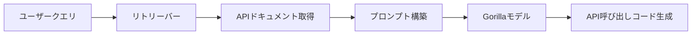

本記事は [Gorilla: Large Language Model Connected with Massive APIs](https://arxiv.org/abs/2305.15334)（NeurIPS 2024採択）の解説記事です。

## 論文概要（Abstract）

LLMが外部ツールをAPI経由で利用する能力は、AI開発環境の拡張性を左右する重要な研究課題である。Gorilla論文は、LLMがAPI呼び出しを生成する際に不正確な引数を出力し、存在しないAPIを幻覚（hallucinate）する問題に取り組んだ。著者らはLLaMA-7Bをファインチューニングし、Retriever-Aware Training（RAT）という学習手法を導入することで、ゼロショット設定でGPT-4を上回るAPI呼び出し精度を達成したと報告している。

この記事は [Zenn記事: Claude Code Skills×MCP×Hooksでプロジェクト専用AI開発環境を構築する](https://zenn.dev/0h_n0/articles/fdd8b55ae2304e) の深掘りです。

## 情報源

- **会議名**: NeurIPS 2024（Neural Information Processing Systems）
- **arXiv ID**: 2305.15334
- **URL**: [https://arxiv.org/abs/2305.15334](https://arxiv.org/abs/2305.15334)
- **著者**: Shishir G. Patil, Tianjun Zhang, Xin Wang, Joseph E. Gonzalez（UC Berkeley, Microsoft Research）
- **発表形式**: Poster

## カンファレンス情報

NeurIPSは機械学習・人工知能分野における最高峰の国際会議の一つである。Gorilla論文は2023年5月にarXivで公開された後、NeurIPS 2024にポスター発表として採択された。LLMのツール利用（tool use）は、AIエージェントが外部システムと連携する上での基盤技術であり、Claude CodeのMCP（Model Context Protocol）やSkillsといった拡張機構にも深く関わる研究領域である。

## 背景と動機（Background & Motivation）

LLMは数学的推論やプログラム合成で高い能力を示す一方、外部APIの正確な呼び出しには課題がある。著者らは、GPT-4のような当時最先端のモデルでさえ、(1) API呼び出しの引数を正しく生成できない、(2) 存在しないAPIを「幻覚」として出力する、という2つの問題を抱えていると指摘している（論文Section 1より）。

この課題はAI開発環境において実用上の大きなボトルネックとなる。たとえばMCPサーバーを通じて外部ツールを利用する場合、LLMがAPIの仕様を正確に理解し、正しい引数でツールを呼び出す能力が不可欠である。Gorilla論文はこの問題にファインチューニングとリトリーバル拡張の組み合わせでアプローチした。

## 主要な貢献（Key Contributions）

- **Gorilla**: LLaMA-7Bベースのファインチューニングモデルで、API呼び出し生成に特化。ゼロショットでGPT-4を上回る精度を達成したと報告されている（論文Table 1より）
- **Retriever-Aware Training（RAT）**: リトリーバーの出力をファインチューニング時のプロンプトに組み込む学習手法。テスト時のAPIドキュメント変更にも適応可能
- **APIBench**: TorchHub、TensorFlow Hub、HuggingFaceの3つのMLモデルハブから構築した1,645 APIのベンチマーク。各APIに対してGPT-4で10件のinstruction-APIペアを合成生成し、計11,000以上のデータペアを公開

## 技術的詳細（Technical Details）

### APIBenchベンチマークの構築

著者らは3つの主要なMLモデルハブからAPIを収集している（論文Section 3.1より）。

| ハブ | API数 | 特徴 |
|------|-------|------|
| TorchHub | 95 | PyTorchモデルのロード・推論API |
| TensorFlow Hub | 626 | TensorFlow v2モデル、フィルタリング後 |
| HuggingFace | 925 | 37ドメイン、各ドメインの上位20モデル |

各APIレコードは以下のフィールドを持つ：`domain`、`framework`、`functionality`、`api_name`、`api_call`、`api_arguments`、`environment_requirements`、`example_code`、`performance`、`description`。

学習データの生成にはSelf-Instruct手法を採用し、GPT-4を使って各APIに対して10件の自然言語instruction-APIペアを生成している。手動で作成したのは18件のみであり、残りはすべて自動合成である。

### Retriever-Aware Training（RAT）

Gorillaの学習プロセスは標準的なinstruction tuningに基づくが、リトリーバルを意識した拡張が施されている。

学習時のプロンプト構造は以下の通り：

```
<<user>>
{自然言語の指示}
Use this API documentation for reference: {取得したAPIドキュメントJSON}
<<assistant>>
{正解のAPI呼び出し}
```

著者らはこの設計意図について、「モデルに対してプロンプトの後半部分（ドキュメント）を参照して前半部分（質問）に答える能力を教える」ことにあると説明している（論文Section 3.2より）。

学習ハイパーパラメータ（論文Appendixより）：

| パラメータ | 値 |
|-----------|-----|
| 学習率 | $2 \times 10^{-5}$ |
| バッチサイズ | 64 |
| エポック数 | 5 |
| ウォームアップ比率 | 0.03 |
| Weight Decay | 0 |
| 最大系列長 | 2,048 |

ベースモデルはLLaMA-7Bであり、標準的なinstruction finetuningの損失関数（cross-entropy loss）で学習している。カスタム損失関数は使用されていない。

### 推論時のリトリーバル

推論時には、ユーザーの自然言語クエリに対してリトリーバーがAPIデータベースから最も関連するAPIドキュメントをtop-1で取得し、プロンプトに追加する。著者らはBM25およびGPT-Index（text-davinci-003ベース）の2種類のリトリーバーを評価している。



### 評価メトリクス

著者らは2つの評価軸を定義している（論文Section 4より）。

**AST部分木マッチング**: 生成されたコードをAST（抽象構文木）に変換し、API呼び出しを根とする部分木がデータベース内のいずれかのAPIと一致するかを判定する。必須引数（例: `repo_or_dir`, `model`）のみを検証し、オプション引数（例: `pretrained=True`）は評価対象外とする。

**ハルシネーション検出**: データベースに存在しないAPIの呼び出しを「ハルシネーション」として定義する。実在するAPIの引数を間違える場合は「エラー」として別途カウントされる。

## 実験結果（Results）

### ゼロショット性能比較

論文Table 1より、ゼロショット設定での精度を以下に示す。

| モデル | TorchHub (%) | HuggingFace (%) | TF Hub (%) |
|--------|-------------|-----------------|------------|
| **Gorilla (0-shot)** | **59.13** | **71.68** | **83.79** |
| GPT-4 (0-shot) | 38.70 | 19.80 | 18.20 |
| GPT-3.5 (0-shot) | 48.38 | — | — |

著者らは、GorillaがTorchHubでGPT-4より20.43ポイント、GPT-3.5より10.75ポイント高い精度を達成したと報告している。

### ハルシネーション率の比較

論文Table 1のハルシネーション列より。

| モデル | TorchHub (%) | HuggingFace (%) | TF Hub (%) |
|--------|-------------|-----------------|------------|
| **Gorilla (0-shot)** | **6.98** | **10.95** | **5.40** |
| GPT-4 (0-shot) | 36.55 | 37.16 | 78.65 |
| GPT-3.5 (0-shot) | 18.81 | — | — |

GPT-4はTensorFlow HubにおいてAPI呼び出しの78.65%がハルシネーションであるのに対し、Gorillaは5.40%に抑えている。著者らはGPT-3.5がGPT-4よりハルシネーションが少ない点について、RLHFが影響している可能性があると推察している（論文Section 5より）。

### リトリーバーの効果

Oracleリトリーバー（正解のドキュメントを与える理想的な条件）を用いた場合の結果（論文Table 1より）：

| モデル | TorchHub (%) | Hallu (%) | HuggingFace (%) | Hallu (%) |
|--------|-------------|-----------|-----------------|-----------|
| Gorilla (Oracle) | 67.20 | 0.00 | 91.26 | 7.08 |
| Gorilla (BM25) | — | — | — | 6.42 |
| Gorilla (GPT-Index) | — | 0.00 | — | — |

リトリーバル拡張の効果に関して、著者らは以下の知見を報告している：

- リトリーバーなしでファインチューニングしたモデルにテスト時のみOracleリトリーバーを追加しても、精度はほとんど改善されない
- Oracleリトリーバーを学習・テスト両方で使用した場合、TorchHubで12.37ポイント、HuggingFaceで23.46ポイントの精度向上が得られる
- 評価時にGPT-IndexやBM25のような現実的なリトリーバーを使うと、Oracleと比較して精度が低下する（GPT-Indexで29.20%低下、BM25で52.27%低下）

この結果は、「リトリーバルで拡張すれば常に性能が向上する」という単純な仮説が成り立たないことを示唆しており、学習時にリトリーバーの存在を意識させるRATの重要性を裏付けている。

## 実装のポイント（Implementation）

### API呼び出しシステムの構築

Gorillaの手法をプロダクションに適用する際の実装上の注意点を、論文の知見に基づいて整理する。

**リトリーバーの選択**: BM25は実装が簡単で計算コストが低いが、著者らの実験ではGPT-Indexに比べて精度が大きく劣る。一方、GPT-Indexはembeddingモデルの推論コストがかかる。実運用ではコストと精度のバランスを考慮する必要がある。

**API仕様のドキュメント管理**: RATの効果はAPIドキュメントの品質に依存する。各APIの仕様書をJSON形式で構造化し、バージョン管理を行うことが重要である。

```python
from typing import Any

def build_api_prompt(
    user_query: str,
    retrieved_doc: dict[str, Any],
) -> str:
    """Gorilla式のリトリーバル拡張プロンプトを構築する。

    Args:
        user_query: ユーザーの自然言語クエリ
        retrieved_doc: リトリーバーが取得したAPIドキュメント

    Returns:
        モデルに入力するプロンプト文字列
    """
    doc_json = json.dumps(retrieved_doc, ensure_ascii=False)
    return (
        f"{user_query}\n"
        f"Use this API documentation for reference: {doc_json}"
    )
```

**AST検証の実装**: 生成されたAPI呼び出しをASTで解析し、存在するAPIかどうかを事前検証するフローを組み込むことで、ハルシネーションをランタイムで防止できる。

```python
import ast

def validate_api_call(
    generated_code: str,
    known_apis: set[str],
) -> tuple[bool, str | None]:
    """生成されたコードのAPI呼び出しを検証する。

    Args:
        generated_code: モデルが生成したコード文字列
        known_apis: 既知のAPI名の集合

    Returns:
        (検証結果, エラーメッセージ or None)
    """
    try:
        tree = ast.parse(generated_code)
    except SyntaxError as e:
        return False, f"構文エラー: {e}"

    for node in ast.walk(tree):
        if isinstance(node, ast.Call):
            func_name = ast.unparse(node.func)
            if func_name not in known_apis:
                return False, f"未知のAPI: {func_name}"
    return True, None
```

## Production Deployment Guide

### AWS実装パターン（コスト最適化重視）

Gorilla的なAPI呼び出しシステム（リトリーバル + LLM生成 + AST検証）をAWS上で構築する場合の推奨構成を示す。

**トラフィック量別の推奨構成**:

| 規模 | 月間リクエスト | 推奨構成 | 月額コスト | 主要サービス |
|------|--------------|---------|-----------|------------|
| **Small** | ~3,000 (100/日) | Serverless | $50-150 | Lambda + Bedrock + OpenSearch Serverless |
| **Medium** | ~30,000 (1,000/日) | Hybrid | $400-900 | Lambda + ECS Fargate + OpenSearch |
| **Large** | 300,000+ (10,000/日) | Container | $2,500-6,000 | EKS + Karpenter + OpenSearch + EC2 Spot |

**Small構成の詳細**（月額$50-150）:
- **Lambda**: API呼び出し生成、1GB RAM、60秒タイムアウト（$20/月）
- **Bedrock**: Claude 3.5 Haiku、Prompt Caching有効（$80/月）
- **OpenSearch Serverless**: APIドキュメントのベクトル検索、0.5 OCU（$30/月）
- **DynamoDB**: API仕様キャッシュ、On-Demand（$10/月）
- **CloudWatch**: 基本監視（$5/月）

**Medium構成の詳細**（月額$400-900）:
- **ECS Fargate**: リトリーバーサービス、0.5 vCPU × 2タスク（$120/月）
- **Bedrock**: Claude 3.5 Sonnet、Batch API活用（$500/月）
- **OpenSearch**: t3.small.search × 2ノード（$80/月）
- **ElastiCache Redis**: APIドキュメントキャッシュ、cache.t3.micro（$15/月）
- **ALB**: ロードバランサー（$20/月）

**コスト削減テクニック**:
- Spot Instances使用で最大90%削減（EKS + Karpenter）
- Bedrock Batch API使用で50%削減（非リアルタイム処理）
- Prompt Caching有効化で30-90%削減（APIドキュメントのシステムプロンプト固定）
- OpenSearch Serverlessのアイドル時自動スケールダウン

**コスト試算の注意事項**:
- 上記は2026年10月時点のAWS ap-northeast-1（東京）リージョン料金に基づく概算値です
- 実際のコストはトラフィックパターン、リージョン、バースト使用量により変動します
- 最新料金は [AWS料金計算ツール](https://calculator.aws/) で確認してください

### Terraformインフラコード

**Small構成（Serverless）: Lambda + Bedrock + OpenSearch Serverless**

```hcl
module "vpc" {
  source  = "terraform-aws-modules/vpc/aws"
  version = "~> 5.0"

  name = "gorilla-api-vpc"
  cidr = "10.0.0.0/16"
  azs  = ["ap-northeast-1a", "ap-northeast-1c"]
  private_subnets = ["10.0.1.0/24", "10.0.2.0/24"]

  enable_nat_gateway   = false
  enable_dns_hostnames = true
}

resource "aws_iam_role" "lambda_api_caller" {
  name = "gorilla-lambda-role"

  assume_role_policy = jsonencode({
    Version = "2012-10-17"
    Statement = [{
      Action = "sts:AssumeRole"
      Effect = "Allow"
      Principal = { Service = "lambda.amazonaws.com" }
    }]
  })
}

resource "aws_iam_role_policy" "bedrock_invoke" {
  role = aws_iam_role.lambda_api_caller.id

  policy = jsonencode({
    Version = "2012-10-17"
    Statement = [{
      Effect   = "Allow"
      Action   = ["bedrock:InvokeModel", "bedrock:InvokeModelWithResponseStream"]
      Resource = "arn:aws:bedrock:ap-northeast-1::foundation-model/anthropic.claude-3-5-haiku*"
    }]
  })
}

resource "aws_lambda_function" "api_call_generator" {
  filename      = "lambda.zip"
  function_name = "gorilla-api-generator"
  role          = aws_iam_role.lambda_api_caller.arn
  handler       = "index.handler"
  runtime       = "python3.12"
  timeout       = 60
  memory_size   = 1024

  environment {
    variables = {
      BEDROCK_MODEL_ID    = "anthropic.claude-3-5-haiku-20241022-v1:0"
      OPENSEARCH_ENDPOINT = aws_opensearchserverless_collection.api_docs.collection_endpoint
      DYNAMODB_TABLE      = aws_dynamodb_table.api_cache.name
    }
  }
}

resource "aws_dynamodb_table" "api_cache" {
  name         = "gorilla-api-cache"
  billing_mode = "PAY_PER_REQUEST"
  hash_key     = "api_hash"

  attribute {
    name = "api_hash"
    type = "S"
  }

  ttl {
    attribute_name = "expire_at"
    enabled        = true
  }
}

resource "aws_cloudwatch_metric_alarm" "lambda_errors" {
  alarm_name          = "gorilla-lambda-errors"
  comparison_operator = "GreaterThanThreshold"
  evaluation_periods  = 1
  metric_name         = "Errors"
  namespace           = "AWS/Lambda"
  period              = 300
  statistic           = "Sum"
  threshold           = 5
  alarm_description   = "Lambda関数エラー率異常"

  dimensions = {
    FunctionName = aws_lambda_function.api_call_generator.function_name
  }
}
```

**Large構成（Container）**: EKS + Karpenter + OpenSearchの構成では、`terraform-aws-modules/eks/aws ~> 20.0`でEKSクラスタ（v1.31）を構築し、Karpenter ProvisionerでSpot Instances（m6i.xlarge/2xlarge）を自動管理する。`ttlSecondsAfterEmpty: 30`でアイドル時の自動スケールダウンを実現し、AWS Budgetsで月額$6,000の予算アラートを設定する。

### セキュリティベストプラクティス

1. **ネットワーク**: EKSは`cluster_endpoint_public_access = false`推奨（VPN経由）。Lambda はVPC内配置
2. **認証**: IAMロール最小権限。Bedrock呼び出しは特定モデルIDのみ許可
3. **シークレット**: AWS Secrets Manager使用。API キーのハードコード禁止
4. **暗号化**: S3/DynamoDB/OpenSearch全てKMS暗号化。転送中はTLS 1.2以上
5. **監査**: CloudTrail全リージョン有効化。GuardDuty脅威検知

### 運用・監視設定

**CloudWatch Logs Insights クエリ**:

```sql
-- API呼び出し生成のレイテンシ分析
fields @timestamp, duration_ms, api_name, retriever_type
| stats pct(duration_ms, 95) as p95, pct(duration_ms, 99) as p99 by bin(5m)

-- ハルシネーション検出率の監視
fields @timestamp, is_hallucination, api_name
| stats sum(is_hallucination) as hallu_count, count(*) as total by bin(1h)
| filter hallu_count > 10
```

**CloudWatch アラーム**: `put_metric_alarm`でカスタム名前空間`Custom/GorillaAPI`にハルシネーション率のメトリクスを送信し、閾値10%超過でSNS通知する。

**X-Ray トレーシング**: `aws_xray_sdk`の`patch_all()`でboto3を自動計装し、`@xray_recorder.capture`デコレータでリトリーバー種別・クエリ長・トークン数をアノテーション/メタデータとして記録する。

**Cost Explorer自動レポート**: `boto3.client('ce').get_cost_and_usage()`で日次コストをサービス別に取得し、$100/日を超えるサービスがあればSNS通知を発火する構成を推奨する。

### コスト最適化チェックリスト

**アーキテクチャ選択**: ~100 req/日はServerless ($50-150/月)、~1,000 req/日はHybrid ($400-900/月)、10,000+ req/日はContainer ($2,500-6,000/月)。

**リソース最適化**: Spot Instances優先（最大90%削減）、Reserved 1年コミット（最大72%削減）、Lambda メモリ最適化、アイドル時スケールダウン。

**LLMコスト削減**: Batch API（50%割引）、Prompt Caching（30-90%削減）、モデル選択ロジック（HaikuとSonnet使い分け）、max_tokens制限。

**監視**: AWS Budgets（80%警告）、CloudWatch（ハルシネーション率監視）、Cost Anomaly Detection、日次コストレポート。

**リソース管理**: Trusted Advisorで未使用リソース削除、タグ戦略、OpenSearch/DynamoDB自動クリーンアップ。

## 実運用への応用（Practical Applications）

Gorilla論文の知見は、AIエージェントが外部ツールと連携するシステム全般に応用可能である。

**MCPサーバーとの関連**: Claude CodeのMCPは、外部ツール・データソースへの標準プロトコルである。Gorilla論文が示した「APIドキュメントをリトリーバルで取得し、LLMに正確な呼び出しを生成させる」パターンは、MCPサーバーのツール仕様をLLMに提示する仕組みと本質的に同じ構造を持つ。

**ハルシネーション抑制の応用**: GPT-4のTF Hub APIにおけるハルシネーション率78.65%（論文Table 1より）は、適切なドキュメント提示なしにLLMにAPI呼び出しを生成させることの危険性を示している。MCPのツール定義（JSON Schema形式）やSkillsのallowed-tools制約は、まさにこの課題への実務的な対策である。

**スケーリング**: 1,645 APIのベンチマークは、大規模なAPIエコシステムにおけるtool useの実用性を示しているが、著者らも指摘するように対象はML APIに限定されている。汎用API（REST API、データベースクエリ等）への拡張は今後の課題である。

## 関連研究（Related Work）

- **ToolACE**（ICLR 2025）: 自動的にfunction calling学習データを生成するパイプライン。Gorilla がSelf-Instructで合成データを作成した手法を、マルチエージェントによる対話生成と二層検証で拡張している
- **Berkeley Function Calling Leaderboard（BFCL）**: Gorilla プロジェクトから発展した function calling の標準ベンチマーク。ICML 2025 に採択されており、複数モデルのtool use性能を継続的に追跡している
- **SWE-agent**（NeurIPS 2024）: LLMがソフトウェアエンジニアリングタスクを自律実行するための Agent-Computer Interface を提案。Gorillaの「LLMとツールの接続」というテーマを、コードリポジトリ全体の操作に拡張している

## 制約と限界

著者らは以下の制約を論文中で認めている（論文Section 6, Limitationsより）：

- **対象がML APIに限定**: TorchHub、TensorFlow Hub、HuggingFaceのMLモデルハブのみが対象。汎用のREST APIやデータベースクエリには評価されていない
- **コード例の実行テスト未実施**: データセット中のコード例は実際に実行して検証されていない。生成されたAPI呼び出しの実行時エラーは評価に含まれていない
- **MLモデルのバイアス**: データセット中のAPIはMLモデルのロード・推論に関するものであり、これらのモデル自体がバイアスを含む可能性がある
- **学習データの合成**: instruction-APIペアの大部分がGPT-4による自動生成であり、Self-Instructの品質上限に依存する

## まとめと今後の展望

Gorilla論文は、LLMのAPI呼び出し生成におけるハルシネーション問題に対して、Retriever-Aware Trainingという実践的なアプローチを提示した。7Bパラメータのモデルがゼロショットでのapi呼び出し精度においてGPT-4を上回るという結果（論文Table 1より）は、ファインチューニングとリトリーバル拡張の組み合わせの有効性を示している。

この研究はBerkeley Function Calling Leaderboardへと発展し、LLMのtool use能力の標準的な評価基盤となっている。Claude CodeにおけるMCPやSkillsの仕組みは、Gorillaが開拓した「LLMと外部ツールの正確な接続」という研究課題の実務的な実装であり、今後もこの分野の進展が開発者体験に直接的な影響を与えると考えられる。

## 参考文献

- **Conference URL**: [https://neurips.cc/virtual/2024/poster/93353](https://neurips.cc/virtual/2024/poster/93353)
- **arXiv**: [https://arxiv.org/abs/2305.15334](https://arxiv.org/abs/2305.15334)
- **Code / Project**: [https://gorilla.cs.berkeley.edu/](https://gorilla.cs.berkeley.edu/)
- **Related Zenn article**: [https://zenn.dev/0h_n0/articles/fdd8b55ae2304e](https://zenn.dev/0h_n0/articles/fdd8b55ae2304e)

---

*この記事はAI（Claude Code）により自動生成されました。内容の正確性については論文原文で検証していますが、数値の引用元は論文Table番号で明示しています。詳細は原論文をご確認ください。*
