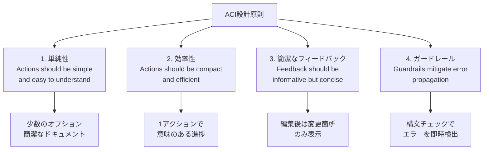

## 論文概要（Abstract）

本記事は [https://arxiv.org/abs/2405.15793](https://arxiv.org/abs/2405.15793)（NeurIPS 2024採択）の解説記事です。

SWE-agent は、言語モデル（LM）エージェント専用の**エージェント・コンピュータ・インターフェース（Agent-Computer Interface, ACI）**を設計し、ソフトウェアエンジニアリングタスクの自動化性能を大幅に改善したシステムである。著者らは、LMエージェントが人間とは異なるニーズと能力を持つ「新しいカテゴリのエンドユーザー」であるとの仮説に基づき、ファイルの作成・編集、リポジトリ全体のナビゲーション、テスト実行を支援するカスタムインターフェースを設計した。論文Table 1によれば、SWE-benchで12.47%（Liteでは18.00%）、HumanEvalFixでPython 87.7%のpass@1を達成し、当時の非対話型LMの性能を大幅に上回った。

この記事は [Zenn記事: Claude Code Skills×MCP×Hooksでプロジェクト専用AI開発環境を構築する](https://zenn.dev/0h_n0/articles/fdd8b55ae2304e) の深掘りです。

## 情報源

- **会議名**: NeurIPS 2024（Neural Information Processing Systems, Vancouver, 2024年12月）
- **年**: 2024
- **URL**: [https://arxiv.org/abs/2405.15793](https://arxiv.org/abs/2405.15793)
- **著者**: John Yang, Carlos E. Jimenez（共同筆頭）, Alexander Wettig, Kilian Lieret, Shunyu Yao, Karthik Narasimhan, Ofir Press（Princeton Language and Intelligence, Princeton University）
- **分野**: cs.SE, cs.AI, cs.CL, cs.HC, cs.LG
- **ライセンス**: CC BY 4.0
- **実装**: [swe-agent.com](https://swe-agent.com), [github.com/princeton-nlp/SWE-agent](https://github.com/princeton-nlp/SWE-agent)（MIT License）

## カンファレンス情報

NeurIPS（Neural Information Processing Systems）は機械学習・人工知能分野の最高峰会議の一つであり、毎年1万件以上の投稿がある。2024年はバンクーバーで開催された。SWE-agentは、LMエージェントのインターフェース設計という新しい研究方向を提示し、ソフトウェアエンジニアリングにおけるエージェント応用の実践的な成果を示した点が評価されたと考えられる。

## 背景と動機（Background & Motivation）

LMエージェントは、コード補完・バグ修正・テスト生成など多様なソフトウェアエンジニアリングタスクへの応用が進んでいる。しかし、従来のアプローチには2つの問題があった。

**非対話型手法の限界**: 従来のRAG（Retrieval-Augmented Generation）ベースの手法では、BM25などで検索したファイルをコンテキストに含め、モデルに直接パッチを生成させる。この手法は安価（論文Table 1より平均$0.13/インスタンス）だが、SWE-benchでの解決率はGPT-4 Turboで1.31%にとどまる。リポジトリ全体の文脈を把握できず、試行錯誤が不可能なことが根本的な制約である。

**汎用シェルの非効率性**: Linuxシェルをそのまま使うエージェント（Shell-only）は対話的だが、bashコマンドの多くは数十のオプションを持ち、LMにとって複雑すぎる。また、ファイル全体の表示やgrep結果の洪水がコンテキストウィンドウを圧迫し、性能低下を招く。

著者らは、人間がIDE（統合開発環境）の恩恵を受けるように、LMエージェントにも専用のインターフェースが必要であると主張している。重要なのは、GUIベースのIDEはLMが操作できないため、IDEの有用な機能（シンタックスチェック、ナビゲーション等）をテキストベースのコマンドとして再設計する必要がある点である。

## 主要な貢献（Key Contributions）

- **ACI（Agent-Computer Interface）の概念定義**: LMエージェントを「新しいカテゴリのエンドユーザー」と位置づけ、エージェント専用のインターフェース設計という研究方向を確立した
- **4つの設計原則の提示**: 実験に基づくインターフェース設計のガイドラインを体系化した
- **SWE-benchでの当時のSOTA達成**: GPT-4 Turboを用いてSWE-bench 12.47%、SWE-bench Lite 18.00%を達成（論文Table 1より）
- **HumanEvalFixでの大幅改善**: Python 87.7%のpass@1を達成し、WaveCoderの57.9%を約30ポイント上回った（論文Table 2より）
- **設計判断のアブレーション分析**: 各インターフェースコンポーネントの寄与を定量的に示した

## 技術的詳細（Technical Details）

### ACIの4つの設計原則

著者らは、開発セット（225インスタンス）での手動検査とグリッドサーチに基づき、以下の4原則を導出している。



**原則1: 単純性（Simplicity）** — bashコマンドの多くは数十のオプションを持つ。LMにとっては、オプションが少なく簡潔なドキュメントを持つコマンドの方が、デモンストレーションやファインチューニングなしで使いやすい。

**原則2: 効率性（Efficiency）** — ナビゲーションや編集など頻繁な操作を統合し、1アクションで意味のある進捗が得られるようにする。これによりターン数が減り、コンテキストウィンドウの消費を抑制できる。

**原則3: 簡潔なフィードバック（Concise Feedback）** — 人間は無関係な情報を無視できるが、LMにとってはすべてのコンテキストに固定コストがかかる。不要な情報は性能を低下させるため、フィードバックは必要最小限の情報に絞る。

**原則4: ガードレール（Guardrails）** — エラーの連鎖を防ぎ、回復を促進する仕組みを組み込む。例えば、編集時にリンターを実行し、構文エラーを即座に検出して無効な編集を破棄する。

### ACIの4つのコンポーネント

ACIは以下の4コンポーネントで構成される。ReAct（Reasoning + Acting）スタイルで、各ステップでエージェントは思考（thought）とアクション（action）を生成する。標準的なLinuxコマンドも引き続き利用可能である。

#### 1. 検索・ナビゲーション

3つの専用コマンドを導入している。

| コマンド | 説明 | 設計意図 |
|---------|------|---------|
| `find_file <name> [<dir>]` | ファイル名でリポジトリを検索 | ディレクトリ構造の把握 |
| `search_file <term> [<file>]` | ファイル内のテキスト検索 | 関連コードの特定 |
| `search_dir <term> [<dir>]` | ディレクトリ全体のテキスト検索 | 横断的なシンボル検索 |

検索結果は最大50件に制限される。これを超える場合は結果を非表示にし、「より具体的なクエリを使ってください」と促す。この設計は原則3（簡潔なフィードバック）に基づく。

著者らのアブレーション分析（論文Table 3より）では、逐次的な検索（IDEのように1件ずつ結果を表示する方式）は、検索コマンドなしの場合よりもかえって性能が低下した（12.0% vs 15.7%）。著者らは、エージェントが全件を網羅的に確認しようとして予算やコンテキストを使い果たすためと分析している。

#### 2. ファイルビューア

`open`コマンドで最大100行のウィンドウを表示し、`scroll_down`、`scroll_up`、`goto <line>`で移動する。表示には、ファイルのフルパス、総行数、省略された行数（上下）、行番号が含まれる。

アブレーション（論文Table 3より）では、ウィンドウサイズの影響が顕著である。

| ウィンドウサイズ | SWE-bench Lite 解決率 |
|---------------|---------------------|
| 30行 | 14.3%（-3.7） |
| 100行（採用） | 18.0% |
| ファイル全体 | 12.7%（-5.3） |

ファイル全体の表示は、30行ウィンドウよりもさらに悪い結果となった。コンテキストウィンドウが古いファイル内容で埋まり、エージェントの判断が阻害されるためと著者らは説明している。

#### 3. ファイルエディタ

`edit`コマンドは3つの必須引数（開始行、終了行、置換テキスト）を取る。編集後はビューアが自動更新され、変更箇所が確認できる。

**リンター・ガードレール**: 編集のたびにflake8が実行される（`flake8 --isolated --select=F821,F822,F831,E111,E112,E113,E999,E902`）。構文エラーが検出された場合、編集は破棄され、エージェントに再試行を促す。

このガードレールの効果は明確で、論文Table 3よりリンターなしでは解決率が18.0%から15.0%に低下する。editコマンド自体を除去すると10.3%まで低下し、-7.7ポイントの最大のドロップとなる。

#### 4. コンテキスト管理

LMのコンテキストウィンドウは有限であるため、以下の工夫が施されている。

- **不正な出力のリトライ**: 不正な形式の出力が生成された場合、リトライメッセージを表示する。最初のエラーメッセージのみを保持する
- **履歴の圧縮**: 直近5回の観測のみ全文を保持し、それ以前は1行に要約する
- **予算制約**: 1インスタンスあたり$4の予算上限。著者らの報告では、おおよそ30〜40ターンに相当する

アブレーション（論文Table 3より）では、全履歴を保持する方式は18.0%から15.0%に低下する。著者らは、古いファイル内容がコンテキストに残ると、エージェントが最新の状態を把握できなくなるためと分析している。

### 推論アルゴリズム

エージェントの推論フローは以下の通りである。

```python
def swe_agent_loop(issue: str, repo: str, budget: float = 4.0) -> str:
    """SWE-agentの推論ループ

    Args:
        issue: GitHub Issueの記述
        repo: 対象リポジトリ
        budget: API呼び出し予算（USD）

    Returns:
        生成されたパッチ（git diff形式）
    """
    env = ACIEnvironment(repo)
    history: list[tuple[str, str, str]] = []
    cost = 0.0

    while cost < budget:
        # 直近5観測のみ全文、それ以前は要約
        context = compress_history(history, keep_last=5)

        # ReActスタイル: thought + action
        thought, action = lm.generate(
            system_prompt=ACI_DOCUMENTATION,
            user_message=issue,
            history=context,
        )

        # アクション実行
        observation = env.execute(action)

        # リンター・ガードレール（edit時）
        if action.startswith("edit") and env.lint_failed:
            observation = "Edit failed lint check. Please fix and retry."
            env.revert_last_edit()

        history.append((thought, action, observation))
        cost += lm.last_call_cost

        if action == "submit":
            return env.generate_patch()

    return env.generate_patch()
```

著者らの報告では、エージェントの典型的な行動パターンは以下の2フェーズに分かれる。

1. **再現・局所化フェーズ**: `find_file`や`search_dir`でバグの位置を特定し、再現スクリプトを作成・実行する
2. **編集・検証フェーズ**: `edit`でコードを修正し、`python`でテストを実行する反復ループ

## 実験結果（Results）

### SWE-bench

論文Table 1より、主要な結果を示す。

| 手法 | モデル | SWE-bench 解決率 | 平均コスト | Lite 解決率 | 平均コスト |
|------|-------|-----------------|-----------|------------|-----------|
| RAG | GPT-4 Turbo | 1.31% | $0.13 | 2.67% | $0.13 |
| RAG | Claude 3 Opus | 3.79% | $0.25 | 4.33% | $0.25 |
| Shell-only | GPT-4 Turbo | — | — | 11.00% | $1.46 |
| Shell-only (デモなし) | GPT-4 Turbo | — | — | 7.33% | $0.79 |
| **SWE-agent** | **GPT-4 Turbo** | **12.47%** | **$1.59** | **18.00%** | **$1.67** |
| SWE-agent | Claude 3 Opus | 10.46% | $2.59 | 13.00% | $2.18 |

RAGとの比較では、SWE-agentはLiteで6.7倍の解決率改善を達成している。ただしコストは8〜13倍高い。Shell-onlyとの比較では、同じGPT-4 Turboを用い、ACIの追加のみで11.00%から18.00%への64%の相対改善が得られている。

**コスト分析**: 成功した実行の中央値は$1.21・12ステップ、失敗した実行の平均値は$2.52・21ステップであった。解決されたインスタンスの93.0%は予算を使い切る前に提出されたのに対し、全体では69.0%であった。著者らは、予算の引き上げによる大幅な改善は見込めないと分析している。

**再現性**: 論文の報告では、SWE-bench Liteで6回の実行を行い、平均17.94% ± 0.49%の解決率を得ている。pass@6では32.67%に達する。

### HumanEvalFix

論文Table 2より、短形式のコードデバッグベンチマークの結果を示す。

| モデル | Python | JavaScript | Java |
|-------|--------|-----------|------|
| CodeLLaMa-instruct-13B | 29.2% | 19.5% | 32.3% |
| GPT-4 | 47.0% | 48.2% | 50.0% |
| WaveCoder-DS-6.7B | 57.9% | 52.4% | 57.3% |
| **SWE-agent + GPT-4 Turbo** | **87.7%** | **89.7%** | **87.9%** |

非対話型のGPT-4（47.0%）と比較して、SWE-agentは40ポイント以上の改善を達成している。特にJavaScriptでは89.7%と最も高い数値を示している。

### 失敗分析

著者らはGPT-4oによる自動ラベリング（人間との一致率87%）で失敗原因を分析している。SWE-bench Liteの未解決248インスタンスについて、約52%が不正確またはオーバーフィットした実装、23.4%がカスケードする編集失敗であった。

編集の成功率について、全テストインスタンスの51.7%（185/294）で少なくとも1回の編集失敗が発生する。1回の失敗後の最終的な成功率は57.2%に低下するが、何度かの再試行を含めれば90.5%のケースで最終的に編集が成功する。

### 制約と限界

- **Python限定**: SWE-benchおよび本論文のACI実装はPythonリポジトリのみを対象としている
- **コスト**: 1インスタンスあたり平均$1.59（成功時$1.21）であり、大量のIssueを処理する場合のコスト効率には課題がある
- **局所化の精度**: F1スコアは59.05%にとどまる（BM25 + Claude 3 Opusの45.47%よりは高い）
- **オープンソースLMでの検証不足**: Llama 3やDeepSeek Coderでは「subpar（標準以下）」の結果であったと報告されており、大規模クローズドモデルへの依存が大きい
- **実行テストの不実施**: APIBenchのデータセットにおけるコード例は実行テストされていないと報告されている

## 実装のポイント（Implementation）

### ACIコマンド設計のポイント

SWE-agentのACI実装で注目すべきは、**情報量の制御**が一貫した設計テーマとなっている点である。

1. **検索結果の上限50件**: 結果が多すぎる場合は結果自体を非表示にする。「結果なし」ではなく「絞り込みを促す」メッセージを返す
2. **ファイルビューア100行**: 全体表示は逆効果であることが実証されている（論文Table 3より12.7% vs 18.0%）
3. **履歴の5観測保持**: 古い情報の蓄積を防ぐ。LMにとってのコンテキストウィンドウ汚染は、人間にとっての情報過多よりも深刻である
4. **リンターの限定的なルールセット**: flake8の全ルールではなく、F821（未定義名）、E999（構文エラー）等の致命的エラーのみを対象とする

### Claude CodeのHooksとの関連

SWE-agentのACI設計原則は、Zenn記事で解説されているClaude CodeのHooksシステムと対応関係がある。

| SWE-agent ACI | Claude Code Hooks |
|--------------|-------------------|
| リンター・ガードレール | PreToolUse Hook（コマンド検証） |
| 不正出力のリトライ | PostToolUse Hook（自動Lint） |
| 検索結果の上限制御 | additionalContextによるフィードバック |
| 情報量の制御 | matcherによるツール限定 |

両者に共通するのは、「エージェントの行動を制約する仕組みが性能を向上させる」という知見である。SWE-agentはこれを研究論文として定量的に実証し、Claude Codeはプロダクション環境で実装している。

## Production Deployment Guide

SWE-agentのACI設計パターンを自社のコーディングエージェントに応用する際のAWSデプロイ構成を示す。

### AWS実装パターン（コスト最適化重視）

**トラフィック量別の推奨構成**:

| 規模 | 月間リクエスト | 推奨構成 | 月額コスト | 主要サービス |
|------|--------------|---------|-----------|------------|
| **Small** | ~3,000 (100/日) | Serverless | $80-200 | Lambda + Bedrock + DynamoDB |
| **Medium** | ~30,000 (1,000/日) | Hybrid | $500-1,200 | Lambda + ECS Fargate + ElastiCache |
| **Large** | 300,000+ (10,000/日) | Container | $3,000-8,000 | EKS + Karpenter + EC2 Spot |

**Small構成の詳細**（月額$80-200）:
- **Lambda**: 2GB RAM, 120秒タイムアウト（エージェントの対話ループに対応）（$30/月）
- **Bedrock**: Claude 3.5 Haiku（各ターンのLM呼び出し）、Prompt Caching有効（$100/月）
- **DynamoDB**: On-Demand, リポジトリコンテキストのキャッシュ（$15/月）
- **S3**: リポジトリスナップショットとパッチの保存（$10/月）
- **CloudWatch**: 基本監視（$5/月）

**Medium構成の詳細**（月額$500-1,200）:
- **ECS Fargate**: 1 vCPU, 4GB RAM × 4タスク（Git操作とリンター実行用）（$200/月）
- **Lambda**: イベントトリガーとオーケストレーション（$50/月）
- **Bedrock**: Claude 3.5 Sonnet, Batch API活用（$600/月）
- **ElastiCache Redis**: リポジトリインデックスキャッシュ, cache.t3.small（$30/月）
- **CodeBuild**: サンドボックス環境でのコード実行（$50/月）

**Large構成の詳細**（月額$3,000-8,000）:
- **EKS**: コントロールプレーン + Karpenter自動スケーリング（$72/月）
- **EC2 Spot Instances**: c6i.2xlarge × 4-8台（コード実行・リンター用）（$400/月, Spot割引後）
- **Bedrock**: Claude 3.5 Sonnet, Batch API + Prompt Caching（$4,000/月）
- **ECR**: コンテナイメージ管理（$10/月）
- **S3 + CloudFront**: パッチ配信とリポジトリアーカイブ（$50/月）

**コスト削減テクニック**:
- Spot Instances使用で最大90%削減（Karpenter自動管理）
- Bedrock Batch API使用で50%削減（非リアルタイム処理のバッチ化）
- Prompt Caching有効化で30-90%削減（ACIドキュメントはシステムプロンプトとして固定）
- リポジトリインデックスのキャッシュで重複検索を排除

**コスト試算の注意事項**:
- 上記は2026年10月時点のAWS ap-northeast-1（東京）リージョン料金に基づく概算値です
- Bedrockの料金はモデルやトークン使用量により大幅に変動します
- 最新料金は [AWS料金計算ツール](https://calculator.aws/) で確認してください

### Terraformインフラコード

**Small構成 (Serverless): Lambda + Bedrock + DynamoDB**

```hcl
module "vpc" {
  source  = "terraform-aws-modules/vpc/aws"
  version = "~> 5.0"

  name = "swe-agent-vpc"
  cidr = "10.0.0.0/16"
  azs  = ["ap-northeast-1a", "ap-northeast-1c"]
  private_subnets = ["10.0.1.0/24", "10.0.2.0/24"]

  enable_nat_gateway   = false
  enable_dns_hostnames = true
}

resource "aws_iam_role" "lambda_swe_agent" {
  name = "lambda-swe-agent-role"

  assume_role_policy = jsonencode({
    Version = "2012-10-17"
    Statement = [{
      Action = "sts:AssumeRole"
      Effect = "Allow"
      Principal = { Service = "lambda.amazonaws.com" }
    }]
  })
}

resource "aws_iam_role_policy" "bedrock_invoke" {
  role = aws_iam_role.lambda_swe_agent.id

  policy = jsonencode({
    Version = "2012-10-17"
    Statement = [{
      Effect   = "Allow"
      Action   = ["bedrock:InvokeModel", "bedrock:InvokeModelWithResponseStream"]
      Resource = "arn:aws:bedrock:ap-northeast-1::foundation-model/anthropic.claude-3-5-haiku*"
    }]
  })
}

resource "aws_lambda_function" "swe_agent_handler" {
  filename      = "lambda.zip"
  function_name = "swe-agent-handler"
  role          = aws_iam_role.lambda_swe_agent.arn
  handler       = "index.handler"
  runtime       = "python3.12"
  timeout       = 120
  memory_size   = 2048

  environment {
    variables = {
      BEDROCK_MODEL_ID    = "anthropic.claude-3-5-haiku-20241022-v1:0"
      DYNAMODB_TABLE      = aws_dynamodb_table.repo_cache.name
      ACI_WINDOW_SIZE     = "100"
      ACI_SEARCH_LIMIT    = "50"
      ACI_HISTORY_KEEP    = "5"
      ENABLE_PROMPT_CACHE = "true"
    }
  }
}

resource "aws_dynamodb_table" "repo_cache" {
  name         = "swe-agent-repo-cache"
  billing_mode = "PAY_PER_REQUEST"
  hash_key     = "repo_hash"

  attribute {
    name = "repo_hash"
    type = "S"
  }

  ttl {
    attribute_name = "expire_at"
    enabled        = true
  }
}

resource "aws_cloudwatch_metric_alarm" "lambda_cost" {
  alarm_name          = "swe-agent-cost-spike"
  comparison_operator = "GreaterThanThreshold"
  evaluation_periods  = 1
  metric_name         = "Duration"
  namespace           = "AWS/Lambda"
  period              = 3600
  statistic           = "Sum"
  threshold           = 300000
  alarm_description   = "SWE-agentのLambda実行時間異常（コスト急増の可能性）"

  dimensions = {
    FunctionName = aws_lambda_function.swe_agent_handler.function_name
  }
}
```

**Large構成 (Container): EKS + Karpenter + Spot Instances**

```hcl
module "eks" {
  source  = "terraform-aws-modules/eks/aws"
  version = "~> 20.0"

  cluster_name    = "swe-agent-cluster"
  cluster_version = "1.31"

  vpc_id     = module.vpc.vpc_id
  subnet_ids = module.vpc.private_subnets

  cluster_endpoint_public_access = true
  enable_cluster_creator_admin_permissions = true
}

resource "kubectl_manifest" "karpenter_provisioner" {
  yaml_body = <<-YAML
    apiVersion: karpenter.sh/v1alpha5
    kind: Provisioner
    metadata:
      name: swe-agent-spot
    spec:
      requirements:
        - key: karpenter.sh/capacity-type
          operator: In
          values: ["spot"]
        - key: node.kubernetes.io/instance-type
          operator: In
          values: ["c6i.2xlarge", "c6i.4xlarge"]
      limits:
        resources:
          cpu: "64"
          memory: "256Gi"
      providerRef:
        name: default
      ttlSecondsAfterEmpty: 60
  YAML
}

resource "aws_secretsmanager_secret" "bedrock_config" {
  name = "swe-agent-bedrock-config"
}

resource "aws_secretsmanager_secret_version" "bedrock_config" {
  secret_id = aws_secretsmanager_secret.bedrock_config.id
  secret_string = jsonencode({
    model_id = "anthropic.claude-3-5-sonnet-20241022-v2:0"
    region   = "ap-northeast-1"
  })
}

resource "aws_budgets_budget" "swe_agent_monthly" {
  name         = "swe-agent-monthly-budget"
  budget_type  = "COST"
  limit_amount = "8000"
  limit_unit   = "USD"
  time_unit    = "MONTHLY"

  notification {
    comparison_operator        = "GREATER_THAN"
    threshold                  = 80
    threshold_type             = "PERCENTAGE"
    notification_type          = "ACTUAL"
    subscriber_email_addresses = ["ops@example.com"]
  }
}
```

### セキュリティベストプラクティス

SWE-agentのようなコード実行エージェントは、特にセキュリティ上の配慮が必要である。

1. **コード実行のサンドボックス化**: エージェントが生成・実行するコードは、ネットワーク隔離されたコンテナ内で実行する。SWE-agent論文ではこの点の詳細な議論はないが、プロダクション環境では必須
2. **IAMロール最小権限**: Bedrock呼び出しとDynamoDBアクセスのみ許可し、他のAWSサービスへのアクセスを制限
3. **リポジトリアクセス制御**: エージェントがアクセスするリポジトリをホワイトリスト方式で管理
4. **シークレット管理**: AWS Secrets Manager使用、環境変数へのハードコード禁止
5. **監査ログ**: CloudTrailによる全API呼び出しの記録

### 運用・監視設定

**CloudWatch Logs Insights クエリ**:

```sql
-- エージェントのターン数とコスト分析
fields @timestamp, instance_id, num_turns, total_cost, resolved
| stats avg(num_turns) as avg_turns, avg(total_cost) as avg_cost,
        sum(resolved) as resolved_count by bin(1h)
| filter total_cost > 2.0

-- リンター・ガードレールの発火率
fields @timestamp, action_type, lint_failed
| filter action_type = "edit"
| stats count(*) as total_edits,
        sum(lint_failed) as lint_failures by bin(1h)
```

**CloudWatch アラーム（コスト重視）**:

```python
import boto3

cloudwatch = boto3.client('cloudwatch')

cloudwatch.put_metric_alarm(
    AlarmName='swe-agent-bedrock-token-spike',
    ComparisonOperator='GreaterThanThreshold',
    EvaluationPeriods=1,
    MetricName='TokenUsage',
    Namespace='Custom/SWEAgent',
    Period=3600,
    Statistic='Sum',
    Threshold=1000000,
    ActionsEnabled=True,
    AlarmActions=['arn:aws:sns:ap-northeast-1:123456789:cost-alerts'],
    AlarmDescription='SWE-agentのトークン使用量異常'
)
```

**X-Ray トレーシング設定**:

```python
from aws_xray_sdk.core import xray_recorder, patch_all

patch_all()

@xray_recorder.capture('swe_agent_turn')
def execute_agent_turn(thought: str, action: str) -> str:
    xray_recorder.put_annotation('action_type', action.split()[0])
    xray_recorder.put_metadata('thought_length', len(thought))

    observation = env.execute(action)

    xray_recorder.put_metadata('observation_length', len(observation))
    xray_recorder.put_annotation('lint_failed', str(env.lint_failed))
    return observation
```

### コスト最適化チェックリスト

**アーキテクチャ選択（トラフィック量で判断）**:
- [ ] ~100 req/日 → Lambda + Bedrock（Serverless）- $80-200/月
- [ ] ~1,000 req/日 → ECS Fargate + Bedrock（Hybrid）- $500-1,200/月
- [ ] 10,000+ req/日 → EKS + Spot（Container）- $3,000-8,000/月

**リソース最適化**:
- [ ] EC2: Spot Instances優先（Karpenter自動管理、最大90%削減）
- [ ] Lambda: メモリサイズ最適化（SWE-agentは2GB推奨）
- [ ] ECS/EKS: アイドルタイムのスケールダウン（夜間0台）
- [ ] Reserved Instances: 1年コミットで最大72%削減（予測可能な負荷の場合）
- [ ] Savings Plans: Compute Savings Plans検討（柔軟性高）

**LLMコスト削減**:
- [ ] Bedrock Batch API: 50%割引（非リアルタイムのバグ修正処理）
- [ ] Prompt Caching: ACIドキュメント（システムプロンプト）の固定で30-90%削減
- [ ] モデル選択ロジック: 簡易タスク→Haiku、複雑タスク→Sonnet
- [ ] ターン数制限: SWE-agentの予算制約（$4/インスタンス）をAWS上でも適用
- [ ] コンテキスト圧縮: 直近5観測保持の設計でトークン消費を抑制

**監視・アラート**:
- [ ] AWS Budgets: 月額予算設定（80%で警告、100%でアラート）
- [ ] CloudWatch アラーム: トークン使用量・ターン数のスパイク検知
- [ ] Cost Anomaly Detection: 機械学習ベースの自動異常検知
- [ ] 日次コストレポート: SNS/Slackへの自動送信

**リソース管理**:
- [ ] 未使用リソース削除: Lambda Insights, Trusted Advisor活用
- [ ] タグ戦略: 環境別（dev/staging/prod）、リポジトリ別でコスト可視化
- [ ] S3ライフサイクル: 古いリポジトリスナップショットの自動削除（30日）
- [ ] 開発環境: 夜間停止（ECS/EKS Auto Scaling to Zero）

## 実運用への応用（Practical Applications）

SWE-agentのACI設計は、Claude Code SkillsやHooksの設計と共通する思想を持つ。実務への応用として以下が考えられる。

**カスタムACIの構築**: 自社のコーディング規約やアーキテクチャに合わせたカスタムコマンドセットを定義し、Claude CodeのSkillsとして実装する。SWE-agentの知見に基づけば、コマンドはシンプルで、フィードバックは簡潔に、そしてガードレールを組み込むべきである。

**リンター・ガードレールの導入**: SWE-agentの実験で+3ポイントの改善が確認されているリンター・ガードレールは、Claude CodeのPreToolUse Hookとして直接実装できる。flake8に限らず、ESLint（TypeScript）やclippy（Rust）なども同様のパターンで適用可能。

**情報量制御の設計**: ファイル全体表示（12.7%）が100行ウィンドウ（18.0%）より悪い結果となった知見は、MCPサーバーのレスポンス設計にも応用できる。外部データソースからの応答を適切にページネーションし、エージェントのコンテキストを保護する設計が有効である。

**コスト最適化**: 成功時$1.21・失敗時$2.52というコスト構造は、エージェントの早期中断や段階的な複雑度のタスク割り当てが有効であることを示唆している。

## 関連研究（Related Work）

- **InterCode** (Yang et al., 2024): Linuxシェルを使ったインタラクティブコード実行フレームワーク。SWE-agentのShell-onlyベースラインはこの手法に基づく。ACIのカスタムコマンドを追加することで、Shell-onlyから64%の相対改善が得られた
- **SWE-bench** (Jimenez et al., 2024): 12のPythonリポジトリから構築された2,294タスクのベンチマーク。SWE-agentはこのベンチマーク上で評価されている。Liteサブセット（300タスク）は自己完結的なタスクのみを含む
- **Gorilla** (Patil et al., NeurIPS 2024): LLMとAPIを接続するためのRetriever-Aware Trainingを提案。SWE-agentがインターフェース設計に焦点を当てるのに対し、GorillaはAPI呼び出しの正確性とハルシネーション削減に焦点を当てている

## まとめと今後の展望

SWE-agentは、LMエージェント専用のインターフェース設計がソフトウェアエンジニアリングタスクの自動化性能を大幅に向上させることを示した。4つの設計原則（単純性、効率性、簡潔なフィードバック、ガードレール）は、Claude CodeのSkills・MCP・Hooksの設計思想とも一致する。

実務への示唆として、エージェントに渡す情報量の制御、編集時のガードレール、コンテキストウィンドウの効率的な活用が重要であることが定量的に裏付けられている。ただし、Python以外の言語への汎化、オープンソースモデルでの性能、コスト効率の改善が今後の課題である。

## 参考文献

- **Conference**: [NeurIPS 2024 Poster](https://neurips.cc/virtual/2024/poster/93353)
- **arXiv**: [https://arxiv.org/abs/2405.15793](https://arxiv.org/abs/2405.15793)
- **Code**: [https://github.com/princeton-nlp/SWE-agent](https://github.com/princeton-nlp/SWE-agent)（MIT License）
- **Project**: [https://swe-agent.com](https://swe-agent.com)
- **Related Zenn article**: [Claude Code Skills×MCP×Hooksでプロジェクト専用AI開発環境を構築する](https://zenn.dev/0h_n0/articles/fdd8b55ae2304e)
