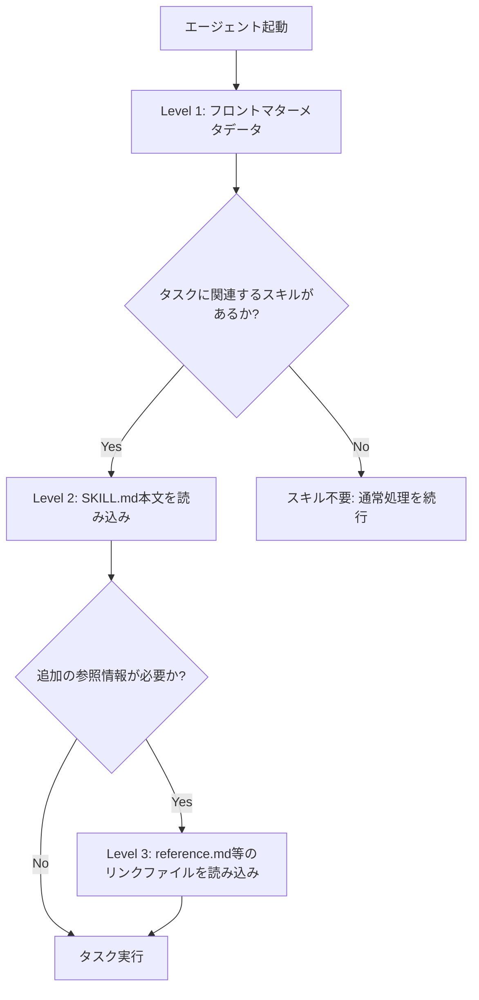

## ブログ概要（Summary）

本記事は [Anthropic Engineering Blog: Equipping agents for the real world with Agent Skills](https://www.anthropic.com/engineering/equipping-agents-for-the-real-world-with-agent-skills)（2025年10月16日公開）の解説記事です。

Anthropicのエンジニアリングチーム（Barry Zhang、Keith Lazuka、Mahesh Murag）が発表したこのブログでは、LLMエージェントにドメイン固有の知識を動的に注入するための仕組み「Agent Skills」の設計思想と実装パターンが詳述されている。Agent Skillsは「命令、スクリプト、リソースを整理したフォルダ」として定義され、エージェントが必要に応じて発見・読み込みできるように設計されている。2025年12月18日には、クロスプラットフォーム互換のオープン標準として [agentskills.io](https://agentskills.io/) で公開された。

この記事は [Zenn記事: Claude Code Skills×MCP×Hooksでプロジェクト専用AI開発環境を構築する](https://zenn.dev/0h_n0/articles/fdd8b55ae2304e) の深掘りです。

## 情報源

- **種別**: 企業テックブログ（Anthropic Engineering）
- **URL**: [https://www.anthropic.com/engineering/equipping-agents-for-the-real-world-with-agent-skills](https://www.anthropic.com/engineering/equipping-agents-for-the-real-world-with-agent-skills)
- **組織**: Anthropic（エンジニアリングチーム）
- **著者**: Barry Zhang, Keith Lazuka, Mahesh Murag
- **発表日**: 2025年10月16日（2025年12月18日にオープン標準化のアップデートあり）

## 技術的背景（Technical Background）

### なぜAgent Skillsが必要なのか

LLMエージェントが汎用的なタスクを処理できるようになるにつれ、特定のドメインに固有の知識やワークフローをどのようにエージェントに伝達するかが課題となっている。従来のアプローチには以下の問題点がある。

**システムプロンプトの肥大化**: プロジェクト固有のルールやワークフローをすべてシステムプロンプトに記述すると、コンテキストウィンドウを圧迫する。LLMのコンテキストウィンドウは有限であり、不要な情報が含まれると応答品質が低下する可能性がある。

**カスタムエージェントの断片化**: ドメインごとに個別のエージェントを構築すると、共通の機能が重複し、保守コストが増大する。著者らは「断片化されたカスタムビルトのエージェントを、共有可能なコンポーザブルな能力で置き換える」ことを目指していると述べている。

**静的な知識の限界**: LLMの学習データに含まれない最新のツール、API、ベストプラクティスに対応するには、動的にドメイン知識を注入する仕組みが必要である。

### 学術研究との関連

Agent Skillsの設計は、LLMエージェントのツール使用（tool use）に関する一連の研究と密接に関連している。

Gorilla（Patil et al., NeurIPS 2024）はLLMとAPI群を接続するアプローチを提案し、Retriever-Aware Training（RAT）によってAPI呼び出しの精度を向上させた。Agent Skillsは、APIレベルの接続よりも一段上の抽象度で「ワークフロー全体をパッケージ化する」というアプローチを取っている点が異なる。

SWE-agent（Yang et al., NeurIPS 2024）は、Agent-Computer Interface（ACI）の設計がLLMエージェントの性能に大きく影響することを示した。Agent Skillsの「プログレッシブディスクロージャー」設計は、ACIの「フィードバックは情報量が多く簡潔であるべき」という原則と通底している。

## 実装アーキテクチャ（Architecture）

### スキルの基本構造

著者らによると、スキルの最小構成は「SKILL.mdファイルを含むディレクトリ」である。SKILL.mdはYAMLフロントマターとMarkdown本文で構成される。

```
.claude/skills/
├── pdf/
│   ├── SKILL.md          # スキル定義（必須）
│   ├── reference.md      # 参照ドキュメント（任意）
│   └── forms.md          # フォーム処理手順（任意）
└── deploy/
    ├── SKILL.md
    └── scripts/
        └── deploy.sh     # 補助スクリプト（任意）
```

フロントマターには `name` と `description` の2つのフィールドが必須である。

```yaml
---
name: pdf
description: Read, edit, and create PDF documents
---
```

### プログレッシブディスクロージャー（Progressive Disclosure）

Agent Skillsの設計で中心的な概念が、3段階のプログレッシブディスクロージャーである。著者らは以下のように段階を定義している。



**Level 1（フロントマターメタデータ）**: エージェント起動時に、インストール済みのすべてのスキルの `name` と `description` がシステムプロンプトにプリロードされる。この情報だけで、エージェントはどのスキルがタスクに関連するかを判断する。

**Level 2（SKILL.md本文）**: エージェントがスキルの関連性を判断した場合にのみ、SKILL.md全文が読み込まれる。ここには具体的な手順、制約、使用するツールの情報が含まれる。

**Level 3以降（参照ファイル）**: さらに詳細な情報が必要な場合にのみ、スキルディレクトリ内の追加ファイルが読み込まれる。例として、PDFスキルでは `forms.md`（フォーム入力の手順）が必要時のみ参照される。

著者らはこの設計について「ファイルシステムとコード実行があれば、スキルが束ねられるコンテキスト量は事実上無制限である」と述べている。これはコンテキストウィンドウの制約を、遅延読み込み（lazy loading）によって回避するアプローチである。

### コンテキストウィンドウ内での動作

著者らは、スキルがコンテキストウィンドウ内でどのように動作するかを次のように説明している。

1. **初期状態**: コアシステムプロンプト + 各スキルのメタデータ + ユーザーの最初のメッセージ
2. **スキルトリガー**: エージェントがBashツールを使って `pdf/SKILL.md` を読み込む
3. **追加コンテキスト**: 必要に応じて `forms.md` を読み込む
4. **タスク実行**: 読み込んだ指示に従ってタスクを実行する

この方式の利点は、不要なスキルのコンテキストがウィンドウを消費しないことである。10個のスキルがインストールされていても、実際に読み込まれるのは関連するスキルのみとなる。

### コード実行との統合

著者らはブログ内で、LLMが苦手とする決定論的な処理（例: ソート）をコード実行に委譲するパターンを紹介している。スキル内にPythonスクリプトを含め、エージェントがそれをツールとして実行することで以下の利点が得られる。

- **トークン効率**: ソート結果をトークンとして生成するよりも、アルゴリズムを実行するほうがコストが低い
- **決定論性**: コード実行は毎回同じ結果を返す
- **コンテキスト節約**: スクリプト自体をコンテキストに読み込まなくても実行できる

```python
from typing import Any
from pathlib import Path
import subprocess
import json


def run_skill_script(
    skill_dir: Path,
    script_name: str,
    input_data: dict[str, Any],
) -> dict[str, Any]:
    """スキルディレクトリ内のスクリプトを実行する。

    Args:
        skill_dir: スキルのルートディレクトリパス
        script_name: 実行するスクリプトのファイル名
        input_data: スクリプトへの入力データ

    Returns:
        スクリプトの実行結果
    """
    script_path = skill_dir / "scripts" / script_name
    result = subprocess.run(
        ["python", str(script_path)],
        input=json.dumps(input_data),
        capture_output=True,
        text=True,
        timeout=30,
    )
    if result.returncode != 0:
        raise RuntimeError(f"Script failed: {result.stderr}")
    return json.loads(result.stdout)
```

このパターンでは、エージェントはスクリプトの内部実装を知らなくても、SKILL.md内の記述に従って適切な引数でスクリプトを呼び出せる。

## スキル開発の4つのガイドライン

著者らは効果的なスキルを開発するための4つのガイドラインを提示している。

### 1. 評価から始める

代表的なタスクでエージェントを実行し、どこで失敗するかを特定した上で、そのギャップを埋めるようにスキルを段階的に構築する。著者らは「先にスキルを書いてからテストする」のではなく「先にテストしてからスキルで補完する」アプローチを推奨している。

### 2. スケールを意識した構造化

大きなSKILL.mdは参照ファイルに分割する。相互排他的なコンテキストや稀にしか組み合わされないパスは分離することで、トークン使用量を削減できる。コードは「ツールとして実行する」か「参照資料として読む」かを明確にすべきと述べられている。

### 3. Claudeの視点で考える

実際の使用状況を観察し、予期しない軌跡や特定のコンテキストへの過剰依存がないか確認する。特に `name` と `description` フィールドは重要で、エージェントがスキルの適用可否を判断する際の主要な手がかりとなる。

### 4. Claudeと反復的に改善する

成功したアプローチや頻出するミスをスキルコンテキストとコードに取り込むようClaudeに依頼する。著者らは「事前にコンテキストを予測するのではなく、Claudeが実際に何のコンテキストを必要としているかを明らかにする」と述べている。

## セキュリティ考慮事項

著者らはスキルのセキュリティリスクについて明確に警告している。

- 悪意のあるスキルは脆弱性を追加したり、エージェントにデータの漏洩や意図しないアクションを取らせたりする可能性がある
- 信頼できるソースのスキルのみインストールすべき
- 信頼度が低いスキルは使用前に監査すること
- 特にコード依存関係、画像、スクリプト、信頼できない外部ネットワークソースへの接続指示に注意が必要

これはソフトウェアサプライチェーンのセキュリティと同様の問題であり、npmパッケージやPythonライブラリの監査と同じ慎重さが求められる。

## 制約と限界

ブログから読み取れる制約は以下の通りである。

**定量的なベンチマークの欠如**: ブログには具体的なベンチマーク結果やメトリクスが記載されていない。「スキルの導入によってタスク成功率がX%向上した」といった定量的な評価は提供されていない。

**コンテキストウィンドウへの間接的依存**: プログレッシブディスクロージャーはコンテキスト使用量を削減するが、Level 3の参照ファイルが大量にある場合の上限は明示されていない。SKILL.mdは500行以内が推奨されているものの、参照ファイルの合計サイズについてのガイダンスは見当たらない。

**エージェントの判断精度**: スキルのトリガーはエージェントの `name` / `description` 解釈に依存する。不適切な名称や曖昧な説明は、誤ったスキルの選択やスキルの見落としにつながる可能性がある。

**セキュリティモデルの未成熟**: スキルの信頼性検証は現時点では手動監査に依存しており、自動化された署名検証やサンドボックス実行の仕組みは言及されていない。

## Production Deployment Guide

### AWS実装パターン（コスト最適化重視）

Agent Skillsを活用したLLMエージェントシステムをAWSで本番運用する場合のアーキテクチャパターンを、トラフィック量別に示す。

**トラフィック量別の推奨構成**:

| 規模 | 月間リクエスト | 推奨構成 | 月額コスト | 主要サービス |
|------|--------------|---------|-----------|------------|
| **Small** | ~3,000 (100/日) | Serverless | $50-150 | Lambda + Bedrock + S3 |
| **Medium** | ~30,000 (1,000/日) | Hybrid | $300-800 | Lambda + ECS Fargate + ElastiCache |
| **Large** | 300,000+ (10,000/日) | Container | $2,000-5,000 | EKS + Karpenter + EC2 Spot |

**Small構成の詳細**（月額$50-150）:
- **Lambda**: 1GB RAM, 60秒タイムアウト（$20/月）
- **Bedrock**: Claude 3.5 Haiku, Prompt Caching有効（$80/月）
- **S3**: スキル定義ファイルの保存（$5/月）
- **CloudWatch**: 基本監視（$5/月）
- **API Gateway**: REST API（$5/月）

**Medium構成の詳細**（月額$300-800）:
- **Lambda**: イベント処理（$50/月）
- **ECS Fargate**: 0.5 vCPU, 1GB RAM × 2タスク（$120/月）
- **Bedrock**: Claude 3.5 Sonnet, Batch API活用（$400/月）
- **ElastiCache Redis**: スキルメタデータキャッシュ、cache.t3.micro（$15/月）
- **Application Load Balancer**: （$20/月）

**Large構成の詳細**（月額$2,000-5,000）:
- **EKS**: コントロールプレーン（$72/月）
- **EC2 Spot Instances**: g5.xlarge × 2-4台（平均$800/月）
- **Karpenter**: 自動スケーリング（追加コストなし）
- **Bedrock Batch**: 50%割引活用（$2,000/月）
- **S3**: スキルリポジトリ＋キャッシュ（$20/月）
- **CloudWatch + X-Ray**: 詳細監視（$100/月）

**コスト削減テクニック**:
- Spot Instances使用で最大90%削減（EKS + Karpenter）
- Reserved Instances購入で最大72%削減（1年コミット）
- Bedrock Batch API使用で50%削減
- Prompt Caching有効化で30-90%削減（スキルメタデータをシステムプロンプトにキャッシュ）

**コスト試算の注意事項**:
- 上記は2026年10月時点のAWS ap-northeast-1（東京）リージョン料金に基づく概算値です
- 実際のコストはトラフィックパターン、リージョン、バースト使用量により変動します
- 最新料金は [AWS料金計算ツール](https://calculator.aws/) で確認してください

### Terraformインフラコード

**Small構成（Serverless）: Lambda + Bedrock + S3**

```hcl
module "vpc" {
  source  = "terraform-aws-modules/vpc/aws"
  version = "~> 5.0"

  name = "agent-skills-vpc"
  cidr = "10.0.0.0/16"
  azs  = ["ap-northeast-1a", "ap-northeast-1c"]
  private_subnets = ["10.0.1.0/24", "10.0.2.0/24"]

  enable_nat_gateway   = false
  enable_dns_hostnames = true
}

resource "aws_iam_role" "lambda_agent" {
  name = "lambda-agent-skills-role"

  assume_role_policy = jsonencode({
    Version = "2012-10-17"
    Statement = [{
      Action = "sts:AssumeRole"
      Effect = "Allow"
      Principal = { Service = "lambda.amazonaws.com" }
    }]
  })
}

resource "aws_iam_role_policy" "bedrock_invoke" {
  role = aws_iam_role.lambda_agent.id
  policy = jsonencode({
    Version = "2012-10-17"
    Statement = [{
      Effect   = "Allow"
      Action   = ["bedrock:InvokeModel", "bedrock:InvokeModelWithResponseStream"]
      Resource = "arn:aws:bedrock:ap-northeast-1::foundation-model/anthropic.claude-3-5-haiku*"
    }]
  })
}

resource "aws_iam_role_policy" "s3_skills" {
  role = aws_iam_role.lambda_agent.id
  policy = jsonencode({
    Version = "2012-10-17"
    Statement = [{
      Effect   = "Allow"
      Action   = ["s3:GetObject", "s3:ListBucket"]
      Resource = [aws_s3_bucket.skills.arn, "${aws_s3_bucket.skills.arn}/*"]
    }]
  })
}

resource "aws_s3_bucket" "skills" {
  bucket = "agent-skills-repository"
}

resource "aws_s3_bucket_server_side_encryption_configuration" "skills" {
  bucket = aws_s3_bucket.skills.id
  rule {
    apply_server_side_encryption_by_default {
      sse_algorithm = "aws:kms"
    }
  }
}

resource "aws_lambda_function" "agent_handler" {
  filename      = "lambda.zip"
  function_name = "agent-skills-handler"
  role          = aws_iam_role.lambda_agent.arn
  handler       = "index.handler"
  runtime       = "python3.12"
  timeout       = 60
  memory_size   = 1024

  environment {
    variables = {
      BEDROCK_MODEL_ID   = "anthropic.claude-3-5-haiku-20241022-v1:0"
      SKILLS_BUCKET      = aws_s3_bucket.skills.id
      ENABLE_PROMPT_CACHE = "true"
    }
  }
}

resource "aws_cloudwatch_metric_alarm" "lambda_cost" {
  alarm_name          = "agent-skills-cost-spike"
  comparison_operator = "GreaterThanThreshold"
  evaluation_periods  = 1
  metric_name         = "Duration"
  namespace           = "AWS/Lambda"
  period              = 3600
  statistic           = "Sum"
  threshold           = 100000
  alarm_description   = "Lambda実行時間異常（コスト急増の可能性）"
  dimensions = {
    FunctionName = aws_lambda_function.agent_handler.function_name
  }
}
```

**Large構成（Container）: EKS + Karpenter + Spot Instances**

```hcl
module "eks" {
  source  = "terraform-aws-modules/eks/aws"
  version = "~> 20.0"

  cluster_name    = "agent-skills-cluster"
  cluster_version = "1.31"
  vpc_id          = module.vpc.vpc_id
  subnet_ids      = module.vpc.private_subnets

  cluster_endpoint_public_access = true
  enable_cluster_creator_admin_permissions = true
}

resource "kubectl_manifest" "karpenter_provisioner" {
  yaml_body = <<-YAML
    apiVersion: karpenter.sh/v1
    kind: NodePool
    metadata:
      name: spot-pool
    spec:
      template:
        spec:
          requirements:
            - key: karpenter.sh/capacity-type
              operator: In
              values: ["spot"]
            - key: node.kubernetes.io/instance-type
              operator: In
              values: ["g5.xlarge", "g5.2xlarge"]
          limits:
            cpu: "32"
            memory: "128Gi"
      disruption:
        consolidationPolicy: WhenEmpty
        consolidateAfter: 30s
  YAML
}

resource "aws_secretsmanager_secret" "bedrock_config" {
  name = "agent-skills-bedrock-config"
}

resource "aws_secretsmanager_secret_version" "bedrock_config" {
  secret_id = aws_secretsmanager_secret.bedrock_config.id
  secret_string = jsonencode({
    model_id = "anthropic.claude-3-5-sonnet-20241022-v2:0"
    region   = "ap-northeast-1"
  })
}

resource "aws_budgets_budget" "monthly" {
  name         = "agent-skills-monthly"
  budget_type  = "COST"
  limit_amount = "5000"
  limit_unit   = "USD"
  time_unit    = "MONTHLY"

  notification {
    comparison_operator        = "GREATER_THAN"
    threshold                  = 80
    threshold_type             = "PERCENTAGE"
    notification_type          = "ACTUAL"
    subscriber_email_addresses = ["ops@example.com"]
  }
}
```

### セキュリティベストプラクティス

1. **ネットワーク**: EKSは `cluster_endpoint_public_access = false` を本番で設定、LambdaはVPC内配置
2. **認証・認可**: IAMロール最小権限、MFA必須、IRSA使用
3. **シークレット管理**: Secrets Manager使用、環境変数ハードコード禁止、90日ローテーション
4. **監査**: CloudTrail全リージョン有効化、Config有効化、GuardDuty有効化
5. **データ保護**: TLS 1.2以上、S3/DynamoDB/EBS全てKMS暗号化

### 運用・監視設定

**CloudWatch Logs Insights クエリ**:

```sql
-- スキル読み込み頻度の分析
fields @timestamp, skill_name, load_level
| stats count(*) as load_count by skill_name, load_level
| sort load_count desc

-- レイテンシ分析: P95, P99
fields @timestamp, duration_ms
| stats pct(duration_ms, 95) as p95, pct(duration_ms, 99) as p99 by bin(5m)
```

**CloudWatch アラーム**:

```python
import boto3

cloudwatch = boto3.client('cloudwatch')

cloudwatch.put_metric_alarm(
    AlarmName='bedrock-token-spike',
    ComparisonOperator='GreaterThanThreshold',
    EvaluationPeriods=1,
    MetricName='TokenUsage',
    Namespace='AWS/Bedrock',
    Period=3600,
    Statistic='Sum',
    Threshold=500000,
    ActionsEnabled=True,
    AlarmActions=['arn:aws:sns:ap-northeast-1:123456789:cost-alerts'],
    AlarmDescription='Bedrockトークン使用量異常'
)
```

**X-Ray トレーシング設定**:

```python
from aws_xray_sdk.core import xray_recorder, patch_all

patch_all()

@xray_recorder.capture('skill_load')
def load_skill(skill_name: str, level: int) -> dict:
    """スキルの読み込みをトレースする。"""
    xray_recorder.put_annotation('skill', skill_name)
    xray_recorder.put_annotation('level', level)
    # S3からスキル定義を取得
    content = s3.get_object(Bucket=SKILLS_BUCKET, Key=f"{skill_name}/SKILL.md")
    xray_recorder.put_metadata('content_length', len(content))
    return content
```

### コスト最適化チェックリスト

**アーキテクチャ選択**:
- [ ] ~100 req/日 → Lambda + Bedrock（Serverless）- $50-150/月
- [ ] ~1000 req/日 → ECS Fargate + Bedrock（Hybrid）- $300-800/月
- [ ] 10000+ req/日 → EKS + Spot Instances（Container）- $2,000-5,000/月

**リソース最適化**:
- [ ] EC2: Spot Instances優先（最大90%削減）
- [ ] Reserved Instances: 1年コミットで72%削減
- [ ] Savings Plans: Compute Savings Plans検討
- [ ] Lambda: メモリサイズ最適化（Power Tuning活用）
- [ ] ECS/EKS: アイドルタイムのスケールダウン

**LLMコスト削減**:
- [ ] Bedrock Batch API: 50%割引（非リアルタイム処理）
- [ ] Prompt Caching: スキルメタデータをキャッシュ（30-90%削減）
- [ ] モデル選択: Haiku（簡易タスク）/ Sonnet（複雑タスク）
- [ ] max_tokens設定: 過剰生成防止

**監視・アラート**:
- [ ] AWS Budgets: 月額予算設定（80%警告、100%アラート）
- [ ] CloudWatch: トークンスパイク検知
- [ ] Cost Anomaly Detection: 自動異常検知
- [ ] 日次コストレポート: SNS/Slack自動送信

**リソース管理**:
- [ ] 未使用リソース: Lambda Insights, Trusted Advisor活用
- [ ] タグ戦略: 環境別・プロジェクト別コスト可視化
- [ ] S3ライフサイクル: 古いスキルキャッシュ自動削除（30日）
- [ ] 開発環境: 夜間停止（Auto Start/Stop）

## 実運用への応用（Practical Applications）

Agent Skillsのアーキテクチャは、以下のユースケースで実務的な価値を持つ。

**CI/CDパイプラインとの統合**: デプロイ手順、テスト実行、リリースチェックリストをスキルとして定義することで、エージェントがこれらの定型作業を一貫して実行できる。SKILL.mdの `allowed-tools` フロントマターにより、スキル実行中のツール権限を制限できる。

**チーム間のナレッジ共有**: スキルをGitリポジトリで管理し、チーム間で共有することで、暗黙知を形式知化できる。新しいメンバーのオンボーディングでは、エージェントがスキルを通じてプロジェクト固有のベストプラクティスを適用する。

**マルチドメインエージェント**: 単一のエージェントが複数のスキルを動的に切り替えることで、コード生成、ドキュメント編集、データ分析など異なるドメインのタスクを処理できる。プログレッシブディスクロージャーにより、使用しないスキルのコンテキストコストは発生しない。

## 関連研究との比較

- **OpenAI Codex**: OpenAIが2025年5月に発表したCodexは、クラウドベースのコーディングエージェントであり、各タスクがコンテナ内で実行される。Agent Skillsのようなスキルベースのドメイン知識注入の仕組みは、2026年にCodex Skillsとして同様の機能が導入された
- **MCP（Model Context Protocol）**: Anthropicが2024年11月に公開したMCPは外部ツールとの接続を担当し、Agent Skillsはワークフローの定義を担当する。両者は補完関係にあり、著者らは「スキルが外部ツールを含むワークフローを教える方法を探りたい」と述べている
- **LangChain Tools**: LangChainのツール定義はPythonコードベースであり、Agent Skillsのマークダウンベースのアプローチとは異なる。Agent Skillsはコード非依存の記述が可能で、非エンジニアでもスキルを作成・編集できる

## まとめと実践への示唆

Anthropicが公開したAgent Skillsは、LLMエージェントにドメイン知識を動的に注入するための体系的なフレームワークである。プログレッシブディスクロージャーによるコンテキスト最適化、コード実行との統合、そしてオープン標準としての公開により、エージェントの実用性を高めるアプローチを提示している。

ただし、定量的なベンチマークが公開されていない点、セキュリティモデルが手動監査に依存している点は、今後の改善が期待される領域である。実務に導入する際は、スキルの評価から始め、段階的に拡充するアプローチが推奨されている。

## 参考文献

- **Blog URL**: [https://www.anthropic.com/engineering/equipping-agents-for-the-real-world-with-agent-skills](https://www.anthropic.com/engineering/equipping-agents-for-the-real-world-with-agent-skills)
- **Agent Skills Open Standard**: [https://agentskills.io/](https://agentskills.io/)
- **Skills GitHub Repository**: [https://github.com/anthropics/skills](https://github.com/anthropics/skills)
- **Related Zenn article**: [https://zenn.dev/0h_n0/articles/fdd8b55ae2304e](https://zenn.dev/0h_n0/articles/fdd8b55ae2304e)
