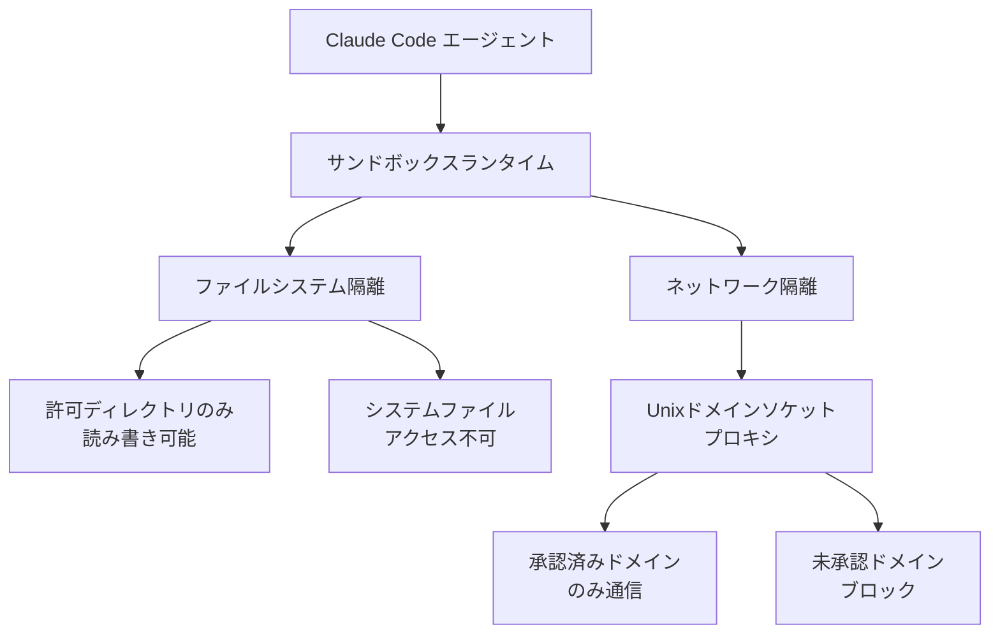
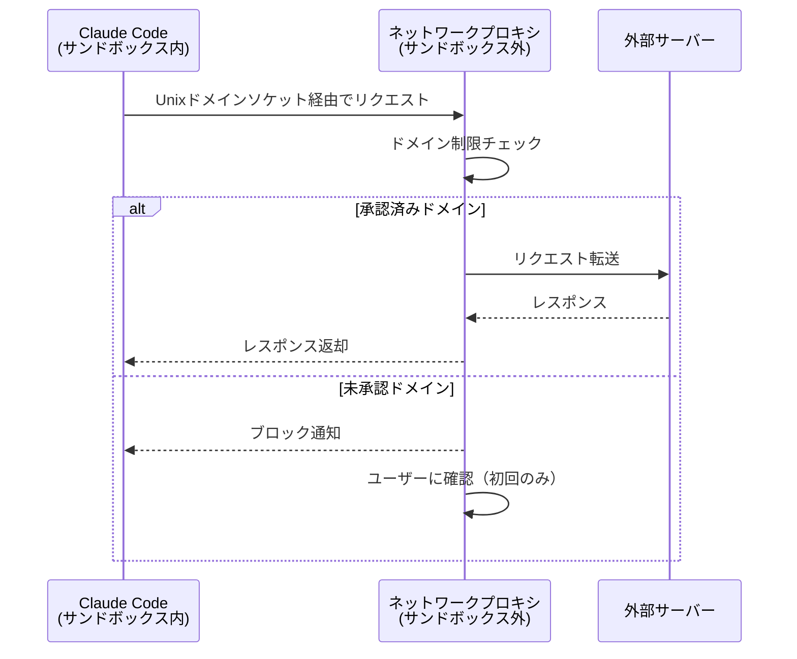

## ブログ概要（Summary）

本記事は [Beyond permission prompts: making Claude Code more secure and autonomous](https://anthropic.com/engineering/claude-code-sandboxing) の解説記事です。

Anthropicのエンジニアリングチーム（David Dworken、Oliver Weller-Davies ら）が2025年10月20日に公開したこのブログでは、AIコーディングエージェント「Claude Code」向けに構築されたサンドボックス機構の設計思想が述べられている。LLMエージェントがファイル操作やコマンド実行を行う際の「許可プロンプト疲れ（approval fatigue）」問題に対し、OSレベルのファイルシステム隔離とネットワーク隔離を組み合わせることで、ブログ本文によれば許可プロンプトを84%削減したとされる。サンドボックスランタイムはオープンソースとして公開されている。

この記事は [Zenn記事: Claude Code Skills×MCP×Hooksでプロジェクト専用AI開発環境を構築する](https://zenn.dev/0h_n0/articles/fdd8b55ae2304e) の深掘りです。

## 情報源

- **種別**: 企業テックブログ（Anthropic Engineering）
- **URL**: [https://anthropic.com/engineering/claude-code-sandboxing](https://anthropic.com/engineering/claude-code-sandboxing)
- **組織**: Anthropic
- **著者**: David Dworken, Oliver Weller-Davies
- **発表日**: 2025年10月20日

## 技術的背景（Technical Background）

### なぜLLMエージェントにサンドボックスが必要なのか

Claude Codeのようなコーディングエージェントは、ファイルの読み書き、シェルコマンドの実行、外部サービスへのアクセスなど、広範なシステム操作を行う。従来のアプローチでは、エージェントがこれらの操作を行うたびにユーザーに許可を求める「許可プロンプト」方式が採用されていた。

著者らは、この方式には根本的な問題があると述べている。開発者がClaude Codeを日常的に使う場合、1セッションで数十から数百回の許可プロンプトが表示される。その結果、ユーザーは内容を確認せずに承認する「承認疲れ（approval fatigue）」に陥り、かえってセキュリティが低下する。ブログ本文ではこの状態を「開発を安全でなくする（makes development less safe）」と表現している。

この問題は、LLMエージェントに固有の課題でもある。従来のソフトウェアツール（IDEやエディタ）はユーザーの操作を忠実に実行するため、操作の意図と実行の間に乖離がない。しかしLLMエージェントは自律的に行動を選択するため、プロンプトインジェクション攻撃や意図しない動作のリスクが存在する。例えば、悪意のあるコード中のコメントがエージェントの行動を誘導し、機密ファイルの読み取りや外部サーバーへのデータ送信を引き起こす可能性がある。

### 学術研究との関連

エージェントのサンドボックスという概念は、オペレーティングシステムのセキュリティ分野で長い歴史を持つ。Linuxのnamespace機能（cgroups、seccomp-bpf）やmacOSのApp Sandbox（seatbelt）は、プロセスレベルでの隔離を実現する技術として広く知られている。

近年のLLMエージェント研究では、エージェントの安全性（agent safety）が注目されている。特に、ツール使用（tool use）を行うLLMエージェントに対する攻撃ベクトルとして、間接的プロンプトインジェクション（indirect prompt injection）が報告されている。攻撃者がWebページやコードベース内にLLMへの指示を埋め込み、エージェントの行動を操作する手法である。Anthropicのサンドボックスは、こうした攻撃が成功した場合でも被害を最小化するための「多層防御（defense in depth）」アプローチとして位置づけられる。

## 実装アーキテクチャ（Architecture）

### サンドボックスの二重防御構造

著者らが設計した核心は、ファイルシステム隔離とネットワーク隔離の**二重防御**である。ブログでは、どちらか一方だけでは不十分である理由が明確に述べられている。



**ファイルシステム隔離のみの場合の脆弱性**: ネットワークが制限されていなければ、エージェントが（プロンプトインジェクション等により）侵害された場合、許可ディレクトリ内のファイルを外部サーバーに送信できてしまう。

**ネットワーク隔離のみの場合の脆弱性**: ファイルシステムが制限されていなければ、エージェントがSSH鍵や環境変数ファイルなどの機密情報にアクセスし、それを許可されたネットワーク経由で間接的に漏洩させる可能性がある。

著者らは「両方が必要である（both are required）」と述べている。

### ローカル環境のサンドボックス実装

#### Linux: bubblewrap

Linux環境では、**bubblewrap**（`bwrap`）を使用してサンドボックスが実装されている。bubblewrapはLinuxのnamespace機能を利用した軽量サンドボックスツールで、Flatpakなどのアプリケーションコンテナでも広く使われている。

bubblewrapの特徴は以下の通りである。

- **ユーザー名前空間（user namespace）**: root権限なしで新しい名前空間を作成可能
- **マウント名前空間（mount namespace）**: 特定のディレクトリのみをサンドボックス内に公開
- **ネットワーク名前空間（network namespace）**: ネットワークアクセスを制限

Claude Codeでは、作業ディレクトリ（CWD）のみが読み書き可能として公開される。ブログによれば、この制限はサブプロセスやスクリプトにも伝播する。つまり、エージェントが `bash -c "cat /etc/passwd"` を実行しても、サンドボックスによりブロックされる。

#### macOS: seatbelt

macOS環境では、**seatbelt**（`sandbox-exec`）によるサンドボックスが実装されている。seatbeltはmacOSのカーネルレベルのセキュリティ機構で、サンドボックスプロファイルを定義することでプロセスのアクセス権を制限する。

```python
# seatbeltプロファイルの概念的な構造（ブログでは具体的なプロファイルは非開示）
# 以下は一般的なseatbeltプロファイルの記述パターンを示す
sandbox_profile = """
(version 1)
(deny default)
(allow file-read* (subpath "/usr/lib"))
(allow file-read* file-write* (subpath "{working_directory}"))
(deny network*)
(allow network-outbound (to unix-socket "{proxy_socket}"))
"""
```

**注意**: 上記コードはseatbeltプロファイルの一般的な記述パターンを示すもので、Claude Codeの実際のプロファイルはブログでは公開されていない。

#### ネットワークプロキシの仕組み

ネットワーク隔離は、Unixドメインソケットを介したプロキシで実現されている。この設計の重要なポイントは以下の通りである。



1. **サンドボックス内のプロセスは直接的なネットワークアクセスを持たない**: すべてのトラフィックがUnixドメインソケットを経由する
2. **プロキシがドメインベースのフィルタリングを実行**: 許可リストにないドメインへのアクセスは初回時にユーザー確認を要求する
3. **プロキシはカスタマイズ可能**: 著者らは「プロキシは送信トラフィックに対する任意のルールを適用できるようカスタマイズ可能」と述べている

### Web版Claude Codeのサンドボックス

Web版ではさらに強固な隔離が実現されている。

- **各セッションが独立したクラウドサンドボックスで実行**: セッション間の干渉がない
- **認証情報の分離**: Gitの認証情報や署名鍵はサンドボックスの外部に保持される
- **カスタムプロキシ**: Git操作専用のプロキシが、スコープ付き認証情報を検証した上で、実際のトークンを付与してGitHubに転送する。例えば、プッシュが設定されたブランチのみに限定されているかを検証する

この設計により、サンドボックス内のエージェントが認証トークンに直接アクセスすることはなく、プロキシが操作の妥当性を検証するゲートキーパーとして機能する。

## Production Deployment Guide

### AWS実装パターン（コスト最適化重視）

LLMエージェントのサンドボックス環境をAWS上で構築する場合のパターンを示す。Anthropicのブログで述べられているファイルシステム隔離とネットワーク隔離の二重防御を、AWSのサービスで実現する構成である。

**注意**: 以下のコスト試算は2026年10月時点のAWS ap-northeast-1（東京）リージョンの料金に基づく概算値です。実際のコストはトラフィックパターンやバースト使用量により変動します。最新料金は [AWS料金計算ツール](https://calculator.aws/) で確認してください。

**トラフィック量別の推奨構成**:

| 規模 | 月間リクエスト | 推奨構成 | 月額コスト | 主要サービス |
|------|--------------|---------|-----------|------------|
| **Small** | ~3,000 (100/日) | Serverless | $50-150 | Lambda + Bedrock + DynamoDB |
| **Medium** | ~30,000 (1,000/日) | Hybrid | $300-800 | Lambda + ECS Fargate + ElastiCache |
| **Large** | 300,000+ (10,000/日) | Container | $2,000-5,000 | EKS + Karpenter + EC2 Spot |

**Small構成の詳細** (月額$50-150):
- **Lambda**: 1GB RAM, 60秒タイムアウト ($20/月)
- **Bedrock**: Claude 3.5 Haiku, Prompt Caching有効 ($80/月)
- **DynamoDB**: On-Demand ($10/月)
- **CloudWatch**: 基本監視 ($5/月)
- **API Gateway**: REST API ($5/月)

**Medium構成の詳細** (月額$300-800):
- **Lambda**: イベント処理 ($50/月)
- **ECS Fargate**: 0.5 vCPU, 1GB RAM × 2タスク ($120/月)
- **Bedrock**: Claude 3.5 Sonnet, Batch API活用 ($400/月)
- **ElastiCache Redis**: cache.t3.micro ($15/月)
- **Application Load Balancer**: ($20/月)

**Large構成の詳細** (月額$2,000-5,000):
- **EKS**: コントロールプレーン ($72/月)
- **EC2 Spot Instances**: g5.xlarge × 2-4台 (平均$800/月)
- **Karpenter**: 自動スケーリング（追加コストなし）
- **Bedrock Batch**: 50%割引活用 ($2,000/月)
- **S3**: プロンプトキャッシュストレージ ($20/月)

**コスト削減テクニック**:
- Spot Instances使用で最大90%削減（EKS + Karpenter）
- Reserved Instances購入で最大72%削減（1年コミット）
- Bedrock Batch API使用で50%割引
- Prompt Caching有効化で30-90%削減

### Terraformインフラコード

**Small構成 (Serverless): Lambda + サンドボックス付きBedrock**

```hcl
module "vpc" {
  source  = "terraform-aws-modules/vpc/aws"
  version = "~> 5.0"

  name = "agent-sandbox-vpc"
  cidr = "10.0.0.0/16"
  azs  = ["ap-northeast-1a", "ap-northeast-1c"]
  private_subnets = ["10.0.1.0/24", "10.0.2.0/24"]

  enable_nat_gateway   = false
  enable_dns_hostnames = true
}

resource "aws_iam_role" "lambda_sandbox" {
  name = "lambda-sandbox-role"

  assume_role_policy = jsonencode({
    Version = "2012-10-17"
    Statement = [{
      Action = "sts:AssumeRole"
      Effect = "Allow"
      Principal = { Service = "lambda.amazonaws.com" }
    }]
  })
}

resource "aws_iam_role_policy" "bedrock_invoke" {
  role = aws_iam_role.lambda_sandbox.id

  policy = jsonencode({
    Version = "2012-10-17"
    Statement = [{
      Effect   = "Allow"
      Action   = ["bedrock:InvokeModel", "bedrock:InvokeModelWithResponseStream"]
      Resource = "arn:aws:bedrock:ap-northeast-1::foundation-model/anthropic.claude-3-5-haiku*"
    }]
  })
}

resource "aws_lambda_function" "agent_sandbox" {
  filename      = "lambda.zip"
  function_name = "agent-sandbox-handler"
  role          = aws_iam_role.lambda_sandbox.arn
  handler       = "index.handler"
  runtime       = "python3.12"
  timeout       = 120
  memory_size   = 1024

  environment {
    variables = {
      BEDROCK_MODEL_ID     = "anthropic.claude-3-5-haiku-20241022-v1:0"
      SANDBOX_ENABLED      = "true"
      ALLOWED_DIRECTORIES  = "/tmp/workspace"
      NETWORK_PROXY_SOCKET = "/tmp/proxy.sock"
    }
  }
}

resource "aws_dynamodb_table" "session_state" {
  name         = "agent-session-state"
  billing_mode = "PAY_PER_REQUEST"
  hash_key     = "session_id"

  attribute {
    name = "session_id"
    type = "S"
  }

  ttl {
    attribute_name = "expire_at"
    enabled        = true
  }
}

resource "aws_cloudwatch_metric_alarm" "sandbox_violation" {
  alarm_name          = "sandbox-violation-alert"
  comparison_operator = "GreaterThanThreshold"
  evaluation_periods  = 1
  metric_name         = "SandboxViolationCount"
  namespace           = "AgentSandbox"
  period              = 300
  statistic           = "Sum"
  threshold           = 0
  alarm_description   = "サンドボックス境界違反が検出されました"
}
```

**Large構成 (Container): EKS + Karpenter + Spot Instances**

```hcl
module "eks" {
  source  = "terraform-aws-modules/eks/aws"
  version = "~> 20.0"

  cluster_name    = "agent-sandbox-cluster"
  cluster_version = "1.31"

  vpc_id     = module.vpc.vpc_id
  subnet_ids = module.vpc.private_subnets

  cluster_endpoint_public_access = true

  enable_cluster_creator_admin_permissions = true
}

resource "kubectl_manifest" "karpenter_provisioner" {
  yaml_body = <<-YAML
    apiVersion: karpenter.sh/v1alpha5
    kind: Provisioner
    metadata:
      name: sandbox-provisioner
    spec:
      requirements:
        - key: karpenter.sh/capacity-type
          operator: In
          values: ["spot"]
        - key: node.kubernetes.io/instance-type
          operator: In
          values: ["m6i.xlarge", "m6i.2xlarge"]
      limits:
        resources:
          cpu: "32"
          memory: "128Gi"
      providerRef:
        name: default
      ttlSecondsAfterEmpty: 30
  YAML
}

resource "aws_secretsmanager_secret" "bedrock_config" {
  name = "agent-sandbox-bedrock-config"
}

resource "aws_secretsmanager_secret_version" "bedrock_config" {
  secret_id = aws_secretsmanager_secret.bedrock_config.id
  secret_string = jsonencode({
    model_id = "anthropic.claude-3-5-sonnet-20241022-v2:0"
    region   = "ap-northeast-1"
  })
}

resource "aws_budgets_budget" "sandbox_monthly" {
  name         = "agent-sandbox-monthly"
  budget_type  = "COST"
  limit_amount = "5000"
  limit_unit   = "USD"
  time_unit    = "MONTHLY"

  notification {
    comparison_operator        = "GREATER_THAN"
    threshold                  = 80
    threshold_type             = "PERCENTAGE"
    notification_type          = "ACTUAL"
    subscriber_email_addresses = ["ops@example.com"]
  }
}
```

### セキュリティベストプラクティス

**本番環境での推奨設定**:

1. **ネットワークセキュリティ**:
   - EKS: `cluster_endpoint_public_access = false` を設定（VPN/Direct Connect経由アクセス）
   - Lambda: VPC内配置、パブリックサブネット不使用
   - セキュリティグループ: 最小限のポート開放（原則として443のみ）

2. **認証・認可**:
   - IAMロール: 最小権限の原則（PoLP）
   - MFA: 本番環境へのアクセスは必須
   - Service Account: Kubernetes RBAC + IRSA

3. **シークレット管理**:
   - AWS Secrets Manager使用、環境変数へのハードコード禁止
   - シークレットローテーション有効化（90日ごと推奨）
   - Terraform State: S3バックエンド + KMS暗号化 + バージョニング有効化

4. **監査・コンプライアンス**:
   - CloudTrail: 全リージョンで有効化
   - Config: リソース構成変更の追跡
   - GuardDuty: 脅威検知サービス有効化

5. **データ保護**:
   - 転送中の暗号化: TLS 1.2以上必須
   - 保管中の暗号化: S3/DynamoDB/EBS全てKMS暗号化

### 運用・監視設定

**CloudWatch Logs Insights クエリ**:

```sql
-- サンドボックス違反検知: 異常なファイルアクセスパターン
fields @timestamp, agent_id, attempted_path, sandbox_action
| filter sandbox_action = "DENY"
| stats count() as violations by bin(1h), agent_id
| filter violations > 5

-- レイテンシ分析: サンドボックスオーバーヘッド
fields @timestamp, duration_ms, sandbox_overhead_ms
| stats pct(sandbox_overhead_ms, 95) as p95_overhead,
        pct(sandbox_overhead_ms, 99) as p99_overhead by bin(5m)
```

**CloudWatch アラーム (セキュリティ重視)**:

```python
import boto3

cloudwatch = boto3.client('cloudwatch')

cloudwatch.put_metric_alarm(
    AlarmName='sandbox-violation-spike',
    ComparisonOperator='GreaterThanThreshold',
    EvaluationPeriods=1,
    MetricName='SandboxViolationCount',
    Namespace='AgentSandbox',
    Period=300,
    Statistic='Sum',
    Threshold=10,
    ActionsEnabled=True,
    AlarmActions=['arn:aws:sns:ap-northeast-1:123456789:security-alerts'],
    AlarmDescription='サンドボックス違反が5分間で10回超過'
)

cloudwatch.put_metric_alarm(
    AlarmName='network-proxy-latency',
    ComparisonOperator='GreaterThanThreshold',
    EvaluationPeriods=2,
    MetricName='ProxyLatency',
    Namespace='AgentSandbox',
    Period=300,
    Statistic='Average',
    Threshold=500,
    AlarmDescription='ネットワークプロキシの平均レイテンシが500msを超過'
)
```

**X-Ray トレーシング設定**:

```python
from aws_xray_sdk.core import xray_recorder
from aws_xray_sdk.core import patch_all

patch_all()

@xray_recorder.capture('sandboxed_agent_execution')
def execute_in_sandbox(command: str, workspace: str) -> dict:
    """サンドボックス内でエージェントコマンドを実行する"""
    xray_recorder.put_annotation('sandbox_enabled', True)
    xray_recorder.put_annotation('workspace', workspace)
    xray_recorder.put_metadata('command_length', len(command))

    result = run_sandboxed_command(command, workspace)

    xray_recorder.put_metadata('exit_code', result['exit_code'])
    xray_recorder.put_metadata('sandbox_violations', result.get('violations', 0))
    return result
```

**Cost Explorer自動レポート**:

```python
import boto3
from datetime import datetime, timedelta

ce = boto3.client('ce')

response = ce.get_cost_and_usage(
    TimePeriod={
        'Start': (datetime.now() - timedelta(days=1)).strftime('%Y-%m-%d'),
        'End': datetime.now().strftime('%Y-%m-%d')
    },
    Granularity='DAILY',
    Metrics=['UnblendedCost'],
    GroupBy=[
        {'Type': 'SERVICE', 'Key': 'SERVICE'},
        {'Type': 'USAGE_TYPE', 'Key': 'USAGE_TYPE'}
    ]
)

for result in response['ResultsByTime']:
    for group in result['Groups']:
        service = group['Keys'][0]
        cost = float(group['Metrics']['UnblendedCost']['Amount'])
        if cost > 100:
            pass  # SNS通知
```

### コスト最適化チェックリスト

**アーキテクチャ選択（トラフィック量で判断）**:
- [ ] ~100 req/日 → Lambda + Bedrock (Serverless) - $50-150/月
- [ ] ~1000 req/日 → ECS Fargate + Bedrock (Hybrid) - $300-800/月
- [ ] 10000+ req/日 → EKS + Spot Instances (Container) - $2,000-5,000/月

**リソース最適化**:
- [ ] EC2: Spot Instances優先（最大90%削減、Karpenter自動管理）
- [ ] Reserved Instances: 1年コミットで72%削減（予測可能な負荷）
- [ ] Savings Plans: Compute Savings Plans検討（柔軟性高）
- [ ] Lambda: メモリサイズ最適化（CloudWatch Insights分析）
- [ ] ECS/EKS: アイドルタイムのスケールダウン（夜間0台）

**LLMコスト削減**:
- [ ] Bedrock Batch API: 50%割引（非リアルタイム処理）
- [ ] Prompt Caching: 30-90%削減（システムプロンプト固定）
- [ ] モデル選択ロジック: 開発=Haiku ($0.25/MTok)、本番複雑=Sonnet ($3/MTok)
- [ ] トークン数制限: max_tokens設定で過剰生成防止

**監視・アラート（セキュリティ異常の即時検知）**:
- [ ] AWS Budgets: 月額予算設定（80%で警告、100%でアラート）
- [ ] CloudWatch アラーム: サンドボックス違反検知
- [ ] Cost Anomaly Detection: 自動異常検知
- [ ] 日次セキュリティレポート: SNS/Slackへ自動送信

**リソース管理**:
- [ ] 未使用リソース削除: Lambda Insights, Trusted Advisor活用
- [ ] タグ戦略: 環境別（dev/staging/prod）、プロジェクト別
- [ ] ライフサイクルポリシー: S3古いセッション自動削除（7日）
- [ ] 開発環境: 夜間停止（Auto Start/Stop）

## パフォーマンス最適化（Performance）

### 許可プロンプト削減の効果

ブログ本文によれば、サンドボックスの導入により「許可プロンプトを84%安全に削減した（safely reduces permission prompts by 84%）」とされている。

**測定に関する制約**: この84%という数値について、ブログでは測定手法やベースラインの詳細が開示されていない。「社内利用（internal usage）」での結果とのみ記載されており、以下の点が不明である。

- ベースラインの許可プロンプト数（1セッションあたり何回だったか）
- 測定期間や対象ユーザー数
- 「安全に（safely）」の具体的な定義（セキュリティインシデント発生率との関係）
- サンドボックスなしの環境と比較した場合のタスク完了率への影響

したがって、84%という数値は参考値として捉え、自環境での検証を推奨する。

### サンドボックスオーバーヘッドの考慮

サンドボックスによるパフォーマンスオーバーヘッドについて、ブログでは具体的な数値が報告されていない。一般的に、bubblewrapやseatbeltによるプロセス隔離のオーバーヘッドは微小（通常1ms未満）であるが、ネットワークプロキシの介在によりネットワークレイテンシが増加する可能性がある。

考慮すべき点は以下の通りである。

- **ファイルシステム操作**: namespace経由のファイルアクセスは、直接アクセスと比較してほぼ同等のパフォーマンスが期待される
- **ネットワーク通信**: Unixドメインソケットを介するプロキシの追加レイテンシ。プロキシでのドメイン照合処理に依存する
- **プロセス起動**: サンドボックスの初期化コスト。bubblewrapのプロセス生成は一般的に高速（数ms）

## 運用での学び（Production Lessons）

### 承認疲れ問題の本質

著者らの主張の核心は、セキュリティと利便性のトレードオフに対する従来のアプローチ（許可プロンプト）が、実際にはどちらも達成できていないという指摘にある。ユーザーが許可を形骸化して承認する状況では、許可プロンプトはセキュリティ機構として機能していない。

この問題は、LLMエージェントに限らず、セキュリティ分野全般で知られている。例えば、TLS証明書の警告が頻繁に表示される環境では、ユーザーが警告を無視するようになり、実際の脅威を見逃すリスクが高まることが報告されている。

### オープンソース化の意義

サンドボックスランタイムが `github.com/anthropic-experimental/sandbox-runtime` としてオープンソースで公開されていることは、エージェントセキュリティのエコシステム構築において意味がある。これにより、Claude Code以外のLLMエージェントフレームワークでも同様のサンドボックス機構を導入できる可能性がある。

ただし、リポジトリ名に `experimental` が含まれている点は注意が必要である。ブログの公開時点（2025年10月）では「beta research preview」と位置づけられており、本番環境での使用には追加の検証が推奨される。

### 制約と今後の課題

著者らのブログからは直接言及されていないが、以下の制約が推察される。

1. **サンドボックス回避攻撃**: bubblewrapやseatbeltの既知の脆弱性や回避手法に対する防御が必要
2. **正当な外部アクセスとの区別**: パッケージマネージャ（pip, npm）によるインターネットアクセスは開発に不可欠だが、サンドボックスではブロック対象となりうる
3. **macOSのseatbelt非推奨化**: Appleは`sandbox-exec`を将来のバージョンで非推奨とする可能性が指摘されている
4. **Windows環境の未対応**: ブログではLinuxとmacOSのみが言及されている

## 学術研究との関連（Academic Connection）

本ブログの設計は、以下の学術的概念と関連している。

- **Principle of Least Privilege（最小権限の原則）**: Saltzer & Schroeder (1975) が提唱した、プロセスに必要最小限の権限のみを付与する設計原則。サンドボックスはこの原則のLLMエージェントへの適用と見なせる
- **Defense in Depth（多層防御）**: ファイルシステム隔離とネットワーク隔離の二重化は、単一障害点を排除する多層防御の実践
- **Capability-based Security**: サンドボックスが「許可されたディレクトリ」「許可されたドメイン」という能力（capability）の集合を定義する点は、capability-based securityモデルとの類似性がある

## まとめと実践への示唆

Anthropicの「Beyond permission prompts」ブログは、LLMエージェントのセキュリティにおいて「許可プロンプトの増加」ではなく「OSレベルのサンドボックス」で安全性を担保するアプローチを提示している。ファイルシステム隔離とネットワーク隔離の二重防御、Unixドメインソケットを介したネットワークプロキシ、bubblewrap/seatbeltによるプロセス隔離という具体的な実装が述べられている。

Zenn記事で紹介されているHooksは、Claude Codeの品質ゲート機構としてツール実行前後にスクリプトを実行する仕組みだが、サンドボックスはそれとは異なるレイヤーで防御を提供する。Hooksがアプリケーション層での「ソフト」な検証であるのに対し、サンドボックスはOS層での「ハード」な制約であり、両者の組み合わせによって多層防御が実現される。

実務でLLMエージェントを運用する際には、ブログで述べられた84%の許可プロンプト削減効果を参考としつつ、自環境での検証を行い、サンドボックスの設定（許可ディレクトリ、許可ドメイン）を段階的に調整していくアプローチが推奨される。

## 参考文献

- **Blog URL**: [https://anthropic.com/engineering/claude-code-sandboxing](https://anthropic.com/engineering/claude-code-sandboxing)
- **Sandbox Runtime (OSS)**: [https://github.com/anthropic-experimental/sandbox-runtime](https://github.com/anthropic-experimental/sandbox-runtime)
- **Related Zenn article**: [https://zenn.dev/0h_n0/articles/fdd8b55ae2304e](https://zenn.dev/0h_n0/articles/fdd8b55ae2304e)
- **Claude Code Sandboxing Docs**: [https://docs.claude.com/en/docs/claude-code/sandboxing](https://docs.claude.com/en/docs/claude-code/sandboxing)
