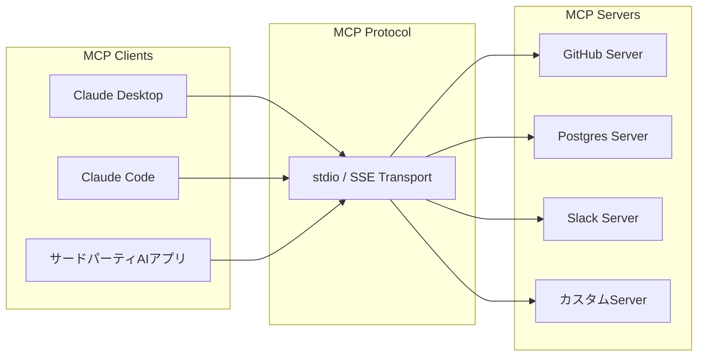
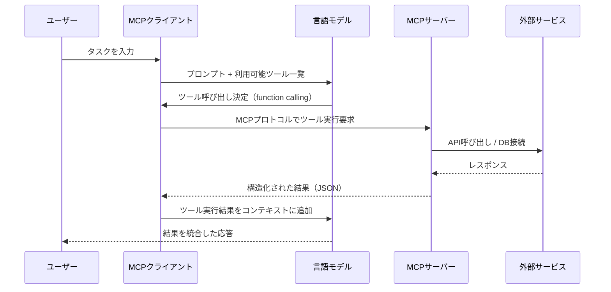

## ブログ概要（Summary）

本記事は [Anthropic公式ブログ "Introducing the Model Context Protocol"](https://www.anthropic.com/news/model-context-protocol)（2024年11月25日公開）の解説記事です。

Model Context Protocol（MCP）は、Anthropicが2024年11月にオープンソースとして公開した、AIアシスタントと外部データソース・ツールを接続するための標準プロトコルである。従来、各データソースごとに個別のカスタム統合を実装する必要があった$N \times M$問題を、サーバー・クライアント型の共通プロトコルにより$N + M$の実装で解決することを目指している。公開から約2年が経過した現在、OpenAIやGoogle DeepMindにも採用され、2025年12月にはLinux Foundation傘下のAgentic AI Foundationに寄贈されるなど、AIエージェントのツール統合における事実上の標準となりつつある。

この記事は [Zenn記事: Claude Code Skills×MCP×Hooksでプロジェクト専用AI開発環境を構築する](https://zenn.dev/0h_n0/articles/fdd8b55ae2304e) の深掘りです。

## 情報源

- **種別**: 企業テックブログ
- **URL**: [https://www.anthropic.com/news/model-context-protocol](https://www.anthropic.com/news/model-context-protocol)
- **組織**: Anthropic
- **発表日**: 2024年11月25日
- **開発者**: David Soria Parra、Justin Spahr-Summers（Anthropic公式ブログより）

## 技術的背景（Technical Background）

### AIアシスタントにおける統合の課題

大規模言語モデル（LLM）ベースのAIアシスタントが実用的なタスクを遂行するには、外部のデータソースやツールへのアクセスが不可欠である。コンテンツリポジトリ、ビジネスツール、開発環境など、企業が利用するシステムは多岐にわたる。

Anthropicの公式ブログによると、従来はこれらのデータソースに対して「それぞれ独自のカスタム実装が必要だった（each new data source required its own custom implementation）」とされている。この問題は、$N$個のAIアプリケーションと$M$個の外部システムを接続する場合に$N \times M$個の個別コネクタが必要になるという組合せ爆発として定式化できる。

$$
\text{従来の統合コスト} \propto N \times M
$$

ここで、
- $N$: AIアプリケーション（クライアント）の数
- $M$: 外部データソース・ツール（サーバー）の数

この問題は、1990年代のデータベース接続におけるODBC/JDBCの登場前に存在していた問題と構造的に類似している。ODBCがドライバベースの抽象化レイヤーを導入してこの問題を解決したように、MCPはAIアシスタント領域においてプロトコルベースの抽象化を導入するものである。

### 学術研究との関連

LLMのツール利用（tool use / function calling）は、2023年以降の活発な研究テーマである。UCバークレーのPatilらが提案したGorilla（NeurIPS 2024）は、LLMをAPIに接続するfine-tuningアプローチを示した。しかし、個々のAPIごとにモデルを調整するアプローチはスケーラビリティに課題がある。MCPは、モデル側の調整ではなく、接続層のプロトコル標準化というアーキテクチャレベルの解決策を提示している。

## 実装アーキテクチャ（Architecture）

### クライアント・サーバー型アーキテクチャ

MCPのアーキテクチャは、以下の3つの主要コンポーネントで構成される。



**MCPサーバー**: 外部データソースやツールへのアクセスを提供するプロセス。各サーバーは、自身が提供できるツール（tool）、リソース（resource）、プロンプト（prompt）をプロトコルに従って宣言する。

**MCPクライアント**: AIアプリケーション側のコンポーネント。MCPサーバーとの通信を管理し、LLMが利用可能なツール一覧を動的に取得する。

**トランスポート層**: 初期リリースではstdio（標準入出力）によるローカルプロセス間通信が採用された。これにより、MCPサーバーはローカルプロセスとして動作し、AIアプリケーションと同一マシン上で安全に通信する。

Anthropicの公式ブログでは、この設計により「AIシステムが異なるツールやデータセット間を移動する際にコンテキストを維持できる（AI systems will maintain context as they move between different tools and datasets）」と述べられている。

### ツール呼び出しのフロー

MCPにおけるツール呼び出しの典型的なフローは以下の通りである。



このフローにおいて、LLMは既存のfunction calling機構を通じてツール呼び出しの意図を表現する。MCPクライアントがその意図をMCPプロトコルに変換し、適切なサーバーに転送する。この設計により、LLM側はMCPの詳細を意識する必要がなく、既存のtool use能力をそのまま活用できる。

### プロトコルの主要機能

MCP仕様には、以下の3つの主要な機能カテゴリが定義されている。

| 機能 | 説明 | 利用例 |
|------|------|--------|
| **Tools** | サーバーが提供する実行可能な操作 | ファイル検索、DB問い合わせ、API呼び出し |
| **Resources** | サーバーが公開する読み取り可能なデータ | ファイル内容、スキーマ情報、設定値 |
| **Prompts** | サーバーが提供するプロンプトテンプレート | コードレビュー用テンプレート、分析手順 |

加えて、**Sampling**（サーバーがLLMにテキスト生成を依頼する機能）と**Elicitation**（サーバーがユーザーに入力を要求する機能）が後に追加されている。

### TypeScript SDKによる実装例

Anthropicは公式SDKとしてTypeScript版とPython版を提供している。以下は、MCP TypeScript SDK v1系（`@modelcontextprotocol/sdk`）を使用したカスタムMCPサーバーの基本構造である。

```typescript
import { McpServer } from "@modelcontextprotocol/sdk/server/mcp.js";
import { StdioServerTransport } from "@modelcontextprotocol/sdk/server/stdio.js";
import { z } from "zod";

const server = new McpServer({
  name: "example-server",
  version: "1.0.0",
});

// ツール定義: 入力スキーマはzodで型安全に定義
server.tool(
  "get_data",
  "指定キーに対応するデータを取得する",
  {
    key: z.string().describe("取得するデータのキー"),
  },
  async ({ key }) => {
    const data = await fetchFromDatabase(key);
    return {
      content: [
        {
          type: "text" as const,
          text: JSON.stringify(data, null, 2),
        },
      ],
    };
  }
);

async function main(): Promise<void> {
  const transport = new StdioServerTransport();
  await server.connect(transport);
}

main().catch(console.error);
```

クライアント側の登録は、`.mcp.json`ファイルで宣言的に行う。

```json
{
  "mcpServers": {
    "example-server": {
      "command": "node",
      "args": ["./tools/mcp/example-server/dist/index.js"],
      "env": {
        "API_TOKEN": "${API_TOKEN}"
      }
    }
  }
}
```

この`.mcp.json`をプロジェクトルートに配置すれば、チーム全員が同じMCPサーバー構成を共有できる。環境変数による認証情報の注入により、シークレットのハードコードを回避する設計となっている。

## Production Deployment Guide

### AWS実装パターン（コスト最適化重視）

MCPサーバーを本番環境で運用する場合、トラフィック量に応じた構成選択が重要になる。以下は2026年10月時点のAWS ap-northeast-1（東京）リージョン料金に基づく概算である。

**トラフィック量別の推奨構成**:

| 規模 | 月間リクエスト | 推奨構成 | 月額コスト | 主要サービス |
|------|--------------|---------|-----------|------------|
| **Small** | ~3,000 (100/日) | Serverless | $50-150 | Lambda + API Gateway + DynamoDB |
| **Medium** | ~30,000 (1,000/日) | Hybrid | $300-800 | Lambda + ECS Fargate + ElastiCache |
| **Large** | 300,000+ (10,000/日) | Container | $2,000-5,000 | EKS + Karpenter + EC2 Spot |

**Small構成の詳細**（月額$50-150）:
- **Lambda**: 1GB RAM、60秒タイムアウト（$20/月）
- **API Gateway**: REST API、MCPクライアントからのHTTPリクエスト受付（$5/月）
- **DynamoDB**: On-Demand、ツール定義・セッションキャッシュ（$10/月）
- **CloudWatch**: 基本監視（$5/月）
- **Secrets Manager**: APIトークン管理（$5/月）

**Medium構成の詳細**（月額$300-800）:
- **Lambda**: イベント駆動処理（$50/月）
- **ECS Fargate**: 0.5 vCPU、1GB RAM × 2タスク、常駐MCPサーバー（$120/月）
- **ElastiCache Redis**: cache.t3.micro、ツール結果キャッシュ（$15/月）
- **Application Load Balancer**: MCPリクエストルーティング（$20/月）
- **Bedrock**: Claude 3.5 Sonnet（sampling機能利用時）（$400/月）

**Large構成の詳細**（月額$2,000-5,000）:
- **EKS**: コントロールプレーン（$72/月）
- **EC2 Spot Instances**: g5.xlarge × 2-4台（平均$800/月、最大90%削減）
- **Karpenter**: 自動スケーリング（追加コストなし）
- **S3**: リソースキャッシュ・ログストレージ（$20/月）
- **CloudWatch + X-Ray**: 詳細監視（$100/月）

**コスト削減テクニック**:
- Spot Instances使用で最大90%削減（EKS + Karpenter）
- Reserved Instances購入で最大72%削減（1年コミット）
- Bedrock Batch API使用で50%削減（非リアルタイム処理）
- DynamoDB TTLによるキャッシュ自動削除（ストレージコスト削減）
- アイドルタイムのAuto Scaling to Zero（Fargate / Lambda）

**注意**: 上記は2026年10月時点の東京リージョン概算。実際のコストはトラフィックパターンにより変動する。最新料金は[AWS料金計算ツール](https://calculator.aws/)で確認。

### Terraformインフラコード

**Small構成（Serverless）: Lambda + API Gateway + DynamoDB**

```hcl
module "vpc" {
  source  = "terraform-aws-modules/vpc/aws"
  version = "~> 5.0"

  name = "mcp-server-vpc"
  cidr = "10.0.0.0/16"
  azs  = ["ap-northeast-1a", "ap-northeast-1c"]
  private_subnets = ["10.0.1.0/24", "10.0.2.0/24"]

  enable_nat_gateway   = false
  enable_dns_hostnames = true
}

resource "aws_iam_role" "lambda_mcp" {
  name = "lambda-mcp-server-role"

  assume_role_policy = jsonencode({
    Version = "2012-10-17"
    Statement = [{
      Action = "sts:AssumeRole"
      Effect = "Allow"
      Principal = { Service = "lambda.amazonaws.com" }
    }]
  })
}

resource "aws_iam_role_policy" "mcp_permissions" {
  role = aws_iam_role.lambda_mcp.id

  policy = jsonencode({
    Version = "2012-10-17"
    Statement = [
      {
        Effect   = "Allow"
        Action   = ["dynamodb:GetItem", "dynamodb:PutItem", "dynamodb:Query"]
        Resource = aws_dynamodb_table.mcp_cache.arn
      },
      {
        Effect   = "Allow"
        Action   = ["secretsmanager:GetSecretValue"]
        Resource = "arn:aws:secretsmanager:ap-northeast-1:*:secret:mcp-*"
      }
    ]
  })
}

resource "aws_lambda_function" "mcp_server" {
  filename      = "mcp-server.zip"
  function_name = "mcp-server-handler"
  role          = aws_iam_role.lambda_mcp.arn
  handler       = "index.handler"
  runtime       = "nodejs20.x"
  timeout       = 60
  memory_size   = 1024

  environment {
    variables = {
      DYNAMODB_TABLE = aws_dynamodb_table.mcp_cache.name
      NODE_ENV       = "production"
    }
  }
}

resource "aws_dynamodb_table" "mcp_cache" {
  name         = "mcp-tool-cache"
  billing_mode = "PAY_PER_REQUEST"
  hash_key     = "tool_call_hash"

  attribute {
    name = "tool_call_hash"
    type = "S"
  }

  ttl {
    attribute_name = "expire_at"
    enabled        = true
  }
}

resource "aws_cloudwatch_metric_alarm" "lambda_errors" {
  alarm_name          = "mcp-server-errors"
  comparison_operator = "GreaterThanThreshold"
  evaluation_periods  = 1
  metric_name         = "Errors"
  namespace           = "AWS/Lambda"
  period              = 300
  statistic           = "Sum"
  threshold           = 5
  alarm_description   = "MCPサーバーのエラー率異常"

  dimensions = {
    FunctionName = aws_lambda_function.mcp_server.function_name
  }
}
```

**Large構成（Container）**: EKS + Karpenter + Spot Instancesの構成は、Small構成をベースにEKSクラスタ（`terraform-aws-modules/eks/aws ~> 20.0`、cluster_version 1.31）とKarpenter NodePool（Spot優先、m6i.large/xlarge）を追加し、AWS Budgets（月額$5,000上限、80%で警告）を設定する。

### セキュリティベストプラクティス

MCPサーバーの認可メカニズムはコミュニティで「まだ成熟途上」と指摘されている。本番運用ではIAM最小権限の原則、Secrets Managerによる認証情報管理（`.mcp.json`への直接記載禁止）、CloudTrail監査ログ、TLS 1.2以上の暗号化を適用する。

### 運用・監視設定

**CloudWatch Logs Insights クエリ**:

```sql
-- MCPツール呼び出しの異常検知: 1時間あたりの呼び出し回数
fields @timestamp, tool_name, duration_ms, status_code
| stats count(*) as call_count, avg(duration_ms) as avg_latency by bin(1h), tool_name
| filter call_count > 1000

-- レイテンシ分析: P95, P99
fields @timestamp, duration_ms, tool_name
| stats pct(duration_ms, 95) as p95, pct(duration_ms, 99) as p99 by bin(5m)
```

**CloudWatch アラーム設定（Python）**:

```python
import boto3

cloudwatch = boto3.client('cloudwatch')

cloudwatch.put_metric_alarm(
    AlarmName='mcp-server-latency-spike',
    ComparisonOperator='GreaterThanThreshold',
    EvaluationPeriods=2,
    MetricName='Duration',
    Namespace='AWS/Lambda',
    Period=300,
    Statistic='p99',
    Threshold=30000,
    ActionsEnabled=True,
    AlarmActions=['arn:aws:sns:ap-northeast-1:123456789:mcp-alerts'],
    AlarmDescription='MCPサーバーP99レイテンシ30秒超過'
)
```

**X-Ray トレーシング**: `aws_xray_sdk`の`patch_all()`でboto3を自動計装し、`@xray_recorder.capture`デコレータでMCPツール実行を記録する。`put_annotation`でツール名、`put_metadata`で引数と結果サイズを保存する。

**Cost Explorer自動レポート**: boto3の`ce.get_cost_and_usage()`で日次コストを取得し、サービス別に$100/日超過を検知してSNS通知する。

### コスト最適化チェックリスト

**アーキテクチャ選択（トラフィック量で判断）**:
- [ ] ~100 req/日 → Lambda + API Gateway（Serverless）- $50-150/月
- [ ] ~1,000 req/日 → ECS Fargate + ALB（Hybrid）- $300-800/月
- [ ] 10,000+ req/日 → EKS + Spot Instances（Container）- $2,000-5,000/月

**リソース最適化**:
- [ ] EC2: Spot Instances優先（最大90%削減、Karpenter自動管理）
- [ ] Reserved Instances: 1年コミットで72%削減（予測可能な負荷）
- [ ] Savings Plans: Compute Savings Plans検討（柔軟性高）
- [ ] Lambda: メモリサイズ最適化（CloudWatch Lambda Insights分析）
- [ ] ECS/EKS: アイドルタイムのスケールダウン（夜間0台）

**MCPサーバー固有の最適化**:
- [ ] ツール結果キャッシュ: 同一引数の呼び出し結果をDynamoDB/Redisでキャッシュ
- [ ] 接続プール: 外部APIへの接続を再利用（Lambda Extensions活用）
- [ ] バッチ処理: 複数ツール呼び出しの並列実行
- [ ] タイムアウト設定: MCPサーバーのタイムアウトを外部API応答時間に合わせて最適化

**監視・アラート**:
- [ ] AWS Budgets（80%警告）、CloudWatchアラーム（レイテンシ/エラー率）、Cost Anomaly Detection、日次コストレポート

**リソース管理**:
- [ ] 未使用リソース削除（Trusted Advisor）、タグ戦略（環境/サーバー別）、DynamoDB TTL（30日）、開発環境夜間停止

## パフォーマンス最適化（Performance）

### N×M問題の解消による開発効率

MCPの最大の貢献は、統合コストの構造的な削減にある。

$$
\text{MCPによる統合コスト} \propto N + M
$$

$N$個のAIアプリケーションと$M$個の外部サービスがある場合、従来は$N \times M$個のカスタムコネクタが必要だった。MCPでは、各AIアプリケーションが1つのMCPクライアントを実装し、各外部サービスが1つのMCPサーバーを実装するだけで、すべての組み合わせが接続可能になる。

ある実務者向けブログでは統合工数の60-70%削減が報告されているが、特定事例に基づく数値であり一般化には注意が必要である。

### レイテンシ特性

MCPのstdioトランスポートはローカルプロセス間通信であるため、プロトコル自体のオーバーヘッドは最小限である。ボトルネックは通常、MCPサーバーが呼び出す外部APIの応答時間に支配される。

**チューニングのポイント**:
- MCPサーバー側のタイムアウト設定（Anthropicの公式ブログではデフォルト値の明記はないが、Claude Codeのhooksではデフォルト600秒が設定されている）
- ツール結果のキャッシュ（頻繁に呼び出されるクエリの結果をメモリ/DynamoDBに保持）
- 複数ツールの並列呼び出し（LLMが複数ツールを同時リクエストした場合の並行処理）

## 運用での学び（Production Lessons）

### エコシステムの発展と課題

MCPの公開後、エコシステムは急速に拡大した。公式ブログで言及されているBlock、Apollo、Zed、Replit、Codeium、Sourcegraphに加え、2025年3月にはOpenAIが公式にMCPの採用を表明した。

しかし、本番環境での運用にはいくつかの課題が指摘されている。

**セキュリティの成熟度**: コミュニティの本番運用レビューでは、リモートMCPサーバーの認可メカニズムが「まだ成熟途上」とされている。特にマルチテナント環境でのアクセス制御やオーセンティケーションの標準化が課題として挙げられている。

**ガバナンスの移行**: 2025年12月にAnthropicはMCPをLinux Foundation傘下のAgentic AI Foundation（AAIF）に寄贈した。これにより、単一企業の管理からコミュニティ主導のガバナンスに移行し、中立的な標準としての信頼性が向上した。

**補完プロトコルとの関係**: GoogleのA2A（Agent-to-Agent）プロトコルは、MCPとは異なるレイヤーの問題を解決する。MCPがエージェントとツール間の「垂直統合」を担うのに対し、A2Aはエージェント間の「水平連携」を担う。両者は競合ではなく補完関係にある。

### 運用上の注意点

- MCPサーバーはローカルプロセスとして動作するため、認証情報はローカルの環境変数で管理する。`.mcp.json`にトークンを直接記載しないこと
- 外部APIを呼び出すMCPサーバーには、タイムアウトとリトライ（指数バックオフ + ジッタ）を必ず実装する
- MCPサーバーのエラーハンドリングでは、外部サービスの障害がLLMの応答品質に波及しないよう、適切なフォールバックを設計する

## 学術研究との関連（Academic Connection）

MCPの設計は、LLMのツール利用に関する複数の学術研究と関連している。

- **Gorilla（Patil et al., NeurIPS 2024）**: LLMをAPIに接続するfine-tuningアプローチ。MCPはモデル調整ではなくプロトコル標準化という異なるアプローチをとっている
- **ToolACE（ICLR 2025）**: 関数呼び出し用の学習データを自動生成するパイプライン。MCPのツール定義スキーマはこうした学習データ標準化にも貢献し得る
- **SWE-agent（Yang et al., NeurIPS 2024）**: ACI設計がエージェント性能に与える影響を調査。MCPのツール`description`の重要性はACI設計原則と共通する

## まとめと実践への示唆

Model Context Protocolは、AIアシスタントと外部システムの統合における$N \times M$問題を、プロトコル標準化により$N + M$に削減するオープン標準である。2024年11月のAnthropicによる公開以降、OpenAI、Google DeepMindを含む主要AIプロバイダに採用され、2025年12月のLinux Foundation寄贈を経て業界標準としての地位を確立しつつある。

**実務への示唆**:
- プロジェクト固有の外部ツール連携にはカスタムMCPサーバーの構築が有効。公式SDKにより、TypeScriptまたはPythonで数十行のコードから実装可能
- 汎用的な連携（GitHub、Slack、DB）には既製MCPサーバーを活用し、カスタム開発は固有要件に集中する
- 本番運用ではセキュリティ（認証情報管理、ネットワーク制御）とエラーハンドリング（タイムアウト、リトライ）の実装が不可欠

**現時点での制約**:
- リモートMCPサーバーの認証・認可メカニズムはまだ発展途上
- マルチテナント環境での大規模運用には追加の設計考慮が必要
- プロトコル仕様の変更が今後も予想される（仕様はバージョニングされている）

## 参考文献

- **Blog URL**: [https://www.anthropic.com/news/model-context-protocol](https://www.anthropic.com/news/model-context-protocol)
- **MCP Specification**: [https://modelcontextprotocol.io](https://modelcontextprotocol.io)
- **GitHub Repositories**: [https://github.com/modelcontextprotocol](https://github.com/modelcontextprotocol)
- **Agent Skills Open Standard**: [https://agentskills.io](https://agentskills.io)
- **Related Zenn article**: [https://zenn.dev/0h_n0/articles/fdd8b55ae2304e](https://zenn.dev/0h_n0/articles/fdd8b55ae2304e)
