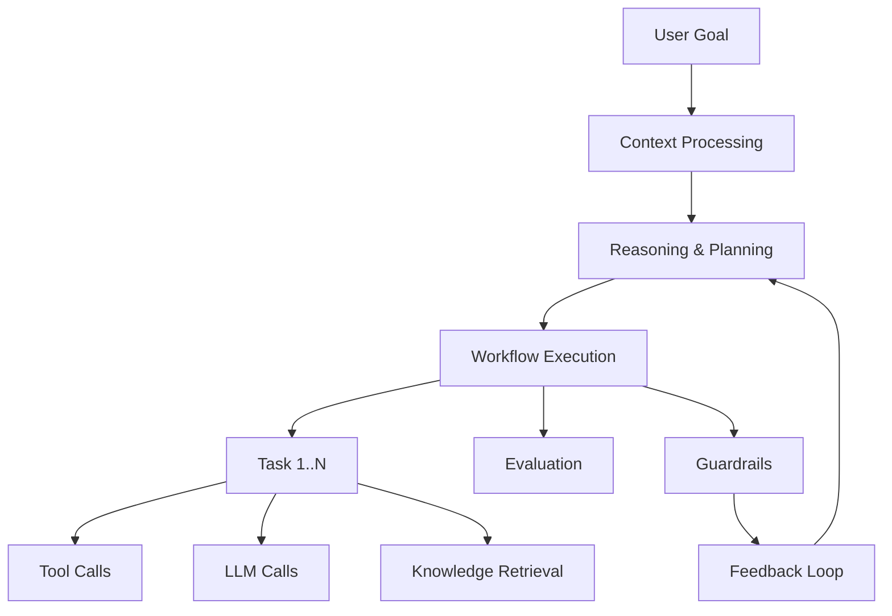

## 論文概要（Abstract）

本記事は [https://arxiv.org/abs/2411.05285](https://arxiv.org/abs/2411.05285) の解説記事です。

Dong, Lu, Zhu（2024）は、LLMエージェントの自律的・非決定的な振る舞いがAI安全性の課題を生じさせることを指摘し、DevOps観点から観測可能性（Observability）が不可欠であると主張している。著者らは既存のAgentOpsツール17種の体系的マッピング調査（Systematic Mapping Study）に基づき、エージェントのライフサイクル全体で追跡すべきアーティファクトとデータを特定する分類法（Taxonomy）を提示している。この分類法は、監視・ロギング・分析インフラの設計テンプレートとして機能することを意図している。

この記事は [Zenn記事: OpenTelemetry GenAIで分散エージェントのSLI/SLOとコスト可観測性を実装する](https://zenn.dev/0h_n0/articles/1288bfe5e7ffc6) の深掘りです。

## 情報源

- **arXiv ID**: 2411.05285
- **URL**: [https://arxiv.org/abs/2411.05285](https://arxiv.org/abs/2411.05285)
- **著者**: Liming Dong, Qinghua Lu, Liming Zhu
- **発表年**: 2024年11月（v2: 2024年11月30日）
- **分野**: cs.AI（人工知能）、cs.SE（ソフトウェア工学）

## 背景と動機（Background & Motivation）

LLMエージェントは多くのドメインで高い性能を示す一方、従来のソフトウェアシステムとは異なる4つの特性を持つと著者らは指摘している。第一に**自律性**（Autonomy）：エージェントはツール選択や実行順序を動的に決定するため、脆弱性のあるツールを選択するリスクがある。第二に**非決定性**（Non-determinism）：同一入力に対して異なる出力が生成される。第三に**継続的進化**（Continuous Evolution）：フィードバックから学習する過程で品質や安全性の目標から逸脱する可能性がある。第四に**共有責任**（Shared Accountability）：エージェント所有者、基盤モデル提供者、外部ツール提供者の間で責任が分散し、障害調査が複雑化する。

従来のDevOpsツールはLLMのメトリクスやプロンプト管理を中心に扱うが、エージェント固有のアーティファクト（ゴール、プラン、ツール選択等）に対するサポートは限定的であると著者らは述べている。この課題に対し、エージェント運用に特化した体系的なフレームワークとしてAgentOpsを提案している。

## 主要な貢献（Key Contributions）

- **AgentOps分類法**: エージェントのライフサイクル全体で追跡すべきアーティファクトとデータを体系化した分類法の提示
- **体系的マッピング調査**: GitHubおよびGoogle検索を通じて17のAgentOpsツールを特定し、その機能を比較・分析
- **設計テンプレート**: 監視・ロギング・分析インフラの設計に利用可能なリファレンスモデルの構築

## 技術的詳細（Technical Details）

### 体系的マッピング調査の方法論

著者らはKitchenham & Chartersのシステマティックレビューガイドラインと、Garousi et al.のグレーリテラチャ統合手法に従っている。

**検索戦略**（論文Section IIIより）:

| 検索ソース | クエリ | 初期ヒット数 | 採択数 |
|-----------|--------|-------------|--------|
| GitHub | "AgentOps" | 37 | 4 |
| GitHub | "Agent" AND "DevOps" | 618 | 1 |
| GitHub | "Agent" AND "LLMOps" | 24 | 3 |
| GitHub | "Agent" AND "Observability" | 81 | 3 |
| Google | LLM + Agent + Observability + Tool | 上位3ページ | 6 |

**採択基準**（論文Table 1より）:
- I1: 観測可能性（モニタリング、トレーシング）をサポート
- I2: エージェントレベルまたはLLMアプリケーションレベルのトレーシングを提供
- I3: 正式リリースバージョンが存在
- I4: 公開ドキュメントが利用可能

### エージェントアーティファクトの実体関連モデル

著者らはエージェントのパイプラインを以下の段階に分解している（論文Figure 2より）:



**設計時アーティファクト**: コンテキストエンジン、外部ツール定義、ナレッジベース構成

**実行時アーティファクト**: ゴール、プラン、ワークフロー、タスク、ツール呼び出し、LLM呼び出し、推論コンテキスト、評価結果、ガードレール発動記録

### AgentOps分類法：スパン型とメタデータ

分類法の中核は**トレース**と**スパン**の階層構造である。トレースはユーザーのゴール要求から最終結果までの全経路をカバーし、スパンはその中の個別ステップを表現する。

**共通スパンメタデータ**:
- Name: スパン名
- Start timestamp / Duration: 開始時刻と所要時間
- Attributes: 入出力、エラー・トレースバック、トークン数等のメトリクス
- Events: スパン内で発生したイベント
- Parent ID: 親スパンへのリンク
- Links: 他スパンや外部リソースへの参照

**スパン型一覧**（論文Figure 3より）:

| スパン型 | 追跡対象 |
|----------|---------|
| Agent | エージェントのロール、ペルソナ |
| Reasoning | コンテキスト、取得知識、推論ルール・境界、結論 |
| Planning | ゴール、制約、コンテキスト、過去のプラン |
| Workflow | タスク群、タスク依存関係、実行コンテキスト、履歴 |
| Task | 記述、ステータス（pending/in_progress/completed）、結果 |
| Tool | ツール名、バージョン、設定（タイムアウト、リソース制限等） |
| Evaluation | テストケース、評価メトリクス、テスト結果 |
| Guardrail | トリガーされたアクション（block/filter/validate）、対象 |
| LLM | モデル名、バージョン、パラメータ（temperature、max_tokens等） |

この構造はOpenTelemetry GenAI Semantic Conventionsの`invoke_agent`や`execute_tool`スパン型と対応関係にある。ただし、AgentOpsではReasoning、Planning、Workflow、Evaluationといった、GenAI Conventionsでは現時点で標準化されていないスパン型も含まれている点が特徴的である。

### ツール機能の比較分析

著者らは17ツールの機能を7カテゴリで比較している（論文Table 4より）:

| 機能 | 対応ツール数（/17） | 主要な対応ツール |
|------|-------------------|----------------|
| トレーシング | 17 | 全ツール |
| モニタリング | 17 | 全ツール |
| 評価（Evaluation） | 15 | Langfuse, Arize Phoenix, LangSmith等 |
| プロンプト管理 | 約半数 | Langfuse, Agenta, Dify等 |
| ガードレール | 6 | AgentOps, Arize, Dify, LangSmith, Lunary, Trulens |
| フィードバック | 多数 | 明示的（評価スコア）と暗黙的（クリック率等） |
| カスタマイズ | 主にエージェント特化ツール | AgentNeo, AgentOps, Agenta, Dify |

**スコープ別の分類**（論文Table 3より）:
- **エージェント特化**: AgentNeo（GitHub Stars: 1k）、AgentOps（2.1k）、AGIFlow（21）、Datadog（2.9k）
- **LLMアプリ汎用**: Langfuse（6.5k）、Dify（51.6k）、PortKey（6.3k）、TraceLoop（3.4k）等

著者らは、トレーシングとモニタリングは全ツールが提供する一方、ガードレールは6ツールのみが対応しており、安全性機能の統合がまだ発展途上であると指摘している。

### 評価の3レベル

著者らは評価を以下の3レベルに分類している:

1. **最終応答レベル**: ユーザーに返された最終出力の品質評価
2. **単一ステップレベル**: 個別のツール選択やLLM呼び出しの妥当性評価
3. **軌跡レベル（Trajectory）**: 一連のアクションシーケンスが最適であったかの評価

この3レベル構造は、Zenn記事で解説されているSLI/SLOの設計と直接対応する。タスク成功率（最終応答レベル）、ループ回数（軌跡レベル）、コスト予算消化率（全レベル横断）の各SLIは、この評価階層の異なるレベルに位置づけられる。

## 実装のポイント（Implementation）

AgentOpsの分類法を実際のシステムに実装する際の要点を以下にまとめる。

**スパン設計の指針**:

```python
from opentelemetry import trace

tracer = trace.get_tracer("agentops.taxonomy")

def execute_agent_task(goal: str, agent_name: str) -> dict:
    """AgentOps分類法に基づくスパン階層の実装例."""
    with tracer.start_as_current_span(
        "agent_execution",
        attributes={
            "agent.role": agent_name,
            "agent.goal": goal,
        },
    ) as agent_span:
        # Reasoningスパン
        with tracer.start_as_current_span(
            "reasoning",
            attributes={
                "reasoning.context_source": "knowledge_base",
                "reasoning.inference_rules": "chain_of_thought",
            },
        ):
            plan = _generate_plan(goal)

        # Planningスパン
        with tracer.start_as_current_span(
            "planning",
            attributes={
                "planning.goal": goal,
                "planning.constraints": "budget_limit_10usd",
                "planning.task_count": len(plan["tasks"]),
            },
        ):
            workflow = _create_workflow(plan)

        # Workflowスパン（タスク群の実行）
        results = []
        for task in workflow["tasks"]:
            with tracer.start_as_current_span(
                f"task_{task['id']}",
                attributes={
                    "task.description": task["description"],
                    "task.status": "in_progress",
                },
            ) as task_span:
                result = _execute_task(task)
                task_span.set_attribute("task.status", "completed")
                results.append(result)

        # Evaluationスパン
        with tracer.start_as_current_span(
            "evaluation",
            attributes={
                "evaluation.level": "trajectory",
                "evaluation.metrics": "task_success_rate",
            },
        ):
            score = _evaluate_trajectory(results)

        return {"results": results, "score": score}
```

**実装時の注意点**:

- **スパンリンクの設計**: 著者らはスパン間のリンクや相互作用が不完全になりうることを認めている。実装では`span.add_link()`を活用し、タスク間の依存関係を明示的にトレースに記録する
- **ガードレールの統合**: 全17ツール中6ツールしかガードレール機能を持たない。OTel Collectorのprocessorでプロンプトインジェクション検知やPII除去を行う設計が現実的である
- **フィードバック収集**: 明示的フィードバック（評価スコア）は実装が容易だが頻度が低い。暗黙的フィードバック（利用パターン）は頻度が高いが実装が複雑であると著者らは述べている

## Production Deployment Guide

### AWS実装パターン（コスト最適化重視）

AgentOps分類法に基づくエージェント観測基盤をAWS上に構築する場合の推奨構成を示す。

**トラフィック量別の推奨構成**:

| 規模 | 月間リクエスト | 推奨構成 | 月額コスト | 主要サービス |
|------|--------------|---------|-----------|------------|
| **Small** | ~3,000 (100/日) | Serverless | $50-150 | Lambda + X-Ray + DynamoDB |
| **Medium** | ~30,000 (1,000/日) | Hybrid | $300-800 | Lambda + ECS Fargate + OpenSearch |
| **Large** | 300,000+ (10,000/日) | Container | $2,000-5,000 | EKS + Grafana + Prometheus |

**Small構成の詳細**（月額$50-150）:
- **Lambda**: エージェント実行ホスト、1GB RAM、60秒タイムアウト（$20/月）
- **X-Ray**: 分散トレーシング（$5/月、100kトレース以内無料枠あり）
- **DynamoDB**: スパンメタデータ・評価結果の保存、On-Demand（$10/月）
- **CloudWatch Logs**: ログ集約（$10/月）
- **Bedrock**: LLM呼び出し（$50-100/月、モデル・利用量依存）

**Medium構成の詳細**（月額$300-800）:
- **Lambda**: イベント駆動処理（$50/月）
- **ECS Fargate**: OTel Collector常駐、0.5 vCPU × 1GB RAM × 2タスク（$120/月）
- **OpenSearch Serverless**: トレース検索・分析（$200/月）
- **Bedrock**: LLM呼び出し + Prompt Caching（$300/月）
- **ElastiCache Redis**: スパンバッファリング、cache.t3.micro（$15/月）

**Large構成の詳細**（月額$2,000-5,000）:
- **EKS**: コントロールプレーン（$72/月）
- **EC2 Spot Instances**: g5.xlarge × 2-4台（平均$800/月）
- **Grafana + Prometheus**: 監視ダッシュボード（$200/月）
- **OpenSearch**: トレースストア（$500/月）
- **S3**: 長期トレースアーカイブ（$20/月）

**コスト削減テクニック**:
- Spot Instances使用で最大90%削減（EKS + Karpenter）
- X-Rayサンプリングレート調整で不要トレース削減
- DynamoDB TTL設定で古いスパンデータを自動削除
- OpenSearch Serverlessのauto-scaling活用

**コスト試算の注意事項**:
- 上記は2026年10月時点のAWS ap-northeast-1（東京）リージョン料金に基づく概算値です
- 実際のコストはトラフィックパターン、リージョン、バースト使用量により変動します
- 最新料金は [AWS料金計算ツール](https://calculator.aws/) で確認してください

### Terraformインフラコード

**Small構成（Serverless）: Lambda + X-Ray + DynamoDB**

```hcl
# --- IAMロール（最小権限） ---
resource "aws_iam_role" "agent_lambda" {
  name = "agentops-lambda-role"

  assume_role_policy = jsonencode({
    Version = "2012-10-17"
    Statement = [{
      Action = "sts:AssumeRole"
      Effect = "Allow"
      Principal = { Service = "lambda.amazonaws.com" }
    }]
  })
}

resource "aws_iam_role_policy" "xray_tracing" {
  role = aws_iam_role.agent_lambda.id

  policy = jsonencode({
    Version = "2012-10-17"
    Statement = [
      {
        Effect = "Allow"
        Action = [
          "xray:PutTraceSegments",
          "xray:PutTelemetryRecords",
          "xray:GetSamplingRules",
          "xray:GetSamplingTargets"
        ]
        Resource = "*"
      },
      {
        Effect = "Allow"
        Action = [
          "dynamodb:PutItem",
          "dynamodb:GetItem",
          "dynamodb:Query"
        ]
        Resource = aws_dynamodb_table.agent_traces.arn
      }
    ]
  })
}

# --- Lambda関数（エージェント実行 + OTel計装） ---
resource "aws_lambda_function" "agent_handler" {
  filename      = "agent_lambda.zip"
  function_name = "agentops-handler"
  role          = aws_iam_role.agent_lambda.arn
  handler       = "index.handler"
  runtime       = "python3.12"
  timeout       = 60
  memory_size   = 1024

  tracing_config {
    mode = "Active"
  }

  environment {
    variables = {
      OTEL_SERVICE_NAME           = "agentops-agent"
      OTEL_EXPORTER_OTLP_ENDPOINT = "http://localhost:4317"
      DYNAMODB_TABLE              = aws_dynamodb_table.agent_traces.name
    }
  }
}

# --- DynamoDB（スパンメタデータ保存） ---
resource "aws_dynamodb_table" "agent_traces" {
  name         = "agentops-traces"
  billing_mode = "PAY_PER_REQUEST"
  hash_key     = "trace_id"
  range_key    = "span_id"

  attribute {
    name = "trace_id"
    type = "S"
  }

  attribute {
    name = "span_id"
    type = "S"
  }

  ttl {
    attribute_name = "expire_at"
    enabled        = true
  }
}

# --- CloudWatchアラーム（異常検知） ---
resource "aws_cloudwatch_metric_alarm" "agent_error_rate" {
  alarm_name          = "agentops-error-rate"
  comparison_operator = "GreaterThanThreshold"
  evaluation_periods  = 2
  metric_name         = "Errors"
  namespace           = "AWS/Lambda"
  period              = 300
  statistic           = "Sum"
  threshold           = 10
  alarm_description   = "エージェント実行エラー率異常"

  dimensions = {
    FunctionName = aws_lambda_function.agent_handler.function_name
  }
}
```

**Large構成（Container）: EKS + OTel Collector + Grafana**

```hcl
# --- EKSクラスタ ---
module "eks" {
  source  = "terraform-aws-modules/eks/aws"
  version = "~> 20.0"

  cluster_name    = "agentops-cluster"
  cluster_version = "1.31"

  vpc_id     = module.vpc.vpc_id
  subnet_ids = module.vpc.private_subnets

  cluster_endpoint_public_access = true
  enable_cluster_creator_admin_permissions = true
}

# --- Karpenter（Spot優先のオートスケーリング） ---
resource "kubectl_manifest" "karpenter_nodepool" {
  yaml_body = <<-YAML
    apiVersion: karpenter.sh/v1
    kind: NodePool
    metadata:
      name: agentops-spot
    spec:
      template:
        spec:
          requirements:
            - key: karpenter.sh/capacity-type
              operator: In
              values: ["spot"]
            - key: node.kubernetes.io/instance-type
              operator: In
              values: ["m6i.xlarge", "m6i.2xlarge", "m7i.xlarge"]
          expireAfter: 720h
      limits:
        cpu: "64"
        memory: "256Gi"
      disruption:
        consolidationPolicy: WhenEmptyOrUnderutilized
  YAML
}

# --- OTel Collector Helm ---
resource "helm_release" "otel_collector" {
  name       = "otel-collector"
  repository = "https://open-telemetry.github.io/opentelemetry-helm-charts"
  chart      = "opentelemetry-collector"
  version    = "0.108.0"

  set {
    name  = "mode"
    value = "deployment"
  }

  set {
    name  = "config.receivers.otlp.protocols.grpc.endpoint"
    value = "0.0.0.0:4317"
  }
}

# --- Cost Explorerアラート ---
resource "aws_budgets_budget" "agentops_monthly" {
  name         = "agentops-monthly-budget"
  budget_type  = "COST"
  limit_amount = "5000"
  limit_unit   = "USD"
  time_unit    = "MONTHLY"

  notification {
    comparison_operator        = "GREATER_THAN"
    threshold                  = 80
    threshold_type             = "PERCENTAGE"
    notification_type          = "ACTUAL"
    subscriber_email_addresses = ["ops@example.com"]
  }
}
```

### 運用・監視設定

**CloudWatch Logs Insights クエリ**:

```sql
-- エージェントスパン別のエラー率
fields @timestamp, span_type, agent_name, error_type
| filter ispresent(error_type)
| stats count(*) as error_count by span_type, agent_name, bin(1h)
| sort error_count desc

-- 評価レベル別のスコア分布
fields @timestamp, evaluation_level, evaluation_score
| stats avg(evaluation_score) as avg_score,
        pct(evaluation_score, 50) as p50,
        pct(evaluation_score, 95) as p95
  by evaluation_level, bin(1d)
```

**CloudWatch アラーム（AgentOps対応）**:

```python
import boto3

cloudwatch = boto3.client('cloudwatch')

cloudwatch.put_metric_alarm(
    AlarmName='agentops-task-success-rate',
    ComparisonOperator='LessThanThreshold',
    EvaluationPeriods=3,
    MetricName='TaskSuccessRate',
    Namespace='AgentOps',
    Period=300,
    Statistic='Average',
    Threshold=0.95,
    ActionsEnabled=True,
    AlarmActions=['arn:aws:sns:ap-northeast-1:123456789:agentops-alerts'],
    AlarmDescription='タスク成功率が95%を下回った場合のアラート'
)

cloudwatch.put_metric_alarm(
    AlarmName='agentops-guardrail-trigger',
    ComparisonOperator='GreaterThanThreshold',
    EvaluationPeriods=1,
    MetricName='GuardrailTriggerCount',
    Namespace='AgentOps',
    Period=60,
    Statistic='Sum',
    Threshold=50,
    AlarmDescription='ガードレール発動回数の急増検知'
)
```

**X-Rayトレーシング設定**:

```python
from aws_xray_sdk.core import xray_recorder, patch_all

patch_all()

@xray_recorder.capture('agent_reasoning')
def trace_reasoning_span(context: str, rules: list[str]) -> dict:
    """AgentOps Reasoningスパンの計装."""
    subsegment = xray_recorder.current_subsegment()
    subsegment.put_annotation('span_type', 'reasoning')
    subsegment.put_annotation('context_source', 'knowledge_base')
    subsegment.put_metadata('inference_rules', rules)

    result = _run_reasoning(context, rules)

    subsegment.put_metadata('conclusion', result['conclusion'])
    return result
```

**Cost Explorer日次レポート**:

```python
import boto3
from datetime import datetime, timedelta

ce = boto3.client('ce')

response = ce.get_cost_and_usage(
    TimePeriod={
        'Start': (datetime.now() - timedelta(days=1)).strftime('%Y-%m-%d'),
        'End': datetime.now().strftime('%Y-%m-%d')
    },
    Granularity='DAILY',
    Metrics=['UnblendedCost'],
    GroupBy=[
        {'Type': 'SERVICE', 'Key': 'SERVICE'},
    ],
    Filter={
        'Tags': {
            'Key': 'project',
            'Values': ['agentops']
        }
    }
)

for result in response['ResultsByTime']:
    for group in result['Groups']:
        service = group['Keys'][0]
        cost = float(group['Metrics']['UnblendedCost']['Amount'])
        if cost > 100:
            print(f"⚠️ {service}: ${cost:.2f}/day")
```

### コスト最適化チェックリスト

**アーキテクチャ選択（トラフィック量で判断）**:
- [ ] ~100 req/日 → Lambda + X-Ray（Serverless）: $50-150/月
- [ ] ~1,000 req/日 → ECS Fargate + OpenSearch（Hybrid）: $300-800/月
- [ ] 10,000+ req/日 → EKS + Grafana + Prometheus（Container）: $2,000-5,000/月

**リソース最適化**:
- [ ] EC2: Spot Instances優先（Karpenter自動管理）
- [ ] Reserved Instances: 予測可能な負荷に1年コミットで72%削減
- [ ] Lambda: メモリサイズ最適化（Power Tuning活用）
- [ ] ECS/EKS: アイドルタイムのスケールダウン
- [ ] X-Ray: サンプリングレート調整（全トレース不要）

**トレーシングコスト削減**:
- [ ] サンプリング戦略: エラートレースは100%、成功トレースは10%
- [ ] スパン属性の制限: 不要な大きいペイロードを除外
- [ ] TTL設定: 古いトレースデータを自動削除（DynamoDB/OpenSearch）
- [ ] バッチエクスポート: OTel CollectorのBatchProcessorで送信最適化

**監視・アラート（コスト異常の即時検知）**:
- [ ] AWS Budgets: 月額予算設定（80%で警告）
- [ ] CloudWatch アラーム: トークン使用量・エラー率
- [ ] Cost Anomaly Detection: 機械学習ベース異常検知
- [ ] 日次コストレポート: SNS/Slackへ自動送信

**リソース管理**:
- [ ] タグ戦略: 環境別（dev/staging/prod）でコスト可視化
- [ ] ライフサイクルポリシー: S3/DynamoDB/OpenSearchの古いデータ自動削除
- [ ] 未使用リソース削除: Lambda Insights, Trusted Advisor活用
- [ ] 開発環境: 夜間停止（ECS/EKS Auto Scaling to Zero）

## 実験結果（Results）

本論文は理論的フレームワークの提案が主目的であり、大規模な定量実験は含まれていない。ただし、17ツールの体系的マッピング調査から以下の知見が得られている。

**ツール機能のカバレッジ**（論文Table 4より）:

| 機能カテゴリ | 対応率 | 備考 |
|-------------|--------|------|
| トレーシング | 100%（17/17） | 全ツールが基本機能として提供 |
| モニタリング | 100%（17/17） | メトリクス・ダッシュボード |
| 評価 | 88%（15/17） | DataDog, TraceLoopが未対応 |
| プロンプト管理 | 約50% | Langfuse, Agenta, Dify等 |
| ガードレール | 35%（6/17） | 安全性機能の統合が発展途上 |
| カスタマイズ | 主にAgent特化ツール | AgentNeo, AgentOps等 |

著者らは、トレーシングとモニタリングはコモディティ化している一方、ガードレール統合やエージェント固有のカスタマイズ機能にはまだ大きなギャップがあると報告している。

## 実運用への応用（Practical Applications）

AgentOps分類法は、分散エージェントシステムの監視設計に直接適用可能である。

**OpenTelemetry GenAI Conventionsとの対応関係**:
- AgentOpsの`Agent`スパン → GenAI Conventionsの`invoke_agent`スパン
- AgentOpsの`Tool`スパン → GenAI Conventionsの`execute_tool`スパン
- AgentOpsの`LLM`スパン → GenAI Conventionsの`chat`/`text_completion`スパン
- AgentOpsの`Reasoning`/`Planning`/`Workflow`スパン → GenAI Conventionsでは未標準化

この対応関係から、現時点のGenAI Conventionsでは推論・計画・ワークフロー段階の観測可能性が不足していることがわかる。Zenn記事で解説されているカスタム属性（`app.llm.cost_usd`等）による拡張が、この不足を補う実践的アプローチである。

**スケーリング上の考慮事項**:
- スパン数はエージェントのステップ数に比例して増加する。1リクエストで10-50スパンが生成される場合、月間100万リクエストでは1,000万-5,000万スパンとなり、ストレージとクエリ性能の設計が重要になる
- 評価の3レベル（最終応答・単一ステップ・軌跡）すべてを本番で実行するとコストが増大する。本番環境では軌跡レベル評価をサンプリングし、単一ステップ評価は障害調査時のみ有効化する運用が現実的である

## 関連研究（Related Work）

- **AgentTelemetry**（Pathak et al., 2025, ACM）: GenAI Conventionsが対応しないエージェント固有の5つの実行フェーズ（計画、推論、安全性監視、エージェント間委譲、メモリ）を指摘しており、AgentOps分類法の課題と共通する
- **Agent System Operations**（Wang et al., 2026, arXiv:2606.01581）: AgentOpsフレームワークを監視・異常検出・根本原因特定・解決の4段階に拡張し、本論文の分類法を実運用パイプラインに組み込む方向性を示している
- **llmmas-otel**（Seyedghorban et al., 2026, arXiv:2608.24271）: OpenTelemetryベースのトレーシングと障害注入を組み合わせた実装ツールであり、AgentOps分類法の実証的検証に活用可能

## まとめと今後の展望

**主要な成果**:
- 17のAgentOpsツールの体系的調査に基づき、エージェントのライフサイクル全体で追跡すべきアーティファクトとスパン型を9種類に分類した
- 全ツールがトレーシングとモニタリングを提供する一方、ガードレール統合は35%のみであり、安全性機能の標準化が今後の課題である

**実務への示唆**:
- OpenTelemetry GenAI Conventionsは`invoke_agent`や`execute_tool`を標準化しているが、推論・計画・評価スパンは対象外である。AgentOps分類法はこれらの拡張設計のガイドラインとして活用できる
- エージェント固有のSLI設計（タスク成功率、ループ回数等）は、分類法の評価3レベル構造と整合させることで体系的に定義可能である

**今後の研究方向**:
- 著者らは、スパン間のリンクと相互作用の記録が不完全であることを制約として認めており、マルチエージェント間通信のトレース標準化が次の課題であると述べている
- プロトタイプAgentOpsツールの開発が計画されている

## 参考文献

- **arXiv**: [https://arxiv.org/abs/2411.05285](https://arxiv.org/abs/2411.05285)
- **Related Zenn article**: [https://zenn.dev/0h_n0/articles/1288bfe5e7ffc6](https://zenn.dev/0h_n0/articles/1288bfe5e7ffc6)
- **OpenTelemetry GenAI Semantic Conventions**: [https://github.com/open-telemetry/semantic-conventions-genai](https://github.com/open-telemetry/semantic-conventions-genai)

---

> **注記**: 本記事はAI（Claude Code）により自動生成されました。内容の正確性については原論文と照合していますが、実際の利用時は公式ドキュメントもご確認ください。
