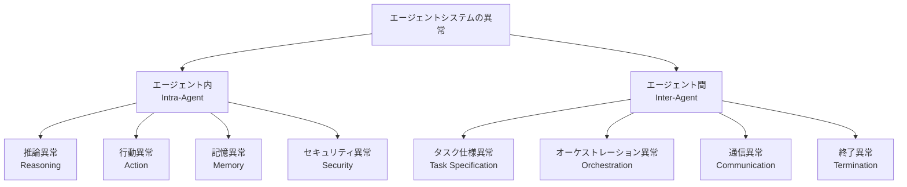
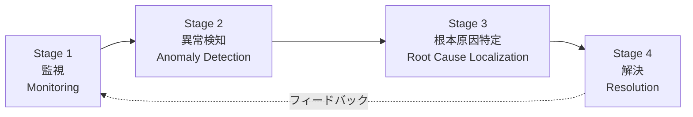

本記事は [https://arxiv.org/abs/2606.01581](https://arxiv.org/abs/2606.01581) の解説記事です。

## 論文概要（Abstract）

LLMベースのエージェントシステムは柔軟性と解釈可能性で注目を集めているが、従来のソフトウェアシステムと同様に異常が発生し、安定性とセキュリティを脅かす。著者らは「Agent System Operations（AgentOps）」というフレームワークを提案し、エージェントシステムの異常を体系的に分類した上で、**監視（Monitoring）→ 異常検知（Anomaly Detection）→ 根本原因特定（Root Cause Localization）→ 解決（Resolution）**の4段階で運用を行う枠組みを整理している。既存ツールの課題と今後の研究方向も示したサーベイ論文である。

この記事は [Zenn記事: OpenTelemetry GenAIで分散エージェントのSLI/SLOとコスト可観測性を実装する](https://zenn.dev/0h_n0/articles/1288bfe5e7ffc6) の深掘りです。

## 情報源

- **arXiv ID**: 2606.01581
- **URL**: [https://arxiv.org/abs/2606.01581](https://arxiv.org/abs/2606.01581)
- **著者**: Zexin Wang, Changhua Pei, Yuanhao Liu, Jingjing Li, Yintong Huo et al.
- **発表年**: 2026年（v2: 2026年9月6日改訂）
- **分野**: cs.MA（マルチエージェントシステム）

## 背景と動機（Background & Motivation）

LLMエージェントが本番環境で利用される場面が増えているが、その運用に関する体系的な研究は不足している。従来のWebサービス監視ではHTTPステータスコードやレイテンシで障害を検知できるが、エージェントシステムでは「HTTP 200を返しつつ幻覚を含む応答を生成する」「無限ループでトークンを浪費する」といった**意味的な障害**が発生する。著者らはこの問題を、DevOps/SREの知見をエージェントシステムに適用する「AgentOps」として定式化し、既存研究とツールを横断的に調査している。

著者らは、AgentOps（エージェントシステム**を**運用する）とAgenticOps（エージェント**で**他のシステムを運用する）を明確に区別しており、本論文は前者に焦点を当てている。

## 主要な貢献（Key Contributions）

- **貢献1**: エージェントシステムの異常を**エージェント内（intra-agent）**と**エージェント間（inter-agent）**に分類する体系的な異常分類法（Anomaly Taxonomy）の提案
- **貢献2**: 監視→異常検知→根本原因特定→解決の4段階からなるAgentOpsフレームワークの定義と、各段階の既存手法の整理
- **貢献3**: 96ペアのサンプルを用いた実験により、異常検知と根本原因特定の統合が解決精度を向上させることの検証
- **貢献4**: 既存ツール（LangFuse、Arize Phoenix、LangSmith等）が主に監視段階に留まっている課題の指摘と、今後の研究方向の提示

## 技術的詳細（Technical Details）

### 異常分類法（Anomaly Taxonomy）

著者らは、エージェントシステムの異常を発生時点（実行前・実行中・実行後）と発生箇所（エージェント内・エージェント間）の2軸で整理している。



**エージェント内異常**の4カテゴリ：

| カテゴリ | 説明 | 具体例 |
|---------|------|--------|
| 推論（Reasoning） | 事実・論理・タスク要件からの逸脱 | 幻覚生成、論理的矛盾、指示無視 |
| 行動（Action） | ツール呼び出しの失敗・不安全な実行 | 不正パラメータ、MCP設定ミス、APIタイムアウト |
| 記憶（Memory） | コンテキスト喪失、RAG検索の信頼性低下 | Lost-in-the-middle問題、無関係な文書の検索 |
| セキュリティ（Security） | 認可範囲外の操作 | プロンプトインジェクション、過剰な権限行使 |

**エージェント間異常**の4カテゴリ：

| カテゴリ | 説明 | 具体例 |
|---------|------|--------|
| タスク仕様（Task Specification） | 曖昧・矛盾したゴールや役割定義 | 相互矛盾する指示、役割の重複 |
| オーケストレーション（Orchestration） | グローバル計画の欠陥 | サブタスク欠落、循環依存、不適切なエージェント割り当て |
| 通信（Communication） | 冗長・過剰なメッセージング | リソース浪費、情報損失、メッセージ順序の逆転 |
| 終了（Termination） | 早期停止または停止不能 | 無限委譲ループ、完了条件の未達成での終了 |

この分類は、Zenn記事で紹介したSLI（タスク成功率、ループ回数）の設計根拠を裏付けるものである。ループ回数のSLIは終了異常の検知に、タスク成功率は推論異常やオーケストレーション異常の包括的な指標として機能する。

### AgentOpsフレームワーク

著者らが提案する4段階フレームワークは以下の構造を持つ。



#### Stage 1: 監視（Monitoring）

従来のメトリクス・ログ・トレースに加え、エージェント固有のデータを収集する必要がある。

**収集すべきデータ**：
- **標準テレメトリ**: メトリクス（レイテンシ、トークン数、エラー率）、構造化ログ、分散トレース
- **モデル内部信号**: ロジット分布、アテンションマップ（ホワイトボックス監視用）
- **ステップレベルチェックポイント**: 各ステップのメモリ状態、環境状態（ロールバック可能にするため）

著者らは、既存の監視ツール（LangFuse、Helicone、Arize Phoenix、LangSmith等）を調査し、これらが**メトリクス・ログ・トレースの収集と可視化**には優れているが、**異常検知・根本原因特定・自動解決**の機能は限定的であると指摘している。

OpenTelemetry GenAI Semantic Conventionsは、この監視段階のトレース収集に対応する標準化の試みであり、`invoke_agent`や`execute_tool`スパンでエージェントの実行を構造化できる。ただし、著者らが指摘するモデル内部信号やチェックポイントの収集はOTelの標準属性ではカバーされておらず、カスタム属性での拡張が必要となる。

#### Stage 2: 異常検知（Anomaly Detection）

異常検知は、モデルへのアクセスレベルに応じて3つのアプローチに分類される。

- **ホワイトボックス**: モデル内部（ロジット、隠れ状態）にアクセスし、出力の不確実性や矛盾を検知する。例えば、トークンレベルのエントロピーが閾値を超えた場合に幻覚の可能性を示す
- **グレーボックス**: モデルの入出力テキストに加え、確率スコア等の部分的な内部情報を利用する。自己一貫性チェック（同じ質問に複数回回答させて一致度を確認）が典型例
- **ブラックボックス**: 出力テキストのみから判断する。LLM-as-a-judgeによる評価や、NLI（自然言語推論）モデルによる矛盾検知が含まれる

著者らは、既存の検知手法がカテゴリ別に特化しており、**統一的なフレームワークが存在しない**ことを課題として挙げている。

#### Stage 3: 根本原因特定（Root Cause Localization）

「失敗帰属（Failure Attribution）」とも呼ばれ、上流の原因と下流の症状を分離する段階である。

主要な手法：
1. **軌道リプレイ＋スペクトラム分析**: 成功・失敗の実行軌道を比較し、失敗に相関するステップを統計的に特定する
2. **構造化トレースモデリング**: トレースデータから因果グラフを構築し、障害の伝播経路を追跡する
3. **LLMベース帰属**: LLMにトレースを読ませて原因を推定する。ただし長いトレースで精度が低下する問題がある

著者らの実験では、根本原因特定の追加による改善は統計的に有意ではなかったが、異常検知と組み合わせた場合には複合パス率の向上が確認されている。

#### Stage 4: 解決（Resolution）

解決策を実行タイミングで3つに分類している。

| タイミング | 手法 | 具体例 |
|-----------|------|--------|
| 事前（Preventive） | タスク再仕様化、計画検証、行動制限 | サンドボックス、権限制御、計画の形式検証 |
| 実行中（Corrective） | 観測に基づく再計画、自己修正、ランタイム強制 | ガードレール、ツール呼び出しの検証、リトライ |
| 事後（Recovery） | ロールバック・再実行、記憶更新、ポリシー修正 | チェックポイントからの復元、プロンプト改訂 |

## 実験結果（Results）

著者らは96ペアのサンプルを用いて、AgentOpsフレームワークの各段階の有効性を検証している。

| 条件 | 複合パス率 |
|------|-----------|
| 解決のみ（Resolution Only） | ベースライン |
| 異常検知 + 解決（AD + Resolution） | ベースラインより向上 |
| 異常検知 + 根本原因特定 + 解決（AD + RCL + Resolution） | 最高パス率を達成 |

著者らは、異常検知と根本原因特定を組み合わせることで解決精度が向上すると報告している（論文Section IV実験より）。ただし、根本原因特定単体の追加による改善は統計的に有意ではなかったとも述べており、サンプルサイズの制約が影響している可能性がある。

## 実装のポイント（Implementation）

この論文の知見を実装に活かすための要点：

1. **監視の多層化**: OpenTelemetryのスパン（`invoke_agent`、`execute_tool`、`chat`）に加え、カスタム属性でステップレベルの状態を記録する。例えば`app.agent.memory_size`や`app.agent.plan_step_count`といった属性を追加する

2. **意味的異常の検知**: HTTPステータスだけでなく、出力品質を評価するメトリクスを導入する。著者らが指摘するように、LLM-as-a-judgeやNLIモデルによるリアルタイム評価が有効である

3. **構造化トレースの活用**: トレースデータを因果グラフとして分析し、障害の伝播経路を可視化する。Zenn記事で紹介したTraceQLクエリはこの分析の入口となる

4. **段階的導入**: まず監視（Stage 1）を整備し、次に異常検知（Stage 2）、その後根本原因特定（Stage 3）と段階的に拡張する。著者らの実験結果が示すように、全段階を統合することで最大の効果が得られる

```python
from opentelemetry import trace

tracer = trace.get_tracer("agentops.monitor")

def monitor_agent_step(agent_name: str, step_index: int) -> None:
    """AgentOpsフレームワークのStage 1に対応する監視実装例."""
    span = trace.get_current_span()

    # 標準テレメトリ（OTel GenAI属性）
    span.set_attribute("gen_ai.agent.name", agent_name)

    # エージェント固有のチェックポイント属性
    span.set_attribute("app.agent.step_index", step_index)
    span.set_attribute("app.agent.memory_state_hash", _hash_memory())
    span.set_attribute("app.agent.plan_remaining_steps", _count_remaining())

    # 異常検知用の信号（Stage 2への入力）
    span.set_attribute("app.agent.output_confidence", _estimate_confidence())
    span.set_attribute("app.agent.loop_count", _get_loop_count())
```

## Production Deployment Guide

### AWS実装パターン（コスト最適化重視）

AgentOpsフレームワークの4段階を本番環境に実装する場合のAWS構成を示す。

**トラフィック量別の推奨構成**:

| 規模 | 月間リクエスト | 推奨構成 | 月額コスト | 主要サービス |
|------|--------------|---------|-----------|------------|
| **Small** | ~3,000 (100/日) | Serverless | $80-200 | Lambda + CloudWatch + DynamoDB |
| **Medium** | ~30,000 (1,000/日) | Hybrid | $400-1,000 | Lambda + ECS Fargate + OpenSearch |
| **Large** | 300,000+ (10,000/日) | Container | $2,500-6,000 | EKS + Grafana Cloud + ElastiCache |

**Small構成の詳細**（月額$80-200）:
- **Lambda**（監視データ収集）: 512MB RAM, 30秒タイムアウト（$15/月）
- **CloudWatch Logs Insights**（異常検知クエリ）: ログスキャン量に応じて（$20/月）
- **DynamoDB**（チェックポイント保存）: On-Demand（$10/月）
- **SNS**（アラート通知）: （$5/月）
- **OTel Collector on Lambda Extension**: （追加コストなし）

**Medium構成の詳細**（月額$400-1,000）:
- **ECS Fargate**（OTel Collector常駐）: 0.5 vCPU, 1GB RAM × 2タスク（$120/月）
- **OpenSearch Serverless**（トレース分析・根本原因特定）: （$350/月）
- **Lambda**（異常検知パイプライン）: （$30/月）
- **ElastiCache Redis**（リアルタイムメトリクス集約）: cache.t3.micro（$15/月）

**Large構成の詳細**（月額$2,500-6,000）:
- **EKS**（OTel Collector + 検知エンジン）: コントロールプレーン（$72/月）
- **EC2 Spot Instances**（異常検知モデル実行）: c5.xlarge × 2（$200/月、Spot適用後）
- **Grafana Cloud**（ダッシュボード・アラート）: Pro tier（$300/月）
- **OpenSearch**（トレース保存・分析）: r6g.large × 2（$600/月）
- **Bedrock**（LLM-as-a-judge異常検知）: Claude 3.5 Haiku（$500/月）

**コスト試算の注意事項**:
- 上記は2026年10月時点のAWS ap-northeast-1（東京）リージョン料金に基づく概算値です
- OpenSearch Serverlessは最低料金が高いため、Small構成ではCloudWatch Logs Insightsを推奨
- 最新料金は [AWS料金計算ツール](https://calculator.aws/) で確認してください

### Terraformインフラコード

**Small構成（Serverless）: AgentOps監視パイプライン**

```hcl
# --- OTel Collector Lambda Extension用IAMロール ---
resource "aws_iam_role" "agentops_collector" {
  name = "agentops-otel-collector-role"

  assume_role_policy = jsonencode({
    Version = "2012-10-17"
    Statement = [{
      Action = "sts:AssumeRole"
      Effect = "Allow"
      Principal = { Service = "lambda.amazonaws.com" }
    }]
  })
}

resource "aws_iam_role_policy" "agentops_collector_policy" {
  role = aws_iam_role.agentops_collector.id

  policy = jsonencode({
    Version = "2012-10-17"
    Statement = [
      {
        Effect = "Allow"
        Action = [
          "logs:CreateLogGroup",
          "logs:CreateLogStream",
          "logs:PutLogEvents"
        ]
        Resource = "arn:aws:logs:ap-northeast-1:*:*"
      },
      {
        Effect   = "Allow"
        Action   = ["dynamodb:PutItem", "dynamodb:GetItem", "dynamodb:Query"]
        Resource = aws_dynamodb_table.agent_checkpoints.arn
      }
    ]
  })
}

# --- DynamoDB（エージェントチェックポイント保存） ---
resource "aws_dynamodb_table" "agent_checkpoints" {
  name         = "agentops-checkpoints"
  billing_mode = "PAY_PER_REQUEST"
  hash_key     = "trace_id"
  range_key    = "step_index"

  attribute {
    name = "trace_id"
    type = "S"
  }

  attribute {
    name = "step_index"
    type = "N"
  }

  ttl {
    attribute_name = "expire_at"
    enabled        = true
  }
}

# --- CloudWatch異常検知アラーム ---
resource "aws_cloudwatch_metric_alarm" "agent_loop_detection" {
  alarm_name          = "agentops-loop-detection"
  comparison_operator = "GreaterThanThreshold"
  evaluation_periods  = 1
  metric_name         = "AgentLoopCount"
  namespace           = "AgentOps"
  period              = 300
  statistic           = "Maximum"
  threshold           = 15
  alarm_description   = "エージェントループ回数がSLO閾値(15回)を超過"

  dimensions = {
    Environment = "production"
  }

  alarm_actions = [aws_sns_topic.agentops_alerts.arn]
}

# --- SNSアラート ---
resource "aws_sns_topic" "agentops_alerts" {
  name = "agentops-anomaly-alerts"
}
```

**Large構成（Container）: EKS + Grafana + 検知エンジン**

```hcl
module "eks" {
  source  = "terraform-aws-modules/eks/aws"
  version = "~> 20.0"

  cluster_name    = "agentops-cluster"
  cluster_version = "1.31"

  vpc_id     = module.vpc.vpc_id
  subnet_ids = module.vpc.private_subnets

  cluster_endpoint_public_access = true
  enable_cluster_creator_admin_permissions = true
}

# --- Karpenter（異常検知ワーカーの自動スケーリング） ---
resource "kubectl_manifest" "karpenter_provisioner" {
  yaml_body = <<-YAML
    apiVersion: karpenter.sh/v1alpha5
    kind: Provisioner
    metadata:
      name: agentops-detector
    spec:
      requirements:
        - key: karpenter.sh/capacity-type
          operator: In
          values: ["spot"]
        - key: node.kubernetes.io/instance-type
          operator: In
          values: ["c5.xlarge", "c5.2xlarge"]
      limits:
        resources:
          cpu: "16"
          memory: "64Gi"
      ttlSecondsAfterEmpty: 60
  YAML
}

# --- AWS Budgets（AgentOps月額予算） ---
resource "aws_budgets_budget" "agentops_monthly" {
  name         = "agentops-monthly-budget"
  budget_type  = "COST"
  limit_amount = "6000"
  limit_unit   = "USD"
  time_unit    = "MONTHLY"

  notification {
    comparison_operator       = "GREATER_THAN"
    threshold                 = 80
    threshold_type            = "PERCENTAGE"
    notification_type         = "ACTUAL"
    subscriber_email_addresses = ["ops@example.com"]
  }
}
```

### セキュリティベストプラクティス

1. **トレースデータのPII除去**: エージェントのプロンプト・応答にPIIが含まれる可能性があるため、OTel Collectorの`transform`プロセッサで属性を切り詰めまたはハッシュ化する
2. **IAMロール最小権限**: 各Lambda/ECSタスクに必要最小限の権限のみ付与
3. **チェックポイントの暗号化**: DynamoDBのKMS暗号化を有効化し、エージェント状態の機密性を保護
4. **ネットワーク分離**: OTel Collectorはプライベートサブネットに配置し、VPCエンドポイント経由でCloudWatchに送信

### 運用・監視設定

**CloudWatch Logs Insightsクエリ（異常検知）**:

```sql
-- エージェントループ回数の異常検知
fields @timestamp, agent_name, loop_count, task_id
| filter loop_count > 10
| stats count(*) as anomaly_count by bin(1h), agent_name

-- 意味的異常の検知（タスク成功率の低下）
fields @timestamp, task_success, agent_name
| stats avg(task_success) as success_rate by bin(15m), agent_name
| filter success_rate < 0.95
```

**異常検知パイプライン（Python）**:

```python
import boto3
from datetime import datetime, timedelta

cloudwatch = boto3.client("cloudwatch")


def detect_agent_anomalies() -> list[dict]:
    """AgentOps Stage 2: 異常検知の実装例."""
    anomalies: list[dict] = []

    # ループ回数の閾値超過チェック
    response = cloudwatch.get_metric_statistics(
        Namespace="AgentOps",
        MetricName="AgentLoopCount",
        StartTime=datetime.utcnow() - timedelta(hours=1),
        EndTime=datetime.utcnow(),
        Period=300,
        Statistics=["Maximum", "Average"],
    )
    for dp in response["Datapoints"]:
        if dp["Maximum"] > 15:
            anomalies.append({
                "type": "termination",
                "subtype": "infinite_loop",
                "severity": "critical",
                "timestamp": dp["Timestamp"].isoformat(),
                "metric_value": dp["Maximum"],
            })

    # コスト予算消化率チェック
    ce = boto3.client("ce")
    cost_response = ce.get_cost_and_usage(
        TimePeriod={
            "Start": datetime.utcnow().replace(day=1).strftime("%Y-%m-%d"),
            "End": datetime.utcnow().strftime("%Y-%m-%d"),
        },
        Granularity="MONTHLY",
        Metrics=["UnblendedCost"],
    )
    monthly_cost = float(
        cost_response["ResultsByTime"][0]["Total"]["UnblendedCost"]["Amount"]
    )
    budget = 6000.0
    if monthly_cost / budget > 0.8:
        anomalies.append({
            "type": "cost",
            "subtype": "budget_exceeded_80pct",
            "severity": "warning",
            "metric_value": monthly_cost,
        })

    return anomalies
```

### コスト最適化チェックリスト

**アーキテクチャ選択（トラフィック量で判断）**:
- [ ] ~100 req/日 → Lambda + CloudWatch（Serverless） — $80-200/月
- [ ] ~1000 req/日 → ECS Fargate + OpenSearch（Hybrid） — $400-1,000/月
- [ ] 10000+ req/日 → EKS + Grafana Cloud（Container） — $2,500-6,000/月

**リソース最適化**:
- [ ] Spot Instances使用で異常検知ワーカーのコストを最大90%削減
- [ ] OpenSearch Serverless → CloudWatch Logs Insights切り替えで小規模環境のコスト削減
- [ ] トレースサンプリング率の調整（開発100%、本番10-20%）
- [ ] DynamoDB TTL設定でチェックポイントの自動削除（7日間保持）
- [ ] Lambda Power Tuningで最適メモリサイズを特定

**LLM異常検知コスト削減**:
- [ ] LLM-as-a-judge: Claude 3.5 Haiku使用（$0.25/MTok）で低コスト評価
- [ ] バッチ評価: リアルタイム全件ではなくサンプリング評価（10%）
- [ ] ルールベース + LLM: 明確なパターンはルールで検知、曖昧なケースのみLLMに委譲
- [ ] Prompt Caching: 評価プロンプトのシステム部分をキャッシュ

**監視・アラート**:
- [ ] AWS Budgets: 月額予算設定（80%で警告、100%でアラート）
- [ ] CloudWatch Anomaly Detection: ループ回数・コスト・レイテンシの自動異常検知
- [ ] バーンレートアラート: SLOエラーバジェットの消費速度監視
- [ ] 日次コストレポート: SNS/Slackへ自動送信

**リソース管理**:
- [ ] 未使用OpenSearchインデックスの自動削除（ISMポリシー）
- [ ] タグ戦略: 環境別（dev/staging/prod）+ 段階別（monitoring/detection/resolution）
- [ ] CloudWatch Logsの保持期間設定（30日）
- [ ] 開発環境のECS/EKSワーカーは夜間停止

## 実運用への応用（Practical Applications）

この論文のAgentOpsフレームワークは、Zenn記事で紹介したOpenTelemetry GenAI計装とSLI/SLO設計に直接対応する。具体的な対応関係：

| AgentOps段階 | Zenn記事の対応箇所 |
|-------------|------------------|
| Stage 1: 監視 | OTel GenAI計装（`invoke_agent`、`execute_tool`スパン） |
| Stage 2: 異常検知 | SLI閾値超過の検知（ループ回数 > 15、成功率 < 95%） |
| Stage 3: 根本原因特定 | TraceQLクエリによる障害トレースの分析 |
| Stage 4: 解決 | バーンレートアラート → オンコール対応 → プロンプト修正 |

著者らが指摘する「既存ツールは監視に偏っている」という課題は、**Stage 2以降を自前で構築する必要がある**ことを意味する。Zenn記事で実装したカスタムSLIとバーンレートアラートは、まさにStage 2（異常検知）の実装に相当する。

## 関連研究（Related Work）

- **AgentOps (arXiv:2411.05285)**: エージェントライフサイクル全体のアーティファクトとデータの分類法を提案。本論文はこれを運用フレームワークとして発展させている
- **llmmas-otel (arXiv:2608.24271)**: OpenTelemetryトレーシングとフォルトインジェクションを組み合わせたツール。本論文のStage 1（監視）とStage 2（異常検知）の実装例として位置づけられる
- **AgentSight (arXiv:2508.02736)**: eBPFベースのシステムレベル観測フレームワーク。アプリケーション層ではなくカーネル層からの監視アプローチを提案しており、本論文の監視段階を補完する

## まとめと今後の展望

著者らは、LLMエージェントシステムの運用を監視→異常検知→根本原因特定→解決の4段階フレームワークとして体系化した。既存ツールが監視段階に集中している現状を指摘し、異常検知と根本原因特定の統合が解決精度を向上させることを実験で示している。

**実務への示唆**として、OpenTelemetry GenAI計装はStage 1の基盤として有効だが、Stage 2以降（意味的異常の検知、根本原因特定、自動解決）は現時点では自前での構築が必要である。今後、エージェント固有の異常検知フレームワークの標準化や、自己修正機能の成熟が進むことで、AgentOpsの4段階がより統合的に実現されることが期待される。

## 参考文献

- **arXiv**: [https://arxiv.org/abs/2606.01581](https://arxiv.org/abs/2606.01581)
- **Related Work**: [AgentOps (arXiv:2411.05285)](https://arxiv.org/abs/2411.05285), [llmmas-otel (arXiv:2608.24271)](https://arxiv.org/abs/2608.24271)
- **Related Zenn article**: [https://zenn.dev/0h_n0/articles/1288bfe5e7ffc6](https://zenn.dev/0h_n0/articles/1288bfe5e7ffc6)

---

:::message
この記事はAI（Claude Code）により自動生成されました。内容の正確性については複数の情報源で検証していますが、実際の利用時は公式ドキュメントもご確認ください。
:::
