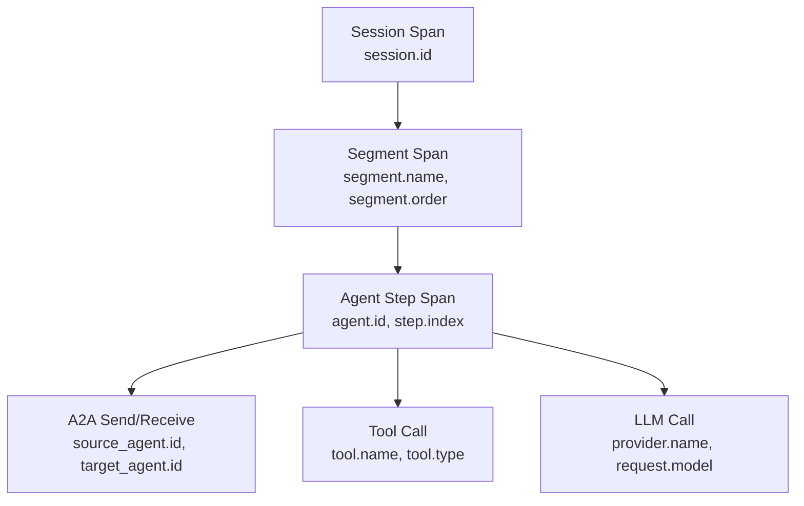

本記事は [https://arxiv.org/abs/2608.24271](https://arxiv.org/abs/2608.24271) の解説記事です。

## 論文概要（Abstract）

LLMベースのマルチエージェントシステム（LLM-MAS）のデバッグは、障害が実行の早い段階で発生し、はるかに後になって表面化するため困難である。著者らは**llmmas-otel**と呼ばれるツールを提案している。これはOpenTelemetryベースの分散トレーシングと障害注入（fault injection）を軽量かつフレームワーク非依存な形で組み合わせたものであり、既存のマルチエージェントシステムを置き換えるのではなく、少数の境界にラッパーを追加する形で導入できる。

この記事は [Zenn記事: OpenTelemetry GenAIで分散エージェントのSLI/SLOとコスト可観測性を実装する](https://zenn.dev/0h_n0/articles/1288bfe5e7ffc6) の深掘りです。

## 情報源

- **arXiv ID**: 2608.24271
- **URL**: [https://arxiv.org/abs/2608.24271](https://arxiv.org/abs/2608.24271)
- **著者**: Zahra Seyedghorban, Egor Klimov, Arie van Deursen, Annibale Panichella, Burcu Kulahcioglu Ozkan
- **発表年**: 2026年8月
- **分野**: cs.SE（Software Engineering）
- **公開リポジトリ**: [github.com/vagabondboffin/llmmas-otel](https://github.com/vagabondboffin/llmmas-otel)

## 背景と動機（Background & Motivation）

LLMベースのマルチエージェントシステムは、ソフトウェア開発タスク（コード生成、テスト、レビュー）において有望な成果を示している。しかし、その非決定的な性質により、従来のログや最終的な成功率だけでは「何が起きたのか」を再構成することが困難である。

著者らが指摘する主な課題は以下の3点である（論文Section I）：

- **障害の伝搬遅延**: あるエージェントの初期段階で発生した微小な問題が、後続のエージェント間通信やツール呼び出しを通じて増幅され、最終出力に大きな影響を与える
- **再現困難性**: LLMの確率的挙動により、同一入力でも異なる実行パスをたどるため、障害の再現と比較分析が難しい
- **既存ツールの限界**: 既存のLLM観測ツール（LangFuse, AgentOps等）はモニタリングに特化しており、制御された障害注入との組み合わせによる因果分析を提供していない

## 主要な貢献（Key Contributions）

- **貢献1**: OpenTelemetryベースの分散トレーシングと障害注入を統合した、フレームワーク非依存の軽量ツールllmmas-otelの設計と実装
- **貢献2**: セッション→セグメント→エージェントステップ→操作（A2A/ツール/LLM）の4層スパン階層によるマルチエージェント実行の構造化記録
- **貢献3**: 設定駆動型の障害注入メカニズムにより、再計装なしで同一ワークフローを異なる障害シナリオで繰り返し実行可能
- **貢献4**: ProgramDevベンチマーク（30タスク）およびChatDevでの初期検証により、微小な遅延がマルチエージェントシステムで大きく増幅されることを定量的に示した

## 技術的詳細（Technical Details）

### スパン階層アーキテクチャ

llmmas-otelの中核は、マルチエージェント実行を4層のスパン階層として構造化するトレーシングレイヤーである（論文Section II）。



各層の役割と主要属性は以下のとおりである：

| 層 | スパン種別 | 主要属性 | 役割 |
|---|---|---|---|
| セッション | Session | `session.id` | 1回の実行全体を包含するルートスパン |
| セグメント | Segment | `segment.name`, `segment.order`, `segment.origin` | ワークフローのフェーズ（設計、コーディング、テスト等） |
| エージェントステップ | Agent Step | `agent.id`, `step.index` | 特定エージェントの1ステップ（推論→行動のサイクル） |
| 操作 | A2A/Tool/LLM | 操作固有の属性群 | 実際のエージェント間通信・ツール呼び出し・LLM呼び出し |

属性は `llmmas.` プレフィックスで名前空間が区切られている。例えば、エージェント間通信のスパンには `llmmas.source_agent.id`、`llmmas.target_agent.id`、`llmmas.edge.id`、`llmmas.message.id` などが付与される。

### 操作レベルの属性設計

論文で定義されている各操作タイプの属性を整理する。

**A2A（Agent-to-Agent）通信**:

```python
# 送信側スパン属性の例（論文Section IIより）
span_attributes = {
    "llmmas.source_agent.id": "planner",
    "llmmas.target_agent.id": "coder",
    "llmmas.edge.id": "plan-to-code-001",
    "llmmas.message.id": "msg-abc123",
    "llmmas.channel": "direct",
    "llmmas.message.preview": "Implement the sorting...",
    "llmmas.message.sha256": "a3f2b8c1...",
}
```

**ツール呼び出し**:

| 属性 | 説明 | 例 |
|---|---|---|
| `operation.name` | 操作名 | `tool_call` |
| `tool.name` | ツール名 | `code_executor` |
| `tool.type` | ツール種別（任意） | `code_interpreter` |
| `tool.call.id` | 呼び出しID | `tc-001` |
| `tool.args.preview` | 引数プレビュー（任意） | `{"code": "def sort..."}` |
| `tool.args.sha256` | 引数ハッシュ（任意） | `b2c3d4e5...` |

**LLM呼び出し**:

| 属性 | 説明 | 例 |
|---|---|---|
| `operation.name` | 操作名 | `llm_call` |
| `provider.name` | プロバイダ名 | `openai` |
| `request.model` | モデル名 | `gpt-4o` |
| `request.id` | リクエストID | `req-xyz789` |
| `llm.input.preview` | 入力プレビュー（任意） | `"You are a...` |
| `llm.input.sha256` | 入力ハッシュ（任意） | `c4d5e6f7...` |

`preview` と `sha256` のペアは、プライバシー保護（プレビューを省略してハッシュのみ記録）とデバッグ利便性（プレビューで内容を確認）のバランスを取る設計である。

### トレース伝搬とコンテキスト注入

エージェント間通信においてトレースコンテキストを伝搬するため、著者らはOpenTelemetryの標準的なコンテキスト伝搬メカニズム（W3C Trace Context）を拡張している（論文Section II）。

```python
from opentelemetry.propagate import inject, extract

def send_message(target_agent: str, message: str) -> None:
    """エージェント間メッセージ送信時のトレースコンテキスト注入."""
    carrier: dict[str, str] = {}
    inject(carrier)  # traceparent, tracestate を carrier に注入

    # carrier をメッセージと共に送信
    transport.send(
        to=target_agent,
        payload=message,
        headers=carrier,
    )

def receive_message(headers: dict[str, str], message: str) -> None:
    """エージェント間メッセージ受信時のトレースコンテキスト復元."""
    context = extract(headers)
    # 復元したコンテキストを使って受信側スパンを開始
    with tracer.start_as_current_span(
        "a2a_receive",
        context=context,
        links=[Link(context)],
    ):
        process(message)
```

送信側で `inject()` によりトレースコンテキストをメッセージキャリアに注入し、受信側で `extract()` により復元する。これにより、プロセス境界をまたぐエージェント間通信がトレース上で明示的にリンクされる。

### 障害注入レイヤー

llmmas-otelの差別化ポイントは、観測性と障害注入を同一ツールに統合した点にある。障害注入ルールはフック・ポイント（LLM呼び出し、ツール呼び出し、A2A送信、A2A受信）で評価され、マッチしたルールがその境界でアクションを発火する。

論文で定義されている障害タイプの一覧（論文Section II, Table I相当）：

| フック・ポイント | 障害タイプ | 効果 |
|---|---|---|
| A2A送信 | `delay` | メッセージ送信の遅延 |
| A2A送信 | `drop` | メッセージの破棄 |
| A2A送信 | `truncate` | メッセージの切り詰め |
| A2A受信 | `delay` | メッセージ受信の遅延 |
| A2A受信 | `drop` | メッセージの破棄 |
| ツール呼び出し | `delay` | ツール応答の遅延 |
| ツール呼び出し | `not_installed` | ツール未インストールエラー |
| ツール呼び出し | `timeout` | タイムアウトエラー |
| ツール呼び出し | `malformed_response` | 不正な応答形式 |
| LLM呼び出し | `delay` | LLM応答の遅延 |
| LLM呼び出し | `rate_limit` | レートリミットエラー |
| LLM呼び出し | `timeout` | タイムアウトエラー |
| LLM呼び出し | `network_error` | ネットワークエラー |
| LLM呼び出し | `malformed_response` | 不正な応答形式 |

障害ルールはYAMLやJSON等の設定ファイルで定義でき、ターゲティングにはフック種別、フェーズ名、エージェントID、チャネル名などのメタデータを使用できる。これにより、**再計装なしで**同一ワークフローを異なる障害シナリオで繰り返し実行できる。

障害注入されたスパンには元のスパンタイプと位置が維持され、`llmmas.fault.injected`、`llmmas.fault.type`、`llmmas.fault.spec_id` 等の属性が追加される。これにより、ベースラインと障害ランのトレースが構造的に比較可能となる。

## 実装のポイント（Implementation）

### デコレータベースの計装API

llmmas-otelは薄いデコレータとコンテキストマネージャをパブリックAPIとして提供する。スパンファクトリがスパンの生成、属性の付与、通信境界をまたぐイベントのリンクを担当する。

```python
from llmmas_otel import trace_session, trace_segment, trace_agent_step

@trace_session(session_id="dev-session-001")
async def run_pipeline(task: str) -> str:
    """パイプライン全体をセッションスパンで計装."""

    @trace_segment(name="planning", order=1)
    async def planning_phase(task: str) -> str:
        """計画フェーズをセグメントスパンで計装."""

        @trace_agent_step(agent_id="planner", step_index=0)
        async def planner_step(task: str) -> str:
            # LLM呼び出し・ツール呼び出しは自動計装
            return await call_llm(model="gpt-4o", prompt=task)

        return await planner_step(task)

    plan = await planning_phase(task)
    code = await coding_phase(plan)
    return code
```

### ベースライン取得と障害注入のワークフロー

著者らが推奨する運用フロー（論文Section II）:

1. 既存のマルチエージェントシステムの境界（セッション開始、フェーズ遷移、エージェントステップ、操作）にデコレータを配置
2. 障害なしでタスクを実行し、ベースライントレースを取得
3. 障害ルールを設定ファイルで定義し、同一タスクを再実行
4. ベースラインと障害ランのトレースを構造的に比較

## 実験結果（Results）

### ProgramDevベンチマーク検証

著者らはProgramDevベンチマーク（30タスク、条件あたり5回実行）で検証を行っている（論文Section III）。評価指標は**増幅係数（Amplification）**で、追加されたエンドツーエンド実行時間を注入された遅延で割った値である。値が1に近ければ線形のオーバーヘッド、1を超えれば遅延が伝搬・増幅されていることを示す。

| システム | シナリオ | 平均増幅係数 | 中央値増幅係数 |
|---|---|---|---|
| デモ（最小構成） | LLM遅延（1000ms） | 1.053 | 1.036 |
| デモ（最小構成） | A2Aハンドオフ遅延（1000ms） | 1.295 | 1.390 |
| ChatDev | LLM遅延（1000ms） | 48.1 | 13.9 |
| ChatDev | A2Aハンドオフ遅延（1000ms） | 59.2 | 6.6 |

論文Table 1より。

**注目すべき結果**: 最小構成のデモシステムではLLM遅延がほぼ線形（1.053倍）であったのに対し、ChatDev（設計→コーディング→テストの複数フェーズを持つメッセージ密度の高いシステム）では、わずか1秒のLLM遅延が平均48.1倍に増幅されている。著者らはこの増幅が、マルチフェーズシステムにおける連鎖的な再試行と待機に起因すると分析している。

ChatDevのA2A遅延シナリオでは、平均（59.2倍）と中央値（6.6倍）の乖離が大きい。これは分布が強く右に歪んでおり、一部のタスクで遅延が極端に増幅されるケースが存在することを示している。

### 制約と今後の課題

著者らは以下の制約を明記している（論文Section V）：

- 現在の障害注入はA2A、LLM、ツールの境界に限定されており、ワークフローレベル、メモリ、協調戦略レベルの障害は未対応
- ペア実行の差分分析、トレース要約、根本原因ランキング、自動レポート生成は未実装で、ユーザーが直接トレースを検査する必要がある
- 検証は初期的なもので、大規模なマルチエージェントシステムでの評価は今後の課題

## 実運用への応用（Practical Applications）

### Zenn記事との関連

[Zenn記事](https://zenn.dev/0h_n0/articles/1288bfe5e7ffc6)ではOpenTelemetry GenAI Semantic Conventionsの`invoke_agent`（CLIENT/INTERNAL分離）と`execute_tool`スパンを使った計装を解説しているが、llmmas-otelは以下の点でこのアプローチを補完する：

- **セグメント層の導入**: GenAI Semantic Conventionsにはない「ワークフローフェーズ」の概念をセグメントスパンとして追加し、マルチフェーズパイプラインの可視化を実現
- **障害注入との統合**: 観測性だけでなく、制御された障害シナリオでの再実行により因果分析が可能
- **A2A通信の明示的モデリング**: エージェント間メッセージの送受信を別スパンとして記録し、通信境界でのコンテキスト伝搬を構造化

### 本番環境での適用パターン

- **カオスエンジニアリング**: ステージング環境でllmmas-otelの障害注入機能を使い、エージェントシステムの耐障害性を事前に検証する
- **回帰テスト**: 新しいエージェントやツールの追加時に、既存ワークフローのベースライントレースと比較し、性能劣化を検出する
- **SLO設定の根拠**: 増幅係数のデータを基に、エージェントシステムのレイテンシSLOを現実的な値に設定する

## Production Deployment Guide

### AWS実装パターン（コスト最適化重視）

llmmas-otelのトレーシングバックエンドとしてAWS上にOTelパイプラインを構築するパターンを示す。

**トラフィック量別の推奨構成**:

| 規模 | 月間トレース数 | 推奨構成 | 月額コスト | 主要サービス |
|------|------------|---------|-----------|------------|
| **Small** | ~3,000 | Serverless | $60-180 | Lambda + X-Ray + DynamoDB |
| **Medium** | ~30,000 | Hybrid | $350-900 | ECS Fargate (OTel Collector) + CloudWatch |
| **Large** | 300,000+ | Container | $2,500-6,000 | EKS + Managed Grafana + S3 |

**Small構成の詳細**（月額$60-180）:
- **Lambda**: エージェントワークフロー実行、1GB RAM、60秒タイムアウト（$25/月）
- **X-Ray**: 分散トレース収集・可視化（$5/月、100,000トレース/月まで無料枠）
- **CloudWatch Logs**: 構造化ログ収集（$15/月）
- **DynamoDB**: トレースメタデータ・障害ルール保存、On-Demand（$10/月）
- **API Gateway**: REST API（$5/月）

**Medium構成の詳細**（月額$350-900）:
- **ECS Fargate**: OTel Collector、0.5 vCPU × 1GB RAM × 2タスク（$60/月）
- **CloudWatch**: メトリクス・ログ・トレース統合（$100/月）
- **Managed Grafana**: ダッシュボード・アラート（$9/月/エディタ）
- **ElastiCache Redis**: スパンバッファリング、cache.t3.micro（$15/月）
- **S3**: トレースアーカイブ、ライフサイクルポリシー付き（$5/月）

**Large構成の詳細**（月額$2,500-6,000）:
- **EKS**: コントロールプレーン（$72/月）
- **EC2 Spot Instances**: OTel Collector + 分析ワーカー、c6i.xlarge × 2-4台（$200/月、Spot利用で最大90%削減）
- **Managed Grafana**: 本番ダッシュボード（$9/月/エディタ + データソース連携）
- **S3 + Athena**: 長期トレース保存とSQLクエリ分析（$100/月）
- **OpenSearch Serverless**: トレース検索・可視化（$700/月〜）

**コスト削減テクニック**:
- Spot Instances使用でOTel Collectorノードコスト最大90%削減（Karpenter自動管理）
- S3 Intelligent-Tieringでトレースアーカイブのストレージコスト最適化
- CloudWatch Logs Insightsの従量課金を活用し、常時起動の分析基盤を回避
- トレースサンプリング（head-based / tail-based）でデータ量を制御

**コスト試算の注意事項**:
- 上記は2026年10月時点のAWS ap-northeast-1（東京）リージョン料金に基づく概算値です
- 実際のコストはトレース量、スパン数、保持期間により変動します
- 最新料金は [AWS料金計算ツール](https://calculator.aws/) で確認してください

### Terraformインフラコード

**Small構成 (Serverless): Lambda + X-Ray + DynamoDB**

```hcl
# --- IAMロール（最小権限） ---
resource "aws_iam_role" "lambda_otel" {
  name = "lambda-otel-tracing-role"

  assume_role_policy = jsonencode({
    Version = "2012-10-17"
    Statement = [{
      Action = "sts:AssumeRole"
      Effect = "Allow"
      Principal = { Service = "lambda.amazonaws.com" }
    }]
  })
}

resource "aws_iam_role_policy" "xray_write" {
  role = aws_iam_role.lambda_otel.id

  policy = jsonencode({
    Version = "2012-10-17"
    Statement = [
      {
        Effect = "Allow"
        Action = [
          "xray:PutTraceSegments",
          "xray:PutTelemetryRecords"
        ]
        Resource = "*"
      },
      {
        Effect   = "Allow"
        Action   = ["dynamodb:PutItem", "dynamodb:GetItem", "dynamodb:Query"]
        Resource = aws_dynamodb_table.fault_rules.arn
      }
    ]
  })
}

# --- Lambda関数（エージェントワークフロー実行） ---
resource "aws_lambda_function" "agent_workflow" {
  filename      = "agent_workflow.zip"
  function_name = "llmmas-agent-workflow"
  role          = aws_iam_role.lambda_otel.arn
  handler       = "index.handler"
  runtime       = "python3.12"
  timeout       = 60
  memory_size   = 1024

  tracing_config {
    mode = "Active"  # X-Rayトレーシング有効化
  }

  environment {
    variables = {
      OTEL_SERVICE_NAME          = "llmmas-agent"
      OTEL_TRACES_EXPORTER       = "otlp"
      DYNAMODB_FAULT_RULES_TABLE = aws_dynamodb_table.fault_rules.name
    }
  }
}

# --- DynamoDB（障害ルール保存） ---
resource "aws_dynamodb_table" "fault_rules" {
  name         = "llmmas-fault-rules"
  billing_mode = "PAY_PER_REQUEST"
  hash_key     = "rule_id"

  attribute {
    name = "rule_id"
    type = "S"
  }

  ttl {
    attribute_name = "expire_at"
    enabled        = true
  }
}

# --- CloudWatchアラーム（トレース異常検知） ---
resource "aws_cloudwatch_metric_alarm" "trace_error_rate" {
  alarm_name          = "llmmas-trace-error-rate"
  comparison_operator = "GreaterThanThreshold"
  evaluation_periods  = 2
  metric_name         = "5XXError"
  namespace           = "AWS/Lambda"
  period              = 300
  statistic           = "Average"
  threshold           = 0.1
  alarm_description   = "エージェントワークフローのエラー率が10%超過"

  dimensions = {
    FunctionName = aws_lambda_function.agent_workflow.function_name
  }
}
```

**Large構成 (Container): EKS + OTel Collector + Managed Grafana**

```hcl
# --- EKSクラスタ ---
module "eks" {
  source  = "terraform-aws-modules/eks/aws"
  version = "~> 20.0"

  cluster_name    = "llmmas-observability"
  cluster_version = "1.31"

  vpc_id     = module.vpc.vpc_id
  subnet_ids = module.vpc.private_subnets

  cluster_endpoint_public_access = true
  enable_cluster_creator_admin_permissions = true
}

# --- OTel Collector Deployment (Kubernetes) ---
resource "kubectl_manifest" "otel_collector" {
  yaml_body = <<-YAML
    apiVersion: apps/v1
    kind: Deployment
    metadata:
      name: otel-collector
      namespace: observability
    spec:
      replicas: 2
      selector:
        matchLabels:
          app: otel-collector
      template:
        metadata:
          labels:
            app: otel-collector
        spec:
          containers:
            - name: collector
              image: otel/opentelemetry-collector-contrib:0.112.0
              ports:
                - containerPort: 4317  # gRPC
                - containerPort: 4318  # HTTP
              volumeMounts:
                - name: config
                  mountPath: /etc/otelcol-contrib
          volumes:
            - name: config
              configMap:
                name: otel-collector-config
  YAML
}

# --- Managed Grafana ---
resource "aws_grafana_workspace" "llmmas" {
  name                     = "llmmas-dashboard"
  account_access_type      = "CURRENT_ACCOUNT"
  authentication_providers = ["AWS_SSO"]
  permission_type          = "SERVICE_MANAGED"
  role_arn                 = aws_iam_role.grafana.arn

  data_sources = ["PROMETHEUS", "XRAY", "CLOUDWATCH"]
}

# --- S3（長期トレースアーカイブ） ---
resource "aws_s3_bucket" "trace_archive" {
  bucket = "llmmas-trace-archive"
}

resource "aws_s3_bucket_lifecycle_configuration" "trace_lifecycle" {
  bucket = aws_s3_bucket.trace_archive.id

  rule {
    id     = "archive-old-traces"
    status = "Enabled"
    transition {
      days          = 30
      storage_class = "GLACIER_IR"
    }
    expiration {
      days = 365
    }
  }
}

# --- AWS Budgets ---
resource "aws_budgets_budget" "observability" {
  name         = "llmmas-observability-budget"
  budget_type  = "COST"
  limit_amount = "6000"
  limit_unit   = "USD"
  time_unit    = "MONTHLY"

  notification {
    comparison_operator       = "GREATER_THAN"
    threshold                 = 80
    threshold_type            = "PERCENTAGE"
    notification_type         = "ACTUAL"
    subscriber_email_addresses = ["ops@example.com"]
  }
}
```

### セキュリティベストプラクティス

1. **ネットワーク**: OTel CollectorはVPC内プライベートサブネットに配置、パブリックアクセス不可
2. **IAM最小権限**: Lambda/ECSタスクロールはX-Ray書き込みとDynamoDB操作のみ許可
3. **データ保護**: スパン属性の`preview`フィールドはPIIを含む可能性があるため、OTel Collectorの`transform`プロセッサでマスキング
4. **暗号化**: S3はKMS暗号化、DynamoDBは保管時暗号化有効
5. **監査**: CloudTrailで全API操作を記録

### 運用・監視設定

**CloudWatch Logs Insights クエリ**:

```sql
-- 増幅係数の高いトレースを検出
fields @timestamp, trace_id, amplification_factor
| filter amplification_factor > 10
| sort amplification_factor desc
| limit 20

-- エージェント別の障害注入結果
fields @timestamp, agent_id, fault_type, fault_injected
| filter fault_injected = true
| stats count(*) as fault_count by agent_id, fault_type
```

**CloudWatchアラーム（Python）**:

```python
import boto3

cloudwatch = boto3.client('cloudwatch')

cloudwatch.put_metric_alarm(
    AlarmName='llmmas-amplification-spike',
    ComparisonOperator='GreaterThanThreshold',
    EvaluationPeriods=1,
    MetricName='AmplificationFactor',
    Namespace='LLMMAS/FaultInjection',
    Period=3600,
    Statistic='Average',
    Threshold=20.0,
    ActionsEnabled=True,
    AlarmActions=['arn:aws:sns:ap-northeast-1:123456789:observability-alerts'],
    AlarmDescription='障害増幅係数が20倍超過（カスケード障害の兆候）'
)
```

**X-Rayトレーシング設定**:

```python
from aws_xray_sdk.core import xray_recorder, patch_all

patch_all()

@xray_recorder.capture('agent_step')
def execute_agent_step(agent_id: str, step_index: int, task: str) -> dict:
    """エージェントステップをX-Rayサブセグメントとして記録."""
    xray_recorder.put_annotation('agent_id', agent_id)
    xray_recorder.put_annotation('step_index', step_index)
    xray_recorder.put_metadata('task_preview', task[:200])

    result = run_step(agent_id, task)

    xray_recorder.put_annotation('success', result.get('success', False))
    return result
```

### コスト最適化チェックリスト

**アーキテクチャ選択**:
- [ ] ~100トレース/日 → Lambda + X-Ray（Serverless）- $60-180/月
- [ ] ~1,000トレース/日 → ECS Fargate + CloudWatch（Hybrid）- $350-900/月
- [ ] 10,000+トレース/日 → EKS + Managed Grafana（Container）- $2,500-6,000/月

**トレースデータ最適化**:
- [ ] Head-basedサンプリング: 開発環境100%、本番環境10-20%
- [ ] Tail-basedサンプリング: エラー・高レイテンシトレースは100%保持
- [ ] `preview`属性の文字数制限（512文字以下）
- [ ] S3 Intelligent-Tieringで30日後にGlacier IR移行
- [ ] トレースTTL設定（本番90日、開発7日）

**コンピュート最適化**:
- [ ] OTel Collector: Spot Instances優先（最大90%削減）
- [ ] Lambda: メモリサイズ最適化（Power Tuning実施）
- [ ] ECS/EKS: アイドル時のスケールダウン（夜間0台）
- [ ] Reserved Instances: 1年コミットで72%削減（予測可能な負荷）

**監視・アラート**:
- [ ] AWS Budgets: 月額予算設定（80%で警告、100%でアラート）
- [ ] CloudWatch アラーム: トレースエラー率スパイク検知
- [ ] Cost Anomaly Detection: 自動異常検知
- [ ] 日次コストレポート: SNS/Slackへ自動送信

**リソース管理**:
- [ ] 未使用のX-Rayグループ・サンプリングルール削除
- [ ] タグ戦略: 環境別（dev/staging/prod）でコスト可視化
- [ ] CloudWatch Logsの保持期間設定（本番90日、開発7日）
- [ ] S3バケットのライフサイクルポリシー設定

## 関連研究（Related Work）

- **AgentOps（Dong et al., 2024）**: LLMエージェントの観測可能性に必要なアーティファクトとデータの分類体系を提案。モニタリングとテレメトリに重点を置くが、制御された障害注入との組み合わせは提供していない
- **MAST / AgentFail / TRAIL**: 障害の分類や事後的な帰属分析を行うが、ライブの障害注入ツールは提供しない
- **AEGIS / AgenTracer**: 障害のある軌跡をラベリングや帰属のために生成するが、llmmas-otelは再利用可能なランタイム機能として再現可能なストレステストを提供する点で異なる

## まとめと今後の展望

llmmas-otelは、LLMベースのマルチエージェントシステムにおけるOpenTelemetryトレーシングと障害注入を統合した実用的なツールである。特にChatDevでの検証結果（1秒の遅延が最大59倍に増幅）は、マルチエージェントシステムにおける障害伝搬の深刻さを定量的に示しており、本番運用時のSLO設計において重要な知見を提供する。

今後は、ワークフローレベルの障害注入、自動差分分析、根本原因ランキングの機能追加が予定されており、マルチエージェントシステムの信頼性エンジニアリングの基盤ツールとしての発展が期待される。

## 参考文献

- **arXiv**: [https://arxiv.org/abs/2608.24271](https://arxiv.org/abs/2608.24271)
- **Code**: [https://github.com/vagabondboffin/llmmas-otel](https://github.com/vagabondboffin/llmmas-otel)
- **Related Zenn article**: [https://zenn.dev/0h_n0/articles/1288bfe5e7ffc6](https://zenn.dev/0h_n0/articles/1288bfe5e7ffc6)
