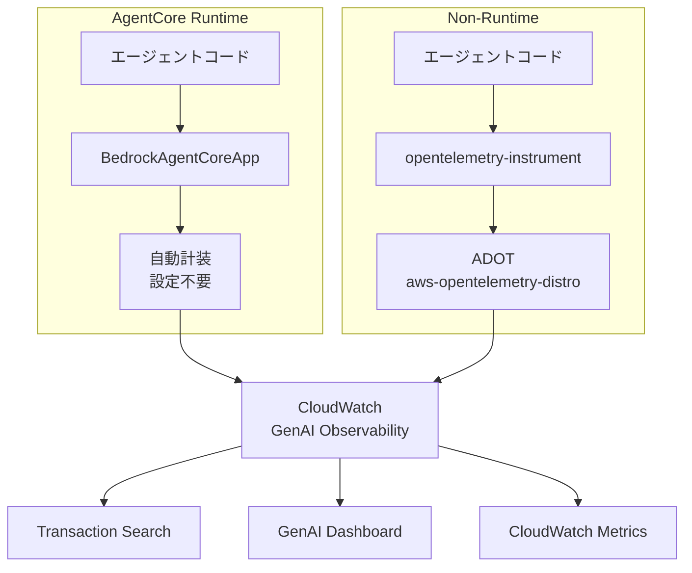

本記事は [Build trustworthy AI agents with Amazon Bedrock AgentCore Observability](https://aws.amazon.com/blogs/machine-learning/build-trustworthy-ai-agents-with-amazon-bedrock-agentcore-observability)（AWS Machine Learning Blog、2025年9月公開）の解説記事です。

## ブログ概要（Summary）

Amazon Bedrock AgentCore Observabilityは、AWS Summit New York City 2025で発表されたAIエージェント向けの監視ソリューションである。最大の特徴は**フレームワーク非依存**であること——Strands Agents、CrewAI、LangGraphなど異なるフレームワークで構築されたエージェントを統一的に監視できる。OpenTelemetryおよびGenerative AI Semantic Conventionsに準拠しており、テレメトリデータはAmazon CloudWatchに集約され、GenAI Observabilityダッシュボードの専用タブで可視化される。

この記事は [Zenn記事: OpenTelemetry GenAIで分散エージェントのSLI/SLOとコスト可観測性を実装する](https://zenn.dev/0h_n0/articles/1288bfe5e7ffc6) の深掘りです。

## 情報源

- **種別**: 企業テックブログ（AWS Machine Learning Blog）
- **URL**: [https://aws.amazon.com/blogs/machine-learning/build-trustworthy-ai-agents-with-amazon-bedrock-agentcore-observability](https://aws.amazon.com/blogs/machine-learning/build-trustworthy-ai-agents-with-amazon-bedrock-agentcore-observability)
- **組織**: Amazon Web Services（Ishan Singh, Gal Goldman, Amanda Lester, Madhu Samhitha Vangara, Vivek Singh, Yanyan Zhang）
- **発表日**: 2025年9月10日

## 技術的背景（Technical Background）

AIエージェントの本番運用では、エージェントがLLMの推論結果に基づいてツール選択・実行を自律的に行う。この非決定的な振る舞いにより、従来のWebアプリケーション監視では捉えられない障害モードが発生する。

AWSのブログでは、観測可能性は「後から追加するのではなく、初日から基盤として組み込むべき（"must be fundamental from day one"）」と主張している。この主張の背景には以下の技術的課題がある：

- **マルチフレームワーク環境**: 組織内で複数のエージェントフレームワークが併用される場合、フレームワーク固有の監視ツールでは横断的な可視化が困難
- **セッション単位の追跡**: ユーザーとの対話セッション全体を通じたエージェントの振る舞いを追跡する必要性
- **クロスサービストレーシング**: 複数のAWSサービスやマイクロサービスをまたぐエージェント呼び出しのトレース伝搬

AgentCore Observabilityは、OpenTelemetryの標準プロトコルを採用することで、これらの課題に対するベンダーニュートラルな解決策を提供している。

## 実装アーキテクチャ（Architecture）

### 2つのデプロイモードと計装パス

AgentCore Observabilityは、エージェントのホスティング方式に応じて2つの計装パスを提供する。



#### パス1: AgentCore Runtime（自動計装）

AgentCore Runtimeにデプロイする場合、計装は自動で行われる。ブログによると、既存のエージェントコードに約4行のSDKコードを追加するだけで完了する。

```python
from bedrock_agentcore.runtime import BedrockAgentCoreApp

app = BedrockAgentCoreApp()

@app.entrypoint
def handler(event, context):
    # 既存のエージェントロジック
    agent = Agent(model="us.anthropic.claude-sonnet-4-20250514")
    return agent(event["prompt"])

app.run()
```

`runtimeSessionId`によるセッション追跡が自動的に有効化され、LLM呼び出し・ツール実行・意思決定ポイントがスパンとして記録される。

#### パス2: Non-Runtime（手動設定）

EC2、EKS、Lambda、または他のクラウド環境で実行する場合、環境変数とAWS Distro for OpenTelemetry（ADOT）パッケージを使用する。

```bash
# 必要な環境変数
export AGENT_OBSERVABILITY_ENABLED=true
export OTEL_PYTHON_DISTRO=aws_distro
export OTEL_PYTHON_CONFIGURATOR=aws_configurator
export OTEL_EXPORTER_OTLP_PROTOCOL=http/protobuf
export OTEL_TRACES_EXPORTER=otlp
export OTEL_RESOURCE_ATTRIBUTES="service.name=my-agent,aws.log.group.names=/aws/agentcore/my-agent"
export OTEL_EXPORTER_OTLP_LOGS_HEADERS="x-aws-log-group=/aws/agentcore/my-agent,x-aws-log-stream=agent-stream,x-aws-metric-namespace=AgentMetrics"
```

```bash
# ADOTパッケージのインストール
pip install aws-opentelemetry-distro strands-agents[otel]

# OTel計装付きで起動
opentelemetry-instrument python agent.py
```

前提条件として、CloudWatch Transaction Searchの有効化が必要である。これはAWSコンソールから初回のみ設定する操作で、AgentCoreスパンとトレースの表示に必須となる。

### テレメトリの階層構造

ブログで説明されているトレーシングモデルは、以下の3層構造をとる：

| 層 | 単位 | 内容 |
|---|---|---|
| **Session** | ユーザー対話セッション | 1ユーザーとの連続的な対話全体 |
| **Trace** | 1リクエスト | セッション内の1回のユーザー入力に対する処理全体 |
| **Span** | 1操作 | LLM呼び出し、ツール実行、意思決定ポイント |

この階層は、OpenTelemetryのGenAI Semantic Conventionsにおける`invoke_agent`スパン（CLIENT/INTERNAL分離）と整合する設計となっている。

### カスタム属性とOpenTelemetry Baggage

ブログでは、OpenTelemetry Baggageを使用してカスタムメタデータをスパンに付与する手法が紹介されている。

```python
from opentelemetry import baggage, context

# カスタム属性をBaggageに設定
ctx = baggage.set_baggage("user.type", "premium")
ctx = baggage.set_baggage("experiment.id", "v2-routing", context=ctx)
ctx = baggage.set_baggage("conversation.topic", "technical-support", context=ctx)
ctx = baggage.set_baggage("session.id", "sess-abc123", context=ctx)

# コンテキストをアクティブに
token = context.attach(ctx)
try:
    result = agent(user_prompt)
finally:
    context.detach(token)
```

これらの属性により、CloudWatchでのフィルタリングが可能になる。たとえば「プレミアムユーザーのセッションをレイテンシでフィルタ」や「実験バージョンv1とv2の比較」といったクエリが実行できる。

### クロスサービストレーシング

複数のサービスをまたぐエージェント呼び出しでは、`invoke_agent_runtime`（boto3のbedrock-agentcoreクライアント）にカスタムヘッダーを渡してトレースを伝搬する。

```python
import boto3

client = boto3.client("bedrock-agentcore")

response = client.invoke_agent_runtime(
    agentId="agent-001",
    sessionId="sess-abc123",
    inputText=user_prompt,
    customHeaders={
        "traceparent": current_traceparent,
        "X-Amzn-Trace-Id": xray_trace_id,
        "X-Amzn-Bedrock-AgentCore-Runtime-Session-Id": session_id,
        "baggage": baggage_header,
    }
)
```

`traceparent`（W3C Trace Context）と`X-Amzn-Trace-Id`（AWS X-Ray）の両方を渡すことで、OTelベースとX-Rayベースの双方のバックエンドでトレースが連結される。

## GenAI Observabilityダッシュボード

CloudWatchのGenAI Observabilityダッシュボードは、ブログによると以下の4つのビューで構成される：

| ビュー | 表示内容 | 用途 |
|-------|---------|------|
| **Overview** | エージェント一覧、セッション数、トレース数、エラーレート | 全体の健全性把握 |
| **Agent** | セッション数、トレース数、レイテンシ、エラー、スロットル | 個別エージェントの詳細分析 |
| **Session** | セッションID単位のトレース一覧、セッションサマリ | ユーザー体験の追跡 |
| **Trace** | スパン一覧、イベント、タイムライン | 個別リクエストのデバッグ |

時間範囲でのフィルタリングが可能で、特定期間のエラースパイクやレイテンシ悪化を調査できる。

### 収集されるメトリクス

ブログで言及されているメトリクスは以下の通り：

- **トークン使用量**: 入力トークン数、出力トークン数
- **ツール選択パターン**: どのツールがどの頻度で呼ばれているか
- **推論プロセス**: LLMの推論ステップの詳細
- **エンドツーエンドレイテンシ**: リクエストから最終応答までの所要時間
- **セッション数**: アクティブなセッションの数
- **エラーレート**: 失敗したスパンの割合
- **スロットル**: レート制限によるリクエスト抑制の回数

## ベストプラクティス

ブログでは5つのベストプラクティスが紹介されている。

### 1. 段階的な計装

自動計装から始め、必要に応じてカスタムスパンと属性を追加する。初期段階で過剰な計装を行うと、テレメトリの量が膨大になりコストが増加する。

### 2. ステージ別の詳細度調整

| ステージ | 詳細度 | サンプリング |
|---------|--------|------------|
| 開発 | 高（全スパン記録） | 100% |
| テスト | 中（部分サンプリング） | 50%程度 |
| 本番 | 低（戦略的サンプリング） | エラー100% + 正常10% |

### 3. 一貫した命名規則

属性名にプレフィックスを使用し、クエリ可能性を確保する：
- `agent.*`: エージェント関連属性（`agent.name`, `agent.version`）
- `business.*`: ビジネスロジック関連属性（`business.use_case`, `business.priority`）

### 4. 機密データのフィルタリング

スパン属性やペイロードからPII（個人識別情報）やビジネス機密データを除去する。OTel Collectorのprocessorやアプリケーション側のフィルタで対応する。

### 5. 定期的なレビュー

観測可能性データのレビューを開発プロセスの一部として組み込む。

## 学術研究との関連（Academic Connection）

AgentCore Observabilityの設計は、エージェント観測可能性に関する複数の研究と関連している。

- **AgentOps（Dong et al., 2024）**: LLMエージェントのライフサイクル全体にわたるアーティファクトとデータの分類体系を提案。AgentCoreの「セッション→トレース→スパン」階層は、AgentOpsが提唱するエージェントライフサイクル監視の具体的実装と位置づけられる。
- **OpenTelemetry GenAI Semantic Conventions**: AgentCoreはv1.41で導入された`invoke_agent`スパンやv1.42で専用リポジトリに分離されたGenAI仕様に準拠している。ただし、ブログでは準拠の具体的なバージョンは明記されていない。
- **Agent System Operations（Wang et al., 2026）**: AgentOpsフレームワークの4段階（監視→異常検知→根因特定→解決）のうち、AgentCoreは主に第1段階（監視）をカバーしている。異常検知以降はCloudWatchアラームやカスタムロジックで補完する必要がある。

## Production Deployment Guide

### AWS実装パターン（コスト最適化重視）

AgentCore Observabilityを使用する場合、エージェントのホスティング構成によってコスト構造が異なる。以下はブログの構成を基にした2026年10月時点のap-northeast-1リージョンでの概算である。

**トラフィック量別の推奨構成**:

| 規模 | 月間リクエスト | 推奨構成 | 月額コスト | 主要サービス |
|------|--------------|---------|-----------|------------|
| **Small** | ~3,000 (100/日) | AgentCore Runtime | $80-200 | AgentCore + CloudWatch + Bedrock |
| **Medium** | ~30,000 (1,000/日) | Non-Runtime + ECS | $400-1,000 | ECS Fargate + ADOT + CloudWatch |
| **Large** | 300,000+ (10,000/日) | Non-Runtime + EKS | $2,500-6,000 | EKS + ADOT Collector + CloudWatch |

**Small構成の詳細**（月額$80-200）:
- **AgentCore Runtime**: マネージドホスティング（従量課金）
- **Bedrock**: Claude 3.5 Haiku（$0.25/MTok input, $1.25/MTok output）、月100リクエスト程度で$20-50/月
- **CloudWatch**: Transaction Search有効化、トレース保存（$5/百万スパン取り込み + $0.60/GBスキャン）、月$10-30
- **CloudWatch Logs**: $0.76/GB取り込み、月$5-10

**Medium構成の詳細**（月額$400-1,000）:
- **ECS Fargate**: 0.5 vCPU, 1GB RAM × 2タスク（$120/月）
- **ADOT Collector**: Fargateサイドカー（追加コスト最小限）
- **Bedrock**: Claude 3.5 Sonnet、Prompt Caching有効（$200-500/月）
- **CloudWatch**: トレース取り込み・保存（$30-80/月）
- **Application Load Balancer**: $20/月

**Large構成の詳細**（月額$2,500-6,000）:
- **EKS**: コントロールプレーン（$72/月）
- **EC2 Spot Instances**: c6i.xlarge × 2-4台（$150-400/月、Spot割引適用時）
- **ADOT Collector**: DaemonSetとして各ノードにデプロイ
- **Bedrock**: Claude 3.5 Sonnet + Batch API 50%割引（$1,500-3,000/月）
- **CloudWatch**: 大量トレース取り込み（$100-300/月）
- **X-Ray**: 詳細トレーシング（$50-100/月）

**コスト削減テクニック**:
- Spot Instances使用で最大90%削減（EKS + Karpenter）
- Bedrock Batch API使用で50%削減（非リアルタイム処理）
- CloudWatch Logsのデータ保持期間を短縮（7日→30日で段階的に調整）
- サンプリングレートの調整（本番では正常トレース10%、エラートレース100%）

**コスト試算の注意事項**:
- 上記は2026年10月時点のAWS ap-northeast-1（東京）リージョン料金に基づく概算値
- AgentCore Runtimeの料金体系はAWSの公式価格ページで最新情報を確認すること
- 実際のコストはトークン消費量、トレース量、リクエストパターンにより変動する
- 最新料金は [AWS料金計算ツール](https://calculator.aws/) で確認

### Terraformインフラコード

**Small構成（AgentCore Runtime + CloudWatch）**

```hcl
# --- CloudWatch Log Group for AgentCore ---
resource "aws_cloudwatch_log_group" "agentcore" {
  name              = "/aws/agentcore/my-agent"
  retention_in_days = 14
}

resource "aws_cloudwatch_log_stream" "agentcore" {
  name           = "agent-stream"
  log_group_name = aws_cloudwatch_log_group.agentcore.name
}

# --- IAM Role for AgentCore ---
resource "aws_iam_role" "agentcore_role" {
  name = "agentcore-observability-role"

  assume_role_policy = jsonencode({
    Version = "2012-10-17"
    Statement = [{
      Action = "sts:AssumeRole"
      Effect = "Allow"
      Principal = {
        Service = "bedrock.amazonaws.com"
      }
    }]
  })
}

resource "aws_iam_role_policy" "agentcore_observability" {
  role = aws_iam_role.agentcore_role.id

  policy = jsonencode({
    Version = "2012-10-17"
    Statement = [
      {
        Effect = "Allow"
        Action = [
          "bedrock:InvokeModel",
          "bedrock:InvokeModelWithResponseStream"
        ]
        Resource = "arn:aws:bedrock:ap-northeast-1::foundation-model/anthropic.claude-3-5-haiku*"
      },
      {
        Effect = "Allow"
        Action = [
          "logs:CreateLogGroup",
          "logs:CreateLogStream",
          "logs:PutLogEvents"
        ]
        Resource = "${aws_cloudwatch_log_group.agentcore.arn}:*"
      },
      {
        Effect = "Allow"
        Action = [
          "xray:PutTraceSegments",
          "xray:PutTelemetryRecords"
        ]
        Resource = "*"
      }
    ]
  })
}

# --- CloudWatch Alarm: エラーレート監視 ---
resource "aws_cloudwatch_metric_alarm" "agent_error_rate" {
  alarm_name          = "agentcore-error-rate"
  comparison_operator = "GreaterThanThreshold"
  evaluation_periods  = 2
  metric_name         = "5XXError"
  namespace           = "AgentMetrics"
  period              = 300
  statistic           = "Sum"
  threshold           = 10
  alarm_description   = "AgentCoreエラーレート異常（5分間で10件超過）"
}
```

**Large構成（EKS + ADOT Collector）**

```hcl
# --- EKSクラスタ ---
module "eks" {
  source  = "terraform-aws-modules/eks/aws"
  version = "~> 20.0"

  cluster_name    = "agent-observability-cluster"
  cluster_version = "1.31"

  vpc_id     = module.vpc.vpc_id
  subnet_ids = module.vpc.private_subnets

  cluster_endpoint_public_access = true
  enable_cluster_creator_admin_permissions = true
}

# --- ADOT Collector DaemonSet用IAMロール ---
resource "aws_iam_role" "adot_collector" {
  name = "adot-collector-role"

  assume_role_policy = jsonencode({
    Version = "2012-10-17"
    Statement = [{
      Effect = "Allow"
      Principal = {
        Federated = module.eks.oidc_provider_arn
      }
      Action = "sts:AssumeRoleWithWebIdentity"
    }]
  })
}

resource "aws_iam_role_policy" "adot_permissions" {
  role = aws_iam_role.adot_collector.id

  policy = jsonencode({
    Version = "2012-10-17"
    Statement = [
      {
        Effect = "Allow"
        Action = [
          "logs:PutLogEvents",
          "logs:CreateLogGroup",
          "logs:CreateLogStream",
          "xray:PutTraceSegments",
          "xray:PutTelemetryRecords",
          "cloudwatch:PutMetricData"
        ]
        Resource = "*"
      }
    ]
  })
}

# --- Karpenter Provisioner（Spot優先） ---
resource "kubectl_manifest" "karpenter_nodepool" {
  yaml_body = <<-YAML
    apiVersion: karpenter.sh/v1
    kind: NodePool
    metadata:
      name: agent-pool
    spec:
      template:
        spec:
          requirements:
            - key: karpenter.sh/capacity-type
              operator: In
              values: ["spot", "on-demand"]
            - key: node.kubernetes.io/instance-type
              operator: In
              values: ["c6i.xlarge", "c6i.2xlarge", "c7i.xlarge"]
          nodeClassRef:
            group: karpenter.k8s.aws
            kind: EC2NodeClass
            name: default
      limits:
        cpu: "64"
        memory: "256Gi"
      disruption:
        consolidationPolicy: WhenEmptyOrUnderutilized
        consolidateAfter: 30s
  YAML
}

# --- AWS Budgets ---
resource "aws_budgets_budget" "agent_monthly" {
  name         = "agent-observability-budget"
  budget_type  = "COST"
  limit_amount = "6000"
  limit_unit   = "USD"
  time_unit    = "MONTHLY"

  notification {
    comparison_operator       = "GREATER_THAN"
    threshold                 = 80
    threshold_type            = "PERCENTAGE"
    notification_type         = "ACTUAL"
    subscriber_email_addresses = ["ops@example.com"]
  }
}
```

### 運用・監視設定

**CloudWatch Logs Insightsクエリ**:

```sql
-- エージェント別エラー率（1時間単位）
fields @timestamp, service.name, @message
| filter ispresent(error) and service.name like /agent/
| stats count(*) as error_count by bin(1h), service.name

-- トレースレイテンシ分析（P95, P99）
fields @timestamp, duration
| filter name = "invoke_agent"
| stats pct(duration, 95) as p95, pct(duration, 99) as p99 by bin(5m)
```

**CloudWatchアラーム設定（Python）**:

```python
import boto3

cloudwatch = boto3.client("cloudwatch")

# エージェントレイテンシアラート
cloudwatch.put_metric_alarm(
    AlarmName="agent-latency-p99",
    ComparisonOperator="GreaterThanThreshold",
    EvaluationPeriods=3,
    MetricName="Duration",
    Namespace="AgentMetrics",
    Period=300,
    ExtendedStatistic="p99",
    Threshold=30000,
    ActionsEnabled=True,
    AlarmActions=["arn:aws:sns:ap-northeast-1:123456789:agent-alerts"],
    AlarmDescription="エージェントP99レイテンシ30秒超過",
)

# トークン使用量スパイクアラート
cloudwatch.put_metric_alarm(
    AlarmName="agent-token-spike",
    ComparisonOperator="GreaterThanThreshold",
    EvaluationPeriods=1,
    MetricName="TokenUsage",
    Namespace="AgentMetrics",
    Period=3600,
    Statistic="Sum",
    Threshold=500000,
    AlarmDescription="1時間あたりトークン使用量50万超過（コスト急増の可能性）",
)
```

**X-Rayトレーシング設定**:

```python
from aws_xray_sdk.core import xray_recorder, patch_all

patch_all()

@xray_recorder.capture("agent_invocation")
def invoke_agent(prompt: str, agent_name: str) -> dict:
    xray_recorder.put_annotation("agent_name", agent_name)
    xray_recorder.put_annotation("environment", "production")
    xray_recorder.put_metadata("prompt_length", len(prompt))

    result = call_bedrock(prompt)

    xray_recorder.put_metadata("token_count", result["usage"]["total_tokens"])
    xray_recorder.put_metadata("cost_usd", calculate_cost(result["usage"]))
    return result
```

**Cost Explorer日次レポート**:

```python
import boto3
from datetime import datetime, timedelta

ce = boto3.client("ce")

response = ce.get_cost_and_usage(
    TimePeriod={
        "Start": (datetime.now() - timedelta(days=1)).strftime("%Y-%m-%d"),
        "End": datetime.now().strftime("%Y-%m-%d"),
    },
    Granularity="DAILY",
    Metrics=["UnblendedCost"],
    GroupBy=[{"Type": "SERVICE", "Key": "SERVICE"}],
    Filter={
        "Or": [
            {"Dimensions": {"Key": "SERVICE", "Values": ["Amazon Bedrock"]}},
            {"Dimensions": {"Key": "SERVICE", "Values": ["Amazon CloudWatch"]}},
            {"Dimensions": {"Key": "SERVICE", "Values": ["AWS X-Ray"]}},
        ]
    },
)

for result in response["ResultsByTime"]:
    for group in result["Groups"]:
        service = group["Keys"][0]
        cost = float(group["Metrics"]["UnblendedCost"]["Amount"])
        if cost > 100:
            print(f"WARNING: {service} daily cost ${cost:.2f} exceeds threshold")
```

### セキュリティベストプラクティス

**本番環境での推奨設定**:

1. **ネットワークセキュリティ**:
   - EKS: `cluster_endpoint_public_access = false`（VPN/Direct Connect経由）
   - CloudWatchエンドポイント: VPCエンドポイント使用（`com.amazonaws.ap-northeast-1.monitoring`）
   - セキュリティグループ: ADOT Collectorの4317/4318ポートのみ内部開放

2. **認証・認可**:
   - IAMロール: 最小権限の原則（Bedrock InvokeModelとCloudWatch PutMetricDataのみ）
   - IRSA（IAM Roles for Service Accounts）: EKS上のADOT Collectorに使用
   - MFA: 本番環境のCloudWatchダッシュボードアクセスに必須

3. **シークレット管理**:
   - ADOT設定の認証情報はSecrets Managerで管理
   - 環境変数のハードコード禁止
   - ブログが推奨する通り、スパン属性からPIIを除去

4. **データ保護**:
   - CloudWatch Logs: KMS暗号化有効化
   - 転送中: TLS 1.2以上必須（OTLPエクスポーターのデフォルト）
   - トレースデータの保持期間を規定（GDPR/個人情報保護法対応）

### コスト最適化チェックリスト

**アーキテクチャ選択（トラフィック量で判断）**:
- [ ] ~100 req/日 → AgentCore Runtime（マネージド）- $80-200/月
- [ ] ~1,000 req/日 → ECS Fargate + ADOT - $400-1,000/月
- [ ] 10,000+ req/日 → EKS + ADOT Collector DaemonSet - $2,500-6,000/月

**リソース最適化**:
- [ ] EC2: Spot Instances優先（Karpenter自動管理、最大90%削減）
- [ ] Reserved Instances: 1年コミットで72%削減（安定ワークロード向け）
- [ ] Savings Plans: Compute Savings Plans検討（柔軟性重視）
- [ ] Lambda: メモリサイズ最適化（PowerTuningツール活用）
- [ ] ECS/EKS: アイドルタイムのスケールダウン（夜間0台）

**テレメトリコスト削減**:
- [ ] サンプリング戦略: エラートレース100% + 正常トレース10%（本番）
- [ ] CloudWatch Logs保持期間: 開発7日、本番30日
- [ ] Transaction Search: 必要な期間のみ有効化
- [ ] バッチエクスポート: `send_batch_size=512`、`timeout=5s`

**LLMコスト削減**:
- [ ] Bedrock Batch API: 50%割引（非リアルタイム処理）
- [ ] Prompt Caching: 30-90%削減（システムプロンプト固定）
- [ ] モデル選択: 簡易タスクはHaiku（$0.25/MTok）、複雑タスクはSonnet
- [ ] max_tokens設定: 過剰生成防止

**監視・アラート**:
- [ ] AWS Budgets: 月額予算設定（80%で警告、100%でアラート）
- [ ] CloudWatchアラーム: トークン使用量スパイク検知
- [ ] Cost Anomaly Detection: 自動異常検知（機械学習ベース）
- [ ] 日次コストレポート: SNS/Slackへ自動送信

**リソース管理**:
- [ ] 未使用リソース削除: Trusted Advisor活用
- [ ] タグ戦略: 環境別（dev/staging/prod）、エージェント別でコスト可視化
- [ ] ログライフサイクル: S3 Glacier自動移行（90日後）
- [ ] 開発環境: 夜間停止（EventBridge Schedulerで自動化）

## 運用での学び（Production Lessons）

ブログが強調する「Day 1からの観測可能性」は、エージェントの本番運用における現実的な課題から導かれている。

**計装の段階的導入**: 自動計装から始めてカスタムスパンを追加する段階的アプローチは、過剰な計装によるテレメトリコスト増大を防ぐ。ブログによると、本番環境では「戦略的サンプリング」を推奨しており、すべてのトレースを保存するのではなくエラートレースを優先的に記録する設計が重要である。

**フレームワーク非依存の価値**: Strands、CrewAI、LangGraphといった異なるフレームワークのエージェントが混在する環境では、統一的な監視基盤の価値が高い。ADOTとOpenTelemetryの標準プロトコルを使用することで、フレームワーク固有のロックインを回避できる。

**制約と注意点**: ブログはAgentCore Observabilityの利点を説明しているが、以下の制約も認識すべきである：
- CloudWatch Transaction Searchの有効化が必須であり、追加コストが発生する
- GenAI Semantic ConventionsはDevelopment statusであり、属性名の変更に備える必要がある
- 非Runtimeデプロイでは手動での環境変数設定とADOTパッケージの管理が必要

## まとめと実践への示唆

Amazon Bedrock AgentCore Observabilityは、AWSが提供するフレームワーク非依存のエージェント監視ソリューションとして、OpenTelemetry標準に準拠した統一的なテレメトリ収集を実現している。AgentCore Runtime上の自動計装と、Non-Runtime環境でのADOTベースの手動設定という2つのパスにより、既存のエージェントシステムへの段階的な導入が可能である。

ただし、このソリューションはAWS固有のエコシステム（CloudWatch、X-Ray、Bedrock）に依存しており、マルチクラウド環境では追加の考慮が必要である。また、SLI/SLOの定義やバーンレートアラートの設計は、AgentCoreの機能範囲外であり、CloudWatchアラームやカスタムメトリクスで補完する必要がある。

## 参考文献

- **Blog URL**: [Build trustworthy AI agents with Amazon Bedrock AgentCore Observability](https://aws.amazon.com/blogs/machine-learning/build-trustworthy-ai-agents-with-amazon-bedrock-agentcore-observability)
- **AWS Docs**: [Amazon Bedrock AgentCore](https://docs.aws.amazon.com/bedrock/latest/userguide/agentcore.html)
- **Related Papers**: AgentOps (arXiv:2411.05285), Agent System Operations (arXiv:2606.01581)
- **Related Zenn article**: [OpenTelemetry GenAIで分散エージェントのSLI/SLOとコスト可観測性を実装する](https://zenn.dev/0h_n0/articles/1288bfe5e7ffc6)
