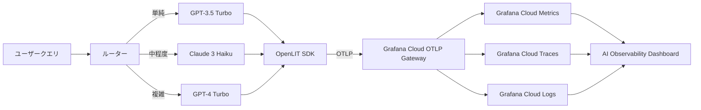

本記事は [https://grafana.com/blog/ai-observability-llms-in-production](https://grafana.com/blog/ai-observability-llms-in-production) の解説記事です。

## ブログ概要（Summary）

Grafana LabsのIshan Jain氏が2026年3月に公開したこのブログ記事では、OpenLIT SDK（v1.35.9時点）とGrafana CloudのAI Observability機能を組み合わせ、LLMアプリケーションを本番環境で監視する方法が紹介されている。デモとして、クエリの複雑度に応じてGPT-3.5 Turbo・Claude 3 Haiku・GPT-4 Turboにルーティングするカスタマーサポートチャットボットを構築し、OpenTelemetry GenAIセマンティック規約に準拠した自動計装によりトークン使用量・コスト・レイテンシ・品質評価を一元的に可視化する手法が示されている。

この記事は [Zenn記事: OpenTelemetry GenAIで分散エージェントのSLI/SLOとコスト可観測性を実装する](https://zenn.dev/0h_n0/articles/1288bfe5e7ffc6) の深掘りです。

## 情報源

- **種別**: 企業テックブログ（Grafana Labs）
- **URL**: [https://grafana.com/blog/ai-observability-llms-in-production](https://grafana.com/blog/ai-observability-llms-in-production)
- **著者**: Ishan Jain（Grafana Labs）
- **発表日**: 2026年3月20日

## 技術的背景（Technical Background）

LLMアプリケーションの本番運用では、従来のWebサービス監視では対応しきれない課題が顕在化する。1つのユーザーリクエストが複数のLLMプロバイダーを経由する構成では、レイテンシの変動要因がモデル選択・プロンプト長・プロバイダー側の負荷と多岐にわたる。さらに、同一機能でもモデルごとにトークン単価が異なるため、コストがリクエスト数に比例しない。

Grafana Labsのブログでは、この問題に対してOpenTelemetry（OTel）のGenAIセマンティック規約をベースとし、OpenLIT SDKによる自動計装でベンダー非依存なテレメトリを収集するアプローチが提案されている。学術的には、Dong et al.のAgentOps（arXiv:2411.05285）が提示するLLMエージェント観測可能性の分類体系と、このブログのアプローチは補完関係にある。AgentOpsがライフサイクル全体の「何を観測すべきか」を体系化する一方、このブログは「どう計装し可視化するか」の実装パターンを提供している。

## 実装アーキテクチャ（Architecture）

### システム構成

ブログで紹介されているアーキテクチャは、4層構成をとる。



**ルーティング層**: クエリの単語数に基づく分類器が、リクエストを適切なモデルに振り分ける。ブログのデモでは20語未満をGPT-3.5 Turbo、100語未満をClaude 3 Haiku、それ以上をGPT-4 Turboに割り当てている。

**計装層（OpenLIT SDK）**: `openlit.init()`の1行でアプリケーション起動時にOpenAI・Anthropic等のクライアントライブラリを自動計装する。OpenTelemetry GenAIセマンティック規約に準拠しているため、生成されるテレメトリはGrafana以外のOTel互換バックエンドにも送信できる。

**テレメトリ転送層**: 環境変数によるOTLPエクスポーター設定で、Grafana CloudのマネージドOTLPゲートウェイにメトリクス・トレース・ログを送信する。

**可視化層**: Grafana Cloudの「AI Observability」機能が5種類のプリビルトダッシュボード（GenAI観測、GenAI評価、ベクトルDB観測、MCP観測、GPU監視）を自動展開する。

### セットアップコード

ブログで示されているセットアップは以下の通りである。

```python
import openlit
from openai import OpenAI
from anthropic import Anthropic

openlit.init()

openai_client = OpenAI()
anthropic_client = Anthropic()


def route_query(message: str) -> str:
    """クエリの複雑度に基づくモデルルーティング."""
    word_count = len(message.split())
    if word_count < 20:
        return "gpt-3.5-turbo"
    elif word_count < 100:
        return "claude-3-haiku"
    else:
        return "gpt-4-turbo"


def call_model(model_name: str, message: str) -> str:
    """選択されたモデルにリクエストを送信."""
    if model_name.startswith("gpt"):
        response = openai_client.chat.completions.create(
            model=model_name,
            messages=[{"role": "user", "content": message}],
        )
        return response.choices[0].message.content
    else:
        response = anthropic_client.messages.create(
            model=model_name,
            max_tokens=1024,
            messages=[{"role": "user", "content": message}],
        )
        return response.content[0].text
```

必要な環境変数は以下の通りである。

```bash
export OTEL_SERVICE_NAME=my-ai-app
export OTEL_DEPLOYMENT_ENVIRONMENT=production
export OTEL_EXPORTER_OTLP_ENDPOINT="https://otlp-gateway-<region>.grafana.net/otlp"
export OTEL_EXPORTER_OTLP_HEADERS="Authorization=Basic <base64-instanceID:token>"
export OPENAI_API_KEY="sk-..."
export ANTHROPIC_API_KEY="sk-ant-..."
```

`<region>`はGrafana Cloudのゾーン（例: `prod-us-central-0`）に対応し、認証トークンはGrafana CloudのOpenTelemetry設定ページから生成する。

### 収集されるテレメトリ

ブログで言及されているメトリクスとトレース属性は以下の通りである。

| カテゴリ | メトリクス/属性 | 説明 |
|----------|----------------|------|
| コスト | `gen_ai_usage_cost_USD_sum` | USD換算の累積コスト |
| トークン | `gen_ai_usage_input_tokens_total` | 入力トークンの累積数 |
| レイテンシ | リクエストレート、レイテンシパーセンタイル | p50/p95/p99等 |
| 品質 | TTFT（Time to First Token） | 初回トークン到達時間 |
| トレース | 分散トレース | 分類→LLM呼び出し→レスポンスの全経路 |

ブログの記述によると、これらのメトリクスはOpenLIT SDKがGenAI規約に従って自動生成する。カスタムモデルのコスト計算にも対応しているとされるが、具体的な設定方法はブログ内には示されていない。

## 品質評価機能（Quality Evaluation）

ブログでは、テレメトリ収集に加えて品質評価機能が紹介されている。

### 幻覚検知

```python
hallucination_evaluator = openlit.evals.Hallucination(
    provider="openai",
    api_key=os.environ["OPENAI_API_KEY"],
)
result = hallucination_evaluator.measure(
    prompt=user_message,
    contexts=["Internal knowledge base"],
    text=answer,
)
```

このコードでは、LLMの出力（`text`）を元のプロンプトとコンテキスト（ナレッジベース等）と照合し、事実的不正確さ・矛盾・捏造情報を検出する。評価結果はOTelメトリクスとしてGrafana Cloudに送信され、GenAI評価ダッシュボードで可視化される。

### ガードレール

```python
guard = openlit.guard.All(
    provider="openai",
    api_key=os.environ["OPENAI_API_KEY"],
)
guard_result = guard.detect(text=user_message)
```

`openlit.guard.All`は、プロンプトインジェクション検知・機密トピックフィルタリング・トピック制限をまとめて実行する。ブログの例ではガードレールの結果を検知のみに使用しており、リクエストのブロックには使用していない。

> **注意**: ブログ内でバイアス・毒性の検知も言及されているが、具体的なコードや設定は示されていない。GenAI評価ダッシュボードの検出カテゴリとして名前が挙がっている段階である。

## パフォーマンス最適化（Performance）

### モデルルーティングによるコスト最適化

ブログのアーキテクチャでは、クエリの複雑度に応じたモデルルーティングがコスト最適化の中心的な戦略となっている。

モデル別の想定コスト構造（2026年10月時点の概算）:

| モデル | 入力単価（/1K tokens） | 出力単価（/1K tokens） | 想定用途 |
|--------|----------------------|----------------------|----------|
| GPT-3.5 Turbo | $0.0005 | $0.0015 | 単純クエリ（FAQ応答等） |
| Claude 3 Haiku | $0.00025 | $0.00125 | 中程度クエリ |
| GPT-4 Turbo | $0.01 | $0.03 | 複雑クエリ（推論要） |

> **注意**: 上記の単価は2026年10月時点の各プロバイダー公式料金に基づく概算であり、変動する可能性がある。

ブログでは「単純クエリをGPT-4からGPT-3.5に移行することで月額$2,000削減」というシナリオが示されているが、これはブログ著者による仮想的な試算であり、実測値ではない。

### 可視化によるボトルネック特定

Grafana CloudのAI Observabilityダッシュボードでは、以下の観点からパフォーマンス分析が可能とされている。

- **モデル別レイテンシ比較**: p50/p95/p99パーセンタイルでモデル間の応答速度を比較
- **TTFT（Time to First Token）**: ストリーミング応答の体感速度指標
- **トークンスループット**: 単位時間あたりのトークン処理量
- **分散トレース**: 個別リクエストの処理経路を入力→分類→LLM呼び出し→レスポンスまで追跡

## 運用での学び（Production Lessons）

ブログから読み取れる本番運用上の知見を整理する。

### 計装のベストプラクティス

1. **1行計装の原則**: `openlit.init()`の1行で自動計装が完了するため、既存アプリケーションへの導入障壁が低い。ただし、カスタム属性の追加やサンプリング率の調整には追加設定が必要になる。

2. **環境変数による設定**: OTLPエンドポイント・認証情報を環境変数で管理することで、アプリケーションコードを変更せずにテレメトリの送信先を切り替えられる。これはOTelの標準的なパターンである。

3. **段階的導入**: ブログでは明示されていないが、OTel互換であるため、まずOpenLITで自動計装を導入し、その後カスタムスパンやメトリクスを追加する段階的アプローチが可能である。

### 注意すべき制約

- **GenAI規約の成熟度**: OpenTelemetry GenAIセマンティック規約は2026年10月時点でDevelopment statusである。属性名の変更に備え、OpenLIT SDKのバージョン固定が推奨される。
- **プロンプト/コンプリーションの保存**: トレースにプロンプトやLLM出力が含まれる可能性がある。PII（個人識別情報）を含むケースでは、OTel Collectorでのフィルタリングやハッシュ化が必要になる。
- **評価コストの考慮**: 幻覚検知やガードレールの実行自体がLLM呼び出しを伴うため、評価のためのコストが追加で発生する。

## 学術研究との関連（Academic Connection）

このブログのアプローチは、複数の学術研究と接点を持つ。

**AgentOps（Dong et al., arXiv:2411.05285）**: LLMエージェントの観測可能性に必要なアーティファクトとデータの分類体系を提案している。ブログのOpenLIT計装は、この分類体系における「メトリクス」「トレース」「ログ」の収集レイヤーに対応する。

**Agent System Operations（Wang et al., arXiv:2606.01581）**: AgentOpsフレームワーク（監視→異常検知→根本原因特定→解決の4段階）を提示するサーベイ論文である。ブログのアプローチは主に「監視」段階を実装しており、異常検知以降のステップにはGrafana Alertingの活用が想定される。

**llmmas-otel（Seyedghorban et al., arXiv:2608.24271）**: OpenTelemetryベースの分散トレースとフォルトインジェクションを組み合わせたツールである。ブログのOpenLIT計装がアプリケーションレベルの自動計装に焦点を当てているのに対し、llmmas-otelはエージェント間通信やフォルト注入まで対象範囲を拡張している。

## Production Deployment Guide

### AWS実装パターン（コスト最適化重視）

ブログのアーキテクチャ（LLMルーティング + OpenLIT計装 + Grafana Cloud監視）をAWS上で構築する場合の推奨構成を示す。

**トラフィック量別の推奨構成**:

| 規模 | 月間リクエスト | 推奨構成 | 月額コスト | 主要サービス |
|------|--------------|---------|-----------|------------|
| **Small** | ~3,000 (100/日) | Serverless | $80-200 | Lambda + Bedrock + Grafana Cloud Free |
| **Medium** | ~30,000 (1,000/日) | Hybrid | $400-1,000 | Lambda + ECS Fargate + Grafana Cloud Pro |
| **Large** | 300,000+ (10,000/日) | Container | $2,500-6,000 | EKS + OTel Collector + Grafana Cloud |

**Small構成の詳細** (月額$80-200):
- **Lambda**: 1GB RAM, 60秒タイムアウト、LLMルーティング＋OpenLIT計装 ($25/月)
- **Bedrock**: Claude 3 Haiku（単純・中程度クエリ）+ Claude 3.5 Sonnet（複雑クエリ） ($100/月)
- **Grafana Cloud Free Tier**: 50GBトレース、10,000メトリクスシリーズ ($0/月)
- **DynamoDB**: セッション管理、On-Demand ($10/月)
- **API Gateway**: REST API ($5/月)

**Medium構成の詳細** (月額$400-1,000):
- **Lambda**: イベント駆動のクエリ受付 ($30/月)
- **ECS Fargate**: OTel Collector、0.5 vCPU × 1GB RAM × 2タスク ($120/月)
- **Bedrock**: マルチモデルルーティング、Prompt Caching有効 ($500/月)
- **Grafana Cloud Pro**: 無制限メトリクスシリーズ、アラート ($49/月)
- **ElastiCache Redis**: プロンプトキャッシュ cache.t3.micro ($15/月)

**Large構成の詳細** (月額$2,500-6,000):
- **EKS**: コントロールプレーン ($72/月)
- **EC2 Spot Instances**: 推論ワーカー m5.xlarge × 2-4台 ($200/月)
- **OTel Collector**: DaemonSet構成、フィルタリング・サンプリング実行 ($0追加)
- **Bedrock Batch API**: 50%割引適用（非リアルタイム処理） ($2,000/月)
- **Grafana Cloud**: カスタムダッシュボード、SLOアラート ($200/月)

**コスト削減テクニック**:
- Spot Instances使用で最大90%削減（EKS + Karpenter管理）
- Bedrock Batch API使用で50%削減（バッチ処理可能なクエリ）
- Prompt Caching有効化で30-90%削減（共通システムプロンプト）
- Grafana Cloud Free Tierで監視コストゼロ化（Small規模）
- OpenLIT自動計装で計装開発コストを最小化

**コスト試算の注意事項**:
- 上記は2026年10月時点のAWS ap-northeast-1（東京）リージョン料金に基づく概算値
- LLMコストはプロンプト長・出力長・モデル選択により大きく変動する
- Grafana Cloud料金はプランとテレメトリ量に依存する
- 最新料金は [AWS料金計算ツール](https://calculator.aws/) および [Grafana Cloud料金](https://grafana.com/pricing/) で確認のこと

### Terraformインフラコード

**Small構成 (Serverless): Lambda + Bedrock + Grafana Cloud**

```hcl
# --- IAMロール（最小権限） ---
resource "aws_iam_role" "lambda_llm" {
  name = "lambda-llm-router-role"

  assume_role_policy = jsonencode({
    Version = "2012-10-17"
    Statement = [{
      Action = "sts:AssumeRole"
      Effect = "Allow"
      Principal = { Service = "lambda.amazonaws.com" }
    }]
  })
}

resource "aws_iam_role_policy" "bedrock_invoke" {
  role = aws_iam_role.lambda_llm.id
  policy = jsonencode({
    Version = "2012-10-17"
    Statement = [{
      Effect   = "Allow"
      Action   = ["bedrock:InvokeModel", "bedrock:InvokeModelWithResponseStream"]
      Resource = "arn:aws:bedrock:ap-northeast-1::foundation-model/anthropic.*"
    }]
  })
}

# --- Lambda関数（OpenLIT計装付き） ---
resource "aws_lambda_function" "llm_router" {
  filename      = "lambda.zip"
  function_name = "llm-router-openlit"
  role          = aws_iam_role.lambda_llm.arn
  handler       = "index.handler"
  runtime       = "python3.12"
  timeout       = 60
  memory_size   = 1024

  environment {
    variables = {
      OTEL_SERVICE_NAME              = "llm-router"
      OTEL_DEPLOYMENT_ENVIRONMENT    = "production"
      OTEL_EXPORTER_OTLP_ENDPOINT   = var.grafana_otlp_endpoint
      OTEL_EXPORTER_OTLP_HEADERS    = "Authorization=Basic ${var.grafana_otlp_token}"
      BEDROCK_MODEL_SIMPLE           = "anthropic.claude-3-haiku-20241022-v1:0"
      BEDROCK_MODEL_COMPLEX          = "anthropic.claude-3-5-sonnet-20241022-v2:0"
    }
  }
}

# --- DynamoDB (セッション管理) ---
resource "aws_dynamodb_table" "sessions" {
  name         = "llm-sessions"
  billing_mode = "PAY_PER_REQUEST"
  hash_key     = "session_id"

  attribute {
    name = "session_id"
    type = "S"
  }

  ttl {
    attribute_name = "expire_at"
    enabled        = true
  }
}

# --- CloudWatch コスト監視アラーム ---
resource "aws_cloudwatch_metric_alarm" "lambda_duration" {
  alarm_name          = "llm-router-duration-spike"
  comparison_operator = "GreaterThanThreshold"
  evaluation_periods  = 2
  metric_name         = "Duration"
  namespace           = "AWS/Lambda"
  period              = 300
  statistic           = "Average"
  threshold           = 30000
  alarm_description   = "Lambda平均実行時間30秒超過（LLMレイテンシ異常）"

  dimensions = {
    FunctionName = aws_lambda_function.llm_router.function_name
  }
}
```

**Large構成 (Container): EKS + OTel Collector DaemonSet**

```hcl
# --- EKSクラスタ ---
module "eks" {
  source  = "terraform-aws-modules/eks/aws"
  version = "~> 20.0"

  cluster_name    = "llm-observability-cluster"
  cluster_version = "1.31"
  vpc_id          = module.vpc.vpc_id
  subnet_ids      = module.vpc.private_subnets

  cluster_endpoint_public_access = true
  enable_cluster_creator_admin_permissions = true
}

# --- OTel Collector DaemonSet用 ConfigMap ---
resource "kubernetes_config_map" "otel_collector" {
  metadata {
    name      = "otel-collector-config"
    namespace = "monitoring"
  }

  data = {
    "config.yaml" = <<-YAML
      receivers:
        otlp:
          protocols:
            grpc:
              endpoint: 0.0.0.0:4317
      processors:
        batch:
          send_batch_size: 512
          timeout: 5s
        memory_limiter:
          check_interval: 1s
          limit_mib: 512
        filter/pii:
          error_mode: ignore
          traces:
            span:
              - 'attributes["gen_ai.prompt"] != nil'
      exporters:
        otlphttp/grafana:
          endpoint: "${var.grafana_otlp_endpoint}"
          headers:
            Authorization: "Basic ${var.grafana_otlp_token}"
      service:
        pipelines:
          traces:
            receivers: [otlp]
            processors: [memory_limiter, filter/pii, batch]
            exporters: [otlphttp/grafana]
          metrics:
            receivers: [otlp]
            processors: [memory_limiter, batch]
            exporters: [otlphttp/grafana]
    YAML
  }
}

# --- AWS Budgets ---
resource "aws_budgets_budget" "llm_monthly" {
  name         = "llm-observability-monthly"
  budget_type  = "COST"
  limit_amount = "6000"
  limit_unit   = "USD"
  time_unit    = "MONTHLY"

  notification {
    comparison_operator        = "GREATER_THAN"
    threshold                  = 80
    threshold_type             = "PERCENTAGE"
    notification_type          = "ACTUAL"
    subscriber_email_addresses = ["ops@example.com"]
  }
}
```

### セキュリティベストプラクティス

1. **ネットワーク**: EKSの`cluster_endpoint_public_access`は本番では`false`に変更し、VPN/Direct Connect経由アクセスに限定する
2. **認証情報**: Grafana Cloud OTLPトークンはAWS Secrets Managerに保管し、環境変数へのハードコードを避ける
3. **PII保護**: OTel Collectorのfilterプロセッサでプロンプト内容をトレースから除去する
4. **暗号化**: S3/DynamoDBはKMS暗号化を有効化、OTLP通信はTLS 1.2以上を使用
5. **監査**: CloudTrail全リージョン有効化でAPI呼び出しを記録

### 運用・監視設定

**Grafana Cloud AI Observabilityダッシュボードの活用**:

ブログによると、AI Observability機能を有効化するとプリビルトダッシュボードが自動展開される。

```sql
-- CloudWatch Logs Insights: LLMコスト異常検知
fields @timestamp, model_id, input_tokens, output_tokens
| stats sum(input_tokens + output_tokens) as total_tokens by bin(1h)
| filter total_tokens > 100000
```

**CloudWatch アラーム設定（Python）**:

```python
import boto3

cloudwatch = boto3.client("cloudwatch")

cloudwatch.put_metric_alarm(
    AlarmName="llm-token-spike",
    ComparisonOperator="GreaterThanThreshold",
    EvaluationPeriods=1,
    MetricName="TokenUsage",
    Namespace="Custom/LLM",
    Period=3600,
    Statistic="Sum",
    Threshold=500000,
    ActionsEnabled=True,
    AlarmActions=["arn:aws:sns:ap-northeast-1:123456789:cost-alerts"],
    AlarmDescription="LLMトークン使用量が50万/時間を超過",
)
```

**Grafana Alertingルール（概念）**:

ブログではGrafana Alertingでコスト閾値・レイテンシスパイク・品質スコア低下のアラートが設定可能とされている。具体的なルール定義はブログ内には記載されていないが、`gen_ai_usage_cost_USD_sum`メトリクスのrate増加をトリガーとする構成が想定される。

### コスト最適化チェックリスト

**アーキテクチャ選択（トラフィック量で判断）**:
- [ ] ~100 req/日 → Lambda + Bedrock (Serverless) + Grafana Cloud Free - $80-200/月
- [ ] ~1,000 req/日 → ECS Fargate + OTel Collector (Hybrid) + Grafana Pro - $400-1,000/月
- [ ] 10,000+ req/日 → EKS + Collector DaemonSet (Container) + Grafana Cloud - $2,500-6,000/月

**LLMコスト削減**:
- [ ] モデルルーティング: クエリ複雑度に応じた安価モデルへの振り分け
- [ ] Bedrock Batch API: 非リアルタイム処理で50%割引
- [ ] Prompt Caching: 共通システムプロンプトで30-90%削減
- [ ] max_tokens設定: 過剰生成の防止
- [ ] レスポンスキャッシュ: 同一クエリの重複呼び出し防止（ElastiCache）

**監視コスト削減**:
- [ ] Grafana Cloud Free Tier活用（50GBトレース/月）
- [ ] OTel Collectorでのサンプリング（本番100%は過剰な場合が多い）
- [ ] 不要スパンのフィルタリング（ヘルスチェック等）
- [ ] メトリクスカーディナリティ制御（ラベル数を最小限に）

**リソース最適化**:
- [ ] Lambda: メモリサイズ最適化（CloudWatch Insights分析）
- [ ] EC2 Spot Instances: 推論ワーカーに適用（最大90%削減）
- [ ] ECS/EKS: 夜間のスケールダウン設定
- [ ] DynamoDB: On-Demandモードで低トラフィック時コスト最小化
- [ ] 未使用リソース: Lambda Insights, Trusted Advisorで定期確認

**監視・アラート**:
- [ ] AWS Budgets: 月額予算設定（80%警告、100%アラート）
- [ ] Grafana Alerting: コスト・レイテンシ・品質の閾値設定
- [ ] Cost Anomaly Detection: 自動異常検知有効化
- [ ] タグ戦略: 環境別・モデル別でコスト可視化

## まとめと実践への示唆

Grafana LabsのブログはOpenLIT SDKの1行計装（`openlit.init()`）によってLLMアプリケーションの観測可能性を最小コストで導入できることを示している。GenAI規約準拠のOTelテレメトリにより、コスト（`gen_ai_usage_cost_USD_sum`）・レイテンシ・トークン使用量を一元的に可視化し、Grafana Alertingで閾値超過を検知する構成は、LLM本番監視の出発点として実用的である。

ただし、ブログのアプローチは主に「監視」段階に焦点を当てており、異常検知・根本原因特定・自動修復といった高度な運用機能については今後の課題として残されている。分散エージェントのSLI/SLO設計やバーンレートアラートについては、Zenn記事で解説されているOpenTelemetry SDKの直接利用によるカスタム計装がより適している場面もある。

## 参考文献

- **Blog URL**: [How to monitor LLMs in production with Grafana Cloud, OpenLIT, and OpenTelemetry](https://grafana.com/blog/ai-observability-llms-in-production)
- **Grafana AI Observability Docs**: [https://grafana.com/docs/grafana-cloud/monitor-applications/ai-observability/](https://grafana.com/docs/grafana-cloud/monitor-applications/ai-observability/)
- **OpenLIT GitHub**: [https://github.com/openlit/openlit](https://github.com/openlit/openlit)
- **Related Papers**: AgentOps (arXiv:2411.05285), Agent System Operations (arXiv:2606.01581)
- **Related Zenn article**: [OpenTelemetry GenAIで分散エージェントのSLI/SLOとコスト可観測性を実装する](https://zenn.dev/0h_n0/articles/1288bfe5e7ffc6)

---

> この記事はAI（Claude Code）により自動生成されました。内容の正確性については複数の情報源で検証していますが、実際の利用時は公式ドキュメントもご確認ください。
