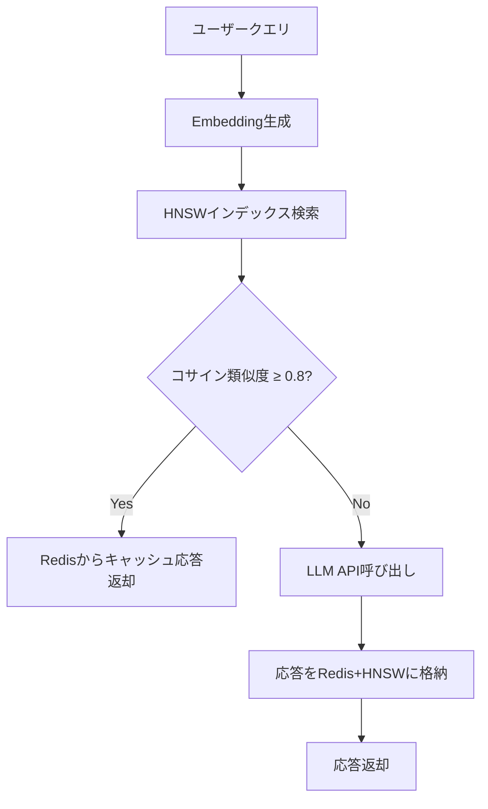

> 本記事は [https://arxiv.org/abs/2411.05276](https://arxiv.org/abs/2411.05276) の解説記事です。論文中の主張・数値は著者らの報告に基づいており、筆者が独自に実験を行ったものではありません。

## 論文概要（Abstract）

GPT Semantic Cacheは、LLM APIへの繰り返しクエリを削減するために、クエリのEmbeddingベクトルをRedisに格納し、意味的に類似した質問に対してキャッシュ済みの応答を返すシステムである。著者らは、カスタマーサービスやプログラミング質問応答など4カテゴリの実験で、APIコールを最大68.8%削減し、キャッシュヒットの正解率（positive hit rate）が92.5〜97.3%に達したと報告している。

この記事は [Zenn記事: セマンティックキャッシュの検索を量子化×Matryoshka Embeddingで高速化する](https://zenn.dev/0h_n0/articles/6f9650fb6fe2a1) の深掘りです。

## 情報源

- **arXiv ID**: 2411.05276
- **URL**: [https://arxiv.org/abs/2411.05276](https://arxiv.org/abs/2411.05276)
- **著者**: Sajal Regmi, Chetan Phakami Pun
- **発表年**: 2024（2024年11月投稿、2024年12月v3改訂）
- **分野**: cs.LG（Machine Learning）

## 背景と動機（Background & Motivation）

LLM APIの利用コストは、クエリ数に比例して増加する。特にカスタマーサポートやFAQ応答のように類似した質問が繰り返されるユースケースでは、毎回LLM APIを呼び出すことはコスト・レイテンシの両面で非効率である。

従来のキャッシュ手法は完全一致に依存しており、表現が異なるが意味的に同じ質問（例:「Pythonでファイルを読む方法」と「Pythonのファイル読み込み手順」）をヒットさせることができなかった。この問題に対し、Embeddingベクトルのコサイン類似度を用いて「意味的な近さ」でキャッシュヒットを判定するセマンティックキャッシュが提案されてきた。

本論文は、この方向性をRedis + HNSWインデックスで実装し、実用的なヒット率とコスト削減効果を定量的に検証した研究である。

## 主要な貢献（Key Contributions）

- **セマンティックキャッシュの完全な実装アーキテクチャ**: Embedding生成、HNSW近似最近傍探索、Redis格納、LLMフォールバックを統合
- **4カテゴリにわたる定量評価**: Pythonプログラミング、ネットワーク技術サポート、注文・配送、ショッピングQ&Aで実測
- **閾値チューニングの知見**: コサイン類似度の閾値を0.6〜0.9でスイープし、0.8が精度とヒット率のバランスで適切と報告

## 技術的詳細（Technical Details）

### システムアーキテクチャ

論文が提案するGPT Semantic Cacheは、以下の4コンポーネントで構成される。



1. **Embedding生成**: OpenAI text-embedding-ada-002（1536次元）またはローカルONNXモデル（all-MiniLM-L6-v2、384次元）でベクトル化
2. **HNSWインデックス**: hnswlib-nodeによる近似最近傍探索。$O(\log n)$ の計算量で探索可能
3. **Redis格納**: Embeddingと応答のペアを格納。次元数でパーティション分割、TTLベースの有効期限
4. **LLMフォールバック**: キャッシュミス時にLLM APIを呼び出し、結果をキャッシュに追加

### 類似度計算とキャッシュヒット判定

キャッシュヒットの判定にはコサイン類似度を使用する。

$$
\text{sim}(\mathbf{u}, \mathbf{v}) = \frac{\mathbf{u} \cdot \mathbf{v}}{\|\mathbf{u}\| \|\mathbf{v}\|}
$$

ここで $\mathbf{u}$ は入力クエリ、$\mathbf{v}$ はキャッシュ内候補のEmbeddingベクトルである。

著者らは閾値を0.6〜0.9の範囲で0.05刻みにスイープした結果、**0.8**がヒット率と正解率のバランスに優れると報告している。0.8未満ではヒット率が上昇するが正解率が低下し、0.8を超えるとヒット率が過度に低下した。ただし、具体的なスイープデータ（各閾値での数値表）は論文中に示されていない。

### キャッシュ管理の設計

- Embedding次元数でパーティション分割し、異なるモデルのEmbedding混在を回避
- インデックスは初期サイズを小さく設定し、エントリ追加に応じて動的に拡張
- 定期的な再バランスでインデックスの検索品質を維持

ただし、TTL値・メモリ上限・エビクションポリシー・HNSWパラメータ（M, efConstruction等）の具体的な設定は報告されていない。

## 実装のポイント（Implementation）

論文の実装はNode.js（TypeScript）ベースで、hnswlib-node、@xenova/transformers、Redisを使用している。以下はアーキテクチャをPythonで簡易的に再現した例である。

```python
from sentence_transformers import SentenceTransformer
import numpy as np
import redis
import json


class SemanticCache:
    """GPT Semantic Cacheの簡易Python実装"""

    def __init__(
        self,
        model_name: str = "all-MiniLM-L6-v2",
        redis_url: str = "redis://localhost:6379",
        similarity_threshold: float = 0.8,
    ):
        self.model = SentenceTransformer(model_name)
        self.redis_client = redis.from_url(redis_url)
        self.threshold = similarity_threshold
        self.embeddings: list[np.ndarray] = []
        self.keys: list[str] = []

    def query(self, text: str) -> dict[str, str | float | bool]:
        """クエリを処理し、キャッシュヒットまたはミスを返す"""
        query_emb = self.model.encode([text])[0]

        if self.embeddings:
            cache_matrix = np.array(self.embeddings)
            sims = cache_matrix @ query_emb / (
                np.linalg.norm(cache_matrix, axis=1) * np.linalg.norm(query_emb)
            )
            best_idx = int(np.argmax(sims))
            best_score = float(sims[best_idx])

            if best_score >= self.threshold:
                cached = self.redis_client.get(self.keys[best_idx])
                if cached:
                    return {"hit": True, "score": best_score,
                            "response": json.loads(cached)["response"]}

        return {"hit": False, "score": 0.0, "response": ""}

    def store(self, text: str, response: str) -> None:
        """クエリと応答をキャッシュに格納する"""
        emb = self.model.encode([text])[0]
        key = f"cache:{hash(text)}"
        self.redis_client.set(
            key, json.dumps({"query": text, "response": response}), ex=3600,
        )
        self.embeddings.append(emb)
        self.keys.append(key)
```

**実装上の注意点**:

- **Embedding次元数の統一**: ada-002（1536次元）とall-MiniLM-L6-v2（384次元）は混在不可。パーティション分割が必要
- **HNSWインデックスの再構築**: エントリ数上限に達するとインデックス再構築が発生し、一時的なレイテンシスパイクを引き起こす
- **閾値の固定値リスク**: ドメインやクエリの多様性によって最適値は変化する。関連Zenn記事で解説されている校正データによるチューニングが実運用では有効

## Production Deployment Guide

### AWS実装パターン（コスト最適化重視）

| 規模 | 月間リクエスト | 推奨構成 | 月額コスト | 主要サービス |
|------|--------------|---------|-----------|------------|
| **Small** | ~3,000 | Serverless | $50-150 | Lambda + Bedrock + ElastiCache Redis |
| **Medium** | ~30,000 | Hybrid | $300-800 | ECS Fargate + ElastiCache Redis |
| **Large** | 300,000+ | Container | $2,000-5,000 | EKS + ElastiCache Redis Cluster |

**Small構成**（月額$50-150）: Lambda 1GB RAM ($20) + Bedrock Haiku ($80) + ElastiCache cache.t3.micro ($15) + CloudWatch ($5)

**Large構成**（月額$2,000-5,000）: EKS ($72) + EC2 Spot r7g.xlarge ($400) + ElastiCache cache.r7g.xlarge 3シャード ($1,200) + Bedrock Batch ($1,500)

**コスト削減テクニック**: Spot Instances（最大90%削減）、ElastiCache Reserved Nodes（55%削減）、Bedrock Batch API（50%削減）、Prompt Caching（30-90%削減）

上記は2026年10月時点のAWS ap-northeast-1料金に基づく概算値。最新料金は[AWS料金計算ツール](https://calculator.aws/)で確認推奨。

### Terraformインフラコード（Small構成）

```hcl
module "vpc" {
  source  = "terraform-aws-modules/vpc/aws"
  version = "~> 5.0"
  name    = "semantic-cache-vpc"
  cidr    = "10.0.0.0/16"
  azs     = ["ap-northeast-1a", "ap-northeast-1c"]
  private_subnets = ["10.0.1.0/24", "10.0.2.0/24"]
  enable_nat_gateway = false
}

resource "aws_elasticache_replication_group" "cache" {
  replication_group_id       = "semantic-cache"
  description                = "Semantic cache Redis"
  node_type                  = "cache.t3.micro"
  num_cache_clusters         = 1
  engine_version             = "7.1"
  port                       = 6379
  subnet_group_name          = aws_elasticache_subnet_group.cache.name
  security_group_ids         = [aws_security_group.redis.id]
  at_rest_encryption_enabled = true
  transit_encryption_enabled = true
}

resource "aws_lambda_function" "cache_handler" {
  filename      = "lambda.zip"
  function_name = "semantic-cache-handler"
  role          = aws_iam_role.lambda_cache.arn
  handler       = "index.handler"
  runtime       = "python3.12"
  timeout       = 60
  memory_size   = 1024
  environment {
    variables = {
      REDIS_ENDPOINT       = aws_elasticache_replication_group.cache.primary_endpoint_address
      SIMILARITY_THRESHOLD = "0.8"
    }
  }
}
```

### 運用・監視設定

```python
import boto3

cloudwatch = boto3.client("cloudwatch")

# キャッシュヒット率低下アラート
cloudwatch.put_metric_alarm(
    AlarmName="semantic-cache-hit-rate-low",
    ComparisonOperator="LessThanThreshold",
    EvaluationPeriods=3,
    MetricName="CacheHitRate",
    Namespace="SemanticCache",
    Period=300,
    Statistic="Average",
    Threshold=0.5,
    AlarmDescription="ヒット率50%未満（閾値調整の検討が必要）",
)

# Redisメモリ使用率アラート
cloudwatch.put_metric_alarm(
    AlarmName="redis-memory-high",
    ComparisonOperator="GreaterThanThreshold",
    EvaluationPeriods=2,
    MetricName="DatabaseMemoryUsagePercentage",
    Namespace="AWS/ElastiCache",
    Period=300,
    Statistic="Average",
    Threshold=80,
    AlarmDescription="Redisメモリ80%超過",
)
```

### コスト最適化チェックリスト

**アーキテクチャ選択**: ~100 req/日→Lambda+ElastiCache ($50-150/月)、~1,000 req/日→ECS Fargate ($300-800/月)、10,000+ req/日→EKS ($2,000-5,000/月)

**リソース最適化**: Spot Instances優先（最大90%削減）/ ElastiCache Reserved Nodes（55%削減）/ Lambda メモリ最適化 / アイドル時スケールダウン / ノードタイプ適正化

**LLMコスト削減**: Bedrock Batch API（50%割引）/ Prompt Caching（30-90%削減）/ モデル選択ロジック（開発: Haiku $0.25/MTok、本番: Sonnet $3/MTok）/ max_tokens設定

**監視**: AWS Budgets（月額予算80%警告）/ CloudWatch（ヒット率・Redisメモリ監視）/ Cost Anomaly Detection / 日次SNS通知

## 実験結果（Results）

著者らは8,000件の質問-回答ペアでキャッシュを構築し、4カテゴリ×500件（計2,000件）のテストクエリで評価している。

| カテゴリ | ヒット数 | ヒット率 | APIコール削減 | 正解数 | 正解率 |
|---------|---------|---------|-------------|-------|-------|
| Pythonプログラミング | 335/500 | 67.0% | 33.0% | 310 | 92.5% |
| ネットワーク技術サポート | 335/500 | 67.0% | 33.0% | 326 | 97.3% |
| 注文・配送 | 344/500 | 68.8% | 31.2% | 331 | 96.2% |
| ショッピングQ&A | 308/500 | 61.6% | 38.4% | 298 | 96.8% |

（論文Table 1相当。正解判定はGPT-4o Miniによるバイナリ判定）

**注意点**: Abstractでは「positive hit rates exceeding 97%」と記載されているが、Pythonカテゴリでは92.5%であり、97%超はネットワーク技術サポートのみである。また、正解判定にGPT-4o Miniを使用しており、人手検証は報告されていない。

## 実運用への応用（Practical Applications）

**有効なユースケース**: FAQ的な質問が繰り返されるカスタマーサポートでは60%以上のAPIコール削減が期待できる。プログラミングQ&Aでも67%のヒット率が報告されている。

**制約事項**:
- **マルチターン対話**: 単一クエリのキャッシュであり、対話履歴を考慮した類似度判定には非対応
- **時間経過による陳腐化**: TTLベースのみで、回答の鮮度を能動的に検証する機構はない
- **スケーリング**: HNSWインデックスの動的拡張には再構築が伴い、数百万エントリでは管理コストが増大

関連Zenn記事では、この検索レイテンシ問題に対してバイナリ量子化やMatryoshka Embeddingによる高速化手法が解説されている。本論文のアーキテクチャと組み合わせることで、大規模キャッシュでのスケーラビリティ改善が見込める。

## 関連研究（Related Work）

- **GPTCache**: オープンソースのセマンティックキャッシュフレームワーク。本論文では関連研究として言及されているが、実験での比較は行われていない
- **Exact Hits to Close Enough（arXiv:2603.03301）**: セマンティックキャッシュのオフラインポリシーがNP困難であることを示し、recency・frequency・localityを組み合わせたオンラインポリシーを提案
- **Ensemble Embedding Approach（arXiv:2507.07061）**: 複数のEmbeddingモデルをメタエンコーダで統合し、キャッシュヒット精度を向上

## まとめと今後の展望

本論文は、Redis + HNSWによるセマンティックキャッシュの実装アーキテクチャを提示し、4カテゴリの実験で最大68.8%のAPIコール削減と92.5〜97.3%の正解率を報告した。実装が比較的シンプルであり、FAQ的なクエリが多いシステムでのコスト削減に有効な手法である。

一方で、閾値チューニングのスイープデータが不足していること、比較対象がno-cacheベースラインのみであること、レイテンシの具体的数値が示されていないことは、実務適用時に追加検証が必要な点である。

## 参考文献

- **arXiv**: [https://arxiv.org/abs/2411.05276](https://arxiv.org/abs/2411.05276)
- **Related Zenn article**: [https://zenn.dev/0h_n0/articles/6f9650fb6fe2a1](https://zenn.dev/0h_n0/articles/6f9650fb6fe2a1)
