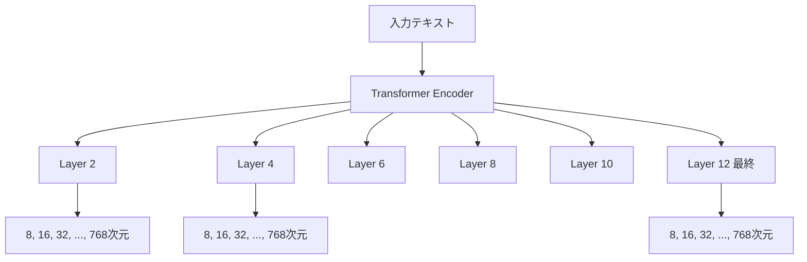

本記事は [https://arxiv.org/abs/2411.17299](https://arxiv.org/abs/2411.17299) の解説記事です。

## 論文概要（Abstract）

2D Matryoshka Sentence Embedding（2DMSE）は、Matryoshka Representation Learning（MRL）をEmbeddingの次元方向だけでなく、Transformerのレイヤー深さ方向にも拡張した訓練手法である。1つのエンコーダモデルで「どのレイヤーから出力を取り出すか」と「先頭何次元を使うか」の両方を自由に選択できるようにすることで、推論コストとEmbeddingサイズを同時に削減することを目指す。本論文は、この2DMSEの2つの公開実装（V1・V2）を再現し、意味的テキスト類似度（STS）タスクに加えて情報検索（MS MARCO・BEIR）への汎化を検証した再現性研究である。

この記事は [Zenn記事: セマンティックキャッシュの検索を量子化×Matryoshka Embeddingで高速化する](https://zenn.dev/0h_n0/articles/6f9650fb6fe2a1) の深掘りです。

## 情報源

- **arXiv ID**: 2411.17299
- **URL**: [https://arxiv.org/abs/2411.17299](https://arxiv.org/abs/2411.17299)
- **著者**: Shuai Wang, Shengyao Zhuang, Bevan Koopman, Guido Zuccon
- **発表年**: 2024年11月
- **分野**: cs.IR, cs.CL
- **再現コード**: [github.com/ielab/2DMSE-Reproduce](https://github.com/ielab/2DMSE-Reproduce)

## 背景と動機（Background & Motivation）

Matryoshka Representation Learning（MRL）は、Embeddingベクトルの先頭 $d$ 次元を切り出しても有用な表現が得られるように訓練する手法であり、セマンティックキャッシュの検索高速化にも活用されている。しかし、MRLが削減するのはEmbeddingの次元数のみであり、エンコーダの推論コスト（全レイヤーを通すForward Pass）は変わらない。

2DMSE（Li et al., 2024で提案された ESE: Early-layer Sub-dimension Embedding）は、次元方向だけでなくレイヤー方向にもMatryoshka構造を導入する。中間レイヤーの出力からEmbeddingを取得できるようにすることで、推論時にTransformerの浅いレイヤーで処理を打ち切ることが可能になり、計算コストとEmbeddingサイズの両方を削減できる。

しかし、2DMSEには2つの異なる公開実装（V1: sentence_transformersベース、V2: AnglEライブラリベース）が存在し、それぞれの損失関数が異なるにもかかわらず、同一手法として比較されている状況があった。著者らはこの不整合を指摘し、両バージョンの正確な再実装と、情報検索タスクへの拡張評価を実施している。

## 主要な貢献（Key Contributions）

- **再現性検証**: 2DMSEの2つの公開実装（V1・V2）を忠実に再実装し、STSタスクでの既存結果を再現
- **検索への拡張**: MS MARCO（教師あり）とBEIR（ゼロショット）での初の体系的評価を実施
- **損失関数の改良**: 情報検索に適した損失関数の改良提案（FULL-DIM、+DIMSなど）
- **文書エンコーダ固定の検証**: クエリのみ浅いレイヤーで処理し文書は最終レイヤーを使う「fix-doc」方式の有効性を検証

## 技術的詳細（Technical Details）

### Matryoshka訓練の基本

標準的なMRL訓練では、最終レイヤー出力 $\mathbf{e}^{(L)}$ の先頭 $k_i$ 次元を切り出した部分ベクトル $\mathbf{e}^{(L)}_{1:k_i}$ に対して損失を計算する。

$$
\mathcal{L}_{\text{MRL}} = \sum_{k_i \in \mathcal{K}} \ell(\mathbf{e}^{(L)}_{1:k_i}, y)
$$

ここで、$\mathcal{K}$ は対象次元の集合（例: $\{64, 128, 256, 768\}$）、$\ell$ は対照学習損失、$y$ はラベルである。

### 2DMSE-V1の損失関数

V1は sentence_transformers ライブラリの MultipleNegativesRankingLoss をベースとし、以下の3項からなる。

$$
\mathcal{L}_{\text{V1}} = \mathcal{L}_{\text{last}} + \mathcal{L}_{\text{random}} + \lambda \cdot \mathcal{L}_{\text{KLD}}
$$

- $\mathcal{L}_{\text{last}}$: 最終レイヤー出力に対する対照学習損失
- $\mathcal{L}_{\text{random}}$: ランダムに選ばれた中間レイヤー $r$ の出力に対する対照学習損失
- $\mathcal{L}_{\text{KLD}}$: 最終レイヤーとランダムレイヤーの出力分布間のKLダイバージェンス
- $\lambda$: KLD項の重み

各損失項ではMRL方式で複数の次元サブセットに対して損失が計算される。訓練時には毎ステップ1つの中間レイヤーのみがサンプリングされるため、V1の計算コストは比較的低い。

### 2DMSE-V2の損失関数

V2は AnglE ライブラリをベースとし、全レイヤーの出力を使う。

$$
\mathcal{L}_{\text{V2}} = \alpha \cdot \mathcal{L}_{\text{layer}} + \beta \cdot \mathcal{L}_{\text{dim}}
$$

- $\mathcal{L}_{\text{layer}}$: 各レイヤー $i$ の出力に重み $w_i$ を付けた損失。$w_i = \frac{1}{1 + \ln i}$（$i < L$ の場合）、$w_L = 1$
- $\mathcal{L}_{\text{dim}}$: 各レイヤーの出力をPCA変換後に目標次元 $k_i$ に切り詰め、MSEとKLダイバージェンスで最終レイヤーの出力に近づける

著者らは、V2の公式コードを調査した結果、公開論文の記述とは異なり、最終レイヤーのフル次元損失 $\ell(\mathbf{e}^{(L)}, y)$ が追加されていること、また中間レイヤーのフル次元出力は直接訓練されておらず目標次元 $k_i = 128$ のみが最適化されていることを発見したと報告している。

### 2次元の探索空間



評価では6レイヤー（$\{2, 4, 6, 8, 10, 12\}$）× 8次元（$\{8, 16, 32, 64, 128, 256, 512, 768\}$）= 48 の構成が検証されている。これにより、推論時に必要な品質とコストのトレードオフに応じて最適な構成を選択できる。

### 検索向け損失関数の改良

著者らは、V2をベースに以下の改良を提案している。

| 改良手法 | 説明 | 効果 |
|---------|------|------|
| **SCORE** | スコアリング特化損失 | 高次元では有効だが低次元に汎化しにくい |
| **FULL-DIM** | 各レイヤーからフル次元の損失を追加 | 128次元以上で大幅改善、レイヤー8-10での低下を解消 |
| **+DIMS** | 目標次元を $\{8, 16, 32, 64, 128, 256, 512\}$ に拡張 | 全次元で安定した性能カーブ、ただし高次元の上限が低下 |

## 実験設定と結果（Results）

### STSタスクでの再現結果（RQ1）

ベースモデルは bert-base-uncased、訓練データは All-NLI（MultiNLI + SNLI）、評価指標はSpearman相関係数である。

著者らの報告によると、2DMSE（V1・V2ともに）は標準のMRL訓練およびBERTの生出力と比較して、中間レイヤー×低次元の構成で一貫した改善を示している。ただし、各構成を個別に訓練したモデル（BERT-S）には及ばないケースが多い。V1はレイヤー2・4・6の8次元でBERT-Sを上回ったが、V2ではこの優位性は確認されなかったと報告されている。

V2はV1よりも全体的に高い性能を示しており、著者らはV2をSTS向けにはより適切なバージョンと位置づけている。

### 情報検索での汎化（RQ2）

訓練はMS MARCO Passage Rankingデータセットで対照学習損失（Tevatronツールキット使用）、評価はMS MARCO dev set（MRR@10）と13のBEIRデータセット（nDCG@10ゼロショット）で実施されている。

著者らの報告による主な知見は以下の通りである。

- 2DMSEはMRLおよびBERTの生出力に対して、中間レイヤーでの性能を改善する（最終レイヤーを除く）
- ただしBERT-S（個別訓練モデル）にはすべての構成で及ばない
- STSと異なり、128次元未満での性能低下が顕著である
- 128次元を超える高次元でも若干の性能低下が観察される

著者らは、この挙動の原因として以下の2点を指摘している。

1. V2の訓練目標次元が $k_i = 128$ に固定されており、他の次元が直接最適化されていない
2. 情報検索はSTSよりも困難なタスクであり、損失関数の設計がより重要になる

### 損失関数改良の効果（RQ3）

著者らはMS MARCOのMRR@10で損失関数の改良効果を評価している。

- **FULL-DIM**: 128次元以上で顕著な改善。レイヤー8・10での次元512における性能低下も解消された
- **+DIMS**: 全次元で滑らかな性能カーブを実現し、個別訓練モデル（BERT-S）に近い挙動を示す。ただし高次元での上限はやや低下する

FULL-DIMと+DIMSの組み合わせが、検索タスクにおいて最も安定した結果を示したと報告されている。

### 文書エンコーダ固定方式（RQ4）

「fix-doc」方式（文書は最終レイヤーのフル出力、クエリのみ浅いレイヤーで処理）の検証では、結果が一貫しないことが報告されている。浅いクエリレイヤー（2, 4, 6）と高次元の組み合わせでは「paired-doc」方式に大きく劣り、深いクエリレイヤー（8, 10）では若干優れる場合があるものの、インデクシングコストが増加するため、著者らは明確な利点はないと結論づけている。

## 実装のポイント（Implementation）

### 再現コードの構成

著者らは再現コード（[github.com/ielab/2DMSE-Reproduce](https://github.com/ielab/2DMSE-Reproduce)）を公開している。訓練にはTevatronツールキットを使用しており、BERTエンコーダの各レイヤーから出力を取り出す仕組みを追加している。

### 2D Matryoshka Embeddingの推論時利用

2DMSEで訓練されたモデルを推論時に利用する場合、エンコーダの中間レイヤー出力を取得する必要がある。Sentence Transformersでの実装例は以下の通りである。

```python
from sentence_transformers import SentenceTransformer
import torch

model = SentenceTransformer("trained-2dmse-model")

def encode_with_layer(
    model: SentenceTransformer,
    texts: list[str],
    target_layer: int = 6,
    target_dim: int = 256,
) -> torch.Tensor:
    """指定レイヤー・次元でEmbeddingを取得する"""
    tokenized = model.tokenize(texts)
    tokenized = {k: v.to(model.device) for k, v in tokenized.items()}

    with torch.no_grad():
        outputs = model[0].auto_model(
            **tokenized, output_hidden_states=True
        )

    # target_layer番目の隠れ状態を取得（0-indexed、0は入力Embedding層）
    hidden = outputs.hidden_states[target_layer]

    # [CLS]トークンの出力を使用
    cls_embedding = hidden[:, 0, :]

    # 先頭target_dim次元を切り出し
    truncated = cls_embedding[:, :target_dim]

    # L2正規化
    normalized = torch.nn.functional.normalize(truncated, p=2, dim=1)
    return normalized
```

### セマンティックキャッシュへの応用

2DMSEの特性は、セマンティックキャッシュのEmbedding計算高速化に直接活用できる。浅いレイヤーでの推論はForward Passの計算量を削減し、次元削減はベクトル検索のコストを下げる。

```python
import numpy as np

def adaptive_cache_search(
    query: str,
    cache_embeddings: np.ndarray,
    model: SentenceTransformer,
    fast_layer: int = 4,
    fast_dim: int = 128,
    full_layer: int = 12,
    full_dim: int = 768,
    fast_threshold: float = 0.85,
    final_threshold: float = 0.92,
    top_k: int = 4,
) -> str | None:
    """2段階キャッシュ検索: 浅いレイヤーで候補絞り込み→最終レイヤーで再検証"""
    # Stage 1: 浅いレイヤー・低次元で高速スクリーニング
    query_fast = encode_with_layer(model, [query], fast_layer, fast_dim)
    query_fast_np = query_fast.cpu().numpy()

    # cache_embeddings_fast は事前に浅いレイヤーで計算済み
    similarities = query_fast_np @ cache_embeddings[:, :fast_dim].T
    candidates = np.where(similarities.flatten() > fast_threshold)[0]

    if len(candidates) == 0:
        return None

    # Stage 2: 最終レイヤー・フル次元で精密検証
    query_full = encode_with_layer(model, [query], full_layer, full_dim)
    query_full_np = query_full.cpu().numpy()

    candidate_full = cache_embeddings[candidates]
    final_sims = (query_full_np @ candidate_full.T).flatten()
    best_idx = np.argmax(final_sims)

    if final_sims[best_idx] >= final_threshold:
        return candidates[best_idx]
    return None
```

**注意点**: 2DMSEはbert-base-uncasedでのみ検証されている。商用のEmbeddingモデル（OpenAI text-embedding-3-large等）やより大規模なモデルでの検証は行われていないため、本番環境での採用時には対象モデルでの事前評価が必要である。

## Production Deployment Guide

### AWS実装パターン（コスト最適化重視）

2DMSEの特性（浅いレイヤーでの推論打ち切り）を活かすには、モデル推論サーバーのカスタマイズが必要となる。以下はトラフィック量別の推奨構成である。

| 規模 | 月間リクエスト | 推奨構成 | 月額コスト | 主要サービス |
|------|--------------|---------|-----------|------------|
| **Small** | ~3,000 (100/日) | Serverless | $50-150 | Lambda + SageMaker Serverless + DynamoDB |
| **Medium** | ~30,000 (1,000/日) | Hybrid | $300-800 | ECS Fargate + ElastiCache Redis + S3 |
| **Large** | 300,000+ (10,000/日) | Container | $2,000-5,000 | EKS + Karpenter + EC2 Spot (GPU) |

**Small構成の詳細**（月額$50-150）:
- **Lambda**: Embeddingリクエストの受付、1GB RAM、30秒タイムアウト（$20/月）
- **SageMaker Serverless Inference**: BERTモデルホスティング、4GB RAM（$40-80/月）
- **DynamoDB**: キャッシュストレージ、On-Demand（$10/月）
- **CloudWatch**: 基本監視（$5/月）

**Medium構成の詳細**（月額$300-800）:
- **ECS Fargate**: BERTモデル推論、1 vCPU / 4GB RAM × 2タスク（$200/月）
- **ElastiCache Redis**: ベクトルキャッシュ、cache.r7g.large（$200/月）
- **S3**: モデルアーティファクト保存（$5/月）
- **ALB**: ロードバランサー（$20/月）

**Large構成の詳細**（月額$2,000-5,000）:
- **EKS**: コントロールプレーン（$72/月）
- **EC2 Spot**: g5.xlarge × 2-4台でGPU推論（平均$800/月、Spot利用で最大90%削減）
- **Karpenter**: 自動スケーリング（追加コストなし）
- **ElastiCache Redis**: cache.r7g.xlarge クラスタ（$400/月）
- **CloudWatch + X-Ray**: 詳細監視（$100/月）

**コスト削減テクニック**:
- 2DMSEの浅いレイヤー推論により、GPU推論時間を最大50%削減可能（12層→6層の場合）
- Spot Instances使用で最大90%削減（EKS + Karpenter）
- SageMaker Serverless Inferenceで低トラフィック時のアイドルコストをゼロに
- ElastiCacheのReserved Nodes購入で最大55%削減（1年コミット）

**コスト試算の注意事項**:
- 上記は2026年10月時点のAWS ap-northeast-1（東京）リージョン料金に基づく概算値です
- 実際のコストはトラフィックパターン、リージョン、バースト使用量により変動します
- 最新料金は [AWS料金計算ツール](https://calculator.aws/) で確認してください

### Terraformインフラコード（Small構成抜粋）

```hcl
resource "aws_sagemaker_endpoint_configuration" "bert_2dmse" {
  name = "bert-2dmse-serverless"
  production_variants {
    variant_name = "default"
    model_name   = aws_sagemaker_model.bert_2dmse.name
    serverless_config {
      memory_size_in_mb = 4096
      max_concurrency   = 5
    }
  }
}

resource "aws_dynamodb_table" "embedding_cache" {
  name         = "semantic-cache-2dmse"
  billing_mode = "PAY_PER_REQUEST"
  hash_key     = "query_hash"
  attribute { name = "query_hash"; type = "S" }
  ttl { attribute_name = "expire_at"; enabled = true }
}

resource "aws_lambda_function" "cache_handler" {
  function_name = "semantic-cache-2dmse-handler"
  role          = aws_iam_role.lambda_embedding.arn
  handler       = "index.handler"
  runtime       = "python3.12"
  timeout       = 30
  memory_size   = 1024
  environment {
    variables = {
      SAGEMAKER_ENDPOINT = aws_sagemaker_endpoint.bert_2dmse.name
      DYNAMODB_TABLE     = aws_dynamodb_table.embedding_cache.name
      TARGET_LAYER       = "6"
      TARGET_DIM         = "256"
    }
  }
}
```

### 運用・監視設定

**CloudWatch Logs Insights クエリ**:

```sql
-- レイヤー別推論レイテンシ分析
fields @timestamp, target_layer, target_dim, inference_ms
| stats avg(inference_ms) as avg_ms, pct(inference_ms, 95) as p95_ms
  by target_layer, target_dim
| sort target_layer asc
```

### コスト最適化チェックリスト

**アーキテクチャ選択**:
- [ ] ~100 req/日 → Lambda + SageMaker Serverless — $50-150/月
- [ ] ~1,000 req/日 → ECS Fargate + ElastiCache — $300-800/月
- [ ] 10,000+ req/日 → EKS + GPU Spot — $2,000-5,000/月

**リソース最適化**:
- [ ] 2DMSEの浅いレイヤー推論で計算コスト削減（12層→6層で約50%削減）
- [ ] GPU Spot Instances優先（最大90%削減）
- [ ] ElastiCache Reserved Nodesで55%削減（1年コミット）

**Embedding最適化**:
- [ ] 低レイテンシ要求: レイヤー4-6 × 128-256次元
- [ ] 高精度要求: レイヤー10-12 × 512-768次元
- [ ] バイナリ量子化との併用でさらにメモリ削減

## 実験結果の詳細（Results）

### 計算コスト

著者らは、全実験に600 H100 GPU時間以上を要したと報告している。これは48構成の個別訓練（BERT-S）が主な要因であり、2DMSE自体の訓練は1回で済む。

### ベースラインとの比較まとめ

| 手法 | STSでの評価 | 検索（MS MARCO）での評価 | 備考 |
|------|-----------|---------------------|------|
| BERT（生出力） | 中間レイヤーで性能低下 | 中間レイヤーで性能低下 | ベースライン |
| MRL（次元方向のみ） | 次元削減に有効 | 次元削減に有効 | レイヤー方向は非対応 |
| BERT-S（個別訓練） | 全構成で最高 | 全構成で最高 | 48モデルの訓練が必要 |
| 2DMSE-V1 | MRLを上回る | MRLを上回る | ランダムレイヤーサンプリング |
| 2DMSE-V2 | V1を上回る | V1を上回る | 全レイヤー損失 |
| 2DMSE-V2 + FULL-DIM + DIMS | — | V2を上回る | 検索向け改良版 |

著者らの結論として、2DMSEは1つのモデルで48の構成をカバーできる利点があるが、個別訓練モデルの品質には達していない。検索タスクでは損失関数の設計が特に重要であり、FULL-DIMと+DIMSの併用が推奨されている。

## 実運用への応用（Practical Applications）

### セマンティックキャッシュでの活用

2DMSEはセマンティックキャッシュの2つのボトルネック（Embedding計算と類似度検索）を同時に改善できる可能性がある。

- **Embedding計算の高速化**: 浅いレイヤー（例: 6層）で推論を打ち切ることで、12層のフルForward Passと比較して計算時間を約50%削減
- **類似度検索の高速化**: MRL特性により低次元Embeddingを使用し、検索コストとメモリ使用量を削減

ただし、128次元未満での検索性能低下が報告されているため、Zenn記事で紹介されているバイナリ量子化やスカラー量子化と組み合わせる際は、事前に十分な評価が必要である。

### 適用時の注意点

- bert-base-uncased以外のモデルでの検証は行われていない
- 大規模なEmbeddingモデル（1024次元以上）での挙動は未検証
- 検索タスクでは128次元を下回ると性能が急激に低下する
- レイヤー方向とMRL方向の最適な組み合わせはタスク依存であり、キャリブレーションが必要

## 関連研究（Related Work）

- **Matryoshka Representation Learning（Kusupati et al., 2022）**: 次元方向のMatryoshka構造の原論文。2DMSEはこれをレイヤー方向に拡張したものである
- **KALE（Zhuang et al., 2024）**: 浅いレイヤーの出力を最終レイヤーにKLダイバージェンスで整合させるクエリエンコーダの枝刈り手法。2DMSEと異なりクエリ側のみが対象
- **MatFormer（Devvrit et al., 2023）**: Transformerの隠れ次元を弾力的に削減する手法。2DMSEがEmbedding次元を対象とするのに対し、MatFormerはモデル内部の次元を対象とする

## まとめと今後の展望

2DMSEは、1つのエンコーダモデルで推論コスト（レイヤー深さ）とEmbeddingサイズ（次元数）の両方を柔軟に制御できる訓練手法である。著者らの再現実験により、STSでの有効性が確認される一方、情報検索では損失関数の設計改良（FULL-DIM、+DIMS）が重要であることが示されている。

セマンティックキャッシュへの応用では、Embedding計算の高速化と検索コスト削減の両方に寄与する可能性があるが、現時点ではbert-base-uncasedでの検証に限られている。今後、より大規模なEmbeddingモデルや多言語モデルでの検証が進むことで、本番環境での実用性が明らかになると考えられる。

## 参考文献

- **arXiv**: [https://arxiv.org/abs/2411.17299](https://arxiv.org/abs/2411.17299)
- **Code**: [https://github.com/ielab/2DMSE-Reproduce](https://github.com/ielab/2DMSE-Reproduce)
- **Related Zenn article**: [https://zenn.dev/0h_n0/articles/6f9650fb6fe2a1](https://zenn.dev/0h_n0/articles/6f9650fb6fe2a1)
- **Matryoshka Representation Learning**: [https://arxiv.org/abs/2205.13147](https://arxiv.org/abs/2205.13147)
- **ESE (2DMSE original)**: Li et al., "2D Matryoshka Sentence Embeddings," 2024
