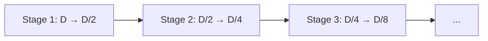

本記事は [https://arxiv.org/abs/2510.12474](https://arxiv.org/abs/2510.12474) の解説記事です。

## 論文概要（Abstract）

SMEC（Sequential Matryoshka Embedding Compression）は、LLMベースの高次元Embeddingを効率的に圧縮しながら検索精度を維持するためのフレームワークである。著者らはMatryoshka Representation Learning（MRL）の3つの課題——勾配の揺らぎ、次元切り詰めによる情報劣化、バッチ内ペアリングのサンプル多様性不足——を分析し、それぞれに対応する3つの手法（SMRL、ADS、S-XBM）を提案している。BEIRベンチマークにおいて、LLM2Vecの256次元圧縮でMatryoshka-Adaptorを1.1ポイント、Search-Adaptorを2.7ポイント上回ったと報告されている（論文Abstract）。

この記事は [Zenn記事: セマンティックキャッシュの検索を量子化×Matryoshka Embeddingで高速化する](https://zenn.dev/0h_n0/articles/6f9650fb6fe2a1) の深掘りです。

## 情報源

- **arXiv ID**: 2510.12474
- **URL**: [https://arxiv.org/abs/2510.12474](https://arxiv.org/abs/2510.12474)
- **著者**: Biao Zhang, Lixin Chen, Tong Liu, Bo Zheng（Alibaba Taobao & Tmall Group）
- **発表年**: 2025年（EMNLP 2025 採択）
- **分野**: cs.CL, cs.LG

## 背景と動機（Background & Motivation）

LLMベースのEmbeddingモデル（OpenAI text-embedding-3-large: 3,072次元、LLM2Vec Qwen2-7B: 3,584次元など）は豊富な意味情報を持つ一方、ストレージ・計算コスト・検索レイテンシの面で実運用上の課題がある。セマンティックキャッシュのように大量のベクトルを高速に検索する用途では、次元数の削減が直接的にコスト改善につながる。

Matryoshka Representation Learning（MRL, Kusupati et al., 2022）は、1つのモデルで複数の次元数に対応するネスト構造のEmbeddingを学習する手法である。しかし著者らは、MRLには以下の3つの限界があると指摘している。

1. **勾配の揺らぎ**: 異なる次元数のサブモデルを同時に学習すると、同一パラメータに異なるスケールの勾配が作用し、学習が不安定になる
2. **情報劣化**: 先頭次元の切り詰めという決定論的な方法では、重要な情報が後方の次元に存在する場合に失われる
3. **サンプル多様性の不足**: バッチ内ペアリングのみでは、高次元と低次元のEmbedding間の対応関係を十分に学習できない

## 主要な貢献（Key Contributions）

- **SMRL（Sequential MRL）**: 並列学習を段階的学習に置き換え、勾配の分散を低減する手法
- **ADS（Adaptive Dimension Selection）**: Gumbel-Softmax による微分可能な次元選択で、情報量の多い次元を適応的に選択する手法
- **S-XBM（Selectable Cross-Batch Memory）**: FIFOキュー型メモリバンクでバッチ間のハードサンプルを活用し、教師なし損失を強化する手法
- 上記3手法を統合したSMECフレームワークが、BEIR・Products-10K・Fashion-200Kの3ベンチマークで既存手法を上回ったと報告されている

## 技術的詳細（Technical Details）

### MRLの勾配問題の分析

著者らはまず、MRLの学習不安定性を勾配の観点から分析している。MRLの目的関数は以下の形式を取る。

$$
\mathcal{L}_{\text{MRL}} = \sum_{m=1}^{M} c_m \cdot \mathcal{L}(f_{d_m}(\mathbf{x}); y)
$$

ここで、$d_1 \leq d_2 \leq \cdots \leq d_M$ はネストされた次元数、$c_m$ は各次元の損失に対する重み係数、$f_{d_m}(\mathbf{x})$ は先頭 $d_m$ 次元の切り出しである。

論文のAppendix Aでは、MSE損失とコサイン類似度を仮定した場合に以下の関係が導出されている。

$$
\frac{\partial \mathcal{L}^d}{\partial w_i} \propto \frac{1}{\delta(d)^2}
$$

ここで、$\delta(d)$ は次元数 $d$ に正の相関を持つ量である。これは、低次元サブモデルほど勾配の絶対値が大きくなることを意味し、同一パラメータ（例えば先頭 $d_1$ 次元に含まれるパラメータ $w_i$）に対して $d_1, d_2, \ldots, d_M$ の各損失から異なるスケールの勾配が加算される。著者らは、この勾配分散の増大がMRLの学習を不安定にしていると主張している。

### SMRL: Sequential Matryoshka Representation Learning

SMRLは、MRLの並列学習を段階的（sequential）学習に置き換える。



具体的には、全次元 $D$ のEmbeddingから出発し、$D \to D/2 \to D/4 \to \cdots \to D/2^n$ と段階的に圧縮する。各ステージでは直前のステージの出力のみを入力とし、そのステージの学習が収束したらパラメータを固定する。

この設計には2つの利点がある。

1. **勾配分散の低減**: 各ステージで1つの次元ペアのみを学習するため、異なるスケールの勾配が同一パラメータに作用しない
2. **継続学習**: 例えば $D/4$ のステージが完了した後に $D/8$ を追加学習する場合、$D/4$ 以前のパラメータは再利用できる。新しい次元数が必要になるたびにゼロから再学習する必要がない

著者らの実験（論文Figure 6, MiniLM on BEIR）では、MRLに比べてSMRLの勾配分散が一貫して低く、エポック15付近で収束し始める一方、MRLはエポック20を過ぎても損失が下がり続けていたと報告されている。

### ADS: Adaptive Dimension Selection

MRLでは先頭 $d$ 次元を機械的に切り出すが、ADSは情報量の多い次元を適応的に選択する。

各次元 $i$ に対して学習可能なロジット $\hat{z}_i$ を導入し、Gumbel-Softmaxで微分可能なサンプリングを行う。

$$
z_i = \text{softmax}_\tau(\hat{z}_i + G_i), \quad G_i \sim \text{Gumbel}(0, 1)
$$

ここで、$\tau$ は温度パラメータである。この確率的な次元選択により、先頭次元への偏りを避け、Embedding全体から情報量の大きい次元を選び出す。

著者らはADSの選択品質を**Achievement Rate**で評価している（論文Table 2）。Achievement Rateは、ADSが選んだ次元のうち、WARE（Weighted Average Reconstruction Error）指標で上位にランクされる次元の割合である。LLM2Vec（3,072次元）からの256次元選択において、ADSは83.6%、MRLの先頭切り出しは17.4%であったと報告されている。

| 目標次元数 | ADS | MRL（先頭切り出し） |
|-----------|-----|-------------------|
| 1,536 | 94.3% | 50.3% |
| 768 | 90.1% | 32.8% |
| 256 | 83.6% | 17.4% |

*表: Achievement Rate（論文Table 2より。LLM2Vec, BEIR 10,000サンプル）*

### S-XBM: Selectable Cross-Batch Memory

S-XBMは、バッチ間のサンプルを活用して教師なし損失を強化する仕組みである。FIFOキュー型のメモリバンクに過去のバッチのEmbeddingを蓄積し、各サンプルに対してメモリ内のtop-k類似サンプルを取得して新たなペアを構成する。

教師なし損失は以下で定義される（論文Eq. 7）。

$$
\mathcal{L}_{\text{unsup}} = \sum_{i} \sum_{j \in \text{top-}k(i)} \left| \text{Sim}(\mathbf{e}_i, \mathbf{e}_j) - \text{Sim}(\mathbf{e}_i[:d], \mathbf{e}_j[:d]) \right|
$$

ここで、$\mathbf{e}_i$ は全次元のEmbedding、$\mathbf{e}_i[:d]$ は圧縮後の $d$ 次元Embedding、$\text{Sim}$ はコサイン類似度である。この損失は、圧縮前後でのペア間類似度の差を最小化することで、低次元Embeddingに全次元の意味構造を保存することを促す。

S-XBMがオリジナルのXBM（Wang et al., 2020）と異なる点は2つある。

1. メモリ内の全サンプルではなく、**top-k類似サンプルのみ**を取得する（ハードサンプルマイニング）
2. 学習可能なFC層の出力ではなく、**凍結されたバックボーンの特徴量**のみをメモリに格納する（特徴ドリフトの防止）

メモリサイズの選択について、著者らは論文Table 3で以下のトレードオフを報告している。

| メモリサイズ | Forward時間 (秒) | NDCG@10 |
|------------|----------------|---------|
| 1,000 | 0.06 | 0.4631 |
| 2,000 | 0.08 | 0.4652 |
| 5,000 | 0.11 | 0.4675 |
| 10,000 | 0.15 | 0.4682 |
| 15,000 | 0.21 | 0.4689 |

*表: S-XBMメモリサイズと性能・速度のトレードオフ（論文Table 3より）*

5,000がバランスポイントとして採用されている。

### 統合損失関数

SMECの全体損失は、教師ありランク損失と教師なしS-XBM損失の和で構成される（論文Eq. 9）。

$$
\mathcal{L}_{\text{total}} = \mathcal{L}_{\text{rank}} + \alpha \cdot \mathcal{L}_{\text{unsup}}
$$

ここで、$\alpha = 1.0$ が固定値として使用されている。ランク損失（論文Eq. 8）は以下の形式を取る。

$$
\mathcal{L}_{\text{rank}} = \sum_{i} \sum_{j} \sum_{k} \sum_{m} \mathbb{I}(y_{ij} > y_{ik})(y_{ij} - y_{ik}) \log\left(1 + \exp(s_{ik}^{[:m]} - s_{ij}^{[:m]})\right)
$$

ここで、$s_{ij}^{[:m]}$ は先頭 $m$ 次元でのコサイン類似度、$y_{ij}$ は正例ペアの関連度ラベルである。

## 実装のポイント（Implementation）

SMECを実装する際の要点を整理する。

```python
import torch
import torch.nn as nn
import torch.nn.functional as F
from collections import deque


class AdaptiveDimensionSelector(nn.Module):
    """ADS: Gumbel-Softmaxベースの次元選択"""

    def __init__(self, full_dim: int, target_dim: int, tau: float = 1.0):
        super().__init__()
        self.full_dim = full_dim
        self.target_dim = target_dim
        self.tau = tau
        self.logits = nn.Parameter(torch.randn(full_dim))

    def forward(self, embeddings: torch.Tensor) -> torch.Tensor:
        """確率的な次元選択を適用する

        Args:
            embeddings: shape (batch_size, full_dim)

        Returns:
            compressed: shape (batch_size, target_dim)
        """
        if self.training:
            gumbel_noise = -torch.log(
                -torch.log(torch.rand_like(self.logits) + 1e-20) + 1e-20
            )
            scores = F.softmax((self.logits + gumbel_noise) / self.tau, dim=0)
        else:
            scores = F.softmax(self.logits / self.tau, dim=0)

        _, top_indices = scores.topk(self.target_dim)
        top_indices_sorted, _ = top_indices.sort()
        return embeddings[:, top_indices_sorted]


class CrossBatchMemory:
    """S-XBM: FIFOキュー型クロスバッチメモリ"""

    def __init__(self, capacity: int = 5000, top_k: int = 10):
        self.capacity = capacity
        self.top_k = top_k
        self.memory: deque[torch.Tensor] = deque(maxlen=capacity)

    def update(self, embeddings: torch.Tensor) -> None:
        """バッチのEmbeddingをメモリに追加する"""
        for emb in embeddings.detach():
            self.memory.append(emb)

    def retrieve_hard_samples(
        self, query: torch.Tensor
    ) -> torch.Tensor:
        """クエリに対するtop-k類似サンプルをメモリから取得する"""
        if len(self.memory) == 0:
            return torch.empty(0, query.shape[-1])

        memory_tensor = torch.stack(list(self.memory))
        sims = F.cosine_similarity(
            query.unsqueeze(1), memory_tensor.unsqueeze(0), dim=2
        )
        _, indices = sims.topk(min(self.top_k, len(self.memory)), dim=1)
        return memory_tensor[indices]
```

**実装上の注意点:**

- **段階的学習の管理**: SMRLの各ステージでオプティマイザとスケジューラを初期化し直す必要がある。前ステージのパラメータは `requires_grad=False` で凍結する
- **メモリの特徴ドリフト**: S-XBMのメモリには凍結バックボーンの出力のみを格納する。学習中のパラメータの出力を格納すると、古いサンプルと新しいサンプルの特徴空間がずれる
- **Gumbel温度のスケジュール**: 論文では $\tau$ の具体的なスケジュールが開示されていないが、一般的には学習初期に高い温度（探索重視）から徐々に低い温度（決定論的選択に近づける）へアニーリングする

## Production Deployment Guide

### AWS実装パターン（コスト最適化重視）

SMECで圧縮したEmbeddingをセマンティックキャッシュに活用する構成を示す。

| 規模 | 月間リクエスト | 推奨構成 | 月額コスト | 主要サービス |
|------|--------------|---------|-----------|------------|
| **Small** | ~3,000 (100/日) | Serverless | $50-150 | Lambda + Bedrock + DynamoDB |
| **Medium** | ~30,000 (1,000/日) | Hybrid | $300-800 | Lambda + ECS Fargate + ElastiCache |
| **Large** | 300,000+ (10,000/日) | Container | $2,000-5,000 | EKS + Karpenter + EC2 Spot |

**Small構成の詳細**（月額$50-150）:
- **Lambda**: 1GB RAM, 60秒タイムアウト ($20/月)
- **Bedrock**: Claude 3.5 Haiku, Prompt Caching有効 ($80/月)
- **DynamoDB**: On-Demand ($10/月)
- **CloudWatch**: 基本監視 ($5/月)
- **API Gateway**: REST API ($5/月)

**Medium構成の詳細**（月額$300-800）:
- **Lambda**: イベント処理 ($50/月)
- **ECS Fargate**: 0.5 vCPU, 1GB RAM × 2タスク ($120/月)
- **Bedrock**: Claude 3.5 Sonnet, Batch API活用 ($400/月)
- **ElastiCache Redis**: cache.t3.micro ($15/月)
- **Application Load Balancer**: ($20/月)

**Large構成の詳細**（月額$2,000-5,000）:
- **EKS**: コントロールプレーン ($72/月)
- **EC2 Spot Instances**: g5.xlarge × 2-4台 (平均$800/月)
- **Karpenter**: 自動スケーリング（追加コストなし）
- **Bedrock Batch**: 50%割引活用 ($2,000/月)
- **S3**: Embeddingキャッシュストレージ ($20/月)
- **CloudWatch + X-Ray**: 詳細監視 ($100/月)

**コスト試算の注意事項**: 上記は2026年10月時点のAWS ap-northeast-1料金に基づく概算値です。Spot Instances（最大90%削減）、Bedrock Batch API（50%削減）、SMECの256次元圧縮（ストレージ12倍削減）の活用を推奨します。最新料金は [AWS料金計算ツール](https://calculator.aws/) で確認してください。

### Terraformインフラコード

**Small構成 (Serverless)** の主要リソース:

```hcl
resource "aws_lambda_function" "embedding_handler" {
  function_name = "smec-embedding-handler"
  runtime       = "python3.12"
  timeout       = 60
  memory_size   = 1024

  environment {
    variables = {
      EMBEDDING_DIM  = "256"
      DYNAMODB_TABLE = aws_dynamodb_table.embedding_cache.name
    }
  }
}

resource "aws_dynamodb_table" "embedding_cache" {
  name         = "smec-embedding-cache"
  billing_mode = "PAY_PER_REQUEST"
  hash_key     = "embedding_hash"

  attribute {
    name = "embedding_hash"
    type = "S"
  }

  ttl {
    attribute_name = "expire_at"
    enabled        = true
  }
}
```

**Large構成 (Container)** の主要リソース:

```hcl
module "eks" {
  source  = "terraform-aws-modules/eks/aws"
  version = "~> 20.0"

  cluster_name    = "smec-inference-cluster"
  cluster_version = "1.31"
  cluster_endpoint_public_access = true
}

# Karpenter NodePool: Spot Instances優先
resource "kubectl_manifest" "karpenter_nodepool" {
  yaml_body = <<-YAML
    apiVersion: karpenter.sh/v1
    kind: NodePool
    metadata:
      name: spot-pool
    spec:
      template:
        spec:
          requirements:
            - key: karpenter.sh/capacity-type
              operator: In
              values: ["spot"]
            - key: node.kubernetes.io/instance-type
              operator: In
              values: ["g5.xlarge", "g5.2xlarge"]
      disruption:
        consolidationPolicy: WhenEmpty
        consolidateAfter: 30s
  YAML
}
```

### セキュリティ・運用

- **IAMロール**: 最小権限（Bedrock InvokeModelのみ許可）、Secrets Manager使用
- **暗号化**: S3/DynamoDB全てKMS暗号化、TLS 1.2以上必須
- **監視**: CloudWatch Logs InsightsでEmbedding処理レイテンシ（P95/P99）を5分間隔で集計。Lambda実行時間の異常検知アラームを設定
- **コスト監視**: AWS Budgets（月額80%で警告）、Cost Anomaly Detection有効化

### コスト最適化チェックリスト

- [ ] トラフィック量でアーキテクチャを選択（Serverless / Hybrid / Container）
- [ ] Spot Instances優先（Karpenter自動管理、最大90%削減）
- [ ] SMEC 256次元圧縮でベクトルストレージ12倍削減
- [ ] int8量子化併用でさらに4倍削減（計48倍）
- [ ] Bedrock Batch API使用で50%削減（非リアルタイム処理）
- [ ] Lambda メモリサイズ最適化（256次元なら512MBで十分）
- [ ] 開発環境の夜間停止、S3ライフサイクルポリシー（30日）

## 実験結果（Results）

### BEIRベンチマーク（主要結果）

著者らは13のBEIRサブデータセットから8データセットを選択し、NDCG@10で評価を行っている。以下は代表的なデータセットでの結果である（論文Table 4より）。

| データセット | 手法 | 128次元 | 256次元 | 512次元 | 3,072次元 |
|-------------|------|---------|---------|---------|-----------|
| SciFact | Search-Adaptor | 0.806 | 0.845 | 0.864 | 0.884 |
| | MRL-Adaptor | 0.826 | 0.861 | 0.876 | 0.887 |
| | **SMEC** | **0.841** | **0.874** | **0.879** | 0.886 |
| FiQA | Search-Adaptor | 0.475 | 0.505 | 0.529 | 0.550 |
| | MRL-Adaptor | 0.496 | 0.523 | 0.534 | 0.550 |
| | **SMEC** | **0.521** | **0.533** | **0.540** | 0.551 |
| NFCorpus | Search-Adaptor | 0.345 | 0.375 | 0.396 | 0.426 |
| | MRL-Adaptor | 0.364 | 0.384 | 0.403 | 0.427 |
| | **SMEC** | **0.389** | **0.402** | **0.418** | 0.431 |

*表: BEIR代表データセットでのNDCG@10（論文Table 4より。ベースモデル: LLM2Vec）*

128次元において、SMECはMRL-Adaptorに対してSciFact +1.5ポイント、FiQA +2.5ポイント、NFCorpus +2.5ポイントの改善を示している。低次元になるほどSMECの優位性が大きくなる傾向がある。

### Ablation Study

各コンポーネントの寄与を論文Table 1で確認する（8つのBEIRデータセットの平均NDCG@10）。

| 手法 | 64次元 | 128次元 | 256次元 | 512次元 |
|------|--------|---------|---------|---------|
| MRL（ベースライン） | 0.3726 | 0.4534 | 0.4802 | 0.5207 |
| + SMRL | 0.3808 | 0.4621 | 0.4895 | 0.5283 |
| + ADS | 0.3765 | 0.4583 | 0.4863 | 0.5254 |
| + S-XBM | 0.3778 | 0.4583 | 0.4853 | 0.5256 |
| **SMEC（全統合）** | **0.4053** | **0.4848** | **0.5002** | **0.5459** |

*表: Ablation Study（論文Table 1より）*

個別ではSMRLの寄与が最大であるが、3手法を統合したSMECは128次元でベースラインから+3.1ポイントの改善を達成している。これは各手法が独立した課題（勾配分散・次元選択・サンプル多様性）を解決しているため、効果が加算的に現れていると考えられる。

### 圧縮率の評価

論文Figure 1によると、LLM2Vec-7B（3,584次元）において、Quoraデータセット上でSMECは256次元（約14倍圧縮）でフル次元と同等の検索精度を達成したと報告されている。LLM2Vec-1B（1,536次元）では128次元（約12倍圧縮）で同様の結果が得られたとされている。

## 実運用への応用（Practical Applications）

SMECは、Zenn記事で解説されているセマンティックキャッシュの文脈で以下のように活用できる可能性がある。

1. **Matryoshka次元削減の代替**: Zenn記事ではMRL対応モデルの `truncate_dim` による先頭次元切り出しを紹介しているが、SMECのADSを使えば、情報量の多い次元を適応的に選択でき、同じ次元数でもより高い検索精度が期待できる
2. **量子化との組み合わせ**: SMECで256次元に圧縮した後、さらにバイナリ量子化（32倍）やスカラー量子化（4倍）を適用することで、Zenn記事の「MRL + 量子化」戦略をさらに高精度に実現できる
3. **段階的導入**: SMRLの段階的学習は、キャッシュ規模の増加に合わせて段階的に圧縮率を上げるZenn記事の推奨戦略と親和性が高い

ただし、SMECには以下の制約がある。

- **学習コスト**: 凍結モデルの上にFC層を追加する構成だが、段階的学習のため学習時間は単一次元の学習より長い
- **ドメイン固有データの必要性**: ラベル付きデータとハードサンプルマイニングに依存するため、汎用的に使えるわけではない
- **推論時のオーバーヘッド**: ADSの次元選択はモデル固定後にインデックスとして保存できるため、推論時の追加コストは軽微だが、初期設定が必要

## 関連研究（Related Work）

- **MRL (Kusupati et al., 2022)**: 元祖Matryoshka表現学習。SMECはMRLの3つの限界を特定し改善を提案
- **Search-Adaptor / Matryoshka-Adaptor (Yoon et al., 2024)**: FC層によるEmbedding次元削減。SMECのベースライン
- **XBM (Wang et al., 2020)**: Cross-Batch Memory。S-XBMの元となった手法で、SMECはtop-k選択と凍結特徴量の2点を改良

## まとめと今後の展望

SMECは、MRLの3つの課題（勾配揺らぎ・情報劣化・サンプル多様性不足）にそれぞれ対応する手法（SMRL・ADS・S-XBM）を提案し、BEIRベンチマークで既存の次元削減手法を上回る結果を報告している。特に128〜256次元の低次元領域での改善が顕著であり、セマンティックキャッシュのようなベクトル検索コスト削減が求められる用途との相性がよいと考えられる。

著者らは今後の方向性として、凍結モデルへのアダプタ追加ではなくフルパラメータ学習での多次元Embedding生成、およびより多様なデータセットでの検証を挙げている。

## 参考文献

- **arXiv**: [https://arxiv.org/abs/2510.12474](https://arxiv.org/abs/2510.12474)
- **MRL原論文**: [https://arxiv.org/abs/2205.13147](https://arxiv.org/abs/2205.13147)
- **Related Zenn article**: [https://zenn.dev/0h_n0/articles/6f9650fb6fe2a1](https://zenn.dev/0h_n0/articles/6f9650fb6fe2a1)
