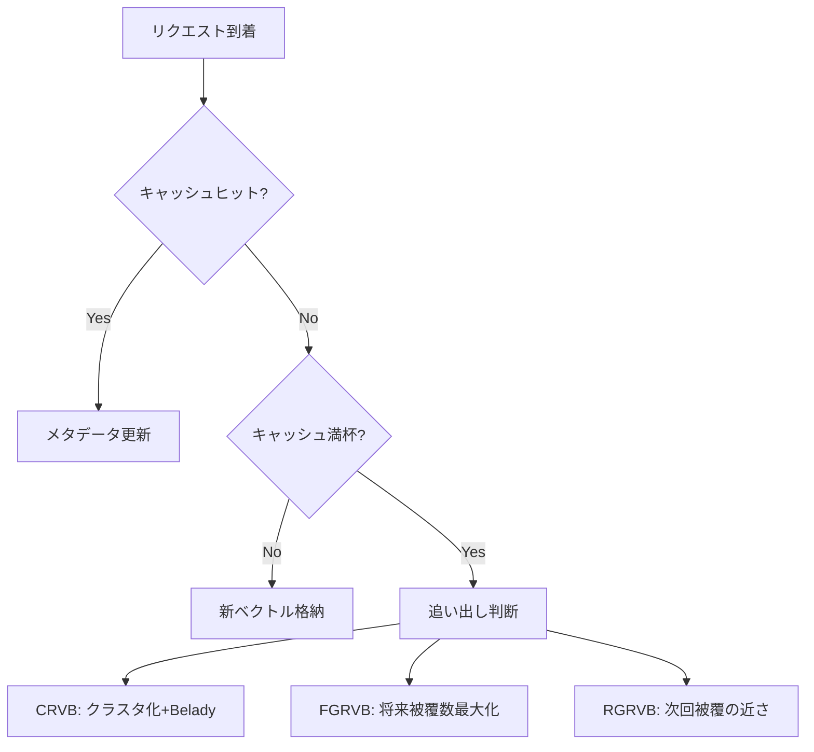

本記事は [https://arxiv.org/abs/2603.03301](https://arxiv.org/abs/2603.03301) の解説記事です。

## 論文概要（Abstract）

Biton & Friedmanによる本論文は、LLMのEmbeddingを用いたセマンティックキャッシュにおけるキャッシュ方策を理論・実験の両面から体系的に分析した研究である。従来のキャッシュ（完全一致ベース）とは異なり、セマンティックキャッシュでは類似度閾値内のベクトルをヒットと判定するため、キャッシュ方策の設計が本質的に難しくなる。著者らは最適オフライン方策の計算がNP困難であることを証明し、複数のオフラインヒューリスティクスを提案するとともに、頻度・近接度・意味的局所性を組み合わせたオンライン方策「SphereLFU」を導入している。

この記事は [Zenn記事: セマンティックキャッシュの検索を量子化×Matryoshka Embeddingで高速化する](https://zenn.dev/0h_n0/articles/6f9650fb6fe2a1) の深掘りです。Zenn記事がベクトル検索の高速化（量子化・次元削減）を扱うのに対し、本論文はキャッシュ方策そのもの——何を保持し何を追い出すか——の理論的最適性と実用的設計に焦点を当てています。

## 情報源

- **arXiv ID**: 2603.03301
- **URL**: [https://arxiv.org/abs/2603.03301](https://arxiv.org/abs/2603.03301)
- **著者**: Dvir David Biton, Roy Friedman
- **発表年**: 2026
- **分野**: cs.CL, cs.AI, cs.LG
- **コード**: [github.com/dbiton/SemanticCaching](https://github.com/dbiton/SemanticCaching)（オープンソース）

## 背景と動機（Background & Motivation）

LLM APIの呼び出しコストとレイテンシを削減するため、セマンティックキャッシュが注目されている。セマンティックキャッシュは、ユーザークエリをEmbeddingベクトルに変換し、過去の類似クエリがキャッシュに存在すれば保存済み応答を返す仕組みである。

しかし、従来のキャッシュ理論はそのまま適用できない。従来のキャッシュでは「キーが一致すればヒット」という明確な判定だが、セマンティックキャッシュでは「距離閾値 $D_{\text{thresh}}$ 以内の近傍ベクトルが存在すればヒット」となる。この違いにより、1つのキャッシュエントリが複数の異なるリクエストをカバーし得るため、どのエントリを保持するかの判断が組合せ最適化問題になる。

著者らは、この問題を形式的に定義し、最適方策の計算困難性を証明した上で、実用的なオンライン方策を提案している。

## 主要な貢献（Key Contributions）

- **貢献1**: セマンティックキャッシュの最適オフライン方策（VOPT）の計算がNP困難であることを、最大被覆問題（Maximum Coverage Problem）からの帰着で証明
- **貢献2**: 3種のオフラインヒューリスティクス（CRVB, FGRVB, RGRVB）を提案し、クレアボヤントな上界として評価
- **貢献3**: オンライン方策として、von Mises-Fisher分布に基づくソフト頻度更新を行うSphereLFUを提案し、9つのデータセットで既存方策を上回ることを実験的に確認
- **貢献4**: セマンティックキャッシュ方策の包括的ベンチマーク基盤をオープンソースで公開

## 技術的詳細（Technical Details）

### 問題の形式化

セマンティックキャッシュは以下のパラメータで定義される。

- 次元数 $\text{Dim}$（Embeddingベクトルの次元）
- 最大容量 $N$（格納可能なベクトル数の上限）
- 距離閾値 $D_{\text{thresh}}$（ヒット判定の閾値）

リクエストベクトル $\mathbf{v}$ が到着したとき、キャッシュ内に $\|\mathbf{v} - \mathbf{c}_i\|_2 \leq D_{\text{thresh}}$ を満たすベクトル $\mathbf{c}_i$ が存在すればキャッシュヒット、存在しなければミスとなる。

ここで、
- $\mathbf{v}$: リクエストのEmbeddingベクトル（$\text{Dim}$次元、L2正規化済み）
- $\mathbf{c}_i$: キャッシュに格納されたベクトル
- $D_{\text{thresh}}$: L2距離による閾値

L2正規化済みベクトルの場合、L2距離とコサイン類似度の関係は以下のとおりである。

$$
\|\mathbf{v} - \mathbf{c}\|_2^2 = 2(1 - \cos(\mathbf{v}, \mathbf{c}))
$$

論文では $D_{\text{thresh}} = 0.9$ をメイン実験で使用しており、これはコサイン類似度で約0.60に相当する。$D_{\text{thresh}} = 0.5$ はコサイン類似度約0.88に対応する。

### NP困難性の証明（概要）

著者らは、最大被覆問題（MCP）からの多項式時間帰着によりNP困難性を証明している。

**最大被覆問題（MCP）**: 集合族 $\mathcal{S} = \{S_1, \ldots, S_m\}$ と元の集合 $U$、予算 $k$ が与えられたとき、$k$個の集合を選んで被覆される元の数を最大化する問題。

**帰着の構成**:

1. 各集合 $S_j$ に対応する「集合ベクトル」と、各元 $u_i$ に対応する「元ベクトル」を構成する
2. 元 $u_i$ が集合 $S_j$ に含まれる場合に限り、対応するベクトル間の距離が $D_{\text{thresh}}$ 以内になるよう幾何的に配置する
3. フェーズ1で全集合ベクトルをリクエスト（すべてミス）、フェーズ2で全元ベクトルをリクエスト
4. フェーズ2のヒット数 = 保持された集合に含まれる元の被覆数

この帰着から、以下が導かれると著者らは主張している。

- VOPTの計算はNP困難
- $P \neq NP$ であれば、$(1 - 1/e)$ を超える近似比を持つ多項式時間アルゴリズムは存在しない
- 静的な場合（追い出しなし）は目的関数が劣モジュラなため、貪欲法で $(1 - 1/e)$ 近似が達成可能
- 動的な場合は追い出し判断による時間的依存があるため、同様の保証はない

### オフラインヒューリスティクス

著者らは、未来のリクエスト列を見ることができる「クレアボヤント」な3つのヒューリスティクスを提案している。これらはオンライン方策の上界として機能する。



**CRVB（Clustered Relaxed Vector Belady）**: キャッシュベクトル間で $D_{\text{thresh}}$ 以内のペアにエッジを張るグラフを構築し、貪欲に最大クリークを抽出してクラスタ化する。各クラスタに従来のBelady最適方策を適用する。類似度関係が推移的な場合にのみ最適だが、実際のEmbedding空間では推移性は保証されない。

**FGRVB（Frequency Greedy Relaxed Vector Belady）**: 各キャッシュベクトルの「ボリュームスコア」——将来のリクエストのうち $D_{\text{thresh}}$ 以内に入る数——を計算する。ただし、他のキャッシュベクトルで既にカバーされるリクエストは除外する（限界利得を使用）。ミス発生時、新ベクトルのボリュームスコアが最小のキャッシュベクトルを上回れば置換する。

**RGRVB（Recency Greedy Relaxed Vector Belady）**: 各キャッシュベクトルの「NextCover」——次にカバーする将来リクエストまでの距離——を用いる。新ベクトルのNextCoverが既にキャッシュでカバーされていなければ格納を許可し、NextCoverが最も遠いベクトルを追い出す。

著者らの実験では、FGRVBが最も強い近似を提供するが、限界利得の計算コストのためスループットが最も低いと報告されている。

### オンラインキャッシュ方策

著者らは、既存のキャッシュ方策をセマンティックキャッシュ向けに適応させるとともに、新規の方策を提案している。

**既存方策の適応**: LRU、LFU、LFUDA（動的エージング付きLFU）、LRU-K、ARC、RAP（確率的入場方策）を、ヒット時に最近傍ベクトルのメタデータを更新する形で適応。

**新規方策 — SphereLFU**: 著者らが提案するSphereLFUは、LFUの離散的な頻度カウントをソフトな頻度更新に拡張する。

各クエリが到着すると、カウンタ1単位を近傍のキャッシュベクトルに分配する。分配はvon Mises-Fisher分布風のカーネルに基づく。

$$
w_i = \frac{\exp(\kappa \cdot \text{sim}(\mathbf{v}, \mathbf{c}_i))}{\sum_{j \in \mathcal{N}} \exp(\kappa \cdot \text{sim}(\mathbf{v}, \mathbf{c}_j))}
$$

ここで、
- $w_i$: キャッシュベクトル $\mathbf{c}_i$ に分配される重み
- $\kappa$: 集中度パラメータ（大きいほど最近傍に集中）
- $\mathcal{N}$: $D_{\text{thresh}}$ 以内の近傍ベクトル集合
- $\text{sim}(\mathbf{v}, \mathbf{c}_i)$: ベクトル間の類似度

カウンタは減衰係数 $\gamma$ で時間減衰する。追い出し時は最小カウンタのベクトルを選択する。著者らはこの方策をFGRVBのオンライン近似と位置づけている。

**その他の新規方策**:
- **MissLFU**: 意味的に同一のベクトルがキャッシュにない場合のみ挿入
- **ClusterLFU/ClusterLRU**: オンライン貪欲クラスタリング後、クラスタ単位でLFU/LRUを適用
- **DistanceLFU**: カウンタを $1 - d/D_{\text{thresh}}$ で増分（近いほど大きく加算）
- **SurprisalLFU**: 最小頻度のベクトル群から、単語頻度に基づくサプライザルが最も高いものを追い出す

### 実装例: SphereLFUの簡略化コード

```python
from dataclasses import dataclass, field
import numpy as np


@dataclass
class CacheEntry:
    """キャッシュエントリ"""
    vector: np.ndarray
    response: str
    counter: float = 0.0


class SphereLFUCache:
    """SphereLFU方策によるセマンティックキャッシュ

    Args:
        capacity: キャッシュ最大容量
        d_thresh: L2距離閾値
        kappa: von Mises-Fisherカーネルの集中度
        gamma: カウンタ減衰係数
    """

    def __init__(
        self,
        capacity: int,
        d_thresh: float = 0.9,
        kappa: float = 10.0,
        gamma: float = 0.99,
    ) -> None:
        self.capacity = capacity
        self.d_thresh = d_thresh
        self.kappa = kappa
        self.gamma = gamma
        self.entries: list[CacheEntry] = []

    def query(self, vector: np.ndarray) -> str | None:
        """クエリベクトルに対しキャッシュ検索を行う"""
        if not self.entries:
            return None

        cache_vectors = np.array([e.vector for e in self.entries])
        distances = np.linalg.norm(cache_vectors - vector, axis=1)
        neighbors = np.where(distances <= self.d_thresh)[0]

        if len(neighbors) == 0:
            return None

        # ソフト頻度更新
        sims = 1.0 - distances[neighbors] / self.d_thresh
        weights = np.exp(self.kappa * sims)
        weights /= weights.sum()

        for idx, w in zip(neighbors, weights):
            self.entries[idx].counter += w

        best = neighbors[np.argmin(distances[neighbors])]
        return self.entries[best].response

    def update(self, vector: np.ndarray, response: str) -> None:
        """キャッシュミス時に新エントリを格納する"""
        # 全カウンタを減衰
        for entry in self.entries:
            entry.counter *= self.gamma

        new_entry = CacheEntry(vector=vector, response=response, counter=1.0)

        if len(self.entries) < self.capacity:
            self.entries.append(new_entry)
        else:
            # 最小カウンタのエントリを追い出し
            min_idx = min(range(len(self.entries)), key=lambda i: self.entries[i].counter)
            self.entries[min_idx] = new_entry
```

## 実験結果（Results）

### 実験設定

著者らは9つのデータセット（MS MARCO, WildChat, ELI5, Natural Questions, StackOverflow, Quora Question Pairs, MMLU, TriviaQA, HotpotQA）の先頭10万件を使用し、Sentence-BERT all-MiniLM-L6-v2（384次元）でEmbeddingを生成している。ベクトルストアにはFaiss flat indexを使用。メイン実験の閾値は $D_{\text{thresh}} = 0.9$ である。

### 主要な結果

著者らの報告によると、結果は以下の通りである（論文Figure 1–4から読み取れる定性的傾向）。

**オフラインヒューリスティクスの比較**:
- FGRVBが全体として最も高いヒット率を達成し、オンライン方策の上界として最も有用
- RGRVBはバースト的なワークロードに強いが、静的なものでは頭打ち
- CRVBは高閾値（$D_{\text{thresh}} = 0.9$）ではクラスタの重複により性能が低下

**オンライン方策の比較**:
- ほとんどのワークロードは頻度偏重であり、LFU系の方策がLRUを大幅に上回る
- SphereLFUは9データセット中7つで最高のヒット率を達成
- SphereLFUは平均ヒット距離（MHD）でも7データセットで最良（意味的精度が高い）
- 例外はMMLUとWildChat（一回限りのクエリが多いデータセット）

**ワークロード別の傾向**:

| データセット | 特徴 | 最良オンライン方策 |
|------------|------|-----------------|
| MS MARCO | 頻度偏重 | SphereLFU |
| WildChat | 多様・一回限りが多い | LRU / SphereLFU |
| ELI5 | 中程度の再利用 | RAP |
| NQ | 頻度偏重 | SphereLFU |
| StackOverflow | 強い頻度偏重 | SphereLFU |
| Quora | ヒット率が桁違いに低い | SurprisalLFU |
| MMLU | 一回限りが多い | LRU-K |
| TriviaQA | 頻度偏重 | SphereLFU |
| HotpotQA | 頻度偏重 | SphereLFU |

**スループット**: 著者らによると、方策間のスループット差は小さく、最近傍探索のコストが支配的である。FGRVBのみ限界利得計算のため顕著に低い。

### Zenn記事との関連

Zenn記事ではベクトル検索の高速化（バイナリ量子化、Matryoshka次元削減）を扱っているが、本論文の知見はその前段階——キャッシュ方策の選択——に関わる。著者らのスループット分析で最近傍探索が律速であると報告されていることは、Zenn記事で扱う量子化による検索高速化の意義を裏付けている。また、SphereLFUのソフト頻度更新は $D_{\text{thresh}}$ 以内の近傍に対する範囲クエリに依存しており、この範囲クエリの高速化にもバイナリ量子化やHNSWインデックスが有効と考えられる。

## 実運用への応用（Practical Applications）

### キャッシュ方策の選択指針

著者らの実験結果から、実運用での方策選択の指針を以下のように整理できる。

1. **まずLFUを試す**: ほとんどのLLMワークロードは頻度偏重であり、LFU系がベースラインとして強い
2. **多様なクエリが多い場合**: WildChatのように一回限りのクエリが多い場合はLRU-KやRAP（確率的入場）を検討
3. **品質重視の場合**: SphereLFUはヒット率だけでなく平均ヒット距離でも優れており、意味的に近い応答を返す確率が高い
4. **SphereLFUの導入コスト**: 範囲クエリが必要なため、ベクトルDBのサポートが前提。QdrantやRedisの場合はフィルタリング付き検索で実現可能

### 閾値設定との関係

著者らは $D_{\text{thresh}} = 0.9$（コサイン類似度 ≈ 0.60）を使用しているが、Zenn記事で推奨されている閾値（コサイン類似度 0.92 = L2距離 ≈ 0.40）とは大きく異なる。閾値を厳しくするほど（$D_{\text{thresh}}$ を小さくするほど）ヒット率は低下するが偽陽性も減少する。本論文の方策間の優劣関係が異なる閾値でも保たれるかは、論文のAppendixで $D_{\text{thresh}} = 0.7, 0.5$ の結果が示唆されているものの、著者ら自身が閾値依存性を認めている点に注意が必要である。

## 関連研究（Related Work）

- **Proximity（Bergman et al., 2025）**: キャッシュをLSH（局所性鋭敏ハッシュ）でバケットに分割し、バケットごとに独立した置換方策を適用するRAGキャッシュシステム。検索時間の削減が主目的であり、本論文の方策最適化とは相補的。著者らは本論文のVOPTとSphereLFUの知見をProximityのバケット内方策選択に応用できると述べている
- **GPTCache（Bang, 2023）**: LLMのセマンティックキャッシュの先駆的実装。セマンティック類似度によるキャッシュ判定の基本フレームワークを確立
- **GPT Semantic Cache（Regmi & Pun, 2024, arXiv:2411.05276）**: Redis上でのEmbeddingキャッシュ実装。キャッシュヒット率61.6〜68.8%、API呼び出し削減率68.8%と報告

## 制約と限界

- 使用されたEmbeddingモデルがall-MiniLM-L6-v2（384次元）の1種のみであり、高次元モデルでの検証がない
- 評価は各データセットの先頭10万件に限定されており、大規模ワークロードでの挙動は未確認
- SphereLFUの範囲クエリはexact searchで実装されており、HNSW等のANNインデックス上でのソフト頻度更新の効率性は未検証
- $\kappa$（集中度）と $\gamma$（減衰率）のハイパーパラメータ感度分析が限定的
- LRB（機械学習ベース方策）はワークロードが短すぎて収束しなかったと報告されており、長期間のワークロードでの評価が今後の課題

## まとめと今後の展望

本論文は、セマンティックキャッシュの方策最適化について初の理論的分析を提供した研究である。最適オフライン方策がNP困難であること、頻度ベースの方策がほとんどのLLMワークロードで有効であること、SphereLFUがソフト頻度更新によりヒット率と意味的精度の両面で優れることが主要な知見として報告されている。

Zenn記事で扱った量子化・次元削減による検索高速化と、本論文のキャッシュ方策最適化は異なるレイヤーの最適化であり、両者を組み合わせることでセマンティックキャッシュの総合的な性能向上が期待できる。特に、SphereLFUの範囲クエリはベクトル検索の高速化から直接的に恩恵を受ける。

## Production Deployment Guide

### AWS実装パターン（コスト最適化重視）

SphereLFUを含むセマンティックキャッシュ方策をAWS上にデプロイする場合の構成を示す。

| 規模 | 月間リクエスト | 推奨構成 | 月額コスト | 主要サービス |
|------|--------------|---------|-----------|------------|
| **Small** | ~3,000 (100/日) | Serverless | $50-150 | Lambda + ElastiCache Redis + S3 |
| **Medium** | ~30,000 (1,000/日) | Hybrid | $300-700 | Lambda + ElastiCache Redis + DynamoDB |
| **Large** | 300,000+ (10,000/日) | Container | $1,500-4,000 | ECS Fargate + ElastiCache Redis Cluster |

**Small構成の詳細**（月額$50-150）:
- **Lambda**: 1GB RAM, 30秒タイムアウト（$20/月）
- **ElastiCache Redis**: cache.t3.micro, 1ノード（$15/月）— ベクトルキャッシュとカウンタ保持
- **S3**: Embeddingモデルアーティファクト保存（$5/月）
- **CloudWatch**: 基本監視（$5/月）
- **Bedrock**: Embedding生成（Amazon Titan Embeddings）（$30-80/月）

**コスト試算の注意事項**: 上記は2026年10月時点のAWS ap-northeast-1（東京）リージョン料金に基づく概算値です。実際のコストはトラフィックパターンやリージョンにより変動します。最新料金は[AWS料金計算ツール](https://calculator.aws/)で確認してください。

### Terraformインフラコード

**Small構成（Serverless）: Lambda + ElastiCache Redis**

```hcl
module "vpc" {
  source  = "terraform-aws-modules/vpc/aws"
  version = "~> 5.0"

  name = "semantic-cache-vpc"
  cidr = "10.0.0.0/16"
  azs  = ["ap-northeast-1a", "ap-northeast-1c"]
  private_subnets = ["10.0.1.0/24", "10.0.2.0/24"]

  enable_nat_gateway   = false
  enable_dns_hostnames = true
}

resource "aws_iam_role" "lambda_cache" {
  name = "semantic-cache-lambda-role"

  assume_role_policy = jsonencode({
    Version = "2012-10-17"
    Statement = [{
      Action    = "sts:AssumeRole"
      Effect    = "Allow"
      Principal = { Service = "lambda.amazonaws.com" }
    }]
  })
}

resource "aws_iam_role_policy" "bedrock_embedding" {
  role = aws_iam_role.lambda_cache.id
  policy = jsonencode({
    Version = "2012-10-17"
    Statement = [{
      Effect   = "Allow"
      Action   = ["bedrock:InvokeModel"]
      Resource = "arn:aws:bedrock:ap-northeast-1::foundation-model/amazon.titan-embed-text-v2*"
    }]
  })
}

resource "aws_elasticache_replication_group" "cache" {
  replication_group_id = "semantic-cache"
  description          = "Semantic cache with SphereLFU counters"
  node_type            = "cache.t3.micro"
  num_cache_clusters   = 1
  engine               = "redis"
  engine_version       = "7.1"
  port                 = 6379

  subnet_group_name  = aws_elasticache_subnet_group.cache.name
  security_group_ids = [aws_security_group.cache.id]

  at_rest_encryption_enabled = true
  transit_encryption_enabled = true
}

resource "aws_lambda_function" "cache_handler" {
  filename      = "lambda.zip"
  function_name = "semantic-cache-handler"
  role          = aws_iam_role.lambda_cache.arn
  handler       = "index.handler"
  runtime       = "python3.12"
  timeout       = 30
  memory_size   = 1024

  environment {
    variables = {
      REDIS_ENDPOINT = aws_elasticache_replication_group.cache.primary_endpoint_address
      D_THRESH       = "0.9"
      KAPPA          = "10.0"
      GAMMA          = "0.99"
      CACHE_CAPACITY = "10000"
    }
  }

  vpc_config {
    subnet_ids         = module.vpc.private_subnets
    security_group_ids = [aws_security_group.lambda.id]
  }
}
```

**Large構成（Container）**: ECS Fargate + ElastiCache Redis Cluster（cache.r7g.xlarge × 3ノード、automatic_failover有効、Multi-AZ）。Fargate Spot（weight=3）とOn-Demand（weight=1）の混合でコスト最適化。AWS Budgets で月額$4,000上限のアラートを設定。

### 運用・監視設定

セキュリティ面では、ElastiCacheのプライベートサブネット配置、TLS/AES-256暗号化、IAM最小権限、CloudTrail有効化を徹底する。

**CloudWatch監視**: Logs Insightsでヒット率の時系列推移（`bin(1h)`）とSphereLFUカウンタ分布の異常検知（`max_counter / avg_counter > 100`）を追跡。アラームは`CacheHitRate < 30%`（3期間連続）と`DatabaseMemoryUsagePercentage > 80%`（2期間連続）で通知。
```

### コスト最適化チェックリスト

**アーキテクチャ選択**: トラフィック量に応じてServerless（~100 req/日, $50-150/月）→ Hybrid（~1,000 req/日, $300-700/月）→ Container（10,000+ req/日, $1,500-4,000/月）を選択。

**リソース最適化**: Fargate Spot活用（最大70%削減）、ElastiCache Reserved Nodes（最大55%削減）、Lambda Power Tuning、夜間スケールダウン、開発環境はt3.micro。

**キャッシュ効率化**: SphereLFUの $\kappa$, $\gamma$ を本番ワークロードで校正、ヒット率カーブから容量を最適化、$D_{\text{thresh}}$ は偽陽性率2%以下に設定、TTLで古いエントリを自動パージ。

**監視**: AWS Budgets（80%警告）、CloudWatch ヒット率アラート、ElastiCacheメモリ/CPU監視、Cost Anomaly Detection。タグ戦略でdev/staging/prodのコスト可視化。

## 参考文献

- **arXiv**: [https://arxiv.org/abs/2603.03301](https://arxiv.org/abs/2603.03301)
- **Code**: [https://github.com/dbiton/SemanticCaching](https://github.com/dbiton/SemanticCaching)
- **Related Zenn article**: [https://zenn.dev/0h_n0/articles/6f9650fb6fe2a1](https://zenn.dev/0h_n0/articles/6f9650fb6fe2a1)

---

:::message
この記事はAI（Claude Code）により自動生成されました。内容の正確性については論文原文で検証していますが、最新情報は公式リポジトリもご確認ください。
:::
