> 本記事は [Why Do Multi-Agent LLM Systems Fail? (arXiv:2503.13657)](https://arxiv.org/abs/2503.13657) の解説記事です。論文中の主張・数値は著者らの報告に基づいており、筆者が独自に実験を行ったものではありません。

## 論文概要（Abstract）

本論文は、マルチエージェントLLMシステム（MAS）がなぜ失敗するのかを体系的に分析した研究である。著者らは7つのオープンソースMASフレームワークから1,642件のトレースを収集・アノテーションし、14の障害モードを3つのカテゴリ（System Design Issues、Inter-Agent Misalignment、Task Verification）に分類するMAST（Multi-Agent System Failure Taxonomy）を提案している。人間アノテータ間の一致度はCohen's $\kappa = 0.88$ と高く、LLM-as-Judgeパイプライン（o1 few-shot）でも $\kappa = 0.77$ を達成したと報告されている。

この記事は [Zenn記事: マルチエージェント通信の状態同期設計：コンテキスト伝搬からバックプレッシャー制御まで](https://zenn.dev/0h_n0/articles/4ee4a8b681acf4) の深掘りです。

## 情報源

- **arXiv ID**: 2503.13657
- **URL**: [https://arxiv.org/abs/2503.13657](https://arxiv.org/abs/2503.13657)
- **著者**: Mert Cemri, Melissa Z. Pan, Shuyi Yang et al.（13名、UC Berkeley中心）
- **発表年**: 2025（2025年3月投稿、2025年10月v3改訂）
- **分野**: cs.AI
- **掲載先**: NeurIPS 2025 Datasets and Benchmarks Track

## カンファレンス情報

NeurIPS（Neural Information Processing Systems）は機械学習・人工知能分野の主要国際会議の一つである。本論文が採択されたDatasets and Benchmarks Trackは、再現性のある研究基盤（データセット、ベンチマーク、評価手法）に焦点を当てたトラックであり、コミュニティが共有可能なリソースの品質と有用性が審査基準となる。

## 背景と動機（Background & Motivation）

マルチエージェントLLMシステムは、コーディング（MetaGPT, ChatDev）、数学的推論（AG2 MathChat）、汎用タスク実行（Magentic-One）など多様なベンチマークで評価されてきた。しかし、著者らによれば、これらのシステムは多くのベンチマークで限定的な性能向上しか示していない。障害率は41%から86.7%に達するフレームワークもあり、MASの実用化には根本的な課題がある。

従来の研究はMASの性能をベンチマーク全体の正解率というトップダウンの視点で評価しており、「なぜ失敗するのか」をボトムアップで分析する体系的な試みは不足していた。著者らは、失敗の根本原因を分類し、再現可能な形で公開することで、MAS設計の改善指針を提供することを目的としている。

## 主要な貢献（Key Contributions）

- **MAST分類体系**: 14の障害モードを3カテゴリに体系化した、MAS向け障害分類法
- **MAST-Data**: 7つのMASフレームワーク・6つのLLMにわたる1,642件のアノテーション付きトレースデータセット
- **LLM-as-Judgeパイプライン**: o1ベースのスケーラブルなアノテーション手法（few-shot accuracy 0.94）
- **介入実験**: プロンプト改善とトポロジー変更による改善効果の定量評価（AG2、ChatDev）
- **フレームワーク横断分析**: 7つのMASにわたる障害パターンの比較と、モデル依存性の検証

## 技術的詳細（Technical Details）

### MAST Taxonomyの全体構造

MASTは14の障害モード（Failure Mode: FM）を3つの障害カテゴリ（Failure Category: FC）に分類する。以下のダイアグラムはMASTの構造を示す。

```mermaid
graph TD
    MAST[MAST Taxonomy]
    FC1[FC1: System Design Issues<br>約44.2%]
    FC2[FC2: Inter-Agent Misalignment<br>約32.4%]
    FC3[FC3: Task Verification<br>約23.5%]

    FM11[FM-1.1 Disobey task specification<br>11.8%]
    FM12[FM-1.2 Disobey role specification<br>1.5%]
    FM13[FM-1.3 Step repetition<br>15.7%]
    FM14[FM-1.4 Loss of conversation history<br>2.8%]
    FM15[FM-1.5 Unaware of termination<br>12.4%]

    FM21[FM-2.1 Conversation reset<br>2.2%]
    FM22[FM-2.2 Fail to ask for clarification<br>6.8%]
    FM23[FM-2.3 Task derailment<br>7.4%]
    FM24[FM-2.4 Information withholding<br>0.85%]
    FM25[FM-2.5 Ignored other agent's input<br>1.9%]
    FM26[FM-2.6 Reasoning-action mismatch<br>13.2%]

    FM31[FM-3.1 Premature termination<br>6.2%]
    FM32[FM-3.2 No or incomplete verification<br>8.2%]
    FM33[FM-3.3 Incorrect verification<br>9.1%]

    MAST --> FC1
    MAST --> FC2
    MAST --> FC3

    FC1 --> FM11
    FC1 --> FM12
    FC1 --> FM13
    FC1 --> FM14
    FC1 --> FM15

    FC2 --> FM21
    FC2 --> FM22
    FC2 --> FM23
    FC2 --> FM24
    FC2 --> FM25
    FC2 --> FM26

    FC3 --> FM31
    FC3 --> FM32
    FC3 --> FM33
```



各障害モードの割合は全障害ラベルに占める比率であり、合計は約100%となる。

### FC1: System Design Issues（約44.2%）

システム設計に起因する障害が最大の割合を占める。MASのプロンプト設計、ワークフロー定義、終了条件の不備が主な原因である。

**FM-1.1 Disobey task specification（11.8%）**: エージェントがタスクの制約・要件に従わない障害。著者らの報告では、ChatDevでWordle生成タスクを実行した際、「毎日ランダムに単語を選択する」という仕様に対し、固定の単語リストを埋め込んだ実装を出力した事例が挙げられている。タスク仕様が曖昧な場合や、複数の制約が競合する場合に発生しやすい。

**FM-1.2 Disobey role specification（1.5%）**: 割り当てられた役割に従わず、他のエージェントの役割を侵害する障害。割合は低いが、著者らはChatDevにおいてCPO（Chief Product Officer）がCEOの承認なしに対話を終了させた事例を報告している。ロール仕様の明確化によりChatDevで+9.4%のタスク成功率改善が得られたと述べている。

**FM-1.3 Step repetition（15.7%）**: 最も頻度が高い個別障害モード。完了済みのステップを不必要に繰り返す。OpenManusやHyperAgentで特に顕著に観察されたと報告されている。コンテキストウィンドウの制約や、進捗追跡メカニズムの欠如が原因として考えられる。

**FM-1.4 Loss of conversation history（2.8%）**: 会話履歴の予期しない切り捨て（truncation）により、以前の文脈が失われる障害。コンテキストウィンドウの上限到達時に発生し、エージェントは過去の議論で決定済みの事項を再度議論し始める。

**FM-1.5 Unaware of termination conditions（12.4%）**: エージェントが終了条件を認識できず、タスクを完了しても処理を継続する、または逆に途中で終了する障害。Step repetition（FM-1.3）と関連が深く、終了条件の明示的な定義がない場合に頻発する。

### FC2: Inter-Agent Misalignment（約32.4%）

エージェント間の協調不全に起因する障害群。情報共有、目的の整合性、推論と行動の一致が問題となる。

**FM-2.1 Conversation reset（2.2%）**: 対話が不当にリスタートされ、それまでの進捗が失われる障害。FM-1.4（履歴の喪失）がシステム側の問題であるのに対し、こちらはエージェントの判断によるリセットを指す。

**FM-2.2 Fail to ask for clarification（6.8%）**: 不明確または不完全な情報を受け取ったにもかかわらず、確認を求めずに処理を続行する障害。著者らの事例では、電話エージェントがユーザー名のフォーマットを確認せずにログイン処理を繰り返し失敗するケースが報告されている。

**FM-2.3 Task derailment（7.4%）**: タスクの本来の目的から逸脱する障害。エージェントが本質的でない細部に時間を費やしたり、無関係なサブタスクに取り組んだりする。

**FM-2.4 Information withholding（0.85%）**: 重要な情報を他のエージェントに共有しない障害。全障害モードの中で最も割合が低いが、著者らの分析によれば、失敗トレースにおいてほぼ専ら観察される（成功トレースにはほとんど出現しない）ため、発生した場合の影響は大きい。

**FM-2.5 Ignored other agent's input（1.9%）**: 他のエージェントからの入力や推奨事項を無視する障害。マルチエージェント設計の利点であるはずの分散的知見の統合が機能しなくなる。

**FM-2.6 Reasoning-action mismatch（13.2%）**: FC2の中で最も頻度が高い障害モード。エージェントの推論（思考過程）と実際の行動が矛盾する。例えば、「次にファイルAを修正すべきだ」と推論しながら、実際にはファイルBを編集する、といった不整合が該当する。

### FC3: Task Verification（約23.5%）

タスク完了後の検証フェーズに起因する障害群。検証の省略、不完全さ、誤りが含まれる。

**FM-3.1 Premature termination（6.2%）**: 目標が達成される前にタスクを終了する障害。FM-1.5（終了条件の不認識）との違いは、FM-3.1が検証フェーズでの判断ミスを指す点にある。

**FM-3.2 No or incomplete verification（8.2%）**: 出力に対する検証を省略するか、部分的にしか実行しない障害。著者らはChatDevのチェス実装タスクで、プログラムがコンパイル・起動チェックは通過するが、ゲームルールの検証を行わず実行時バグが残った事例を報告している。高レベルの目的チェックを追加することでChatDevのProgramDevベンチマークで+15.6%の改善が得られたと述べている。

**FM-3.3 Incorrect verification（9.1%）**: 検証は実行するがエラーを正しく検出できない障害。HyperAgentで特に顕著に観察されたと報告されている。検証ロジック自体の品質が問われる。

著者らの分析によれば、FM-3.2とFM-3.3は成功トレースにも出現する点が特徴的である。つまり、検証が不完全でも偶然正解に到達するケースが存在し、これは潜在的な信頼性リスクを示唆している。

### データ収集とアノテーション手法

#### MAST-Dataの構成

MAST-Dataは7つのMASフレームワークから収集された1,642件のアノテーション付きトレースで構成される。以下に主要な構成を示す（Table 1より抜粋）。

| MAS | ベンチマーク | LLM | トレース数 |
|:---|:---|:---|---:|
| AG2 (MathChat) | OlympiadBench | GPT-4o | 206 |
| AG2 (MathChat) | GSM-Plus | Claude-3.7-Sonnet | 193 |
| Magentic-One | GAIA | GPT-4o | 165 |
| AG2 (MathChat) | MMLU | GPT-4o-mini | 168 |
| ChatDev | ProgramDev-v2 | GPT-4o | 100 |
| MetaGPT | ProgramDev-v2 | GPT-4o | 100 |
| MetaGPT | ProgramDev-v2 | Claude-3.7-Sonnet | 100 |
| ChatDev | ProgramDev-v2 | Qwen2.5-Coder-32B | 100 |
| MetaGPT | ProgramDev-v2 | Qwen2.5-Coder-32B | 100 |
| ChatDev | ProgramDev-v2 | CodeLlama-7b | 100 |
| MetaGPT | ProgramDev-v2 | CodeLlama-7b | 100 |
| ChatDev | ProgramDev | GPT-4o | 30 |
| MetaGPT | ProgramDev | GPT-4o | 30 |
| HyperAgent | SWE-Bench Lite | Claude-3.7-Sonnet | 30 |
| AppWorld | Test-C | GPT-4o | 30 |
| OpenManus | ProgramDev | GPT-4o | 30 |

ProgramDevは30件のコーディングタスク（Tic-Tac-Toe、チェス、数独など）で構成される比較的単純なベンチマークであり、ProgramDev-v2はこれを100タスクに拡張したものである。

#### アノテーションプロセス

分類体系の構築は以下の手順で行われた。

1. 6名の専門アノテータが初期150トレースを分析（各トレースは平均15,000行以上）
2. 3名のアノテータが5トレースずつ3ラウンドのIAA（Inter-Annotator Agreement）評価を実施
3. 不一致箇所の議論・解決を経て、最終的にCohen's $\kappa = 0.88$ を達成
4. アノテータ1名あたり20時間以上を投じた精密な作業

### LLM-as-Judgeパイプライン

大規模なアノテーションをスケールさせるため、著者らはOpenAIのo1モデルを用いたLLM-as-Judgeパイプラインを構築した。


| 設定 | Accuracy | Recall | Precision | F1 | Cohen's $\kappa$ |
|:---|---:|---:|---:|---:|---:|
| o1 zero-shot | 0.89 | 0.62 | 0.68 | 0.64 | 0.58 |
| o1 few-shot | 0.94 | 0.77 | 0.833 | 0.80 | 0.77 |

few-shot設定により精度が大幅に向上し、$\kappa = 0.77$ は「実質的な一致（substantial agreement）」に相当する。さらに、未知のフレームワーク（OpenManus, Magentic-One）やベンチマーク（MMLU, GAIA）に対する汎化性能でも $\kappa = 0.79$ を達成しており、MAST定義の修正なしにドメイン外トレースへ適用可能であることが示されている。

なお、障害モード間の相関分析（Appendix Eより）では、カテゴリ間の相関は低い（0.17--0.32）一方、個別モード間では最大0.63の中程度の相関が報告されており、類似モードの混同リスクが指摘されている。

## 実験結果（Experimental Results）

### フレームワーク別の障害率

著者らの報告によれば、7つのMASにおける障害率は41%から86.7%に分布している。ただし各フレームワークは異なるベンチマークで評価されているため、直接比較には注意が必要である。

#### フレームワーク別の特徴的な障害パターン

- **AppWorld**: Premature termination（FM-3.1）が頻出。スター型トポロジーと事前定義ワークフローの欠如が原因と分析されている
- **OpenManus**: Step repetition（FM-1.3）が支配的
- **HyperAgent**: Step repetition（FM-1.3）とIncorrect verification（FM-3.3）の両方が顕著

### モデル比較

**GPT-4o vs. Claude 3.7 Sonnet**（MetaGPT, ProgramDev-v2）: GPT-4oは全体的に優位で、FC1（System Design Issues）の障害が39%少ないと報告されている。FC3（Task Verification）についてはGPT-4oがわずかに低いが、両モデルとも検証フェーズの障害は多い。

**MetaGPT vs. ChatDev**（ProgramDev-v2, GPT-4o）: MetaGPTはFC1、FC2の障害がChatDevの60--68%少ない一方、FC3の障害は1.56倍多い。MetaGPTの構造化されたワークフローがシステム設計・エージェント間整合性の問題を軽減する一方、検証フェーズに課題が残ることを示している。

**オープンソースモデル**（Table 6より、400トレース）: Qwen2.5-Coder-32B-InstructはCodeLlama-7b-Instruct-hfよりも大幅に頑健である。ただし両モデルともGPT-4oやClaude 3.7 Sonnetと比較して障害率が高い。

### 成功トレース vs. 失敗トレースの差異

Table 7の分析によれば、障害モードの出現パターンは成功・失敗で異なる。

- **失敗トレースに集中**: FM-1.5（Unaware of termination conditions）とFM-2.4（Information withholding）はほぼ失敗トレースでのみ観察される
- **成功トレースにも出現**: FM-3.2（No or incomplete verification）とFM-3.3（Incorrect verification）は成功トレースにも見られ、偶然の正解が検証の不備を隠蔽するリスクを示唆

### 介入実験

著者らはMAST分類に基づいてAG2とChatDevで介入実験を実施した。

#### AG2 MathChat（GSM-Plus, 200問, 6回繰り返し）

| 構成 | GPT-4 | GPT-4o |
|:---|---:|---:|
| ベースライン | 84.75 $\pm$ 1.94 | 84.25 $\pm$ 1.86 |
| プロンプト改善 | 89.75 $\pm$ 1.44 | 89.00 $\pm$ 1.38 |
| トポロジー変更 | 85.50 $\pm$ 1.18 | 88.83 $\pm$ 1.51 |

トポロジー変更では、3つの役割（Problem Solver, Coder, Verifier）を導入し、Verifierのみが対話を終了できる設計とした。GPT-4ではプロンプト改善が有意に効果を示した一方、トポロジー変更の効果は有意でなかった（Wilcoxon $p = 0.4$）。GPT-4oでは両方の介入がベースラインを有意に上回った（$p = 0.03$）。

#### ChatDev（ProgramDev-v0, 32タスク）

| 構成 | ProgramDev-v0 | HumanEval |
|:---|---:|---:|
| ベースライン | 25.0 | 89.6 |
| プロンプト改善 | 34.4 | 90.3 |
| トポロジー変更 | 40.6 | 91.5 |

プロンプト改善ではロール階層の強制と検証仕様の明確化を、トポロジー変更ではDAG構造からサイクル構造への変更（CTOがレビュー完了を確認するまで終了しない設計）を実施した。著者らはこれらの改善について「大幅とは言えない」と評価し、より包括的な解決策の必要性を指摘している。

## 実装のポイント（Implementation）

MAST分類体系はMASの障害診断ツールとして活用できる。以下は、エージェントのトレースログから代表的な障害モードを検出する簡易例である。

```python
from dataclasses import dataclass


@dataclass
class TraceEvent:
    """エージェントトレースの1イベント"""
    agent_id: str
    action: str
    reasoning: str
    step_index: int


def detect_step_repetition(
    events: list[TraceEvent],
    window_size: int = 5,
) -> list[tuple[int, int]]:
    """FM-1.3: 直近window_size件と同一actionの繰り返しを検出する"""
    duplicates: list[tuple[int, int]] = []
    for i, event in enumerate(events):
        start = max(0, i - window_size)
        for j in range(start, i):
            if (events[j].action == event.action
                    and events[j].agent_id == event.agent_id):
                duplicates.append((j, i))
    return duplicates


def detect_reasoning_action_mismatch(
    events: list[TraceEvent],
    similarity_fn: callable,
    threshold: float = 0.3,
) -> list[int]:
    """FM-2.6: 推論内容とactionの意味的不一致を検出する"""
    mismatches: list[int] = []
    for i, event in enumerate(events):
        if event.reasoning and event.action:
            score = similarity_fn(event.reasoning, event.action)
            if score < threshold:
                mismatches.append(i)
    return mismatches
```

**実装上の注意点**:

- **Step repetitionの検出精度**: 単純な文字列一致では「同じAPIを異なるパラメータで呼ぶ」正当なケースを誤検出する。action typeとパラメータを分離して比較する設計が望ましい
- **Reasoning-action mismatchの判定**: Embeddingベースの類似度計算やLLM-as-Judgeで評価する。論文のo1 few-shot手法が参考になる
- **リアルタイム検出**: 事後分析だけでなく、ストリーミングトレースに対してリアルタイムにFM-1.3やFM-1.5を検出し、バックプレッシャーをかける設計も可能

## 実運用への応用

### Zenn記事（バックプレッシャー制御・コンテキスト伝搬）との関連

関連Zenn記事「マルチエージェント通信の状態同期設計」では、コンテキスト伝搬とバックプレッシャー制御を用いたマルチエージェント通信の設計パターンが解説されている。MAST分類体系は、これらの設計パターンがどの障害モードに対処しているかを明確にする。

| MAST障害モード | 関連する設計パターン | 対処の方向性 |
|:---|:---|:---|
| FM-1.3 Step repetition | 状態同期・進捗追跡 | 共有状態に完了ステップを記録し重複実行を防止 |
| FM-1.4 Loss of conversation history | コンテキスト伝搬 | 構造化されたコンテキストの明示的な受け渡し |
| FM-1.5 Unaware of termination | バックプレッシャー制御 | 終了条件の明示的な定義と監視 |
| FM-2.4 Information withholding | 契約テスト | エージェント間インターフェースの型定義と検証 |
| FM-2.6 Reasoning-action mismatch | 状態同期 | 推論結果を共有状態に書き込み、行動前に検証 |
| FM-3.2 No/incomplete verification | 検証パイプライン | 出力検証を独立したエージェント/ステップとして分離 |

### MAST分類体系を用いた障害対策の優先度付け

MAST分類の割合データは、MAS設計における改善投資の優先順位付けに活用できる。FC1（System Design Issues）が約44%を占めることから、プロンプト設計・ワークフロー定義・終了条件の明確化が最も投資効果の高い領域と考えられる。一方、FC3（Task Verification）の障害は成功トレースにも潜在するため、見落としやすいリスクとして注意が必要である。

## 制約と限界

- **オープンソースのみ**: 商用MAS（例: Manus）はトレースが公開されていないため対象外
- **LLM-as-Judgeの精度**: $\kappa = 0.77$ は実質的一致だが完全ではない。類似障害モード間（相関最大0.63）の混同が残る
- **ベンチマーク依存**: ProgramDevは比較的単純なタスクで構成されており、より複雑な実世界タスクへの汎化は未検証
- **介入効果の限定性**: プロンプト改善・トポロジー変更の効果はモデル依存であり、普遍的な解決策は示されていない
- **障害モードの網羅性**: MASTは全ての障害パターンを網羅するものではなく、新たなフレームワークやタスクで追加モードが発見される可能性がある

## 関連研究

- **AgentEval** (Arabzadeh et al.): エージェントの出力品質を評価するフレームワーク。MASTがプロセス（トレース）の障害を分析するのに対し、AgentEvalは出力の品質に焦点を当てる
- **AGDebugger**: マルチエージェントシステムのデバッグツール。トレースレベルの分析を支援するが、体系的な障害分類は提供しない
- **Who&When (Zhang et al.)**: 障害をどのエージェントが、どのステップで引き起こしたかを帰属させる研究。MASTの「何が」起きたか（障害モード）に対し、「誰が・いつ」を扱う補完的アプローチ
- **Anthropic "Building Effective Agents"**: エージェント設計の実践的ガイドライン。MASTの知見は、このガイドラインが推奨する設計原則のうち、どの原則がどの障害モードに対応するかを定量的に裏付ける

## まとめ

本論文は、マルチエージェントLLMシステムの障害を14のモードと3カテゴリに分類するMAST分類体系を提案した。1,642件のアノテーション付きトレースの分析から、以下の知見が導かれている。

1. **System Design Issues（FC1）が最大の障害源**: 約44%を占め、特にStep repetition（15.7%）、Reasoning-action mismatch（13.2%）、Unaware of termination conditions（12.4%）が上位
2. **検証フェーズの障害は潜在的リスク**: FM-3.2とFM-3.3は成功トレースにも出現し、偶然の正解が検証不備を隠蔽する
3. **介入効果はモデル依存**: プロンプト改善やトポロジー変更は一定の効果を示すが、その効果はLLMモデルによって異なり、普遍的な解決策は未確立
4. **LLM-as-Judgeによるスケーラブルな分析**: o1 few-shotパイプラインは $\kappa = 0.77$ でドメイン外汎化も確認されており、継続的な障害モニタリングに活用可能

MAS設計者にとって、MASTは障害の体系的な診断と改善投資の優先順位付けを支援するツールとなる。関連Zenn記事で解説されたコンテキスト伝搬やバックプレッシャー制御の設計パターンは、MAST分類のFC1・FC2に対応する具体的な対策として位置付けられる。

## 参考文献

- Cemri, M., Pan, M. Z., Yang, S. et al. (2025). Why Do Multi-Agent LLM Systems Fail? arXiv:2503.13657. NeurIPS 2025 Datasets and Benchmarks Track. [https://arxiv.org/abs/2503.13657](https://arxiv.org/abs/2503.13657)
- Hong, S. et al. (2023). MetaGPT: Meta Programming for A Multi-Agent Collaborative Framework. arXiv:2308.00352. [https://arxiv.org/abs/2308.00352](https://arxiv.org/abs/2308.00352)
- Qian, C. et al. (2023). ChatDev: Communicative Agents for Software Development. arXiv:2307.07924. [https://arxiv.org/abs/2307.07924](https://arxiv.org/abs/2307.07924)
- Fourney, A. et al. (2024). Magentic-One: A Generalist Multi-Agent System for Solving Complex Tasks. arXiv:2411.04468. [https://arxiv.org/abs/2411.04468](https://arxiv.org/abs/2411.04468)
- AG2 (formerly AutoGen). [https://github.com/ag2ai/ag2](https://github.com/ag2ai/ag2)
- Anthropic. Building Effective Agents. 2024. [https://www.anthropic.com/engineering/building-effective-agents](https://www.anthropic.com/engineering/building-effective-agents)
