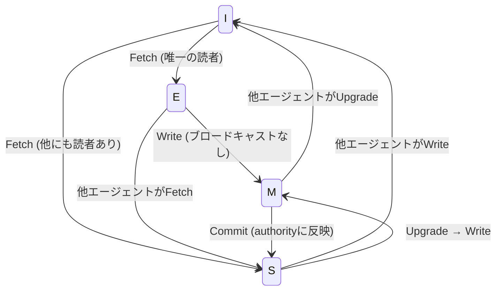

本記事は [Token Coherence (arXiv:2603.15183)](https://arxiv.org/abs/2603.15183) の解説記事です。

## 論文概要（Abstract）

Parakhinによる本論文は、マルチエージェントLLMオーケストレーションにおけるアーティファクト同期のオーバーヘッドを、共有メモリマルチプロセッサのキャッシュコヒーレンスプロトコル（MESI）を適用することで削減する手法を提案している。ナイーブなブロードキャスト方式では同期コストが $O(n \times S \times |D|)$ でスケールするのに対し、提案手法であるAgent Coherence System（ACS）プロトコルは、シミュレーション環境において84--95%のトークン転送量削減を達成したと報告されている。

この記事は [Zenn記事: マルチエージェント通信の状態同期設計：コンテキスト伝搬からバックプレッシャー制御まで](https://zenn.dev/0h_n0/articles/4ee4a8b681acf4) の深掘りです。Zenn記事がマルチエージェント間の状態同期設計パターン（コンテキスト伝搬、バックプレッシャー制御）を実装レベルで扱うのに対し、本論文はその同期オーバーヘッドそのものを理論的に削減するアプローチを、ハードウェアのキャッシュコヒーレンス理論から導出しています。

## 情報源

- **arXiv ID**: 2603.15183
- **URL**: [https://arxiv.org/abs/2603.15183](https://arxiv.org/abs/2603.15183)
- **著者**: Vladyslav Parakhin（単著）
- **発表年**: 2026
- **分野**: cs.DC, cs.AI, cs.LG, cs.MA
- **コード**: [github.com/hipvlady/agent-coherence](https://github.com/hipvlady/agent-coherence)（オープンソース、v0.1）

## 背景と動機（Background & Motivation）

マルチエージェントLLMシステムでは、複数のエージェントがコード、プラン、分析結果などのアーティファクトを共有しながら協調作業を行う。ナイーブな実装では、あるエージェントがアーティファクトを更新するたびに全エージェントにブロードキャストする。このコストは以下の式で表される。

$$
T_{\text{broadcast}} = n \times S \times \sum_{d_i \in D} |d_i|
$$

ここで、
- $n$: エージェント数
- $S$: ワークフローのステップ数
- $|d_i|$: アーティファクト $d_i$ のトークンサイズ
- $D$: 共有アーティファクトの集合

この3重の乗算的スケーリングにより、エージェント数4、ステップ数40、3アーティファクト（各4,096トークン）の構成でも約200万トークンの転送が発生する。エージェント数やステップ数の増加に伴い、転送量は急激に膨張する。

著者はこの問題が、共有メモリマルチプロセッサにおけるキャッシュコヒーレンス問題と構造的に等価であることに着目している。CPUのMESIプロトコルが不要なメモリバス転送を排除するのと同様に、LLMエージェント間でも「読まれないアーティファクトの転送」を排除できるという着想である。

## 主要な貢献（Key Contributions）

- **貢献1**: MESIプロトコルの4状態（Modified, Exclusive, Shared, Invalid）をLLMエージェントのアーティファクト同期に写像し、有効性述語 $T(I)=0; T(M)=T(E)=T(S)=1$ を定義
- **貢献2**: Token Coherence Theoremを証明し、削減下界 $\text{Savings} \geq 1 - (n + W)/S$ とボラティリティ崖 $V^* = 1 - n/S$ を導出
- **貢献3**: TLA+による形式検証で3エージェント・1アーティファクトモデルにおいてSWMR（Single Writer, Multiple Reader）、単調バージョニング、有界stalenessの3不変条件を約2,400状態空間で違反ゼロ・デッドロックゼロを確認
- **貢献4**: ACSプロトコルに4つの条件付きアクセス戦略（Eager, Lazy, Lease TTL, Access-count）を定義
- **貢献5**: LangGraph, CrewAI, AutoGenアダプターを備えたリファレンス実装agent-coherence v0.1を公開

## 技術的詳細（Technical Details）

### MESI状態マッピング

MESIプロトコルはCPUキャッシュの4つの排他的状態を定義する。著者はこれをLLMエージェントのアーティファクト保持状態に以下のように写像している。



各状態の定義は以下の通りである。

| 状態 | 意味 | 有効性 $T$ | 書き込み可否 |
|------|------|-----------|------------|
| **M (Modified)** | エージェントが唯一の有効コピーを保持。authorityのコピーはstale | 1 | 可（Commit必要） |
| **E (Exclusive)** | 唯一のコピーでauthorityと一致 | 1 | ブロードキャストなしで書き込み可能 |
| **S (Shared)** | 複数エージェントが有効コピーを保持。最後のcommit以降書き込みなし | 1 | 不可（Upgradeが必要） |
| **I (Invalid)** | キャッシュコピーがstale | 0 | 不可（Fetch必要） |

有効性述語: $T(I)=0; \; T(M)=T(E)=T(S)=1$

ハードウェアMESIとの重要な差異は、LLMアーティファクトが数千トークン規模であるのに対し、CPUキャッシュラインは典型的に64バイトである点である。このサイズ差が、コヒーレンスプロトコルによる不要転送排除の効果をより大きくしている。

### Token Coherence Theorem

著者は以下の定理を証明している。仮定として、A1（キャッシュミス時に全アーティファクト転送）およびA2（authorityを通じた書き込みシリアライズ）を置いている。

**ブロードキャストコスト**（ベースライン）:

$$
T_{\text{broadcast}} = n \times S \times \sum_{d_i \in D} |d_i|
$$

**コヒーレント上界**:

$$
T_{\text{coherent}} \leq \sum_{d_i \in D} n \cdot (n + W(d_i)) \cdot |d_i|
$$

ここで、$W(d_i)$ はアーティファクト $d_i$ の書き込み回数である。

**削減下界**（均一アーティファクトサイズ時）:

$$
\text{Savings} \geq 1 - \frac{n + W}{S}
$$

**ボラティリティファクター**の定義:

$$
V(d_i) = \frac{W(d_i)}{S}
$$

これを用いると削減率は $1 - n/S - V$ と表せる。

**ボラティリティ崖**: 削減率がゼロになる閾値は以下で与えられる。

$$
V^* = 1 - \frac{n}{S}
$$

例えば $n=4, S=40$ の場合、$V^* = 0.9$ である。つまりアーティファクトがステップの90%で書き換えられない限り、コヒーレンスプロトコルはブロードキャスト方式に対して正の削減を達成する。

この定理の直感的解釈として、エージェントが多いほど（$n$ 大）、またアーティファクトの書き換え頻度が高いほど（$V$ 大）削減率は低下するが、ワークフローのステップ数が十分に長ければ（$S$ 大）、Read-heavyなワークフローではコヒーレンスの恩恵が大きくなる。

### ACSプロトコルの状態マシン

Agent Coherence System（ACS）プロトコルは6つ組 $\langle A, D, \Sigma, \delta, \alpha, T \rangle$ で定義される。

- $A$: エージェント集合
- $D$: アーティファクト集合
- $\Sigma$: 状態集合（MESI 4状態）
- $\delta$: 状態遷移関数
- $\alpha$: アクション集合
- $T$: 有効性述語

**操作一覧**:

| 操作 | 説明 | 状態遷移 |
|------|------|---------|
| **Read** | アーティファクトの読み取り。T=1なら即時、T=0ならFetch先行 | I→E/S |
| **Upgrade** | S→MへのPromote。他のS保持者をInvalidateする | S→M |
| **Write** | M状態でのアーティファクト更新 | M→M |
| **Commit** | 変更をauthorityに反映し、M→Sへ遷移 | M→S |
| **Fetch** | authorityから最新コピーを取得 | I→E/S |
| **Invalidate** | 他エージェントの書き込みにより自身のコピーを無効化 | E/S→I |

**チャネル構成**:
- 制御チャネル（HTTP/gRPC）: 状態遷移メッセージ、Invalidation通知
- イベントチャネル（pub/sub）: Commit通知、バージョンイベント

**Lease TTL**: デフォルト $\tau = 30$ 秒。TTL経過後、E/S状態のコピーは自動的にI状態に遷移する。

### 同期戦略の比較

著者は4つの同期戦略を定義している。

| 戦略 | 動作 | ユースケース |
|------|------|------------|
| **Eager** | Write/Commit後、即座に全S保持者にpush | 低レイテンシ要求、少数エージェント |
| **Lazy** | Read時にバージョンチェックし、staleならFetch | 推奨デフォルト。Read-heavyワークロード |
| **Lease TTL** | TTL $\tau$ 経過で自動Invalid化 | ネットワーク分断耐性が必要な環境 |
| **Access-count** | 一定アクセス回数後にInvalid化 | アクセス頻度が予測可能な環境 |

### TLA+形式検証

著者はTLA+で以下のモデルを検証している。

- **構成**: 3エージェント、1アーティファクト、`MAX_STALE_STEPS=3`
- **状態空間**: 約2,400状態

検証された3つの不変条件:

1. **SWMR（Single Writer, Multiple Reader）**: 同時にM状態のエージェントが2以上存在しないこと
2. **単調バージョニング**: アーティファクトのバージョン番号が単調増加すること
3. **有界staleness**: エージェントが保持するコピーのstale度が `MAX_STALE_STEPS` を超えないこと

結果は違反ゼロ、デッドロックゼロと報告されている。ただし、活性（liveness）の検証は行われておらず、著者自身がこれを制約として明記している。

### 実装例: LangGraphアダプター

agent-coherence v0.1はLangGraph, CrewAI, AutoGenのアダプターを提供している。以下はLangGraphでの使用例である。

```python
from ccs.adapters.langgraph import LangGraphAdapter


adapter = LangGraphAdapter(
    coordinator_url="http://localhost:8080",
    strategy="lazy",
    max_stale_steps=5,
)

# LangGraphのStateGraphに統合
# アダプターがアーティファクトのRead/Write操作を
# ACSプロトコルの状態遷移に変換する
```

著者のリポジトリによると、アダプターは各フレームワークのアーティファクト操作をフックし、ACSコーディネーターとの通信を透過的に行う設計である。ただし、アダプターは特定のフレームワークバージョンに依存しており、バージョンアップ時の互換性は保証されていない点に注意が必要である。

## 実験結果（Results）

### 実験設定

著者は以下の構成でシミュレーション実験を実施している。本番LLMワークロードでの検証ではなく、アーティファクトのRead/Writeパターンを模擬したシミュレーションである点に注意が必要である。

- エージェント数 $n = 4$
- アーティファクト数 $m = 3$
- アーティファクトサイズ $|d| = 4{,}096$ トークン
- ステップ数 $S = 40$
- 10シードラン

### 正準シナリオ（lazy戦略）

ブロードキャストベースラインは全シナリオで約1,979.6Kトークンである。

| シナリオ | $V$ | コヒーレントトークン(K) | 削減率 | CHR |
|---|---|---|---|---|
| A: Planning | 0.05 | 98.1 $\pm$ 25.0 | 95.0% $\pm$ 1.3% | 79.4% |
| B: Analysis | 0.10 | 152.3 $\pm$ 28.5 | 92.3% $\pm$ 1.4% | 66.8% |
| C: Development | 0.25 | 231.2 $\pm$ 29.1 | 88.3% $\pm$ 1.5% | 51.1% |
| D: High churn | 0.50 | 312.1 $\pm$ 25.6 | 84.2% $\pm$ 1.3% | 34.6% |

ここで、
- $V$: ボラティリティファクター（$W/S$）
- CHR: Cache Hit Rate（キャッシュヒット率）
- 削減率: ブロードキャストベースラインに対するトークン転送量の削減割合

シナリオAの Planning（$V=0.05$）は、計画フェーズのようにアーティファクトの書き換えが少なく読み取りが多い状況を模擬しており、95.0%の削減を達成している。一方、シナリオDの High churn（$V=0.50$）はアーティファクトが頻繁に書き換えられる開発フェーズを模擬しており、削減率は84.2%に低下するものの依然として大幅な削減を維持している。

### 戦略比較（シナリオB: Analysis, V=0.10）

| 戦略 | 削減率 |
|------|-------|
| Eager | 93.3% |
| Lazy | 92.3% |
| Access-count | 92.2% |
| TTL | 70.2% |

Eager, Lazy, Access-countの3戦略は近い性能を示す一方、TTL戦略は$\tau$の設定に敏感であり、削減率が70.2%に留まっている。著者はLazy戦略をデフォルトとして推奨しており、その理由としてEagerに近い削減率を達成しつつ、ネットワーク負荷が低い点を挙げている。

### エージェントスケーリング（V=0.10）

| エージェント数 $n$ | 削減率 |
|---|---|
| 2 | 95.5% |
| 4 | 92.3% |
| 8 | 88.2% |
| 16 | 84.1% |

エージェント数の増加に伴い削減率は低下するが、$n=16$ でも84.1%の削減を維持している。これはToken Coherence Theoremの $\text{Savings} \geq 1 - (n+W)/S$ と整合する。$n=16, V=0.10, S=40$ の場合、理論下界は $1 - 16/40 - 0.10 = 0.50$ であり、実測の84.1%は理論下界を大幅に上回っている。

### ボラティリティスイープ

ボラティリティ $V$ を0.0から1.0まで変化させた結果、$V^* = 1 - n/S = 0.9$（$n=4, S=40$）付近で削減率が急激にゼロに近づく「崖」が観測されたと著者は報告している。$V < 0.5$ の実用的な範囲では84%以上の削減が維持されている。

## Production Deployment Guide

### AWS実装パターン（コスト最適化重視）

ACSプロトコルのコーディネーターとエージェントキャッシュをAWS上に構築するパターンを示す。

**トラフィック量別の推奨構成**:

| 規模 | エージェント数 | 推奨構成 | 月額コスト | 主要サービス |
|------|------------|---------|-----------|------------|
| **Small** | 2-4 | Serverless | $50-150 | Lambda + ElastiCache + DynamoDB |
| **Medium** | 4-8 | Hybrid | $400-900 | ECS Fargate (Coordinator) + ElastiCache |
| **Large** | 8-16+ | Container | $2,000-5,000 | EKS + ElastiCache Cluster + S3 |

**Small構成の詳細**（月額$50-150）:
- **Lambda**: エージェントワークフロー実行、1GB RAM、300秒タイムアウト（$30/月）
- **ElastiCache Redis**: ACSコーディネーター状態管理、cache.t3.micro（$15/月）
- **DynamoDB**: アーティファクトauthorityストア、On-Demand（$10/月）
- **SNS/SQS**: Invalidation通知チャネル（$5/月）

**Medium構成の詳細**（月額$400-900）:
- **ECS Fargate**: ACSコーディネーター常駐、0.5 vCPU x 1GB RAM x 2タスク（$60/月）
- **ElastiCache Redis**: 状態管理 + pub/subイベントチャネル、cache.t3.small（$30/月）
- **S3**: アーティファクト永続ストレージ（$10/月）
- **CloudWatch**: メトリクス・ログ統合（$50/月）
- **Bedrock**: LLMエージェント推論（$200-500/月、トラフィック依存）

**Large構成の詳細**（月額$2,000-5,000）:
- **EKS**: コントロールプレーン（$72/月）
- **EC2 Spot Instances**: コーディネーター + エージェントワーカー、c6i.xlarge x 2-4台（$200/月、Spot利用で最大90%削減）
- **ElastiCache Redis Cluster**: マルチAZ、cache.r6g.large x 2ノード（$300/月）
- **Bedrock**: LLM推論（$1,000-3,000/月）
- **S3 + Athena**: アーティファクトアーカイブ・分析（$50/月）

**コスト削減テクニック**:
- Spot Instances使用でワーカーノードコスト最大90%削減（Karpenter自動管理）
- ElastiCache Reserved Nodesで最大55%削減（1年コミット）
- Bedrock Batch API使用で推論コスト50%削減
- Prompt Caching有効化でコンテキスト再送コスト30-90%削減
- ACSプロトコル自体がトークン転送量を84-95%削減するため、Bedrockのトークン課金が大幅に低減

**コスト試算の注意事項**:
- 上記は2026年10月時点のAWS ap-northeast-1（東京）リージョン料金に基づく概算値です
- 実際のコストはエージェント数、アーティファクトサイズ、ワークフロー頻度により変動します
- 最新料金は [AWS料金計算ツール](https://calculator.aws/) で確認してください

### Terraformインフラコード

**Small構成 (Serverless): Lambda + ElastiCache + DynamoDB**

```hcl
# --- IAMロール（最小権限） ---
resource "aws_iam_role" "agent_lambda" {
  name = "acs-agent-lambda-role"
  assume_role_policy = jsonencode({
    Version = "2012-10-17"
    Statement = [{
      Action = "sts:AssumeRole", Effect = "Allow"
      Principal = { Service = "lambda.amazonaws.com" }
    }]
  })
}

resource "aws_iam_role_policy" "agent_permissions" {
  role = aws_iam_role.agent_lambda.id
  policy = jsonencode({
    Version = "2012-10-17"
    Statement = [
      {
        Effect   = "Allow"
        Action   = ["dynamodb:GetItem", "dynamodb:PutItem", "dynamodb:UpdateItem", "dynamodb:Query"]
        Resource = aws_dynamodb_table.artifact_authority.arn
      },
      {
        Effect   = "Allow"
        Action   = ["sns:Publish"]
        Resource = aws_sns_topic.invalidation.arn
      }
    ]
  })
}

# --- DynamoDB: Artifact Authority Store ---
resource "aws_dynamodb_table" "artifact_authority" {
  name         = "acs-artifact-authority"
  billing_mode = "PAY_PER_REQUEST"
  hash_key     = "artifact_id"
  attribute { name = "artifact_id"; type = "S" }
  server_side_encryption { enabled = true }  # KMS暗号化
  point_in_time_recovery { enabled = true }
}

# --- SNS: Invalidation通知チャネル ---
resource "aws_sns_topic" "invalidation" {
  name              = "acs-invalidation"
  kms_master_key_id = "alias/aws/sns"
}

# --- Lambda: Agent Workflow ---
resource "aws_lambda_function" "agent_worker" {
  function_name = "acs-agent-worker"
  role          = aws_iam_role.agent_lambda.arn
  runtime       = "python3.12"
  handler       = "handler.main"
  timeout       = 300
  memory_size   = 1024
  environment {
    variables = {
      ACS_COORDINATOR_URL = "redis://${aws_elasticache_cluster.coordinator.cache_nodes[0].address}:6379"
      ACS_STRATEGY        = "lazy"
      ACS_MAX_STALE_STEPS = "5"
      AUTHORITY_TABLE     = aws_dynamodb_table.artifact_authority.name
    }
  }
  filename = "lambda_placeholder.zip"
}

# --- ElastiCache: Coordinator State ---
resource "aws_elasticache_cluster" "coordinator" {
  cluster_id           = "acs-coordinator"
  engine               = "redis"
  node_type            = "cache.t3.micro"
  num_cache_nodes      = 1
  parameter_group_name = "default.redis7"
  port                 = 6379
}
```

**Large構成 (Container): EKS + Karpenter + Spot Instances**

```hcl
module "eks" {
  source          = "terraform-aws-modules/eks/aws"
  version         = "~> 20.0"
  cluster_name    = "acs-coherence-cluster"
  cluster_version = "1.31"
  vpc_id          = module.vpc.vpc_id
  subnet_ids      = module.vpc.private_subnets
  cluster_endpoint_public_access = false  # コスト・セキュリティ最適化
}

# --- Karpenter Provisioner（Spot優先） ---
resource "kubectl_manifest" "karpenter_provisioner" {
  yaml_body = yamlencode({
    apiVersion = "karpenter.sh/v1"
    kind       = "NodePool"
    metadata   = { name = "acs-workers" }
    spec = {
      template = { spec = { requirements = [
        { key = "karpenter.sh/capacity-type", operator = "In", values = ["spot", "on-demand"] },
        { key = "node.kubernetes.io/instance-type", operator = "In", values = ["c6i.xlarge", "c6i.2xlarge", "c7i.xlarge"] }
      ] } }
      limits     = { cpu = "32" }
      disruption = { consolidationPolicy = "WhenEmptyOrUnderutilized", consolidateAfter = "30s" }
    }
  })
}

# --- AWS Budgets: 予算アラート ---
resource "aws_budgets_budget" "monthly" {
  name         = "acs-monthly-budget"
  budget_type  = "COST"
  limit_amount = "5000"
  limit_unit   = "USD"
  time_unit    = "MONTHLY"
  notification {
    comparison_operator        = "GREATER_THAN"
    threshold                  = 80
    threshold_type             = "PERCENTAGE"
    notification_type          = "ACTUAL"
    subscriber_email_addresses = ["ops-team@example.com"]
  }
}
```

### 運用・監視設定

**CloudWatch Logs Insights クエリ: ACSプロトコル効率分析**

```
fields @timestamp, agent_id, artifact_id, operation, state_transition, tokens_saved
| filter operation in ["Read", "Write", "Fetch", "Invalidate"]
| stats
    count(*) as total_ops,
    sum(case when operation = "Fetch" then 1 else 0 end) as cache_misses,
    sum(tokens_saved) as total_tokens_saved
  by bin(1h) as hour
| sort hour desc
```

**CloudWatch Logs Insights クエリ: レイテンシ分析**

```
fields @timestamp, operation, latency_ms
| filter operation in ["Read", "Fetch", "Commit"]
| stats
    avg(latency_ms) as avg_latency,
    pct(latency_ms, 95) as p95_latency,
    pct(latency_ms, 99) as p99_latency
  by operation
```

**CloudWatch アラーム設定（Python）: Fetch頻度異常検知**

```python
import boto3


def create_acs_alarms(function_name: str, sns_topic_arn: str) -> None:
    """ACSプロトコルの監視アラームを作成する

    Args:
        function_name: 監視対象のLambda関数名
        sns_topic_arn: 通知先SNSトピックARN
    """
    cw = boto3.client("cloudwatch", region_name="ap-northeast-1")

    # Fetch頻度が高すぎる場合（キャッシュ効率低下の兆候）
    cw.put_metric_alarm(
        AlarmName="acs-high-fetch-rate",
        MetricName="FetchOperations",
        Namespace="ACS/Coherence",
        Statistic="Sum",
        Period=300,
        EvaluationPeriods=3,
        Threshold=500,
        ComparisonOperator="GreaterThanThreshold",
        AlarmActions=[sns_topic_arn],
        AlarmDescription="ACS Fetch operations exceeded 500/5min (cache efficiency degradation)",
    )

    # Invalidation storm検知
    cw.put_metric_alarm(
        AlarmName="acs-invalidation-storm",
        MetricName="InvalidateOperations",
        Namespace="ACS/Coherence",
        Statistic="Sum",
        Period=60,
        EvaluationPeriods=2,
        Threshold=100,
        ComparisonOperator="GreaterThanThreshold",
        AlarmActions=[sns_topic_arn],
        AlarmDescription="ACS Invalidation storm detected (>100/min)",
    )
```

**X-Ray トレーシング設定（Python）: ACSプロトコル操作の追跡**

```python
from aws_xray_sdk.core import xray_recorder, patch_all

patch_all()  # boto3自動計装

@xray_recorder.capture("acs_artifact_read")
def read_artifact(agent_id: str, artifact_id: str) -> dict:
    """ACSプロトコルに基づくアーティファクト読み取り"""
    subsegment = xray_recorder.current_subsegment()
    subsegment.put_annotation("agent_id", agent_id)
    subsegment.put_annotation("artifact_id", artifact_id)
    state = check_coherence_state(agent_id, artifact_id)
    subsegment.put_metadata("mesi_state", state)
    subsegment.put_annotation("cache_hit", state != "I")
    if state == "I":
        return fetch_from_authority(artifact_id)
    return read_local_cache(agent_id, artifact_id)
```

**Cost Explorer自動レポート（Python）**

```python
import boto3
from datetime import datetime, timedelta

def daily_acs_cost_report(sns_topic_arn: str) -> dict:
    """ACS関連AWSコストの日次レポートを生成しSNS通知する"""
    ce = boto3.client("ce", region_name="us-east-1")
    sns = boto3.client("sns", region_name="ap-northeast-1")
    end = datetime.utcnow().strftime("%Y-%m-%d")
    start = (datetime.utcnow() - timedelta(days=1)).strftime("%Y-%m-%d")

    response = ce.get_cost_and_usage(
        TimePeriod={"Start": start, "End": end},
        Granularity="DAILY", Metrics=["UnblendedCost"],
        Filter={"Tags": {"Key": "Project", "Values": ["acs-coherence"]}},
        GroupBy=[{"Type": "DIMENSION", "Key": "SERVICE"}],
    )
    total = sum(
        float(g["Metrics"]["UnblendedCost"]["Amount"])
        for g in response["ResultsByTime"][0]["Groups"]
    )
    if total > 100:
        sns.publish(
            TopicArn=sns_topic_arn,
            Subject=f"ACS Daily Cost Alert: ${total:.2f}",
            Message=f"Daily ACS cost exceeded $100. Total: ${total:.2f}",
        )
    return {"date": start, "total": total}
```

### コスト最適化チェックリスト

**アーキテクチャ選択**:
- [ ] エージェント数2-4: Serverless構成（Lambda + ElastiCache）
- [ ] エージェント数4-8: Hybrid構成（ECS Fargate Coordinator）
- [ ] エージェント数8+: Container構成（EKS + Karpenter）

**リソース最適化**:
- [ ] EC2/EKSワーカー: Spot Instances優先（最大90%削減）
- [ ] ElastiCache: Reserved Nodes 1年コミット（最大55%削減）
- [ ] Lambda: メモリサイズ最適化（Power Tuningツール使用）
- [ ] EKS: Karpenter consolidation設定でアイドルノード自動縮退
- [ ] Savings Plans: Compute Savings Plans検討（最大66%削減）

**LLMコスト削減**（ACSプロトコルによる直接効果）:
- [ ] ACS Lazy戦略でトークン転送量84-95%削減
- [ ] Bedrock Batch API使用で推論コスト50%削減
- [ ] Prompt Caching有効化でコンテキスト再送コスト30-90%削減
- [ ] モデル選択ロジック: 軽量タスクはHaiku、複雑タスクはSonnet/Opus
- [ ] トークン数制限: max_tokensパラメータ設定

**監視・アラート**:
- [ ] AWS Budgets: 月次予算アラート設定（80%/100%閾値）
- [ ] CloudWatch: Fetch頻度・Invalidation storm検知
- [ ] Cost Anomaly Detection: 自動異常検知有効化
- [ ] 日次コストレポート: Cost Explorer + SNS通知
- [ ] ACSキャッシュヒット率ダッシュボード: CHR低下トレンド監視

**リソース管理**:
- [ ] 未使用ElastiCacheクラスタ削除
- [ ] 全リソースにProject/Envタグ付与
- [ ] S3ライフサイクルポリシー: 90日後Glacier移行
- [ ] 開発環境: 夜間・週末のEKSノード停止
- [ ] DynamoDB: 未使用テーブルの定期棚卸し

## 実運用への応用（Practical Applications）

### Zenn記事との接続

[Zenn記事](https://zenn.dev/0h_n0/articles/4ee4a8b681acf4)ではマルチエージェント間のコンテキストドリフト（エージェント間で共有状態が乖離する問題）への対策として、コンテキスト伝搬パターンとバックプレッシャー制御を扱っている。本論文のACSプロトコルは、このコンテキストドリフト問題に対して以下の補完的なアプローチを提供する。

- **有界staleness保証**: TLA+で検証された `MAX_STALE_STEPS` パラメータにより、エージェント間のコンテキスト乖離に上界を設定できる。Zenn記事のバックプレッシャー制御がフロー制御の観点から乖離を防ぐのに対し、ACSは状態一貫性の観点から保証を与える
- **Invalidation通知**: Zenn記事のイベント駆動コンテキスト伝搬を、ACSのInvalidation + Lazy Fetchで効率的に実装できる。全アーティファクトをpushする代わりに、変更通知のみを送り、必要なエージェントだけが最新版をpullする
- **ボラティリティによる戦略選択**: 論文のボラティリティファクター $V$ は、Zenn記事のワークフロー設計において同期戦略を定量的に選択する基準を提供する

### 適用時の注意点

ACSプロトコルを実運用に適用する際には、論文の制約を踏まえた検討が必要である。中央集権的なauthorityは単一障害点となるため、本番環境ではRedis SentinelやElastiCacheマルチAZによる冗長化が必須である。また、always-read型のエージェント（他エージェントのアーティファクトを常にコンテキストに注入するパターン）にはACSの恩恵がない。

## 関連研究（Related Work）

- **Context Drift（He et al., 2026, arXiv:2606.21666）**: マルチエージェントLLMシステムにおけるコンテキストドリフトの形式的定義と検出手法を提案。ACSプロトコルの有界staleness保証はContext Driftの制御手段として位置づけられる
- **MAST（Kim et al., 2025, arXiv:2503.13657）**: マルチエージェントLLMシステムの状態管理フレームワーク。ACSがキャッシュコヒーレンスに特化しているのに対し、MASTはより広範な状態管理を扱う
- **MESIプロトコル（Papamarcos & Patel, 1984）**: 共有メモリマルチプロセッサの元祖キャッシュコヒーレンスプロトコル。ACSはこの4状態モデルをLLMアーティファクトに再解釈している

## 制約と限界

著者が明記している制約および筆者が認識する限界を以下に列挙する。

- **中央集権的authority**: コーディネーターが単一障害点となる。分散コンセンサス（Raft等）への拡張は未検討
- **シミュレーションのみ**: 本番LLMワークロードでの検証は行われていない。実際のLLM推論レイテンシ、ネットワーク遅延、エージェントの非決定的動作が結果に与える影響は不明
- **均一アクセスパターンの仮定**: 実際のワークロードでは特定アーティファクトへのアクセスが偏る可能性がある
- **always-read適用外**: 全アーティファクトを常にコンテキストに注入するパターンには効果がない
- **活性（liveness）未検証**: TLA+で安全性は検証されたが、活性（全ての操作がいつか完了すること）は未検証
- **M状態クラッシュ時のロック孤立**: M状態のエージェントがクラッシュした場合、ロックが残留する可能性がある
- **リース感度問題**: TTL戦略の $\tau$ パラメータの最適値はワークロード依存であり、汎用的な設定指針がない
- **プロトコルオーバーヘッド未計上**: 制御メッセージ（Invalidation通知、バージョンチェック等）のオーバーヘッドは削減率の計算に含まれていない
- **単一アーティファクト書き込み**: 複数アーティファクトの同時書き込み（トランザクション的操作）はサポートされていない
- **フルアーティファクト転送**: デルタ転送（差分のみの転送）は未実装であり、大きなアーティファクトの小さな変更でも全体が転送される
- **アダプター脆弱性**: LangGraph, CrewAI, AutoGenの特定バージョンへの依存があり、フレームワーク側のAPI変更で動作しなくなる可能性がある

## まとめと今後の展望

本論文は、マルチプロセッサのキャッシュコヒーレンス理論をLLMマルチエージェントシステムに適用するという新規のアプローチを提示している。Token Coherence Theoremにより削減の理論的保証が与えられ、シミュレーション実験では84--95%のトークン転送量削減が報告されている。TLA+による形式検証も安全性の観点から一定の信頼性を提供している。

ただし、現時点ではシミュレーションのみの評価であり、本番ワークロードでの検証が今後の最重要課題である。また、中央集権的コーディネーターの冗長化、デルタ転送の実装、活性の形式検証など、プロダクション適用に向けた課題が残されている。Zenn記事で扱ったコンテキスト伝搬パターンとACSプロトコルを組み合わせることで、マルチエージェントシステムの同期効率と一貫性の両立が期待できる。

## 参考文献

- **arXiv**: [https://arxiv.org/abs/2603.15183](https://arxiv.org/abs/2603.15183)
- **Code**: [https://github.com/hipvlady/agent-coherence](https://github.com/hipvlady/agent-coherence)
- **Related Zenn article**: [https://zenn.dev/0h_n0/articles/4ee4a8b681acf4](https://zenn.dev/0h_n0/articles/4ee4a8b681acf4)
- **Context Drift**: [https://arxiv.org/abs/2606.21666](https://arxiv.org/abs/2606.21666)
- **MAST**: [https://arxiv.org/abs/2503.13657](https://arxiv.org/abs/2503.13657)
- **MESIプロトコル**: Papamarcos, M. S. & Patel, J. H. (1984). "A low-overhead coherence solution for multiprocessors with private cache memories." ISCA.
