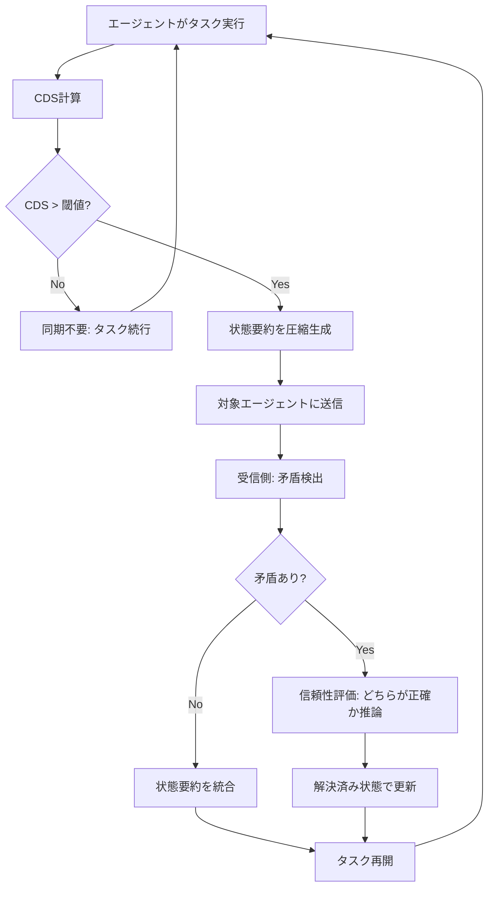

本記事は [Hallucination as Context Drift (arXiv:2606.21666)](https://arxiv.org/abs/2606.21666) の解説記事です。

## 論文概要（Abstract）

マルチエージェントLLMシステムでは、並行して作業するエージェント間の内部知識状態が徐々に乖離する「コンテキストドリフト」が発生し、これが幻覚（hallucination）の一因となる。著者は、この現象をモデル固有の欠陥ではなく分散システムのインターフェース問題として再定式化し、エージェントペア間の知識状態の乖離を定量化するContext Divergence Score（CDS）と、CDS閾値に基づいて選択的に状態要約を交換するShared State Verification Protocol（SSVP）を提案している。Claude Haikuを用いた実験では、SSVPが全量ブロードキャストと比較して幻覚率を有意に低下させつつAPI呼び出しを58%削減したと報告されている。

この記事は [Zenn記事: マルチエージェント通信の状態同期設計：コンテキスト伝搬からバックプレッシャー制御まで](https://zenn.dev/0h_n0/articles/4ee4a8b681acf4) の深掘りです。Zenn記事がマルチエージェント通信の実装パターン全般を扱うのに対し、本論文は「なぜ同期が必要か」を幻覚率という定量指標で検証した研究に焦点を当てています。

## 情報源

- **arXiv ID**: 2606.21666
- **URL**: [https://arxiv.org/abs/2606.21666](https://arxiv.org/abs/2606.21666)
- **著者**: Carson Rodrigues（単著）
- **発表年**: 2026
- **分野**: cs.AI, cs.CL, cs.MA

## 背景と動機（Background & Motivation）

マルチエージェントLLMシステムでは、複数のエージェントが並行してタスクを遂行し、最終的に結果を統合する。旅行プランニングを例にとると、宿泊担当エージェントが「ホテルAは満室」と判断した情報が交通担当エージェントに伝わらなければ、交通エージェントは「ホテルAへのアクセス」を前提とした提案を続け、結果として矛盾した計画が生成される。

従来、こうした矛盾は各LLMの「幻覚を起こしやすい性質」に帰属されてきた。しかし著者は、個々のモデルが正確な推論を行っていても、エージェント間の知識状態が同期されなければシステム全体として矛盾が発生すると主張している。これは分散システムにおけるレプリカ間の一貫性問題と本質的に同じ構造であり、幻覚の一部はモデルの能力ではなくシステム設計の問題として対処可能であるという視点を提示している。

さらに著者は、全エージェントに全状態を一斉配信するナイーブな全量ブロードキャストがかえって幻覚率を悪化させることを実験的に示し、「同期すれば解決する」という単純な仮定に疑問を投げかけている。

## 主要な貢献（Key Contributions）

- **貢献1**: **Context Divergence Score（CDS）の定義** -- エージェントペア間の知識状態の乖離を空間的・時間的・タスク的な3次元で定量化する軽量スカラー指標を提案
- **貢献2**: **Shared State Verification Protocol（SSVP）の設計** -- CDSに基づいて同期の要否を判断し、閾値超過時のみ圧縮された状態要約を交換するプロトコルを実装
- **貢献3**: **幻覚の分散システム的再定式化** -- マルチエージェントLLMにおける幻覚を、モデル固有の欠陥ではなく分散システムの一貫性問題として位置づける理論的枠組みを提示
- **貢献4**: **全量ブロードキャストの逆効果の実証** -- ナイーブな同期が幻覚率をbaseline比で約34%増加させる「汚染効果（contamination effect）」を実験的に確認

## 技術的詳細（Technical Details）

### Context Divergence Score（CDS）

CDSはエージェントペア $(A_i, A_j)$ 間の知識状態の乖離を、3つの次元で定量化するスカラー指標である。

$$
\text{CDS}(A_i, A_j) = \alpha \cdot D_{\text{spatial}} + \beta \cdot D_{\text{temporal}} + \gamma \cdot D_{\text{task}}
$$

ここで、
- $D_{\text{spatial}}$: 空間的乖離 -- エージェントが参照している情報空間の重複度。例えば「ホテル情報」と「航空券情報」の共有範囲
- $D_{\text{temporal}}$: 時間的乖離 -- エージェントが保持する情報の鮮度の差。最終更新タイムスタンプの差分
- $D_{\text{task}}$: タスク的乖離 -- 現在遂行中のサブタスクの関連度。独立タスクなら低く、依存タスクなら高い
- $\alpha, \beta, \gamma$: ドメイン依存の重み係数（$\alpha + \beta + \gamma = 1$）

CDSは0から1の範囲を取り、0は完全同期、1は完全乖離を示す。重み係数はドメインごとに調整する必要がある。例えばリアルタイム性が重要なドメインでは $\beta$ を大きくし、情報の空間的分割が大きいドメインでは $\alpha$ を重視するといった使い分けが想定されている。

### Shared State Verification Protocol（SSVP）の動作フロー

SSVPはCDS値に基づいて同期の要否を判断し、必要な場合のみ圧縮された状態要約を交換するプロトコルである。全量ブロードキャストとの違いは、閾値ベースの選択的同期と、受信側での能動的な矛盾推論にある。



SSVPの重要な設計判断として、受信側が送られてきた状態を無条件に上書きするのではなく、自身の状態と比較して矛盾を検出し、どちらの情報源がより信頼できるかを推論する点がある。これにより、誤った状態の伝搬（汚染効果）を抑制している。

### 実装イメージ

以下は論文で提案されているCDSとSSVPの概念をPythonコードで表現した実装イメージである。論文にはこの形式のコードは掲載されていないが、アルゴリズムの理解を助けるために筆者が構成した。

```python
from dataclasses import dataclass, field
from typing import Any


@dataclass
class AgentState:
    """エージェントの内部知識状態を表現する構造体。

    Attributes:
        agent_id: エージェントの一意識別子
        knowledge: 現在保持している知識のキーバリューストア
        timestamp: 最終更新のタイムスタンプ
        current_task: 現在遂行中のサブタスク識別子
        spatial_scope: 参照している情報空間のスコープ
    """
    agent_id: str
    knowledge: dict[str, Any] = field(default_factory=dict)
    timestamp: float = 0.0
    current_task: str = ""
    spatial_scope: set[str] = field(default_factory=set)


def compute_cds(
    state_i: AgentState,
    state_j: AgentState,
    alpha: float = 0.4,
    beta: float = 0.3,
    gamma: float = 0.3,
) -> float:
    """2つのエージェント間のContext Divergence Scoreを計算する。

    Args:
        state_i: エージェントiの状態
        state_j: エージェントjの状態
        alpha: 空間的乖離の重み
        beta: 時間的乖離の重み
        gamma: タスク的乖離の重み

    Returns:
        0.0（完全同期）から1.0（完全乖離）のスカラー値
    """
    # 空間的乖離: Jaccard距離
    union = state_i.spatial_scope | state_j.spatial_scope
    if not union:
        d_spatial = 0.0
    else:
        intersection = state_i.spatial_scope & state_j.spatial_scope
        d_spatial = 1.0 - len(intersection) / len(union)

    # 時間的乖離: タイムスタンプ差の正規化
    max_staleness = 300.0  # 5分を最大乖離とする（秒）
    d_temporal = min(
        abs(state_i.timestamp - state_j.timestamp) / max_staleness, 1.0
    )

    # タスク的乖離: 同一タスクなら0、異なれば1（簡略化）
    d_task = 0.0 if state_i.current_task == state_j.current_task else 1.0

    return alpha * d_spatial + beta * d_temporal + gamma * d_task


@dataclass
class SSVPConfig:
    """SSVPプロトコルの設定パラメータ。

    Attributes:
        cds_threshold: 同期をトリガーするCDS閾値
        alpha: CDS空間的乖離の重み
        beta: CDS時間的乖離の重み
        gamma: CDS タスク的乖離の重み
    """
    cds_threshold: float = 0.5
    alpha: float = 0.4
    beta: float = 0.3
    gamma: float = 0.3


def should_sync(
    state_i: AgentState,
    state_j: AgentState,
    config: SSVPConfig,
) -> bool:
    """SSVPに基づき、2エージェント間で同期が必要かを判定する。

    Args:
        state_i: エージェントiの状態
        state_j: エージェントjの状態
        config: SSVPの設定パラメータ

    Returns:
        同期が必要ならTrue
    """
    cds = compute_cds(
        state_i, state_j,
        alpha=config.alpha,
        beta=config.beta,
        gamma=config.gamma,
    )
    return cds > config.cds_threshold


def compress_state_summary(state: AgentState) -> dict[str, Any]:
    """状態要約を圧縮して送信用に変換する。

    全知識を送るのではなく、キーとタイムスタンプのみを含む
    軽量な要約を生成する。

    Args:
        state: 圧縮対象のエージェント状態

    Returns:
        圧縮された状態要約の辞書
    """
    return {
        "agent_id": state.agent_id,
        "timestamp": state.timestamp,
        "current_task": state.current_task,
        "knowledge_keys": list(state.knowledge.keys()),
        "spatial_scope": list(state.spatial_scope),
    }
```

このコードでは、CDS計算の3次元（空間・時間・タスク）それぞれを独立に算出し、重み付き加算でスカラーに集約している。`should_sync`関数がSSVPの中核判定ロジックであり、閾値を超えた場合のみ`compress_state_summary`で圧縮した状態要約を交換する。全量ブロードキャストとの違いは、この閾値判定と圧縮要約にある。

## 実験結果（Results）

### 実験設定

著者はClaude Haikuモデルを使用し、2つのドメインで実験を実施している。

- **旅行プランニング**: 30シナリオ（n=30 per condition）
- **ソフトウェアプロジェクトプランニング**: 10シナリオ（n=10 per condition）
- **合計**: 8シナリオ構成、3条件（No-sync / Full-broadcast / SSVP）

### 幻覚率（Hallucination Rate）の比較

論文の実験結果より、各条件の幻覚率（HR）は以下のとおりである。

| 条件 | 幻覚率（HR） | baseline比 | 統計的有意性 |
|------|-------------|-----------|-------------|
| No-sync baseline | 0.492 | -- | -- |
| Full-broadcast | 0.658 | +34%増加 | p=0.0022, Cohen's d=1.18 |
| SSVP | 0.463 | 微減 | vs baseline: d=0.30（modest reduction） |

- **SSVP vs Full-broadcast**: p=0.0005, Cohen's d=1.47（大きな効果量）
- **API呼び出し削減**: SSVPはFull-broadcast比で58%削減

### ドメイン間の差異

著者らの報告によると、ソフトウェアドメインでは全条件で幻覚率が0.2未満に収束しており、旅行ドメインで観察された汚染効果（contamination effect）が再現されなかった。著者らはこの差異について、旅行プランニングでは1つの誤った共有情報（例: 誤ったホテル空室情報）が複数の評価軸に連鎖的に影響する（宿泊・交通・スケジュール全体が崩れる）のに対し、ソフトウェアプロジェクトでは各コンポーネントの独立性が高いため波及効果が限定的であると分析している。

### 結果の解釈における注意点

- SSVPのbaseline比での改善は効果量d=0.30であり、統計的に「modest」と著者自身が記載している
- SSVPの主たる利点はFull-broadcastとの比較にあり、「同期しすぎない」ことの価値を示している
- Full-broadcastがbaselineより悪化した点（汚染効果）は、Cohen's d=1.18と大きな効果量で支持されている

## Production Deployment Guide

本論文はCDS計算とSSVPプロトコルの実装セクションを含んでいるため、AWS上での実運用構成を示す。

### AWS実装パターン（コスト最適化重視）

マルチエージェントLLMシステムの状態同期基盤をAWSに構築する場合、トラフィック量に応じた3段階の構成を推奨する。コスト試算は2026年10月時点のap-northeast-1（東京）リージョン概算値であり、実際のコストはトラフィックパターンやバースト使用量により変動する。最新料金はAWS料金計算ツールで確認を推奨する。

**Small構成（~100 req/日）: Serverless -- 月額$50-150**
- Lambda（CDS計算 + SSVP判定）: 128MB, タイムアウト30秒
- DynamoDB（エージェント状態ストア）: On-Demandモード
- Bedrock（Claude Haiku, 状態要約生成）: 従量課金
- SQS（エージェント間メッセージング）: 標準キュー
- 内訳: Lambda $5 + DynamoDB $10 + Bedrock $20-120 + SQS $1

**Medium構成（~1,000 req/日）: Hybrid -- 月額$300-800**
- ECS Fargate（エージェントオーケストレータ）: 0.5 vCPU, 1GB RAM
- ElastiCache Redis（CDS計算キャッシュ + 状態ストア）: cache.t3.micro
- Bedrock（Claude Haiku）: Batch API併用で50%削減
- EventBridge（同期イベントルーティング）
- 内訳: Fargate $30 + Redis $15 + Bedrock $200-700 + EventBridge $5

**Large構成（10,000+ req/日）: Container -- 月額$2,000-5,000**
- EKS + Karpenter（エージェントクラスタ）: Spot優先で最大90%削減
- ElastiCache Redis Cluster（状態同期ハブ）: 3ノードクラスタ
- Bedrock + Prompt Caching: 状態要約のキャッシュで30-90%削減
- Kinesis Data Streams（高スループットメッセージング）
- 内訳: EKS $150 + EC2 Spot $200-500 + Redis $150 + Bedrock $1,500-4,000

### Terraformインフラコード

**Small構成（Serverless）**

```hcl
# CDS計算 + SSVPエージェント状態同期基盤（Small構成）
# 2026-10 時点のap-northeast-1対応

resource "aws_dynamodb_table" "agent_state" {
  name         = "${var.project}-agent-state"
  billing_mode = "PAY_PER_REQUEST"
  hash_key     = "agent_id"
  range_key    = "timestamp"

  attribute {
    name = "agent_id"
    type = "S"
  }
  attribute {
    name = "timestamp"
    type = "N"
  }

  # KMS暗号化
  server_side_encryption {
    enabled     = true
    kms_key_arn = aws_kms_key.main.arn
  }

  ttl {
    attribute_name = "expires_at"
    enabled        = true
  }

  tags = var.common_tags
}

resource "aws_iam_role" "cds_lambda" {
  name = "${var.project}-cds-lambda"
  assume_role_policy = jsonencode({
    Version = "2012-10-17"
    Statement = [{
      Action = "sts:AssumeRole"
      Effect = "Allow"
      Principal = { Service = "lambda.amazonaws.com" }
    }]
  })
}

# 最小権限: DynamoDB + Bedrock + SQS + CloudWatch Logs
resource "aws_iam_role_policy" "cds_lambda" {
  name = "${var.project}-cds-lambda-policy"
  role = aws_iam_role.cds_lambda.id
  policy = jsonencode({
    Version = "2012-10-17"
    Statement = [
      {
        Effect   = "Allow"
        Action   = ["dynamodb:GetItem", "dynamodb:PutItem", "dynamodb:Query"]
        Resource = aws_dynamodb_table.agent_state.arn
      },
      {
        Effect   = "Allow"
        Action   = ["bedrock:InvokeModel"]
        Resource = "arn:aws:bedrock:ap-northeast-1::foundation-model/anthropic.claude-3-haiku-*"
      },
      {
        Effect   = "Allow"
        Action   = ["sqs:SendMessage", "sqs:ReceiveMessage", "sqs:DeleteMessage"]
        Resource = aws_sqs_queue.sync_queue.arn
      }
    ]
  })
}

resource "aws_lambda_function" "cds_calculator" {
  function_name = "${var.project}-cds-calculator"
  runtime       = "python3.12"
  handler       = "handler.lambda_handler"
  role          = aws_iam_role.cds_lambda.arn
  memory_size   = 128
  timeout       = 30

  environment {
    variables = {
      STATE_TABLE     = aws_dynamodb_table.agent_state.name
      CDS_THRESHOLD   = "0.5"
      SYNC_QUEUE_URL  = aws_sqs_queue.sync_queue.url
    }
  }

  tracing_config {
    mode = "Active"  # X-Ray有効化
  }

  tags = var.common_tags
}

resource "aws_sqs_queue" "sync_queue" {
  name                       = "${var.project}-sync-queue"
  visibility_timeout_seconds = 60
  message_retention_seconds  = 3600  # 1時間

  # KMS暗号化
  kms_master_key_id = aws_kms_key.main.id

  tags = var.common_tags
}

# コスト監視アラーム
resource "aws_cloudwatch_metric_alarm" "lambda_cost" {
  alarm_name          = "${var.project}-lambda-invocations-high"
  comparison_operator = "GreaterThanThreshold"
  evaluation_periods  = 1
  metric_name         = "Invocations"
  namespace           = "AWS/Lambda"
  period              = 3600
  statistic           = "Sum"
  threshold           = 1000
  alarm_actions       = [var.sns_topic_arn]

  dimensions = {
    FunctionName = aws_lambda_function.cds_calculator.function_name
  }
}
```

**Large構成（Container）**

```hcl
# EKS + Karpenter構成（Large）
# Spot優先で大幅コスト削減

module "eks" {
  source          = "terraform-aws-modules/eks/aws"
  version         = "~> 20.0"
  cluster_name    = "${var.project}-cluster"
  cluster_version = "1.31"

  vpc_id     = var.vpc_id
  subnet_ids = var.private_subnet_ids

  # パブリックアクセス最小化
  cluster_endpoint_public_access  = false
  cluster_endpoint_private_access = true

  # KMS暗号化
  cluster_encryption_config = {
    provider_key_arn = aws_kms_key.main.arn
    resources        = ["secrets"]
  }

  tags = var.common_tags
}

# Karpenter: Spot優先で最大90%削減
resource "kubectl_manifest" "karpenter_nodepool" {
  yaml_body = yamlencode({
    apiVersion = "karpenter.sh/v1"
    kind       = "NodePool"
    metadata   = { name = "agent-workers" }
    spec = {
      template = {
        spec = {
          requirements = [
            { key = "karpenter.sh/capacity-type", operator = "In", values = ["spot", "on-demand"] },
            { key = "node.kubernetes.io/instance-type", operator = "In",
              values = ["m6i.large", "m6a.large", "m5.large"] }
          ]
        }
      }
      limits   = { cpu = "100", memory = "200Gi" }
      disruption = {
        consolidationPolicy = "WhenEmptyOrUnderutilized"
        consolidateAfter    = "60s"
      }
    }
  })
}

# AWS Budgets: 月次コスト上限
resource "aws_budgets_budget" "monthly" {
  name         = "${var.project}-monthly"
  budget_type  = "COST"
  limit_amount = "5000"
  limit_unit   = "USD"
  time_unit    = "MONTHLY"

  notification {
    comparison_operator       = "GREATER_THAN"
    threshold                 = 80
    threshold_type            = "PERCENTAGE"
    notification_type         = "ACTUAL"
    subscriber_sns_topic_arns = [var.sns_topic_arn]
  }
}
```

### 運用・監視設定

**CloudWatch Logs Insights: CDS閾値超過の監視**

```
fields @timestamp, agent_pair, cds_value, sync_triggered
| filter sync_triggered = true
| stats count(*) as sync_count, avg(cds_value) as avg_cds by bin(1h)
| sort @timestamp desc
```

**CloudWatch Logs Insights: Bedrock API使用量トラッキング**

```
fields @timestamp, model_id, input_tokens, output_tokens
| filter model_id like /claude/
| stats sum(input_tokens) as total_input, sum(output_tokens) as total_output,
        count(*) as api_calls by bin(1h)
| sort @timestamp desc
```

**CloudWatchアラーム設定（Python）**

```python
import boto3


def create_bedrock_token_alarm(
    project_name: str,
    sns_topic_arn: str,
    threshold: int = 100000,
) -> dict:
    """Bedrockトークン使用量のスパイク検知アラームを作成する。

    Args:
        project_name: プロジェクト名（アラーム名のプレフィクス）
        sns_topic_arn: 通知先SNSトピックARN
        threshold: 1時間あたりのトークン数閾値

    Returns:
        CloudWatch APIのレスポンス
    """
    cw = boto3.client("cloudwatch")
    return cw.put_metric_alarm(
        AlarmName=f"{project_name}-bedrock-tokens-high",
        MetricName="InputTokenCount",
        Namespace="AWS/Bedrock",
        Statistic="Sum",
        Period=3600,
        EvaluationPeriods=1,
        Threshold=threshold,
        ComparisonOperator="GreaterThanThreshold",
        AlarmActions=[sns_topic_arn],
    )
```

**X-Rayトレーシング設定（Python）**

```python
from aws_xray_sdk.core import xray_recorder, patch_all

# boto3を含む全ライブラリを自動計装
patch_all()


@xray_recorder.capture("compute_cds")
def traced_compute_cds(state_i: dict, state_j: dict) -> float:
    """X-Rayトレース付きCDS計算。

    Args:
        state_i: エージェントiの状態辞書
        state_j: エージェントjの状態辞書

    Returns:
        CDS値（0.0-1.0）
    """
    subsegment = xray_recorder.current_subsegment()
    if subsegment:
        subsegment.put_annotation("agent_pair",
                                  f"{state_i['agent_id']}-{state_j['agent_id']}")
        subsegment.put_metadata("cds_params", {
            "alpha": 0.4, "beta": 0.3, "gamma": 0.3
        })
    # CDS計算ロジック（前述のcompute_cdsと同等）
    cds_value = _compute_cds_internal(state_i, state_j)
    if subsegment:
        subsegment.put_annotation("cds_value", cds_value)
    return cds_value
```

**Cost Explorer日次レポート（Python）**

```python
import boto3
from datetime import date, timedelta


def get_daily_cost_report(threshold_usd: float = 100.0) -> dict:
    """日次コストレポートを取得し、閾値超過時にSNS通知する。

    Args:
        threshold_usd: 通知閾値（USD/日）

    Returns:
        サービス別コスト辞書
    """
    ce = boto3.client("ce")
    today = date.today()
    yesterday = today - timedelta(days=1)

    response = ce.get_cost_and_usage(
        TimePeriod={
            "Start": yesterday.isoformat(),
            "End": today.isoformat(),
        },
        Granularity="DAILY",
        Metrics=["UnblendedCost"],
        GroupBy=[{"Type": "DIMENSION", "Key": "SERVICE"}],
    )

    costs = {}
    total = 0.0
    for group in response["ResultsByTime"][0]["Groups"]:
        service = group["Keys"][0]
        amount = float(group["Metrics"]["UnblendedCost"]["Amount"])
        costs[service] = amount
        total += amount

    if total > threshold_usd:
        sns = boto3.client("sns")
        sns.publish(
            TopicArn="arn:aws:sns:ap-northeast-1:ACCOUNT:cost-alert",
            Subject=f"Daily cost alert: ${total:.2f}",
            Message=f"Daily cost ${total:.2f} exceeded ${threshold_usd}",
        )

    return costs
```

### コスト最適化チェックリスト

**アーキテクチャ選択**
- [ ] トラフィック量に基づき構成を選択（~100: Serverless / ~1000: Hybrid / 10000+: Container）
- [ ] CDS計算はステートレスに設計しLambdaまたはFargate Spotで実行

**リソース最適化**
- [ ] EC2/EKS: Spot Instances優先（最大90%削減）
- [ ] Reserved Instances: 安定ワークロードは1年コミット（最大72%削減）
- [ ] Savings Plans: Compute Savings Plans検討
- [ ] Lambda: メモリサイズをPower Tuningで最適化（128MB-256MB推奨）
- [ ] ECS/EKS: Karpenterで未使用ノード自動縮退

**LLMコスト削減**
- [ ] Bedrock Batch API: 非リアルタイム状態要約生成で50%削減
- [ ] Prompt Caching: SSVP状態要約テンプレートをキャッシュ（30-90%削減）
- [ ] モデル選択: CDS計算は軽量モデル、矛盾解決は高性能モデルと使い分け
- [ ] トークン数制限: 状態要約の圧縮率を調整し入力トークンを削減
- [ ] SSVPの閾値調整: CDS閾値を上げてAPI呼び出し頻度を削減

**監視・アラート**
- [ ] AWS Budgets: 月次予算アラート（80%到達で通知）
- [ ] CloudWatch アラーム: Bedrock InputTokenCount / Lambda Duration
- [ ] Cost Anomaly Detection: 有効化して異常支出を自動検知
- [ ] 日次コストレポート: Cost Explorer API + SNS通知

**リソース管理**
- [ ] 未使用リソース: 不要なElastiCacheノード・Lambda関数を定期削除
- [ ] タグ戦略: 全リソースにproject/environment/ownerタグを付与
- [ ] DynamoDB TTL: エージェント状態のライフサイクルポリシー設定
- [ ] 開発環境: 夜間・週末のEKSノード自動停止

## 実運用への応用（Practical Applications）

本論文の知見は、Zenn記事「[マルチエージェント通信の状態同期設計](https://zenn.dev/0h_n0/articles/4ee4a8b681acf4)」で扱われているバックプレッシャー制御やコンテキスト伝搬の設計と直接関連する。

Zenn記事がLangGraphやA2Aプロトコルを用いた実装パターンを扱うのに対し、本論文は「なぜ選択的同期が必要か」を定量的に裏付けている。具体的には、以下の実装指針を導出できる。

1. **全量同期の回避**: Full-broadcastが幻覚率を34%悪化させた結果は、Zenn記事で議論されているバックプレッシャー制御の必要性を実験的に裏付けている
2. **CDS指標の組み込み**: エージェント間の状態乖離を定量化する仕組みをオーケストレータに組み込むことで、同期タイミングを最適化できる
3. **ドメイン依存の重み調整**: ソフトウェアドメインでは効果が限定的であった点から、エージェント間の依存度が高いタスク（旅行プランニング等）でSSVPの効果が大きいと考えられる

ただし、本論文の実験はClaude Haikuのみ、小規模サンプル（n=30/10）で実施されており、プロダクション環境への適用時にはモデル・スケールの違いによる効果の変動を検証する必要がある。

## 関連研究（Related Work）

- **Agent Drift（arXiv: 2601.04170）**: Rath（2026）は、マルチエージェントLLMシステムにおいて長時間のインタラクションを通じてエージェントの行動が徐々に劣化する「Agent Drift」を定量化した研究である。本論文がエージェント間の知識状態の乖離に着目するのに対し、Agent Driftは個々のエージェントの行動品質の経時劣化に焦点を当てている。2階層ヒエラルキーがより安定する傾向があるとの知見が報告されており、SSVPのような同期メカニズムとの併用が有効な可能性がある
- **AgentOS（arXiv: 2602.20934）**: Li et al.（2026）は、LLMをOSのReasoning Kernelと見なし、コンテキストウィンドウをアドレス可能なセマンティック空間として管理するフレームワークを提案している。Semantic SlicingやTemporal Alignmentといったメカニズムは、CDSの各次元（空間・時間・タスク）と概念的に対応しており、両者を統合する可能性がある。ただしAgentOSは概念的フレームワークであり、実験的検証はまだ限定的である
- **Governed Shared Memory（arXiv: 2606.24535）**: 2026年6月に発表された論文で、マルチエージェント共有メモリの4つの故障モードとして、不正漏洩（unauthorized leakage）、陳腐化伝搬（stale propagation）、矛盾持続（contradiction persistence）、来歴崩壊（provenance collapse）を定義している。SSVPの矛盾検出メカニズムはこのうち「矛盾持続」と「陳腐化伝搬」への対処に対応しており、相補的な関係にある
- **MAS-BENCH（ACL 2026 Findings）**: Yang et al.は分散ソーティングベンチマークを通じて、エージェント数の増加に伴い協調性能が急激に低下することを示した。共有状態・ブロードキャスト・P2Pの3通信モードを比較し、共有状態モードでの改善手法CAMOCを提案している。SSVPと同様に、通信量の最適化がマルチエージェント性能の鍵であるという知見を共有している

## まとめと今後の展望

本論文は、マルチエージェントLLMにおける幻覚の一因を分散システムの一貫性問題として捉え直し、CDSとSSVPという具体的なメカニズムを提案した点に意義がある。特に、全量ブロードキャストがかえって幻覚率を悪化させるという知見は、「同期すれば安全」という直感に反する結果であり、選択的同期の設計根拠を提供している。

一方で、Claude Haikuのみ・小規模サンプル（旅行n=30、ソフトウェアn=10）・2ドメインという実験条件は限定的であり、結果の一般化には慎重であるべきである。ソフトウェアドメインでの効果が再現されなかった点からも、CDSとSSVPの有効性はドメインの性質に強く依存する可能性がある。

今後の研究方向としては、(1) 複数のLLMモデルでの追実験、(2) エージェント数のスケーリング検証、(3) Governed Shared MemoryやAgentOSとの統合によるより包括的な状態管理フレームワークの構築、(4) CDS重みパラメータの自動チューニング手法の開発が考えられる。

## 参考文献

- **arXiv**: [https://arxiv.org/abs/2606.21666](https://arxiv.org/abs/2606.21666)
- **Agent Drift**: [https://arxiv.org/abs/2601.04170](https://arxiv.org/abs/2601.04170)
- **AgentOS**: [https://arxiv.org/abs/2602.20934](https://arxiv.org/abs/2602.20934)
- **Governed Shared Memory**: [https://arxiv.org/abs/2606.24535](https://arxiv.org/abs/2606.24535)
- **MAS-BENCH (ACL 2026 Findings)**: [https://preview.aclanthology.org/ingest-acl/2026.findings-acl.1698/](https://preview.aclanthology.org/ingest-acl/2026.findings-acl.1698/)
- **Related Zenn article**: [https://zenn.dev/0h_n0/articles/4ee4a8b681acf4](https://zenn.dev/0h_n0/articles/4ee4a8b681acf4)
