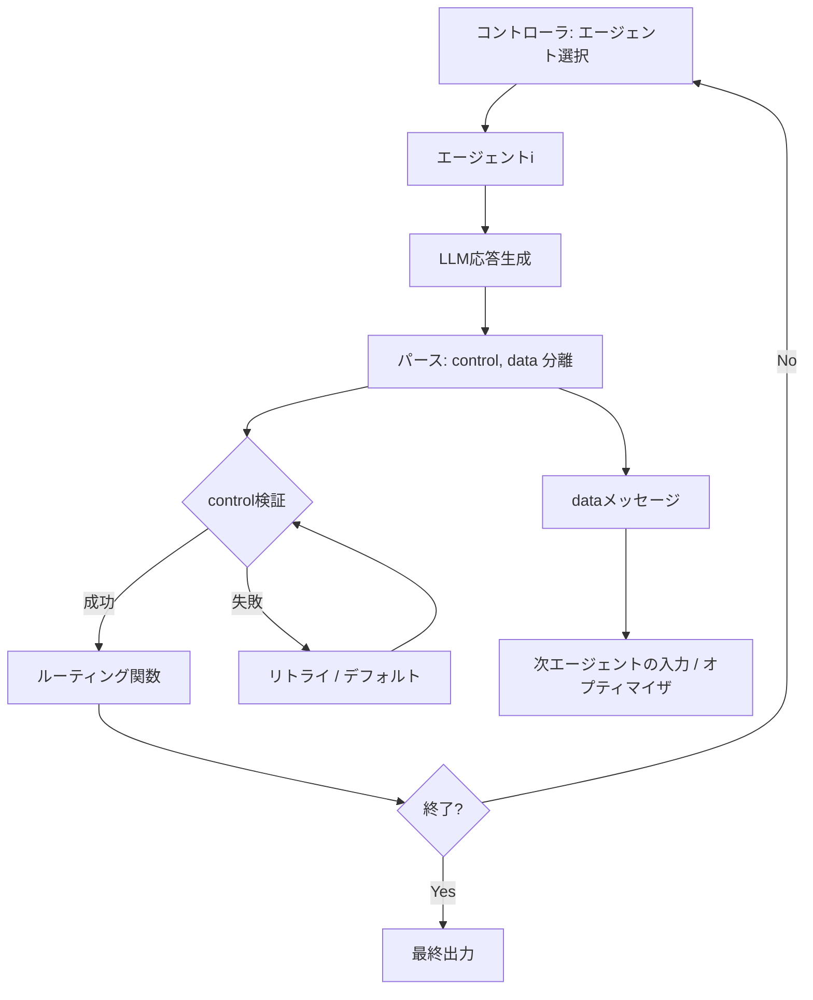

本記事は [Control-Data Flow Separation (arXiv:2609.00621)](https://arxiv.org/abs/2609.00621) の解説記事です。

## 論文概要（Abstract）

Zhangらによる本論文は、マルチエージェントLLMシステムにおけるプロンプト最適化の根本的な問題を扱っている。最適化されるプロンプトには「タスク関連コンテンツの生成（data flow）」と「実行プロトコルの制御（control flow）」という2つの役割が絡み合っており、コンテンツ改善のための編集がプロトコル部分を壊してパイプライン全体を停止させることがある。著者らはエージェント出力を型付きcontrolオブジェクトと自由テキストのdataメッセージに分離するControl-Data Flow Separationを提案し、3つの評価ドメインで100%のプロトコル有効性とタスク性能の向上を報告している。

この記事は [Zenn記事: マルチエージェント通信の状態同期設計](https://zenn.dev/0h_n0/articles/4ee4a8b681acf4) の深掘りです。Zenn記事がマルチエージェント間の状態同期とバックプレッシャー制御を扱うのに対し、本論文はプロンプト最適化時にエージェント間通信プロトコルが壊れる問題とその解決策に焦点を当てています。

## 情報源

- **arXiv ID**: 2609.00621
- **URL**: [https://arxiv.org/abs/2609.00621](https://arxiv.org/abs/2609.00621)
- **著者**: Wentao Zhang, Syed Shariyar Murtaza, Junaid Ahmad Bhatti et al.（7名）
- **発表年**: 2026
- **掲載先**: EMNLP 2026 Findings
- **分野**: cs.AI, cs.CL, cs.MA
- **ライセンス**: CC BY 4.0

## カンファレンス情報

**EMNLP（Conference on Empirical Methods in Natural Language Processing）** はACL SIGDAT主催の自然言語処理分野の主要国際会議である。EMNLP 2026はハンガリー・ブダペストで2026年10月に開催される。過去の採択率はメインカンファレンスで22-23%程度であり、本論文はFindings（質の高い論文を収録するトラック）として採択されている。

## 背景と動機（Background & Motivation）

マルチエージェントLLMシステムでは、複数のエージェントが連携してタスクを遂行する。各エージェントのプロンプトには2種類の情報が埋め込まれている。

1. **Data flow**: タスクに関連するコンテンツ生成のための指示（例: 「保険契約の条件を分析せよ」）
2. **Control flow**: 実行プロトコルの制御（例: ルーティング先の指定、出力フォーマット、終了信号）

TextGradやDSPyなどのプロンプト最適化手法でdata flowを改善しようとすると、同じプロンプト内に混在するcontrol flow部分（JSONスキーマ指示やルーティングラベルなど）が意図せず書き換えられ、パイプラインが失敗する。著者らはこの現象を「control-surface drift」と呼び、Naive TextGradではMARGベンチマークでプロトコル有効性が0%まで崩壊したと報告している（Table 1より）。

この問題は、プロトコル部分が構造化情報である一方、タスクコンテンツが非構造的な自然言語であるという表現の違いに起因する。著者らはこの観察に基づき、2つのチャネルを明示的に分離するアーキテクチャを提案している。

## 主要な貢献（Key Contributions）

- **貢献1**: エージェント出力を型付きcontrolオブジェクトと自由テキストdataメッセージに分離するControl-Data Flow Separationアーキテクチャの提案
- **貢献2**: 3条件下でparse/validation/routing違反が発生しないことを保証するProtocol-Stability Lemmaの定式化
- **貢献3**: 3ドメイン（BBH推論、MARG論文レビュー、保険査定）での評価により、全条件で100%プロトコル有効性とタスク性能向上を実験的に確認
- **貢献4**: cdsep Pythonパッケージとしてのオープンソース実装（ユニット・統合テスト付き）

## 技術的詳細（Technical Details）

### Control-Data分離アーキテクチャ

エージェント $i$ の時刻 $t$ における出力 $y_i^t$ を以下のペアに分離する。

$$
y_i^t = (c_i^t, \; m_i^t)
$$

ここで、
- $c_i^t$: 型付きcontrolオブジェクト（dataclass/Pydanticモデル）。ルーティング・終了判断に使用
- $m_i^t$: 自由テキストのdataメッセージ。他エージェントとオプティマイザが使用

コントローラはcontrolオブジェクト $c_i^t$ のみを読み取って次のエージェントまたは終了を決定し、dataメッセージ $m_i^t$ はルーティング判断に一切関与しない。



最適化の対象は以下のように定式化される。

$$
\min_{\{p_i\}} \; \mathbb{E}[\mathcal{L}(\hat{y}(x; \{p_i\}), \; y^*)]
$$

ここで、
- $p_i$: エージェント $i$ のプロンプト
- $x$: タスク入力
- $\hat{y}$: パイプラインの最終出力
- $y^*$: 正解ラベル
- $\mathcal{L}$: タスク損失関数

重要な制約として、オプティマイザはdata flow部分のプロンプトのみを編集でき、controlスキーマやparse/validation部分は「凍結されたスキャフォールディング」として編集対象外となる。

### 型付きControlオブジェクトの設計

controlオブジェクトはPythonのdataclassまたはPydanticモデルとして定義し、選択肢は`Literal`型で閉じた集合として表現する。

```python
from dataclasses import dataclass
from typing import Literal


@dataclass
class LeaderControl:
    """リーダーエージェントの制御オブジェクト

    Attributes:
        target: 次に指示を送るワーカーまたは終了
    """
    target: Literal["worker_1", "worker_2", "worker_3", "stop"]


@dataclass
class WorkerControl:
    """ワーカーエージェントの制御オブジェクト

    Attributes:
        status: タスク完了状態
    """
    status: Literal["done", "need_more_info"]
```

この設計によりcontrolオブジェクトの取りうる値が型レベルで制限される。

### Protocol-Stability Lemma

著者らは以下の3条件が満たされる場合、任意のエピソードにおいてparse/validation/routing違反が発生しないことを示すProtocol-Stability Lemmaを定式化している。

**条件C1（Typed routing）**: 各ルーティング関数 $\rho_i$ は型付きcontrolオブジェクトのみを受け取り、次のエージェント $\in \mathcal{A}$ または終了信号を返す。

$$
\rho_i: \text{ControlType}_i \to \mathcal{A} \cup \{\text{terminate}\}
$$

**条件C2（Frozen scaffolding）**: スキーマスキャフォールディング（出力フォーマット指示）がオプティマイザが編集不可能なプロンプトスロットに配置されている。

**条件C3（Bounded recovery）**: 無効なcontrolオブジェクトに対して有限回のリトライを行い、リトライ上限に達した場合は事前定義されたデフォルトアクションまたは制御された失敗を返す。

著者らはこの補題の証明をparse違反・validation違反・routing違反の3つに分けて行っている。ただし、この保証はプロトコルの実行有効性に限定されており、意味的正確性は保証しない点が明示されている。

### ルーティング関数の設計

ルーティング関数は純粋なPython関数として実装し、controlオブジェクトのフィールドのみを参照する。

```python
from cdsep import Agent, run_episode, LLMClient


def route(ctrl: LeaderControl | WorkerControl) -> Agent | None:
    """エージェントルーティング

    Args:
        ctrl: 検証済みcontrolオブジェクト

    Returns:
        次のエージェント。Noneの場合はエピソード終了
    """
    if isinstance(ctrl, LeaderControl):
        if ctrl.target == "stop":
            return None
        return agents[ctrl.target]
    if isinstance(ctrl, WorkerControl):
        return leader  # ワーカー完了後はリーダーに戻る
    return None
```

dataメッセージの内容に依存しないため、オプティマイザがdataプロンプトをどのように編集してもルーティングの正確性は保たれる。

### TextGradベースの最適化

本論文のオプティマイザはTextGradのバックワード走査を拡張し、計算グラフ上でエージェント間の依存関係を追跡してフィードバックを生成する。**Separated（本手法）** モードではdata flowプロンプトのみを編集対象とし、スキーマ指示は凍結スロットに配置されているため物理的に編集不可能である。一方、**Naive（ベースライン）** モードではプロンプト全体を編集対象とする。著者らの実験ではAgentモデルにgpt-5.4-nano（temperature 0）、Optimizerモデルにgpt-5.4-mini（temperature 1）を使用している。

### cdsepパッケージの実装

著者らは提案手法をcdsep Pythonパッケージとして公開している。主要モジュールは `schema.py`（スキャフォールディング生成・パース・バリデーション）、`agent.py`（凍結スキーマプロンプト＋最適化可能システムプロンプト・リトライ）、`episode.py`（エピソードループ・ルーティング・安定性メタデータ）、`optimizer.py`（TextGradスタイルオプティマイザ）、`llm.py`（プロバイダ非依存クライアント、OpenAI/Anthropic/Googleアダプタ内蔵）である。

```python
from cdsep import Agent, LLMClient, run_episode

llm = LLMClient(model="gpt-5.4-mini")

leader = Agent(
    name="leader",
    control_schema=LeaderControl,
    system_prompt="You are a review leader. Assign review aspects to workers.",
)
worker_1 = Agent(
    name="worker_1",
    control_schema=WorkerControl,
    system_prompt="You review the methodology section.",
)
agents = {"worker_1": worker_1, "worker_2": worker_2, "worker_3": worker_3}

result = run_episode(
    entry_agent=leader, agents=agents,
    route_fn=route, task_input="Review this ICLR submission...", llm=llm,
)
# result.stability == True (プロトコル違反なし)
```

## 実験結果（Results）

### 評価ドメイン

著者らは3つのドメインで評価を行っている。

1. **BBH（BIG-Bench Hard, 単一エージェント）**: LogicalDeduction, TrackingShuffledObjects, CausalJudgement, WordSortingの4タスク。メトリクス: accuracy
2. **MARG（マルチエージェント）**: リーダー＋3ワーカーによるICLR論文レビューコメント生成。メトリクス: alignment-based Jaccard
3. **Insurance Underwriting（2変種）**: 3エージェントチェーン（extractor → rater → aggregator）。Synthetic版（12章10バケット）とIndustry版（28章15バケット）

### メイン結果（Table 1, 3シード平均）

| 手法 | BBH Acc (Stab) | MARG Jaccard (Stab) | UW Syn Acc (Stab) | UW Ind. Acc (Stab) |
|---|---|---|---|---|
| Fixed prompts | 51.7% | 31.0% | 36.7% | 20.0% |
| Naive TextGrad | 45.0% (92.0%) | 0.0% (0.0%) | 47.8% (100%) | 18.3% (56.7%) |
| DSPy (no compile) | 66.3% (100%) | 41.8% (100%) | 26.7% (98.9%) | 11.7% (93.3%) |
| DSPy+BootstrapFS | 74.3% (100%) | 39.6% (100%) | 34.4% (100%) | 23.3% (83.3%) |
| DSPy+MIPROv2 | 71.3% (100%) | 43.2% (100%) | 32.2% (98.9%) | 18.3% (83.3%) |
| **Ours** | **78.3% (100%)** | **44.4% (100%)** | **50.0% (100%)** | **36.7% (100%)** |

Stabはプロトコル有効性を示す。Naive TextGradはMARGで有効性0%まで崩壊する一方、本手法は全ドメインで100%の有効性とタスク性能の最高値を達成していると著者らは報告している。

### アブレーション（Table 2, MARG & Synthetic UW）

| 変種 | Schema | Retry | Per-example FB | MARG J (Stab) | UW Acc (Stab) |
|---|---|---|---|---|---|
| Naive | - | - | - | 0.0% (0%) | 44.4% (97.8%) |
| Schema-only | + | - | - | 26.8% (100%) | 34.4% (98.9%) |
| Schema + retry | + | + | - | 26.9% (100%) | 37.8% (100%) |
| Ours (full) | + | + | + | 38.0% (100%) | 51.1% (100%) |

著者らによると、スキーマスキャフォールディングが安定性の主要因（MARG有効性: 0%→100%）であり、Per-example feedbackが品質面の主要因（MARG Jaccard: 26.9%→38.0%）である。

### Control-surface drift（Table 3）

| ベンチマーク | Naive TextGrad | Ours |
|---|---|---|
| Synthetic | 27.0% | 14.6% |
| BBH | 22.9% | 18.6% |
| Insurance | 22.6% | 12.2% |
| Review (MARG) | 16.6% | 4.2% |

この表は編集されたプロンプト行のうちcontrolトークンに接触した割合を示す。Naive TextGradでは16.6-27.0%がcontrol部分に触れるのに対し、本手法では4.2-18.6%に低減されている。

### Multi-LLM robustness（Table 4, MARG Jaccard / Stability）

| LLMファミリー | Fixed | Naive | Ours |
|---|---|---|---|
| OpenAI | 43.4 / 100% | 0.0 / 0% | 42.2 / 100% |
| Anthropic | 25.1 / 100% | 0.0 / 0% | 33.5 / 100% |
| Google | 33.7 / 100% | 0.0 / 0% | 40.3 / 100% |

1シード、N=12論文での評価。Naive TextGradは全ファミリーで有効性0%に崩壊する一方、本手法は100%を維持している。

## Production Deployment Guide

### AWS実装パターン（コスト最適化重視）

Control-Data Flow Separationに基づくマルチエージェントパイプラインをAWS上にデプロイする場合の構成を示す。

| 規模 | 月間リクエスト | 推奨構成 | 月額コスト | 主要サービス |
|------|--------------|---------|-----------|------------|
| **Small** | ~3,000 (100/日) | Serverless | $80-200 | Lambda + Step Functions + DynamoDB |
| **Medium** | ~30,000 (1,000/日) | Hybrid | $400-1,000 | ECS Fargate + Step Functions + DynamoDB |
| **Large** | 300,000+ (10,000/日) | Container | $2,500-6,000 | EKS + Karpenter + ElastiCache Redis |

**Small構成の詳細**（月額$80-200）:
- **Lambda**: 各エージェントを個別関数化、1GB RAM、60秒タイムアウト（$25/月）
- **Step Functions**: エージェント間ルーティング、リトライ、エラーハンドリング（$10/月）
- **DynamoDB**: controlオブジェクトとエピソードログの永続化（$10/月）
- **Bedrock**: LLM推論（Claude/Titan）（$30-120/月）
- **CloudWatch**: 安定性メトリクスの監視（$5/月）

**コスト試算の注意事項**: 上記は2026年10月時点のAWS ap-northeast-1料金に基づく概算値です。最新料金は[AWS料金計算ツール](https://calculator.aws/)で確認してください。

Step Functionsのルーティング関数はcontrolオブジェクトの`target`フィールドでChoice Stateを分岐させ、リトライはRetry設定で実現する。条件C1とC3に直接対応する。

### Terraformインフラコード

**Small構成（Serverless）: Lambda + Step Functions + DynamoDB**

```hcl
resource "aws_iam_role" "agent_lambda" {
  name = "cdsep-agent-lambda-role"
  assume_role_policy = jsonencode({
    Version = "2012-10-17"
    Statement = [{
      Action = "sts:AssumeRole", Effect = "Allow"
      Principal = { Service = "lambda.amazonaws.com" }
    }]
  })
}

resource "aws_iam_role_policy" "bedrock_invoke" {
  role = aws_iam_role.agent_lambda.id
  policy = jsonencode({
    Version = "2012-10-17"
    Statement = [{
      Effect   = "Allow"
      Action   = ["bedrock:InvokeModel"]
      Resource = "arn:aws:bedrock:ap-northeast-1::foundation-model/anthropic.claude-*"
    }]
  })
}

resource "aws_dynamodb_table" "episode_log" {
  name         = "cdsep-episode-log"
  billing_mode = "PAY_PER_REQUEST"
  hash_key     = "episode_id"
  range_key    = "step"

  attribute { name = "episode_id"; type = "S" }
  attribute { name = "step"; type = "N" }

  server_side_encryption { enabled = true }
  point_in_time_recovery { enabled = true }
}

resource "aws_lambda_function" "agent" {
  for_each      = toset(["leader", "worker_1", "worker_2", "worker_3"])
  filename      = "agent_lambda.zip"
  function_name = "cdsep-agent-${each.key}"
  role          = aws_iam_role.agent_lambda.arn
  handler       = "handler.main"
  runtime       = "python3.12"
  timeout       = 60
  memory_size   = 1024

  environment {
    variables = {
      AGENT_NAME       = each.key
      DYNAMODB_TABLE   = aws_dynamodb_table.episode_log.name
      MAX_RETRY        = "3"
      BEDROCK_MODEL_ID = "anthropic.claude-sonnet-4-20250514"
    }
  }
}

resource "aws_cloudwatch_metric_alarm" "stability_alarm" {
  alarm_name          = "cdsep-protocol-violation"
  comparison_operator = "GreaterThanThreshold"
  evaluation_periods  = 1
  metric_name         = "ProtocolViolationCount"
  namespace           = "CDSep/Pipeline"
  period              = 300
  statistic           = "Sum"
  threshold           = 0
  alarm_actions       = [aws_sns_topic.alerts.arn]
}
```

**Large構成（Container）**: EKSクラスタにKarpenter Provisioner（Spot優先、weight=3; On-Demand weight=1）を設定し、各エージェントをコンテナとして独立デプロイする。Redis Cluster（cache.r7g.xlarge x 3ノード）でエピソード状態を共有し、AWS Budgetsで月額$6,000上限アラートを設定する。

### 運用・監視設定

**CloudWatch監視**: Logs Insightsでプロトコル有効性の時系列（`bin(1h)`でstability=falseイベントをカウント）とエージェント別リトライ率を追跡する。アラームは`ProtocolViolationCount > 0`（即時通知）と`AgentLatencyP99 > 30s`（3期間連続）で設定する。

**X-Rayトレーシング**: Step Functions全体のトレースを有効化し、各Lambda呼び出しにcontrolオブジェクトの型情報とリトライ回数をアノテーションとして付加する。

**Cost Explorer**: Bedrock使用量を日次で集計し、$100/日超過でSNS通知する。

### コスト最適化チェックリスト

**アーキテクチャ選択**: トラフィック量に応じてServerless（~100 req/日, $80-200/月）、Hybrid（~1,000 req/日, $400-1,000/月）、Container（10,000+ req/日, $2,500-6,000/月）を選択。

**リソース最適化**: EKS Spot Instances活用（最大90%削減）、Reserved Instances（1年コミットで最大72%削減）、Lambda Power Tuning、ECS/EKS夜間スケールダウン、開発環境はLambdaに統一。

**LLMコスト削減**: Bedrock Batch API使用（50%削減）、Prompt Caching有効化（凍結スキャフォールディングのキャッシュで30-90%削減）、タスク複雑度に応じたモデル選択（簡易タスクはHaiku/Nano、複雑タスクはSonnet/Mini）、controlスキーマを簡潔に保ちトークン数を最小化。

**監視・アラート**: AWS Budgets（80%警告）、CloudWatchプロトコル違反アラーム、Cost Anomaly Detection、日次コストレポート。

**リソース管理**: 未使用Lambda関数の定期削除、`Project: cdsep`タグ戦略、DynamoDB TTLポリシー（30日自動削除）、開発環境夜間停止。

## 実運用への応用（Practical Applications）

### Zenn記事との接続

Zenn記事で扱っている「契約テスト」パターンは、本論文のProtocol-Stability Lemmaと密接に関連している。Zenn記事ではエージェント間メッセージのスキーマをPydanticで定義し、受信側で検証する設計を紹介しているが、本論文はこれをプロンプト最適化の文脈に拡張し、型付きcontrolオブジェクトによって「最適化が通信プロトコルを壊さない」ことを保証する仕組みを提供している。

また、Zenn記事のバックプレッシャー制御は、本論文の条件C3（有界リトライ＋デフォルトアクション）と対応する。parse失敗時のリトライ上限はバックプレッシャーの一形態であり、上流エージェントの出力品質が低下した際にパイプライン全体を保護する。

### マルチエージェントフレームワークへの適用

LangGraphやAutogenなどの既存フレームワークへの適用では、各ノードの出力型をcontrol/dataに分離し、グラフのエッジ条件をcontrolオブジェクトのみで判定する。LangGraphの場合、Conditional Edgeの判定関数でState内のcontrolフィールドのみを参照させることで同等の保証が得られる。

## 関連研究（Related Work）

- **DSPy（Khattab et al.）**: プロンプト最適化フレームワーク。BootstrapFewShotやMIPROv2はプロトコル安定性を直接保証する機構を持たない。Table 1よりDSPy+MIPROv2はBBH 71.3%に対し本手法は78.3%
- **TextGrad（Yuksekgonul et al.）**: テキストベース自動微分によるプロンプト最適化。本論文のオプティマイザのベースだが、分離なしではMARG有効性が0%に崩壊する
- **MAST（arXiv:2503.13657）**: マルチエージェント安定性を扱う別のアプローチ。本論文は出力構造の分離という異なる角度から安定性を保証

## 制約と限界

著者らは以下の制約を明示している。

- **安定性と正確性の区別**: プロトコル有効性は意味的正確性を保証しない。controlオブジェクトが有効でもdataメッセージが不正確である可能性がある
- **LLM judgeのバイアス**: MARGのスコアリングはLLM-as-judge方式であり、評価モデル固有のバイアスが影響しうる（評価モデルは全条件で同一）
- **固定スキーマの制約**: エージェントの役割とスキーマは事前定義。動的エージェント生成やランタイムスキーマ進化は未評価
- **倫理的考慮**: 論文レビューや保険査定など感受性の高いドメインでの最終判断の自動化には慎重さが必要と著者らは注意喚起

## まとめと今後の展望

本論文は、マルチエージェントLLMシステムにおけるプロンプト最適化のcontrol-data flow分離アーキテクチャを提案し、3ドメインで100%のプロトコル有効性と既存手法を上回るタスク性能を報告している。型付きcontrolオブジェクトと凍結スキャフォールディングという比較的シンプルな設計原則により、最適化の自由度を保ちつつプロトコルの健全性を保証するアプローチは、プロダクション環境でのマルチエージェントシステム運用に直接応用可能である。

今後の研究方向として、動的スキーマ進化への対応やスケーラビリティ検証が挙げられる。

## 参考文献

- **arXiv**: [https://arxiv.org/abs/2609.00621](https://arxiv.org/abs/2609.00621)
- **EMNLP 2026**: [https://2026.emnlp.org/](https://2026.emnlp.org/)
- **Related Zenn article**: [https://zenn.dev/0h_n0/articles/4ee4a8b681acf4](https://zenn.dev/0h_n0/articles/4ee4a8b681acf4)

---

:::message
この記事はAI（Claude Code）により自動生成されました。内容の正確性については論文原文で検証していますが、最新情報は公式リポジトリもご確認ください。
:::
