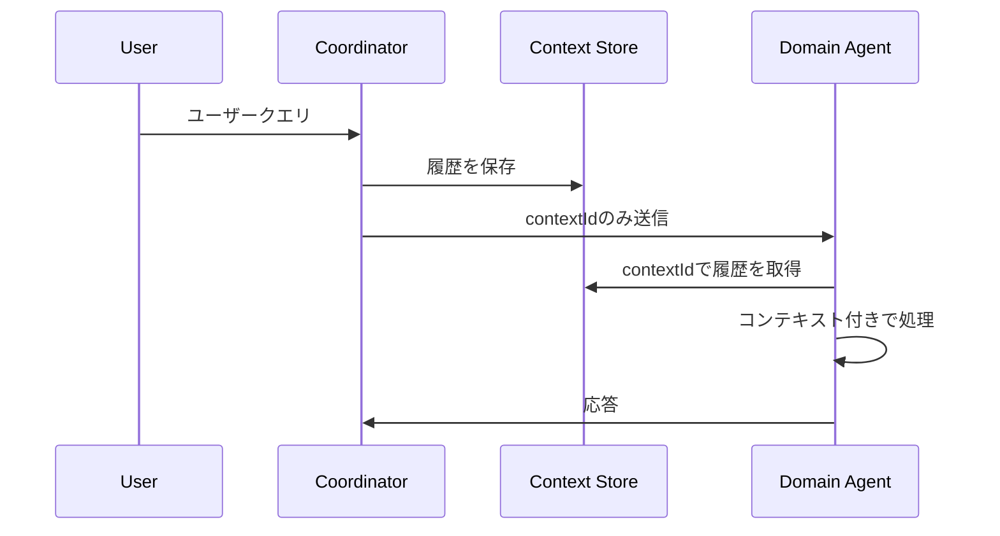
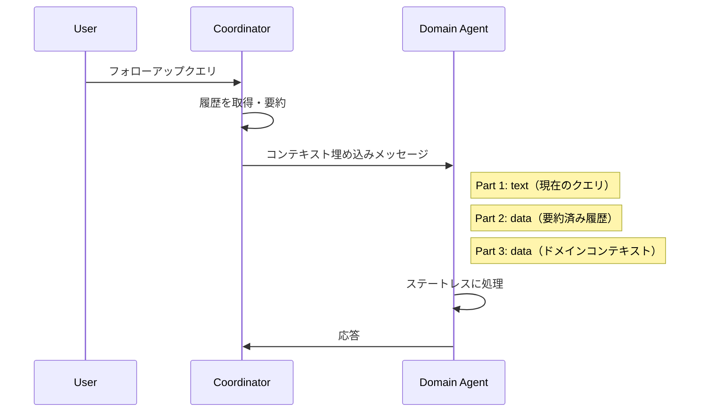
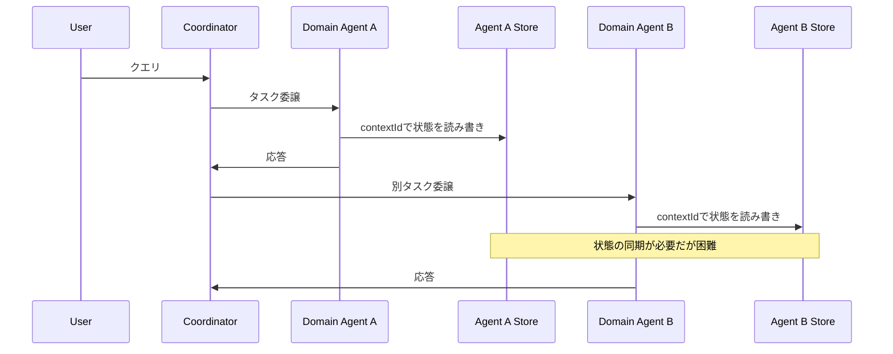
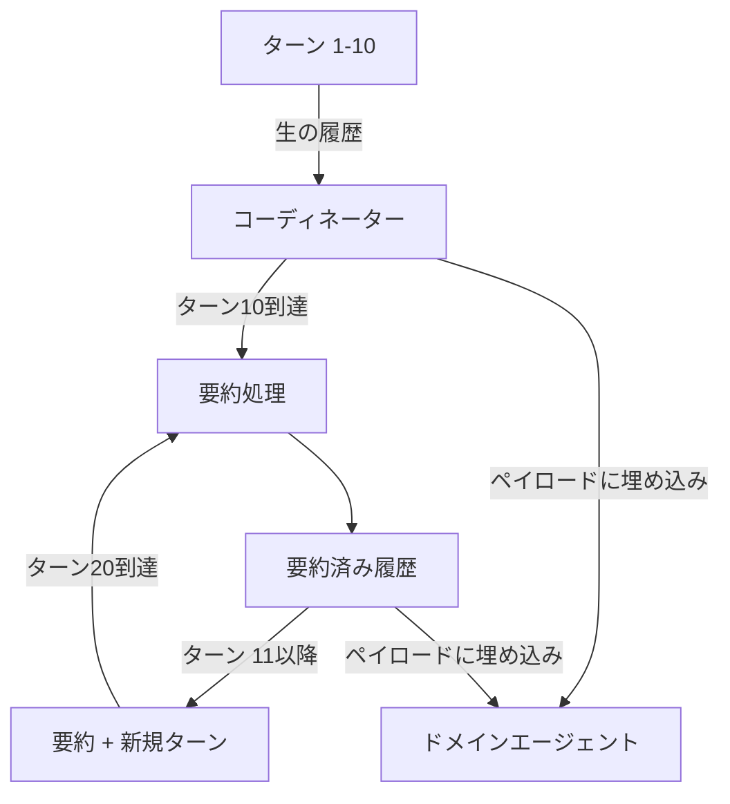

本記事は [Passing Context Between Agents in Multi-Agent A2A Systems (Microsoft ISE Blog)](https://devblogs.microsoft.com/ise/a2a-context-passing-multi-agent-systems/) の解説記事です。

## ブログ概要（Summary）

Microsoft ISE（Industry Solutions Engineering）チームのOlha Konstantinova氏とScott Grosenick氏が2026年6月に公開したこのブログ記事では、A2Aプロトコルを用いたマルチエージェントシステムにおいて、独立デプロイされたエージェント間でどのようにコンテキストを伝搬するかという設計課題を扱っている。共有ストレージ方式、埋め込みコンテキスト方式、エージェント個別ストア方式の3パターンを比較し、Embedded Context（埋め込みコンテキスト）パターンを採用した設計判断の根拠が詳述されている。

この記事は [Zenn記事: マルチエージェント通信の状態同期設計：コンテキスト伝搬からバックプレッシャー制御まで](https://zenn.dev/0h_n0/articles/4ee4a8b681acf4) の深掘りです。

## 情報源

- **種別**: 企業テックブログ（Microsoft ISE = Industry Solutions Engineering）
- **URL**: [https://devblogs.microsoft.com/ise/a2a-context-passing-multi-agent-systems/](https://devblogs.microsoft.com/ise/a2a-context-passing-multi-agent-systems/)
- **著者**: Olha Konstantinova, Scott Grosenick（Microsoft ISE Team）
- **発表日**: 2026年6月26日

## 技術的背景（Technical Background）

### マルチエージェントシステムにおけるコンテキスト伝搬の課題

マルチエージェントシステムでは、各エージェントがドメイン固有のタスクを担当するマイクロサービスとして独立デプロイされる。ユーザーがフォローアップの質問をした場合、受信側のエージェントは過去の会話コンテキストを必要とするが、コーディネーターのメモリに直接アクセスできない。Microsoft ISEチームは、この問題を以下の4つの設計要件として整理している。

1. **コンテキストの連続性**: 複数ターン・複数エージェントにまたがる会話で、各エージェントが一貫した応答を返せること
2. **バージョン独立性**: コーディネーターとドメインエージェントが異なるスケジュールでデプロイされても、コンテキスト形式が破綻しないこと
3. **共有インフラなし**: ドメインエージェントがコーディネーターのデータベースにアクセスしない真のマイクロサービスであること
4. **セキュリティ分離**: コーディネーターが各ドメインエージェントに渡すコンテキストを制御できること

### A2Aプロトコルの基本概念

A2Aプロトコルは、HTTP(S)上のJSON-RPC 2.0をトランスポートとして使用するエージェント間通信プロトコルである。ブログで扱われている主要な概念は以下の通りである。

**contextId** はサーバー（リモートエージェント）が生成する識別子で、関連するTaskオブジェクト群を1つの会話としてグルーピングする。初回インタラクションでリモートエージェントがcontextIdを生成して返却し、クライアント（コーディネーター）は以降のターンで同じcontextIdを送信する。1つのcontextIdに対して複数のtaskIdがマッピングされる（ターンごとに1 taskId）。

**Message** は1ターンの通信単位で、`role`（"user"または"agent"）、一意の`messageId`、1つ以上のPartオブジェクトを持つ。

**Part** はメッセージ内のコンテンツコンテナで、以下の4種類のうち1つを保持する。
- `text`: プレーンテキスト
- `data`: 構造化JSON（オブジェクトまたは配列）
- `raw`: インラインバイナリデータ
- `url`: 外部ファイルへのURI参照

各Partには`metadata`（key-valueマップ）を付与でき、型識別やスキーマバージョニングに使用される。

## 実装アーキテクチャ（Architecture）

Microsoft ISEチームは、コンテキスト伝搬の設計として3つのパターンを評価し、そのうちEmbedded Contextパターンを採用している。以下では各パターンの構造と評価を解説する。

### パターン1: Shared Storage with contextId Reference

コーディネーターはcontextIdのみを送信し、ドメインエージェントが共有ストアから過去の履歴を読み取る方式である。



**長所**: ペイロードが最小、Single source of truth、履歴サイズの制限なし

**短所**: Microsoft ISEチームは、この方式が「no-shared-infrastructure原則」に違反する点を指摘している。各ドメインエージェントが共有ストアへの接続とクレデンシャルを必要とし、運用の複雑さとセキュリティ表面が拡大する。

### パターン2: Embedded Context（採用パターン）

コーディネーターが履歴を取得・要約し、メッセージペイロードに埋め込んで送信する方式である。ドメインエージェントはストレージアクセスを一切必要としない。



**長所**: ストレージ依存なし、ステートレスなドメインエージェント、コーディネーターがエージェントごとにコンテキストを調整可能、モックペイロードによるテストが容易

**短所**: ペイロードサイズが大きくなる、長い会話では要約による情報損失が発生する

#### メッセージ構造の例

ブログで示されているフォローアップターンのメッセージ構造は以下のようになっている。

```json
{
  "messageId": "msg-002",
  "contextId": "ctx-abc-123",
  "role": "user",
  "metadata": { "userId": "user-456" },
  "parts": [
    {
      "text": "現在のユーザークエリ"
    },
    {
      "data": [
        { "role": "user", "content": "要約済みの過去の会話..." },
        { "role": "agent", "content": "要約済みの過去の応答..." }
      ],
      "metadata": {
        "type": "ConversationHistory",
        "schemaVersion": "1.0"
      }
    },
    {
      "data": {
        "userProfile": { "location": "Tokyo", "language": "ja" },
        "priorSearchResults": { "query": "...", "count": 5 },
        "sessionContext": { "source": "web", "region": "ap-northeast-1" }
      },
      "metadata": {
        "type": "UserContext",
        "schemaVersion": "1.0"
      }
    }
  ]
}
```

各Partが独立した`metadata.type`と`schemaVersion`を持つことで、型の識別とバージョン管理をPart単位で行える設計になっている。

### パターン3: Per-Agent Context Store（棄却）

各ドメインエージェントがcontextIdをキーに独自の状態ストアを保持する方式である。



**長所**: 完全なエージェント自律性、自己完結型のエージェント

**短所**: Microsoft ISEチームは、各エージェントが独自ストレージを必要とし、デプロイ時の状態マイグレーション、エージェント間の状態同期ロジックが運用オーバーヘッドとして積み上がる点を指摘している。この方式は、独立デプロイされるマイクロサービス群において自律性の利点を運用コストが上回るとして、早期に棄却されている。

### 決定マトリクス

| 評価基準 | Shared Storage | Embedded Context | Per-Agent State |
|---|---|---|---|
| ストレージ依存 | 共有ストアへのアクセス必要 | なし（ステートレス） | エージェントごとに必要 |
| ペイロードサイズ | 最小 | 要約により管理可能 | 最小 |
| コンテキスト忠実度 | 完全な履歴 | 要約による損失あり | エージェント単位の完全履歴 |
| ネットワークレイテンシ | ストレージへの追加呼び出し | 追加呼び出しなし | エージェントごとのストレージ呼び出し |
| セキュリティ分離 | エージェント間の情報露出リスク | コーディネーター制御 | エージェントレベルの分離 |
| テスト容易性 | ストレージモック必要 | ペイロードモックで簡単 | エージェントごとの状態セットアップ |
| バージョン独立性 | ストレージ形式の結合 | Part単位のスキーマバージョニング | エージェントごとの形式管理 |
| 状態一貫性 | Single source of truth | コーディネーター所有 | 乖離リスク |
| 運用オーバーヘッド | 共有インフラ管理 | コーディネーターがコンテキスト管理 | エージェントごとのインフラ |

### Embedded Context採用の根拠

Microsoft ISEチームは、Embedded Contextパターンの採用理由として以下の4点を挙げている。

1. **Single source of truth**: 会話状態がコーディネーターにのみ存在し、状態ドリフトを防止する
2. **Context precision**: エージェントごとにコンテキストを調整・書き換えでき、不要な情報や機密情報を除外できる
3. **Simpler debugging**: 入力メッセージが決まれば振る舞いが決定的になり、任意のインスタンスを状態マイグレーションなしに交換・ロールバックできる
4. **Evolutionary flexibility**: ステートレスからステートフルへの移行は追加的（エージェント側で独自ストアを追加し埋め込みコンテキストを無視するだけ）だが、逆方向はオーケストレーターの再設計を要する。ステートレスから始めることがリスクの低いデフォルトである

### 適用ガイダンス

ブログでは、各パターンの適用場面も整理されている。

- **Shared Storage**: 信頼されたイントラサービス間で既にストレージアクセスがある場合、要約では対応できない非常に長い会話、または履歴に対する横断クエリが必要な場合
- **Embedded Context**: 独立デプロイされたマイクロサービス、組織境界をまたぐ通信、細粒度のセキュリティ分離、ステートレスかつポータブルなエージェントが求められる場合
- **Per-Agent State**: メモリに対する完全な自律性が必要なエージェント、深いユーザーコンテキストを持つ長時間稼働エージェント、エージェント間の状態一貫性が不要な場合

## Production Deployment Guide

Embedded Contextパターンをコーディネーター + ドメインエージェント構成でAWS上に展開する際の実装ガイドを示す。以下のコスト試算は2026年10月時点のAWS ap-northeast-1（東京）リージョン料金に基づく概算値であり、実際のコストはトラフィックパターン、リージョン、バースト使用量により変動する。最新料金はAWS料金計算ツールで確認を推奨する。

### AWS実装パターン（コスト最適化重視）

| 構成 | トラフィック | サービス構成 | 月額概算 |
|---|---|---|---|
| Small | ~100 req/日 | Lambda（コーディネーター + 各エージェント） + DynamoDB + API Gateway | $50-150 |
| Medium | ~1,000 req/日 | ECS Fargate（コーディネーター） + Lambda（エージェント） + DynamoDB + ALB | $300-800 |
| Large | 10,000+ req/日 | EKS + Spot Instances + ElastiCache + ALB + DynamoDB | $2,000-5,000 |

**Small構成（~100 req/日）**: Lambda関数としてコーディネーターと各ドメインエージェントをデプロイする。Embedded Contextパターンではドメインエージェントがステートレスなため、Lambda のコールドスタートによる状態消失が問題にならない。コーディネーターの会話履歴はDynamoDBに保存し、10ターン要約後のコンパクトな履歴をペイロードに埋め込む。

**Medium構成（~1,000 req/日）**: コーディネーターをECS Fargateで常時起動し、要約処理のレイテンシを安定させる。ドメインエージェントはLambdaのままで、リクエスト数に応じた自動スケーリングの恩恵を受ける。

**Large構成（10,000+ req/日）**: EKSクラスタでコーディネーターとドメインエージェントを全てコンテナ化する。Karpenter + Spot Instancesで自動スケーリングとコスト最適化を両立する。ElastiCacheで要約済み履歴をキャッシュし、DynamoDBへの読み取り回数を削減する。

**コスト削減テクニック**:
- Spot Instances活用（EKS Large構成）で最大90%のコンピュート費削減
- Reserved Instances（1年コミット）で最大72%削減
- Bedrock Batch API使用（要約処理のバッチ化）で50%削減
- Lambda Provisioned Concurrencyを必要最小限に設定し、過剰プロビジョニングを回避

### Terraformインフラコード

#### Small構成（Serverless）

```hcl
# --- VPC基盤（NAT Gateway不使用でコスト削減） ---
resource "aws_vpc" "a2a_vpc" {
  cidr_block           = "10.0.0.0/16"
  enable_dns_hostnames = true
  tags = { Name = "a2a-embedded-context-vpc" }
}

resource "aws_subnet" "private" {
  count             = 2
  vpc_id            = aws_vpc.a2a_vpc.id
  cidr_block        = cidrsubnet(aws_vpc.a2a_vpc.cidr_block, 8, count.index)
  availability_zone = data.aws_availability_zones.available.names[count.index]
  tags = { Name = "a2a-private-${count.index}" }
}

# --- IAMロール（最小権限） ---
resource "aws_iam_role" "coordinator_lambda" {
  name               = "a2a-coordinator-lambda"
  assume_role_policy = data.aws_iam_policy_document.lambda_assume.json
}

resource "aws_iam_role_policy" "coordinator_policy" {
  role   = aws_iam_role.coordinator_lambda.id
  policy = jsonencode({
    Version = "2012-10-17"
    Statement = [
      {
        Effect   = "Allow"
        Action   = ["dynamodb:GetItem", "dynamodb:PutItem", "dynamodb:Query"]
        Resource = aws_dynamodb_table.conversation_history.arn
      },
      {
        Effect   = "Allow"
        Action   = ["lambda:InvokeFunction"]
        Resource = "arn:aws:lambda:*:*:function:a2a-domain-agent-*"
      }
    ]
  })
}

# --- DynamoDB（会話履歴、On-Demand） ---
resource "aws_dynamodb_table" "conversation_history" {
  name         = "a2a-conversation-history"
  billing_mode = "PAY_PER_REQUEST"
  hash_key     = "contextId"
  range_key    = "turnIndex"

  attribute {
    name = "contextId"
    type = "S"
  }
  attribute {
    name = "turnIndex"
    type = "N"
  }

  ttl {
    attribute_name = "expiresAt"
    enabled        = true
  }

  server_side_encryption { enabled = true }
  tags = { Service = "a2a-context" }
}

# --- Lambda（コーディネーター） ---
resource "aws_lambda_function" "coordinator" {
  function_name = "a2a-coordinator"
  runtime       = "python3.12"
  handler       = "coordinator.handler"
  role          = aws_iam_role.coordinator_lambda.arn
  timeout       = 60
  memory_size   = 512

  environment {
    variables = {
      HISTORY_TABLE    = aws_dynamodb_table.conversation_history.name
      SUMMARY_INTERVAL = "10"  # 10ターンごとに要約
    }
  }

  tracing_config { mode = "Active" }
  tags = { CostCenter = "a2a-platform" }
}

# --- CloudWatchアラーム（コスト監視） ---
resource "aws_cloudwatch_metric_alarm" "lambda_cost_alarm" {
  alarm_name          = "a2a-coordinator-invocation-spike"
  comparison_operator = "GreaterThanThreshold"
  evaluation_periods  = 1
  metric_name         = "Invocations"
  namespace           = "AWS/Lambda"
  period              = 3600
  statistic           = "Sum"
  threshold           = 1000
  alarm_actions       = [aws_sns_topic.alerts.arn]

  dimensions = {
    FunctionName = aws_lambda_function.coordinator.function_name
  }
}
```

#### Large構成（Container）

```hcl
# --- EKSクラスタ ---
module "eks" {
  source          = "terraform-aws-modules/eks/aws"
  version         = "~> 20.0"
  cluster_name    = "a2a-embedded-context"
  cluster_version = "1.31"
  vpc_id          = aws_vpc.a2a_vpc.id
  subnet_ids      = aws_subnet.private[*].id

  cluster_endpoint_public_access = false
  tags = { CostCenter = "a2a-platform" }
}

# --- Karpenter（Spot優先、自動スケーリング） ---
resource "kubectl_manifest" "karpenter_nodepool" {
  yaml_body = yamlencode({
    apiVersion = "karpenter.sh/v1"
    kind       = "NodePool"
    metadata   = { name = "a2a-agents" }
    spec = {
      template = {
        spec = {
          requirements = [
            { key = "karpenter.sh/capacity-type", operator = "In", values = ["spot", "on-demand"] },
            { key = "node.kubernetes.io/instance-type", operator = "In",
              values = ["m7i.large", "m7i.xlarge", "m6i.large", "m6i.xlarge"] }
          ]
        }
      }
      limits   = { cpu = "100", memory = "400Gi" }
      disruption = { consolidationPolicy = "WhenEmptyOrUnderutilized" }
    }
  })
}

# --- Secrets Manager（API設定） ---
resource "aws_secretsmanager_secret" "agent_config" {
  name       = "a2a/agent-config"
  kms_key_id = aws_kms_key.a2a.arn
}

# --- AWS Budgets（予算アラート） ---
resource "aws_budgets_budget" "a2a_monthly" {
  name         = "a2a-monthly-budget"
  budget_type  = "COST"
  limit_amount = "5000"
  limit_unit   = "USD"
  time_unit    = "MONTHLY"

  notification {
    comparison_operator       = "GREATER_THAN"
    threshold                 = 80
    threshold_type            = "PERCENTAGE"
    notification_type         = "ACTUAL"
    subscriber_email_addresses = ["ops-team@example.com"]
  }
}
```

### 運用・監視設定

**CloudWatch Logs Insightsクエリ（コスト異常検知）**:

```
fields @timestamp, @message
| filter @message like /embedded_context/
| stats count() as requests,
        sum(payload_size_bytes) as total_payload_bytes,
        avg(payload_size_bytes) as avg_payload_bytes,
        percentile(latency_ms, 95) as p95_latency
  by bin(1h)
| sort @timestamp desc
```

**CloudWatchアラーム設定（Python）**:

```python
import boto3

cloudwatch = boto3.client("cloudwatch", region_name="ap-northeast-1")

def create_payload_size_alarm() -> None:
    """Embedded Contextペイロードサイズの異常検知アラームを作成."""
    cloudwatch.put_metric_alarm(
        AlarmName="a2a-payload-size-spike",
        MetricName="EmbeddedContextPayloadBytes",
        Namespace="A2A/Coordinator",
        Statistic="Average",
        Period=300,
        EvaluationPeriods=3,
        Threshold=50000,  # 50KB超でアラート
        ComparisonOperator="GreaterThanThreshold",
        AlarmActions=["arn:aws:sns:ap-northeast-1:123456789012:a2a-alerts"],
    )
```

**X-Rayトレーシング設定（Python）**:

```python
from aws_xray_sdk.core import xray_recorder, patch_all

xray_recorder.configure(service="a2a-coordinator")
patch_all()  # boto3自動計装


def trace_context_embedding(context_id: str, agent_id: str, payload_size: int) -> None:
    """コンテキスト埋め込み処理のトレースを記録."""
    subsegment = xray_recorder.begin_subsegment("embed_context")
    subsegment.put_annotation("context_id", context_id)
    subsegment.put_annotation("target_agent", agent_id)
    subsegment.put_metadata("payload_size_bytes", payload_size)
    subsegment.put_metadata("summarized", payload_size < 30000)
    xray_recorder.end_subsegment()
```

**Cost Explorer日次レポート（Python）**:

```python
import boto3
from datetime import date, timedelta


def get_daily_a2a_cost() -> dict[str, float]:
    """A2A関連サービスの日次コストを取得."""
    ce = boto3.client("ce", region_name="us-east-1")
    today = date.today()
    yesterday = today - timedelta(days=1)

    response = ce.get_cost_and_usage(
        TimePeriod={"Start": str(yesterday), "End": str(today)},
        Granularity="DAILY",
        Metrics=["UnblendedCost"],
        Filter={
            "Tags": {
                "Key": "CostCenter",
                "Values": ["a2a-platform"],
            }
        },
        GroupBy=[{"Type": "DIMENSION", "Key": "SERVICE"}],
    )

    costs: dict[str, float] = {}
    for group in response["ResultsByTime"][0]["Groups"]:
        service = group["Keys"][0]
        amount = float(group["Metrics"]["UnblendedCost"]["Amount"])
        costs[service] = amount
    return costs
```

### コスト最適化チェックリスト

**アーキテクチャ選択**:
- [ ] トラフィック量に応じた構成を選択（Small: Serverless / Medium: Hybrid / Large: Container）
- [ ] Embedded Contextパターンにより共有ストレージコストを排除
- [ ] ドメインエージェントのステートレス性を活かしたスケーリング設計

**リソース最適化**:
- [ ] EC2/EKS: Spot Instances優先（最大90%削減）
- [ ] Reserved Instances: 1年コミットで最大72%削減
- [ ] Savings Plans: コンピュート使用量に応じた検討
- [ ] Lambda: メモリサイズ最適化（Power Tuning実施）
- [ ] ECS/EKS: アイドル時のスケールダウン設定

**LLMコスト削減**:
- [ ] 要約処理のバッチ化（Bedrock Batch API）
- [ ] Prompt Caching有効化（30-90%削減）
- [ ] 要約間隔（ターン数）の最適化
- [ ] トークン数制限の設定

**監視・アラート**:
- [ ] AWS Budgets設定（月次予算アラート）
- [ ] CloudWatchアラーム（ペイロードサイズ、レイテンシ）
- [ ] Cost Anomaly Detection有効化
- [ ] 日次コストレポート自動送信

**リソース管理**:
- [ ] 未使用Lambda関数の削除
- [ ] CostCenterタグの全リソース付与
- [ ] DynamoDB TTLによる古い会話履歴の自動削除
- [ ] 開発環境の夜間停止スケジュール設定
- [ ] CloudWatch Logsの保持期間設定（90日推奨）

## パフォーマンス最適化（Performance）

### 10ターン要約戦略

Embedded Contextパターンの最大の課題はペイロードサイズの増大である。Microsoft ISEチームは、10ターンごとにコーディネーターが会話履歴を要約してから埋め込む戦略を採用している。

この戦略のトレードオフについて、Microsoft ISEチームは以下のように述べている。要約により詳細が失われる、あるいは不正確な要約が生成されるリスクがある一方で、無制限の履歴にも関連性と一貫性の問題がある。10ターンという閾値はチューニング可能なトレードオフである。



### セキュリティ境界としての要約

要約はペイロードサイズの制御だけでなく、コンテンツレベルのセキュリティ境界としても機能する。Microsoft ISEチームは、ストレージレベルのアクセス制御では達成が困難な、情報のフィルタリングや再構成を要約プロセスで実現できる点を指摘している。コーディネーターが各ドメインエージェントに渡す要約の内容を個別に調整することで、エージェントが不必要な情報や機密情報に触れることを防げる。

## 運用での学び（Production Lessons）

### Part-level Metadataによる型安全な逆シリアライゼーション

ブログで示されている設計の特徴的な点は、各Partに独立した`metadata.type`と`schemaVersion`を付与する方式である。受信側エージェントは`metadata.type`を読み取り、ファクトリパターンで強く型付けされた逆シリアライゼーションを実行できる。

```python
from dataclasses import dataclass


@dataclass(frozen=True)
class ConversationHistory:
    """要約済み会話履歴."""
    turns: list[dict[str, str]]
    schema_version: str = "1.0"


@dataclass(frozen=True)
class UserContext:
    """ユーザードメインコンテキスト."""
    user_profile: dict[str, str]
    prior_search_results: dict[str, object]
    session_context: dict[str, str]
    schema_version: str = "1.0"


PART_TYPE_REGISTRY: dict[str, type] = {
    "ConversationHistory": ConversationHistory,
    "UserContext": UserContext,
}


def deserialize_parts(parts: list[dict]) -> list[object]:
    """Part-level metadataに基づく型安全な逆シリアライゼーション.

    Args:
        parts: A2Aメッセージのpartsリスト

    Returns:
        型付けされたオブジェクトのリスト
    """
    result: list[object] = []
    for part in parts:
        metadata = part.get("metadata", {})
        part_type = metadata.get("type")
        if part_type and part_type in PART_TYPE_REGISTRY:
            cls = PART_TYPE_REGISTRY[part_type]
            data = part.get("data", {})
            result.append(cls(**data))
        elif "text" in part:
            result.append(part["text"])
    return result
```

### スキーマバージョニング戦略

Microsoft ISEチームは、セマンティックバージョニングをPart単位で適用することを推奨している。

- **Minor/Patchインクリメント**: 後方互換性あり。受信側は既存のデシリアライゼーションロジックで処理可能
- **Majorインクリメント**: 破壊的変更。受信側（全Consumer）の再テストが必須

この設計により、コーディネーターが`ConversationHistory`をv2.0に更新しても、ドメインエージェントがv1.0を期待している場合に、Part単位でバージョン互換性を判定できる。コーディネーターとドメインエージェントが異なるデプロイスケジュールで更新される環境において、この独立したバージョニングは運用上の柔軟性を提供する。

## 学術研究との関連（Academic Connection）

### Context Drift論文との接続

Rodrigues (2026) の "Hallucination as Context Drift: Synchronization Protocols for Multi-Agent LLM Systems"（arXiv:2606.21666）は、マルチエージェントLLMシステムにおけるハルシネーションの一部を、エージェント間の知識状態の乖離（Context Drift）として再定義している。

この論文はContext Divergence Score（CDS）というスカラーメトリクスを導入し、エージェントペア間のコンテキスト埋め込みのコサイン距離からコンテキストの乖離度を計測する。さらに、Shared State Verification Protocol（SSVP）として、システムレベルのCDSが閾値（$\tau = 0.25$）を超えた場合にのみ、圧縮された状態要約を交換するプロトコルを提案している。

論文の実験（Claude Haikuを使用、旅行計画タスク $n=30$）では、ナイーブな全ブロードキャスト同期がベースライン（同期なし、HR=0.492）に対してハルシネーション率を34%増加させる（HR=0.658、$p=0.0022$、$d=1.18$）一方、SSVPはベースラインに対して5.9%の減少（HR=0.463、$d=0.30$）を示し、全ブロードキャストに対して58%少ないAPI呼び出しで実現したと報告されている。

この結果は、Microsoft ISEチームのEmbedded Contextパターンにおける設計判断を学術的に裏付けるものとして興味深い。ISEチームがコーディネーター制御による選択的なコンテキスト伝搬を選択した判断は、Rodrigues論文が指摘する「無差別な情報共有がコンテキスト汚染を通じてシステム障害を増加させる」という知見と整合する。ただし、ISEブログはプロダクション環境での設計パターンの記述であり、論文のような統制実験は行われていない点に留意が必要である。

## まとめと実践への示唆

Microsoft ISEチームのブログは、A2Aプロトコルにおけるコンテキスト伝搬の設計判断を、3パターンの比較と明確な評価基準で整理した実践的な記事である。Embedded Contextパターンの採用は、ステートレスなドメインエージェント、コーディネーター制御のコンテキスト、デプロイ独立性という利点に基づいている。

実務への示唆として、ステートレスから始めて必要に応じてステートフルに移行する「additive approach」は、マイクロサービスアーキテクチャの一般原則とも合致する。10ターン要約とPart単位のスキーマバージョニングは、ペイロードサイズ制御とバージョン独立性を両立する具体的な手法として参考になる。

## 参考文献

- **Blog URL**: [Passing Context Between Agents in Multi-Agent A2A Systems - Microsoft ISE Blog](https://devblogs.microsoft.com/ise/a2a-context-passing-multi-agent-systems/)
- **A2A Protocol Documentation**: [https://a2a-protocol.org/latest/](https://a2a-protocol.org/latest/)
- **A2A Protocol Specification**: [https://a2a-protocol.org/latest/specification/](https://a2a-protocol.org/latest/specification/)
- **A2A Key Concepts**: [https://a2a-protocol.org/latest/topics/key-concepts/](https://a2a-protocol.org/latest/topics/key-concepts/)
- **Context Drift論文**: Rodrigues, C. (2026). Hallucination as Context Drift: Synchronization Protocols for Multi-Agent LLM Systems. [arXiv:2606.21666](https://arxiv.org/abs/2606.21666)
- **Related Zenn article**: [マルチエージェント通信の状態同期設計：コンテキスト伝搬からバックプレッシャー制御まで](https://zenn.dev/0h_n0/articles/4ee4a8b681acf4)
