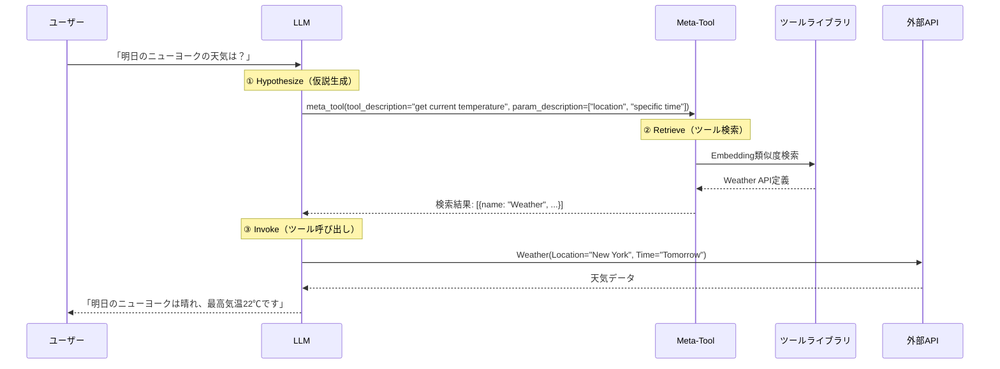

本記事は [Meta-Tool: Unleash Open-World Function Calling Capabilities of General-Purpose Large Language Models](https://aclanthology.org/2025.acl-long.1481)（ACL 2025）の解説記事です。

## 論文概要（Abstract）

LLMに外部ツールを統合する「Function Calling」は、LLMの実用性を飛躍的に高める技術である。しかし従来のFunction Callingでは、利用可能なツールがシステムプロンプト内に事前定義された固定セットに限られ、多様な実世界のタスクに対応しきれないという課題があった。Qinら（2025）はこの制約を「Closed-World Function Calling」と呼び、それに対するOpen-World Function Callingという新たな問題設定を提案した。

この記事は [Zenn記事: AI SDK v7×Next.jsでFunction Callingを型安全に実装する](https://zenn.dev/0h_n0/articles/a3b7e2f1c9d046) の深掘りです。

## 情報源

- **会議名**: ACL 2025（63rd Annual Meeting of the Association for Computational Linguistics）
- **年**: 2025
- **URL**: [https://aclanthology.org/2025.acl-long.1481](https://aclanthology.org/2025.acl-long.1481)
- **著者**: Shengqian Qin, Yakun Zhu, Linjie Mu, Shaoting Zhang, Xiaofan Zhang（Shanghai Jiao Tong University, SII, SPIRAL Lab）
- **発表形式**: Long Paper（pp. 30653–30677）

## カンファレンス情報

ACLは自然言語処理（NLP）分野における最高峰の国際会議の1つである。2025年はオーストリア・ウィーンで7月27日〜8月1日に開催された。Long Paperは厳格な査読プロセスを経て採択され、この論文は全25ページ（付録含む）にわたる詳細な研究報告として発表されている。

## 背景と動機（Background & Motivation）

### Closed-World vs Open-World Function Calling

従来のFunction Calling（著者らが「Closed-World」と呼ぶ設定）では、利用可能なツールがシステムプロンプト内に事前定義されている。例えば、天気APIと検索APIの2つだけが定義されている場合、ユーザーが「フライトを予約して」と依頼しても、LLMは「対応できない」と回答するしかない。

これに対しOpen-World Function Callingでは、LLMが外部のツールライブラリ（数千〜数万のAPI定義を含む）から必要なツールを自律的に検索・取得し、呼び出す。著者らはこの設定をRAG（Retrieval-Augmented Generation）のツール版と位置づけている。

### 既存手法の課題

著者らは既存のツール検索手法に2つの問題があると指摘している。

1. **Dialogue History-Based Retrieval**: ユーザーの対話履歴をクエリとして、ツールライブラリ内のツール定義との類似度を計算する手法。シンプルなシングルターン対話では有効だが、複雑なマルチターン対話ではクエリにノイズが含まれ、検索精度が著しく低下する。論文Table 3によると、Hard設定でのHR@1は0.49%にまで落ち込んでいる。
2. **Keyword-Based Retrieval**: LLMが生成したキーワードをクエリとする手法。Dialogue History方式よりは改善されるが、LLMがツールの「名前と説明」のみで検索するため、パラメータレベルの一致を捉えられない。

## 主要な貢献（Key Contributions）

著者らは以下の3つの貢献を報告している。

- **Meta-Tool**: hypothesize-retrieve-invokeフレームワークに基づく新しいツール検索システム。LLMがツールの機能とパラメータを「仮説」として生成し、その仮説を使ってツールライブラリを検索する
- **Meta-Bench**: Open-World Function Calling評価のための包括的ベンチマーク。2,800の対話、7,361のツール、10のシナリオカテゴリで構成される
- **MT-LLaMA**: LLaMA-3.1-8B-InstructをLoRAでファインチューニングしたモデル。8Bパラメータでありながら、Hard設定のFunction Missing Detection（FMD）でGPT-4oを14.86ポイント上回ると報告されている

## 技術的詳細（Technical Details）

### Hypothesize-Retrieve-Invokeフレームワーク

Meta-Toolの中核は、3段階のパイプラインである。



#### ① Hypothesize（仮説生成）

LLMはユーザーのクエリに基づいて、必要なツールの「仮説」をmeta-tool形式で生成する。この仮説には以下が含まれる。

- `tool_description`: ツールの機能説明（例: "get current temperature"）
- `param_description`: 必要なパラメータのリスト（例: ["location, city or country", "specific time"]）

重要な点は、この仮説が完全に正確である必要はないことである。LLMが「こういう機能のツールが必要だ」と推測するだけでよく、実際のAPIの名前や正確なパラメータ名を知っている必要はない。

#### ② Retrieve（ツール検索）

仮説として生成されたmeta-toolの記述を使って、ツールライブラリから最も類似するツールを検索する。著者らは以下のアルゴリズムを提案している。

テキストEmbeddingモデル$\mathbf{E}$（multilingual-e5-large）を使用し、クエリツール$t^q$とライブラリ内のツール$t^v$の類似度を2つの観点から計算する。

**ツール説明の類似度** $S_t$:

$$
S_t = \cos(\mathbf{E}(des_t^q), \mathbf{E}(des_t^v))
$$

ここで、$des_t^q$はクエリツールの説明文、$des_t^v$はライブラリ内ツールの説明文である。

**パラメータの類似度** $S_p$:

クエリツールの各必須パラメータ$i$について、ライブラリ内ツールの全パラメータとのコサイン類似度を計算し、最も類似するパラメータとのスコアを取得する。

$$
S_p[i] = \max_j \cos(\mathbf{E}(des_p^q[i]), \mathbf{E}(des_p^v[j]))
$$

$$
S_p^{mean} = \frac{1}{|P|} \sum_{i=1}^{|P|} S_p[i]
$$

ここで、$des_p^q[i]$はクエリツールの$i$番目のパラメータ説明、$des_p^v[j]$はライブラリ内ツールの$j$番目のパラメータ説明、$|P|$は必須パラメータ数である。

**最終類似度**:

$$
S = S_t + S_p^{mean}
$$

$S_t$と$S_p^{mean}$の重み付き和が最終的な類似度となり、上位$k$件（実験ではTop 5）のツールが検索結果として返される。

この方式の特徴は、ツール名だけでなくパラメータレベルの意味的一致を考慮する点にある。例えば「位置情報を取得する」ツールを検索する際、「latitude, longitude」というパラメータを持つツールを、「address」のみのツールより高く評価できる。

#### ③ Invoke（ツール呼び出し）

検索されたツール定義がLLMのコンテキストに挿入され、LLMは標準的なFunction Callingとしてツールを呼び出す。この段階では、AI SDK v7の`tool()`関数のような既存のFunction Calling機構がそのまま利用できる。

### データセット構築パイプライン

著者らはMeta-Benchの構築に、既存のFunction Callingデータセット（ToolACEとglaive-function-calling-v2）を拡張する自動パイプラインを用いている。

1. **ツール分類**: 元データから呼び出されたツール（invoked tools）と未使用ツール（unused tools）を抽出する
2. **Meta-Tool挿入**: 呼び出されたツールを削除し、代わりにmeta-toolをシステムプロンプトに挿入する。これにより、モデルが「ツールが見つからない」状況を検知し、meta-toolを呼び出す訓練データが生成される
3. **ノイズ追加**: LLMを用いてmeta-toolの関数呼び出しをリライトし、ツール説明やパラメータ記述にバリエーションを持たせる。これにより検索のロバスト性が向上する
4. **推論ステップ追加**: 「reason and act」パラダイムに基づき、Function Calling前に対話履歴と現在のターンを分析する推論ステップを追加する。より大きなLLMの推論パターンを蒸留することで、小型モデルの判断精度を向上させている
5. **非ツール使用クエリへの対応**: `get_user_input`という特殊ツールを導入し、ツール呼び出しが不要な場合でもFunction Calling形式で応答の一貫性を保つ
6. **二重検証**: 自動JSON構造検証（関数名・パラメータの整合性チェック）とLLMベース検証（GPT-4oによるハルシネーション検出・一貫性チェック）の2段階でデータ品質を担保する

### Meta-Benchの構造

Meta-Benchは以下の3つの軸で構造化されている。

**難易度**: Simple（会話中のFunction Calling頻度が低い）とHard（高頻度）の2段階。Hard設定では無関係なツールも含まれ、モデルの判断力が試される。

**Openness**: Open-World（meta-toolまたはツール検索機構へのアクセスあり）とClosed-World（システムプロンプト内のツールのみ）の2設定。

**テストカテゴリ**: 以下の評価シナリオが設定されている。
- **Single Tool Call / Multi Tool Call**: 単一・複数ツール呼び出し（Closed-World）
- **Function Missing**: 必要なツールがシステムプロンプトにない状況（Open-World）。meta-toolを呼び出してツール検索を行う必要がある
- **Function Existing**: ツールがコンテキスト内に存在する状況（Open-World）。meta-toolを使わず直接呼び出す判断力を評価する
- **Chat**: ツール呼び出しが不要な一般会話。不要なツール呼び出しを抑制する能力を評価する

ドメインは30以上のカテゴリ（AI、Commerce、Health、Cybersecurity、Travel等）にわたる。

## 実験結果（Results）

### 評価指標

著者らは3つの指標群を報告している。

- **T-Acc（Tool Selection Accuracy）**: 呼び出されたツールの名前が正解と一致する割合
- **P-Acc（Parameter Selection Accuracy）**: 全パラメータの値が正解と完全に一致する割合
- **IRR（Irrelevance Detection）**: ツール呼び出しが不要な場面で、ツール呼び出しを行わなかった割合
- **FMD（Function Missing Detection）**: ツールが欠落していることを検知した割合
- **HR@k（Hit Rate at k）**: 検索された上位$k$件の中に正解ツールが含まれる割合

### Common Function Callingの結果（論文Table 2より）

著者らが報告したSimple設定の主要結果:

| モデル | Open-World FM T-Acc | FE T-Acc | Chat IRR | Closed SM T-Acc | Chat IRR |
|--------|---------------------|----------|----------|-----------------|----------|
| GPT-4o | 91.50 | 97.75 | 11.30 | 100.00 | 24.54 |
| GPT-3.5 | 92.75 | 99.00 | 13.33 | 99.75 | 13.50 |
| LLaMA-3.1-8B | 4.50 | 98.00 | 20.58 | 99.00 | 23.31 |
| MT-LLaMA-8B | **96.75** | 94.00 | **95.07** | 96.50 | **99.39** |

Hard設定の主要結果:

| モデル | Open-World FM T-Acc | FE T-Acc | Chat IRR | Closed SM T-Acc | Chat IRR |
|--------|---------------------|----------|----------|-----------------|----------|
| GPT-4o | 78.81 | 74.09 | 2.00 | 73.43 | 6.00 |
| MT-LLaMA-8B | **81.49** | **84.26** | **28.00** | **87.35** | **56.00** |

著者らが注目している点は以下の通りである。

1. **MT-LLaMA-8BはHard設定でGPT-4oを上回る**: Function Missing（T-Acc）で81.49 vs 78.81、Function Existing（T-Acc）で84.26 vs 74.09と、8Bパラメータのモデルがクローズドソースモデルを超えたと報告している
2. **Irrelevance Detection（IRR）の大幅改善**: ベースのLLaMA-3.1-8BのSimple IRRが20.58であるのに対し、MT-LLaMAは95.07に達した。GPT-4oの11.30も大きく上回っている。これは不要なツール呼び出しの抑制に特化した訓練の効果であると著者らは分析している

### ツール検索の結果（論文Table 3より）

Function Missing（ツール欠落検知→ツール検索）カテゴリにおける検索精度:

| 手法 | Simple FMD | HR@1 | HR@5 | Hard FMD | HR@1 | HR@5 |
|------|-----------|------|------|----------|------|------|
| Dialogue History | 100.00 | 63.45 | 88.13 | 100.00 | 0.49 | 1.83 |
| Keyword（GPT-4o） | 99.25 | 69.25 | 87.00 | 49.13 | 15.90 | 21.30 |
| Meta-Tool（GPT-4o） | 98.00 | 63.75 | 89.25 | 60.89 | 34.18 | 49.13 |
| Meta-Tool（MT-LLaMA） | 92.25 | 53.00 | 74.75 | **75.75** | **33.54** | **48.66** |

著者らは以下の知見を報告している。

- **Hard設定でDialogue History手法は完全に機能しない**: HR@1が0.49%まで低下する。マルチターン対話のノイズに対して極めて脆弱であることが示された
- **Meta-Tool方式はHard設定で大幅に改善**: GPT-4oでのHR@1がKeyword方式の15.90から34.18に倍増している。パラメータレベルの類似度計算が、複雑な対話でのツール特定に寄与していると分析されている
- **MT-LLaMAのFMD精度**: Hard設定でFMD 75.75を達成し、GPT-4oの60.89を14.86ポイント上回った。ファインチューニングによって「ツールが足りない」という判断能力が大きく向上している

## Zenn記事との接続: AI SDKのactiveToolsとMeta-Toolの関係

[Zenn記事](https://zenn.dev/0h_n0/articles/a3b7e2f1c9d046)で解説されているAI SDK v7の`activeTools`や`prepareStep`は、アプリケーションレベルでのツール選択を制御する機能である。

```typescript
prepareStep: ({ steps }) => {
  // ステップごとに利用可能なツールを動的に制御
  return { activeTools: ['searchProducts', 'getProductDetail'] };
}
```

この仕組みは「あらかじめ定義されたツール群の中から、状況に応じて有効化するツールを選ぶ」ものであり、本質的にはClosed-World Function Callingの枠内にある。

Meta-Toolが提案するOpen-World Function Callingは、この限界を根本的に拡張する。ツールを事前定義する代わりに、外部ライブラリから動的に検索・取得する。AI SDKの`tool()`関数における`deferLoading`オプション（ツール定義の遅延読み込み）は、この方向性の初歩的な実装と見ることができる。

実用的な統合としては、AI SDKの`prepareStep`内でMeta-Toolのような検索システムを呼び出し、ステップごとに`activeTools`を動的に決定するアーキテクチャが考えられる。

## 実装のポイント（Implementation）

### ツール検索の実装

著者らが公開しているコード（[github.com/qinshengqian/Meta-Tool](https://github.com/qinshengqian/Meta-Tool)）から、実装の要点を解説する。

```python
from sentence_transformers import SentenceTransformer
import numpy as np
from typing import TypedDict

class ToolHypothesis(TypedDict):
    tool_description: str
    param_description: list[str]

class ToolDefinition(TypedDict):
    name: str
    description: str
    parameters: dict[str, dict]

def retrieve_tools(
    hypothesis: ToolHypothesis,
    tool_library: list[ToolDefinition],
    model: SentenceTransformer,
    top_k: int = 5
) -> list[ToolDefinition]:
    """Meta-Toolのhypothesize-retrieve-invokeにおけるRetrieveステップ

    Args:
        hypothesis: LLMが生成したツール仮説
        tool_library: 検索対象のツールライブラリ
        model: テキストEmbeddingモデル（multilingual-e5-large等）
        top_k: 返却するツール数

    Returns:
        類似度上位k件のツール定義リスト
    """
    query_desc_emb = model.encode(hypothesis["tool_description"])
    query_param_embs = [
        model.encode(p) for p in hypothesis["param_description"]
    ]

    scores: list[float] = []
    for tool in tool_library:
        tool_desc_emb = model.encode(tool["description"])
        s_t = float(np.dot(query_desc_emb, tool_desc_emb) / (
            np.linalg.norm(query_desc_emb) * np.linalg.norm(tool_desc_emb)
        ))

        tool_param_descs = [
            v.get("description", k)
            for k, v in tool["parameters"].items()
        ]
        if not tool_param_descs or not query_param_embs:
            s_p_mean = 0.0
        else:
            tool_param_embs = [model.encode(d) for d in tool_param_descs]
            s_p_values = []
            for qp in query_param_embs:
                max_sim = max(
                    float(np.dot(qp, tp) / (
                        np.linalg.norm(qp) * np.linalg.norm(tp)
                    ))
                    for tp in tool_param_embs
                )
                s_p_values.append(max_sim)
            s_p_mean = sum(s_p_values) / len(s_p_values)

        scores.append(s_t + s_p_mean)

    ranked = sorted(
        zip(scores, tool_library), key=lambda x: x[0], reverse=True
    )
    return [tool for _, tool in ranked[:top_k]]
```

### 推論サーバーの構成

著者らのリポジトリでは、vLLMをバックエンドとする推論サーバーが使用されている。

```bash
# vLLMサーバー起動（LoRAアダプタ付き）
python -m vllm.entrypoints.openai.api_server \
    --model meta-llama/Llama-3.1-8B-Instruct \
    --dtype bfloat16 \
    --max-model-len 4096 \
    --enable-lora \
    --lora-modules lora1=Shengqian12138/MT-LLaMA-LoRA \
    --port 1053
```

LoRAアダプタのサイズが小さいため、8Bモデルでも単一GPUで推論が可能である。

## Production Deployment Guide

### AWS実装パターン（コスト最適化重視）

Meta-Toolのようなツール検索システムをプロダクション環境にデプロイする場合、Embeddingモデル（multilingual-e5-large）の推論とLLM推論の2つのコンポーネントが必要となる。

**トラフィック量別の推奨構成**:

| 規模 | 月間リクエスト | 推奨構成 | 月額コスト | 主要サービス |
|------|--------------|---------|-----------|------------|
| **Small** | ~3,000 (100/日) | Serverless | $80-200 | Lambda + Bedrock + OpenSearch Serverless |
| **Medium** | ~30,000 (1,000/日) | Hybrid | $400-1,000 | ECS Fargate + Bedrock + OpenSearch |
| **Large** | 300,000+ (10,000/日) | Container | $2,500-6,000 | EKS + SageMaker Endpoint + OpenSearch |

**Small構成の詳細** (月額$80-200):
- **Lambda**: Embedding計算、1GB RAM、60秒タイムアウト ($25/月)
- **Bedrock**: Claude 3.5 Haiku（LLM推論）、Prompt Caching有効 ($80/月)
- **OpenSearch Serverless**: ツールライブラリのベクトルインデックス ($30/月)
- **DynamoDB**: ツール定義のメタデータストア ($10/月)
- **S3**: Embeddingモデルのアーティファクト保管 ($5/月)

**Medium構成の詳細** (月額$400-1,000):
- **ECS Fargate**: Embeddingモデル専用コンテナ、0.5 vCPU × 2タスク ($120/月)
- **Bedrock**: Claude 3.5 Sonnet（高精度タスク向け） ($500/月)
- **OpenSearch**: t3.small.search × 2ノード ($60/月)
- **ElastiCache Redis**: ツール検索結果のキャッシュ ($15/月)
- **ALB**: ロードバランサー ($20/月)

**Large構成の詳細** (月額$2,500-6,000):
- **EKS**: コントロールプレーン ($72/月)
- **SageMaker Endpoint**: multilingual-e5-largeのリアルタイム推論、ml.g5.xlarge ($800/月)
- **EC2 Spot Instances**: LLM推論用、g5.xlarge × 2-4台 (平均$600/月)
- **OpenSearch**: r6g.large.search × 3ノード ($400/月)
- **Karpenter**: 自動スケーリング（追加コストなし）

**コスト削減テクニック**:
- Embeddingの事前計算: ツールライブラリのEmbeddingはオフラインで一括計算し、OpenSearchに格納する。リクエスト時はクエリのEmbedding計算のみで済む
- Spot Instances使用で最大90%削減（EKS + Karpenter）
- Bedrock Batch API使用で50%削減（非リアルタイム処理向け）
- Prompt Caching有効化で30-90%削減（システムプロンプトの固定部分）

**コスト試算の注意事項**:
- 上記は2026年10月時点のAWS ap-northeast-1（東京）リージョン料金に基づく概算値です
- 実際のコストはトラフィックパターン、リージョン、バースト使用量により変動します
- 最新料金は [AWS料金計算ツール](https://calculator.aws/) で確認してください

### Terraformインフラコード

**Small構成 (Serverless): Lambda + Bedrock + OpenSearch Serverless**

```hcl
# --- OpenSearch Serverless（ベクトル検索） ---
resource "aws_opensearchserverless_collection" "tool_library" {
  name = "meta-tool-library"
  type = "VECTORSEARCH"
}

resource "aws_opensearchserverless_security_policy" "encryption" {
  name = "meta-tool-encryption"
  type = "encryption"
  policy = jsonencode({
    Rules = [{
      ResourceType = "collection"
      Resource      = ["collection/meta-tool-library"]
    }]
    AWSOwnedKey = true
  })
}

# --- IAMロール（最小権限） ---
resource "aws_iam_role" "lambda_metatool" {
  name = "lambda-metatool-role"

  assume_role_policy = jsonencode({
    Version = "2012-10-17"
    Statement = [{
      Action = "sts:AssumeRole"
      Effect = "Allow"
      Principal = { Service = "lambda.amazonaws.com" }
    }]
  })
}

resource "aws_iam_role_policy" "bedrock_and_opensearch" {
  role = aws_iam_role.lambda_metatool.id
  policy = jsonencode({
    Version = "2012-10-17"
    Statement = [
      {
        Effect = "Allow"
        Action = [
          "bedrock:InvokeModel",
          "bedrock:InvokeModelWithResponseStream"
        ]
        Resource = "arn:aws:bedrock:ap-northeast-1::foundation-model/anthropic.claude-3-5-haiku*"
      },
      {
        Effect = "Allow"
        Action = ["aoss:APIAccessAll"]
        Resource = aws_opensearchserverless_collection.tool_library.arn
      }
    ]
  })
}

# --- Lambda関数（Embedding計算 + ツール検索） ---
resource "aws_lambda_function" "tool_retriever" {
  filename      = "tool_retriever.zip"
  function_name = "meta-tool-retriever"
  role          = aws_iam_role.lambda_metatool.arn
  handler       = "index.handler"
  runtime       = "python3.12"
  timeout       = 60
  memory_size   = 1024

  environment {
    variables = {
      OPENSEARCH_ENDPOINT = aws_opensearchserverless_collection.tool_library.collection_endpoint
      BEDROCK_MODEL_ID    = "anthropic.claude-3-5-haiku-20241022-v1:0"
      TOP_K               = "5"
    }
  }
}

# --- DynamoDB（ツールメタデータ） ---
resource "aws_dynamodb_table" "tool_metadata" {
  name         = "meta-tool-metadata"
  billing_mode = "PAY_PER_REQUEST"
  hash_key     = "tool_id"

  attribute {
    name = "tool_id"
    type = "S"
  }

  ttl {
    attribute_name = "expire_at"
    enabled        = true
  }
}

# --- CloudWatch アラーム ---
resource "aws_cloudwatch_metric_alarm" "retrieval_latency" {
  alarm_name          = "meta-tool-retrieval-latency"
  comparison_operator = "GreaterThanThreshold"
  evaluation_periods  = 2
  metric_name         = "Duration"
  namespace           = "AWS/Lambda"
  period              = 300
  statistic           = "p99"
  threshold           = 10000
  alarm_description   = "ツール検索レイテンシP99が10秒超過"

  dimensions = {
    FunctionName = aws_lambda_function.tool_retriever.function_name
  }
}
```

**Large構成 (Container): EKS + SageMaker + OpenSearch**

```hcl
# --- EKSクラスタ ---
module "eks" {
  source  = "terraform-aws-modules/eks/aws"
  version = "~> 20.0"

  cluster_name    = "meta-tool-cluster"
  cluster_version = "1.31"

  vpc_id     = module.vpc.vpc_id
  subnet_ids = module.vpc.private_subnets

  cluster_endpoint_public_access = true
  enable_cluster_creator_admin_permissions = true
}

# --- SageMaker Endpoint（Embeddingモデル） ---
resource "aws_sagemaker_model" "e5_large" {
  name               = "multilingual-e5-large"
  execution_role_arn = aws_iam_role.sagemaker_role.arn

  primary_container {
    image          = "763104351884.dkr.ecr.ap-northeast-1.amazonaws.com/huggingface-pytorch-inference:2.1-transformers4.36-gpu-py310-cu121-ubuntu22.04"
    model_data_url = "s3://${aws_s3_bucket.models.id}/multilingual-e5-large/model.tar.gz"
    environment = {
      HF_MODEL_ID = "intfloat/multilingual-e5-large"
      HF_TASK     = "feature-extraction"
    }
  }
}

resource "aws_sagemaker_endpoint_configuration" "e5_large" {
  name = "e5-large-config"

  production_variants {
    variant_name           = "primary"
    model_name             = aws_sagemaker_model.e5_large.name
    initial_instance_count = 1
    instance_type          = "ml.g5.xlarge"
  }
}

# --- Karpenter（Spot優先自動スケーリング） ---
resource "kubectl_manifest" "karpenter_provisioner" {
  yaml_body = <<-YAML
    apiVersion: karpenter.sh/v1alpha5
    kind: Provisioner
    metadata:
      name: meta-tool-spot
    spec:
      requirements:
        - key: karpenter.sh/capacity-type
          operator: In
          values: ["spot"]
        - key: node.kubernetes.io/instance-type
          operator: In
          values: ["g5.xlarge", "g5.2xlarge"]
      limits:
        resources:
          cpu: "32"
          memory: "128Gi"
      ttlSecondsAfterEmpty: 30
  YAML
}

# --- AWS Budgets ---
resource "aws_budgets_budget" "metatool_monthly" {
  name         = "meta-tool-monthly"
  budget_type  = "COST"
  limit_amount = "6000"
  limit_unit   = "USD"
  time_unit    = "MONTHLY"

  notification {
    comparison_operator        = "GREATER_THAN"
    threshold                  = 80
    threshold_type             = "PERCENTAGE"
    notification_type          = "ACTUAL"
    subscriber_email_addresses = ["ops@example.com"]
  }
}
```

### セキュリティベストプラクティス

1. **ネットワーク**: EKSのcluster_endpoint_public_accessは本番環境ではfalseに設定し、VPN/Direct Connect経由でアクセスする
2. **認証・認可**: IAMロールは最小権限の原則に従い、Bedrock/OpenSearch/SageMakerの各サービスに対して必要なアクションのみ許可する
3. **シークレット管理**: APIキーやモデル設定はAWS Secrets Managerで管理し、環境変数へのハードコードを避ける
4. **暗号化**: OpenSearch Serverlessはデフォルトで暗号化が有効。S3/DynamoDB/EBSもKMS暗号化を有効にする
5. **監査**: CloudTrailを全リージョンで有効化し、ツール検索のアクセスログを長期保存する

### 運用・監視設定

**CloudWatch Logs Insights クエリ**:

```sql
-- ツール検索のレイテンシ分析（P95, P99）
fields @timestamp, retrieval_latency_ms, tool_name, hit_rank
| stats pct(retrieval_latency_ms, 95) as p95,
        pct(retrieval_latency_ms, 99) as p99
  by bin(5m)

-- ツール検索のヒット率分析
fields @timestamp, query_tool_description, hit_rank
| stats count(*) as total,
        sum(case when hit_rank <= 1 then 1 else 0 end) as hr_at_1,
        sum(case when hit_rank <= 5 then 1 else 0 end) as hr_at_5
  by bin(1h)
| display hr_at_1 * 100.0 / total as hr1_pct,
          hr_at_5 * 100.0 / total as hr5_pct
```

**CloudWatch アラーム設定（Python）**:

```python
import boto3

cloudwatch = boto3.client('cloudwatch')

cloudwatch.put_metric_alarm(
    AlarmName='meta-tool-retrieval-failure-rate',
    ComparisonOperator='GreaterThanThreshold',
    EvaluationPeriods=2,
    MetricName='RetrievalFailureRate',
    Namespace='MetaTool/Production',
    Period=300,
    Statistic='Average',
    Threshold=0.1,
    ActionsEnabled=True,
    AlarmActions=['arn:aws:sns:ap-northeast-1:123456789:ops-alerts'],
    AlarmDescription='ツール検索の失敗率が10%超過'
)
```

**X-Ray トレーシング設定**:

```python
from aws_xray_sdk.core import xray_recorder, patch_all

patch_all()

@xray_recorder.capture('tool_retrieval')
def retrieve_and_invoke(query: str, tool_library_endpoint: str):
    xray_recorder.put_annotation('query_length', len(query))

    # Hypothesize
    with xray_recorder.in_subsegment('hypothesize'):
        hypothesis = generate_hypothesis(query)
        xray_recorder.put_metadata('hypothesis', hypothesis)

    # Retrieve
    with xray_recorder.in_subsegment('retrieve'):
        tools = search_tools(hypothesis, tool_library_endpoint)
        xray_recorder.put_annotation('tools_found', len(tools))

    # Invoke
    with xray_recorder.in_subsegment('invoke'):
        result = call_tool(tools[0], query)

    return result
```

### コスト最適化チェックリスト

**アーキテクチャ選択（トラフィック量で判断）**:
- [ ] ~100 req/日 → Lambda + Bedrock + OpenSearch Serverless - $80-200/月
- [ ] ~1000 req/日 → ECS Fargate + Bedrock + OpenSearch - $400-1,000/月
- [ ] 10000+ req/日 → EKS + SageMaker + OpenSearch - $2,500-6,000/月

**Embeddingコスト最適化**:
- [ ] ツールライブラリのEmbeddingはオフラインで事前計算（リクエスト時はクエリのみ計算）
- [ ] Embedding結果をOpenSearchにキャッシュ（ツール定義更新時のみ再計算）
- [ ] SageMaker Serverless Inference検討（低トラフィック時のコスト削減）

**LLMコスト削減**:
- [ ] Bedrock Batch API: 50%割引（非リアルタイム処理）
- [ ] Prompt Caching: meta-toolのシステムプロンプトを固定化して30-90%削減
- [ ] モデル選択: 仮説生成にはHaiku、最終推論にはSonnetを使い分け
- [ ] max_tokens制限: ツール仮説の出力トークンを制限

**リソース最適化**:
- [ ] EC2 Spot Instances優先（Karpenter管理、最大90%削減）
- [ ] Lambda: メモリサイズ最適化（Embeddingモデルサイズに合わせる）
- [ ] OpenSearch: UltraWarm/Cold Storageで古いインデックスコスト削減
- [ ] 開発環境: SageMaker Endpointを夜間削除（Savings ~60%）

**監視・アラート**:
- [ ] AWS Budgets: 月額予算設定（80%で警告、100%でアラート）
- [ ] CloudWatch: ツール検索レイテンシ・ヒット率の監視
- [ ] Cost Anomaly Detection: 自動異常検知
- [ ] 日次コストレポート: SNS/Slackへ自動送信

**リソース管理**:
- [ ] 未使用Embeddingインデックスの定期削除
- [ ] タグ戦略: 環境別・プロジェクト別でコスト可視化
- [ ] S3ライフサイクル: 古いモデルアーティファクトの自動削除（90日）

## 関連研究（Related Work）

- **ToolBench（Qin et al., 2023）**: 16,000以上のAPIを含む大規模ベンチマーク。ただしOpen-World Function Callingの設定は含まれていない
- **BFCL（Patil et al., 2025）**: AST-based evaluationによるFunction Calling評価のデファクトスタンダード。シリアル・パラレル呼び出し、複数言語をカバーするが、ツール検索の評価は含まれていない
- **API-Bank（Li et al., 2023）**: ToolSearcherをプロンプトに注入し、LLMが自律的に検索タイミングを判断する手法。Meta-Toolはこのアプローチをツールの「仮説生成」に拡張している

## まとめと今後の展望

Meta-Toolは、Function Callingの適用範囲をClosed-WorldからOpen-Worldへと拡張するフレームワークである。hypothesize-retrieve-invokeの3段階パイプラインにより、LLMが未知のツールを自律的に発見・利用できる仕組みを提供している。

著者らが報告する制約として、ファインチューニングがLLaMA-3.1-8Bのみに適用されている点がある。より大きなモデルへの適用で、さらなる性能向上が期待されるとしている。また、ファインチューニングによる汎用的な言語能力への影響については、irrelevance detectionの評価のみで確認されており、より広範な評価が今後の課題として挙げられている。

## 参考文献

- **Conference URL**: [https://aclanthology.org/2025.acl-long.1481](https://aclanthology.org/2025.acl-long.1481)
- **Code**: [https://github.com/qinshengqian/Meta-Tool](https://github.com/qinshengqian/Meta-Tool)
- **Related Zenn article**: [https://zenn.dev/0h_n0/articles/a3b7e2f1c9d046](https://zenn.dev/0h_n0/articles/a3b7e2f1c9d046)

---

:::message
この記事はAI（Claude Code）により自動生成されました。内容の正確性については論文の原文と照合して検証していますが、詳細は上記の論文原文もご確認ください。
:::
