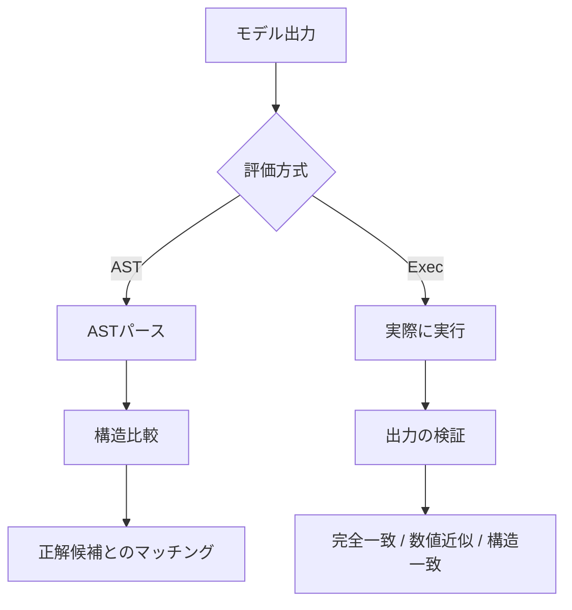

本記事は [The Berkeley Function Calling Leaderboard (BFCL): From Tool Use to Agentic Evaluation of Large Language Models (ICML 2025)](https://proceedings.mlr.press/v267/patil25a.html) の解説記事です。

## 論文概要（Abstract）

Function Calling（ツール呼び出し）はLLMが外部関数やAPIを呼び出すための構造化引数を生成する機能であり、エージェントアプリケーションの中核を担う。しかし、関数呼び出しの正しさを評価する標準的なベンチマークは存在しなかった。著者らは、AST（抽象構文木）ベースの評価手法を用いたBerkeley Function Calling Leaderboard（BFCL）を提案し、シリアル・パラレル呼び出し、複数プログラミング言語、マルチターン・マルチステップの評価を包括的にカバーする4,441サンプルのベンチマークを構築している。

この記事は [Zenn記事: AI SDK v7×Next.jsでFunction Callingを型安全に実装する](https://zenn.dev/0h_n0/articles/a3b7e2f1c9d046) の深掘りです。

## 情報源

- **会議名**: ICML 2025（International Conference on Machine Learning）
- **年**: 2025
- **URL**: [https://proceedings.mlr.press/v267/patil25a.html](https://proceedings.mlr.press/v267/patil25a.html)
- **著者**: Shishir G. Patil, Huanzhi Mao, Fanjia Yan, Charlie Cheng-Jie Ji, Vishnu Suresh, Ion Stoica, Joseph E. Gonzalez（UC Berkeley）
- **掲載**: Proceedings of the 42nd International Conference on Machine Learning, PMLR 267, pp. 48371–48392

## カンファレンス情報

**ICMLについて**: ICMLは機械学習分野の最高峰国際会議の1つであり、毎年数千件の投稿から厳選された論文が採択される。BFCLはUC BerkeleyのGorilla LLMプロジェクトの一環として開発され、Function Callingの事実上の標準ベンチマークとして広く利用されている。ライブリーダーボードは [gorilla.cs.berkeley.edu/leaderboard.html](https://gorilla.cs.berkeley.edu/leaderboard.html) で公開されており、2025年12月のV4更新時点で多数のモデルが登録されている。

## 技術的詳細（Technical Details）

### Function Calling評価の課題

Function Callingの評価が困難な理由は、正解が一意でないことにある。同じ意味の関数呼び出しでも、引数の順序、文字列の表現、オプションパラメータの有無などが異なり得る。単純な文字列マッチングでは、意味的に正しい出力を誤って不正解と判定してしまう。著者らはこの問題に対し、AST（抽象構文木）レベルでの構造比較という手法を提案している。

### AST評価手法

BFCLのAST評価は、モデルが生成した関数呼び出しをPythonのASTとしてパースし、事前に用意された「可能な正解」群と構造的に比較する。具体的な検証項目は以下の通りである。

**関数名の一致**: 生成された関数名が正解候補のいずれかと一致するか確認する。ドット（`.`）をアンダースコア（`_`）に置換するオプションがあり、一部のモデルがドットを含む関数名を出力できない問題に対応している。

**パラメータの検証**:
- 必須パラメータがすべて含まれているか
- 関数定義に存在しないパラメータ（ハルシネーション）が含まれていないか
- 各パラメータの型が正しいか

**型ごとの比較ルール**:

| 型 | 比較ルール |
|------|------|
| Boolean | 厳密一致。文字列`"true"`は不可 |
| 数値 | Python: intをfloatパラメータに許可。Java/JS: floatリテラル必須（`5.0`） |
| 文字列 | 大文字小文字を無視、空白・一部記号（`,./-_*^`）を除去して比較 |
| リスト | 順序考慮（順列許可フラグがある場合を除く）。要素型も再帰的に検証 |
| 辞書 | キー順序は無視 |

**オプションパラメータの扱い**: 正解候補に空文字列`""`が含まれる場合のみ、省略またはデフォルト値の使用が許容される。それ以外では特定の値が要求される。

**複数関数呼び出し時の照合**: 各モデル出力を正解候補にマッチさせる。順序は問わないが、すべての正解候補がマッチしなければ不正解となる（all-or-nothing評価）。

### AST評価 vs. 実行ベース（Exec）評価

BFCLは2種類の評価方式を併用している。



**AST評価**: 関数呼び出しの構造と引数値を正解候補と比較する。実行不要のため高速だが、正解候補の網羅性に依存する。Python、Java、JavaScriptに対応している。

**実行ベース（Exec）評価**: 生成された関数呼び出しを実際に実行し、出力を検証する。検証方式は3種類ある。
1. **完全一致**: 出力が期待値と完全に一致
2. **数値近似**: 実数値が期待値の±20%以内
3. **構造一致**: 型、リスト長、辞書キーが一致

著者らは実行ベース評価が理想的としつつも、Java/JavaScript出力の実行環境の制約からAST評価が補完的に必要であると述べている。

### ベンチマークのカテゴリ構成

BFCLは4,441サンプルを以下のカテゴリに分類している（EvalScope bfcl_v3ドキュメントより）。

**AST Non-Live（静的テスト）**: 1,150サンプル

| サブセット | サンプル数 | 説明 |
|-----------|----------|------|
| simple | 400 | 1つの関数から正しい引数を生成 |
| multiple | 200 | 2〜4個の候補関数から適切な1つを選択 |
| parallel | 200 | 1つの関数セットに対し複数回呼び出し |
| parallel_multiple | 200 | 複数関数をそれぞれ0回以上呼び出し |
| java | 100 | Java固有の型システムでの評価 |
| javascript | 50 | JavaScript固有の型システムでの評価 |

**AST Live（ライブAPIテスト）**: 1,351サンプル

実際のAPIエンドポイントに対するテスト。`live_simple`（258）、`live_multiple`（1,053）、`live_parallel`（16）、`live_parallel_multiple`（24）で構成される。

**Relevance（関連性判定）**: 1,140サンプル

提供された関数がユーザーの要求に適合しない場合に、モデルが関数呼び出しを行わないことを評価する。`irrelevance`（240）、`live_relevance`（18）、`live_irrelevance`（882）の3サブセット。

**Multi-Turn（マルチターン）**: 800サンプル

複数ターンの対話における関数呼び出しを評価する。著者らはV3（2024年9月リリース）でこのカテゴリを追加している。
- `multi_turn_base`（200）: 基本的なマルチターン呼び出し
- `multi_turn_miss_func`（200）: 必要な関数が欠落した状況
- `multi_turn_miss_param`（200）: 必要なパラメータが欠落した状況
- `multi_turn_long_context`（200）: 長いコンテキストでの呼び出し

マルチターン評価では状態ベースの検証が行われ、最終的なシステム状態が期待される状態と一致するかを確認する。書き込み・削除操作を含むタスクで特に重要となる。

### 形式的な評価指標

BFCLの主要指標は**正答率（Accuracy）**である。各テストケースについて、モデル出力がAST評価またはExec評価を通過すれば正解、そうでなければ不正解とする二値判定である。

$$
\text{Accuracy}_{\text{category}} = \frac{\sum_{i=1}^{N} \mathbb{1}[\text{eval}(y_i, \hat{y}_i) = \text{pass}]}{N}
$$

ここで、
- $N$: カテゴリ内のサンプル数
- $y_i$: モデルの出力（関数呼び出し）
- $\hat{y}_i$: 正解候補の集合
- $\text{eval}$: AST評価またはExec評価関数

全体スコアはカテゴリごとの正答率の重み付き平均として算出される。

## 実装のポイント（Implementation）

### BFCLを自プロジェクトで活用する方法

BFCLの評価フレームワークは、AI SDK v7のようなFunction Callingフレームワークの品質保証に応用できる。具体的には以下の観点で活用が可能である。

**1. ツール定義の品質テスト**

Zenn記事で解説されているAI SDK v7の`tool()`関数で定義したツール群に対し、BFCLのカテゴリに準じたテストケースを設計できる。

```python
from typing import Any

def ast_evaluate_tool_call(
    model_output: dict[str, Any],
    expected_calls: list[dict[str, Any]],
    func_definitions: list[dict[str, Any]],
) -> bool:
    """BFCL方式のAST評価を簡易実装する。

    Args:
        model_output: モデルが生成した関数呼び出し
        expected_calls: 正解候補のリスト
        func_definitions: 関数定義（パラメータスキーマ）

    Returns:
        評価結果（True=正解）
    """
    for expected in expected_calls:
        if not _match_function_name(model_output["name"], expected["name"]):
            continue
        if _validate_params(
            model_output.get("arguments", {}),
            expected.get("arguments", {}),
            func_definitions,
        ):
            return True
    return False


def _match_function_name(actual: str, expected: str) -> bool:
    """関数名の一致判定（ドット/アンダースコア置換対応）"""
    return actual.replace(".", "_") == expected.replace(".", "_")


def _validate_params(
    actual: dict[str, Any],
    expected: dict[str, Any],
    definitions: list[dict[str, Any]],
) -> bool:
    """パラメータの型・値の検証"""
    for key, value in expected.items():
        if key not in actual:
            return False
        if not _type_compatible(actual[key], value):
            return False
    return True


def _type_compatible(actual: Any, expected: Any) -> bool:
    """型互換性チェック（BFCLルール準拠）"""
    if isinstance(expected, bool):
        return actual is expected
    if isinstance(expected, (int, float)):
        if isinstance(actual, (int, float)):
            return True
    if isinstance(expected, str):
        return _normalize_string(str(actual)) == _normalize_string(expected)
    return type(actual) == type(expected)


def _normalize_string(s: str) -> str:
    """文字列の正規化（大文字小文字、空白、記号を除去）"""
    import re
    s = s.lower().strip()
    s = re.sub(r"[,./\-_*^ ]+", "", s)
    return s
```

**2. parallel / parallel_multiple テストの設計**

AI SDK v7の`stopWhen: isStepCount(5)`によるマルチステップ実行では、LLMが複数のツールを並列に呼び出すケースがある。BFCLのparallel/parallel_multipleカテゴリに倣い、以下のようなテストケースを作成できる。

```typescript
// BFCLのparallel_multipleカテゴリに相当するテストケース
const testCase = {
  userQuery: "東京と大阪の天気を調べて、それぞれのおすすめレストランも検索して",
  expectedCalls: [
    { name: "getWeather", args: { location: "東京" } },
    { name: "getWeather", args: { location: "大阪" } },
    { name: "searchRestaurants", args: { location: "東京" } },
    { name: "searchRestaurants", args: { location: "大阪" } },
  ],
  evaluation: "all_or_nothing", // 全呼び出しが正しければ正解
};
```

**3. Relevance検出テスト**

ユーザーの要求に対してツールが不適切な場合に呼び出しを行わないことも重要な能力である。AI SDK v7の`toolChoice: 'auto'`設定時にこの挙動をテストすることで、不要なAPI呼び出しによるコスト増加を防げる。

## Production Deployment Guide

### AWS実装パターン（コスト最適化重視）

BFCLの評価フレームワークを本番環境のFunction Calling品質監視に組み込む構成を示す。

**トラフィック量別の推奨構成**:

| 規模 | 月間リクエスト | 推奨構成 | 月額コスト | 主要サービス |
|------|--------------|---------|-----------|------------|
| **Small** | ~3,000 (100/日) | Serverless | $50-150 | Lambda + Bedrock + DynamoDB |
| **Medium** | ~30,000 (1,000/日) | Hybrid | $300-800 | Lambda + ECS Fargate + ElastiCache |
| **Large** | 300,000+ (10,000/日) | Container | $2,000-5,000 | EKS + Karpenter + EC2 Spot |

**Small構成の詳細**（月額$50-150）:
- **Lambda**: 1GB RAM, 60秒タイムアウト（$20/月）— 各Function Calling応答のAST評価を実行
- **Bedrock**: Claude 3.5 Haiku, Prompt Caching有効（$80/月）— LLM推論
- **DynamoDB**: On-Demand（$10/月）— 評価結果・メトリクスの保存
- **CloudWatch**: 基本監視（$5/月）— 正答率の時系列追跡
- **API Gateway**: REST API（$5/月）

**Medium構成の詳細**（月額$300-800）:
- **Lambda**: イベント処理（$50/月）
- **ECS Fargate**: 0.5 vCPU, 1GB RAM × 2タスク（$120/月）— バッチ評価実行
- **Bedrock**: Claude 3.5 Sonnet, Batch API活用（$400/月）
- **ElastiCache Redis**: cache.t3.micro（$15/月）— 評価結果キャッシュ
- **Application Load Balancer**: （$20/月）

**Large構成の詳細**（月額$2,000-5,000）:
- **EKS**: コントロールプレーン（$72/月）
- **EC2 Spot Instances**: g5.xlarge × 2-4台（平均$800/月、最大90%削減）
- **Karpenter**: 自動スケーリング（追加コストなし）
- **Bedrock Batch**: 50%割引活用（$2,000/月）
- **S3**: プロンプトキャッシュストレージ（$20/月）
- **CloudWatch + X-Ray**: 詳細監視（$100/月）

**コスト削減テクニック**:
- Spot Instances使用で最大90%削減（EKS + Karpenter）
- Reserved Instances購入で最大72%削減（1年コミット）
- Bedrock Batch API使用で50%削減
- Prompt Caching有効化で30-90%削減
- アイドルタイムのAuto Scaling to Zero（Fargate/Lambda）

**コスト試算の注意事項**: 上記は2026年10月時点のAWS ap-northeast-1（東京）リージョン料金に基づく概算値です。実際のコストはトラフィックパターン、リージョン、バースト使用量により変動します。最新料金は [AWS料金計算ツール](https://calculator.aws/) で確認してください。

### Terraformインフラコード

**Small構成 (Serverless): Lambda + Bedrock + DynamoDB**

```hcl
module "vpc" {
  source  = "terraform-aws-modules/vpc/aws"
  version = "~> 5.0"

  name = "fc-eval-vpc"
  cidr = "10.0.0.0/16"
  azs  = ["ap-northeast-1a", "ap-northeast-1c"]
  private_subnets = ["10.0.1.0/24", "10.0.2.0/24"]

  enable_nat_gateway   = false
  enable_dns_hostnames = true
}

resource "aws_iam_role" "lambda_eval" {
  name = "fc-eval-lambda-role"

  assume_role_policy = jsonencode({
    Version = "2012-10-17"
    Statement = [{
      Action = "sts:AssumeRole"
      Effect = "Allow"
      Principal = { Service = "lambda.amazonaws.com" }
    }]
  })
}

resource "aws_iam_role_policy" "bedrock_invoke" {
  role = aws_iam_role.lambda_eval.id

  policy = jsonencode({
    Version = "2012-10-17"
    Statement = [{
      Effect   = "Allow"
      Action   = ["bedrock:InvokeModel", "bedrock:InvokeModelWithResponseStream"]
      Resource = "arn:aws:bedrock:ap-northeast-1::foundation-model/anthropic.claude-3-5-haiku*"
    }]
  })
}

resource "aws_lambda_function" "fc_evaluator" {
  filename      = "lambda.zip"
  function_name = "fc-ast-evaluator"
  role          = aws_iam_role.lambda_eval.arn
  handler       = "index.handler"
  runtime       = "python3.12"
  timeout       = 60
  memory_size   = 1024

  environment {
    variables = {
      BEDROCK_MODEL_ID    = "anthropic.claude-3-5-haiku-20241022-v1:0"
      DYNAMODB_TABLE      = aws_dynamodb_table.eval_results.name
      ENABLE_PROMPT_CACHE = "true"
    }
  }
}

resource "aws_dynamodb_table" "eval_results" {
  name         = "fc-eval-results"
  billing_mode = "PAY_PER_REQUEST"
  hash_key     = "eval_id"

  attribute {
    name = "eval_id"
    type = "S"
  }

  ttl {
    attribute_name = "expire_at"
    enabled        = true
  }
}

resource "aws_cloudwatch_metric_alarm" "eval_accuracy_drop" {
  alarm_name          = "fc-eval-accuracy-drop"
  comparison_operator = "LessThanThreshold"
  evaluation_periods  = 3
  metric_name         = "EvalAccuracy"
  namespace           = "FunctionCallingEval"
  period              = 3600
  statistic           = "Average"
  threshold           = 0.85
  alarm_description   = "Function Calling正答率が85%を下回った"
}
```

**Large構成 (Container): EKS + Karpenter + Spot Instances**

```hcl
module "eks" {
  source  = "terraform-aws-modules/eks/aws"
  version = "~> 20.0"

  cluster_name    = "fc-eval-cluster"
  cluster_version = "1.31"

  vpc_id     = module.vpc.vpc_id
  subnet_ids = module.vpc.private_subnets

  cluster_endpoint_public_access = true
  enable_cluster_creator_admin_permissions = true
}

resource "kubectl_manifest" "karpenter_provisioner" {
  yaml_body = <<-YAML
    apiVersion: karpenter.sh/v1alpha5
    kind: Provisioner
    metadata:
      name: spot-provisioner
    spec:
      requirements:
        - key: karpenter.sh/capacity-type
          operator: In
          values: ["spot"]
        - key: node.kubernetes.io/instance-type
          operator: In
          values: ["m6i.xlarge", "m6i.2xlarge"]
      limits:
        resources:
          cpu: "32"
          memory: "128Gi"
      providerRef:
        name: default
      ttlSecondsAfterEmpty: 30
  YAML
}

resource "aws_budgets_budget" "eval_monthly" {
  name         = "fc-eval-monthly-budget"
  budget_type  = "COST"
  limit_amount = "5000"
  limit_unit   = "USD"
  time_unit    = "MONTHLY"

  notification {
    comparison_operator        = "GREATER_THAN"
    threshold                  = 80
    threshold_type             = "PERCENTAGE"
    notification_type          = "ACTUAL"
    subscriber_email_addresses = ["ops@example.com"]
  }
}
```

### セキュリティベストプラクティス

1. **ネットワークセキュリティ**: EKSは`cluster_endpoint_public_access = false`を推奨（VPN経由）。Lambda: VPC内配置
2. **認証・認可**: IAMロール最小権限。MFA必須。IRSA（IAM Roles for Service Accounts）
3. **シークレット管理**: AWS Secrets Manager使用。ローテーション90日ごと。Terraform State: S3 + KMS暗号化
4. **監査**: CloudTrail全リージョン有効化。Config有効化。GuardDuty有効化
5. **データ保護**: TLS 1.2以上。S3/DynamoDB/EBS全てKMS暗号化

### 運用・監視設定

**CloudWatch Logs Insights クエリ**:

```sql
-- Function Calling正答率の時系列推移
fields @timestamp, category, accuracy
| stats avg(accuracy) as avg_accuracy by bin(1h), category
| filter category IN ["simple", "parallel", "multiple"]

-- エラーパターン分析
fields @timestamp, error_type, tool_name
| stats count(*) as error_count by error_type
| sort error_count desc
| limit 20
```

**CloudWatch アラーム（コスト重視）**:

```python
import boto3

cloudwatch = boto3.client('cloudwatch')

cloudwatch.put_metric_alarm(
    AlarmName='bedrock-token-spike',
    ComparisonOperator='GreaterThanThreshold',
    EvaluationPeriods=1,
    MetricName='TokenUsage',
    Namespace='AWS/Bedrock',
    Period=3600,
    Statistic='Sum',
    Threshold=500000,
    ActionsEnabled=True,
    AlarmActions=['arn:aws:sns:ap-northeast-1:123456789:cost-alerts'],
    AlarmDescription='Bedrockトークン使用量異常'
)

cloudwatch.put_metric_alarm(
    AlarmName='lambda-duration-spike',
    ComparisonOperator='GreaterThanThreshold',
    EvaluationPeriods=2,
    MetricName='Duration',
    Namespace='AWS/Lambda',
    Period=300,
    Statistic='Average',
    Threshold=30000,
    AlarmDescription='Lambda実行時間異常'
)
```

**X-Ray トレーシング設定**:

```python
from aws_xray_sdk.core import xray_recorder, patch_all

patch_all()

@xray_recorder.capture('ast_evaluation')
def evaluate_function_call(model_output: dict, expected: list[dict]) -> bool:
    xray_recorder.put_annotation('category', model_output.get('category', 'unknown'))
    xray_recorder.put_metadata('tool_count', len(expected))
    result = ast_evaluate_tool_call(model_output, expected, [])
    xray_recorder.put_metadata('result', result)
    return result
```

**Cost Explorer自動レポート**:

```python
import boto3
from datetime import datetime, timedelta

ce = boto3.client('ce')

response = ce.get_cost_and_usage(
    TimePeriod={
        'Start': (datetime.now() - timedelta(days=1)).strftime('%Y-%m-%d'),
        'End': datetime.now().strftime('%Y-%m-%d')
    },
    Granularity='DAILY',
    Metrics=['UnblendedCost'],
    GroupBy=[
        {'Type': 'SERVICE', 'Key': 'SERVICE'},
        {'Type': 'USAGE_TYPE', 'Key': 'USAGE_TYPE'}
    ]
)

for result in response['ResultsByTime']:
    for group in result['Groups']:
        service = group['Keys'][0]
        cost = float(group['Metrics']['UnblendedCost']['Amount'])
        if cost > 100:
            pass  # SNS通知
```

### コスト最適化チェックリスト

**アーキテクチャ選択（トラフィック量で判断）**:
- [ ] ~100 req/日 → Lambda + Bedrock (Serverless) — $50-150/月
- [ ] ~1000 req/日 → ECS Fargate + Bedrock (Hybrid) — $300-800/月
- [ ] 10000+ req/日 → EKS + Spot Instances (Container) — $2,000-5,000/月

**リソース最適化**:
- [ ] EC2: Spot Instances優先（最大90%削減、Karpenter自動管理）
- [ ] Reserved Instances: 1年コミットで72%削減
- [ ] Savings Plans: Compute Savings Plans検討
- [ ] Lambda: メモリサイズ最適化（CloudWatch Insights分析）
- [ ] ECS/EKS: アイドルタイムのスケールダウン

**LLMコスト削減**:
- [ ] Bedrock Batch API: 50%割引（非リアルタイム評価処理）
- [ ] Prompt Caching: 30-90%削減（評価プロンプト固定）
- [ ] モデル選択: 開発はHaiku ($0.25/MTok)、本番複雑タスクはSonnet ($3/MTok)
- [ ] トークン数制限: max_tokens設定で過剰生成防止

**監視・アラート**:
- [ ] AWS Budgets: 月額予算設定（80%で警告、100%でアラート）
- [ ] CloudWatch アラーム: 正答率低下・トークンスパイク検知
- [ ] Cost Anomaly Detection: 自動異常検知
- [ ] 日次コストレポート: SNS/Slackへ自動送信

**リソース管理**:
- [ ] 未使用リソース削除: Lambda Insights, Trusted Advisor活用
- [ ] タグ戦略: 環境別（dev/staging/prod）でコスト可視化
- [ ] ライフサイクルポリシー: S3古い評価結果自動削除（30日）
- [ ] 開発環境は夜間停止（Auto Start/Stop）

## 実験結果（Results）

### モデル性能の比較

著者らの報告によると、最新のGPT-4系モデルが総合スコアでリードしており、OpenFunctions-v2、Mistral-medium、Claude-2.1が僅差で続いている（論文Figure 1より）。

**カテゴリ別の傾向**:

| カテゴリ | プロプライエタリモデル | オープンソースモデル | 著者らの所見 |
|---------|---------------------|-------------------|-------------|
| Simple | 高い正答率 | 同等の性能 | ファインチューニングにより同等に到達可能 |
| Multiple | 高い正答率 | GPT系に劣る | 候補関数からの選択精度に差 |
| Parallel | 高い正答率 | GPT系に劣る | 並列呼び出しの難易度が高い |
| Relevance | 概ね良好 | モデルにより差異大 | 不要な呼び出しの抑制が課題 |
| Multi-turn | 課題あり | さらに課題あり | メモリと動的判断が困難 |

### 主要な知見

著者らは以下の知見を報告している。

1. **単一ターンの呼び出しは概ね解決済み**: シンプルな関数呼び出しでは、主要モデルの正答率は高水準に達している
2. **並列・複数関数呼び出しに性能差**: GPT系モデルが他のモデルを上回る傾向がある
3. **メモリと長期推論が未解決**: マルチターン・マルチステップの設定では、状態の保持と動的な判断にモデルが苦戦している
4. **関連性判定の重要性**: 不適切なツール呼び出しの抑制は、コスト効率とユーザー体験の両面で重要である

### BFCLの制約

著者らはBFCLの制約として以下を挙げている。
- 正解候補の網羅性に限界がある（意味的に正しいが候補にない出力を不正解とする可能性）
- ライブAPIテストはAPI側の変更により結果が不安定になり得る
- マルチターン評価は状態ベースであり、中間ステップの品質は直接評価しない

## 実運用への応用（Practical Applications）

### AI SDK v7との関連

Zenn記事で解説されているAI SDK v7のFunction Calling実装に対し、BFCLの知見は以下の形で応用できる。

**1. ツール定義の品質向上**: BFCLでSimpleカテゴリの正答率が高いモデルでも、`description`の記述が不十分だとツール選択を誤る。AI SDK v7の`tool()`関数で`description`を3〜4文で充実させ、Zodの`.describe()`で各フィールドにヒントを追加する実践は、BFCLの知見と整合する。

**2. マルチステップ制御の設計指針**: BFCLの結果から、マルチターン・マルチステップではモデルの性能が低下することが明らかである。AI SDK v7の`stopWhen: isStepCount(n)`の値設定や、`prepareStep`による動的制御は、この性能特性を踏まえたガードレールとして機能する。

**3. プロバイダー選択の根拠**: BFCLリーダーボードの結果は、モデル選択の客観的根拠として活用できる。AI SDK v7はプロバイダー非依存設計であるため、モデルIDの1行変更でBFCLスコアの高いモデルに切り替え可能である。

**4. Relevance検出の実装**: AI SDK v7の`toolChoice: 'auto'`設定時に、モデルが不適切なツール呼び出しを行わないことをBFCL方式でテストし、不要なAPI呼び出しによるコスト増加を防止できる。

## 関連研究（Related Work）

- **Gorilla** (Patil et al., 2023): BFCLの前身となるLLMのAPI呼び出し能力評価プロジェクト。APIドキュメントからの関数呼び出し生成を評価した
- **ToolLLM** (Qin et al., 2024): 16,000以上のAPIを対象としたツール利用ベンチマーク。BFCLと比較してAPIの多様性に焦点を当てている
- **API-Bank** (Li et al., 2023): APIの検索・呼び出し・応答統合を評価するベンチマーク。BFCLのAST評価とは異なり、エンドツーエンドの評価を重視
- **τ-bench** (Yao et al., 2024): エージェントのツール利用を状態遷移として評価するベンチマーク。BFCLのマルチターン評価と類似の方向性を持つ

## まとめと今後の展望

BFCLは、LLMのFunction Calling能力を体系的に評価するためのベンチマークとして、AST評価と実行ベース評価の併用、4,441サンプル・4カテゴリの包括的構成、ライブリーダーボードによる継続的評価を提供している。著者らの主要な知見として、単一ターンの関数呼び出しは概ね解決済みだが、マルチステップ・マルチターンの設定ではメモリ・動的判断・長期推論に課題が残ることが報告されている。

AI SDK v7でFunction Callingを実装する際には、BFCLのカテゴリ（Simple/Multiple/Parallel/Relevance/Multi-turn）に準じたテスト設計を行い、`description`の品質向上、`stopWhen`によるステップ数制限、`toolChoice`による動的制御を組み合わせることで、本番環境での信頼性を高められる。

## 参考文献

- **Conference URL**: [https://proceedings.mlr.press/v267/patil25a.html](https://proceedings.mlr.press/v267/patil25a.html)
- **Leaderboard**: [https://gorilla.cs.berkeley.edu/leaderboard.html](https://gorilla.cs.berkeley.edu/leaderboard.html)
- **Code**: [https://github.com/ShishirPatil/gorilla](https://github.com/ShishirPatil/gorilla)
- **Related Zenn article**: [https://zenn.dev/0h_n0/articles/a3b7e2f1c9d046](https://zenn.dev/0h_n0/articles/a3b7e2f1c9d046)
- **EvalScope BFCL v3 Documentation**: [https://evalscope.readthedocs.io/en/latest/benchmarks/bfcl_v3.html](https://evalscope.readthedocs.io/en/latest/benchmarks/bfcl_v3.html)
