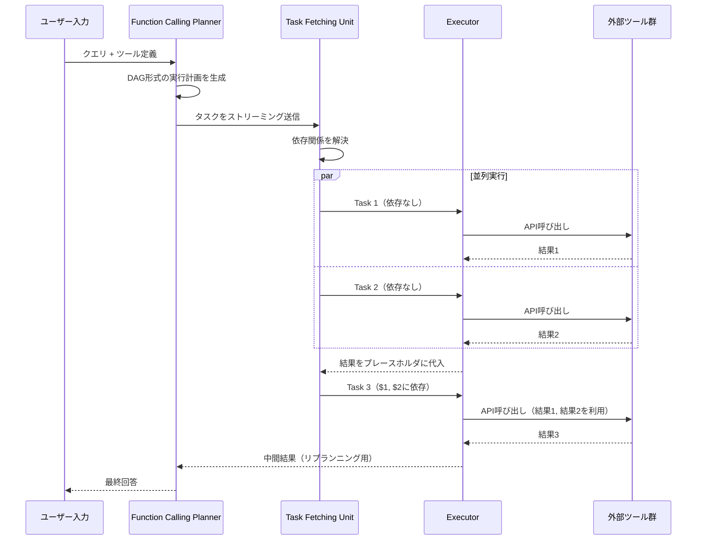

本記事は [arXiv:2312.04511 "An LLM Compiler for Parallel Function Calling"](https://arxiv.org/abs/2312.04511)（Kim et al., ICML 2024）の解説記事です。

この記事は [Zenn記事: AI SDK v7×Next.jsでFunction Callingを型安全に実装する](https://zenn.dev/0h_n0/articles/a3b7e2f1c9d046) の深掘りです。

## 論文概要（Abstract）

LLMによるFunction Calling（ツール呼び出し）は、知識のカットオフ、算術能力の限界、プライベートデータへのアクセス不能といった制約を克服する手段として注目されている。しかし、従来のReActパターンでは関数呼び出しを1つずつ逐次的に実行するため、レイテンシとコストが増大し、精度も低下する場合がある。著者らはこの課題に対し、古典的なコンパイラの最適化手法に着想を得た**LLMCompiler**フレームワークを提案している。LLMCompilerは独立した関数呼び出しを自動的に並列実行することで、ReActと比較して最大3.7倍のレイテンシ改善、6.7倍のコスト削減、約9%の精度向上を達成したと報告されている。

## 情報源

- **arXiv ID**: 2312.04511
- **URL**: [https://arxiv.org/abs/2312.04511](https://arxiv.org/abs/2312.04511)
- **著者**: Sehoon Kim, Suhong Moon, Ryan Tabrizi, Nicholas Lee, Michael W. Mahoney, Kurt Keutzer, Amir Gholami
- **発表年**: 2024（ICML 2024, pp. 24370-24391）
- **分野**: cs.CL（計算言語学）
- **コード**: [github.com/SqueezeAILab/LLMCompiler](https://github.com/SqueezeAILab/LLMCompiler)（MIT License）

## 背景と動機（Background & Motivation）

LLMのFunction Callingは、外部APIやデータベースへのアクセスを可能にする技術であり、AI SDK v7のような開発フレームワークでも中核的な機能となっている。しかし、従来の主流パターンであるReActは、「思考（Thought）→ 行動（Action）→ 観察（Observation）」のループを**1関数ずつ逐次的に繰り返す**設計となっている。

この逐次実行には3つの問題がある。第一に、互いに独立した関数呼び出しであっても直列に実行されるため、**レイテンシが関数数に比例して増大**する。第二に、各ステップでLLMを呼び出す必要があるため、**トークン消費（コスト）が累積**する。第三に、ループの途中で不要な関数を再度呼び出したり、途中で停止したりする**誤動作**が発生する場合がある。

著者らは、コンパイラが命令間の依存関係を解析して独立な命令を並列実行するのと同様に、LLMの関数呼び出しでも依存関係グラフを構築し並列実行できると指摘している。この着想がLLMCompilerの設計基盤となっている。

## 主要な貢献（Key Contributions）

- **コンパイラ着想の並列実行フレームワーク**: Function Calling Planner、Task Fetching Unit、Executorの3コンポーネントからなるアーキテクチャを提案
- **依存関係の自動解析**: プランナーがDAG（有向非巡回グラフ）形式の実行計画を生成し、独立タスクを自動的に並列化
- **リプランニング機構**: 中間結果に基づいて実行計画を動的に再生成する仕組みを導入
- **オープンソース・クローズドソース両対応**: GPT系モデルだけでなくLLaMA-2 70Bでも動作することを実験で確認
- **ストリーミング最適化**: プランナーの出力をストリーミングし、計画生成と並行してタスク実行を開始する手法を提案

## 技術的詳細（Technical Details）

### アーキテクチャ

LLMCompilerは以下の3つのコンポーネントで構成される。



#### Function Calling Planner

プランナーはLLMベースのコンポーネントであり、ユーザーのクエリとツール定義を受け取り、**DAG（有向非巡回グラフ）形式の実行計画**を出力する。各タスクにはIDが付与され、他タスクの出力を参照するプレースホルダ変数（例: `$1`, `$2`）で依存関係が表現される。

著者らの論文（Section 4.2）によると、プランナーはタスクを**ストリーミング形式で逐次出力**できる。これにより、計画全体の生成完了を待たずに、依存関係が解決済みのタスクから順次実行を開始できる。

#### Task Fetching Unit

Task Fetching Unitはプランナーから出力されたタスクを受け取り、依存関係が解決されたタスクを**貪欲方策（greedy policy）**でExecutorにディスパッチする。具体的には、あるタスクが参照するプレースホルダ変数（`$i`）に対応する先行タスクがすべて完了した時点で、プレースホルダを実際の出力値に置換し、タスクを実行キューに投入する。このコンポーネント自体にはLLMは使用されておらず、軽量なキューイングロジックとして実装されている。

#### Executor

Executorは受け取ったタスクを**非同期・並列に実行**する。同時にディスパッチされたタスクは構造上互いに独立であることが保証されているため、安全に並列実行できる。各タスクには専用のメモリ領域が割り当てられ、中間結果は依存するタスクに自動的に転送される。ツールには通常の関数（計算機、検索API）だけでなく、LLMエージェント自体も指定可能である。

### レイテンシの理論モデル

著者らは論文のAppendix E.1で、ReActとLLMCompilerのレイテンシを以下のように定式化している。

**ReActのレイテンシ**:

$$
T^R = \sum_{i=1}^{N} \bigl(T_P^R(P_i) + T_E(E_i)\bigr)
$$

ここで、$N$ はタスク数、$T_P^R(P_i)$ は $i$ 番目のステップにおけるプランニング（LLM推論）時間、$T_E(E_i)$ はツール実行時間である。ReActでは各ステップが逐次実行されるため、全体のレイテンシは各ステップの合計となる。

**LLMCompilerのレイテンシ**:

$$
T^C = \sum_{i=1}^{N} T_P^C(P_i) + \max_k T_E(E_k)
$$

LLMCompilerではプランニングは1回（またはリプランニング時は数回）で済み、独立したタスクの実行時間は**最も遅いタスクの実行時間**（$\max$ 演算）で決まる。

**理論上の高速化率**:

$$
\gamma = \frac{T^R}{T^C}
$$

上限は $\gamma_{\max} \approx N$（全タスクが完全に並列実行可能な場合）、下限は $\gamma_{\min} \approx 1$（プランニングコストが支配的な場合）となる。著者らは実験で実際の高速化率がこの範囲内に収まることを確認している。

### リプランニング機構

Game of 24ベンチマークやWebShopのような反復的タスクでは、中間結果に基づいて計画を動的に更新する必要がある。LLMCompilerでは、Executorの中間結果をプランナーにフィードバックし、新しいタスクセットを生成する**リプランニングループ**を実装している。Game of 24では、`thought_proposer`（候補生成）、`state_evaluator`（評価）、`top_k_select`（選択）の3ツールを用いて、候補が24に到達するまでリプランニングを繰り返す設計が採用されている。

## 実装のポイント（Implementation）

LLMCompilerの実装において重要な点は以下の通りである。

**プランナーのプロンプト設計**: DAG形式の計画を安定的に生成させるには、プランナーへのプロンプトにタスクIDと依存関係の記法ルールを明確に含める必要がある。著者らはAppendix Hにプロンプトテンプレートを掲載している。

**ストリーミングパース**: プランナーの出力をトークン単位でパースし、タスクが1つ完成した時点でFetching Unitに送る仕組みが必要となる。著者らの実験（Table C.1）では、ストリーミングによりParallelQAで1.30倍のレイテンシ改善が得られたと報告されている。

**エラーハンドリング**: ParallelQAの障害分析（論文Section 6）によると、障害の64%がExecutorエラー（数学属性の誤り、単位変換ミス等）、28%が最終出力エラー、8%がプランナーエラーであった。ツール実行のリトライ機構と出力バリデーションの実装が精度向上に寄与すると考えられる。

**AI SDK v7との対応関係**: Zenn記事で解説されているAI SDK v7の`stopWhen: isStepCount(5)`は、LLMCompilerのリプランニングにおけるイテレーション上限に対応する概念である。また、`prepareStep`による動的なツール切り替えは、LLMCompilerのTask Fetching Unitが依存関係に基づいてタスクを動的にディスパッチする仕組みと類似している。AI SDK v7は逐次的なマルチステップを提供する一方、LLMCompilerは並列実行を中核とするアプローチであり、両者は補完的な関係にある。

## Production Deployment Guide

### AWS実装パターン（コスト最適化重視）

LLMCompilerのような並列Function Calling基盤をAWS上に構築する場合、トラフィック量に応じた構成を選択する。

| 規模 | 月間リクエスト | 推奨構成 | 月額コスト概算 | 主要サービス |
|------|--------------|---------|-------------|------------|
| **Small** | ~3,000 (100/日) | Serverless | $50-150 | Lambda + Step Functions + Bedrock |
| **Medium** | ~30,000 (1,000/日) | Hybrid | $300-800 | Lambda + ECS Fargate + ElastiCache |
| **Large** | 300,000+ (10,000/日) | Container | $2,000-5,000 | EKS + Karpenter + EC2 Spot |

**Small構成の詳細**（月額$50-150）:
- **Lambda**: 並列タスク実行用。1GB RAM、60秒タイムアウト（$20/月）
- **Step Functions**: DAGベースのタスクオーケストレーション。Parallel状態で並列実行を表現（$25/月）
- **Bedrock**: Claude 3.5 Haiku（プランナーLLM用）、Prompt Caching有効化（$80/月）
- **DynamoDB**: タスク状態・中間結果の保存、On-Demand（$10/月）
- **CloudWatch**: 基本監視（$5/月）

**Medium構成の詳細**（月額$300-800）:
- **Lambda**: イベントトリガー・軽量タスク実行（$50/月）
- **ECS Fargate**: プランナーLLMとExecutorの常駐プロセス、0.5 vCPU, 1GB RAM × 2タスク（$120/月）
- **Bedrock**: Claude 3.5 Sonnet（プランナー用）、Batch API活用（$400/月）
- **ElastiCache Redis**: タスク結果キャッシュ・依存関係キュー、cache.t3.micro（$15/月）
- **Application Load Balancer**: ($20/月)

**Large構成の詳細**（月額$2,000-5,000）:
- **EKS**: コントロールプレーン（$72/月）
- **EC2 Spot Instances**: 並列Executor用、c6i.xlarge × 2-8台（平均$400/月、最大90%削減）
- **Karpenter**: Executor負荷に応じた自動スケーリング（追加コストなし）
- **Bedrock Batch**: 50%割引活用（$2,000/月）
- **SQS/SNS**: タスクキューイング・イベント通知（$20/月）
- **CloudWatch + X-Ray**: 詳細監視（$100/月）

**コスト削減テクニック**:
- Spot Instances使用で最大90%削減（EKS + Karpenter）
- Reserved Instances購入で最大72%削減（1年コミット）
- Bedrock Batch API使用で50%削減（非リアルタイム処理）
- Prompt Caching有効化で30-90%削減（プランナープロンプト固定部分）
- Step FunctionsのExpress Workflowで短時間タスクのコスト最適化

**コスト試算の注意事項**: 上記は2026年10月時点のAWS ap-northeast-1（東京）リージョン料金に基づく概算値です。実際のコストはトラフィックパターン、リージョン、バースト使用量により変動します。最新料金は [AWS料金計算ツール](https://calculator.aws/) で確認してください。

### Terraformインフラコード

**Small構成 (Serverless): Lambda + Step Functions + Bedrock**

```hcl
module "vpc" {
  source  = "terraform-aws-modules/vpc/aws"
  version = "~> 5.0"

  name = "llmcompiler-vpc"
  cidr = "10.0.0.0/16"
  azs  = ["ap-northeast-1a", "ap-northeast-1c"]
  private_subnets = ["10.0.1.0/24", "10.0.2.0/24"]

  enable_nat_gateway   = false
  enable_dns_hostnames = true
}

resource "aws_iam_role" "lambda_executor" {
  name = "llmcompiler-lambda-executor"

  assume_role_policy = jsonencode({
    Version = "2012-10-17"
    Statement = [{
      Action = "sts:AssumeRole"
      Effect = "Allow"
      Principal = { Service = "lambda.amazonaws.com" }
    }]
  })
}

resource "aws_iam_role_policy" "bedrock_invoke" {
  role = aws_iam_role.lambda_executor.id

  policy = jsonencode({
    Version = "2012-10-17"
    Statement = [{
      Effect   = "Allow"
      Action   = ["bedrock:InvokeModel", "bedrock:InvokeModelWithResponseStream"]
      Resource = "arn:aws:bedrock:ap-northeast-1::foundation-model/anthropic.claude-3-5-haiku*"
    }]
  })
}

resource "aws_lambda_function" "planner" {
  filename      = "planner.zip"
  function_name = "llmcompiler-planner"
  role          = aws_iam_role.lambda_executor.arn
  handler       = "index.handler"
  runtime       = "python3.12"
  timeout       = 120
  memory_size   = 1024

  environment {
    variables = {
      BEDROCK_MODEL_ID    = "anthropic.claude-3-5-haiku-20241022-v1:0"
      DYNAMODB_TABLE      = aws_dynamodb_table.task_state.name
      ENABLE_PROMPT_CACHE = "true"
    }
  }
}

resource "aws_lambda_function" "tool_executor" {
  filename      = "executor.zip"
  function_name = "llmcompiler-tool-executor"
  role          = aws_iam_role.lambda_executor.arn
  handler       = "index.handler"
  runtime       = "python3.12"
  timeout       = 60
  memory_size   = 512
}

resource "aws_dynamodb_table" "task_state" {
  name         = "llmcompiler-task-state"
  billing_mode = "PAY_PER_REQUEST"
  hash_key     = "task_id"

  attribute {
    name = "task_id"
    type = "S"
  }

  ttl {
    attribute_name = "expire_at"
    enabled        = true
  }
}

resource "aws_cloudwatch_metric_alarm" "planner_duration" {
  alarm_name          = "llmcompiler-planner-duration"
  comparison_operator = "GreaterThanThreshold"
  evaluation_periods  = 1
  metric_name         = "Duration"
  namespace           = "AWS/Lambda"
  period              = 3600
  statistic           = "Average"
  threshold           = 60000
  alarm_description   = "Planner Lambda平均実行時間60秒超過"

  dimensions = {
    FunctionName = aws_lambda_function.planner.function_name
  }
}
```

**Large構成 (Container): EKS + Karpenter + Spot Instances**

```hcl
module "eks" {
  source  = "terraform-aws-modules/eks/aws"
  version = "~> 20.0"

  cluster_name    = "llmcompiler-cluster"
  cluster_version = "1.31"

  vpc_id     = module.vpc.vpc_id
  subnet_ids = module.vpc.private_subnets

  cluster_endpoint_public_access = true
  enable_cluster_creator_admin_permissions = true
}

resource "kubectl_manifest" "karpenter_provisioner" {
  yaml_body = <<-YAML
    apiVersion: karpenter.sh/v1alpha5
    kind: Provisioner
    metadata:
      name: executor-spot
    spec:
      requirements:
        - key: karpenter.sh/capacity-type
          operator: In
          values: ["spot"]
        - key: node.kubernetes.io/instance-type
          operator: In
          values: ["c6i.xlarge", "c6i.2xlarge", "c7i.xlarge"]
      limits:
        resources:
          cpu: "64"
          memory: "128Gi"
      providerRef:
        name: default
      ttlSecondsAfterEmpty: 30
  YAML
}

resource "aws_budgets_budget" "monthly" {
  name         = "llmcompiler-monthly"
  budget_type  = "COST"
  limit_amount = "5000"
  limit_unit   = "USD"
  time_unit    = "MONTHLY"

  notification {
    comparison_operator        = "GREATER_THAN"
    threshold                  = 80
    threshold_type             = "PERCENTAGE"
    notification_type          = "ACTUAL"
    subscriber_email_addresses = ["ops@example.com"]
  }
}
```

### セキュリティベストプラクティス

1. **ネットワークセキュリティ**: EKSは `cluster_endpoint_public_access = false` を推奨（VPN/Direct Connect経由）。Lambda はVPC内配置。
2. **認証・認可**: IAMロール最小権限。Bedrock呼び出し権限はモデル単位で制限。
3. **シークレット管理**: AWS Secrets Manager使用。環境変数へのハードコード禁止。
4. **データ保護**: 転送中TLS 1.2以上。保管中KMS暗号化。

### 運用・監視設定

**CloudWatch Logs Insights クエリ**:

```sql
-- 並列タスク実行の効率分析
fields @timestamp, task_count, parallel_tasks, total_duration_ms
| stats avg(total_duration_ms) as avg_latency,
        avg(parallel_tasks) as avg_parallelism by bin(1h)

-- プランナーエラー検知
fields @timestamp, component, error_type
| filter component = "planner" and level = "ERROR"
| stats count(*) as error_count by error_type, bin(1h)
```

**CloudWatch アラーム**:

```python
import boto3

cloudwatch = boto3.client('cloudwatch')

cloudwatch.put_metric_alarm(
    AlarmName='llmcompiler-bedrock-token-spike',
    ComparisonOperator='GreaterThanThreshold',
    EvaluationPeriods=1,
    MetricName='TokenUsage',
    Namespace='Custom/LLMCompiler',
    Period=3600,
    Statistic='Sum',
    Threshold=500000,
    ActionsEnabled=True,
    AlarmActions=['arn:aws:sns:ap-northeast-1:123456789:cost-alerts'],
    AlarmDescription='Bedrockトークン使用量異常（コスト急増）'
)

cloudwatch.put_metric_alarm(
    AlarmName='llmcompiler-parallelism-degradation',
    ComparisonOperator='LessThanThreshold',
    EvaluationPeriods=3,
    MetricName='ParallelismRatio',
    Namespace='Custom/LLMCompiler',
    Period=300,
    Statistic='Average',
    Threshold=1.5,
    AlarmDescription='並列度低下（プランナーの計画品質劣化の可能性）'
)
```

**X-Ray トレーシング設定**:

```python
from aws_xray_sdk.core import xray_recorder, patch_all

patch_all()

@xray_recorder.capture('llmcompiler_plan')
def execute_plan(query: str, tools: list):
    xray_recorder.put_annotation('tool_count', len(tools))

    plan = generate_plan(query, tools)
    xray_recorder.put_metadata('plan_task_count', len(plan.tasks))

    results = execute_parallel(plan)
    xray_recorder.put_metadata('parallel_groups', plan.parallel_groups)

    return results
```

### コスト最適化チェックリスト

**アーキテクチャ選択**:
- [ ] ~100 req/日 → Lambda + Step Functions (Serverless) - $50-150/月
- [ ] ~1,000 req/日 → ECS Fargate + Lambda (Hybrid) - $300-800/月
- [ ] 10,000+ req/日 → EKS + Spot (Container) - $2,000-5,000/月

**リソース最適化**:
- [ ] EC2: Spot Instances優先（Executor用、最大90%削減）
- [ ] Reserved Instances: プランナー用常駐インスタンス（1年コミットで72%削減）
- [ ] Lambda: メモリサイズ最適化（CloudWatch Lambda Insights分析）
- [ ] Step Functions: Express Workflow選択（短時間タスク）
- [ ] ECS/EKS: アイドルタイムのスケールダウン（夜間0台）

**LLMコスト削減**:
- [ ] Bedrock Batch API: 50%割引（非リアルタイム処理）
- [ ] Prompt Caching: プランナープロンプトの固定部分をキャッシュ（30-90%削減）
- [ ] モデル選択: プランナーにはHaiku、複雑な推論にはSonnet
- [ ] max_tokens設定: プランナー出力の上限制限で過剰生成防止

**監視・アラート**:
- [ ] AWS Budgets: 月額予算設定（80%で警告、100%でアラート）
- [ ] CloudWatch: 並列度・レイテンシ・トークン使用量監視
- [ ] Cost Anomaly Detection: 自動異常検知
- [ ] 日次コストレポート: SNS/Slackへ自動送信

**リソース管理**:
- [ ] 未使用リソース削除: Lambda Insights, Trusted Advisor活用
- [ ] タグ戦略: 環境別（dev/staging/prod）でコスト可視化
- [ ] ライフサイクルポリシー: DynamoDB TTLでタスク状態自動削除
- [ ] 開発環境: 夜間停止（ECS/EKSスケールダウン）

## 実験結果（Results）

著者らは5つのベンチマークでLLMCompilerを評価している。以下に主要な結果を示す（論文Table 1, 2より）。

### 精度とレイテンシ

| ベンチマーク | モデル | 手法 | 精度 (%) | レイテンシ (s) | 高速化率 |
|-------------|--------|------|---------|--------------|---------|
| HotpotQA | GPT | ReAct | 62.47 | 7.12 | 1.00x |
| HotpotQA | GPT | LLMCompiler | 62.00 | 3.95 | **1.80x** |
| Movie Rec. | GPT | ReAct | 72.47 | 20.47 | 1.00x |
| Movie Rec. | GPT | LLMCompiler | 77.13 | 5.47 | **3.74x** |
| ParallelQA | GPT-4 Turbo | ReAct | 89.09 | 35.90 | 1.00x |
| ParallelQA | GPT-4 Turbo | LLMCompiler | 89.38 | 16.69 | **2.15x** |
| Game of 24 | GPT-4 | ToT | 74.00 | 241.2 | 1.00x |
| Game of 24 | GPT-4 | LLMCompiler | 75.33 | 83.6 | **2.89x** |

Movie Recommendationベンチマーク（8本の映画を並列検索するタスク）において最大の高速化率3.74倍が達成されている。これは8つの独立した検索を並列実行できるためであり、理論上限の8倍には到達していないものの、プランニングオーバーヘッドを考慮すると妥当な値である。

### コスト比較（論文Table 2より）

| ベンチマーク | 手法 | 入力トークン | 出力トークン | コスト削減率 |
|-------------|------|------------|------------|------------|
| HotpotQA | ReAct | 4,393 | 270 | 1.00x |
| HotpotQA | LLMCompiler | 1,300 | 80 | **3.37x** |
| Movie Rec. | ReAct | 18,840 | 773 | 1.00x |
| Movie Rec. | LLMCompiler | 2,800 | 115 | **6.73x** |
| ParallelQA | ReAct | 42,860 | 1,570 | 1.00x |
| ParallelQA | LLMCompiler | 9,200 | 340 | **4.65x** |

コスト削減の主因は、ReActが各ステップで累積する会話履歴を毎回LLMに送信するのに対し、LLMCompilerはプランニングを1回で行い、その後のツール実行にはLLM呼び出しが不要な点にある。

### WebShopベンチマーク（論文Table 3より）

WebShop（インタラクティブなECサイトタスク）では、LLMCompilerはgpt-4使用時にReActの35.2%に対し55.6%の成功率を達成している。LATSと比較して101.7倍、LASERと比較して2.69倍高速であったと報告されている。

## 実運用への応用（Practical Applications）

LLMCompilerのアプローチは、Zenn記事で解説されているAI SDK v7のマルチステップFunction Callingを拡張する方向性を示している。

**現在のAI SDK v7**: `stopWhen: isStepCount(5)`で逐次的なマルチステップを制御。各ステップはLLMの推論→ツール実行→結果返却の逐次ループで動作する。

**LLMCompilerの示唆**: ステップ内で独立した複数ツールを並列実行することで、ECサイトのショッピングアシスタントのような「検索→詳細取得→カート追加」フローにおいて、複数商品の検索や詳細取得を並列化できる可能性がある。

**適用が有効なユースケース**:
- 複数の外部APIを同時に呼び出すデータ集約タスク
- RAGにおける複数ソースからの並列検索
- マルチモーダル処理（画像・テキスト・音声の並列分析）

**注意すべき制約**:
- プランニングオーバーヘッドが全体レイテンシの50%以上を占める場合がある（著者らの報告ではMovie Rec.でプランニング1.88秒 + 最終回答生成1.62秒）
- ストラグラー問題（最も遅いタスクがボトルネック）により、理論上の並列高速化率 $N$ 倍には到達しない
- ツール間に暗黙の依存関係がある場合、プランナーが誤った並列化計画を生成するリスクがある

## 関連研究（Related Work）

- **ReAct**（Yao et al., 2023）: 思考-行動-観察の逐次ループ。LLMCompilerの直接的なベースライン
- **Gorilla**（Patil et al., 2023）: API呼び出しに特化したLLMの訓練。BFCLリーダーボードでFunction Calling性能を比較評価
- **ToolACE**（Liu et al., ICLR 2025）: Function Callingの訓練データ自動生成パイプライン。8Bモデルで最新GPT-4級の性能を達成したと報告

## まとめと今後の展望

LLMCompilerは、古典コンパイラの最適化手法をLLMのFunction Callingに適用することで、逐次実行の非効率性を解消するアプローチを示した。著者らの実験では、最大3.74倍のレイテンシ改善と6.73倍のコスト削減が報告されている。

今後の方向性として、AI SDK v7のようなアプリケーションフレームワークにおいて、`stopWhen`制御と並列実行最適化を組み合わせた次世代のFunction Calling基盤が期待される。ただし、プランニングオーバーヘッドの削減とストラグラー対策が実用化に向けた課題として残されている。

## 参考文献

- **arXiv**: [https://arxiv.org/abs/2312.04511](https://arxiv.org/abs/2312.04511)
- **Code**: [https://github.com/SqueezeAILab/LLMCompiler](https://github.com/SqueezeAILab/LLMCompiler)（MIT License）
- **ICML 2024 Proceedings**: [https://proceedings.mlr.press/v235/kim24y.html](https://proceedings.mlr.press/v235/kim24y.html)
- **Related Zenn article**: [https://zenn.dev/0h_n0/articles/a3b7e2f1c9d046](https://zenn.dev/0h_n0/articles/a3b7e2f1c9d046)
