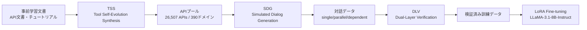

## 論文概要（Abstract）

本記事は [ToolACE: Winning the Points of LLM Function Calling](https://arxiv.org/abs/2409.00920)（arXiv:2409.00920, ICLR 2025採択）の解説記事です。

LLMのFunction Calling能力を向上させるには高品質な訓練データが不可欠ですが、実世界のFunction Callingデータは収集・アノテーションが困難であり、既存の合成データは網羅性と正確性に課題を抱えています。ToolACEは、自動化されたエージェントパイプラインにより、多様で正確かつ複雑なFunction Calling訓練データを生成する手法です。著者らは、このデータで訓練した8Bパラメータモデル（ToolACE-8B）がBerkeley Function-Calling Leaderboard（BFCL）においてGPT-4クラスのモデルに匹敵する性能を達成したと報告しています。

この記事は [Zenn記事: AI SDK v7×Next.jsでFunction Callingを型安全に実装する](https://zenn.dev/0h_n0/articles/a3b7e2f1c9d046) の深掘りです。Zenn記事ではAI SDK v7の`tool()`関数とZodスキーマによるFunction Callingの実装方法を解説していますが、本記事ではその背後にある「LLMがどのようにFunction Callingを学習するか」という訓練データの観点から深掘りします。

## 情報源

- **arXiv ID**: 2409.00920
- **URL**: [https://arxiv.org/abs/2409.00920](https://arxiv.org/abs/2409.00920)
- **著者**: Weiwen Liu, Xu Huang, Xingshan Zeng, Xinlong Hao, Shuai Yu, Dexun Li et al.
- **発表年**: 2024（ICLR 2025採択）
- **分野**: cs.LG, cs.AI, cs.CL

## 背景と動機（Background & Motivation）

LLMのFunction Calling（Tool Use）は、外部APIやツールを呼び出すことで、LLM単体では対応できないタスク（リアルタイムデータ取得、計算、データベース操作など）を実現する技術です。AI SDK v7のようなフレームワークでは、Zodスキーマによる型安全なツール定義が可能ですが、その根底にあるのはLLMが「どの関数を、どの引数で呼ぶべきか」を正しく判断する能力です。

この能力の獲得には高品質な訓練データが必要ですが、従来手法には以下の課題がありました。

- **実データの収集困難**: 実世界のFunction Callingログは企業固有のものが多く、公開データセットが限られる
- **合成データの品質**: 既存の自動生成データ（ToolLLM, xLAMなど）は、APIの多様性が不足し、複雑なマルチステップ呼び出しのカバレッジが低い
- **検証の不十分さ**: 生成されたデータの正確性を確認するメカニズムが弱く、ハルシネーションや不整合が混入する

ToolACEはこれらの課題に対し、「APIプールの自動拡張」「マルチエージェントによる対話生成」「二重検証」の3モジュールで構成されるパイプラインを提案しています。

## 主要な貢献（Key Contributions）

- **Tool Self-Evolution Synthesis（TSS）**: 事前学習文書からAPIコンテキストツリーを構築し、26,507個の多様なAPIを自動合成する手法
- **Simulated Dialog Generation（SDG）**: 複雑性評価器とマルチエージェントによる対話生成。モデル自身の損失関数でデータの難易度を適応的に調整する
- **Dual-Layer Verification（DLV）**: ルールベースとモデルベースの二重検証により、生成データの品質を保証する仕組み
- **BFCL-v3で8BモデルがGPT-4級**: ToolACE-8BがOverallスコア59.22を達成し、GPT-4-turbo（59.49）に0.27ポイント差まで迫ったことを著者らが報告（論文Table 2より）

## 技術的詳細（Technical Details）

### パイプライン全体像

ToolACEのパイプラインは3つのモジュールで構成されています。



### モジュール1: Tool Self-Evolution Synthesis（TSS）

TSSは3つのステップで構成されます。

**1. Speciation（種分化）**: フロンティアLLMが事前学習文書（APIマニュアル、チュートリアルなど）からAPIのドメインと機能を抽出し、階層的な「APIコンテキストツリー」を構築します。これにより、APIの機能空間を体系的に整理します。

**2. Adaptation（適応）**: API生成時に、ツリーからサブツリーをサンプリングします。各APIが異なる機能を持つよう、サブツリーの範囲を変化させます。広いサブツリーからは多機能なAPI、狭いサブツリーからは特化型APIが生成されます。

**3. Evolution（進化）**: LLMがサンプリングしたサブツリーとバッファ内の既存APIを参考に新しいAPIを合成します。多様性を確保するため、以下の変異指標が適用されます。

- 新しい機能やパラメータの追加
- 制約条件の変更
- パラメータ型の変異
- 戻り値の更新

生成されたAPIはバッファに戻され、次の生成のシードとなります。この自己進化プロセスにより、最終的に390ドメインにまたがる26,507個のAPIプールが構築されたと報告されています。

### モジュール2: Simulated Dialog Generation（SDG）

SDGはマルチエージェントシステムと複雑性評価器で構成されます。

**マルチエージェント対話生成**: ユーザーエージェント、アシスタントエージェント、ツールエージェントの3つのLLMエージェントが対話を生成します。アシスタントエージェントの行動空間は以下の4種類です。

- API呼び出し（Function Calling）
- 追加情報のリクエスト
- ツール応答の要約
- ツール不使用の回答

各アクションは複数回生成され、一貫した判断のみが採用されます。対話タイプは4種類に分類されます。

| 対話タイプ | 説明 | 例 |
|-----------|------|-----|
| Single | 1つのAPI呼び出し | 天気取得 |
| Parallel | 複数APIの同時呼び出し | 複数都市の天気を一括取得 |
| Dependent | APIの連鎖呼び出し | 検索 → 詳細取得 → カート追加 |
| Non-tool-use | ツール不使用の応答 | 一般的な質問への回答 |

**複雑性評価器**: 訓練対象モデル$M$自身の損失関数を用いて、各サンプルの難易度を評価します。

$$
H_M(x, y) = -\frac{1}{n_y} \sum_{i=1}^{n_y} \log p(t_i \mid x, t_1, \ldots, t_{i-1})
$$

ここで、
- $x$: 入力（ユーザークエリ + API定義）
- $y = [t_1, \ldots, t_{n_y}]$: 応答トークン列
- $H_M$: モデル$M$における平均トークンあたりの負の対数尤度

著者らによると、損失値が高いサンプルほどモデルにとって「難しい」データであり、以下の要因で損失が上昇する傾向があります。

- 候補APIの数が多い（選択肢が増える）
- 使用するAPIの数が多い（連鎖が長い）
- クエリとAPI descriptionの類似度が低い（暗黙的な推論が必要）

**Self-Guided Complication**: 複雑性スコアに基づき、簡単すぎるサンプルはユーザーエージェントにクエリの複雑化を指示し、難しすぎるサンプルは簡略化を指示します。これにより、モデルの学習に最も効果的な難易度帯のデータを重点的に生成します。

### モジュール3: Dual-Layer Verification（DLV）

**ルールベース検証**: 実行不要の静的チェックを4つの観点で実施します。

1. **API定義の明確性**: JSON Schema準拠、パラメータ型の整合性
2. **Function Callingの実行可能性**: 呼び出すAPI名がツールリストに存在するか、必須パラメータがすべて指定されているか、正規表現フォーマットの遵守
3. **対話の正確性**: 応答長の適切さ、言語の一貫性
4. **データの整合性**: ロール順序（user → assistant → tool）、ツール応答が呼び出し直後に続くか

**モデルベース検証**: 3つの専門LLMエージェントが以下を検証します。

1. パラメータ値のハルシネーション検出
2. ユーザー制約およびシステム制約との整合性
3. シミュレートされたツール応答とAPI定義の一致性

さらに、繰り返しや無意味な出力を除去するプロンプトも適用されます。人間の専門家が両レイヤーを監督する体制が取られています。

## 実装のポイント（Implementation）

### 訓練設定

著者らが報告している訓練設定は以下の通りです（論文Table 5より）。

- **ベースモデル**: LLaMA-3.1-8B-Instruct
- **手法**: LoRA（Supervised Fine-tuning）
- **LoRAパラメータ**: rank=16, alpha=32, 全モジュールに適用
- **学習率**: 1e-4
- **ウォームアップ比率**: 0.1
- **スケジューラ**: Cosine
- **バッチサイズ**: 48
- **エポック数**: 3

```python
from peft import LoraConfig, get_peft_model
from transformers import AutoModelForCausalLM

def setup_toolace_training(
    model_name: str = "meta-llama/Meta-Llama-3.1-8B-Instruct",
    lora_rank: int = 16,
    lora_alpha: int = 32,
) -> "PeftModel":
    """ToolACEの訓練設定を再現するためのLoRA設定例

    Args:
        model_name: ベースモデルのHuggingFace ID
        lora_rank: LoRAのランク
        lora_alpha: LoRAのアルファ値

    Returns:
        LoRA適用済みモデル
    """
    model = AutoModelForCausalLM.from_pretrained(
        model_name,
        torch_dtype="auto",
        device_map="auto",
    )

    lora_config = LoraConfig(
        r=lora_rank,
        lora_alpha=lora_alpha,
        target_modules="all-linear",
        task_type="CAUSAL_LM",
    )

    return get_peft_model(model, lora_config)
```

### API定義とZodスキーマの対応

ToolACEが生成するAPI定義はJSON Schema形式であり、これはAI SDK v7のZodスキーマと直接対応します。Zenn記事で解説されている`tool()`関数の`inputSchema`は内部的にJSON Schemaに変換されるため、ToolACEの訓練データと同じ形式です。

```typescript
// AI SDK v7のZodスキーマ定義
const searchProducts = tool({
  description: '商品名やカテゴリで商品を検索する',
  inputSchema: z.object({
    query: z.string().describe('検索キーワード'),
    category: z.enum(['electronics', 'books']).optional(),
  }),
  execute: async ({ query, category }) => { /* ... */ },
});

// ↑ 内部的に以下のJSON Schemaに変換される（ToolACEの訓練データ形式と同等）
// {
//   "type": "object",
//   "properties": {
//     "query": { "type": "string", "description": "検索キーワード" },
//     "category": { "type": "string", "enum": ["electronics", "books"] }
//   },
//   "required": ["query"]
// }
```

この対応関係は重要です。ToolACEの研究が示唆するのは、**descriptionの質がFunction Callingの精度に直結する**という点です。Zenn記事で「descriptionに使用条件を含める」と推奨されている理由は、LLMの訓練データにおいてdescriptionがツール選択の主要な手がかりとなっているためです。

## Production Deployment Guide

### AWS実装パターン（コスト最適化重視）

ToolACEのデータ生成パイプラインをAWS上で構築する場合の構成を示します。

**トラフィック量別の推奨構成**:

| 規模 | 用途 | 推奨構成 | 月額コスト | 主要サービス |
|------|------|---------|-----------|------------|
| **Small** | 研究・プロトタイプ | Serverless | $100-300 | Lambda + Bedrock + S3 |
| **Medium** | チーム利用（~1,000件/日） | Hybrid | $500-1,500 | ECS Fargate + Bedrock + ElastiCache |
| **Large** | 大規模データ生成（10,000件+/日） | Container + GPU | $3,000-8,000 | EKS + Spot GPU + SageMaker |

**Small構成の詳細**（月額$100-300）:
- **Lambda**: データ前処理・API定義の検証（$20/月）
- **Bedrock**: Claude 3.5 Haiku でAPI合成・対話生成（$150/月）
- **S3**: APIプール・生成データの保存（$5/月）
- **DynamoDB**: 生成済みAPI・対話のインデックス（$10/月）
- **Step Functions**: パイプラインオーケストレーション（$5/月）

**Medium構成の詳細**（月額$500-1,500）:
- **ECS Fargate**: マルチエージェント対話生成（0.5 vCPU × 4タスク、$200/月）
- **Bedrock**: Claude 3.5 Sonnet でデータ検証（$800/月）
- **ElastiCache Redis**: 生成済みAPIのキャッシュ（cache.t3.micro、$15/月）
- **SQS**: タスクキュー（$5/月）

**Large構成の詳細**（月額$3,000-8,000）:
- **EKS**: コントロールプレーン（$72/月）
- **EC2 Spot GPU**: g5.xlarge × 2-4台、LoRA Fine-tuning用（平均$800/月）
- **SageMaker**: モデル訓練ジョブ（$2,000/月）
- **Bedrock Batch**: 50%割引でデータ生成（$1,500/月）

**コスト削減テクニック**:
- Spot GPU Instances使用で最大90%削減（Karpenter自動管理）
- Bedrock Batch API使用で50%削減（非リアルタイムデータ生成）
- Prompt Caching有効化で30-90%削減（API定義テンプレートの再利用）
- S3 Intelligent-Tieringで長期保存コスト最適化

**コスト試算の注意事項**:
- 上記は2026年10月時点のAWS ap-northeast-1（東京）リージョン料金に基づく概算値です
- 実際のコストはデータ生成量、モデル選択、バースト使用量により変動します
- 最新料金は [AWS料金計算ツール](https://calculator.aws/) で確認してください

### Terraformインフラコード

**Small構成（Serverless）: Lambda + Bedrock + S3**

```hcl
module "vpc" {
  source  = "terraform-aws-modules/vpc/aws"
  version = "~> 5.0"

  name = "toolace-pipeline-vpc"
  cidr = "10.0.0.0/16"
  azs  = ["ap-northeast-1a", "ap-northeast-1c"]
  private_subnets = ["10.0.1.0/24", "10.0.2.0/24"]

  enable_nat_gateway   = false
  enable_dns_hostnames = true
}

resource "aws_iam_role" "lambda_toolace" {
  name = "lambda-toolace-role"

  assume_role_policy = jsonencode({
    Version = "2012-10-17"
    Statement = [{
      Action = "sts:AssumeRole"
      Effect = "Allow"
      Principal = { Service = "lambda.amazonaws.com" }
    }]
  })
}

resource "aws_iam_role_policy" "bedrock_invoke" {
  role = aws_iam_role.lambda_toolace.id

  policy = jsonencode({
    Version = "2012-10-17"
    Statement = [{
      Effect   = "Allow"
      Action   = ["bedrock:InvokeModel", "bedrock:InvokeModelWithResponseStream"]
      Resource = "arn:aws:bedrock:ap-northeast-1::foundation-model/anthropic.claude-3-5-haiku*"
    }]
  })
}

resource "aws_lambda_function" "api_synthesizer" {
  filename      = "api_synthesizer.zip"
  function_name = "toolace-api-synthesizer"
  role          = aws_iam_role.lambda_toolace.arn
  handler       = "index.handler"
  runtime       = "python3.12"
  timeout       = 120
  memory_size   = 1024

  environment {
    variables = {
      BEDROCK_MODEL_ID = "anthropic.claude-3-5-haiku-20241022-v1:0"
      S3_BUCKET        = aws_s3_bucket.api_pool.id
    }
  }
}

resource "aws_s3_bucket" "api_pool" {
  bucket = "toolace-api-pool-${data.aws_caller_identity.current.account_id}"
}

resource "aws_s3_bucket_server_side_encryption_configuration" "api_pool" {
  bucket = aws_s3_bucket.api_pool.id

  rule {
    apply_server_side_encryption_by_default {
      sse_algorithm = "aws:kms"
    }
  }
}

resource "aws_dynamodb_table" "generation_index" {
  name         = "toolace-generation-index"
  billing_mode = "PAY_PER_REQUEST"
  hash_key     = "api_id"

  attribute {
    name = "api_id"
    type = "S"
  }

  ttl {
    attribute_name = "expire_at"
    enabled        = true
  }
}

resource "aws_cloudwatch_metric_alarm" "lambda_cost" {
  alarm_name          = "toolace-lambda-cost-spike"
  comparison_operator = "GreaterThanThreshold"
  evaluation_periods  = 1
  metric_name         = "Duration"
  namespace           = "AWS/Lambda"
  period              = 3600
  statistic           = "Sum"
  threshold           = 200000
  alarm_description   = "Lambda実行時間異常（コスト急増の可能性）"

  dimensions = {
    FunctionName = aws_lambda_function.api_synthesizer.function_name
  }
}

data "aws_caller_identity" "current" {}
```

**Large構成（Container + GPU）: EKS + Spot + SageMaker**

```hcl
module "eks" {
  source  = "terraform-aws-modules/eks/aws"
  version = "~> 20.0"

  cluster_name    = "toolace-training-cluster"
  cluster_version = "1.31"

  vpc_id     = module.vpc.vpc_id
  subnet_ids = module.vpc.private_subnets

  cluster_endpoint_public_access = true
  enable_cluster_creator_admin_permissions = true
}

resource "kubectl_manifest" "karpenter_provisioner" {
  yaml_body = <<-YAML
    apiVersion: karpenter.sh/v1alpha5
    kind: Provisioner
    metadata:
      name: gpu-spot-provisioner
    spec:
      requirements:
        - key: karpenter.sh/capacity-type
          operator: In
          values: ["spot"]
        - key: node.kubernetes.io/instance-type
          operator: In
          values: ["g5.xlarge", "g5.2xlarge"]
      limits:
        resources:
          cpu: "32"
          memory: "128Gi"
          nvidia.com/gpu: "4"
      providerRef:
        name: default
      ttlSecondsAfterEmpty: 60
  YAML
}

resource "aws_budgets_budget" "toolace_monthly" {
  name         = "toolace-monthly-budget"
  budget_type  = "COST"
  limit_amount = "8000"
  limit_unit   = "USD"
  time_unit    = "MONTHLY"

  notification {
    comparison_operator        = "GREATER_THAN"
    threshold                  = 80
    threshold_type             = "PERCENTAGE"
    notification_type          = "ACTUAL"
    subscriber_email_addresses = ["ops@example.com"]
  }
}
```

### セキュリティベストプラクティス

1. **ネットワーク**: EKSは`cluster_endpoint_public_access = false`推奨（VPN経由アクセス）
2. **IAMロール**: Bedrock呼び出しは最小権限で特定モデルIDのみ許可
3. **シークレット**: AWS Secrets Manager使用、環境変数へのハードコード禁止
4. **暗号化**: S3/DynamoDB全てKMS暗号化、転送中はTLS 1.2以上
5. **監査**: CloudTrail全リージョン有効化

### 運用・監視設定

**CloudWatch Logs Insights クエリ**:

```sql
-- データ生成スループット: 1時間あたりの生成件数
fields @timestamp, generation_type, api_count
| stats count(*) as generated_count by bin(1h), generation_type
| sort generated_count desc

-- 検証失敗率
fields @timestamp, verification_result
| stats count(*) as total,
        sum(case when verification_result = 'FAIL' then 1 else 0 end) as failures
  by bin(1h)
| filter total > 0
```

**CloudWatch アラーム（コスト重視）**:

```python
import boto3

cloudwatch = boto3.client('cloudwatch')

cloudwatch.put_metric_alarm(
    AlarmName='toolace-bedrock-token-spike',
    ComparisonOperator='GreaterThanThreshold',
    EvaluationPeriods=1,
    MetricName='TokenUsage',
    Namespace='AWS/Bedrock',
    Period=3600,
    Statistic='Sum',
    Threshold=500000,
    ActionsEnabled=True,
    AlarmActions=['arn:aws:sns:ap-northeast-1:123456789:cost-alerts'],
    AlarmDescription='Bedrockトークン使用量異常'
)
```

**X-Ray トレーシング設定**:

```python
from aws_xray_sdk.core import xray_recorder, patch_all

patch_all()

@xray_recorder.capture('api_synthesis')
def synthesize_api(context_tree_node: dict) -> dict:
    """APIコンテキストツリーからAPI定義を合成する"""
    xray_recorder.put_annotation('domain', context_tree_node.get('domain', ''))
    xray_recorder.put_metadata('subtree_size', len(context_tree_node.get('children', [])))

    response = bedrock.invoke_model(
        modelId='anthropic.claude-3-5-haiku-20241022-v1:0',
        body=json.dumps({'prompt': build_synthesis_prompt(context_tree_node)})
    )

    xray_recorder.put_metadata('token_count', response['usage']['total_tokens'])
    return response
```

### コスト最適化チェックリスト

**アーキテクチャ選択**:
- [ ] 研究用途 → Lambda + Bedrock (Serverless) - $100-300/月
- [ ] チーム利用 → ECS Fargate + Bedrock (Hybrid) - $500-1,500/月
- [ ] 大規模生成 → EKS + Spot GPU (Container) - $3,000-8,000/月

**リソース最適化**:
- [ ] EC2 GPU: Spot Instances優先（最大90%削減、Karpenter自動管理）
- [ ] Reserved Instances: 継続的な訓練ジョブには1年コミットで72%削減
- [ ] Savings Plans: Compute Savings Plans検討（柔軟性高）
- [ ] Lambda: メモリサイズ最適化（CloudWatch Insights分析）
- [ ] ECS/EKS: アイドルタイムのスケールダウン（夜間0台）

**LLMコスト削減**:
- [ ] Bedrock Batch API: 50%割引（バッチデータ生成）
- [ ] Prompt Caching: 30-90%削減（APIテンプレート再利用）
- [ ] モデル選択ロジック: API合成はHaiku、検証はSonnet
- [ ] トークン数制限: max_tokens設定で過剰生成防止

**監視・アラート**:
- [ ] AWS Budgets: 月額予算設定（80%で警告）
- [ ] CloudWatch アラーム: トークン使用量スパイク検知
- [ ] Cost Anomaly Detection: 自動異常検知
- [ ] 日次コストレポート: SNS/Slackへ自動送信

**リソース管理**:
- [ ] 未使用リソース削除: Lambda Insights活用
- [ ] タグ戦略: 環境別（dev/staging/prod）でコスト可視化
- [ ] S3ライフサイクル: 古い生成データの自動アーカイブ（30日）
- [ ] GPU インスタンス: 訓練完了後の自動停止

## 実験結果（Results）

### BFCL-v3ベンチマーク

論文Table 2より、BFCL-v3（2024年9月20日更新時点）における主要モデルの比較結果を示します。

| モデル | Overall | Non-live (AST) | Non-live (Exec) | Live (AST) | Multi-turn | Relevance | Irrelevance |
|--------|---------|---------------|-----------------|------------|------------|-----------|-------------|
| GPT-4-turbo (FC) | 59.49 | 82.65 | 83.80 | 73.39 | 21.62 | 70.73 | 79.79 |
| **ToolACE-8B (FC)** | **59.22** | **89.27** | **90.07** | **73.21** | **14.37** | **85.37** | **83.81** |
| GPT-4o (FC) | 59.29 | 85.52 | 82.96 | 71.79 | 21.25 | 63.41 | 82.91 |
| xLAM-7b-fc-r (FC) | 51.45 | 86.83 | 85.02 | 68.81 | 0.00 | 80.49 | 79.76 |
| Gorilla-v2 (FC) | 51.01 | 87.29 | 84.96 | 68.59 | 0.00 | 85.37 | 73.13 |

著者らが報告する注目点として、ToolACE-8BはNon-live（AST: 89.27, Exec: 90.07）およびRelevance（85.37）でGPT-4-turboを上回っています。一方、Multi-turn（14.37 vs 21.62）ではGPT-4-turboに差をつけられており、マルチターン対話での長期的な文脈追跡に課題が残ることが示唆されています。

### API-Bankベンチマーク

論文Table 3より、API-Bankにおける結果です。

| モデル | Call | Retrieval+Call |
|--------|------|---------------|
| GPT-4-0613 | 75.94 | 48.89 |
| ToolACE-8B | 75.94 | 47.41 |
| LLaMA-3.1-8B-Instruct | 71.18 | 37.04 |
| xLAM-7b-fc-r | 32.83 | 21.48 |

ToolACE-8BはCall単体ではGPT-4-0613と同スコア（75.94）を達成し、Retrieval+CallでもGPT-4に1.48ポイント差まで迫ったと報告されています。

### アブレーション研究

論文Table 6より、訓練データ比較（25,000サンプル統一条件）の結果です。

| データソース | Overallスコア |
|-------------|-------------|
| ToolACE | 58.19 |
| xLAM | 40.51 |
| ToolLLM | 24.90 |

同じデータ量で比較した場合、ToolACEデータはxLAMデータの1.44倍、ToolLLMデータの2.34倍のOverallスコアを達成したと著者らは報告しています。

論文Table 7より、対話タイプ別のアブレーション結果です。Parallel（並列呼び出し）データを除外するとOverallが58.19→50.60に低下し、Multi-type（複数タイプ混合）データを除外するとIrrelevance（不要なツール呼び出しの拒否能力）が83.81→6.99に激減することが報告されています。

## 実運用への応用（Practical Applications）

### AI SDKとの関連性

ToolACEの知見は、AI SDK v7でFunction Callingを実装する際に以下の示唆を与えます。

**descriptionの重要性**: ToolACEの複雑性評価器は、クエリとAPI descriptionの類似度が低いほど難易度が上がることを示しています。AI SDK v7の`tool()`関数における`description`は、Zodスキーマの`.describe()`とともに、LLMのツール選択精度を左右する要因です。

**多様な呼び出しパターンへの対応**: ToolACEが4種類の対話タイプ（single, parallel, dependent, non-tool-use）を網羅的に生成していることは、`stopWhen: isStepCount(5)`のようなマルチステップ設定が実用上不可欠であることを裏付けています。

**Irrelevanceの重要性**: ToolACEのアブレーション結果は、「ツールを使わない」判断の訓練が不十分だとIrrelevanceスコアが激減することを示しています。AI SDK v7の`toolChoice: 'auto'`設定では、LLMがツール不使用を適切に判断する必要があり、この能力は訓練データの質に依存します。

### スケーリング戦略

ToolACEのパイプラインは、APIプール拡張 → 対話生成 → 検証の3段階が独立しているため、各段階を水平スケールできます。Large構成（EKS + Spot GPU）では、APIプール拡張と対話生成を並列実行し、検証をバッチ処理することで、1日あたり数万件のデータ生成が可能です。

## 関連研究（Related Work）

- **ToolLLM**（Qin et al., 2024）: RapidAPIから16,464個の実APIを収集し、ChatGPTで訓練データを生成。ToolACEと比較して、合成API数とデータ品質に差がある（論文Table 6で25kサンプル比較時にOverall 24.90 vs 58.19）
- **xLAM**（Zhang et al., 2024）: 大規模なFunction Callingデータセット。ToolACEのTSS（自己進化合成）とは異なり、既存APIの収集に基づく。同条件比較でOverall 40.51 vs 58.19（論文Table 6）
- **Gorilla**（Patil et al., 2023）: APIドキュメントを検索拡張生成（RAG）で活用するFunction Callingモデル。BFCLリーダーボードの基盤

## まとめと今後の展望

ToolACEは、Function Calling訓練データの自動生成において3つの技術的貢献を行っています。TSSによるAPIプールの自動拡張（26,507 API）、SDGによる適応的難易度調整を伴うマルチエージェント対話生成、DLVによる二重検証です。著者らは、これらにより8BモデルでGPT-4級のFunction Calling性能が達成されたと報告しています。

AI SDK v7のようなフレームワークでFunction Callingを実装する開発者にとって、ToolACEの研究は「なぜdescriptionの質が重要なのか」「なぜマルチステップ対応が難しいのか」という疑問に対する訓練データ側からの回答を提供しています。モデルとデータはHuggingFace（Team-ACE）で公開されています。

## 参考文献

- **arXiv**: [https://arxiv.org/abs/2409.00920](https://arxiv.org/abs/2409.00920)
- **HuggingFace**: [https://huggingface.co/Team-ACE](https://huggingface.co/Team-ACE)
- **Related Zenn article**: [https://zenn.dev/0h_n0/articles/a3b7e2f1c9d046](https://zenn.dev/0h_n0/articles/a3b7e2f1c9d046)

---

:::message
この記事はAI（Claude Code）により自動生成されました。内容の正確性については原論文をご確認ください。本記事は論文の引用・解説であり、筆者自身が実験を行ったものではありません。
:::
