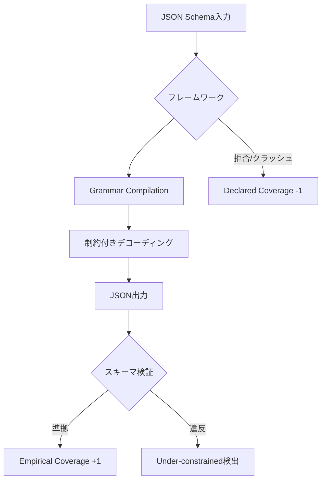

## 論文概要（Abstract）

本記事は [https://arxiv.org/abs/2501.10868](https://arxiv.org/abs/2501.10868) の解説記事です。

JSONSchemaBenchは、LLMの構造化出力（Structured Output）を実現する**制約付きデコーディング（Constrained Decoding）**の信頼性を体系的に評価するベンチマークである。著者らは約10,000件の実世界JSON Schemaを収集し、6つの主要フレームワーク（Guidance、Outlines、Llamacpp、XGrammar、OpenAI、Gemini）を**効率性（Efficiency）**・**網羅性（Coverage）**・**出力品質（Quality）**の3次元で比較評価している。

この記事は [Zenn記事: AI SDK v7×Next.jsでFunction Callingを型安全に実装する](https://zenn.dev/0h_n0/articles/a3b7e2f1c9d046) の深掘りです。Zenn記事ではZodスキーマがJSON Schemaに変換されてLLMに渡される仕組みを解説していますが、本論文はその**JSON Schema準拠の出力をLLMが実際にどの程度正確に生成できるのか**を定量的に検証しています。

## 情報源

- **arXiv ID**: 2501.10868
- **URL**: [https://arxiv.org/abs/2501.10868](https://arxiv.org/abs/2501.10868)
- **著者**: Saibo Geng, Hudson Cooper, Michał Moskal, Samuel Jenkins, Julian Berman, Nathan Ranchin, Robert West, Eric Horvitz, Harsha Nori
- **発表年**: 2025
- **分野**: cs.CL, cs.AI
- **コード**: [github.com/guidance-ai/jsonschemabench](https://github.com/guidance-ai/jsonschemabench)
- **データセット**: [huggingface.co/datasets/epfl-dlab/JSONSchemaBench](https://huggingface.co/datasets/epfl-dlab/JSONSchemaBench)（MITライセンス）

## 背景と動機（Background & Motivation）

LLMの出力を構造化データとして利用する需要が急速に高まっている。Function Callingでは、LLMが生成するJSON引数がスキーマに準拠している必要があり、AI SDK v7の`strict: true`オプションのように、プロバイダー側でスキーマ準拠を保証する機能も登場している。

しかし、著者らはこの分野には以下の課題があると指摘している：

- 制約付きデコーディングの実効性が**体系的に評価されていない**
- 既存ベンチマークは合成スキーマが中心で、**実世界のスキーマ複雑性を反映していない**
- フレームワーク間の比較が**公平な条件**で行われていない

これらの課題を解決するため、著者らは実世界から収集した約10,000件のJSON Schemaに基づくベンチマークと、3次元の評価フレームワークを提案している。

## 主要な貢献（Key Contributions）

- **貢献1**: 効率性・網羅性・出力品質の3次元で制約付きデコーディングを評価するフレームワークの提案
- **貢献2**: GitHubリポジトリ、Kubernetes、GlaiveAI等から収集した約10,000件の実世界JSON Schemaによるベンチマーク（JSONSchemaBench）の構築
- **貢献3**: 6つの主要フレームワーク（Guidance、Outlines、Llamacpp、XGrammar、OpenAI、Gemini）の定量的比較と、各フレームワークの強み・弱みの特定
- **貢献4**: 公式JSON Schema Test Suiteとの統合による、スキーマ機能サポートの詳細な検証

## 技術的詳細（Technical Details）

### ベンチマーク構成

著者らは10のコレクションから合計9,558件のJSON Schemaを収集している（論文Table 1より）。

| データセット | スキーマ数 | 特徴 |
|-------------|----------|------|
| GlaiveAI-2K | 1,707 | Function Calling用スキーマ |
| GitHub-Easy | 1,943 | 10〜30フィールド |
| GitHub-Medium | 1,976 | 30〜100フィールド |
| GitHub-Hard | 1,240 | 100〜500フィールド |
| Kubernetes | 1,064 | API定義スキーマ |
| JSON Schema Store | 492 | 公開スキーマレジストリ |
| Snowplow | 403 | イベント追跡スキーマ |
| Washington Post | 125 | ANS仕様 |
| GitHub-Trivial | 444 | 10フィールド未満 |
| GitHub-Ultra | 164 | 500フィールド超 |

複雑度はフィールド数に基づいてTrivial（<10）、Easy（10〜30）、Medium（30〜100）、Hard（100〜500）、Ultra（>500）の5段階に分類されている。GitHub-TrivialとGitHub-Ultraは実験対象外として扱われている。

### 評価フレームワーク：3つの次元

#### 1. 効率性（Efficiency）

著者らは3つの時間指標を定義している：

- **GCT（Grammar Compilation Time）**: JSON Schemaから文法オートマトンへの変換時間
- **TTFT（Time to First Token）**: 最初のトークン生成までの時間（GCT含む）
- **TPOT（Time Per Output Token）**: 出力トークンあたりの生成時間

$$
\text{TTFT} = \text{GCT} + T_{\text{prefill}} + T_{\text{first\_decode}}
$$

ここで、$T_{\text{prefill}}$はプロンプトの処理時間、$T_{\text{first\_decode}}$は最初のデコードステップの時間を表す。

#### 2. 網羅性（Coverage）

著者らは3段階のカバレッジを定義している：

- **Declared Coverage**: フレームワークがスキーマを受理する（クラッシュ・拒否しない）割合
- **Empirical Coverage**: 生成された出力が実際にスキーマに準拠する割合
- **Compliance Rate**: Empirical Coverage / Declared Coverage

$$
\text{Compliance Rate} = \frac{|\{s \in S : \text{output}(s) \models s\}|}{|\{s \in S : \text{accepted}(s)\}|}
$$

ここで、$S$はスキーマ集合、$\text{output}(s) \models s$は出力がスキーマ$s$に準拠することを表す。

Compliance Rateが1未満の場合、フレームワークがスキーマを受理したにもかかわらず、生成された出力がスキーマに違反していることを意味する（**under-constrained**な挙動）。

#### 3. 出力品質（Quality）

制約付きデコーディングが推論タスクの精度に与える影響を、Last Letters（文字操作）、Shuffle Objects（オブジェクト並べ替え）、GSM8K（数学推論）の3タスクで評価している。

### フレームワーク比較の手法

著者らはLlamacppバックエンドとHugging Faceバックエンドの両方で実験を実施している。モデルはLlama-3.1-8B-InstructおよびLlama-3.2-1B-Instructを使用し、greedy decodingで40秒のタイムアウトを設定している。



## 実験結果（Results）

### 効率性の比較

論文Table 2より、Llama-3.1-8B-InstructをLlamacppバックエンドで実行した際の中央値を示す：

| データセット | フレームワーク | GCT (s) | TTFT (s) | TPOT (ms) |
|-------------|-------------|---------|---------|----------|
| GlaiveAI | LM only（制約なし） | — | 0.10 | 15.40 |
| GlaiveAI | Guidance | 0.00 | 0.24 | 6.37 |
| GlaiveAI | Llamacpp | 0.05 | 0.20 | 29.98 |
| GlaiveAI | Outlines | 3.48 | 3.65 | 30.33 |
| GitHub-Medium | Guidance | 0.01 | 0.54 | 7.57 |
| GitHub-Medium | Outlines | 8.05 | 8.38 | 46.57 |

著者らは、Guidanceのfast-forwarding機構により、制約付きデコーディングが**制約なしデコーディングよりも高速になる**場合があると報告している（GlaiveAIデータセットでTPOT 6.37ms vs 15.40ms）。一方、Outlinesは文法コンパイル時間が数秒〜数十秒と大きく、実用上のボトルネックになると指摘されている。

### 網羅性の比較

論文Table 4より、Llama-3.2-1B-Instructでの結果（一部抜粋）：

| データセット | フレームワーク | Declared | Empirical | Compliance |
|-------------|-------------|----------|-----------|------------|
| GitHub-Easy | Guidance | 0.90 | 0.86 | 0.96 |
| GitHub-Easy | OpenAI | 0.30 | 0.29 | 0.97 |
| GitHub-Hard | Guidance | 0.60 | 0.41 | 0.69 |
| GitHub-Hard | Llamacpp | 0.61 | 0.39 | 0.63 |
| GitHub-Hard | LM only | 1.00 | 0.13 | 0.13 |

この結果から読み取れる重要なポイント：

1. **OpenAI/Geminiは保守的な戦略**を取っている。Declared Coverageは低い（0.30）が、受理したスキーマに対するCompliance Rateは高い（0.97）。サポートするJSON Schema機能を限定することで、高い準拠率を維持している
2. **複雑なスキーマでは全フレームワークが苦戦**する。GitHub-Hardでは、最良のGuidanceでもEmpirical Coverageが0.41にとどまる
3. **制約なし（LM only）では0.13**と、LLM単体ではスキーマ準拠が困難であることが明確に示されている

### JSON Schema Test Suite による機能サポート評価

論文Table 6より、43カテゴリのJSON Schema機能に対するフレームワーク別の失敗モードを示す：

| 失敗タイプ | Guidance | Outlines | Llamacpp | XGrammar |
|-----------|----------|----------|----------|----------|
| コンパイルエラー | 25 | 42 | 37 | 3 |
| Under-constrained | 1 | 8 | 7 | 38 |

著者らはXGrammarについて、コンパイルエラーは少ないものの**under-constrained（制約不足）の失敗が38カテゴリ**と報告しており、スキーマを受理しても制約が正しく適用されないケースが多いと指摘している。

### 出力品質への影響

論文Table 8より、Llama-3.1-8B-Instructでの推論タスク精度：

| 手法 | Last Letters | Shuffle Objects | GSM8K |
|------|-------------|----------------|-------|
| LM only | 50.7% | 52.6% | 80.1% |
| XGrammar | 51.2% | 52.7% | 83.7% |
| Llamacpp | 52.0% | 52.6% | 82.4% |
| Outlines | 53.3% | 53.0% | 81.6% |
| Guidance | 54.0% | 55.9% | 83.8% |

著者らは、制約付きデコーディングがタスク精度を**低下させない**ことを確認し、Guidanceでは約3%の精度向上が見られたと報告している。この向上はtoken-healing実装による効果と考えられると述べている。

## 実装のポイント（Implementation）

### 制約付きデコーディングの内部メカニズム

制約付きデコーディングでは、JSON Schemaを有限状態オートマトン（FSA）やプッシュダウンオートマトン（PDA）に変換し、各デコードステップでスキーマに違反するトークンをマスクする。

```python
from typing import Any

def constrained_decode(
    model: Any,
    schema: dict,
    prompt: str,
    max_tokens: int = 1024,
) -> str:
    """制約付きデコーディングの概念的な実装

    Args:
        model: LLMモデル
        schema: JSON Schemaの辞書表現
        prompt: 入力プロンプト
        max_tokens: 最大生成トークン数

    Returns:
        スキーマに準拠したJSON文字列
    """
    automaton = compile_schema_to_automaton(schema)
    state = automaton.initial_state
    tokens: list[int] = []

    for _ in range(max_tokens):
        logits = model.forward(prompt, tokens)
        # スキーマ違反トークンをマスク
        valid_tokens = automaton.get_valid_tokens(state)
        masked_logits = apply_mask(logits, valid_tokens)
        next_token = greedy_select(masked_logits)

        if next_token == EOS_TOKEN:
            break

        tokens.append(next_token)
        state = automaton.transition(state, next_token)

    return decode_tokens(tokens)


def compile_schema_to_automaton(schema: dict) -> Any:
    """JSON Schemaを有限状態オートマトンに変換

    GCT（Grammar Compilation Time）に相当する処理。
    スキーマの複雑度に応じて変換時間が変動する。
    """
    raise NotImplementedError
```

### AI SDK v7との関連

Zenn記事で解説されているAI SDK v7の`tool()`関数では、Zodスキーマが内部的にJSON Schemaに変換される。`strict: true`オプションを有効にすると、プロバイダー側で制約付きデコーディングが適用される。

本論文の結果から、以下の実装上の考慮事項が導き出される：

1. **スキーマの複雑度を意識する**: フィールド数100以上のスキーマでは、最良のフレームワークでもEmpirical Coverageが0.41程度。ツール定義のスキーマはできるだけシンプルに保つべき
2. **プロバイダーごとの戦略の違い**: OpenAI/Geminiは保守的にサポート範囲を限定して高いCompliance Rateを維持。`z.union()`や再帰型が`strict: true`で動作しない理由はここにある
3. **リトライ戦略の重要性**: under-constrainedな出力に対しては、バリデーション失敗時のリトライが有効

## Production Deployment Guide

### AWS実装パターン（コスト最適化重視）

構造化出力の制約付きデコーディングをプロダクション環境で運用する際のAWS構成を示す。

**トラフィック量別の推奨構成**:

| 規模 | 月間リクエスト | 推奨構成 | 月額コスト | 主要サービス |
|------|--------------|---------|-----------|------------|
| **Small** | ~3,000 (100/日) | Serverless | $50-150 | Lambda + Bedrock + DynamoDB |
| **Medium** | ~30,000 (1,000/日) | Hybrid | $300-800 | Lambda + ECS Fargate + ElastiCache |
| **Large** | 300,000+ (10,000/日) | Container | $2,000-5,000 | EKS + Karpenter + EC2 Spot |

**Small構成の詳細**（月額$50-150）:
- **Lambda**: 1GB RAM、60秒タイムアウト（$20/月）
- **Bedrock**: Claude 3.5 Haiku、Prompt Caching有効（$80/月）。Bedrockのstructured output機能で制約付きデコーディングを利用
- **DynamoDB**: On-Demand、スキーマキャッシュ用（$10/月）
- **CloudWatch**: 基本監視（$5/月）

**Medium構成の詳細**（月額$300-800）:
- **ECS Fargate**: 0.5 vCPU、1GB RAM × 2タスク（$120/月）。vLLM + XGrammarでセルフホスト制約付きデコーディング
- **ElastiCache Redis**: コンパイル済み文法キャッシュ（$15/月）。GCT削減に有効
- **Bedrock**: バッチ処理用（$400/月）

**Large構成の詳細**（月額$2,000-5,000）:
- **EKS + Karpenter**: Spot Instances（g5.xlarge）で最大90%削減
- **セルフホストLLM**: vLLM + Guidanceバックエンドで完全制御。論文結果よりGuidanceのTPOTが最も高速
- **Redis Cluster**: 文法キャッシュの分散管理

**コスト削減テクニック**:
- Spot Instances使用で最大90%削減（EKS + Karpenter）
- Bedrock Batch API使用で50%削減（非リアルタイム処理）
- 文法コンパイル結果のキャッシュでGCTを削減（論文よりOutlinesはGCT 3〜8秒）
- Prompt Caching有効化で30-90%削減

**コスト試算の注意事項**: 上記は2026年10月時点のAWS ap-northeast-1（東京）リージョン料金に基づく概算値です。実際のコストはトラフィックパターン、リージョン、バースト使用量により変動します。最新料金は [AWS料金計算ツール](https://calculator.aws/) で確認してください。

### Terraformインフラコード

**Small構成（Serverless）: Lambda + Bedrock + DynamoDB**

```hcl
module "vpc" {
  source  = "terraform-aws-modules/vpc/aws"
  version = "~> 5.0"

  name = "structured-output-vpc"
  cidr = "10.0.0.0/16"
  azs  = ["ap-northeast-1a", "ap-northeast-1c"]
  private_subnets = ["10.0.1.0/24", "10.0.2.0/24"]

  enable_nat_gateway   = false
  enable_dns_hostnames = true
}

resource "aws_iam_role" "lambda_bedrock" {
  name = "lambda-structured-output-role"

  assume_role_policy = jsonencode({
    Version = "2012-10-17"
    Statement = [{
      Action    = "sts:AssumeRole"
      Effect    = "Allow"
      Principal = { Service = "lambda.amazonaws.com" }
    }]
  })
}

resource "aws_iam_role_policy" "bedrock_invoke" {
  role = aws_iam_role.lambda_bedrock.id

  policy = jsonencode({
    Version = "2012-10-17"
    Statement = [{
      Effect   = "Allow"
      Action   = ["bedrock:InvokeModel", "bedrock:InvokeModelWithResponseStream"]
      Resource = "arn:aws:bedrock:ap-northeast-1::foundation-model/anthropic.claude-3-5-haiku*"
    }]
  })
}

resource "aws_lambda_function" "structured_output_handler" {
  filename      = "lambda.zip"
  function_name = "structured-output-handler"
  role          = aws_iam_role.lambda_bedrock.arn
  handler       = "index.handler"
  runtime       = "python3.12"
  timeout       = 60
  memory_size   = 1024

  environment {
    variables = {
      BEDROCK_MODEL_ID    = "anthropic.claude-3-5-haiku-20241022-v1:0"
      DYNAMODB_TABLE      = aws_dynamodb_table.schema_cache.name
      ENABLE_STRICT_MODE  = "true"
    }
  }
}

resource "aws_dynamodb_table" "schema_cache" {
  name         = "json-schema-cache"
  billing_mode = "PAY_PER_REQUEST"
  hash_key     = "schema_hash"

  attribute {
    name = "schema_hash"
    type = "S"
  }

  ttl {
    attribute_name = "expire_at"
    enabled        = true
  }
}

resource "aws_cloudwatch_metric_alarm" "lambda_cost" {
  alarm_name          = "structured-output-cost-spike"
  comparison_operator = "GreaterThanThreshold"
  evaluation_periods  = 1
  metric_name         = "Duration"
  namespace           = "AWS/Lambda"
  period              = 3600
  statistic           = "Sum"
  threshold           = 100000
  alarm_description   = "Lambda実行時間異常（コスト急増の可能性）"

  dimensions = {
    FunctionName = aws_lambda_function.structured_output_handler.function_name
  }
}
```

**Large構成（Container）: EKS + vLLM + Guidance**

```hcl
module "eks" {
  source  = "terraform-aws-modules/eks/aws"
  version = "~> 20.0"

  cluster_name    = "structured-output-cluster"
  cluster_version = "1.31"

  vpc_id     = module.vpc.vpc_id
  subnet_ids = module.vpc.private_subnets

  cluster_endpoint_public_access = true
  enable_cluster_creator_admin_permissions = true
}

resource "kubectl_manifest" "karpenter_provisioner" {
  yaml_body = <<-YAML
    apiVersion: karpenter.sh/v1alpha5
    kind: Provisioner
    metadata:
      name: spot-gpu-provisioner
    spec:
      requirements:
        - key: karpenter.sh/capacity-type
          operator: In
          values: ["spot"]
        - key: node.kubernetes.io/instance-type
          operator: In
          values: ["g5.xlarge", "g5.2xlarge"]
      limits:
        resources:
          cpu: "32"
          memory: "128Gi"
      providerRef:
        name: default
      ttlSecondsAfterEmpty: 30
  YAML
}

resource "aws_budgets_budget" "structured_output_monthly" {
  name         = "structured-output-monthly-budget"
  budget_type  = "COST"
  limit_amount = "5000"
  limit_unit   = "USD"
  time_unit    = "MONTHLY"

  notification {
    comparison_operator        = "GREATER_THAN"
    threshold                  = 80
    threshold_type             = "PERCENTAGE"
    notification_type          = "ACTUAL"
    subscriber_email_addresses = ["ops@example.com"]
  }
}
```

### セキュリティベストプラクティス

1. **ネットワークセキュリティ**: EKSは`cluster_endpoint_public_access = false`を推奨（VPN/Direct Connect経由）。Lambda はVPC内配置
2. **認証・認可**: IAMロール最小権限。Bedrock呼び出しは特定モデルARNに限定
3. **シークレット管理**: AWS Secrets Manager使用。環境変数へのハードコード禁止
4. **データ保護**: 転送中TLS 1.2以上、保管中KMS暗号化

### 運用・監視設定

**CloudWatch Logs Insights クエリ**:

```sql
-- スキーマ準拠率の監視
fields @timestamp, schema_id, is_compliant, framework
| stats avg(is_compliant) as compliance_rate by bin(1h)
| filter compliance_rate < 0.95

-- GCT異常検知（Outlines使用時に重要）
fields @timestamp, schema_complexity, gct_ms
| stats pct(gct_ms, 95) as p95_gct, pct(gct_ms, 99) as p99_gct by bin(5m)
| filter p95_gct > 5000
```

**CloudWatch アラーム（コスト重視）**:

```python
import boto3

cloudwatch = boto3.client('cloudwatch')

cloudwatch.put_metric_alarm(
    AlarmName='bedrock-token-spike',
    ComparisonOperator='GreaterThanThreshold',
    EvaluationPeriods=1,
    MetricName='TokenUsage',
    Namespace='AWS/Bedrock',
    Period=3600,
    Statistic='Sum',
    Threshold=500000,
    ActionsEnabled=True,
    AlarmActions=['arn:aws:sns:ap-northeast-1:123456789:cost-alerts'],
    AlarmDescription='Bedrockトークン使用量異常（コスト急増）'
)
```

**X-Ray トレーシング設定**:

```python
from aws_xray_sdk.core import xray_recorder, patch_all

patch_all()

@xray_recorder.capture('structured_output_generation')
def generate_structured_output(schema: dict, prompt: str) -> dict:
    """制約付きデコーディングによる構造化出力生成"""
    xray_recorder.put_annotation('schema_complexity', count_fields(schema))
    xray_recorder.put_metadata('schema', schema)

    response = bedrock.invoke_model(
        modelId='anthropic.claude-3-5-haiku-20241022-v1:0',
        body=json.dumps({
            'prompt': prompt,
            'tool_choice': {'type': 'tool', 'name': 'structured_output'},
        })
    )

    xray_recorder.put_metadata('token_count', response['usage']['total_tokens'])
    return response
```

### コスト最適化チェックリスト

**アーキテクチャ選択**:
- [ ] ~100 req/日 → Lambda + Bedrock（Serverless）$50-150/月
- [ ] ~1,000 req/日 → ECS Fargate + セルフホスト（Hybrid）$300-800/月
- [ ] 10,000+ req/日 → EKS + Spot Instances（Container）$2,000-5,000/月

**リソース最適化**:
- [ ] EC2: Spot Instances優先（最大90%削減、Karpenter自動管理）
- [ ] Reserved Instances: 1年コミットで最大72%削減
- [ ] Lambda: メモリサイズ最適化（CloudWatch Insights分析）
- [ ] ECS/EKS: アイドルタイムのスケールダウン（夜間0台）
- [ ] 文法コンパイル結果のRedisキャッシュ（GCT削減）

**LLMコスト削減**:
- [ ] Bedrock Batch API: 50%割引（非リアルタイム処理）
- [ ] Prompt Caching: 30-90%削減（システムプロンプト固定）
- [ ] モデル選択: 簡易スキーマはHaiku、複雑スキーマはSonnet
- [ ] `max_tokens`設定で過剰生成防止

**監視・アラート**:
- [ ] AWS Budgets: 月額予算設定（80%で警告）
- [ ] CloudWatch: スキーマ準拠率・GCT・TPOT監視
- [ ] Cost Anomaly Detection: 自動異常検知
- [ ] 日次コストレポート: SNS/Slack通知

**リソース管理**:
- [ ] 未使用リソース削除: Lambda Insights、Trusted Advisor活用
- [ ] タグ戦略: 環境別（dev/staging/prod）でコスト可視化
- [ ] DynamoDB TTL: 古い文法キャッシュの自動削除
- [ ] 開発環境: 夜間停止（Auto Start/Stop）

## 実運用への応用（Practical Applications）

本論文の知見は、AI SDK v7を使ったFunction Calling実装に直接的な示唆を与える。

**スキーマ設計の最適化**: 論文の結果から、フィールド数30以下のスキーマでは高い準拠率が得られる一方、100フィールド以上では急激に低下する。Zenn記事で紹介されている`z.object()`によるツール定義では、1ツールあたりのパラメータ数を10以下に抑え、複雑な操作は複数ツールに分割することが推奨される。

**プロバイダー選択の基準**: OpenAI/Geminiの`strict: true`は保守的だが高い準拠率を持つ。セルフホスト環境ではGuidanceが効率性・網羅性・品質のバランスに優れるが、スキーマ複雑度に応じた戦略切り替えが必要になる。

**リトライとフォールバック**: 制約付きデコーディングの失敗時には、スキーマを簡略化した上でリトライするか、AI SDKの`repairToolCall`機能でLLMに自己修正させる戦略が有効である。

## 関連研究（Related Work）

- **Outlines** (Willard & Louf, 2023): 正規表現・文脈自由文法による制約付きデコーディング。本論文ではコンパイル時間の長さと42/43カテゴリでのコンパイルエラーが課題として指摘されている
- **XGrammar** (Dong et al., 2024): 高速な文法コンパイルを実現するが、under-constrainedな挙動が38/43カテゴリで報告されている
- **Guidance** (Microsoft, 2023): token-healingとfast-forwardingにより効率性と品質で優位だが、25/43カテゴリでコンパイルエラーが発生する
- **BFCL** (Patil et al., 2025): Function Calling評価のデファクトスタンダード。JSONSchemaBenchはBFCLとは異なり、スキーマ制約自体の評価に焦点を当てている

## まとめと今後の展望

JSONSchemaBenchは、LLMの構造化出力における制約付きデコーディングの信頼性を、約10,000件の実世界スキーマで初めて体系的に評価したベンチマークである。主要な知見として、(1) 最良のフレームワーク（Guidance）でも複雑なスキーマではEmpirical Coverageが0.41にとどまること、(2) OpenAI/Geminiは保守的な戦略で高いCompliance Rateを維持していること、(3) 制約付きデコーディングはタスク精度を低下させないことが報告されている。

AI SDK v7でZodスキーマを用いたFunction Callingを実装する際は、本論文の知見を活用してスキーマの複雑度を管理し、プロバイダーごとの特性を考慮した設計を行うことが重要である。

## 参考文献

- **arXiv**: [https://arxiv.org/abs/2501.10868](https://arxiv.org/abs/2501.10868)
- **Code**: [https://github.com/guidance-ai/jsonschemabench](https://github.com/guidance-ai/jsonschemabench)
- **Dataset**: [https://huggingface.co/datasets/epfl-dlab/JSONSchemaBench](https://huggingface.co/datasets/epfl-dlab/JSONSchemaBench)
- **Related Zenn article**: [https://zenn.dev/0h_n0/articles/a3b7e2f1c9d046](https://zenn.dev/0h_n0/articles/a3b7e2f1c9d046)
