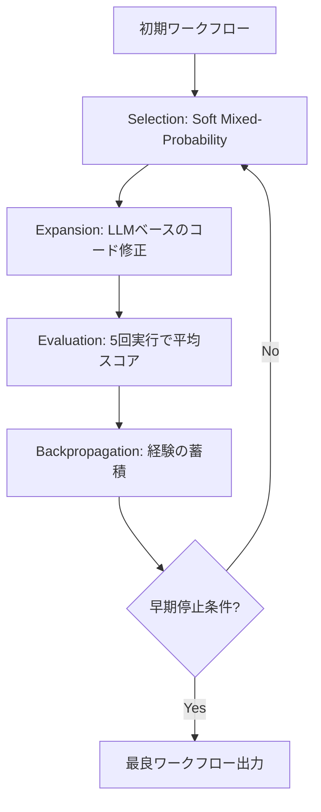

## 論文概要（Abstract）

本記事は ICLR 2025でOral採択された [AFlow: Automating Agentic Workflow Generation](https://arxiv.org/abs/2410.10762) の解説記事です。

AFlowは、LLMエージェントのワークフロー設計を**コード表現上の探索問題**として再定式化し、モンテカルロ木探索（MCTS）によって自動的に高品質なワークフローを生成する手法である。著者らは、6つのベンチマークで手動設計のベースラインに対して平均5.7%の改善を報告しており、GPT-4o-miniのような小規模モデルがGPT-4oの推論コストの4.55%で同等以上の性能を達成できると述べている。

この記事は [Zenn記事: LangGraph StateGraphでエージェントワークフローをステートマシンとして設計する](https://zenn.dev/0h_n0/articles/85189b9677caae) の深掘りです。

## 情報源

- **会議名**: ICLR 2025（International Conference on Learning Representations）
- **発表形式**: Oral（採択率は例年5%前後と報告されており、競争率が高い）
- **arXiv ID**: 2410.10762
- **URL**: [https://arxiv.org/abs/2410.10762](https://arxiv.org/abs/2410.10762)
- **著者**: Jiayi Zhang, Jinyu Xiang, Zhaoyang Yu, Fengwei Teng, Xionghui Chen, Jiaqi Chen, Mingchen Zhuge, Xin Cheng, Sirui Hong, Jinlin Wang, Bingnan Zheng, Bang Liu, Yuyu Luo, Chenglin Wu
- **所属**: Deep Wisdom, HKUST (Guangzhou), Renmin University, Nanjing University, Fudan University 他
- **コード**: [github.com/FoundationAgents/AFlow](https://github.com/FoundationAgents/AFlow)

## カンファレンス情報

**ICLR（International Conference on Learning Representations）**は機械学習分野の主要国際会議であり、Oral採択は全投稿の上位5%前後に限られる。AFlowのOral採択は、ワークフロー自動化の重要性と手法の新規性が評価された結果といえる。

## 背景と動機（Background & Motivation）

LLMエージェントワークフロー（ReAct、CoT、Tool Use等を組み合わせた処理パイプライン）は広く利用されているが、その設計には課題がある。

著者らは、(1) 各タスクに適したワークフロー設計の試行錯誤コストの高さ、(2) 手動設計のドメイン汎化の困難さ、(3) ADAS等の先行研究が初期セットアップに人手を必要とする制約、を課題として挙げている。AFlowはワークフロー設計を探索問題として扱い、人手の介入を最小化する。

## 主要な貢献（Key Contributions）

- **貢献1**: ワークフロー最適化を**コード表現上の探索問題**として再定式化し、グラフや自然言語よりも表現力の高い形式で条件分岐・ループ・並列処理を扱えることを示した
- **貢献2**: **モンテカルロ木探索（MCTS）**をワークフロー探索に適用し、木構造化された経験（tree-structured experience）と実行フィードバックによる効率的な探索を実現した
- **貢献3**: 6つのベンチマークで手動設計・自動設計の両ベースラインを上回る性能を報告し、小規模モデルによるコスト効率の高い推論が可能であることを示した

## 技術的詳細（Technical Details）

### ワークフローのコード表現

AFlowでは、エージェントワークフローを**Python コード**として表現する。各ワークフローは以下の要素で構成される：

- **ノード（Node）**: 1回のLLM呼び出しに対応し、モデルID、プロンプト、温度パラメータ、出力形式（raw, json, markdown, xml）をパラメータとして持つ
- **エッジ（Edge）**: ノード間の接続をコードで記述する。これにより、単純なシーケンスだけでなく、条件分岐（if/else）、ループ（for/while）、グラフ構造を自然に表現できる

著者らは、コード表現がグラフ表現やニューラルネットワーク表現よりも柔軟であると主張している。たとえば、LangGraphのStateGraphではエッジをConditional Edgeとして明示的に定義する必要があるが、AFlowではPythonの制御フローで自然に記述できる。

### 7つのオペレーター

AFlowは、ワークフロー構成の基本パターンとして7つの**オペレーター**を定義している：

| オペレーター | 機能 | 用途 |
|-------------|------|------|
| **Generate** | LLMによるテキスト生成 | プロンプトに基づく応答生成 |
| **Format** | 出力形式の変換 | JSON/XML等への構造化 |
| **Review & Revise** | 生成→レビュー→修正ループ | 品質改善のための反復 |
| **Ensemble** | 複数候補からの選択 | 多数決的な精度向上 |
| **Test** | 公開テストケースによる検証 | コード生成タスクの正誤判定 |
| **Programmer** | コード生成・実行 | プログラミングタスク |
| **Custom** | ユーザー定義 | ドメイン固有の処理 |

これらのオペレーターは探索の効率化に寄与するが、後述のアブレーション実験で示されるように、オペレーターなしでもAFlowは有効に機能する。

### MCTSによるワークフロー探索

AFlowの探索アルゴリズムは、標準的なMCTSを以下のように変更した独自の手法を用いている：



**アルゴリズムの詳細**:

**1. Selection（選択フェーズ）**

上位$k$個のワークフローから次の探索対象を選択する。選択確率は一様分布とスコアベースのSoftmax分布を混合する：

$$
P(w_i) = \alpha \cdot \frac{1}{k} + (1 - \alpha) \cdot \frac{\exp(\lambda \cdot s_i)}{\sum_{j=1}^{k} \exp(\lambda \cdot s_j)}
$$

ここで、
- $w_i$: $i$番目のワークフロー候補
- $s_i$: $w_i$の評価スコア
- $\alpha$: 一様分布の混合比率
- $\lambda$: Softmax温度パラメータ

> **注意点**: 論文本文ではこのパラメータを$\alpha = 0.4$、$\lambda = 0.2$と記載しているが、Algorithm 1では$\lambda = 0.4$、$\alpha = 0.2$と記載されており、記号の割り当てが逆転している。実装を参照する際はコードリポジトリを確認することを推奨する。

初期ワークフローも常に候補に含めることで、局所最適への収束を防いでいる。

**2. Expansion（展開フェーズ）**

選択されたワークフローに対し、**LLM（Claude-3.5-sonnet）がオプティマイザーとして**コード修正を行う。オプティマイザーは過去の修正履歴（成功・失敗の経験）を参照しながら、プロンプトの変更、ノードの追加・削除、エッジの再接続などを提案する。

**3. Evaluation（評価フェーズ）**

修正後のワークフローをバリデーションセットで**5回実行**し、平均スコアと標準偏差を計算する。複数回実行することで、LLMの出力の確率的変動を考慮した安定的な評価を行う。

**4. Backpropagation（逆伝播フェーズ）**

評価結果を木構造に蓄積する。各ノードには、適用された修正内容、その結果（スコア変化）、期待出力との比較ログが保存される。

**早期停止**: 上位$k$個のワークフローの平均スコアが$n$ラウンド連続で改善しない場合、探索を終了する。著者らの実験では20イテレーションを上限としている。

### 木構造化された経験（Tree-Structured Experience）

AFlowの特徴的な設計として、探索経験を木構造で管理する点がある。先行手法（プロンプト最適化など）ではLLMの入力トークンが蓄積され、文脈長の制約やノイズの問題が生じる。AFlowでは、各木ノードが独立した経験レコードを持ち、親子関係で修正の系譜を追跡できる。

```python
class TreeNode:
    """AFlowの木ノード（概念的な擬似コード）"""
    workflow_code: str          # ワークフローのPythonコード
    score: float                # 評価スコア（平均）
    score_std: float            # 評価スコア（標準偏差）
    modification: str           # 親ノードからの変更内容
    execution_logs: list[dict]  # 実行ログ（予測 vs 期待出力）
    parent: "TreeNode | None"
    children: list["TreeNode"]
```

この設計により、オプティマイザーLLMは関連する経験のみを参照でき、無関係な修正履歴によるノイズを排除できる。

## 実験結果（Results）

### ベンチマーク評価

著者らは6つのベンチマークデータセットで評価を行い、以下の結果を報告している（論文Table 1より、GPT-4o-miniをエグゼキューターとして使用、テスト分割での結果）：

| 手法 | HotpotQA | DROP | HumanEval | MBPP | GSM8K | 平均 |
|------|----------|------|-----------|------|-------|------|
| IO（直接入出力） | 68.3 | 87.0 | 71.8 | 92.7 | 48.6 | 72.8 |
| CoT SC（5回） | 78.8 | 91.6 | 73.6 | 92.7 | 50.4 | 76.0 |
| ADAS | 76.6 | 82.4 | 53.4 | 90.8 | 35.4 | 67.2 |
| **AFlow** | **80.6** | **94.7** | **83.4** | **93.5** | **56.2** | **80.3** |

**分析ポイント**:
- 手動設計の最良ベースライン（CoT SC）に対して平均4.3ポイント（約5.7%）の改善
- 自動設計の先行手法ADASに対して平均13.1ポイント（約19.5%）の改善
- 特にHumanEvalでの改善幅が大きく（+9.8ポイント）、コード生成タスクでのワークフロー自動化の有効性を示唆している

> **注意**: 論文Abstractでは「5.7%の改善」と記載されているが、Table 1の絶対値差は80.3 - 76.0 = 4.3ポイントである。5.7%は相対改善率（4.3/76.0）に相当すると考えられる。

### コスト分析

著者らは、AFlowで最適化されたワークフローにより、小規模モデル（GPT-4o-mini、DeepSeek-V2.5）がコスト-性能のパレートフロント上でGPT-4oを上回ると報告している。具体的には、特定のタスクにおいてGPT-4oの推論コストの**4.55%**で同等以上の性能を達成できると述べている（論文Appendix Dより）。

### ワークフローの転移可能性

あるモデルで最適化されたワークフローを別のモデル（GPT-4o、DeepSeek-V2.5、Claude-3.5-sonnet）で実行した場合でも性能が維持されることが報告されている。ただし、特定のモデル向けにチューニングされたワークフローは他のモデルでは若干性能が低下する傾向があるとも述べられている。

### アブレーション実験

GSM8Kでのアブレーション（論文より）では、オペレーターを事前定義しなくてもAFlowは93.1%の精度を達成し、Ensembleに類似した構造を自律的に発見できると報告されている。これはMCTSによる探索がドメイン知識なしでも有効なパターンを見出せることを示唆している。なお、この数値とTable 1のテスト分割（56.2%）の差異は評価条件の違いに起因する可能性がある。

## 実装のポイント（Implementation）

### ワークフローの基本構造

AFlowの公開コード（github.com/FoundationAgents/AFlow）では、ワークフローをPythonクラスとして実装している：

```python
from typing import Any

class ActionNode:
    """LLM呼び出しノード"""
    def __init__(
        self,
        model: str = "gpt-4o-mini",
        temperature: float = 0.0,
        output_format: str = "raw",
    ):
        self.model = model
        self.temperature = temperature
        self.output_format = output_format

    async def fill(self, prompt: str, **kwargs: Any) -> str:
        """プロンプトを実行し結果を返す"""
        ...

class Workflow:
    """ワークフロー基底クラス"""
    async def __call__(self, problem: str) -> str:
        """タスクを受け取り結果を返す"""
        raise NotImplementedError
```

### Ensembleオペレーターの実装例

```python
class EnsembleWorkflow(Workflow):
    """複数候補から多数決で選択するワークフロー"""
    async def __call__(self, problem: str) -> str:
        candidates: list[str] = []
        for _ in range(3):
            node = ActionNode(temperature=0.7)
            result = await node.fill(
                prompt=f"Solve: {problem}"
            )
            candidates.append(result)

        selector = ActionNode(temperature=0.0)
        best = await selector.fill(
            prompt=(
                f"Given these solutions:\n"
                + "\n".join(f"- {c}" for c in candidates)
                + "\nSelect the best one."
            )
        )
        return best
```

### LangGraphとの関係

Zenn記事で解説されているLangGraphのStateGraphは、ワークフローの構造を**明示的なグラフ（State/Node/Edge/Checkpointer）**で定義する。一方、AFlowはワークフローを**コードそのもの**として表現し、その探索を自動化する。

両者は対立するものではなく、補完的な関係にある：
- **LangGraph**: 設計者がワークフローの構造を宣言的に定義し、チェックポイントやHuman-in-the-Loopを組み込む**実行基盤**
- **AFlow**: ワークフローの構造自体をMCTSで**自動発見**する**設計支援**

AFlowで発見された最適なワークフローパターンを、LangGraphのStateGraphとして実装するという組み合わせが考えられる。

## Production Deployment Guide

### AWS実装パターン（コスト最適化重視）

AFlowをAWS上で運用する場合、**探索フェーズ（オフライン）**と**推論フェーズ（オンライン）**を分離する設計が有効である。

**トラフィック量別の推奨構成**:

| 規模 | 月間リクエスト | 推奨構成 | 月額コスト | 主要サービス |
|------|--------------|---------|-----------|------------|
| **Small** | ~3,000 (100/日) | Serverless | $50-150 | Lambda + Bedrock + DynamoDB |
| **Medium** | ~30,000 (1,000/日) | Hybrid | $300-800 | Lambda + ECS Fargate + ElastiCache |
| **Large** | 300,000+ (10,000/日) | Container | $2,000-5,000 | EKS + Karpenter + EC2 Spot |

**Small構成の詳細** (月額$50-150):
- **Lambda**: 1GB RAM, 60秒タイムアウト ($20/月)
- **Bedrock**: Claude 3.5 Haiku, Prompt Caching有効 ($80/月)
- **DynamoDB**: On-Demand、ワークフロー定義とキャッシュ保存 ($10/月)
- **S3**: 探索結果（最適化済みワークフロー）の保存 ($5/月)
- **CloudWatch**: 基本監視 ($5/月)

**Medium構成の詳細** (月額$300-800):
- **ECS Fargate**: 0.5 vCPU, 1GB RAM × 2タスク ($120/月)
- **Bedrock**: Claude 3.5 Sonnet, Batch API活用 ($400/月)
- **ElastiCache Redis**: cache.t3.micro、ワークフロー結果キャッシュ ($15/月)
- **Step Functions**: ワークフロー実行のオーケストレーション ($30/月)

**Large構成の詳細** (月額$2,000-5,000):
- **EKS**: コントロールプレーン ($72/月)
- **EC2 Spot Instances**: g5.xlarge × 2-4台 (平均$800/月)
- **Karpenter**: 自動スケーリング（追加コストなし）
- **Bedrock Batch**: 50%割引活用 ($2,000/月)

**コスト削減テクニック**:
- Spot Instances使用で最大90%削減（EKS + Karpenter）
- Bedrock Batch API使用で50%削減（MCTS探索フェーズ）
- Prompt Caching有効化で30-90%削減（同一プロンプトの再利用）
- 探索済みワークフローのキャッシュで推論時のLLM呼び出し削減

**コスト試算の注意事項**: 上記は2026年10月時点のAWS ap-northeast-1（東京）リージョン料金に基づく概算値です。実際のコストはトラフィックパターン、リージョン、バースト使用量により変動します。最新料金は [AWS料金計算ツール](https://calculator.aws/) で確認してください。

### Terraformインフラコード

**Small構成 (Serverless): Lambda + Bedrock + DynamoDB**

```hcl
module "vpc" {
  source  = "terraform-aws-modules/vpc/aws"
  version = "~> 5.0"

  name = "aflow-vpc"
  cidr = "10.0.0.0/16"
  azs  = ["ap-northeast-1a", "ap-northeast-1c"]
  private_subnets = ["10.0.1.0/24", "10.0.2.0/24"]

  enable_nat_gateway   = false
  enable_dns_hostnames = true
}

resource "aws_iam_role" "lambda_aflow" {
  name               = "lambda-aflow-role"
  assume_role_policy = jsonencode({
    Version   = "2012-10-17"
    Statement = [{ Action = "sts:AssumeRole", Effect = "Allow",
                    Principal = { Service = "lambda.amazonaws.com" } }]
  })
}

resource "aws_iam_role_policy" "bedrock_invoke" {
  role   = aws_iam_role.lambda_aflow.id
  policy = jsonencode({
    Version   = "2012-10-17"
    Statement = [{ Effect = "Allow",
      Action   = ["bedrock:InvokeModel", "bedrock:InvokeModelWithResponseStream"],
      Resource = "arn:aws:bedrock:ap-northeast-1::foundation-model/anthropic.claude-3-5-haiku*" }]
  })
}

resource "aws_lambda_function" "aflow_executor" {
  filename      = "lambda.zip"
  function_name = "aflow-workflow-executor"
  role          = aws_iam_role.lambda_aflow.arn
  handler       = "index.handler"
  runtime       = "python3.12"
  timeout       = 120
  memory_size   = 1024

  environment {
    variables = {
      BEDROCK_MODEL_ID    = "anthropic.claude-3-5-haiku-20241022-v1:0"
      DYNAMODB_TABLE      = aws_dynamodb_table.workflow_cache.name
      WORKFLOW_BUCKET      = aws_s3_bucket.workflows.id
      ENABLE_PROMPT_CACHE = "true"
    }
  }
}

resource "aws_dynamodb_table" "workflow_cache" {
  name         = "aflow-workflow-cache"
  billing_mode = "PAY_PER_REQUEST"
  hash_key     = "workflow_id"
  range_key    = "task_hash"
  attribute { name = "workflow_id"; type = "S" }
  attribute { name = "task_hash";   type = "S" }
  ttl { attribute_name = "expire_at"; enabled = true }
}

resource "aws_s3_bucket" "workflows" {
  bucket = "aflow-optimized-workflows"
}
```

**Large構成 (Container)**: EKS + Karpenter + Spot Instancesの構成では、`terraform-aws-modules/eks/aws` (v20.0+) でEKSクラスタを構築し、KarpenterのProvisionerでSpot Instances（g5.xlarge/g5.2xlarge）を自動管理する。`ttlSecondsAfterEmpty: 30`でアイドルノードを迅速にスケールダウンし、AWS Budgets（月額$5,000上限、80%で警告）でコストを制御する。

### セキュリティベストプラクティス

IAM最小権限（Bedrock ARN限定）、Secrets Manager使用、S3/DynamoDB KMS暗号化、TLS 1.2以上、VPC Private Subnet配置、CloudTrail有効化。

### 運用・監視設定

**CloudWatch Logs Insights クエリ**:

```sql
-- ワークフロー実行のトークン使用量監視
fields @timestamp, workflow_id, input_tokens, output_tokens
| stats sum(input_tokens + output_tokens) as total_tokens by bin(1h)
| filter total_tokens > 100000

-- レイテンシ分析
fields @timestamp, duration_ms
| stats pct(duration_ms, 95) as p95, pct(duration_ms, 99) as p99 by bin(5m)
```

**CloudWatch アラーム**: `Custom/AFlow`名前空間でTokenUsageメトリクスを監視し、1時間あたり50万トークン超過でSNS通知を発火する。Lambda実行時間（Duration）の異常検知も併用する。

**X-Ray トレーシング**: `aws_xray_sdk`の`patch_all()`でboto3を自動計装し、ワークフロー実行ごとに`workflow_id`アノテーションと`task_length`/`result_length`メタデータを記録する。

### コスト最適化チェックリスト

**アーキテクチャ選択**: トラフィック量に応じてServerless ($50-150/月) / Hybrid ($300-800/月) / Container ($2,000-5,000/月) を選択。

**リソース最適化**: Spot Instances優先（最大90%削減）、Reserved Instances（72%削減）、Lambda メモリ最適化、アイドル時スケールダウン。

**LLMコスト削減（AFlow固有）**: MCTS探索にBedrock Batch API（50%削減）、Prompt Caching（30-90%削減）、探索済みワークフローのキャッシュ再利用、探索にSonnet・推論にHaikuのモデル使い分け。

**監視**: AWS Budgets（80%警告）、CloudWatch トークン監視、Cost Anomaly Detection、日次レポート。

## 実運用への応用（Practical Applications）

AFlowの実用上の価値は、**ワークフロー設計の自動化によるコスト削減**にある。Zenn記事で解説したLangGraphのStateGraphでは、開発者が手動でノード・エッジ・条件分岐を設計する必要がある。AFlowは、この設計プロセス自体をMCTSで自動化することで、ワークフロー開発の初期コストを削減する可能性がある。

想定される適用シナリオとして、カスタマーサポートBot（タスク別の最適ワークフローを探索→LangGraphで実装）、コードレビュー自動化（Ensembleで複数観点を統合）、ドキュメント生成パイプライン（調査→下書き→修正の自動最適化）が挙げられる。ただし、著者らも指摘しているように探索自体にLLM呼び出しコストが発生するため、ワークフロー変更頻度が低いケースでは手動設計が効率的な場合もある。

## 関連研究（Related Work）

- **ADAS（Automated Design of Agentic Systems）**: LLMエージェントシステムの自動設計を提案したが、初期セットアップに人手が必要という制約があった。AFlowはMCTSによりこの制約を緩和している
- **DSPy**: プロンプトやプログラムの最適化フレームワーク。AFlowがワークフロー構造全体を探索するのに対し、DSPyは個々のプロンプトの最適化に焦点を当てている
- **StateFlow（arXiv:2403.11322）**: LLMタスク解決を状態マシンとしてモデル化する手法。手動で状態と遷移を設計する点でAFlowとは補完的な関係にある

## まとめと今後の展望

AFlowは、エージェントワークフローの設計を「コード上の探索問題」として定式化し、MCTSで自動化する手法である。ICLR 2025でOral採択された本研究は、手動設計への依存を減らしつつ、小規模モデルでのコスト効率の高い推論を実現する方向性を示している。

LangGraphのStateGraphが「ワークフローをどう実行するか」の基盤を提供するのに対し、AFlowは「どのようなワークフローが最適か」を自動発見する。両者の組み合わせ——AFlowで探索した最適構造をLangGraphで本番実装する——は、エージェント開発の実用的なアプローチとなりうる。

今後の課題として、著者らはオープンエンドなタスク（正解が一意でないタスク）への適用や、探索コストのさらなる削減を挙げている。

## 参考文献

- **Conference URL**: [https://arxiv.org/abs/2410.10762](https://arxiv.org/abs/2410.10762)
- **ICLR Proceedings**: [ICLR 2025 Conference](https://proceedings.iclr.cc/paper_files/paper/2025/hash/5492ecbce4439401798dcd2c90be94cd-Abstract-Conference.html)
- **Code**: [https://github.com/FoundationAgents/AFlow](https://github.com/FoundationAgents/AFlow)
- **Related Zenn article**: [https://zenn.dev/0h_n0/articles/85189b9677caae](https://zenn.dev/0h_n0/articles/85189b9677caae)

---

:::message
この記事はAI（Claude Code）により自動生成されました。内容の正確性については論文原文と公式リポジトリで検証していますが、実際の利用時は原論文もご確認ください。
:::
