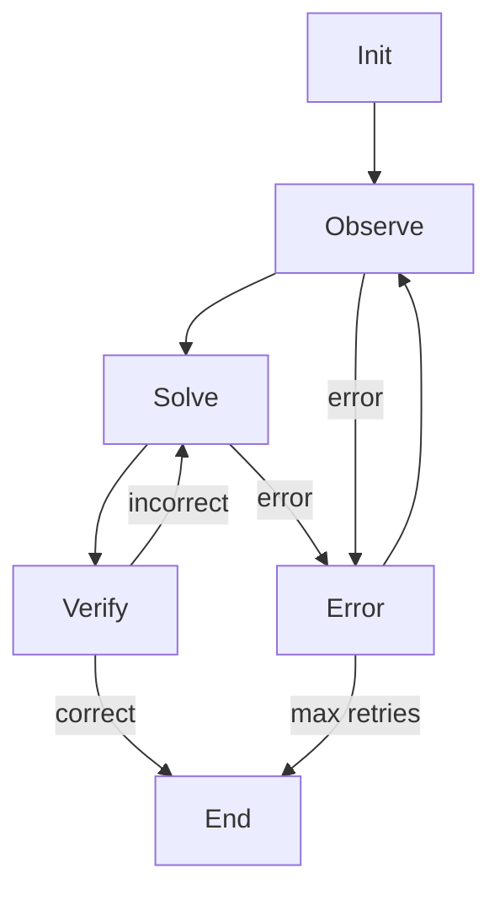

## 論文概要（Abstract）

本記事は [arXiv:2403.11322](https://arxiv.org/abs/2403.11322) の解説記事です。

StateFlowは、LLMによるタスク解決プロセスを**状態マシン（State Machine）**として形式化するパラダイムである。著者らは、処理フローの制御（process grounding）とサブタスクの実行（sub-task solving）を分離することで、ReActパターンと比較してInterCode SQLベンチマークで13ポイント、ALFWorldベンチマークで28ポイントの成功率向上を達成したと報告している。同時に推論コストはそれぞれ約5分の1、約3分の1に削減されたとしている。

この記事は [Zenn記事: LangGraph StateGraphでエージェントワークフローをステートマシンとして設計する](https://zenn.dev/0h_n0/articles/85189b9677caae) の深掘りです。

## 情報源

- **arXiv ID**: 2403.11322
- **URL**: [https://arxiv.org/abs/2403.11322](https://arxiv.org/abs/2403.11322)
- **著者**: Yiran Wu, Tianwei Yue, Shaokun Zhang, Chi Wang, Qingyun Wu
- **発表年**: 2024（v1: 2024年3月、v5: 2024年9月）
- **分野**: cs.CL, cs.AI

## 背景と動機（Background & Motivation）

LLMエージェントのタスク解決において、ReActパターンが広く利用されている。ReActではLLMが「思考→行動→観察」のサイクルを繰り返し、ツール呼び出しの判断を全てLLM自身に委ねる。しかし著者らは、この方式にはいくつかの構造的問題があると指摘している。

第一に、LLMがプロセス全体の制御とサブタスクの実行を同時に担うため、長いタスクではプロンプトが肥大化し、推論コストが増大する。第二に、処理フローが暗黙的にLLMの出力に依存するため、デバッグや検証が困難になる。第三に、特定のタスクドメインでは最適なワークフローが事前にわかっているにもかかわらず、それをLLMに毎回「再発見」させることは非効率である。

これらの課題に対し、StateFlowは処理フローの制御を明示的な状態マシンに委ね、各状態内での行動のみをLLMに任せるアプローチを提案している。

## 主要な貢献（Key Contributions）

- **状態マシンによるLLMタスク解決の形式化**: タスク解決プロセスを6つ組（sextuple）で定義する形式的モデルを提案
- **プロセス制御とサブタスク実行の分離**: 状態遷移による処理フロー制御と、各状態内でのLLM/ツール呼び出しを独立して設計可能に
- **コスト効率の大幅な改善**: ReActと比較してInterCode SQLで約5倍、ALFWorldで約3倍のコスト削減を報告
- **既存手法との組み合わせ**: Reflexionなどの反復改善手法と直交的に組み合わせ可能であることを実証

## 技術的詳細（Technical Details）

### StateFlowの形式的定義

著者らはStateFlowを以下の6つ組（sextuple）として形式化している（論文Section 3より）：

$$
\mathcal{M} = \langle S, s_0, F, \delta, \Gamma, \Omega \rangle
$$

ここで、
- $S$: 状態の有限集合
- $s_0 \in S$: 初期状態
- $F \subseteq S$: 終了状態の集合
- $\delta: S \times \Gamma^* \to S$: 遷移関数（現在の状態とコンテキスト履歴に基づく）
- $\Gamma$: メッセージの集合
- $\Omega$: 各状態に紐づく出力関数の集合

古典的な有限状態マシン（FSM）との重要な違いとして、StateFlowには**入力テープが存在しない**。遷移はあらかじめ定義された入力列ではなく、**蓄積されたコンテキスト履歴** $\Gamma^*$ に依存する。これにより、LLMの出力やツールの実行結果に基づいて動的に遷移先を決定できる。

### 出力関数と状態内の動作

各状態 $s \in S$ には、順序付きの出力関数リスト $[\omega_1, \omega_2, \ldots, \omega_k]$ が割り当てられる。各出力関数 $\omega_i: \Gamma^* \to \Gamma$ はコンテキスト履歴を受け取り、新しいメッセージを返す。出力関数には以下の3種類がある：

1. **LLM呼び出し**: 状態固有のシステムプロンプトを付与してLLMを呼び出す
2. **ツール/環境呼び出し**: 外部ツールやシミュレーション環境とのインタラクション
3. **静的プロンプター**: 固定のメッセージを生成する補助関数

### 遷移関数の実装パターン

遷移関数 $\delta$ の具体的な実装として、著者らは2つのパターンを示している：

1. **文字列マッチング**: 最新の出力メッセージに対するルールベースの判定（例：「execution failed」を含む場合はError状態へ遷移）
2. **LLMベースの判定**: LLMに現在の状況を判断させ、遷移先を決定させる

### アルゴリズム

論文のAlgorithm 1で示される実行ループは以下の通りである：

```python
from typing import TypedDict, Callable
from enum import Enum

class State(Enum):
    INIT = "init"
    OBSERVE = "observe"
    SOLVE = "solve"
    VERIFY = "verify"
    END = "end"
    ERROR = "error"

class StateFlowContext(TypedDict):
    history: list[dict]
    current_state: State
    transition_count: int
    max_transitions: int

def run_stateflow(
    initial_state: State,
    output_functions: dict[State, list[Callable]],
    transition_fn: Callable[[State, list[dict]], State],
    final_states: set[State],
    max_transitions: int = 30,
) -> list[dict]:
    """StateFlowの実行ループ（Algorithm 1に基づく）

    Args:
        initial_state: 初期状態
        output_functions: 各状態に紐づく出力関数のリスト
        transition_fn: 遷移関数
        final_states: 終了状態の集合
        max_transitions: 最大遷移回数（暴走防止）

    Returns:
        コンテキスト履歴
    """
    context: list[dict] = []
    current_state = initial_state
    transition_count = 0

    while current_state not in final_states and transition_count < max_transitions:
        for omega in output_functions[current_state]:
            message = omega(context)
            context.append(message)

        next_state = transition_fn(current_state, context)
        current_state = next_state
        transition_count += 1

    return context
```

著者らは、最大遷移回数（`max_transitions`）による暴走防止が重要であると述べている。これはLangGraphの `recursion_limit` に相当する設計パターンである。

### SQLタスクにおけるStateFlowの設計例

論文では、InterCode SQLベンチマークに対する具体的な状態設計が示されている：



- **Init状態**: `SHOW TABLES`を実行してスキーマ情報を取得
- **Observe状態**: `DESC`コマンドで個別テーブルの構造を探索
- **Solve状態**: SQLクエリを生成・実行
- **Verify状態**: 実行結果が質問に正しく回答しているかをLLMで検証
- **Error状態**: エラー発生時のフォールバック処理

著者らは、ReActのデモンストレーションでは最初に失敗する`SELECT`文が頻出する点を観察しており、StateFlowではInit→Observeの段階的なスキーマ探索によりこの問題を回避していると説明している。

## 実装のポイント（Implementation）

StateFlowの実装において、著者らが強調するポイントは以下の通りである：

1. **状態設計のガイドライン**: まず理想的なワークフローを特定し、そのフェーズを状態にマッピングする。Error状態を含めることで障害耐性を確保する
2. **プロンプトの短縮効果**: ReActのプロンプトは約2,043トークンであるのに対し、StateFlowの各状態のプロンプトは最大でも約400トークンである。これが推論コスト削減の主要因とされている
3. **遷移関数の選択**: 単純なケースでは文字列マッチングで十分であり、複雑な判断が必要な場合にのみLLMベースの遷移を使用する
4. **Reflexionとの統合**: StateFlowは反復改善手法と直交的であり、Reflexionと組み合わせることでALFWorldの成功率を84%から94.8%に向上できたと報告されている

## Production Deployment Guide

### AWS実装パターン（コスト最適化重視）

StateFlowパターンをAWS上で本番運用する場合のトラフィック量別推奨構成を示す。

| 規模 | 月間リクエスト | 推奨構成 | 月額コスト | 主要サービス |
|------|--------------|---------|-----------|------------|
| **Small** | ~3,000 (100/日) | Serverless | $50-150 | Lambda + Bedrock + DynamoDB |
| **Medium** | ~30,000 (1,000/日) | Hybrid | $300-800 | Lambda + ECS Fargate + ElastiCache |
| **Large** | 300,000+ (10,000/日) | Container | $2,000-5,000 | EKS + Karpenter + EC2 Spot |

**Small構成の詳細**（月額$50-150）:
- **Lambda**: 1GB RAM, 60秒タイムアウト（状態遷移ごとに呼び出し）$20/月
- **Bedrock**: Claude 3.5 Haiku, Prompt Caching有効（状態プロンプトが短いため効果的）$80/月
- **DynamoDB**: On-Demand、状態遷移履歴の永続化 $10/月
- **Step Functions**: 状態マシンのオーケストレーション $5/月

StateFlowの「状態ごとに短いプロンプト」という特性は、Prompt Cachingとの相性が良い。各状態のシステムプロンプトをキャッシュすることで、論文が報告するReAct比5倍のコスト削減に加えて、さらに30-90%のAPI呼び出しコスト削減が期待できる。

**コスト試算の注意事項**: 上記は2026年10月時点のAWS ap-northeast-1（東京）リージョン料金に基づく概算値です。実際のコストはトラフィックパターン、リージョン、バースト使用量により変動します。最新料金は [AWS料金計算ツール](https://calculator.aws/) で確認してください。

### Terraformインフラコード

**Small構成（Serverless）: Lambda + Step Functions + Bedrock**

```hcl
module "vpc" {
  source  = "terraform-aws-modules/vpc/aws"
  version = "~> 5.0"

  name = "stateflow-vpc"
  cidr = "10.0.0.0/16"
  azs  = ["ap-northeast-1a", "ap-northeast-1c"]
  private_subnets = ["10.0.1.0/24", "10.0.2.0/24"]

  enable_nat_gateway   = false
  enable_dns_hostnames = true
}

resource "aws_iam_role" "lambda_stateflow" {
  name = "lambda-stateflow-role"

  assume_role_policy = jsonencode({
    Version = "2012-10-17"
    Statement = [{
      Action = "sts:AssumeRole"
      Effect = "Allow"
      Principal = { Service = "lambda.amazonaws.com" }
    }]
  })
}

resource "aws_iam_role_policy" "bedrock_invoke" {
  role = aws_iam_role.lambda_stateflow.id
  policy = jsonencode({
    Version = "2012-10-17"
    Statement = [{
      Effect   = "Allow"
      Action   = ["bedrock:InvokeModel", "bedrock:InvokeModelWithResponseStream"]
      Resource = "arn:aws:bedrock:ap-northeast-1::foundation-model/anthropic.claude-3-5-haiku*"
    }]
  })
}

resource "aws_lambda_function" "state_handler" {
  filename      = "lambda.zip"
  function_name = "stateflow-handler"
  role          = aws_iam_role.lambda_stateflow.arn
  handler       = "index.handler"
  runtime       = "python3.12"
  timeout       = 60
  memory_size   = 1024

  environment {
    variables = {
      BEDROCK_MODEL_ID    = "anthropic.claude-3-5-haiku-20241022-v1:0"
      DYNAMODB_TABLE      = aws_dynamodb_table.state_history.name
      ENABLE_PROMPT_CACHE = "true"
    }
  }
}

resource "aws_dynamodb_table" "state_history" {
  name         = "stateflow-history"
  billing_mode = "PAY_PER_REQUEST"
  hash_key     = "session_id"
  range_key    = "transition_index"

  attribute {
    name = "session_id"
    type = "S"
  }
  attribute {
    name = "transition_index"
    type = "N"
  }

  ttl {
    attribute_name = "expire_at"
    enabled        = true
  }
}

resource "aws_cloudwatch_metric_alarm" "transition_cost" {
  alarm_name          = "stateflow-cost-spike"
  comparison_operator = "GreaterThanThreshold"
  evaluation_periods  = 1
  metric_name         = "Duration"
  namespace           = "AWS/Lambda"
  period              = 3600
  statistic           = "Sum"
  threshold           = 100000
  alarm_description   = "StateFlow Lambda実行時間異常（コスト急増の可能性）"

  dimensions = {
    FunctionName = aws_lambda_function.state_handler.function_name
  }
}
```

**Large構成（Container）**: EKS + Karpenter + Spot Instancesの構成では、`terraform-aws-modules/eks/aws ~> 20.0`でEKSクラスタを構築し、Karpenter NodePoolでSpot Instances（m7i.xlarge/2xlarge）を自動管理する。`consolidateAfter: 30s`でアイドルノードを即座にスケールダウンし、AWS Budgets（月額$5,000上限、80%で警告）でコストを制御する。

### セキュリティベストプラクティス

- **IAMロール**: 最小権限の原則に従い、Bedrock InvokeModelのみ許可
- **ネットワーク**: Lambda/EKSはプライベートサブネットに配置
- **シークレット管理**: AWS Secrets Managerを使用、環境変数へのハードコード禁止
- **暗号化**: DynamoDB/S3はKMS暗号化、TLS 1.2以上必須
- **監査**: CloudTrail全リージョン有効化

### 運用・監視設定

```sql
-- CloudWatch Logs Insights: 状態遷移回数の異常検知
fields @timestamp, session_id, current_state, transition_count
| stats max(transition_count) as max_transitions by session_id
| filter max_transitions > 20
| sort max_transitions desc
```

```python
import boto3

cloudwatch = boto3.client('cloudwatch')

cloudwatch.put_metric_alarm(
    AlarmName='stateflow-transition-spike',
    ComparisonOperator='GreaterThanThreshold',
    EvaluationPeriods=1,
    MetricName='TransitionCount',
    Namespace='StateFlow/Metrics',
    Period=3600,
    Statistic='Average',
    Threshold=25,
    ActionsEnabled=True,
    AlarmActions=['arn:aws:sns:ap-northeast-1:123456789:cost-alerts'],
    AlarmDescription='StateFlow遷移回数異常（無限ループの可能性）'
)
```

### コスト最適化チェックリスト

**アーキテクチャ選択**:
- [ ] ~100 req/日 → Lambda + Step Functions (Serverless) - $50-150/月
- [ ] ~1,000 req/日 → ECS Fargate (Hybrid) - $300-800/月
- [ ] 10,000+ req/日 → EKS + Spot (Container) - $2,000-5,000/月

**StateFlow固有の最適化**:
- [ ] 各状態のプロンプトをPrompt Cachingで固定（30-90%削減）
- [ ] 遷移関数を文字列マッチング優先、LLM判定は複雑なケースのみ
- [ ] max_transitions設定で暴走時のコスト上限を制御
- [ ] 状態ごとに異なるモデルを選択（簡単な遷移判定にはHaiku、複雑な生成にはSonnet）

**リソース最適化**:
- [ ] EC2 Spot Instances優先（最大90%削減）
- [ ] Reserved Instances: 1年コミットで72%削減
- [ ] Lambda: メモリサイズをCloudWatch Insights分析で最適化
- [ ] DynamoDB: TTL設定で状態履歴を自動削除

**監視・アラート**:
- [ ] AWS Budgets: 月額予算設定（80%で警告）
- [ ] CloudWatch: 遷移回数スパイク検知
- [ ] Cost Anomaly Detection: 自動異常検知
- [ ] 日次コストレポート: SNS/Slack連携

## 実験結果（Results）

### InterCode SQLベンチマーク

著者らは、InterCode SQL（1,034タスク）において以下の結果を報告している（論文Table 1より）：

| 手法 | GPT-3.5 成功率 | GPT-3.5 コスト | GPT-4 成功率 | GPT-4 コスト |
|------|---------------|--------------|-------------|-------------|
| Plan & Solve | 47.68% | $2.38 | 56.19% | $44.7 |
| ReAct | 50.68% | $17.7 | 60.16% | $147 |
| ReAct_Refine | 57.74% | $18.1 | 57.93% | $141 |
| **StateFlow** | **63.73%** | **$3.82** | **69.34%** | **$36.0** |

GPT-3.5において、StateFlowはReActと比較して成功率が13.05ポイント高く、コストは約4.6倍低い。著者らは、このコスト削減の主因をプロンプト長の違いに帰している。ReActのプロンプトが約2,043トークンであるのに対し、StateFlowの各状態プロンプトは最大でも約400トークンである。

### ALFWorldベンチマーク

ALFWorld（134タスク、GPT-3.5-Turbo、3回平均）の結果は以下の通り（論文Table 2より）：

| 手法 | 成功率 | コスト |
|------|--------|-------|
| ReAct | 55.5% | $6.6 |
| ALFChat (2 agents) | 58.2% | — |
| ALFChat (3 agents) | 67.7% | $6.1 |
| **StateFlow** | **83.3%** | **$2.6** |

StateFlowの10状態バリアント（Pickを「find」と「take」に分割）では88.8%に達し、コストは約$2.2に低下したと報告されている。

### アブレーション実験

GPT-3.5におけるInterCode SQLのアブレーション結果（論文Table 3より）：

| 構成 | 成功率 |
|------|--------|
| StateFlow（完全版） | 63.73% |
| Verify状態を除去 | 62.28%（-1.45pt） |
| Error状態を除去 | 58.80%（-4.93pt） |
| Observe状態を除去 | 57.83%（-5.90pt） |

Observe状態の除去が最も大きな影響を与えており、段階的なスキーマ探索がStateFlowの性能に不可欠であることを示している。

### Reflexionとの統合

著者らは、StateFlowがReflexion（反復的な自己改善手法）と組み合わせ可能であることを実証している（論文Table 4より）：

| 手法 | 初回成功率 | 6イテレーション後 | コスト |
|------|-----------|----------------|-------|
| ReAct + Reflexion | 55.2% | 74.6% | $27.9 |
| StateFlow + Reflexion | 84.0% | 94.8% | $8.6 |

StateFlow + Reflexionの組み合わせでは、ReAct + Reflexionと比較して20.2ポイント高い成功率を、約3分の1のコストで達成している。

## 実運用への応用（Practical Applications）

StateFlowのアプローチは、LangGraphの`StateGraph`と設計思想を共有している。Zenn記事で解説されているLangGraphの4要素（State・Node・Edge・Checkpointer）は、StateFlowの6つ組（状態集合・出力関数・遷移関数）に対応付けることができる。

**プロダクション適用の観点**:
- **カスタマーサポート**: 分類→情報収集→解決→確認の各フェーズを状態として定義し、各状態で専用のプロンプトを使用することでコスト効率と応答品質を両立できる
- **コード生成**: Init→スキーマ理解→生成→テスト→修正のサイクルを状態マシンで管理し、論文のSQL設計例と同様のパターンが適用可能
- **文書分析**: 文書タイプ判定→セクション抽出→要約→品質検証の各段階を状態として切り出すことで、ノード単位のユニットテストが可能

StateFlowの「各状態で短いプロンプト」という特性は、本番環境でのコスト管理に直結する。ReActの長いプロンプトと比較して、API呼び出しあたりのトークン数を削減できるため、大量リクエストを処理するシステムでは運用コストの大幅な削減が見込める。

## 関連研究（Related Work）

- **ReAct（Yao et al., 2022）**: LLMに推論（Reasoning）と行動（Action）を交互に行わせるパターン。StateFlowはReActの暗黙的なフロー制御を、明示的な状態マシンに置き換えるアプローチと位置付けられる
- **Tree of Thoughts / Graph of Thoughts**: 推論プロセスの制御に焦点を当てるが、外部環境とのインタラクションを統合的に扱わない点でStateFlowと異なる
- **Reflexion（Shinn et al., 2023）**: 過去の試行からのフィードバックに基づく反復改善手法。StateFlowとは直交的であり、組み合わせによりALFWorldで94.8%の成功率を達成したと報告されている

## まとめと今後の展望

StateFlowは、LLMタスク解決を状態マシンとして形式化することで、処理フローの制御とサブタスク実行を分離するパラダイムを提案している。著者らが報告する実験結果は、この分離がReActパターンと比較して成功率の向上とコスト削減の両方を実現しうることを示唆している。

この設計思想はLangGraphの`StateGraph`と共通しており、Zenn記事で解説されているTypedDict・リデューサー・条件分岐エッジ・チェックポイントの4要素は、StateFlowの形式的定義を実用的なフレームワークとして具現化したものと理解できる。

著者らは今後の課題として、LLMを用いた状態マシンの自動構築と、性能に基づく状態の動的な追加・削除（アクティブラーニング的アプローチ）を挙げている。

## 参考文献

- **arXiv**: [https://arxiv.org/abs/2403.11322](https://arxiv.org/abs/2403.11322)
- **AG2 (AutoGen)での実装例**: [https://docs.ag2.ai/blog/2024-02-29-StateFlow](https://docs.ag2.ai/blog/2024-02-29-StateFlow)
- **Related Zenn article**: [https://zenn.dev/0h_n0/articles/85189b9677caae](https://zenn.dev/0h_n0/articles/85189b9677caae)

---

:::message
本記事はAI（Claude Code）により自動生成されました。内容の正確性については原論文で検証してください。
:::
