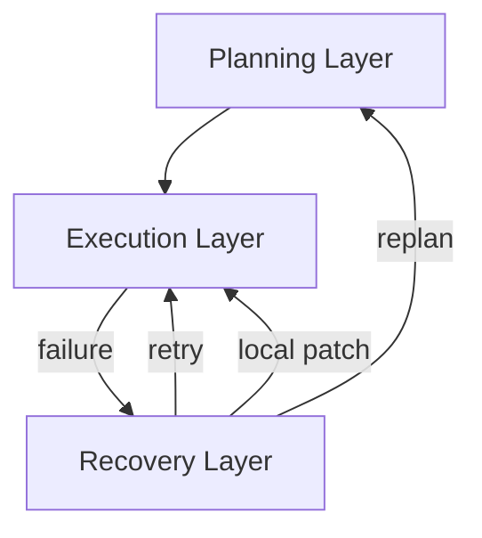

## 論文概要（Abstract）

本記事は [arXiv:2604.11378](https://arxiv.org/abs/2604.11378) の解説記事です。

本論文は、LLMエージェントの実行制御パターンとして広く普及している「Agent Loop」を古典スケジューリング理論の観点から形式化し、その構造的弱点を分析した上で、代替アーキテクチャとして「Structured Graph Harness（SGH）」を提案するポジションペーパーである。著者は70のエージェントシステムを調査し、Agent Loopとグラフベース実行器を「スケジューラ連続体」上に位置づけるフレームワークを提示している。

**重要な注記:** 本論文はポジションペーパーおよび設計提案であり、実験的検証は含まれていない。実装や経験的結果は示されておらず、提案された7群実験設計は今後の研究課題として位置づけられている。

この記事は [Zenn記事: LangGraph StateGraphでエージェントワークフローをステートマシンとして設計する](https://zenn.dev/0h_n0/articles/85189b9677caae) の深掘りです。

## 情報源

- **arXiv ID**: 2604.11378
- **URL**: [https://arxiv.org/abs/2604.11378](https://arxiv.org/abs/2604.11378)
- **著者**: Hu Wei（Wei Hu）
- **発表年**: 2026（2026年4月13日投稿）
- **分野**: cs.AI, eess.SY
- **ページ数**: 51ページ、4図

## 背景と動機（Background & Motivation）

LLMエージェントの実行制御において、現在最も広く採用されているパターンは「Agent Loop」である。これは、LLMが次に実行するアクションを逐次的に選択し、その結果を受けて再度LLMが判断するというループ構造を指す。LangChainのReActエージェントや、OpenAI Agents SDK、CrewAIなど、多くの主要フレームワークがこのパターンに基づいている。

著者はこのAgent Loopパターンに3つの構造的弱点があると主張している：

1. **暗黙的な依存関係**: ステップ間の依存関係がコンテキスト内に埋め込まれ、外部から検査できない
2. **無制限の復旧ループ**: エラー発生時のリカバリが際限なく繰り返される可能性がある
3. **可変な実行履歴**: コンテキスト履歴が書き換え可能であり、デバッグや監査が困難になる

これらの問題は、エージェントの動作が複雑化するほど深刻になる。特に、複数のツール呼び出しを含むワークフローや、人間の承認を必要とする長期実行タスクにおいて顕著であると著者は指摘している。

## 主要な貢献（Key Contributions）

著者は以下の4つを本論文の貢献として挙げている：

- **貢献1**: 古典スケジューリング理論をLLMエージェント実行に適用し、非決定的なLLMノードがもたらす課題を特定するフレームワークの提案
- **貢献2**: 70のエージェントシステムを調査し、制御可能性・表現力・実装容易性のトレードオフ分析を実施
- **貢献3**: ノード状態マシンを含む形式仕様の提示（終了性と健全性の保証付き）
- **貢献4**: 今後の実験的検証のための7群実験設計の提案

## 技術的詳細（Technical Details）

### Agent Loopのスケジューラとしての形式化

著者は、Agent Loopを「単一レディユニットスケジューラ」（$|\mathcal{U}| \leq 1$）として形式化している。ここで$\mathcal{U}$はレディセット（実行可能なユニットの集合）を表す。Agent Loopでは、常に最大1つの実行ユニットのみが活性化され、次に実行すべきユニットの選択はLLMの推論という不透明なプロセスによって決定される。

実行システム全体は以下のタプルで定義される：

$$
\mathcal{E} = (\mathcal{S}, \mathcal{U}, \mathcal{P}, \mathcal{O}, \Delta)
$$

ここで、
- $\mathcal{S}$: ノード状態の集合。各ノードは`pending`、`ready`、`running`、`completed`、`failed`といった離散的状態を取る
- $\mathcal{U}$: レディセット（実行可能ユニットの集合）。Agent Loopでは$|\mathcal{U}| \leq 1$だが、グラフ実行器では$|\mathcal{U}| \geq 1$となりうる
- $\mathcal{P}$: スケジューリングポリシー。レディセットからどのユニットを選択して実行するかを決定する関数
- $\mathcal{O}$: 結果空間（各ノードの実行結果の集合）。成功、失敗、部分的成功などの結果を含む
- $\Delta$: 状態遷移関数。$\Delta: \mathcal{S} \times \mathcal{O} \rightarrow \mathcal{S}$として、ノードの実行結果に基づいて次の状態を決定する

この形式化の意義は、Agent Loopとグラフベースの実行エンジンの違いを本質的にスケジューリングポリシー$\mathcal{P}$の違いとして統一的に捉えられる点にある。Agent Loopでは$\mathcal{P}$がLLMの出力に完全に依存する不透明な関数であるのに対し、グラフ実行器では$\mathcal{P}$がDAGのトポロジカル順序とノード状態に基づく検査可能な関数として定義される。

### スケジューラ連続体（Scheduler Continuum）

著者は、Agent Loopとグラフ実行器を対立する2つのアプローチとしてではなく、同一の「スケジューラ連続体」上の異なるポイントとして位置づけている。この連続体は以下の3つの軸で特徴づけられる：

| 軸 | Agent Loop側 | グラフ実行器側 |
|---|---|---|
| レディセットの基数 | $\|\mathcal{U}\| \leq 1$（逐次実行） | $\|\mathcal{U}\| \geq 1$（並列ディスパッチ可能） |
| ポリシーの明示性 | 不透明（LLM推論に内包） | 明示的（検査・テスト可能） |
| ポリシーの決定性 | 非決定的（LLMの出力に依存） | 決定的（状態に基づくルール） |

この分類により、LangGraphのようなフレームワークは連続体のグラフ実行器側に位置し、条件分岐エッジやチェックポイントを通じて明示的かつ検査可能なポリシーを提供していることが理論的に位置づけられる。

### Structured Graph Harness（SGH）の設計

著者が提案するSGHは、Agent Loopの弱点を克服するために制御フローをコンテキストウィンドウの外部に持ち出し、明示的な静的DAG（有向非巡回グラフ）として表現するアーキテクチャである。

SGHは以下の3つの設計コミットメントに基づいている：

**コミットメント1: 実行計画の不変性**

実行計画は、与えられた計画バージョンの存続期間中は不変（immutable）である。実行中に計画が動的に変更されることはなく、変更が必要な場合は新しい計画バージョンとして発行される。

**コミットメント2: 三層分離アーキテクチャ**

計画（Planning）、実行（Execution）、復旧（Recovery）の3つのレイヤーを独立して分離する：

- **計画層**: タスクをDAGとして分解し、ノード間の依存関係を定義
- **実行層**: DAG上のレディノードをディスパッチし、結果を収集
- **復旧層**: 失敗時のエスカレーションプロトコルを管理

**コミットメント3: 厳格なエスカレーションプロトコル**

復旧は以下の順序で段階的にエスカレーションされる：

1. **リトライ**: 同一ノードの再実行
2. **ローカルパッチ**: 失敗ノードの局所的な修正
3. **リプラン**: 計画層への差し戻しと計画の再生成

この厳格な順序により、無制限のリプランニングが防止される。Agent Loopでは、エラーが発生するとLLMが自由にリカバリ戦略を選択するため、復旧ループが無制限に続く可能性があるが、SGHではエスカレーションの各段階に上限が設定される。

### ノード状態マシン

SGHの各ノードは形式的な状態マシンとして定義されている。著者はこの状態マシンに対して終了性（termination）と健全性（soundness）の保証を主張している（ただし、証明の完全な検証は論文の全文に依存する）。

ジョイン（合流）モードとして以下の2種類が定義されている：

- **all_of**: すべての先行ノードが完了した場合にのみ後続ノードが実行可能になる
- **any_of**: いずれか1つの先行ノードが完了した時点で後続ノードが実行可能になる

著者は制御可能性を優先するため、以下の機能をSGHから意図的に除外している：

- 競争的並列処理（competitive parallelism）
- `first_of`ジョイン
- 再帰的サブグラフ展開
- 親チェーンロールバック

これらの除外は表現力の制限を伴うが、著者はシステムの検証可能性と予測可能性がそれを上回ると主張している。

### 実行例による比較

著者は「バグ修正タスク」を例として、Agent LoopとSGHの実行パターンを比較している：

| 項目 | Agent Loop | SGH |
|---|---|---|
| 実行ターン数 | 11ターン（逐次） | 10ディスパッチ / 6スケジューリングラウンド |
| 並列実行 | なし | あり（検索・読み取り・修正/文書作業を並列化） |
| リカバリ | アドホック（LLM判断） | エスカレーションプロトコルに従う |
| 監査証跡 | なし | 計画とルート履歴が記録される |

SGHの実行例では、10ノードのDAGを6ラウンドで実行する。決定的ポリシーがすべてのレディノードを同時にディスパッチするため、並列実行が自然に実現される。`any_of`ジョインにより、複数の修正パスのうち1つが成功した時点で次のステップに進める設計になっている。

ただし、著者自身がこの例は「完全なプランナ」を前提としていると述べており、プランナの失敗モードについても以下のように分析している：

- **依存関係の欠落**: 実際には前のステップの出力を必要とするノードが、並列実行可能と誤分類される
- **冗長な依存関係**: 不要な依存関係が追加され、並列化の機会が失われる
- **ジョインセマンティクスの誤り**: `all_of`と`any_of`の選択を誤ると、不完全な結果で先に進むか、不要な待機が発生する
- **過剰分解**: タスクが細かすぎるノードに分割され、オーケストレーションのオーバーヘッドが支配的になる
- **過少分解**: ノードが大きすぎて、内部での失敗時に部分的なリカバリができない

これらの失敗モードの分析は、LangGraphでグラフを設計する際のノード粒度やエッジ構造の判断に対しても実務的な示唆を与えている。

## 70システムの調査結果（Survey Findings）

著者は70のエージェントシステム（フレームワークおよびツール）をGitHubと文献から収集し、実行パターンを分類している。

| パターン | 割合 |
|---|---|
| Agent Loop | 約60%（42/70） |
| その他（ハイブリッド等） | 約33% |
| グラフ/フロー型オーケストレーション | 約5-7% |

著者はこの調査から、グラフベースのオーケストレーションは最も少数派であると報告している。ただし、論文内の数値にはわずかな不整合があり、本文では42/70がAgent Loopとされる一方、付録のリストでは41システムとなっている点に注意が必要である。

著者はこの分布から、表現力を高めるほど制御可能性が低下し、実装リスクが増大するというトレードオフが存在すると主張している。

## 実験設計（提案のみ・未実施）

著者は、SGHの有効性を検証するための7群実験設計を提案しているが、これは実際には実施されていない。著者が述べている主要な仮説は以下の3つである：

1. **マルチレディユニットスケジューリング仮説**: 並列ディスパッチ機能は、計画品質に依存せず独立して性能向上に寄与する
2. **複雑性スケーリング仮説**: SGHの利点はタスクの複雑性が増すほど大きくなる
3. **エスカレーション有効性仮説**: 厳格なエスカレーションプロトコルは、失敗しやすいタスクで特に有効である

実験因子として$G_{\text{plan}}$、$G_{\text{scaffold}}$、$G_{\text{graph}}$、$G_{\text{patch}}$、$G_{\text{replan}}$が命名されている。

## 制約と限界（Limitations）

著者自身が認めている制約は以下の通りである：

- **実験的検証の欠如**: 本論文は理論的枠組みと設計提案に留まり、実装や経験的結果は提示されていない
- **静的DAG仮定**: 実行時に構造を動的に再構成する必要があるタスクは対象外である
- **LLMエラー伝搬**: 非決定的なLLMノードが引き起こすエラーの伝搬に対する複雑性理論的保証は提供されていない
- **プランナ依存性**: SGHの性能はプランナの品質に強く依存する
- **計算量的保証の不在**: 古典的なリストスケジューリングの結果（Grahamの$2 - 1/m$境界）がSGHに適用可能な可能性を著者は示唆しているが、証明はされていない

## 実運用への応用（Practical Applications）

LangGraphのようなフレームワークを使ったエージェント開発において、本論文の理論的枠組みは以下の実務的な示唆を提供する。

**設計判断の理論的根拠**: Zenn記事で解説されているLangGraphのStateGraphは、スケジューラ連続体のグラフ実行器側に位置づけられる。条件分岐エッジ（Conditional Edge）は明示的なポリシー$\mathcal{P}$に対応し、チェックポイントは実行状態$\mathcal{S}$の永続化に対応する。本論文のフレームワークは、なぜこれらの機能が素朴なwhileループ（$|\mathcal{U}| = 1$の不透明ポリシー）よりも制御可能性が高いかを理論的に説明している。

**復旧戦略の設計指針**: SGHのエスカレーションプロトコル（リトライ → ローカルパッチ → リプラン）は、LangGraphでリトライポリシーやエラーハンドリングノードを設計する際の指針となりうる。LangGraphの`RetryPolicy`は「リトライ」段階に対応し、条件分岐エッジによるエラーノードへのルーティングは「ローカルパッチ」段階に対応する。「リプラン」段階に相当する機能はLangGraphの標準APIには直接含まれないが、サブグラフのリビルドやDynamic Fan-outの再生成として実装する設計パターンが考えられる。

**並列性の設計**: SGHの`all_of`/`any_of`ジョインモードの区別は、LangGraphの`Send`によるDynamic Fan-outパターンの設計指針として応用可能である。`all_of`は全ワーカーの完了を待つバリア同期に対応し、`any_of`は最初に成功したワーカーの結果を採用するパターンに対応する。

**ノード粒度の設計原則**: SGHのプランナ失敗モード分析が示す過剰分解・過少分解のトレードオフは、LangGraphのノード設計にも直接適用できる。著者の提案する「プロダクトイベントに対応するノード境界」という指針は、監査ログやリトライルールの単位としてノードを設計する際の判断基準となる。

ただし、本論文は実験的検証を欠いているため、これらの示唆はあくまで理論的な考察に基づくものである点に留意が必要である。SGHの設計コミットメントが実際の開発生産性やシステム信頼性にどの程度寄与するかは、今後の実証研究の結果を待つ必要がある。

## 関連研究（Related Work）

- **StateFlow（Wu et al., 2024, arXiv:2403.11322）**: LLMタスク解決を状態マシンとしてモデル化し、ReActに対して最大28%の成功率向上を報告している。本論文のSGHとは異なり、実験的検証を含む
- **GPTSwarm（ICML 2024）**: 言語エージェントを最適化可能なグラフとしてモデル化し、エッジとプロンプトを同時最適化する手法を提案している
- **AFlow（Zhang et al., ICLR 2025）**: MCTSを用いてエージェントワークフローの自動生成を行い、コード表現されたワークフロー空間を探索する

本論文はこれらの手法と比較して、実行制御の形式化と理論的基盤の確立に焦点を当てている点が特徴である。

## まとめと今後の展望

本論文の主要な貢献は、Agent Loopとグラフベース実行を「スケジューラ連続体」という統一的な枠組みの中に位置づけた点にある。レディセットの基数、ポリシーの明示性、ポリシーの決定性という3つの軸による分類は、LangGraphなどのフレームワーク選択に対する理論的な指針を提供する。

一方で、本論文はポジションペーパーであり、SGHの有効性は実験的に検証されていない。著者が提案する7群実験設計に基づく今後の研究が、理論的主張の妥当性を確認するために不可欠である。

LLMエージェントの実行制御が「ループからグラフへ」と進化する中で、本論文はその変化を理論的に裏付ける試みとして位置づけられる。ただし、理論と実践の間には常にギャップが存在し、LangGraphのような実用的フレームワークは理論的な最適性よりも開発者の生産性や運用上の要件を優先して設計されている点も考慮する必要がある。

## 参考文献

- **arXiv**: [https://arxiv.org/abs/2604.11378](https://arxiv.org/abs/2604.11378)
- **Related Zenn article**: [https://zenn.dev/0h_n0/articles/85189b9677caae](https://zenn.dev/0h_n0/articles/85189b9677caae)

---

:::message
この記事はAI（Claude Code）により自動生成されました。内容の正確性については原論文もご確認ください。本論文はポジションペーパーであり、実験的検証は含まれていません。
:::
