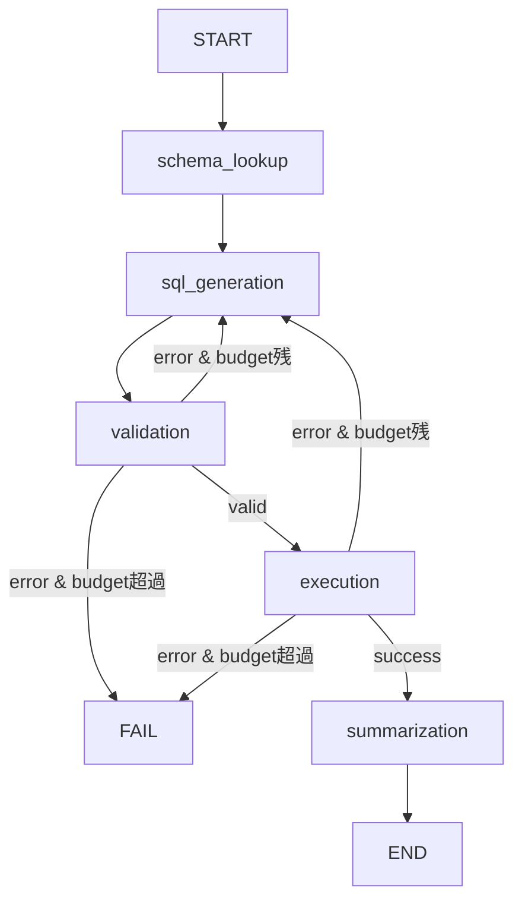
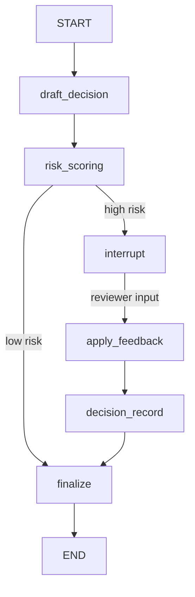

## 論文概要（Abstract）

本記事は [arXiv:2607.19297](https://arxiv.org/abs/2607.19297) の解説記事です。

Pearson らは、長時間稼働するステートフルなビジネスプロセスにおいて、LangGraph のグラフベースオーケストレーションがどのように有効であるかを3つの実行可能なレシピ（SQL分析、Agentic RAG、Human-in-the-Loop ポリシーレビュー）を通じて示している。本論文はベンチマーク論文ではなく、実務者向けのガイドであり、著者らは「LangGraph がモデル品質を向上させることが主眼ではない」と明言している。

この記事は [Zenn記事: LangGraph StateGraphでエージェントワークフローをステートマシンとして設計する](https://zenn.dev/0h_n0/articles/85189b9677caae) の深掘りです。

## 情報源

- **arXiv ID**: 2607.19297
- **URL**: [https://arxiv.org/abs/2607.19297](https://arxiv.org/abs/2607.19297)
- **著者**: Daniel Pearson, Sidney Shapiro, Emiliano Sebastian Gonzalez Venegas, Sanad Al-Khatib, Aurora Pinzón Arzola
- **発表年**: 2026
- **分野**: cs.AI, cs.SE
- **ページ数**: 25ページ、2図、付属コード付き

## 背景と動機（Background & Motivation）

LLMベースのエージェントシステムが普及する中、単発のプロンプト呼び出しやシンプルなReActループでは対応できない複雑なビジネスプロセスが増えている。著者らは、以下の条件を満たす場合にグラフベースのオーケストレーションが必要であると主張している。

- プロセスが一時停止と再開を必要とする（人間のレビュー待ちなど）
- 次のステップが明示的な状態（リスクレベル、検証ステータス、エビデンス品質、リトライ回数など）に依存する
- 失敗時にエラーを返すのではなく、修復パスにルーティングする必要がある
- どのルートが実行されたかの監査証跡が必要である
- 複数のモデル/ツール呼び出しが耐久性のある共有状態を必要とする

一方で、単一プロンプト、単一ツール呼び出し、線形フローで分岐や耐久状態が不要な場合には、LangGraph は過剰であるとも述べている。

## 主要な貢献（Key Contributions）

- **3つの実行可能なレシピの提供**: SQL分析（修復ループ付き）、Agentic RAG（エビデンスゲーティング付き）、HITL ポリシーレビュー（割り込み・チェックポイント復旧付き）
- **適用判断ガイドラインの策定**: LangGraph の構造がいつコストに見合うかの選択指針を提示
- **実装パターンの体系化**: ルート、一時停止、監査証跡を明示的なプロダクト動作として設計するパターンを整理
- **付属コードの公開**: `sql_analytics`、`agentic_rag`、`hitl_policy_review` の3ワークフロー、共有LLMクライアント、モックブレイン、ツール、テストを含む

## 技術的詳細（Technical Details）

### LangGraph の5つのコアプリミティブ

著者らは LangGraph のコアプリミティブを以下の5要素に整理している。

| プリミティブ | 役割 | 説明 |
|------------|------|------|
| **型付き状態（Typed State）** | データ保持 | 入力、中間成果物、ルート決定、リトライ回数、出力を保持する耐久的レコード |
| **ノード（Nodes）** | 処理単位 | 1ステップを担う小さな関数（取得、検証、リスクスコアリング、レビュー要求など） |
| **条件分岐エッジ（Conditional Edges）** | ルーティング | 状態を読み取り次のステップを決定する関数（実行、修復、再取得、割り込み、完了など） |
| **チェックポインター（Checkpointer）** | 永続化 | 一時停止、再起動、承認遅延のための状態永続化機構 |
| **監査可能性（Auditability）** | 設計指針 | 何が起きたかを再構築するための構造化状態とルート履歴の保持 |

著者らは、ノードの境界はプロダクトイベントに対応させるべきだと述べている。スキーマ検索やリスクスコアリングなど、監査ログ・リトライルール・ダッシュボードに現れるべきステップがノードの候補となる。ルート関数は小さく保ち、ロジックを含まず状態を読み取るだけにすべきとしている。

### レシピ1: SQL分析修復ループ



**状態定義**: question、schema、generated_sql、error、attempts、rows、final_answer、status

処理フローは、スキーマ検索 → SQL生成 → バリデーション → 実行 → ビジネスサマリーの順で進む。バリデーションエラーや実行エラーが発生した場合、リトライ予算が残っていれば SQL生成に戻り、予算超過であれば失敗として終了する。

```python
from typing import TypedDict, Annotated

class SQLAnalyticsState(TypedDict):
    """SQL分析ワークフローの状態定義"""
    question: str
    schema: str
    generated_sql: str
    error: str
    attempts: int
    rows: list[dict]
    final_answer: str
    status: str  # "pending" | "success" | "failed"

def route_after_validation(state: SQLAnalyticsState) -> str:
    """バリデーション後のルーティング"""
    if not state.get("error"):
        return "execute"
    if state["attempts"] < 3:
        return "regenerate"
    return "fail"
```

### レシピ2: Agentic RAG エビデンスループ

**状態定義**: question、retrieval_decision、documents、evidence_grade、answer、citations、retries、status

処理フローは、質問分析 → 文書取得 → 文書グレーディング → 回答生成 → 引用検証 → 完了の順で進む。エビデンスが弱い場合はリトライ予算内で再取得を行う。予算を使い切った場合、著者らはシステムが「不十分な情報」として明示的な不足応答を生成するのが正しい動作であると述べている。引用検証に失敗した場合は、根拠のない回答を返すのではなく失敗ステータスで終了する。

```python
def route_after_grading(state: dict) -> str:
    """エビデンスグレーディング後のルーティング"""
    if state["evidence_grade"] == "strong":
        return "generate_answer"
    if state["retries"] < state.get("max_retries", 3):
        return "retrieve"  # 再取得
    return "insufficient"  # 明示的な不足応答
```

### レシピ3: HITL ポリシーレビュー（割り込みとチェックポイント）



**状態定義**: question、policy_passages、draft_answer、risk_level、approval、reviewer_feedback、final_answer、decision_record、status

低リスクのケースは直接最終化に進む。高リスクのケースでは `interrupt()` が呼び出され、グラフの実行が一時停止する。ドラフト、リスクレベル、関連ポリシー文書がレビュアーに提示され、レビュアーの入力で再開すると、フィードバックが適用され構造化された意思決定レコードが書き込まれる。

著者らは以下の設計上の注意点を挙げている。

- **チェックポインターの除去は禁止**: チェックポインターなしでは割り込み後の再開が破綻する
- **レビューゲートの除去は危険**: レビューゲートを外すと、レビュアーが承認したはずのない意思決定が完了ステータスになりうる
- **冪等性の確保**: `interrupt()` 後にノードが先頭から再実行されるため、副作用のあるノードは冪等に設計する必要がある

## 実装のポイント（Implementation）

### ファイル構成パターン

著者らは、グラフ構造（`graph.py`）とドメインロジック（`logic.py`）を分離するファイル構成を推奨している。

```python
# graph.py - グラフ構造の定義
from langgraph.graph import StateGraph, START, END

builder = StateGraph(SQLAnalyticsState)
builder.add_node("schema_lookup", schema_lookup_node)
builder.add_node("generate_sql", generate_sql_node)
builder.add_node("validate", validate_node)
builder.add_node("execute", execute_node)
builder.add_node("summarize", summarize_node)

builder.add_edge(START, "schema_lookup")
builder.add_edge("schema_lookup", "generate_sql")
builder.add_conditional_edges("validate", route_after_validation, {
    "execute": "execute",
    "regenerate": "generate_sql",
    "fail": END,
})
builder.add_edge("execute", "summarize")
builder.add_edge("summarize", END)
```

```python
# logic.py - ドメインロジック（ツール・プロンプト）
def schema_lookup_node(state: SQLAnalyticsState) -> dict:
    """スキーマを取得するノード"""
    schema = fetch_database_schema(state["question"])
    return {"schema": schema}

def generate_sql_node(state: SQLAnalyticsState) -> dict:
    """SQLを生成するノード"""
    sql = llm.invoke(f"Schema: {state['schema']}\nQuestion: {state['question']}")
    return {"generated_sql": sql, "attempts": state["attempts"] + 1}
```

### チェックポインターの選択

| 環境 | チェックポインター | 特徴 |
|------|------------------|------|
| 開発・テスト | `InMemorySaver` | 高速だがプロセス終了で消失 |
| ローカル開発 | `SqliteSaver` | ファイルベースで永続化 |
| 本番環境 | `PostgresSaver` | スケーラブル、複数ワーカー対応 |

### テスト戦略

著者らは、テストではルート動作と状態遷移をアサートすべきであり、回答品質をテストすべきではないと述べている。具体的なテスト例として以下を挙げている。

- 不正なSQLがリトライ予算内で再生成されること
- 弱いエビデンスが「supported」として最終化されないこと
- HITLスレッド状態が再開後も保持されること

## Production Deployment Guide

### AWS実装パターン（コスト最適化重視）

本論文の3レシピ（SQL分析・RAG・HITL）をAWS上で運用する場合の構成を以下に示す。

**トラフィック量別の推奨構成**:

| 規模 | 月間リクエスト | 推奨構成 | 月額コスト | 主要サービス |
|------|--------------|---------|-----------|------------|
| **Small** | ~3,000 (100/日) | Serverless | $50-150 | Lambda + Bedrock + DynamoDB |
| **Medium** | ~30,000 (1,000/日) | Hybrid | $300-800 | Lambda + ECS Fargate + ElastiCache |
| **Large** | 300,000+ (10,000/日) | Container | $2,000-5,000 | EKS + Karpenter + EC2 Spot |

**Small構成の詳細**（月額$50-150）:
- **Lambda**: 1GB RAM, 60秒タイムアウト（$20/月）— SQL分析・RAGの各ノードをLambda関数として実装
- **Bedrock**: Claude 3.5 Haiku, Prompt Caching有効（$80/月）
- **DynamoDB**: On-Demand, チェックポイント保存用（$10/月）— `thread_id` をパーティションキーとして使用
- **API Gateway**: REST API（$5/月）

**コスト削減テクニック**:
- Spot Instances使用で最大90%削減（EKS + Karpenter）
- Bedrock Batch API使用で50%割引（非リアルタイム処理）
- Prompt Caching有効化で30-90%削減（システムプロンプト固定部分）
- Lambda Power Tuningでメモリ・コスト最適化

**注意**: 上記は2026年10月時点のAWS東京リージョン概算値です。最新料金は [AWS料金計算ツール](https://calculator.aws/) で確認してください。

### Terraformインフラコード

**Small構成（Serverless）: Lambda + Bedrock + DynamoDB**

```hcl
module "vpc" {
  source  = "terraform-aws-modules/vpc/aws"
  version = "~> 5.0"

  name = "langgraph-vpc"
  cidr = "10.0.0.0/16"
  azs  = ["ap-northeast-1a", "ap-northeast-1c"]
  private_subnets = ["10.0.1.0/24", "10.0.2.0/24"]

  enable_nat_gateway   = false
  enable_dns_hostnames = true
}

resource "aws_iam_role" "lambda_langgraph" {
  name = "lambda-langgraph-role"

  assume_role_policy = jsonencode({
    Version = "2012-10-17"
    Statement = [{
      Action    = "sts:AssumeRole"
      Effect    = "Allow"
      Principal = { Service = "lambda.amazonaws.com" }
    }]
  })
}

resource "aws_iam_role_policy" "bedrock_invoke" {
  role = aws_iam_role.lambda_langgraph.id
  policy = jsonencode({
    Version = "2012-10-17"
    Statement = [{
      Effect   = "Allow"
      Action   = ["bedrock:InvokeModel", "bedrock:InvokeModelWithResponseStream"]
      Resource = "arn:aws:bedrock:ap-northeast-1::foundation-model/anthropic.claude-3-5-haiku*"
    }]
  })
}

resource "aws_lambda_function" "langgraph_node" {
  filename      = "lambda.zip"
  function_name = "langgraph-workflow-node"
  role          = aws_iam_role.lambda_langgraph.arn
  handler       = "index.handler"
  runtime       = "python3.12"
  timeout       = 60
  memory_size   = 1024

  environment {
    variables = {
      BEDROCK_MODEL_ID    = "anthropic.claude-3-5-haiku-20241022-v1:0"
      DYNAMODB_TABLE      = aws_dynamodb_table.checkpoint.name
      ENABLE_PROMPT_CACHE = "true"
    }
  }
}

resource "aws_dynamodb_table" "checkpoint" {
  name         = "langgraph-checkpoints"
  billing_mode = "PAY_PER_REQUEST"
  hash_key     = "thread_id"
  range_key    = "checkpoint_id"

  attribute {
    name = "thread_id"
    type = "S"
  }
  attribute {
    name = "checkpoint_id"
    type = "S"
  }

  ttl {
    attribute_name = "expire_at"
    enabled        = true
  }
}

resource "aws_cloudwatch_metric_alarm" "lambda_cost" {
  alarm_name          = "langgraph-lambda-cost-spike"
  comparison_operator = "GreaterThanThreshold"
  evaluation_periods  = 1
  metric_name         = "Duration"
  namespace           = "AWS/Lambda"
  period              = 3600
  statistic           = "Sum"
  threshold           = 100000
  alarm_description   = "Lambda実行時間異常（コスト急増の可能性）"

  dimensions = {
    FunctionName = aws_lambda_function.langgraph_node.function_name
  }
}
```

**Large構成（Container）: EKS + Karpenter + Spot Instances**

```hcl
module "eks" {
  source  = "terraform-aws-modules/eks/aws"
  version = "~> 20.0"

  cluster_name    = "langgraph-cluster"
  cluster_version = "1.31"
  vpc_id          = module.vpc.vpc_id
  subnet_ids      = module.vpc.private_subnets

  cluster_endpoint_public_access = true
  enable_cluster_creator_admin_permissions = true
}

resource "kubectl_manifest" "karpenter_provisioner" {
  yaml_body = <<-YAML
    apiVersion: karpenter.sh/v1
    kind: NodePool
    metadata:
      name: langgraph-spot
    spec:
      template:
        spec:
          requirements:
            - key: karpenter.sh/capacity-type
              operator: In
              values: ["spot"]
            - key: node.kubernetes.io/instance-type
              operator: In
              values: ["m7i.xlarge", "m7i.2xlarge"]
          expireAfter: 720h
      limits:
        cpu: "32"
        memory: "128Gi"
  YAML
}

resource "aws_budgets_budget" "langgraph_monthly" {
  name         = "langgraph-monthly-budget"
  budget_type  = "COST"
  limit_amount = "5000"
  limit_unit   = "USD"
  time_unit    = "MONTHLY"

  notification {
    comparison_operator        = "GREATER_THAN"
    threshold                  = 80
    threshold_type             = "PERCENTAGE"
    notification_type          = "ACTUAL"
    subscriber_email_addresses = ["ops@example.com"]
  }
}
```

### セキュリティベストプラクティス

- **IAMロール**: 最小権限の原則。Bedrock の `InvokeModel` のみ許可し、モデルARNでリソースを限定
- **ネットワーク**: Lambda は VPC 内配置、EKS は `cluster_endpoint_public_access = false` を推奨
- **シークレット管理**: AWS Secrets Manager 使用、環境変数へのハードコード禁止
- **暗号化**: DynamoDB/S3 は KMS 暗号化、転送中は TLS 1.2以上
- **監査**: CloudTrail 全リージョン有効化

### 運用・監視設定

```sql
-- CloudWatch Logs Insights: ワークフロー実行時間分析
fields @timestamp, thread_id, node_name, duration_ms
| stats avg(duration_ms) as avg_ms, pct(duration_ms, 95) as p95, pct(duration_ms, 99) as p99
  by node_name
| sort p95 desc
```

```python
import boto3

cloudwatch = boto3.client('cloudwatch')

cloudwatch.put_metric_alarm(
    AlarmName='langgraph-bedrock-token-spike',
    ComparisonOperator='GreaterThanThreshold',
    EvaluationPeriods=1,
    MetricName='TokenUsage',
    Namespace='AWS/Bedrock',
    Period=3600,
    Statistic='Sum',
    Threshold=500000,
    ActionsEnabled=True,
    AlarmActions=['arn:aws:sns:ap-northeast-1:123456789:cost-alerts'],
    AlarmDescription='Bedrockトークン使用量異常'
)
```

### コスト最適化チェックリスト

**アーキテクチャ選択**:
- [ ] ~100 req/日 → Lambda + Bedrock（Serverless）— $50-150/月
- [ ] ~1,000 req/日 → ECS Fargate + Bedrock（Hybrid）— $300-800/月
- [ ] 10,000+ req/日 → EKS + Spot Instances（Container）— $2,000-5,000/月

**リソース最適化**:
- [ ] EC2: Spot Instances優先（Karpenter自動管理）
- [ ] Reserved Instances: 1年コミットで最大72%削減
- [ ] Lambda: Power Tuningでメモリサイズ最適化
- [ ] ECS/EKS: アイドル時スケールダウン

**LLMコスト削減**:
- [ ] Bedrock Batch API: 50%割引（非リアルタイム）
- [ ] Prompt Caching: システムプロンプト固定で30-90%削減
- [ ] モデル選択: 開発→Haiku、本番簡易→Haiku、本番複雑→Sonnet
- [ ] max_tokens設定で過剰生成防止

**監視・アラート**:
- [ ] AWS Budgets: 月額予算設定
- [ ] CloudWatch: トークンスパイク検知
- [ ] Cost Anomaly Detection有効化
- [ ] 日次コストレポート自動送信

**リソース管理**:
- [ ] チェックポイントTTL設定（DynamoDB TTL）
- [ ] タグ戦略: 環境別・プロジェクト別

## 関連ツールとの位置づけ

著者らは、LangGraph を他のツールと相互補完的な関係にあると位置づけている。

| ツール | 適用場面 |
|--------|---------|
| **Plain SDK / ReAct ループ** | チェックポイントや承認が不要なシンプルなツール使用 |
| **Schema-first ツール** | 構造化抽出・バリデーション重視のタスク |
| **DSPy** | プロンプトやプログラムの最適化が主目的のタスク |
| **AutoGen / CrewAI** | マルチエージェントの協調 |
| **Temporal** | 耐久ワークフロー（LLM以外も含む汎用オーケストレーション） |
| **LangGraph** | ステートフルな分岐・修復・人間レビュー・長時間協調が必要な場合 |

## 実運用への応用（Practical Applications）

本論文のレシピは、以下のようなビジネスプロセスへの適用を想定している。

- **SQL分析修復ループ**: 自然言語→SQL生成、エラー時自動修復する分析パイプライン
- **Agentic RAG**: エビデンス品質保証付き検索応答。不十分な場合は明示的に「不足」と回答
- **HITL ポリシーレビュー**: リスクレベルに応じて人間の判断を挟むワークフロー

著者らは、マルチエージェントパターン、クロスセッションメモリ、ストリーミングUX、運用コストなどは本論文の対象外であると述べている。

## 関連研究（Related Work）

- **ReAct / Toolformer**: 軽量なツール使用パターン。チェックポイントや承認不要な場合に適している
- **AutoGen / CrewAI**: マルチエージェント協調に特化。本論文はシングルエージェントの複雑なワークフローに焦点
- **Temporal**: 汎用耐久ワークフローエンジン。一時停止・再開の概念は共通

## まとめと今後の展望

本論文は、LangGraph のグラフベースオーケストレーションを3つの実践的なレシピを通じて解説するプラクティショナーガイドである。著者らの主要な主張は、LangGraph の価値はモデル品質の向上ではなく、ルーティング・一時停止・監査証跡を明示的なプロダクト動作として設計できる点にあるというものである。

ただし、本論文は実証的な評価を含まず、3つのレシピもモック環境での実行に留まっている。本番環境で重要なマルチエージェントパターンやストリーミングは今後の研究で補完される必要がある。

## 参考文献

- **arXiv**: [https://arxiv.org/abs/2607.19297](https://arxiv.org/abs/2607.19297)
- **Related Zenn article**: [https://zenn.dev/0h_n0/articles/85189b9677caae](https://zenn.dev/0h_n0/articles/85189b9677caae)
- **LangGraph公式ドキュメント**: [https://docs.langchain.com/oss/python/langgraph/overview](https://docs.langchain.com/oss/python/langgraph/overview)
