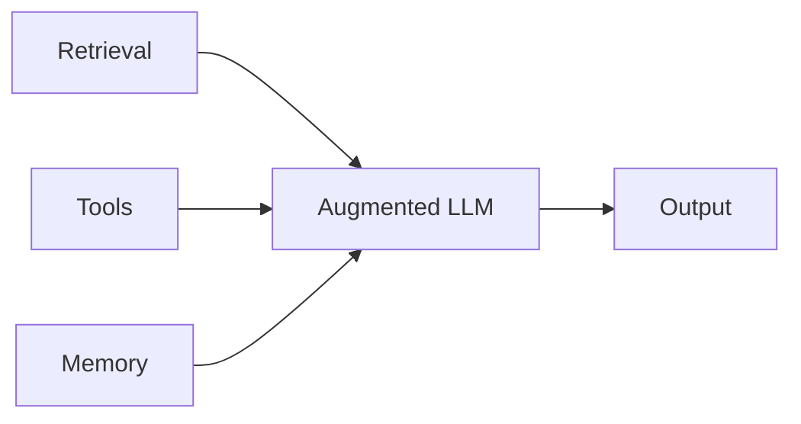
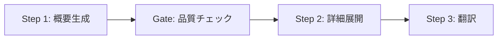
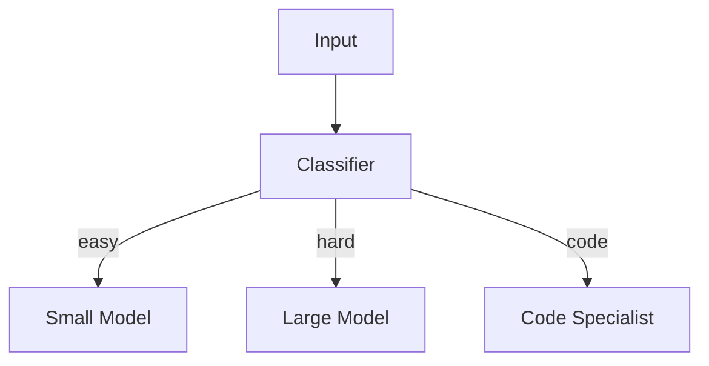
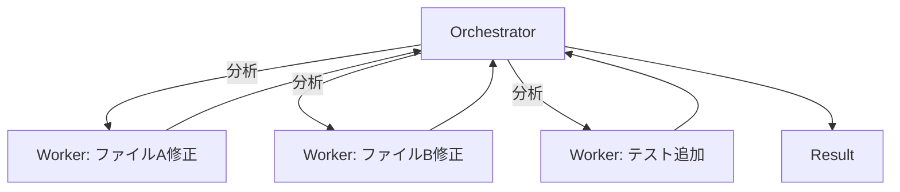

## ブログ概要（Summary）

本記事は [Anthropic Engineering Blog: Building Effective Agents](https://www.anthropic.com/engineering/building-effective-agents) の解説記事です。

Anthropicのエンジニアリングチームが2024年12月に公開したこのブログ記事は、LLMを用いたエージェントシステムの設計指針を体系的にまとめたものである。ブログでは「**Workflow**（事前定義されたコードパスでLLMとツールを統制するシステム）」と「**Agent**（LLM自身が動的にプロセスとツール使用を制御するシステム）」を明確に区別し、5つのワークフローパターンと、自律型エージェントの設計原則を提示している。

この記事は [Zenn記事: LangGraph StateGraphでエージェントワークフローをステートマシンとして設計する](https://zenn.dev/0h_n0/articles/85189b9677caae) の深掘りです。

## 情報源

- **種別**: 企業テックブログ
- **URL**: [https://www.anthropic.com/engineering/building-effective-agents](https://www.anthropic.com/engineering/building-effective-agents)
- **組織**: Anthropic Engineering（Erik S.、Barry Zhang）
- **発表日**: 2024年12月19日

## 技術的背景（Technical Background）

LLMを用いたシステムの複雑化に伴い、単純なプロンプト→レスポンスのパターンでは対処しきれないユースケースが増加している。複数のLLM呼び出しを組み合わせ、ツールを統合し、人間の承認を挟むといった「エージェント的」なシステムの需要が高まる中、どのような設計パターンを選択すべきかという体系的な指針が求められていた。

Anthropicチームは、**最もシンプルな解決策から始め、必要な場合にのみ複雑性を追加する**アプローチを推奨している。この原則は、LangGraphのようなフレームワークを「いつ使うべきか」の判断にも直結する。

ReActパターン（Yao et al., 2022）等の研究がツール使用の基礎を築いているが、本ブログはこれらを**プロダクション設計**の観点から再構成している。

## Augmented LLM: エージェントシステムの基本構成要素

Anthropicチームは、すべてのエージェントシステムの基盤となる概念として「**Augmented LLM**（拡張LLM）」を定義している。これは、素のLLMに以下の3つの機能を追加したものである。



- **Retrieval（検索）**: RAGなどによる外部知識の参照
- **Tools（ツール）**: 外部APIやデータベースへのアクセス
- **Memory（メモリ）**: 会話履歴や長期記憶の管理

Anthropicチームは、このAugmented LLMを「適切に実装することが、より複雑なシステムを構築するための前提条件」と述べている。

## 5つのワークフローパターン

ブログでは、事前定義されたコードパスに沿ってLLMとツールを統制する「Workflow」として、5つのパターンを提示している。以下、各パターンの構造、適用条件、および実装例を解説する。

### パターン1: Prompt Chaining（プロンプトチェイニング）

タスクを逐次的なステップに分解し、各ステップの出力を次のステップの入力とする方式である。ステップ間にプログラム的なチェック（バリデーション）を挟むことで、正確性を高められる。



**適用条件**: タスクが独立したサブタスクに自然に分解でき、各ステップで品質ゲートを設けたい場合。レイテンシが増加するトレードオフがある。

```python
import anthropic
client = anthropic.Anthropic()

def prompt_chain(topic: str) -> str:
    """プロンプトチェイニング: アウトライン→品質Gate→本文生成"""
    outline = client.messages.create(
        model="claude-sonnet-4-20250514", max_tokens=1024,
        messages=[{"role": "user", "content": f"{topic}のアウトラインを作成"}]
    ).content[0].text

    # Gate: 品質チェック
    check = client.messages.create(
        model="claude-sonnet-4-20250514", max_tokens=256,
        messages=[{"role": "user", "content": f"技術的誤りを確認:\n{outline}"}]
    ).content[0].text
    if "問題あり" in check:
        raise ValueError(f"品質チェック失敗: {check}")

    return client.messages.create(
        model="claude-sonnet-4-20250514", max_tokens=4096,
        messages=[{"role": "user", "content": f"アウトラインに基づき記事執筆:\n{outline}"}]
    ).content[0].text
```

### パターン2: Routing（ルーティング）

入力を分類し、専門化された後続処理にディスパッチするパターンである。LangGraphのConditional Edgeに相当する。



**適用条件**: 入力のカテゴリによって最適な処理が異なる場合。カスタマーサポートでのチケット振り分けや、難易度に応じたモデル選択など。

```python
def route_query(query: str) -> str:
    """クエリの複雑度に応じてモデルを選択するルーティング"""
    classification = client.messages.create(
        model="claude-haiku-4-20250514",
        max_tokens=64,
        messages=[{
            "role": "user",
            "content": f"以下のクエリをsimple/complex/codeに分類してください。分類のみ出力:\n{query}"
        }]
    ).content[0].text.strip().lower()

    model_map = {
        "simple": "claude-haiku-4-20250514",
        "complex": "claude-sonnet-4-20250514",
        "code": "claude-sonnet-4-20250514",
    }
    selected_model = model_map.get(classification, "claude-sonnet-4-20250514")

    response = client.messages.create(
        model=selected_model,
        max_tokens=2048,
        messages=[{"role": "user", "content": query}]
    )
    return response.content[0].text
```

### パターン3: Parallelization（並列化）

サブタスクを同時に実行する方式で、2つの変種がある。

- **Sectioning（セクション分割）**: 独立した複数のサブタスクを並列実行する。例として、ガードレールモデルとメインレスポンスの同時実行がある。
- **Voting（投票）**: 同一タスクを複数回実行し、多様な出力を集約する。例として、複数のプロンプトでコードの脆弱性をレビューする手法がある。

```python
import asyncio

async def parallel_review(code: str) -> dict[str, str]:
    """セクション分割: セキュリティ/パフォーマンス/可読性を並列レビュー"""
    aspects = {"security": "セキュリティ脆弱性", "performance": "パフォーマンス", "readability": "可読性"}

    async def review(aspect: str, focus: str) -> tuple[str, str]:
        resp = client.messages.create(
            model="claude-sonnet-4-20250514", max_tokens=1024,
            messages=[{"role": "user", "content": f"{focus}の観点からレビュー:\n```\n{code}\n```"}]
        )
        return aspect, resp.content[0].text

    return dict(await asyncio.gather(*[review(a, f) for a, f in aspects.items()]))
```

### パターン4: Orchestrator-Workers（オーケストレーター・ワーカー）

中央のLLM（オーケストレーター）がタスクを動的に分解し、ワーカーLLMに委譲する方式である。パターン3の並列化と異なり、サブタスクが入力に応じて動的に決定される。LangGraphのSupervisorパターンに相当する。



**適用条件**: サブタスクの構成が事前に予測できない場合。コーディングエージェントにおける複数ファイルの同時変更などが典型例として挙げられている。

```python
import json

def orchestrate_task(task_description: str) -> str:
    """オーケストレーター・ワーカーパターンの実装例"""
    plan = client.messages.create(
        model="claude-sonnet-4-20250514",
        max_tokens=1024,
        messages=[{"role": "user", "content": f"タスクをサブタスクに分解(JSON配列): {task_description}"}]
    ).content[0].text

    subtasks = json.loads(plan)
    results = [
        client.messages.create(
            model="claude-sonnet-4-20250514", max_tokens=2048,
            messages=[{"role": "user", "content": st}]
        ).content[0].text
        for st in subtasks
    ]

    return client.messages.create(
        model="claude-sonnet-4-20250514", max_tokens=2048,
        messages=[{"role": "user", "content": f"結果を統合:\n{json.dumps(results, ensure_ascii=False)}"}]
    ).content[0].text
```

### パターン5: Evaluator-Optimizer（評価者・最適化者）

一方のLLMが出力を生成し、もう一方が評価とフィードバックを提供するループ構造である。LangGraphの条件分岐エッジによるループ実装に対応する。

**適用条件**: 評価基準が明確で、反復的な改善が測定可能な場合。文芸翻訳やコード最適化に向くとされている。

```python
def evaluate_and_optimize(task: str, max_iterations: int = 3) -> str:
    """評価者・最適化者パターン: 生成→評価→改善のループ"""
    draft = client.messages.create(
        model="claude-sonnet-4-20250514", max_tokens=2048,
        messages=[{"role": "user", "content": task}]
    ).content[0].text

    for _ in range(max_iterations):
        evaluation = client.messages.create(
            model="claude-sonnet-4-20250514", max_tokens=512,
            messages=[{"role": "user", "content": f"評価し改善点なければ'APPROVED':\n{draft}"}]
        ).content[0].text

        if "APPROVED" in evaluation:
            break
        draft = client.messages.create(
            model="claude-sonnet-4-20250514", max_tokens=2048,
            messages=[{"role": "user", "content": f"改善:\n{evaluation}\n原文:\n{draft}"}]
        ).content[0].text
    return draft
```

## 自律型Agentの設計原則

Anthropicチームは、Workflowパターンでは対応できない、**LLM自身が動的にプロセスを制御する**ケースとして「Agent」を定義している。Agentの基本構造は「ツール呼び出しループ」であり、LangGraphのReActパターン実装に対応する。

ブログでは、Agent設計における3つの原則を述べている。

1. **Simplicity（単純性）**: 設計はできる限りシンプルに保つ。フレームワークを使う場合でも、内部のコードを理解した上で使用することが推奨されている
2. **Transparency（透明性）**: 計画ステップをユーザーに見せることで、信頼性と検証可能性を確保する
3. **Agent-Computer Interface（ACI）設計**: ツールの定義にもプロンプトエンジニアリングと同等の注意を払う。「poka-yoke（ポカヨケ）」の概念を適用し、ミスが起きにくいインターフェースを設計する

> Anthropicチームは、SWE-benchの実験において、ファイルパスを相対パスから絶対パスに変更するだけでエラーが排除されたと報告している。この事例は、ツール設計が全体性能に与える影響の大きさを示している。

### 暴走防止とHuman-in-the-Loop

ブログでは、Agentが自律的に動作する際の制御策として以下を述べている。

- **停止条件**: 最大イテレーション数やトークン上限の設定
- **人間のフィードバック**: チェックポイントで一時停止し、人間の確認を待つ仕組み
- **サンドボックス**: 広範なテストとガードレールの設定

これらの設計は、LangGraphの`interrupt()`やチェックポイント機構と直接対応する。

## 実用事例: カスタマーサポートとコーディングエージェント

Anthropicチームは、Agent型アーキテクチャが適する2つのドメインを挙げている。

**カスタマーサポート**: 会話フロー、ツールアクセス（注文履歴等）、アクション実行（返金処理）を組み合わせ、解決率で測定可能。LangGraphのConditional Edgeによるルーティングとinterrupt()承認フローが適用できる。

**コーディングエージェント**: 自動テストでソリューションを検証でき、テスト結果をフィードバックとして反復改善が可能。出力品質が測定可能なため、Evaluator-Optimizerパターンとの相性もよい。

## パフォーマンス最適化（Performance）

ブログでは具体的なベンチマーク数値は公開されていないが、以下の最適化指針が述べられている。

**レイテンシ削減**:
- Prompt Chainingではステップ数に比例してレイテンシが増加する。ステップの統合やパイプライン化で緩和可能
- Parallelizationで独立したサブタスクを並列実行し、wall-clock timeを削減

**コスト最適化**:
- Routingで入力の複雑度に応じたモデル選択を行い、簡単なクエリにはHaikuなどの小型モデルを使用
- 不要な複雑性を排除し、シンプルなパターンを優先する

**信頼性向上**:
- 各ステップにバリデーションゲートを設ける（Prompt Chaining）
- 複数回実行による結果の安定化（Voting）
- ループ回数の制限による暴走防止

## 運用での学び（Production Lessons）

Anthropicチームが述べている運用上の教訓を整理する。

**フレームワーク選択**: フレームワークは出発点として有用だが、プロダクション時はLLM APIの直接呼び出しに近い形で制御することが推奨されている。

**ツール設計の重要性**: ツール定義はメインプロンプトと同等の品質が必要。使用例、エッジケース記述、多数の入力例テストが推奨されている。

**段階的な複雑化**: シンプルな解決策を試し、改善が測定可能な場合にのみワークフローパターンを導入する。

## 学術研究との関連（Academic Connection）

- **ReAct（Yao et al., 2022）**: Agent型ループの基盤。ブログのAgent定義はReActの実務拡張
- **StateFlow（Wu et al., 2024, arXiv:2403.11322）**: 状態マシンによるワークフロー制御。ブログのWorkflow/Agent区別と整合

LangGraphの`StateGraph`は、ブログの5パターンのうちRouting（Conditional Edge）、Orchestrator-Workers（Supervisor）、Evaluator-Optimizer（ループ）の実装基盤として位置づけられる。

## Production Deployment Guide

### AWS実装パターン（コスト最適化重視）

Anthropicのワークフローパターンを本番環境にデプロイするためのAWS構成を示す。

**トラフィック量別の推奨構成**:

| 規模 | 月間リクエスト | 推奨構成 | 月額コスト | 主要サービス |
|------|--------------|---------|-----------|------------|
| **Small** | ~3,000 (100/日) | Serverless | $50-150 | Lambda + Bedrock + DynamoDB |
| **Medium** | ~30,000 (1,000/日) | Hybrid | $300-800 | Lambda + ECS Fargate + ElastiCache |
| **Large** | 300,000+ (10,000/日) | Container | $2,000-5,000 | EKS + Karpenter + EC2 Spot |

**Small構成の詳細** (月額$50-150):
- **Lambda**: 1GB RAM, 60秒タイムアウト ($20/月)
- **Bedrock**: Claude 3.5 Haiku, Prompt Caching有効 ($80/月)
- **DynamoDB**: On-Demand, 会話履歴保存 ($10/月)
- **API Gateway**: REST API ($5/月)

**コスト削減テクニック**:
- Routingパターンで簡易クエリにHaiku（$0.25/MTok）、複雑クエリのみSonnet（$3/MTok）に振り分け
- Prompt Caching有効化で30-90%削減。Bedrock Batch APIで非リアルタイム処理を50%割引

**注意**: 上記は2026年10月時点のAWS東京リージョン概算値。最新料金は [AWS料金計算ツール](https://calculator.aws/) で確認を推奨。

### Terraformインフラコード

**Small構成 (Serverless): Lambda + Bedrock + DynamoDB**

```hcl
module "vpc" {
  source  = "terraform-aws-modules/vpc/aws"
  version = "~> 5.0"

  name = "agent-workflow-vpc"
  cidr = "10.0.0.0/16"
  azs  = ["ap-northeast-1a", "ap-northeast-1c"]
  private_subnets = ["10.0.1.0/24", "10.0.2.0/24"]

  enable_nat_gateway   = false
  enable_dns_hostnames = true
}

resource "aws_iam_role" "lambda_agent" {
  name = "lambda-agent-role"

  assume_role_policy = jsonencode({
    Version = "2012-10-17"
    Statement = [{
      Action    = "sts:AssumeRole"
      Effect    = "Allow"
      Principal = { Service = "lambda.amazonaws.com" }
    }]
  })
}

resource "aws_iam_role_policy" "bedrock_invoke" {
  role = aws_iam_role.lambda_agent.id
  policy = jsonencode({
    Version = "2012-10-17"
    Statement = [{
      Effect   = "Allow"
      Action   = ["bedrock:InvokeModel", "bedrock:InvokeModelWithResponseStream"]
      Resource = "arn:aws:bedrock:ap-northeast-1::foundation-model/anthropic.claude-*"
    }]
  })
}

resource "aws_lambda_function" "agent_handler" {
  filename      = "lambda.zip"
  function_name = "agent-workflow-handler"
  role          = aws_iam_role.lambda_agent.arn
  handler       = "index.handler"
  runtime       = "python3.12"
  timeout       = 120
  memory_size   = 1024

  environment {
    variables = {
      BEDROCK_MODEL_ID    = "anthropic.claude-3-5-haiku-20241022-v1:0"
      DYNAMODB_TABLE      = aws_dynamodb_table.conversations.name
      ENABLE_PROMPT_CACHE = "true"
    }
  }
}

resource "aws_dynamodb_table" "conversations" {
  name         = "agent-conversations"
  billing_mode = "PAY_PER_REQUEST"
  hash_key     = "thread_id"

  attribute {
    name = "thread_id"
    type = "S"
  }

  ttl {
    attribute_name = "expire_at"
    enabled        = true
  }
}

resource "aws_cloudwatch_metric_alarm" "lambda_cost" {
  alarm_name          = "agent-lambda-cost-spike"
  comparison_operator = "GreaterThanThreshold"
  evaluation_periods  = 1
  metric_name         = "Duration"
  namespace           = "AWS/Lambda"
  period              = 3600
  statistic           = "Sum"
  threshold           = 100000
  alarm_description   = "Lambda実行時間異常（コスト急増の可能性）"
  dimensions = {
    FunctionName = aws_lambda_function.agent_handler.function_name
  }
}
```

### セキュリティベストプラクティス

- **IAMロール**: 最小権限原則。Bedrock呼び出し権限はモデル単位で制限
- **シークレット管理**: AWS Secrets Manager使用、環境変数へのハードコード禁止
- **暗号化**: S3/DynamoDB/EBS全てKMS暗号化。TLS 1.2以上必須
- **監査**: CloudTrail全リージョン有効化、Config有効化

### 運用・監視設定

**CloudWatch Logs Insights クエリ（コスト異常検知）**:
```sql
fields @timestamp, model_id, input_tokens, output_tokens
| stats sum(input_tokens + output_tokens) as total_tokens by bin(1h)
| filter total_tokens > 100000
```

**CloudWatch アラーム**: Bedrockトークン使用量スパイク検知（50万トークン/時間超過）、Lambda実行時間異常検知（平均30秒超過）を設定し、SNSでアラート通知する。

**X-Ray トレーシング**: `aws_xray_sdk`でboto3を自動計装し、各ワークフローステップのパターン名・入力サイズ・出力トークン数をアノテーション・メタデータとして記録する。

### コスト最適化チェックリスト

**アーキテクチャ選択**:
- [ ] ~100 req/日 → Lambda + Bedrock (Serverless) - $50-150/月
- [ ] ~1000 req/日 → ECS Fargate + Bedrock (Hybrid) - $300-800/月
- [ ] 10000+ req/日 → EKS + Spot Instances (Container) - $2,000-5,000/月

**リソース最適化**: Spot Instances優先（最大90%削減）、Reserved Instances（72%削減）、Lambda メモリ最適化、アイドル時スケールダウン

**LLMコスト削減**: Routingで簡易→Haiku/複雑→Sonnet振り分け、Batch API（50%割引）、Prompt Caching（30-90%削減）、max_tokens制限

**監視**: AWS Budgets（80%警告）、CloudWatchトークンスパイク検知、Cost Anomaly Detection、日次レポート

## まとめと実践への示唆

Anthropicの「Building Effective Agents」ブログは、LLMエージェント設計における「シンプルさを優先する」という原則を体系的にまとめたものである。5つのワークフローパターン（Prompt Chaining、Routing、Parallelization、Orchestrator-Workers、Evaluator-Optimizer）は、LangGraphのStateGraph上で実装可能な設計パターンの分類として有用である。

Zenn記事で解説されている LangGraph の Conditional Edge はRoutingパターンに、サブグラフ合成はOrchestrator-Workersパターンに、ReActループはAgent型の設計に、それぞれ対応している。Anthropicチームの推奨する「まずシンプルに」という原則は、LangGraphの導入判断においても重要な指針となる。

## 参考文献

- **Blog URL**: [https://www.anthropic.com/engineering/building-effective-agents](https://www.anthropic.com/engineering/building-effective-agents)
- **Related Papers**: Yao et al., "ReAct: Synergizing Reasoning and Acting in Language Models" (arXiv:2210.03629)
- **Related Zenn article**: [https://zenn.dev/0h_n0/articles/85189b9677caae](https://zenn.dev/0h_n0/articles/85189b9677caae)

---

:::message
この記事はAI（Claude Code）により自動生成されました。内容の正確性については原文ブログをご確認ください。
:::
