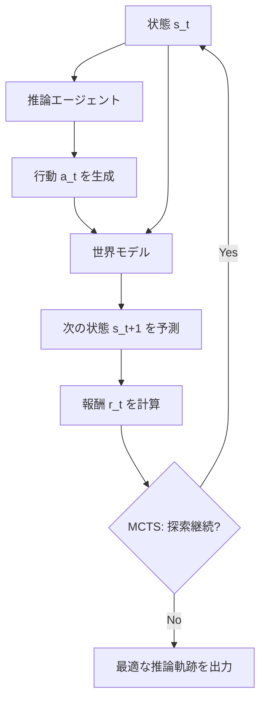

## 論文概要（Abstract）

本記事は [https://arxiv.org/abs/2305.14992](https://arxiv.org/abs/2305.14992) の解説記事です。

RAP（Reasoning via Planning）は、LLMを**世界モデル**と**推論エージェント**の二役として活用し、モンテカルロ木探索（MCTS）によって推論空間を戦略的に探索するフレームワークである。著者らは、LLaMA-33BにRAP を適用することで、Chain of Thought（CoT）を使ったGPT-4の性能を上回り、計画生成タスクで33%の相対的改善を達成したと報告している（論文Abstract より）。

この記事は [Zenn記事: Tree of ThoughtsをPythonで実装してLLMの推論精度を高める](https://zenn.dev/0h_n0/articles/1a116f72e8a543) の深掘りです。Zenn記事ではTree of Thoughts（ToT）のBFS/DFS探索を解説していますが、RAPはMCTSという異なる木探索アルゴリズムを採用し、さらにLLMに「世界モデル」としての役割を与える点でToTとは本質的に異なるアプローチを提示しています。

## 情報源

- **arXiv ID**: 2305.14992
- **URL**: [https://arxiv.org/abs/2305.14992](https://arxiv.org/abs/2305.14992)
- **著者**: Shibo Hao, Yi Gu, Haodi Ma, Joshua Jiahua Hong et al.（UC San Diego, University of Florida, Mohamed bin Zayed University of Artificial Intelligence）
- **発表年**: 2023（EMNLP 2023採択）
- **分野**: cs.CL, cs.AI, cs.LG
- **コード**: [https://github.com/Ber666/llm-reasoners](https://github.com/Ber666/llm-reasoners)

## 背景と動機（Background & Motivation）

LLMはChain of Thought（CoT）プロンプティングにより推論能力を向上させてきたが、著者らは従来のCoTに3つの本質的な限界があると指摘している。

1. **内部世界モデルの欠如**: CoTは状態を明示的にシミュレートしないため、推論の途中で「今どの状態にいるか」を把握できない
2. **報酬メカニズムの不在**: 推論の各ステップを評価し、望ましい方向に誘導する仕組みがない
3. **探索と活用のバランス**: 広大な推論空間において、代替パスの探索とバックトラッキングが不可能

Tree of Thoughts（ToT）はBFS/DFSでこの問題にアプローチしたが、RAPはより原理的な手法としてモンテカルロ木探索（MCTS）を導入する。MCTSはAlphaGoなどのゲームAIで実績があり、UCT（Upper Confidence bounds applied to Trees）公式により探索と活用のバランスを数学的に制御できる。著者らは「これまでの手法はいずれも世界モデルと報酬を統一的なフレームワークに組み込んでいない」と主張しており、RAPがその初めての試みであると位置づけている。

## 主要な貢献（Key Contributions）

- **貢献1**: LLMを世界モデルと推論エージェントの二役として再利用するフレームワークの提案。追加の学習やファインチューニングは不要
- **貢献2**: MCTSに基づく計画アルゴリズムにより、推論空間における戦略的探索を実現
- **貢献3**: 計画生成・数学推論・論理推論の3タスクで有効性を検証。LLaMA-33BがGPT-4のCoT性能を上回るケースを実証

## 技術的詳細（Technical Details）

### RAPフレームワークのアーキテクチャ

RAPは推論プロセスをマルコフ決定過程（MDP）としてモデル化する。推論の軌跡は状態と行動の交互列 $(s_0, a_0, s_1, a_1, \ldots, a_{T-1}, s_T)$ として表現される。

LLMは以下の2つの役割を同時に担う。

**推論エージェント（Reasoning Agent）**: 現在の状態 $s_t$ とプロンプト $c$ を条件として、行動 $a_t$ をサンプリングする。

$$
a_t \sim p_\phi(a \mid s_t, c)
$$

**世界モデル（World Model）**: 現在の状態 $s_t$ と行動 $a_t$ から、次の状態 $s_{t+1}$ を予測する。

$$
s_{t+1} \sim p_\theta(s \mid s_t, a_t, c')
$$

ここで、
- $s_t$: 時刻 $t$ の状態（自然言語で表現）
- $a_t$: 時刻 $t$ の行動（推論ステップ）
- $c, c'$: それぞれエージェント用・世界モデル用のプロンプト（In-context demonstrations含む）
- $p_\phi, p_\theta$: 同一のLLMだが、異なるプロンプトで条件付けされる



CoTとの本質的な違いは、CoTの中間ステップが**行動のみ**の列であるのに対し、RAPでは**状態と行動の交互列**を維持する点にある。これにより、推論の途中経過を明示的に追跡できる。

### タスク別の状態・行動設計

著者らは3つのタスクで状態と行動を以下のように具体化している。

| タスク | 状態 $s_t$ | 行動 $a_t$ |
|--------|-----------|-----------|
| Blocksworld（計画生成） | ブロックの配置（自然言語記述） | ブロック操作（例: "pickup the orange block"） |
| GSM8K（数学推論） | 中間変数の値 | 未知の変数に関するサブ質問 |
| PrOntoQA（論理推論） | 現在注目している事実 | 適用するルールの選択 |

### 報酬設計（Reward Design）

著者らは4種類の報酬 $r_t = r(s_t, a_t)$ を提案している。

1. **行動尤度（Action Likelihood）**: LLMが生成した行動の対数確率。In-context demonstrationsと現在の状態を条件とする。「エージェントとしてのLLMの直感」を反映し、探索の事前分布として機能する

2. **状態信頼度（State Confidence）**: 世界モデルから複数回回答をサンプリングし、最頻回答の出現割合を報酬とする。数学推論のように状態が「答え」に対応するタスクで有効

3. **自己評価（Self-Evaluation）**: LLMに「この推論ステップは正しいか？」と問い、"Yes"トークンの次トークン確率を報酬とする

4. **タスク固有ヒューリスティック**: Blocksworldでは、予測されたブロック状態がゴール状態の条件をどれだけ満たしているかを報酬とする

数学推論では、報酬は重み付き幾何平均で合成される。

$$
r_t = r_{t,1}^{\alpha} \cdot r_{t,2}^{1-\alpha}
$$

ここで $r_{t,1}$ は自己評価、$r_{t,2}$ は状態信頼度、$\alpha$ は重みパラメータである。

### MCTS探索アルゴリズム

RAPのMCTSは4つのフェーズで構成される。

**1. 選択（Selection）**: ルートから葉ノードまでUCT公式に従って降下する。

$$
a^* = \arg\max_{a \in A(s)} \left[ Q(s, a) + w \cdot \sqrt{\frac{\ln N(s)}{N(c(s, a))}} \right]
$$

ここで、
- $Q(s, a)$: 状態 $s$ で行動 $a$ を取った場合の期待報酬推定値
- $N(s)$: ノード $s$ の訪問回数
- $c(s, a)$: 行動 $a$ により到達する子ノード
- $w$: 探索重み（探索と活用のトレードオフを制御）

**2. 拡張（Expansion）**: 葉ノードで $d$ 個の行動候補をLLM（エージェント）からサンプリングし、各行動に対してLLM（世界モデル）で次の状態を予測する。

**3. シミュレーション（Simulation）**: 終端状態までロールアウトする。ロールアウトポリシーは $d$ 個の候補を生成し、局所報酬が最大のものを選択する: $a' = \arg\max r(s, a)$。計算効率のため、マルチサンプル状態信頼度などの高コスト報酬はシミュレーション中は省略される。

**4. 逆伝播（Back-propagation）**: パス上の $Q$ 値を将来のステップの報酬で更新する。

$$
Q^*(s_t, a_t) = \max_{\text{future paths}} \text{avg}(r_t, \ldots, r_l)
$$

著者らは標準MCTSに2つの修正を加えている。第一に、数学推論のようなオープンドメイン問題では行動空間を列挙できないため、LLMから固定数の候補をサンプリングして行動空間を制限する。第二に、未訪問の行動ノードには軽量な局所報酬（自己評価など）による $Q$ 推定値を事前に与え、限られたイテレーション予算下での探索効率を高めている。

### 最終解の選択とアグリゲーション

最終的な推論軌跡の選択について、著者らは3つの戦略を検討している。（1）ルートから最大Q値のパスを辿る、（2）最高報酬のイテレーションのパスを採用する、（3）最多訪問の葉ノードを選ぶ。著者らは「（2）の戦略が多くの場合で最良の結果をもたらす」と報告している。

数学推論のように最終的な答えのみが必要なタスクでは、RAP-Aggregation として複数のMCTSイテレーションから得られた回答を多数決で集約する。

## 実装のポイント（Implementation）

著者らの実験はすべてLLaMA-33B（サンプリング温度0.8）で実施されている。4×NVIDIA A5000 GPU（24GB）を使用したと記載されている（論文Appendix B.2より）。

実装上の注意点は以下の通りである。

**世界モデルのプロンプト設計**: 状態遷移を予測するプロンプトは、行動実行後の状態変化に焦点を当てる。Blocksworldでは `[SCENARIO]/[STATE]/[ACTION]/[CHANGE]` のブロック形式でプロンプトを構成する（論文Appendix C.1より）。

**報酬計算時の情報制限**: $r_t$ の計算時、LLMには現在の状態のみを見せ、過去の履歴は隠す。これにより残りの問題が簡単になり、難しい初期の決定により多くのイテレーションを割り当てられる。

**シミュレーションの軽量化**: ロールアウト中は高コストな報酬コンポーネント（マルチサンプルの状態信頼度など）を省略し、計算効率を確保する。

```python
from dataclasses import dataclass
import math
import random


@dataclass
class MCTSNode:
    """MCTS木のノード。"""

    state: str
    action: str | None = None
    parent: "MCTSNode | None" = None
    children: list["MCTSNode"] | None = None
    q_value: float = 0.0
    visit_count: int = 0

    def uct_score(self, exploration_weight: float) -> float:
        """UCTスコアを計算する。"""
        if self.visit_count == 0:
            return float("inf")
        parent_visits = self.parent.visit_count if self.parent else 1
        exploitation = self.q_value / self.visit_count
        exploration = exploration_weight * math.sqrt(
            math.log(parent_visits) / self.visit_count
        )
        return exploitation + exploration


def select(node: MCTSNode, w: float) -> MCTSNode:
    """UCT公式に基づき葉ノードまで降下する。"""
    while node.children:
        node = max(node.children, key=lambda c: c.uct_score(w))
    return node


def expand(
    node: MCTSNode,
    generate_actions: callable,
    predict_state: callable,
    d: int = 5,
) -> list[MCTSNode]:
    """ノードを拡張し、d個の子ノードを生成する。"""
    actions = generate_actions(node.state, k=d)
    children = []
    for action in actions:
        next_state = predict_state(node.state, action)
        child = MCTSNode(
            state=next_state, action=action, parent=node
        )
        children.append(child)
    node.children = children
    return children
```

## Production Deployment Guide

### AWS実装パターン（コスト最適化重視）

RAP/MCTSベースのLLM推論システムをAWSにデプロイする場合、1回の推論で複数回のLLMコールが発生するため、バッチ処理とキャッシュが重要になる。

**トラフィック量別の推奨構成**:

| 規模 | 月間リクエスト | 推奨構成 | 月額コスト | 主要サービス |
|------|--------------|---------|-----------|------------|
| **Small** | ~3,000 (100/日) | Serverless | $100-300 | Lambda + Bedrock + DynamoDB |
| **Medium** | ~30,000 (1,000/日) | Hybrid | $800-2,000 | ECS Fargate + Bedrock + ElastiCache |
| **Large** | 300,000+ (10,000/日) | Container | $5,000-15,000 | EKS + Karpenter + SageMaker Endpoint |

RAPは1問あたり10-20回のMCTSイテレーション×各イテレーションで複数のLLMコールを行うため、通常のLLM推論と比較してコストが10-50倍になる点に注意が必要である。

**Small構成の詳細（月額$100-300）**:
- **Lambda**: 1GB RAM, 120秒タイムアウト（MCTSの反復に対応）$30/月
- **Bedrock**: Claude 3.5 Haiku, Prompt Caching有効 $150/月（MCTSイテレーション分を考慮）
- **DynamoDB**: 中間状態キャッシュ用 On-Demand $15/月
- **Step Functions**: MCTSイテレーションのオーケストレーション $5/月

**Medium構成の詳細（月額$800-2,000）**:
- **ECS Fargate**: 1 vCPU, 2GB RAM × 2タスク $200/月
- **Bedrock**: Claude 3.5 Sonnet, Batch API活用 $1,200/月
- **ElastiCache Redis**: 状態・評価キャッシュ cache.t3.small $30/月
- **SQS**: 非同期処理キュー $5/月

**Large構成の詳細（月額$5,000-15,000）**:
- **EKS**: コントロールプレーン $72/月
- **EC2 Spot**: g5.xlarge × 2-4台（自己ホスト推論用）$800/月
- **SageMaker Endpoint**: 高頻度推論用 $3,000/月
- **Bedrock Batch**: 50%割引活用 $5,000/月

**コスト削減テクニック（RAP固有）**:
- **状態キャッシュ**: 同一状態からの遷移結果をDynamoDB/Redisにキャッシュし、重複LLMコールを削減
- **Prompt Caching**: システムプロンプト・In-context demonstrations部分を共有（30-90%削減）
- **Proposer/Evaluator分離**: 行動生成にはHaiku、評価にはSonnetを使用してコスト最適化
- **Early Termination**: IMPOSSIBLE判定されたノードの早期剪定でイテレーション数を削減

**コスト試算の注意事項**:
- 上記は2026年10月時点のAWS ap-northeast-1（東京）リージョン料金に基づく概算値です
- RAPの特性上、問題の難易度によりLLMコール数が大きく変動するため、実際のコストは問題セットに強く依存します
- 最新料金は [AWS料金計算ツール](https://calculator.aws/) で確認してください

### Terraformインフラコード

**Small構成（Serverless）: Lambda + Step Functions + Bedrock**

```hcl
module "vpc" {
  source  = "terraform-aws-modules/vpc/aws"
  version = "~> 5.0"

  name = "rap-mcts-vpc"
  cidr = "10.0.0.0/16"
  azs  = ["ap-northeast-1a", "ap-northeast-1c"]
  private_subnets = ["10.0.1.0/24", "10.0.2.0/24"]

  enable_nat_gateway   = false
  enable_dns_hostnames = true
}

resource "aws_iam_role" "lambda_rap" {
  name = "lambda-rap-mcts-role"

  assume_role_policy = jsonencode({
    Version = "2012-10-17"
    Statement = [{
      Action    = "sts:AssumeRole"
      Effect    = "Allow"
      Principal = { Service = "lambda.amazonaws.com" }
    }]
  })
}

resource "aws_iam_role_policy" "bedrock_invoke" {
  role = aws_iam_role.lambda_rap.id

  policy = jsonencode({
    Version = "2012-10-17"
    Statement = [{
      Effect   = "Allow"
      Action   = ["bedrock:InvokeModel", "bedrock:InvokeModelWithResponseStream"]
      Resource = "arn:aws:bedrock:ap-northeast-1::foundation-model/anthropic.claude-3-5-haiku*"
    }]
  })
}

resource "aws_lambda_function" "rap_mcts_handler" {
  filename      = "lambda.zip"
  function_name = "rap-mcts-handler"
  role          = aws_iam_role.lambda_rap.arn
  handler       = "index.handler"
  runtime       = "python3.12"
  timeout       = 120
  memory_size   = 1024

  environment {
    variables = {
      BEDROCK_MODEL_ID    = "anthropic.claude-3-5-haiku-20241022-v1:0"
      DYNAMODB_TABLE      = aws_dynamodb_table.state_cache.name
      MCTS_ITERATIONS     = "10"
      MCTS_BEAM_WIDTH     = "5"
      ENABLE_PROMPT_CACHE = "true"
    }
  }
}

resource "aws_dynamodb_table" "state_cache" {
  name         = "rap-state-cache"
  billing_mode = "PAY_PER_REQUEST"
  hash_key     = "state_hash"

  attribute {
    name = "state_hash"
    type = "S"
  }

  ttl {
    attribute_name = "expire_at"
    enabled        = true
  }
}

resource "aws_cloudwatch_metric_alarm" "lambda_duration" {
  alarm_name          = "rap-lambda-duration-spike"
  comparison_operator = "GreaterThanThreshold"
  evaluation_periods  = 1
  metric_name         = "Duration"
  namespace           = "AWS/Lambda"
  period              = 3600
  statistic           = "Average"
  threshold           = 60000
  alarm_description   = "RAP Lambda平均実行時間60秒超過（MCTSイテレーション増加の可能性）"

  dimensions = {
    FunctionName = aws_lambda_function.rap_mcts_handler.function_name
  }
}
```

**Large構成（Container）: EKS + Karpenter + Spot Instances**

```hcl
module "eks" {
  source  = "terraform-aws-modules/eks/aws"
  version = "~> 20.0"

  cluster_name    = "rap-inference-cluster"
  cluster_version = "1.31"

  vpc_id     = module.vpc.vpc_id
  subnet_ids = module.vpc.private_subnets

  cluster_endpoint_public_access = true
  enable_cluster_creator_admin_permissions = true
}

resource "kubectl_manifest" "karpenter_provisioner" {
  yaml_body = <<-YAML
    apiVersion: karpenter.sh/v1alpha5
    kind: Provisioner
    metadata:
      name: rap-spot-provisioner
    spec:
      requirements:
        - key: karpenter.sh/capacity-type
          operator: In
          values: ["spot"]
        - key: node.kubernetes.io/instance-type
          operator: In
          values: ["g5.xlarge", "g5.2xlarge"]
      limits:
        resources:
          cpu: "32"
          memory: "128Gi"
      providerRef:
        name: default
      ttlSecondsAfterEmpty: 30
  YAML
}

resource "aws_budgets_budget" "rap_monthly" {
  name         = "rap-monthly-budget"
  budget_type  = "COST"
  limit_amount = "15000"
  limit_unit   = "USD"
  time_unit    = "MONTHLY"

  notification {
    comparison_operator        = "GREATER_THAN"
    threshold                  = 80
    threshold_type             = "PERCENTAGE"
    notification_type          = "ACTUAL"
    subscriber_email_addresses = ["ops@example.com"]
  }
}
```

### セキュリティベストプラクティス

- **ネットワーク**: EKSは `cluster_endpoint_public_access = false` を本番環境で設定。Lambda はVPC内配置
- **認証・認可**: IAMロール最小権限、IRSA（IAM Roles for Service Accounts）使用
- **シークレット管理**: AWS Secrets Manager使用、環境変数ハードコード禁止
- **暗号化**: S3/DynamoDB全てKMS暗号化、転送中はTLS 1.2以上必須
- **監査**: CloudTrail全リージョン有効化、Config有効化

### 運用・監視設定

**CloudWatch Logs Insights クエリ**:
```sql
-- MCTSイテレーション数とトークン使用量の監視
fields @timestamp, mcts_iterations, total_tokens, duration_ms
| stats avg(mcts_iterations) as avg_iter,
        sum(total_tokens) as total_tokens,
        pct(duration_ms, 95) as p95_latency
  by bin(1h)

-- 剪定率の監視（低すぎる場合はevaluatorの調整が必要）
fields @timestamp, pruned_count, total_nodes
| stats avg(pruned_count / total_nodes) as prune_rate by bin(1h)
| filter prune_rate < 0.1
```

**CloudWatch アラーム設定**:
```python
import boto3

cloudwatch = boto3.client('cloudwatch')

cloudwatch.put_metric_alarm(
    AlarmName='rap-bedrock-token-spike',
    ComparisonOperator='GreaterThanThreshold',
    EvaluationPeriods=1,
    MetricName='TokenUsage',
    Namespace='Custom/RAP',
    Period=3600,
    Statistic='Sum',
    Threshold=2000000,
    ActionsEnabled=True,
    AlarmActions=['arn:aws:sns:ap-northeast-1:123456789:cost-alerts'],
    AlarmDescription='RAPトークン使用量異常（MCTS深掘りによるコスト急増）'
)
```

**X-Rayトレーシング設定**:
```python
from aws_xray_sdk.core import xray_recorder, patch_all

patch_all()

@xray_recorder.capture('rap_mcts_iteration')
def run_mcts_iteration(state: str, iteration: int):
    xray_recorder.put_annotation('iteration', iteration)
    xray_recorder.put_annotation('state_length', len(state))

    with xray_recorder.in_subsegment('generate_actions'):
        actions = generate_actions(state)

    with xray_recorder.in_subsegment('evaluate_states'):
        scores = evaluate_states(actions)

    xray_recorder.put_metadata('action_count', len(actions))
    xray_recorder.put_metadata('best_score', max(scores))
    return select_best(actions, scores)
```

### コスト最適化チェックリスト

**アーキテクチャ選択**:
- [ ] ~100 req/日 → Lambda + Step Functions（Serverless）$100-300/月
- [ ] ~1,000 req/日 → ECS Fargate + Bedrock（Hybrid）$800-2,000/月
- [ ] 10,000+ req/日 → EKS + SageMaker Endpoint（Container）$5,000-15,000/月

**リソース最適化**:
- [ ] Spot Instances優先（EKS + Karpenter、最大90%削減）
- [ ] Reserved Instances 1年コミット（予測可能な負荷で最大72%削減）
- [ ] Lambda メモリ最適化（CloudWatch Insights分析）
- [ ] ECS/EKS アイドルタイムのスケールダウン
- [ ] Step Functions Express Workflows（短時間実行向け）

**RAP固有のLLMコスト削減**:
- [ ] 状態キャッシュ（DynamoDB/Redis）で重複LLMコール削減
- [ ] Prompt Caching有効化（30-90%削減）
- [ ] Proposer: Haiku / Evaluator: Sonnet のモデル分離
- [ ] Early Termination による不要なイテレーション削減
- [ ] Bedrock Batch API（非リアルタイム処理で50%割引）
- [ ] max_tokens制限で過剰生成防止

**監視・アラート**:
- [ ] AWS Budgets月額予算設定（80%警告、100%アラート）
- [ ] CloudWatch MCTSイテレーション数監視
- [ ] Cost Anomaly Detection有効化
- [ ] 日次コストレポートSNS/Slack送信

**リソース管理**:
- [ ] 未使用リソース削除（Lambda Insights, Trusted Advisor）
- [ ] タグ戦略（環境別・プロジェクト別コスト可視化）
- [ ] DynamoDB TTLで古い状態キャッシュ自動削除
- [ ] 開発環境の夜間停止（ECS/EKS Auto Stop）

## 実験結果（Results）

### 計画生成: Blocksworld

論文Table 1より、LLaMA-33BでのBlocksworld成功率を以下に示す。テストケースは2ステップ（30件）、4ステップ（57件）、6ステップ（114件）で構成され、最大5ブロックを使用する。

| 手法 | 2ステップ | 4ステップ | 6ステップ |
|------|----------|----------|----------|
| CoT | 0.17 | 0.02 | 0.00 |
| CoT - pass@10 | 0.23 | 0.07 | 0.00 |
| CoT（GPT-4） | 0.50 | 0.63 | 0.40 |
| RAP(10) | 1.00 | 0.86 | 0.26 |
| RAP(20) | 1.00 | 0.88 | 0.42 |

RAP(10)およびRAP(20)はMCTSのイテレーション数を表す。著者らは、RAP(20)で平均成功率64%を達成し、CoT（GPT-4）に対して33%の相対的改善を得たと報告している。6ステップ問題（探索空間が最大 $5^6$ に達する）でも、RAP(20)は42%の成功率を示している。

著者らはケーススタディにおいて、RAPの優位性を3点で説明している。（1）世界モデルによる状態維持が不正な行動の検出を可能にする、（2）MCTSのバックトラッキングが局所最適からの脱出を可能にする、（3）報酬計算時に履歴を隠すことで、難しい初期決定により多くの探索リソースを割り当てられる。

さらに、Llama-2 70Bを用いた拡張実験（論文Table 4より）では、602件の全Blocksworldテストケースに対して、Easy設定でRAP(10)が全体成功率0.65（CoT: 0.08）、Hard設定で0.51（CoT: 0.05）を達成したと報告されている。

### 数学推論: GSM8K

論文Table 2より、LLaMA-33BでのGSM8K正解率を以下に示す。

| 手法 | 正解率（%） |
|------|-----------|
| Chain-of-Thought | 29.4 |
| + SC(10) | 46.8 |
| Least-to-Most | 25.5 |
| + SC(10) | 42.5 |
| RAP(1) | 40.0 |
| RAP(10) | 48.6 |
| + aggr（アグリゲーション） | 51.6 |

RAP-Aggregation（多数決による回答集約）により51.6%を達成し、Self-Consistency（10サンプル）の46.8%を上回っている。

なお、論文本文中では「RAPは48.8%の問題を正しく解いた」と記載されているが、Table 2ではRAP(10)が48.6%となっており、軽微な不一致がある点に注意が必要である。

### 論理推論: PrOntoQA

論文Table 3より、3-5ホップの論理推論タスクでの結果を以下に示す。

| 手法 | 予測精度（%） | 証明精度（%） |
|------|-------------|-------------|
| CoT | 87.8 | 64.8 |
| CoT + SC | 89.8 | - |
| RAP | 94.2 | 78.8 |

著者らは、RAPがCoTに対して証明精度で14ポイント、CoT+SCに対して予測精度で4.4ポイントの改善を達成したと報告している。

### 報酬設計のアブレーション

論文Section 5.2では、報酬の組み合わせによる影響を分析している。著者らの知見として、（1）複数の報酬を組み合わせることが性能に寄与する、（2）行動尤度報酬は計画生成には有効だが数学推論にはあまり寄与しない、（3）自己評価報酬は生成後に誤りを検出しやすいタスクで効果が高い、と報告されている。

## 実運用への応用（Practical Applications）

RAPの実運用での適用先として、以下の場面が考えられる。

**複雑な計画生成**: ロボット制御やワークフロー自動化など、複数ステップの計画を正確に生成する必要があるタスク。世界モデルにより状態遷移をシミュレートしながら計画を立案できる。

**数学・論理推論パイプライン**: 金融モデリングや法的推論など、正確性が求められる多段階推論。MCTSによるバックトラッキングが誤った推論パスからの回復を可能にする。

**コスト面の考慮**: RAPは1問あたり10-20回のMCTSイテレーションを必要とし、各イテレーションで複数のLLMコールが発生する。著者らの実験は4×A5000 GPUで実施されており、推論コストはCoTの10-50倍になりうる。状態キャッシュやProposer/Evaluatorのモデル分離による最適化が実運用では必須となる。

**2026年時点での位置づけ**: OpenAI o3やClaude extended thinkingなどのreasoning modelが内部で類似の探索を行うようになった現在、RAPの明示的MCTSは（1）探索過程の可視性が必要な場面、（2）ドメイン固有の報酬設計が必要な場面、（3）コスト制御のためにイテレーション数を明示的に管理したい場面で依然として有効である。

## 関連研究（Related Work）

- **Tree of Thoughts（Yao et al., 2023）**: BFS/DFSベースのヒューリスティック探索。RAPとの違いは、ToTが世界モデルを明示的に導入しない点と、MCTSのようなUCT公式による探索・活用バランスの制御がない点
- **CoRe（Zhu et al., 2022）**: 数学推論にMCTSを適用するが、生成器と検証器をファインチューニングする必要がある。RAPはファインチューニング不要
- **Self-Consistency（Wang et al., 2022）**: 複数サンプルの多数決による推論改善。RAPのアグリゲーションはこれを探索レベルで発展させたもの

## まとめと今後の展望

RAPは、LLMの推論を「計画問題」として定式化し、MCTSで解くという原理的なアプローチを提示した。LLaMA-33BがGPT-4のCoT性能を計画生成で上回るという結果は、モデルサイズだけでなく推論戦略の重要性を示唆している。

著者らは制約として、ファインチューニングなしの凍結LLMを主に対象としており、その能力は事前学習に依存すると述べている。今後の方向性として、LLMを世界モデルとしてファインチューニングすること、外部ツールとの統合が挙げられている。

Tree of Thoughtsとの比較では、ToTのBFS/DFSがシンプルで実装しやすい一方、RAPのMCTSはUCT公式による理論的な探索・活用のバランス制御を提供する。問題の特性（探索空間の広さ、報酬設計の容易さ、計算予算）に応じた使い分けが重要である。

## 参考文献

- **arXiv**: [https://arxiv.org/abs/2305.14992](https://arxiv.org/abs/2305.14992)
- **Code**: [https://github.com/Ber666/llm-reasoners](https://github.com/Ber666/llm-reasoners)
- **Related Zenn article**: [https://zenn.dev/0h_n0/articles/1a116f72e8a543](https://zenn.dev/0h_n0/articles/1a116f72e8a543)
