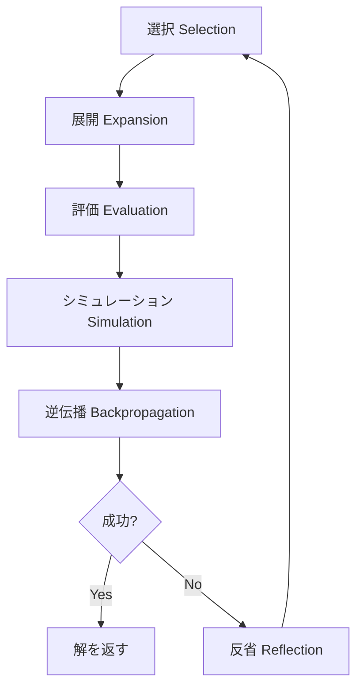

本記事は [arXiv:2310.04406 "Language Agent Tree Search Unifies Reasoning, Acting, and Planning in Language Models"](https://arxiv.org/abs/2310.04406) の解説記事です。

## 論文概要（Abstract）

Language Agent Tree Search（LATS）は、LLMエージェントにおける推論（reasoning）、行動（acting）、計画（planning）を統合する汎用フレームワークである。著者らはモンテカルロ木探索（MCTS）をLLMエージェントに組み込み、LM自体を価値関数および自己反省（self-reflection）の生成器として活用することで、外部環境からのフィードバックを取り入れた適応的な問題解決を実現している。著者らは、GPT-4を用いたHumanEvalでpass@1精度92.7%、GPT-3.5を用いたWebShopで平均スコア75.9を達成したと報告している。

この記事は [Zenn記事: Tree of ThoughtsをPythonで実装してLLMの推論精度を高める](https://zenn.dev/0h_n0/articles/1a116f72e8a543) の深掘りです。

## 情報源

- **arXiv ID**: 2310.04406
- **URL**: [https://arxiv.org/abs/2310.04406](https://arxiv.org/abs/2310.04406)
- **著者**: Andy Zhou, Kai Yan, Michal Shlapentokh-Rothman, Haohan Wang, Yu-Xiong Wang（全員University of Illinois Urbana-Champaign所属）
- **発表年**: 2023年10月投稿、2024年ICML採択
- **分野**: cs.AI, cs.CL, cs.CV, cs.LG
- **コード**: [https://github.com/lapisrocks/LanguageAgentTreeSearch](https://github.com/lapisrocks/LanguageAgentTreeSearch)

## 背景と動機（Background & Motivation）

LLMをエージェントとして活用する研究は、ReActやReflexionなどの手法で進展してきたが、これらは探索空間の体系的な探索を行わない。Chain of Thought（CoT）は1本の推論パスに限定され、Tree of Thoughts（ToT）は木探索を導入したものの外部環境との相互作用を扱わない。Reflexionは自己反省を取り入れるが探索は逐次的である。

著者らはこれらの手法が「推論」「行動」「計画」のいずれか一部しかカバーしていない点を課題として挙げている。論文のTable 1では、既存手法の機能比較が示されており、LATSのみが内部推論（Internal Reasoning）、外部行動（External Actions）、計画的探索（Deliberate Search）、自己反省（Reflection）、外部フィードバック（External Feedback）のすべてを備えていると主張している。

LATSは、ゲームAIで成功を収めたMCTS（AlphaGoで広く知られる）をLLMエージェントに適用することで、これらの能力を統合する。従来のMCTSがドメイン固有のシミュレータや学習済みの価値関数を必要としたのに対し、LATSではLLM自体がこれらの役割を担う点が特徴的である。

## 主要な貢献（Key Contributions）

- **貢献1**: 推論・行動・計画を統一的に扱う初の汎用フレームワークLATSの提案。MCTSの6つの操作（選択・展開・評価・シミュレーション・逆伝播・反省）をLLMエージェントに適用した
- **貢献2**: LLM自体を価値関数・自己反省生成器として活用する設計。外部の学習済みモデルや報酬関数を必要としない
- **貢献3**: プログラミング（HumanEval）、対話型QA（HotPotQA）、Web操作（WebShop）、数学（Game of 24）の4つの異なるドメインでの実験的検証

## 技術的詳細（Technical Details）

### LATSのアーキテクチャ

LATSは以下の6つの操作を繰り返し実行する。



#### 1. 状態表現

LATSでは、各ノードの状態を以下のように定義している。

$$
s = [x, a_{1..i}, o_{1..i}]
$$

ここで、
- $x$: タスクの入力（問題文やWebページなど）
- $a_{1..i}$: これまでに実行されたアクションの列
- $o_{1..i}$: 各アクションに対する環境からの観測の列

行動空間はReActスタイルに従い、$\hat{A} = A \cup Z$と定義される。$A$は環境に対する実行可能なアクション（検索、クリックなど）、$Z$は推論トレース（内部的な思考ステップ）である。

#### 2. 選択（Selection）— UCTアルゴリズム

MCTSの標準的な選択戦略であるUCT（Upper Confidence bounds applied to Trees）を使用する。

$$
\text{UCT}(s) = V(s) + w \cdot \sqrt{\frac{\ln N(\text{parent}(s))}{N(s)}}
$$

ここで、
- $V(s)$: ノード$s$の推定価値
- $N(s)$: ノード$s$の訪問回数
- $w$: 探索と活用のバランスを制御する重み（実験では$w = 1$）

UCTの第1項は既知の価値（活用）、第2項は訪問回数が少ないノードを優先する探索ボーナスである。この式により、有望だがまだ十分に調査されていないノードを優先的に探索する。

#### 3. 展開（Expansion）

選択されたノードから、LLMを使って$n$個の子ノード（アクション候補）をサンプリングする。各アクションは実際に環境で実行され、環境からの観測結果が子ノードの状態に追加される。

ToTとの決定的な違いは、ToTがLLM内部の評価のみで枝を評価するのに対し、LATSは**実際の環境実行結果**をフィードバックとして使用する点である。

#### 4. 評価（Evaluation）— ハイブリッド価値関数

LATSの価値関数は、LLMによるスコアリングと自己一貫性（Self-Consistency）を組み合わせたハイブリッド方式である。

$$
V(s) = \lambda \cdot V_{\text{LM}}(s) + (1 - \lambda) \cdot V_{\text{SC}}(s)
$$

ここで、
- $V_{\text{LM}}(s)$: LLMが環境フィードバックを踏まえて出力するスコア（0〜1の実数値）
- $V_{\text{SC}}(s)$: 複数回サンプリングした結果の自己一貫性スコア
- $\lambda$: 両者の混合比（タスクにより調整。論文ではHotPotQAとGame of 24で$\lambda = 0.5$、プログラミングとWebShopで$\lambda = 0.8$）

#### 5. 逆伝播（Backpropagation）

評価結果を根ノードまで伝播する。MCTSの標準的な更新則に従い、訪問回数と価値の累積平均を更新する。

$$
N(s_i) = N(s_{i-1}) + 1
$$

$$
V(s_i) = \frac{V(s_{i-1}) \cdot N(s_{i-1}) + r}{N(s_i)}
$$

ここで$r$は今回の探索で得られた報酬である。

#### 6. 反省（Reflection）— 意味的な勾配信号

LATSの独自機能として、探索が失敗した（タスクを達成できなかった）場合にLLMが**自己反省**（self-reflection）テキストを生成する。著者らはこれを「意味的な勾配信号（semantic gradient signal）」と呼んでいる。

失敗した軌跡と自己反省テキストはメモリに保存され、以降の探索時にコンテキストとして追加される。これにより、同じ失敗パターンを繰り返すことを防ぎ、探索の効率を高める。

### アルゴリズム全体の擬似コード

```python
from dataclasses import dataclass, field
import math


@dataclass
class LATSNode:
    state: list[str]
    value: float = 0.0
    visits: int = 0
    children: list["LATSNode"] = field(default_factory=list)
    parent: "LATSNode | None" = None
    reflection: str = ""


def uct_score(node: LATSNode, w: float = 1.0) -> float:
    """UCTスコアを計算する。"""
    if node.visits == 0:
        return float("inf")
    parent_visits = node.parent.visits if node.parent else 1
    exploitation = node.value
    exploration = w * math.sqrt(math.log(parent_visits) / node.visits)
    return exploitation + exploration


def lats_search(
    root: LATSNode,
    llm,
    env,
    n_children: int = 5,
    max_iterations: int = 50,
    lam: float = 0.5,
) -> LATSNode | None:
    """LATSのメインループ。"""
    reflections: list[str] = []

    for _ in range(max_iterations):
        # 1. 選択: UCTで最も有望なリーフノードを選択
        leaf = select(root)

        # 2. 展開: LLMでn個の子ノードを生成し環境で実行
        children = expand(leaf, llm, env, n_children, reflections)
        leaf.children.extend(children)

        # 3. 評価: ハイブリッド価値関数でスコアリング
        for child in children:
            v_lm = llm.evaluate(child.state)
            v_sc = self_consistency_score(child, llm)
            child.value = lam * v_lm + (1 - lam) * v_sc

            # 4. 成功判定
            if env.is_success(child.state):
                return child

        # 5. 逆伝播
        best_child = max(children, key=lambda c: c.value)
        backpropagate(best_child, best_child.value)

        # 6. 反省（失敗時）
        if env.is_terminal(best_child.state) and not env.is_success(best_child.state):
            reflection = llm.reflect(best_child.state)
            reflections.append(reflection)

    return None
```

## 実装のポイント（Implementation）

### ハイパーパラメータの設定

著者らが実験で使用したハイパーパラメータは以下の通りである。

| パラメータ | HotPotQA | HumanEval/MBPP | WebShop | Game of 24 |
|-----------|----------|----------------|---------|-----------|
| 子ノード数 $n$ | 5 | — | — | — |
| 最大反復回数 $k$ | 50 | 8 | 30 | 30 |
| 深さ上限 | 6-7 | 8 | 15 | 5 |
| $\lambda$ | 0.5 | 0.8 | 0.8 | 0.5 |
| UCTの$w$ | 1.0 | 1.0 | 1.0 | 1.0 |

### 環境リセットの前提

LATSは環境が任意の過去状態にリセット可能であることを前提としている。これはゲームやシミュレーション環境では自然だが、本番のWebアプリケーションやAPIでは困難な場合がある。著者ら自身もこれを制約として認めている。

### コスト制御

MCTSベースの探索はAPIコールが増加する。論文のHotPotQAでの成功時トークンコストの比較では、ToTが210,215トークン、RAPが176,500トークン、LATSが173,290トークンと報告されている（$n=5, k=50$の設定）。LATSは探索効率の面ではToTやRAPと同程度のコストで済むが、失敗時の反省生成により追加コストが発生する。

## 実験結果（Results）

### HotPotQA（対話型質問応答）

論文Table 2およびTable 3より、GPT-3.5を使用した実験結果（Exact Match）を以下に示す。

**推論ベース手法（Table 2）**:

| 手法 | EM |
|------|-----|
| Base LM | 0.32 |
| CoT | 0.34 |
| CoT-SC | 0.38 |
| ToT | 0.55 |
| RAP ($n=10$) | 0.60 |
| LATS (CoT) | 0.62 |

**行動ベース手法（Table 3）**:

| 手法 | EM |
|------|-----|
| ReAct | 0.32 |
| Reflexion | 0.51 |
| ToT (ReAct) | 0.39 |
| RAP (ReAct) | 0.54 |
| LATS (ReAct) | 0.63 |
| LATS (CoT + ReAct) | 0.71 |

LATS (CoT + ReAct)は推論トレースと行動の両方を統合した構成であり、EM 0.71を達成している。これはReActの0.32から大幅な改善であり、推論と行動の統合が有効であることを示唆している。

### プログラミング（HumanEval / MBPP）

HumanEvalでのpass@1精度について、著者らは以下の結果を報告している。

| 手法 | GPT-3.5 | GPT-4 |
|------|---------|-------|
| CoT | 46.9 | — |
| ReAct | 56.9 | — |
| Reflexion | 68.1 | 91.0 |
| ToT | 54.4 | — |
| RAP | 63.1 | — |
| LATS (ReAct) | 83.8 | 92.7 |

GPT-4を用いたLATSは92.7%のpass@1を達成しており、Reflexionの91.0%を上回っている。プログラミングタスクではテスト実行という明確な環境フィードバックが得られるため、LATSの環境フィードバック活用の利点が発揮されやすい。

### WebShop（Web操作）

| 手法 | Score | Success Rate |
|------|-------|-------------|
| ReAct | 53.8 | 28.0% |
| Reflexion | 64.2 | 35.0% |
| LATS (ReAct) | 75.9 | 38.0% |
| IL + RL（ファインチューニング） | 62.4 | 28.7% |

著者らは、LATSがファインチューニングなしで勾配ベースの手法（IL+RL: 62.4）を上回るスコア（75.9）を達成したと報告している。ただしSuccess Rateではファインチューニング手法（45.0%）がLATS（38.0%）を上回っている点にも留意が必要である。

### アブレーション実験

論文Section 5.4より、HotPotQAでの各コンポーネントの寄与を以下に示す。

| 構成 | EM |
|------|-----|
| LATS（反省なし） | 0.58 |
| LATS（DFS探索） | 0.42 |
| LATS（LMヒューリスティックなし） | 0.37 |
| LATS（完全版） | 0.63 |

LMヒューリスティック（価値関数）を除去すると性能が大幅に低下（0.63→0.37）しており、LLMによる状態評価がLATSの中核的な要素であることが分かる。反省の除去による影響（0.63→0.58）は比較的小さいが、それでも有意な貢献がある。

## 実運用への応用（Practical Applications）

LATSは以下のユースケースで特に有効と考えられる。

**コード生成・デバッグ**: テスト実行結果を環境フィードバックとして利用できるため、LATSの枠組みが自然に適合する。CI/CDパイプライン内でのコード自動修正にも応用可能である。

**Web操作エージェント**: WebShopの結果が示すように、ブラウザ操作タスクでの意思決定改善が期待できる。ただし、実際のWebサイトでは状態リセットが困難なため、チェックポイント機構やスナップショットの仕組みが必要となる。

**対話型情報検索**: HotPotQAの結果から、複数ステップの情報収集を伴うRAGシステムへの応用が考えられる。検索結果を環境フィードバックとして活用し、複数の検索戦略を並列に試行できる。

**制約として認識すべき点**: LATSは環境リセットを前提とするため、状態変更が不可逆な環境（送金、メール送信など）では適用が困難である。またAPIコストは単純なCoTの数十倍になりうるため、コスト対効果の検証が必須である。

## Production Deployment Guide

### AWS実装パターン（コスト最適化重視）

LATSベースのLLMエージェントをAWSにデプロイする場合のトラフィック量別推奨構成を示す。LATSは1リクエストあたり数十〜数百回のLLM APIコールを発生させるため、通常のLLMアプリケーションより高いコストと長いレイテンシを前提とした設計が必要である。

| 規模 | 月間リクエスト | 推奨構成 | 月額コスト | 主要サービス |
|------|--------------|---------|-----------|------------|
| **Small** | ~3,000 (100/日) | Serverless | $200-500 | Lambda + Bedrock + DynamoDB |
| **Medium** | ~30,000 (1,000/日) | Hybrid | $1,500-4,000 | ECS Fargate + ElastiCache + Bedrock |
| **Large** | 300,000+ (10,000/日) | Container | $10,000-25,000 | EKS + Karpenter + Bedrock Batch |

**注意**: LATSは1リクエストあたり平均50-200回のLLMコールを行うため、通常のLLMアプリに比べてBedrock利用料が主要コスト要因となる。上記は2026年10月時点のAWS ap-northeast-1（東京）リージョン料金に基づく概算値であり、実際のコストはモデル選択・探索パラメータ・タスク複雑度により大きく変動する。最新料金は [AWS料金計算ツール](https://calculator.aws/) で確認されたい。

**Small構成の詳細**（月額$200-500）:
- **Lambda**: 1GB RAM, 300秒タイムアウト（LATSの探索ループに対応）$30/月
- **Bedrock**: Claude 3.5 Haiku（proposer）+ Claude 3.5 Sonnet（evaluator）、Prompt Caching有効 $350/月
- **DynamoDB**: 探索木状態のキャッシュ、On-Demand $15/月
- **Step Functions**: 探索ループのオーケストレーション $10/月

**コスト削減テクニック**:
- Proposer（候補生成）にHaikuクラスの安価モデル、Evaluator（評価）にSonnetクラスの高精度モデルを使い分ける
- 探索済みノードのキャッシュにDynamoDBを活用し、同一部分問題の再評価を防止する
- Prompt Cachingの有効化でシステムプロンプト部分のコストを30-90%削減する
- Bedrock Batch APIを使い、非リアルタイム処理では50%割引を活用する

### Terraformインフラコード

**Small構成（Serverless）: Lambda + Step Functions + Bedrock**

```hcl
resource "aws_iam_role" "lats_lambda" {
  name = "lats-agent-lambda-role"

  assume_role_policy = jsonencode({
    Version = "2012-10-17"
    Statement = [{
      Action = "sts:AssumeRole"
      Effect = "Allow"
      Principal = { Service = "lambda.amazonaws.com" }
    }]
  })
}

resource "aws_iam_role_policy" "bedrock_invoke" {
  role = aws_iam_role.lats_lambda.id
  policy = jsonencode({
    Version = "2012-10-17"
    Statement = [{
      Effect   = "Allow"
      Action   = ["bedrock:InvokeModel", "bedrock:InvokeModelWithResponseStream"]
      Resource = [
        "arn:aws:bedrock:ap-northeast-1::foundation-model/anthropic.claude-3-5-haiku*",
        "arn:aws:bedrock:ap-northeast-1::foundation-model/anthropic.claude-3-5-sonnet*"
      ]
    }]
  })
}

resource "aws_lambda_function" "lats_expand" {
  filename      = "lats_expand.zip"
  function_name = "lats-expand-node"
  role          = aws_iam_role.lats_lambda.arn
  handler       = "handler.expand"
  runtime       = "python3.12"
  timeout       = 120
  memory_size   = 1024

  environment {
    variables = {
      PROPOSER_MODEL  = "anthropic.claude-3-5-haiku-20241022-v1:0"
      EVALUATOR_MODEL = "anthropic.claude-3-5-sonnet-20241022-v2:0"
      DYNAMODB_TABLE  = aws_dynamodb_table.lats_cache.name
    }
  }
}

resource "aws_lambda_function" "lats_evaluate" {
  filename      = "lats_evaluate.zip"
  function_name = "lats-evaluate-node"
  role          = aws_iam_role.lats_lambda.arn
  handler       = "handler.evaluate"
  runtime       = "python3.12"
  timeout       = 60
  memory_size   = 512

  environment {
    variables = {
      EVALUATOR_MODEL = "anthropic.claude-3-5-sonnet-20241022-v2:0"
      CACHE_TABLE     = aws_dynamodb_table.lats_cache.name
    }
  }
}

resource "aws_dynamodb_table" "lats_cache" {
  name         = "lats-search-cache"
  billing_mode = "PAY_PER_REQUEST"
  hash_key     = "state_hash"

  attribute {
    name = "state_hash"
    type = "S"
  }

  ttl {
    attribute_name = "expire_at"
    enabled        = true
  }
}

resource "aws_cloudwatch_metric_alarm" "lats_cost_alarm" {
  alarm_name          = "lats-bedrock-cost-spike"
  comparison_operator = "GreaterThanThreshold"
  evaluation_periods  = 1
  metric_name         = "Duration"
  namespace           = "AWS/Lambda"
  period              = 3600
  statistic           = "Sum"
  threshold           = 300000
  alarm_description   = "LATSの探索ループが長時間化（コスト急増の可能性）"
  dimensions = {
    FunctionName = aws_lambda_function.lats_expand.function_name
  }
}
```

**Large構成（Container）: EKS + Karpenter**

```hcl
module "eks" {
  source          = "terraform-aws-modules/eks/aws"
  version         = "~> 20.0"
  cluster_name    = "lats-agent-cluster"
  cluster_version = "1.31"
  vpc_id          = module.vpc.vpc_id
  subnet_ids      = module.vpc.private_subnets
  cluster_endpoint_public_access = true
  enable_cluster_creator_admin_permissions = true
}

resource "kubectl_manifest" "karpenter_provisioner" {
  yaml_body = <<-YAML
    apiVersion: karpenter.sh/v1alpha5
    kind: Provisioner
    metadata:
      name: lats-spot-provisioner
    spec:
      requirements:
        - key: karpenter.sh/capacity-type
          operator: In
          values: ["spot"]
        - key: node.kubernetes.io/instance-type
          operator: In
          values: ["c6i.xlarge", "c6i.2xlarge", "c7i.xlarge"]
      limits:
        resources:
          cpu: "64"
          memory: "256Gi"
      ttlSecondsAfterEmpty: 60
  YAML
}

resource "aws_budgets_budget" "lats_monthly" {
  name         = "lats-monthly-budget"
  budget_type  = "COST"
  limit_amount = "25000"
  limit_unit   = "USD"
  time_unit    = "MONTHLY"

  notification {
    comparison_operator        = "GREATER_THAN"
    threshold                  = 80
    threshold_type             = "PERCENTAGE"
    notification_type          = "ACTUAL"
    subscriber_email_addresses = ["ops@example.com"]
  }
}
```

### セキュリティベストプラクティス

- **IAMロール**: Lambda/ECSタスクごとに最小権限のロールを割り当て。BedrockのInvokeModelは使用するモデルARNに限定する
- **シークレット管理**: AWS Secrets Managerでシークレットを管理。環境変数へのハードコード禁止
- **ネットワーク**: VPC内Lambda配置、セキュリティグループで443ポートのみ許可
- **暗号化**: DynamoDB・S3はKMS暗号化を有効化。転送中はTLS 1.2以上必須
- **監査**: CloudTrail全リージョン有効化、Config/GuardDuty有効化

### 運用・監視設定

**CloudWatch Logs Insights クエリ**:

```sql
-- LATSの探索ステップ数とコスト異常検知
fields @timestamp, task_id, search_iterations, total_tokens
| stats sum(total_tokens) as total, avg(search_iterations) as avg_iters by bin(1h)
| filter total > 500000

-- レイテンシ分析（P95, P99）
fields @timestamp, duration_ms, task_type
| stats pct(duration_ms, 95) as p95, pct(duration_ms, 99) as p99 by bin(5m)
```

**CloudWatch アラーム（コスト重視）**:

```python
import boto3

cloudwatch = boto3.client("cloudwatch")

cloudwatch.put_metric_alarm(
    AlarmName="lats-token-spike",
    ComparisonOperator="GreaterThanThreshold",
    EvaluationPeriods=1,
    MetricName="TokenUsage",
    Namespace="Custom/LATS",
    Period=3600,
    Statistic="Sum",
    Threshold=2000000,
    ActionsEnabled=True,
    AlarmActions=["arn:aws:sns:ap-northeast-1:123456789:lats-cost-alerts"],
    AlarmDescription="LATSトークン使用量異常（200万トークン/時間超過）",
)
```

**X-Ray トレーシング設定**:

```python
from aws_xray_sdk.core import xray_recorder, patch_all

patch_all()

@xray_recorder.capture("lats_iteration")
def run_lats_iteration(node, iteration: int):
    xray_recorder.put_annotation("iteration", iteration)
    xray_recorder.put_annotation("depth", node.depth)
    children = expand_node(node)
    xray_recorder.put_metadata("children_count", len(children))
    return children
```

### コスト最適化チェックリスト

**アーキテクチャ選択**:
- [ ] ~100 req/日 → Lambda + Step Functions（Serverless）$200-500/月
- [ ] ~1000 req/日 → ECS Fargate + ElastiCache（Hybrid）$1,500-4,000/月
- [ ] 10000+ req/日 → EKS + Spot Instances（Container）$10,000-25,000/月

**リソース最適化**:
- [ ] Spot Instances使用で最大90%削減（EKS + Karpenter）
- [ ] Reserved Instances: 1年コミットで最大72%削減
- [ ] Lambda: メモリサイズ最適化（展開ステップと評価ステップで異なるサイズ）
- [ ] ECS/EKS: 夜間・休日のスケールダウン設定
- [ ] Step Functions: Express Workflowで短時間実行のコスト削減

**LLMコスト削減（LATSで最重要）**:
- [ ] Proposer/Evaluatorのモデル分離（Haiku生成 + Sonnet評価）
- [ ] 探索済みノードのキャッシュ（DynamoDB TTL付き）
- [ ] Prompt Caching有効化で30-90%削減
- [ ] Bedrock Batch API使用で50%削減（非リアルタイム処理）
- [ ] 探索パラメータ調整: $n$と$k$を最小限に設定（$n=3$でもLATSは有効）
- [ ] 早期終了条件の設定（成功確信度が高い場合は探索を打ち切る）

**監視・アラート**:
- [ ] AWS Budgets: 月額予算設定（80%で警告）
- [ ] CloudWatch: 探索ステップ数・トークン使用量のアラーム
- [ ] Cost Anomaly Detection: 自動異常検知
- [ ] 日次コストレポート: SNS/Slackへ自動送信

**リソース管理**:
- [ ] DynamoDBキャッシュ: TTLでの自動削除（24-72時間）
- [ ] タグ戦略: 環境別・タスク種別でコスト可視化
- [ ] 未使用リソース削除: Lambda Insights活用
- [ ] ログ保持期間: CloudWatch Logs保持を30日に制限

## 関連研究（Related Work）

- **Tree of Thoughts（Yao et al., 2023）**: LATSの直接的な先行研究。ToTはLLM内部での木探索に限定されるが、LATSは外部環境フィードバックとMCTSを追加。ToTのBFS/DFS探索をUCTベースの選択に置き換えた
- **Reflexion（Shinn et al., 2023）**: 自己反省に基づく改善を行うが、探索は逐次的。LATSはReflexionの自己反省をMCTSの木探索と組み合わせた
- **RAP（Hao et al., 2023）**: MCTSを推論に適用するが、LLMを世界モデルとして使用。LATSは実環境からのフィードバックを使用する点で異なる
- **ReAct（Yao et al., 2022）**: 推論トレースと行動を交互に生成するが、バックトラック不可。LATSはReActをMCTSの展開ステップとして内包する

## まとめと今後の展望

LATSは、MCTSの枠組みをLLMエージェントに適用することで、推論・行動・計画を統一的に扱うフレームワークである。論文の実験では、HumanEvalでのpass@1 92.7%やHotPotQAでのEM 0.71など、既存手法を上回る結果が報告されている。

実務への示唆として、テスト実行結果を環境フィードバックとして活用できるコード生成タスクはLATSの適用に適している。一方で、APIコストの増大と環境リセットの前提は導入時の主要な障壁となる。著者ら自身も計算コストの削減と非可逆環境への拡張を今後の課題として挙げている。

2026年現在、reasoning model（OpenAI o3等）の登場により、モデル内部で探索を行うアプローチも普及している。LATSのような明示的な外部探索が有効なのは、カスタム環境フィードバック（テスト実行、シミュレーション結果など）が利用できる場面であり、両アプローチの使い分けが重要となっている。

## 参考文献

- **arXiv**: [https://arxiv.org/abs/2310.04406](https://arxiv.org/abs/2310.04406)
- **Code**: [https://github.com/lapisrocks/LanguageAgentTreeSearch](https://github.com/lapisrocks/LanguageAgentTreeSearch)
- **Related Zenn article**: [https://zenn.dev/0h_n0/articles/1a116f72e8a543](https://zenn.dev/0h_n0/articles/1a116f72e8a543)
- **Yao et al., "Tree of Thoughts" (NeurIPS 2023)**: [https://arxiv.org/abs/2305.10601](https://arxiv.org/abs/2305.10601)
- **Shinn et al., "Reflexion" (NeurIPS 2023)**: [https://arxiv.org/abs/2303.11366](https://arxiv.org/abs/2303.11366)
- **Hao et al., "Reasoning via Planning" (EMNLP 2023)**: [https://arxiv.org/abs/2305.14992](https://arxiv.org/abs/2305.14992)
