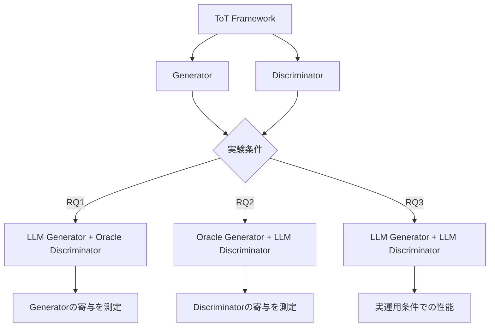

本記事は [https://arxiv.org/abs/2410.17820](https://arxiv.org/abs/2410.17820) の解説記事です。

## 論文概要（Abstract）

Tree of Thoughts（ToT）はLLMの推論能力を木構造の探索で拡張するフレームワークであり、推論候補を生成するGenerator（生成器）と、候補を選別するDiscriminator（識別器）の2つのコンポーネントで構成される。ToTはChain of Thought（CoT）を上回る性能を示すことが多いが、すべてのモデルで一貫して優れるわけではない。本論文では、この2つのコンポーネントを分離して分析し、ToTの成功条件を明らかにしている。著者らの主要な発見は、**Generatorの能力がDiscriminatorよりもToTの性能に決定的な影響を与える**という点である。

この記事は [Zenn記事: Tree of ThoughtsをPythonで実装してLLMの推論精度を高める](https://zenn.dev/0h_n0/articles/1a116f72e8a543) の深掘りです。

## 情報源

- **arXiv ID**: 2410.17820
- **URL**: [https://arxiv.org/abs/2410.17820](https://arxiv.org/abs/2410.17820)
- **著者**: Qiqi Chen, Xinpeng Wang, Philipp Mondorf, Michael A. Hedderich, Barbara Plank（LMU Munich, MaiNLP / Munich Center for Machine Learning）
- **発表年**: 2024年10月
- **分野**: cs.CL（計算言語学）
- **コード**: [github.com/mainlp/tot-eval](https://github.com/mainlp/tot-eval)

## 背景と動機（Background & Motivation）

Yaoら（NeurIPS 2023）が提案したTree of Thoughtsは、LLMの推論を木構造で探索するフレームワークとして注目を集めた。しかし、後続の研究でいくつかの課題が指摘されている。Duanら（2024）はToTが弱いLLMではかえって性能を低下させる場合があることを報告しており、Chenら（2024）は木探索が効果的に機能するためにDiscriminatorの精度が約90%必要であると述べている。

こうした背景から、「ToTはいつ有効で、いつ有効でないのか」という問いが重要になる。本論文の著者らは、GeneratorとDiscriminatorを分離して分析するという方法論を提案し、以下の3つのリサーチクエスチョンを設定している。

- **RQ1**: GeneratorをスケールアップするとToTの性能は向上するか？
- **RQ2**: DiscriminatorをスケールアップするとToTの性能は向上するか？
- **RQ3**: ToTがIO（直接入出力）やCoTを上回るのはどのような条件か？

## 主要な貢献（Key Contributions）

- **貢献1**: ToTのGeneratorとDiscriminatorを分離し、Oracle（精度制御可能な理想的モジュール）で片方を置き換えることで各コンポーネントの寄与を定量的に分析する手法を提案
- **貢献2**: Generatorの能力がToT性能を支配的に決定し、Discriminatorのスケーリングでは限界的な改善しか得られないことを実証
- **貢献3**: 異なるスケールのモデルが同等の識別能力を持つ一方、生成能力では大きく異なることを示し、「大規模モデルをGeneratorに、小規模モデルをDiscriminatorに」というコスト最適化の指針を提案

## 技術的詳細（Technical Details）

### ToTのGeneratorとDiscriminatorの定式化

ToTでは、問題 $x$ に対して解 $y$ を求める過程を木構造で表現する。各ノードは中間的な思考ステップ $t_i$ に対応する。

$$
y = f_{\text{ToT}}(x) = \text{Search}(G, D, x)
$$

ここで、
- $G$: Generator — 現在の状態から次の推論候補 $\{t_1, t_2, \ldots, t_k\}$ を生成
- $D$: Discriminator — 各候補を評価し、探索を継続するノードを選択
- $\text{Search}$: BFSまたはDFSによる木探索アルゴリズム

Yaoらの原論文では、Discriminatorの評価方法として2つが提案されている。

**Value方式**: 各候補に対して「sure」「maybe」「impossible」の3値で評価し、数値スコアに変換する。

$$
V(t_i) = \frac{1}{N} \sum_{j=1}^{N} v_j(t_i), \quad v_j \in \{0, 0.5, 1\}
$$

ここで $N$ は評価のサンプリング回数（論文では $N=3$）、$v_j$ は各サンプルでの評価値（impossible=0, maybe=0.5, sure=1）である。

**Vote方式**: 候補セット全体を見せて「最も有望な候補はどれか」を投票させる。

$$
D_{\text{vote}}(t_i) = \sum_{j=1}^{N} \mathbb{1}[\text{vote}_j = t_i]
$$

### Oracle実験の設計

本論文の核心的な手法は、GeneratorまたはDiscriminatorの一方をOracle（理想的なモジュール）に置き換えて、もう一方の寄与を独立に測定する点にある。

**Oracle Generator**: 精度パラメータ $p$ を持ち、確率 $p$ で正しい推論ステップを生成し、確率 $1-p$ でランダムなステップを生成する。

**Oracle Discriminator**: 精度パラメータ $p$ を持ち、確率 $p$ で正しい候補を選択し、確率 $1-p$ でランダムに選択する。

この設計により、例えばOracle Discriminator（$p=0.8$）とLLM Generatorの組み合わせで実験すれば、「識別が完璧に近い条件下でのGenerator性能」を測定できる。



### 実験設定

**タスク**:

1. **Game of 24**: 4つの整数（1〜13）を四則演算で組み合わせて24を作るパズル。決定の複雑度は $4! \times 4^3 = 1{,}536$ 通り。Yaoらのデータセットから1,362問を使用。著者らはDFSアルゴリズムですべての正解を生成し、Oracle Generatorの基盤とした。

2. **Knights and Knaves**: 「騎士は常に真実を、悪漢は常に嘘をつく」という論理パズル。Mondorf and Plank（2024）のデータセットから3キャラクター版600問を使用。

**モデル（6種、すべてオープンウェイト・instruction-tuned）**:

| カテゴリ | モデル |
|---------|-------|
| 10B未満 | gemma-2b-it, Llama-3-8B-Instruct, Llama-3.1-8B-Instruct |
| 10B〜50B | gemma-2-27b-it |
| 50B以上 | Llama-3-70B-Instruct, Llama-3.1-70B-Instruct |

**評価指標**: 平均成功率（Average Success Rate）

$$
\text{ASR} = \frac{1}{|\mathcal{T}|} \sum_{t \in \mathcal{T}} \frac{\text{correct}(t)}{\text{outputs}(t)}
$$

この指標は、複数回の試行で得られた正解数を試行数で割り、全タスクで平均する。これにより、1タスクで多数の正解を出すだけでスコアが上がる問題を回避している。

**ToTの探索パラメータ**: Game of 24では各ステップで5候補を生成し、Discriminatorが3回評価して上位5つを残すビームサーチ。Knights and Knavesでは2候補を生成し3回投票。

## 実験結果（Results）

### RQ1: Generatorのスケーリング効果

著者らはOracle Discriminatorの精度を20%、40%、60%、80%、100%、およびランダムに設定し、LLM Generatorのモデルサイズを8B、27B、70Bで変化させて実験を行っている。

論文の結果によると、Game of 24では、Oracle Discriminatorの精度が同じ条件でGenerator を8Bから70Bにスケールアップすると、ToTの性能が大幅に向上する。特にOracle Discriminator精度100%の条件では、8B Generatorでの成功率と70B Generatorでの成功率に大きな差が生じている。

著者らは、Generatorの品質がToTの性能を支配的に決定すると結論づけている。弱いGeneratorでは、高精度のDiscriminatorを使っても探索空間に良質な候補が存在しないため、選別しようがないという構造的な限界がある。

### RQ2: Discriminatorのスケーリング効果

Oracle Generatorの精度を20%〜80%に設定し、LLM Discriminatorのモデルサイズを変化させた実験では、対照的な結果が得られている。

論文Table 1より、Game of 24における主要な結果を以下に示す。

| Generator | Discriminator | 平均成功率 |
|-----------|--------------|-----------|
| Llama-3-8B (8B) | gemma-2b-it (2B) | 0.18% |
| Llama-3-8B (8B) | Llama-3-8B (8B) | 1.29% |
| Llama-3-8B (8B) | Llama-3-70B (70B) | 1.85% |
| Llama-3-70B (70B) | gemma-2b-it (2B) | 10.76% |
| Llama-3-70B (70B) | Llama-3-8B (8B) | 33.38% |
| Llama-3-70B (70B) | Llama-3-70B (70B) | 33.76% |

この結果から読み取れる重要なポイントは以下の通りである。

**Generatorの効果（縦方向の比較）**: 同じDiscriminator（例: 8B）を使った場合、Generatorを8B→70Bに変更すると、1.29%→33.38%と約**26倍**の改善が得られる。

**Discriminatorの効果（横方向の比較）**: 同じGenerator（例: 70B）を使った場合、Discriminatorを8B→70Bに変更しても、33.38%→33.76%と**0.38ポイント**の改善にとどまる。

著者らはこの結果を「異なるスケールのモデルが同等の識別能力を持つ」と解釈している。つまり、2Bモデルでも70Bモデルでも、「この推論ステップは正しいか？」という判定能力にはほとんど差がないということになる。

### Knights and Knaves での結果

論文Table 1より、Knights and Knavesでも同様の傾向が確認されている。

| Generator | Discriminator | 平均成功率 |
|-----------|--------------|-----------|
| Llama-3.1-8B (8B) | Llama-3.1-8B (8B) | 20.50% |
| Llama-3.1-8B (8B) | Llama-3.1-70B (70B) | 21.33% |
| Llama-3.1-70B (70B) | Llama-3.1-8B (8B) | 52.00% |
| Llama-3.1-70B (70B) | Llama-3.1-70B (70B) | 52.00% |

注目すべきは、70B Generator + 8B Discriminatorの組み合わせ（52.00%）が、70B Generator + 70B Discriminatorの組み合わせ（52.00%）と**完全に同一**の成功率を示している点である。Discriminatorのスケーリングが文字通り効果ゼロとなっている。

### RQ3: ToTがベースラインを上回る条件

著者らは、ToTがIOやCoTを上回る条件について以下の知見を報告している。

**Game of 24**:
- IO: 2.28%（8B）、3.47%（70B）
- CoT: 1.57%（8B）、10.44%（70B）
- ToT（70B Gen + 8B Disc）: 33.38%

70B Generatorを使用した場合、ToTはCoT（10.44%）の約3.2倍の成功率を達成している。一方、8B Generatorの場合、ToT（1.29%、8B Disc）はIO（2.28%）を**下回って**いる。

**Knights and Knaves**:
- IO: 17.63%（8B）、39.87%（70B）
- CoT: 17.70%（8B）、40.37%（70B）
- ToT（70B Gen + 70B Disc）: 52.00%

Knights and Knavesでは、両方のモデルサイズでToTがベースラインを上回っている。著者らはこれを、Knights and Knavesの探索空間がGame of 24より小さいためと分析している。

### ステップごとの生成品質分析

著者らはGame of 24の3ステップ（2つの数を組み合わせる操作を3回行う）について、各ステップでの生成品質を分析している（論文Figure 6）。

ステップ1とステップ2では、小規模モデル（8B）の生成品質が低いことが報告されている。一方、ステップ3（最後の2つの数を組み合わせる段階）では、8Bモデルでも78%以上の正解率を示す。著者らは、小規模モデルがステップ1でfew-shotの例をそのまま繰り返す傾向があることを指摘している。これは、生成の多様性と正確性が探索の初期段階で特に重要であることを示唆している。

## ToTの構成要素に関する理論的考察

本論文の結果は、ToTを設計・実装する際に重要な示唆を与える。

### なぜGeneratorが支配的なのか

ToTの構造を木探索として考えると、Generatorは「探索空間を定義する」役割を担い、Discriminatorは「探索空間内で最良のパスを選択する」役割を担う。

$$
\text{ToT性能} \leq \max_{t \in \mathcal{G}(x)} Q(t)
$$

ここで $\mathcal{G}(x)$ はGeneratorが生成する候補集合、$Q(t)$ は候補 $t$ の品質である。この不等式が示すように、ToTの性能上限はGeneratorが生成する候補の最高品質で決まる。Discriminatorがどれほど優秀でも、Generatorが良質な候補を生成しなければ選びようがない。

逆に、Generatorが十分に良質な候補を生成していれば、ランダムに近いDiscriminatorでもある程度の性能が得られる。実際、論文Table 1では70B Generator + 2B Discriminatorの組み合わせ（10.76%）が、8B Generator + 70B Discriminatorの組み合わせ（1.85%）を大幅に上回っている。

### 識別タスクの容易さ

著者らが報告した「モデルスケールに関わらず識別能力が同等」という結果は、ToTにおける識別タスクの性質から理解できる。Discriminatorが行う判定は、「この推論ステップは24に近づいているか？」という比較的単純な評価であり、候補をゼロから生成するよりもはるかに容易なタスクである。

これは、自然言語処理における生成タスクと識別タスクの一般的な難易度差とも整合する。文章を書くのは難しくても、2つの文章のどちらが良いかを判断するのは比較的容易であるのと同様の構造がある。

## Zenn記事の実装との対応

[Zenn記事](https://zenn.dev/0h_n0/articles/1a116f72e8a543)では、ToTの実装においてThought Generator（思考生成器）とState Evaluator（状態評価器）を分離して設計している。本論文の知見は、この設計のパラメータ選択に直接的な指針を与える。

### コスト最適化への応用

Zenn記事で紹介されているCostOptimizedToT（proposerとevaluatorでモデルを分離する構成）は、本論文の知見と整合する。

```python
# Zenn記事のコスト最適化構成
class CostOptimizedToT:
    def __init__(self) -> None:
        self.proposer = ChatOpenAI(model="gpt-4o")        # 大規模モデル
        self.evaluator = ChatOpenAI(model="gpt-4o-mini")   # 小規模モデル
```

本論文の結果に基づけば、この構成は理にかなっている。Generatorには高性能な大規模モデルを使い、Discriminatorには安価な小規模モデルを使う方が、両方に大規模モデルを使う場合とほぼ同等の性能を低コストで達成できる。

### evaluatorのsamples数に対する示唆

Zenn記事ではState Evaluatorの`samples=3`（多数決の投票回数）を推奨している。本論文でも同様にDiscriminatorの評価を3回行う設計を採用しているが、Discriminatorのスケーリング効果が小さいという結果は、投票回数を増やすよりもGeneratorの品質向上に投資すべきことを示唆している。

## 関連研究（Related Work）

本論文では、ToTに関連する多数の推論フレームワークが比較されている。

- **Graph of Thoughts (GoT)**: Bestaら（2024a）が提案。木構造をDAG（有向非巡回グラフ）に拡張し、推論パスの合流を許容する。ToTの木構造的な制約を緩和するアプローチ
- **Algorithm of Thoughts (AoT)**: Selら（2023）が提案。アルゴリズムの実行過程をプロンプトに含めることで、単一のLLMクエリ内で探索的推論を実現する。本論文のGeneratorとDiscriminatorの分離という視点とは異なるアプローチ
- **GTBench**: Duanら（2024）による10種のゲーム推論タスクのベンチマーク。ToTが弱いLLMで性能低下することを示した研究として本論文でも引用されている
- **Chenら（2024）の分析**: 木探索ベースの推論にはDiscriminator精度90%以上が必要と主張。本論文はこの知見を部分的に支持しつつ、Generator側の制約がより本質的であることを示した

## 本論文の限界と注意点

著者らは論文のLimitations（第7節）で以下の制約を明記している。

1. **Knights and Knavesの部分的な評価**: 3キャラクター版（600問）のみを使用しており、4〜6キャラクター版は未評価。3キャラクター版はベースライン手法にとって有利な（比較的容易な）設定であり、結果が楽観的になっている可能性がある

2. **ToTのハイパーパラメータ探索なし**: ビーム幅、候補数、投票回数などのパラメータは固定されており、最適化されていない。異なるパラメータ設定で結果が変わる可能性がある

3. **オープンウェイトモデルのみ**: GPT-4やClaude等のプロプライエタリモデルは評価対象外。Yaoらの原論文がGPT-4で74%の成功率を報告しているのに対し、本論文の最高成功率は33.76%（Llama-3-70B）にとどまっている。モデルの世代や品質が結果に影響している可能性がある

4. **タスクの限定性**: Game of 24とKnights and Knaves の2タスクのみで評価しており、コード生成や創作文など、ToTが有効とされる他のタスクでの検証は行われていない

## まとめと今後の展望

本論文は、ToTの2つの構成要素（GeneratorとDiscriminator）をOracle実験によって分離分析し、Generatorの能力がToTの性能を支配的に決定することを実証した研究である。

**主要な知見**:
- Generatorのスケーリングは性能に大きく影響する（8B→70Bで成功率が約26倍に向上する場合がある）
- Discriminatorのスケーリングは限界的な改善しかもたらさない（70Bと8Bの差がわずか0.38ポイントの場合がある）
- 異なるスケールのモデルが同等の識別能力を持つ

**実務への示唆**:
- ToTを実装する際は、Generatorに可能な限り高性能なモデルを割り当てるべきである
- Discriminatorには安価な小規模モデルを使うことでコストを最適化できる
- 弱いGenerator（8B程度）でToTを使うと、IO prompting以下の性能になるリスクがある

**今後の研究方向**:
- プロプライエタリモデル（GPT-4o、Claude等）での検証
- より多様なタスク（コード生成、計画立案、創作文等）での分析
- GeneratorとDiscriminatorのモデルサイズ比の最適化

## 参考文献

- **arXiv**: [https://arxiv.org/abs/2410.17820](https://arxiv.org/abs/2410.17820)
- **Code**: [https://github.com/mainlp/tot-eval](https://github.com/mainlp/tot-eval)
- **Related Zenn article**: [https://zenn.dev/0h_n0/articles/1a116f72e8a543](https://zenn.dev/0h_n0/articles/1a116f72e8a543)
- **Yao et al. (2023)**: [https://arxiv.org/abs/2305.10601](https://arxiv.org/abs/2305.10601)（Tree of Thoughts 原論文）
- **Duan et al. (2024)**: GTBench（ゲーム推論ベンチマーク）
- **Mondorf and Plank (2024)**: Knights and Knaves データセット
