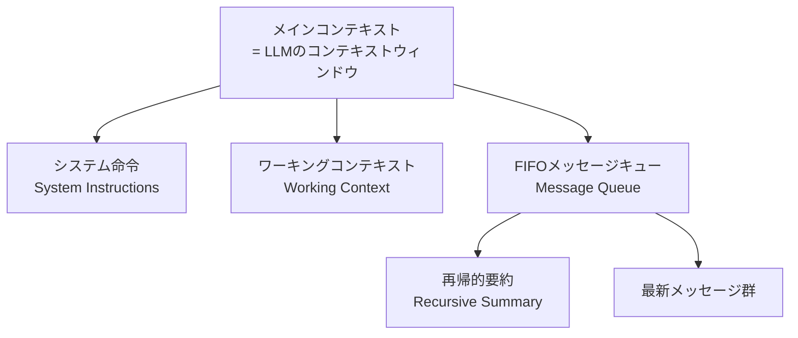

本記事は [MemGPT: Towards LLMs as Operating Systems](https://arxiv.org/abs/2310.08560)（Packer et al., 2023）の解説記事です。

この記事は [Zenn記事: AgentCore Memoryでサポートエージェントのトークンを最大95%圧縮する](https://zenn.dev/0h_n0/articles/4668d5a487ed15) の深掘りです。

## 論文概要（Abstract）

LLMの固定長コンテキストウィンドウは、長時間の対話や大規模文書の分析において制約となる。著者らはオペレーティングシステム（OS）の階層型メモリ管理に着想を得た「仮想コンテキスト管理」を提案し、LLMのコンテキストウィンドウをRAM、外部ストレージをディスクに見立てることで、有限のコンテキストを超えた情報処理を可能にするシステム「MemGPT」を実装している。評価は文書分析タスクとマルチセッション対話タスクの2つで実施されている。

## 情報源

- **arXiv ID**: 2310.08560
- **URL**: [https://arxiv.org/abs/2310.08560](https://arxiv.org/abs/2310.08560)
- **著者**: Charles Packer, Sarah Wooders, Kevin Lin, Vivian Fang, Shishir G. Patil, Ion Stoica, Joseph E. Gonzalez（UC Berkeley）
- **発表年**: 2023（初版: 2023年10月、改訂版v2: 2024年2月）
- **分野**: cs.AI
- **コード**: [https://research.memgpt.ai](https://research.memgpt.ai)

## 背景と動機（Background & Motivation）

LLMのコンテキストウィンドウは有限であり、長い会話履歴や大規模文書を扱う際にボトルネックとなる。たとえば、サポートエージェントが過去数百ターンの対話履歴を参照しようとすると、コンテキストウィンドウに収まらず情報が欠落する。従来のアプローチとしては、コンテキスト長を拡張したモデル（LongLLaMA等）やRAG（Retrieval-Augmented Generation）があるが、前者はモデルの再学習コストが高く、後者はユーザーが検索クエリを明示的に設計する必要がある。

著者らはこの問題を「OSのメモリ管理」というアナロジーで捉え直す。物理RAMが有限であるのと同様にコンテキストウィンドウは有限だが、OSが仮想メモリとページングでアプリケーションに無限のメモリを提供するように、LLMにも階層型のメモリ管理機構を導入すれば有限コンテキストの制約を克服できるという着想である。

## 主要な貢献（Key Contributions）

- **仮想コンテキスト管理の提案**: OSの仮想メモリとページング機構をLLMのコンテキスト管理に適用するフレームワークを定義した
- **MemGPTシステムの実装**: LLM自身がfunction callを通じてメモリのページイン・ページアウトを自律的に行うエージェントシステムを構築した
- **2タスクでの有効性実証**: コンテキストウィンドウを超える文書分析とマルチセッション対話の両方で、既存手法に対する優位性を示した

## 技術的詳細（Technical Details）

### OSアナロジーに基づくメモリ階層

MemGPTの設計は、OSの以下の概念をLLMに対応づけている。

| OS概念 | MemGPTでの対応 | 説明 |
|---|---|---|
| プロセッサ | LLM | テキスト生成を行う計算主体 |
| メインメモリ（RAM） | コンテキストウィンドウ | LLMが直接参照できるトークン領域 |
| ディスクストレージ | 外部データベース | コンテキスト外の永続的な情報格納先 |
| OS（カーネル） | MemGPTシステム | メモリ管理とイベント制御を担うレイヤー |

### メインコンテキストの構造

メインコンテキスト（LLMのプロンプトに収まる領域）は、以下の3つのセクションに分割される。



**システム命令（System Instructions）**: エージェントのペルソナや行動規則を定義する読み取り専用領域。OSのカーネルコードに相当する。

**ワーキングコンテキスト（Working Context）**: エージェントが自由に読み書きできる「スクラッチパッド」。ユーザーの好みや対話中に得た重要な情報を保持する。OSのヒープメモリに近い。

**FIFOメッセージキュー**: 直近の対話メッセージをFirst-In-First-Outで保持するキュー。キューの先頭には、すでにエビクト（退去）されたメッセージの**再帰的要約**が格納される。

### エビクションとページング

メッセージキューのトークン数が閾値を超えると、MemGPTのキューマネージャーが以下の2段階で動作する。

1. **メモリプレッシャー警告**: キュー使用量が警告閾値 $\tau_w$ を超えた時点で、LLMにシステムアラートを送信する。これにより、LLMは重要な情報をワーキングコンテキストやアーカイバルストレージに退避する猶予を得る

2. **強制エビクション**: キュー使用量がエビクション閾値 $\tau_e$（$\tau_e > \tau_w$）を超えた場合、キューの古いメッセージを強制的に削除する。削除されたメッセージの内容は再帰的要約に統合される

この仕組みにより、コンテキストウィンドウのトークン数 $C$ が固定であっても、実質的に無制限の対話履歴を扱える。任意のターン $t$ における実効的な情報量 $I_{\text{eff}}(t)$ は以下のように表せる。

$$
I_{\text{eff}}(t) = I_{\text{main}}(t) + I_{\text{recall}}(t) + I_{\text{archival}}(t)
$$

ここで、
- $I_{\text{main}}(t)$: メインコンテキスト内の情報量（$\leq C$ トークン）
- $I_{\text{recall}}(t)$: リコールストレージ（全対話ログ）に蓄積された情報量
- $I_{\text{archival}}(t)$: アーカイバルストレージに保存された情報量

$I_{\text{recall}}(t)$ と $I_{\text{archival}}(t)$ にはサイズ制限がないため、$I_{\text{eff}}(t)$ はコンテキストウィンドウ長 $C$ に制約されない。

### 外部ストレージ（ディスクに相当）

外部ストレージは2種類に分かれる。

**リコールストレージ（Recall Storage）**: 対話の全メッセージを時系列で保持する完全なログ。キーワード検索、日時フィルタ、内容検索が可能。OSのファイルシステムに近い。

**アーカイバルストレージ（Archival Storage）**: 任意のテキストを保存・検索できるベクトルデータベース。セマンティック検索（埋め込みベクトルの類似度による検索）を提供する。OSの外部ディスクに近い。

### Function Callによる自律的メモリ管理

MemGPTの重要な特徴は、LLM自身がfunction callを通じてメモリ操作を実行する点にある。著者らは以下のfunction群を定義している。

```python
def core_memory_append(section: str, content: str) -> str:
    """ワーキングコンテキストの指定セクションにテキストを追記する。

    Args:
        section: 書き込み先のセクション名（例: "human", "persona"）
        content: 追記するテキスト

    Returns:
        操作結果のステータスメッセージ
    """
    ...

def core_memory_replace(section: str, old_content: str, new_content: str) -> str:
    """ワーキングコンテキスト内の既存テキストを置換する。

    Args:
        section: 対象セクション名
        old_content: 置換対象の既存テキスト
        new_content: 新しいテキスト

    Returns:
        操作結果のステータスメッセージ
    """
    ...

def conversation_search(query: str, page: int = 0) -> list[dict]:
    """リコールストレージから対話履歴を検索する。

    Args:
        query: 検索クエリ（キーワードまたは日時）
        page: ページネーション用のページ番号

    Returns:
        マッチしたメッセージのリスト
    """
    ...

def archival_memory_insert(content: str) -> str:
    """アーカイバルストレージにテキストを保存する。

    Args:
        content: 保存するテキスト

    Returns:
        操作結果のステータスメッセージ
    """
    ...

def archival_memory_search(query: str, page: int = 0) -> list[dict]:
    """アーカイバルストレージをセマンティック検索する。

    Args:
        query: 検索クエリ
        page: ページネーション用のページ番号

    Returns:
        関連度の高い順にソートされた結果リスト
    """
    ...
```

LLMはこれらの関数を自律的に呼び出し、必要な情報をメインコンテキストにページインしたり、不要な情報を外部ストレージにページアウトしたりする。この設計により、メモリ管理の判断がLLM自身の推論能力に委ねられる。

### イベント駆動制御フロー

MemGPTはイベント駆動型のアーキテクチャを採用している。処理は以下のイベントによってトリガーされる。

- **ユーザーメッセージイベント**: ユーザーからの入力
- **システムイベント**: メモリプレッシャー警告やスケジュールされたタスク
- **エージェント内部イベント**: function callの結果返却

各イベントに対してLLMが応答を生成し、必要に応じてfunction callを発行する。function callの結果は再びイベントとしてLLMに返却され、連鎖的な処理が可能になる。この「内部独白（inner monologue）」により、エージェントはユーザーに応答する前に複数のメモリ操作を実行できる。

## 実装のポイント（Implementation）

### メインコンテキストのトークンバジェット管理

メインコンテキストの各セクションにはトークン上限を設定する必要がある。著者らの実装では、コンテキストウィンドウ全体の容量 $C$ に対して以下のように配分している。

- システム命令: 固定長（ペルソナ定義に依存）
- ワーキングコンテキスト: 可変長だが上限あり
- FIFOキュー: 残りのトークンを使用

キューの閾値設定が重要で、$\tau_w$ を低く設定しすぎるとメモリプレッシャー警告が頻発してエージェントの応答効率が低下し、$\tau_e$ を高く設定しすぎるとエビクション前に情報を退避する余裕がなくなる。

### 再帰的要約の品質

エビクトされたメッセージの再帰的要約は、情報損失の主要なボトルネックとなる。要約が不正確だと、過去の対話に関する質問に正しく回答できなくなる。著者らの実装では、要約の更新にLLM自身を使用しており、新たにエビクトされるメッセージと既存の要約をLLMに渡して統合させている。

### 制約と限界

著者ら自身が指摘している制約として、以下の点がある。

- **レイテンシ**: メモリ操作のfunction callが連鎖すると、1回のユーザー応答に複数回のLLM推論が必要となり応答時間が増加する
- **function callの信頼性**: LLMが適切なタイミングで適切な関数を呼び出す保証がなく、メモリ操作の失敗や不適切な呼び出しが発生し得る
- **要約の情報損失**: 再帰的要約では不可避的に情報が失われるため、過去の詳細な事実を正確に想起する能力には限界がある
- **計算コスト**: メモリ管理のためのfunction callごとにLLM推論が発生するため、単純なコンテキスト詰め込みと比較してトークン消費が増加するケースがある

## 実験結果（Results）

### 文書分析タスク

著者らは、コンテキストウィンドウを超えるサイズの文書に対する質問応答タスクでMemGPTを評価している。MemGPTは文書をアーカイバルストレージに格納し、質問に応じてセマンティック検索でページインする方式を採用している。著者らは、この方式により既存のコンテキスト長拡張手法と比較して競争力のある結果が得られたと報告している。

### マルチセッション対話タスク（Deep Memory Retrieval）

マルチセッション対話では、複数回のセッションにわたる対話履歴から特定の情報を検索する「Deep Memory Retrieval（DMR）」タスクで評価している。二次情報源の集計によると、以下のような結果が報告されている。

| モデル | MemGPTあり | MemGPTなし（ベースライン） |
|---|---|---|
| GPT-4 | 92.5% | 32.1% |
| GPT-3.5 Turbo | 66.9% | 38.7% |

（注: 上記の数値は二次情報源に基づく。正確な値は[原論文PDF](https://arxiv.org/pdf/2310.08560)を参照されたい。）

ベースラインとの大きな差は、MemGPTなしの場合は固定長のコンテキストウィンドウに収まる直近の対話しか参照できないのに対し、MemGPTはリコールストレージとアーカイバルストレージを検索して過去のセッションの情報をページインできることに起因する。

## 実運用への応用（Practical Applications）

MemGPTの設計は、Zenn記事で紹介されているAmazon Bedrock AgentCore Memoryの設計思想と共通点が多い。

| MemGPTの概念 | AgentCore Memoryの対応 |
|---|---|
| メインコンテキスト（RAM） | 短期記憶（CreateEvent / ListEvents） |
| アーカイバルストレージ（ディスク） | 長期記憶（RetrieveMemoryRecords） |
| ワーキングコンテキスト | Semantic / UserPreference戦略 |
| 再帰的要約 | Summary戦略 |
| function callによる自律管理 | サービス側LLMによる自動抽出・統合 |

MemGPTがLLM自身にメモリ管理を委ねる「self-managed」アプローチであるのに対し、AgentCore Memoryはサービス側で抽出・統合を自動実行する「managed service」アプローチという違いがある。AgentCore Memoryの方式では、開発者がfunction callの設計やエビクションポリシーを実装する必要がなく、メモリ戦略の設定のみで記憶機能を導入できる。

一方で、MemGPTの方式はメモリ管理戦略をLLM自身が状況に応じて柔軟に判断できるため、定型的でないタスクやドメイン固有の情報管理要件がある場合に適している。

## Production Deployment Guide

### AWS実装パターン（コスト最適化重視）

MemGPTのメモリ階層をAWS上で実装する場合、メインコンテキスト（LLM推論）、リコールストレージ（対話ログ）、アーカイバルストレージ（セマンティック検索）の3層を構成する必要がある。

**トラフィック量別の推奨構成**:

| 規模 | 月間リクエスト | 推奨構成 | 月額コスト | 主要サービス |
|------|--------------|---------|-----------|------------|
| **Small** | ~3,000 (100/日) | Serverless | $80-200 | Lambda + Bedrock + DynamoDB + OpenSearch Serverless |
| **Medium** | ~30,000 (1,000/日) | Hybrid | $500-1,200 | Lambda + ECS Fargate + ElastiCache + OpenSearch |
| **Large** | 300,000+ (10,000/日) | Container | $3,000-7,000 | EKS + Karpenter + OpenSearch + ElastiCache |

**Small構成の詳細**（月額$80-200）:
- **Lambda**: メモリ管理ループの実行（1GB RAM、60秒タイムアウト） — $30/月
- **Bedrock**: Claude 3.5 Haiku（function call対応、Prompt Caching有効） — $100/月
- **DynamoDB**: リコールストレージ（対話ログ保存、On-Demand） — $15/月
- **OpenSearch Serverless**: アーカイバルストレージ（ベクトル検索） — $25/月
- **CloudWatch**: 基本監視 — $5/月

**Medium構成の詳細**（月額$500-1,200）:
- **ECS Fargate**: メモリ管理ループの常駐プロセス（0.5 vCPU, 1GB RAM × 2タスク） — $120/月
- **Bedrock**: Claude 3.5 Sonnet（複雑な推論対応） — $600/月
- **ElastiCache Redis**: ワーキングコンテキストのキャッシュ（cache.t3.micro） — $15/月
- **OpenSearch**: アーカイバルストレージ（t3.small.search × 2ノード） — $80/月
- **DynamoDB**: リコールストレージ — $30/月
- **ALB**: ロードバランサー — $20/月

**Large構成の詳細**（月額$3,000-7,000）:
- **EKS**: コントロールプレーン — $72/月
- **EC2 Spot Instances**: g5.xlarge × 2-4台（Karpenter管理、平均$800/月、最大90%削減）
- **OpenSearch**: r6g.large.search × 3ノード（ベクトル検索用、$600/月）
- **Bedrock Batch**: 50%割引活用（$2,500/月）
- **ElastiCache**: r6g.large × 2ノード（ワーキングコンテキストキャッシュ、$300/月）
- **S3 + CloudWatch + X-Ray**: ストレージ・監視（$150/月）

**コスト削減テクニック**:
- Spot Instances使用で最大90%削減（EKS + Karpenter）
- Bedrock Prompt Caching有効化でシステム命令部分のトークンコスト30-90%削減
- Bedrock Batch API使用で50%削減（非リアルタイム処理）
- DynamoDB TTL設定でリコールストレージの古いデータを自動削除

**コスト試算の注意事項**: 上記は2026年10月時点のAWS ap-northeast-1（東京）リージョン料金に基づく概算値です。実際のコストはトラフィックパターン、リージョン、バースト使用量により変動します。最新料金は [AWS料金計算ツール](https://calculator.aws/) で確認してください。

### Terraformインフラコード

**Small構成（Serverless）: Lambda + Bedrock + DynamoDB + OpenSearch Serverless**

```hcl
module "vpc" {
  source  = "terraform-aws-modules/vpc/aws"
  version = "~> 5.0"

  name = "memgpt-vpc"
  cidr = "10.0.0.0/16"
  azs  = ["ap-northeast-1a", "ap-northeast-1c"]
  private_subnets = ["10.0.1.0/24", "10.0.2.0/24"]

  enable_nat_gateway   = false
  enable_dns_hostnames = true
}

resource "aws_iam_role" "lambda_memgpt" {
  name = "lambda-memgpt-role"

  assume_role_policy = jsonencode({
    Version = "2012-10-17"
    Statement = [{
      Action    = "sts:AssumeRole"
      Effect    = "Allow"
      Principal = { Service = "lambda.amazonaws.com" }
    }]
  })
}

resource "aws_iam_role_policy" "bedrock_invoke" {
  role = aws_iam_role.lambda_memgpt.id

  policy = jsonencode({
    Version = "2012-10-17"
    Statement = [{
      Effect   = "Allow"
      Action   = ["bedrock:InvokeModel", "bedrock:InvokeModelWithResponseStream"]
      Resource = "arn:aws:bedrock:ap-northeast-1::foundation-model/anthropic.claude-3-5-haiku*"
    }]
  })
}

resource "aws_lambda_function" "memgpt_handler" {
  filename      = "lambda.zip"
  function_name = "memgpt-memory-loop"
  role          = aws_iam_role.lambda_memgpt.arn
  handler       = "index.handler"
  runtime       = "python3.12"
  timeout       = 60
  memory_size   = 1024

  environment {
    variables = {
      BEDROCK_MODEL_ID    = "anthropic.claude-3-5-haiku-20241022-v1:0"
      DYNAMODB_TABLE      = aws_dynamodb_table.recall_storage.name
      OPENSEARCH_ENDPOINT = aws_opensearchserverless_collection.archival.collection_endpoint
    }
  }
}

resource "aws_dynamodb_table" "recall_storage" {
  name         = "memgpt-recall-storage"
  billing_mode = "PAY_PER_REQUEST"
  hash_key     = "session_id"
  range_key    = "timestamp"

  attribute {
    name = "session_id"
    type = "S"
  }
  attribute {
    name = "timestamp"
    type = "N"
  }

  ttl {
    attribute_name = "expire_at"
    enabled        = true
  }
}

resource "aws_opensearchserverless_collection" "archival" {
  name = "memgpt-archival"
  type = "VECTORSEARCH"
}

resource "aws_cloudwatch_metric_alarm" "lambda_cost" {
  alarm_name          = "memgpt-lambda-cost-spike"
  comparison_operator = "GreaterThanThreshold"
  evaluation_periods  = 1
  metric_name         = "Duration"
  namespace           = "AWS/Lambda"
  period              = 3600
  statistic           = "Sum"
  threshold           = 120000
  alarm_description   = "Lambda実行時間異常（コスト急増の可能性）"

  dimensions = {
    FunctionName = aws_lambda_function.memgpt_handler.function_name
  }
}
```

**Large構成（Container）: EKS + Karpenter + OpenSearch**

```hcl
module "eks" {
  source  = "terraform-aws-modules/eks/aws"
  version = "~> 20.0"

  cluster_name    = "memgpt-cluster"
  cluster_version = "1.31"

  vpc_id     = module.vpc.vpc_id
  subnet_ids = module.vpc.private_subnets

  cluster_endpoint_public_access = true
  enable_cluster_creator_admin_permissions = true
}

resource "kubectl_manifest" "karpenter_provisioner" {
  yaml_body = <<-YAML
    apiVersion: karpenter.sh/v1alpha5
    kind: Provisioner
    metadata:
      name: memgpt-spot
    spec:
      requirements:
        - key: karpenter.sh/capacity-type
          operator: In
          values: ["spot"]
        - key: node.kubernetes.io/instance-type
          operator: In
          values: ["g5.xlarge", "g5.2xlarge"]
      limits:
        resources:
          cpu: "32"
          memory: "128Gi"
      ttlSecondsAfterEmpty: 30
  YAML
}

resource "aws_budgets_budget" "memgpt_monthly" {
  name         = "memgpt-monthly-budget"
  budget_type  = "COST"
  limit_amount = "7000"
  limit_unit   = "USD"
  time_unit    = "MONTHLY"

  notification {
    comparison_operator        = "GREATER_THAN"
    threshold                  = 80
    threshold_type             = "PERCENTAGE"
    notification_type          = "ACTUAL"
    subscriber_email_addresses = ["ops@example.com"]
  }
}
```

### セキュリティベストプラクティス

**本番環境での推奨設定**:

1. **ネットワークセキュリティ**: EKSは`cluster_endpoint_public_access = false`に設定し、VPN/Direct Connect経由でアクセス。Lambda はVPC内配置
2. **認証・認可**: IAMロールは最小権限の原則。Kubernetes RBACとIRSA（IAM Roles for Service Accounts）を併用
3. **シークレット管理**: AWS Secrets Manager使用。環境変数へのハードコード禁止。90日ごとのローテーション推奨
4. **データ保護**: 転送中はTLS 1.2以上必須。保管中はS3/DynamoDB/EBS全てKMS暗号化
5. **監査**: CloudTrail全リージョン有効化。Config によるリソース変更追跡。GuardDuty有効化

### 運用・監視設定

**CloudWatch Logs Insights クエリ**:

```sql
-- function call回数と種別の分析（メモリ管理の効率性評価）
fields @timestamp, function_name, latency_ms
| stats count(*) as call_count, avg(latency_ms) as avg_latency by function_name, bin(1h)
| filter function_name in ["conversation_search", "archival_memory_search", "core_memory_append"]

-- メモリプレッシャー発生頻度
fields @timestamp, event_type, context_tokens
| filter event_type = "memory_pressure"
| stats count(*) as pressure_events by bin(1h)
```

**CloudWatch アラーム（コスト重視）**:

```python
import boto3

cloudwatch = boto3.client('cloudwatch')

cloudwatch.put_metric_alarm(
    AlarmName='memgpt-bedrock-token-spike',
    ComparisonOperator='GreaterThanThreshold',
    EvaluationPeriods=1,
    MetricName='TokenUsage',
    Namespace='AWS/Bedrock',
    Period=3600,
    Statistic='Sum',
    Threshold=500000,
    ActionsEnabled=True,
    AlarmActions=['arn:aws:sns:ap-northeast-1:123456789:cost-alerts'],
    AlarmDescription='Bedrockトークン使用量異常（メモリ操作ループの暴走検知）'
)
```

**X-Ray トレーシング設定**:

```python
from aws_xray_sdk.core import xray_recorder, patch_all

patch_all()

@xray_recorder.capture('memgpt_memory_loop')
def memory_management_loop(user_message: str, session_id: str) -> str:
    """MemGPTのメモリ管理ループを実行する。

    Args:
        user_message: ユーザーからの入力メッセージ
        session_id: セッション識別子

    Returns:
        エージェントの応答テキスト
    """
    xray_recorder.put_annotation('session_id', session_id)
    xray_recorder.put_metadata('input_length', len(user_message))
    # function callのチェーンを実行
    ...
```

### コスト最適化チェックリスト

**アーキテクチャ選択（トラフィック量で判断）**:
- [ ] ~100 req/日 → Lambda + Bedrock (Serverless) — $80-200/月
- [ ] ~1000 req/日 → ECS Fargate + Bedrock (Hybrid) — $500-1,200/月
- [ ] 10000+ req/日 → EKS + Spot Instances (Container) — $3,000-7,000/月

**リソース最適化**:
- [ ] EC2: Spot Instances優先（最大90%削減、Karpenter自動管理）
- [ ] Reserved Instances: 1年コミットで最大72%削減（予測可能な負荷）
- [ ] Savings Plans: Compute Savings Plans検討
- [ ] Lambda: メモリサイズ最適化（CloudWatch Insights分析）
- [ ] OpenSearch: アイドル時のノードスケールダウン

**LLMコスト削減**:
- [ ] Bedrock Prompt Caching: システム命令のキャッシュで30-90%削減
- [ ] Bedrock Batch API: 非リアルタイム処理で50%割引
- [ ] モデル選択ロジック: メモリ操作にはHaiku、最終応答にはSonnet
- [ ] function call回数制限: 1ターンあたりの最大チェーン長を設定

**監視・アラート（コスト異常の即時検知）**:
- [ ] AWS Budgets: 月額予算設定（80%で警告、100%でアラート）
- [ ] CloudWatch アラーム: function callループの暴走検知
- [ ] Cost Anomaly Detection: 自動異常検知
- [ ] 日次コストレポート: SNS/Slackへ自動送信

**リソース管理**:
- [ ] DynamoDB TTL: リコールストレージの古い対話ログ自動削除
- [ ] OpenSearch Index Lifecycle: 古いベクトルデータの自動削除
- [ ] タグ戦略: 環境別（dev/staging/prod）でコスト可視化
- [ ] 開発環境: 夜間・週末はスケールダウン

## 関連研究（Related Work）

- **Retrieval-Augmented Generation（RAG）**: Lewis et al.（2020）が提案した外部知識ベースからの検索と生成の統合手法。MemGPTとの違いは、RAGが検索をモデル外部の固定パイプラインで実行するのに対し、MemGPTはLLM自身が検索タイミングと対象を判断する点にある
- **LongLLaMA**: コンテキスト長を拡張したモデル。MemGPTとは異なり、モデルアーキテクチャの変更を必要とするが、追加の推論コスト（function call）は発生しない
- **Generative Agents（Park et al., 2023）**: エージェントにメモリストリームとリフレクション機構を持たせた研究。MemGPTと同じく外部メモリを持つが、メモリ管理のメカニズムが異なる

## まとめと今後の展望

MemGPTは、OSの仮想メモリ管理をLLMのコンテキスト管理に適用するという明快なアナロジーに基づき、有限のコンテキストウィンドウを超えた情報処理を実現するフレームワークである。LLM自身がfunction callを通じてメモリのページイン・ページアウトを自律的に行う設計は、その後のエージェントメモリ研究に影響を与えている。

MemGPTのコードベースは2024年9月にLettaに改名され、フレームワークとして発展を続けている。また、Amazon Bedrock AgentCore Memoryのように、MemGPTが開拓した階層型メモリ管理の概念をマネージドサービスとして提供する動きも進んでおり、開発者がメモリ管理の実装詳細を意識せずにエージェントに記憶機能を導入できる環境が整いつつある。

## 参考文献

- **arXiv**: [https://arxiv.org/abs/2310.08560](https://arxiv.org/abs/2310.08560)
- **Code**: [https://research.memgpt.ai](https://research.memgpt.ai)（現在はLettaに統合: [https://github.com/letta-ai/letta](https://github.com/letta-ai/letta)）
- **Related Zenn article**: [https://zenn.dev/0h_n0/articles/4668d5a487ed15](https://zenn.dev/0h_n0/articles/4668d5a487ed15)

---

:::message
この記事はAI（Claude Code）により自動生成されました。内容の正確性については複数の情報源で検証していますが、実際の利用時は公式ドキュメントもご確認ください。
:::
