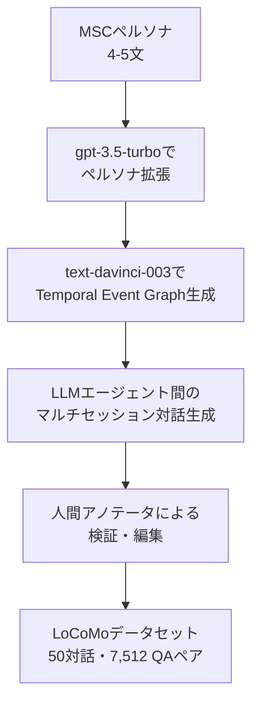

本記事は[Evaluating Very Long-Term Conversational Memory of LLM Agents](https://arxiv.org/abs/2402.17753)の解説記事です。

この記事は [Zenn記事: AgentCore Memoryでサポートエージェントのトークンを最大95%圧縮する](https://zenn.dev/0h_n0/articles/4668d5a487ed15) の深掘りです。

## 論文概要（Abstract）

LoCoMoは、LLMエージェントの**超長期対話記憶**（Very Long-Term Conversational Memory）を定量的に評価するために設計されたベンチマークデータセットである。著者らは、既存の長期対話研究が最大5セッション程度の対話しか扱っておらず、数十セッションにわたる長期記憶の評価が未開拓であると指摘している。LLMベースのエージェントアーキテクチャとTemporal Event Graphを組み合わせた機械・人間協調パイプラインにより、平均300ターン・9,000トークン・最大35セッションの対話データを構築し、質問応答・イベント要約・マルチモーダル対話生成の3タスクで評価を行った。

Amazon Bedrock AgentCore Memoryの[公式ブログ](https://aws.amazon.com/blogs/machine-learning/building-smarter-ai-agents-agentcore-long-term-memory-deep-dive)では、LoCoMoがSemantic戦略の評価ベンチマークとして採用されており、Zenn記事で紹介した「Semantic戦略の圧縮率89%（LoCoMo）」という数値はこのベンチマーク上で計測された値である。本記事では、LoCoMoの設計思想とデータ構築プロセス、評価タスクの詳細、そして各手法の比較結果を解説する。

## 情報源

- **arXiv ID**: 2402.17753
- **URL**: [https://arxiv.org/abs/2402.17753](https://arxiv.org/abs/2402.17753)
- **著者**: Adyasha Maharana, Dong-Ho Lee, Sergey Tulyakov, Mohit Bansal, Francesco Barbieri, Yuwei Fang
- **発表年**: 2024（ACL 2024 Long Paper）
- **分野**: cs.CL, cs.AI, cs.LG
- **プロジェクトページ**: [https://snap-research.github.io/locomo/](https://snap-research.github.io/locomo/)

## 背景と動機（Background & Motivation）

長期対話における記憶能力の評価は、LLMベースのチャットアシスタントやサポートエージェントにとって重要な課題である。しかし、著者らは既存のベンチマークが以下の点で不十分であると主張している。

**既存データセットとの比較（論文Table 1より）:**

| データセット | ターン/対話 | セッション/対話 | トークン/対話 | マルチモーダル |
|---|---|---|---|---|
| MSC | 53.3 | 4 | 1,225.9 | なし |
| Conversation Chronicles | 58.5 | 5 | 1,054.7 | なし |
| **LoCoMo** | **304.9** | **19.3** | **9,209.2** | **あり** |

MSCやConversation Chroniclesといった既存データセットは最大4〜5セッション程度であり、実際のサポートエージェントが扱う「数十セッションにまたがる長期的なやり取り」を評価するには不十分だった。LoCoMoはこのギャップを埋めるために、平均19.3セッション（最大35セッション）、平均304.9ターンという規模のデータセットを構築した。

さらに、既存のベンチマークでは画像のやり取りを含むマルチモーダルな対話を扱っていなかった点も、LoCoMoが新規に対処する課題である。

## 主要な貢献（Key Contributions）

著者らの主要な貢献は以下の3点である。

- **貢献1**: LLM＋Temporal Event Graphによる高品質な超長期対話データの自動生成パイプラインの構築。人間アノテータによる検証を組み合わせた機械・人間協調アプローチにより、長期的一貫性を維持したデータセットを効率的に構築した
- **貢献2**: 質問応答（QA）・イベント要約・マルチモーダル対話生成の3タスクからなる包括的な評価ベンチマークの設計。QAでは5種類の推論タイプ（single-hop、multi-hop、temporal、open-domain、adversarial）を定義し、多角的な記憶能力の測定を可能にした
- **貢献3**: Long-context LLM、RAG、ベースラインLLMの系統的な比較実験。各手法の強みと弱みを明らかにし、人間との性能差を定量化した

## 技術的詳細（Technical Details）

### データ構築パイプライン

LoCoMoのデータ構築は、**ペルソナ生成 → Temporal Event Graph構築 → エージェント対話生成 → 人間検証**の4段階で行われる。

**ステップ1: ペルソナ生成**

MSCデータセットの4〜5文のペルソナを出発点とし、gpt-3.5-turboで以下の5要素を含む詳細なペルソナに拡張する。

- 目標・目的（objectives）
- 過去の経験（past experiences）
- 日常の習慣（daily habits）
- 対人関係（interpersonal relationships）
- 名前・年齢・性別

**ステップ2: Temporal Event Graph**

text-davinci-003を使い、各エージェントのペルソナから**最大25個のライフイベント**を生成する。イベントは6〜12か月間に分散され、イベント間の因果関係（causal links）が記録される。生成は$k=3$のバッチで反復的に行われ、既存イベントとの整合性を確保する。

Temporal Event Graphの定義を形式的に述べると、各エージェント $a$ のイベントグラフ $G_a = (V_a, E_a)$ において、ノード $v \in V_a$ はタイムスタンプ付きイベントであり、有向辺 $e = (v_i, v_j) \in E_a$ はイベント $v_i$ がイベント $v_j$ の原因であることを表す。

**ステップ3: エージェント対話生成**

Park et al. (2023) のGenerative Agentsアーキテクチャを基に、以下の機能を持つエージェントが対話を生成する。

- **反省と応答（Reflect and Respond）**: 各セッション終了時にセッション要約を生成し、各ターンの観察を長期記憶に保存する。次セッションでは、要約・検索された観察・ペルソナ・セッション間に発生したイベントを用いて応答を生成する
- **画像共有と反応**: エージェントがキャプションを生成し、検索キーワードに変換してicrawlerで画像を取得する。受信した画像はBLIP-2でキャプション化される

**ステップ4: 人間検証**

アノテータが以下の作業を行う。

- 長期的な一貫性のチェックと修正
- 不適切な画像の除去・差し替え
- イベントグラフと対話内容の整合性確認

著者らによると、対話ターンの約15%が編集され、画像の約19%が除去または差し替えられたと報告されている。

### データセットの規模

論文の報告に基づくLoCoMoデータセットの統計量は以下の通りである。

| 項目 | 値 |
|---|---|
| 対話数 | 50 |
| 平均セッション数/対話 | 19.3（最大35） |
| 平均ターン数/対話 | 304.9 |
| 平均トークン数/対話 | 9,209.2 |
| QAペア総数 | 7,512 |
| 平均イベント数/対話 | 24.2 |
| 平均画像数/対話 | 32.3 |

### 質問の5カテゴリ

QAタスクでは、以下の5種類の推論タイプが定義されている。

| カテゴリ | 割合 | 定義 |
|---|---|---|
| **Single-hop** | 36.0%（2,705件） | 単一セッション内の情報から回答可能 |
| **Multi-hop** | 14.7%（1,104件） | 複数セッションの情報を統合して回答する必要がある |
| **Temporal** | 20.6%（1,547件） | 時間的推論と対話内の時間的手がかりが必要 |
| **Open-domain** | 3.8%（285件） | 対話の情報と外部の常識・世界知識を組み合わせる必要がある |
| **Adversarial** | 24.9%（1,871件） | 回答不可能と判断すべき誤誘導的質問 |

この設計は、LLMの記憶能力を「事実の検索」「情報の統合」「時間的推論」「知識の適用」「拒否判断」の5つの側面から評価する意図がある。AgentCore MemoryのSemantic戦略が主にsingle-hopおよびmulti-hopの事実的記憶に対応し、Summary戦略がイベント要約に対応すると考えると、LoCoMoの多角的評価は各メモリ戦略の強みと弱みを特定する上で有用なフレームワークとなる。

## 評価タスクとメトリクス

### タスク1: 質問応答（QA）

3つの実験設定で評価が行われる。

1. **Base**: コンテキスト長に制限のあるLLMで、古い対話が切り捨てられる。使用モデルはMistral-7B、Llama-2-Chat-70B、GPT-3.5-turbo、GPT-4-turbo
2. **Long-context**: より長いコンテキストウィンドウを持つGPT-3.5-turbo-16Kで、4K/8K/12K/16Kトークンの段階的評価
3. **RAG**: DRAGONをリトリーバー、GPT-3.5-turbo-16Kをリーダーとして使用。検索対象は対話ログ（Dialog）、観察記録（Observation）、セッション要約（Summary）の3種類

**評価メトリクス**: 正規化されたテキスト回答に対する**F1スコア**（部分一致）。各QAアイテムには回答が含まれるターンIDがアノテーションされている。RAGの検索性能はRecall@kで別途評価される。

### タスク2: イベント要約

対話を時系列に沿ってセッション単位で逐次処理し、各エージェントのライフイベントを要約する。BaseおよびLong-context設定で評価される（RAGは適用されない）。

**評価メトリクス**: 従来のROUGEスコアに加え、著者らは**FactScore**を採用している。FactScoreはイベントグラフのアトミックファクトに対する精度（Precision）・再現率（Recall）のF1として定義される。著者らは、BLEUやROUGEは要約の事実的正確性を適切に測定できないと主張しており、FactScoreをイベント要約の主指標として位置づけている。

$$
\text{FactScore-F1} = \frac{2 \cdot P_{\text{fact}} \cdot R_{\text{fact}}}{P_{\text{fact}} + R_{\text{fact}}}
$$

ここで、$P_{\text{fact}}$ は生成要約に含まれるアトミックファクトのうちイベントグラフに存在するものの割合、$R_{\text{fact}}$ はイベントグラフのアトミックファクトのうち生成要約でカバーされるものの割合である。

### タスク3: マルチモーダル対話生成

MiniGPT-5をベースに、3つのバリアント（Base、+Summary、+Observation）で評価される。人間によるフィルタリングを行っていない50対話で学習し、MMDialogで事前学習したチェックポイントから初期化される。

**評価メトリクス**: BLEU-1/2、ROUGE-L、MM-Relevance（マルチモーダル関連度）。

## 実験結果（Results）

### QAタスクの結果

**ベースおよびLong-context設定の結果（論文Table 2より）:**

| モデル | コンテキスト | Single | Multi | Temporal | Open | Adv. | Overall |
|---|---|---|---|---|---|---|---|
| **Human** | — | 95.1 | 85.8 | 92.6 | 75.4 | 89.4 | **87.9** |
| Mistral-7B | 8K | 10.2 | 12.8 | 16.1 | 19.5 | 17.0 | 13.9 |
| Llama-2-Chat-70B | 4K | 19.7 | 14.4 | 13.3 | 15.9 | 22.1 | 17.9 |
| GPT-3.5-turbo | 4K | 29.9 | 23.3 | 17.5 | 29.5 | 12.8 | 22.4 |
| GPT-4-turbo | 4K | 23.4 | 23.4 | 10.4 | 24.6 | 70.2 | 32.1 |
| GPT-3.5-turbo-16K | 4K | 31.7 | 25.4 | 16.8 | 27.6 | 13.1 | 24.1 |
| GPT-3.5-turbo-16K | 8K | 38.8 | 31.2 | 21.0 | 35.0 | 8.4 | 25.2 |
| GPT-3.5-turbo-16K | 12K | 51.1 | 40.4 | 25.0 | 36.5 | 6.4 | 33.5 |
| GPT-3.5-turbo-16K | 16K | 56.4 | 42.0 | 20.3 | 37.2 | 2.1 | **37.8** |

この結果から、著者らは以下の知見を報告している。

**知見1: コンテキスト拡大の効果と限界**

GPT-3.5-turbo-16Kのコンテキストを4Kから16Kに拡大すると、single-hopのF1は31.7→56.4と大幅に向上する。しかし、adversarial質問では13.1→2.1と**急激に悪化**している。著者らはこれを「コンテキストが増えるほど誤った情報を根拠に回答してしまう」傾向として分析している。

**知見2: 人間との性能差**

最良のモデル（GPT-3.5-turbo-16K、16Kコンテキスト）のoverall F1 37.8に対して、人間のoverall F1は87.9であり、**約57%の性能差**が存在する。temporal推論では人間92.6に対してモデル20.3と、**78%の差**がある。

**知見3: GPT-4-turboのadversarial性能**

GPT-4-turboはadversarial質問で70.2という突出したF1を示している。これは「回答不可能」と判断する能力が他モデルより優れていることを示唆しているが、全体性能は32.1と、Long-context設定のGPT-3.5-turbo-16K（37.8）を下回っている。

### RAG設定の結果

**RAG設定の結果（論文Table 3より、GPT-3.5-turbo-16K使用）:**

| 検索対象 | Top-K | Overall F1 | Overall Recall@K |
|---|---|---|---|
| なし（ベースライン） | — | 22.4 | — |
| Dialog | 5 | 31.7 | 38.5 |
| Dialog | 50 | 34.8 | 67.9 |
| **Observation** | **5** | **41.4** | **49.6** |
| Observation | 50 | 37.8 | 71.1 |
| Summary | 2 | 29.9 | 61.5 |
| Summary | 10 | 31.5 | 90.7 |

著者らの分析によると、以下の傾向が報告されている。

- **Observation検索がtop-5で最高性能（F1 41.4）**を達成する。生の対話ログよりも、各ターンから抽出された観察記録のほうが検索精度が高い
- **Summary検索はRecallが高いがF1は低い**。top-10でRecall 90.7%に達するものの、F1は31.5にとどまる。要約は広範な情報をカバーするが、具体的な事実の精度が不足する
- **Top-Kの増加はF1を必ずしも改善しない**。Observation検索ではtop-5からtop-50にかけてF1が41.4→37.8と**低下**している。無関係なコンテキストの混入が原因と考えられる

この結果は、AgentCore Memoryの設計と直接的に関連する。AgentCore MemoryのSemantic戦略は対話から事実（observation）を抽出する方式であり、LoCoMoのObservation検索が最高性能を示した点は、この設計判断を支持するベンチマーク結果として位置づけられる。

### イベント要約の結果

**イベント要約の結果（論文Table 4より）:**

| モデル | コンテキスト | ROUGE-1 | ROUGE-2 | ROUGE-L | FS-P | FS-R | FS-F1 |
|---|---|---|---|---|---|---|---|
| Mistral-7B | 8K | 29.4 | 7.2 | 14.1 | 27.1 | 19.8 | 23.0 |
| Llama-2-70B | 4K | 28.1 | 9.3 | 14.8 | 36.3 | 22.7 | 28.3 |
| GPT-4-turbo | 4K | 38.8 | 11.4 | 20.6 | 51.6 | 41.8 | 45.1 |
| GPT-3.5-turbo | 4K | 41.1 | 13.5 | 20.9 | 45.3 | 46.5 | 45.9 |
| GPT-3.5-turbo-16K | 16K | 36.2 | 8.5 | 16.4 | 42.3 | 37.8 | 39.9 |

著者らは以下の点を報告している。

- GPT-4-turboはFactScore精度（51.6）で最高だが、GPT-3.5-turboが再現率（46.5）で上回りF1はほぼ同等（45.1 vs 45.9）
- **Long-contextモデル（16K）はBase設定より性能が低下**する。GPT-3.5-turbo-16K（16K）のFS-F1 39.9は、Base設定のGPT-3.5-turbo（4K）のFS-F1 45.9を下回る
- 著者らはこの低下を「コンテキスト拡大により些細な情報も含めてしまい、イベントの重要度判断が困難になる」ためと分析している

### 要約のエラー分析

著者らは要約における5種類の主要エラーパターンを報告している。

1. **情報欠落（Missing Information）**: イベントグラフに含まれる重要イベントが要約に反映されない
2. **幻覚（Hallucination）**: 対話に存在しない情報を生成する
3. **対話のニュアンス誤読**: ユーモアや皮肉を字義通りに解釈する
4. **話者の誤帰属**: 2人の話者の発言を混同する
5. **些細な情報の過大評価**: 重要でない日常会話をイベントとして記録する

## AgentCore Memoryとの関連

LoCoMoの実験結果は、AgentCore Memoryの設計判断と以下の点で対応関係がある。

**1. Observation検索の優位性 → Semantic戦略**

LoCoMoのRAG実験（Table 3）でObservation検索がDialog検索やSummary検索を上回った結果は、AgentCore MemoryのSemantic戦略（対話から事実を抽出してセマンティック検索する方式）の有効性を裏付けている。AWS公式ブログでは、LoCoMo上でSemantic戦略の圧縮率89%が報告されている。

**2. Summary検索の高Recall/低F1 → Summary戦略の役割**

LoCoMoでSummary検索はRecall@10で90.7%に達するがF1は31.5にとどまった。この結果は、AgentCore MemoryでSummary戦略が「概要把握」に適している一方で「個別の事実検索」には不向きであるという特性と一致する。AgentCore Memoryでは、Summary戦略のnamespace templateに`{sessionId}`を含めてセッション単位に限定することで、この制約に対処する設計となっている。

**3. Adversarial質問への脆弱性 → メモリ統合の重要性**

Long-contextモデルがadversarial質問で壊滅的に悪化する（F1 2.1）ことは、大量のコンテキストを無批判に注入することの危険性を示している。AgentCore Memoryの統合（Consolidation）プロセスでは、新旧レコードのLLM比較によりADD/UPDATE/NO-OPを判断することで、古い・矛盾する情報の蓄積を防いでいる。

## 関連研究（Related Work）

- **MSC (Multi-Session Chat)**: Xu et al.が提案した5セッション・53ターンのマルチセッション対話データセット。LoCoMoはこのペルソナ設計を基盤としつつ、規模を約6倍に拡張している
- **MemGPT**: Packer et al. (2023)が提案したOS型メモリ管理アーキテクチャ。LoCoMoのエージェント設計（反省・要約・観察記録の検索）はMemGPTのメモリ階層と類似した設計思想を持つ
- **LongMemEval**: Wu et al. (2024)が提案した別の長期記憶ベンチマーク。500問で情報抽出・マルチセッション推論・時間推論・知識更新・回答拒否の5能力を評価する。AgentCore Memoryの公式評価ではLoCoMoとLongMemEvalの両方が使用されている

## まとめと今後の展望

LoCoMoは、LLMエージェントの長期記憶を**50対話・7,512 QAペア・3タスク・5推論タイプ**で多角的に評価するベンチマークである。著者らの実験により、以下の知見が得られている。

- 最良モデルでも人間のF1 87.9に対して37.8〜41.4にとどまり、**約50〜57%の性能差**が存在する
- Long-contextモデルは事実検索で有効だが、adversarial質問と要約品質で劣化する
- RAGではObservation（観察記録）ベースの検索が最も効果的で、生の対話ログやセッション要約より高い性能を示す
- 時間的推論（temporal reasoning）が全手法を通じて最も困難なカテゴリである

これらの結果は、AgentCore Memoryのような記憶管理サービスが「単一の戦略ではなく複数戦略の組み合わせ」で設計されている理由を実験的に裏付けている。Semantic戦略による事実抽出、Summary戦略によるセッション概要、UserPreference戦略による嗜好学習を組み合わせることで、LoCoMoが明らかにした各手法の弱点を相互に補完する設計となっている。

## 参考文献

- **arXiv**: [https://arxiv.org/abs/2402.17753](https://arxiv.org/abs/2402.17753)
- **ACL 2024**: [https://aclanthology.org/2024.acl-long.747](https://preview.aclanthology.org/setup/2024.acl-long.747)
- **プロジェクトページ**: [https://snap-research.github.io/locomo/](https://snap-research.github.io/locomo/)
- **AgentCore Memory公式ブログ**: [Building smarter AI agents: AgentCore long-term memory deep dive](https://aws.amazon.com/blogs/machine-learning/building-smarter-ai-agents-agentcore-long-term-memory-deep-dive)
- **Related Zenn article**: [https://zenn.dev/0h_n0/articles/4668d5a487ed15](https://zenn.dev/0h_n0/articles/4668d5a487ed15)

---

:::message
この記事はAI（Claude Code）により自動生成されました。内容の正確性については複数の情報源で検証していますが、実際の利用時は公式ドキュメントもご確認ください。
:::
