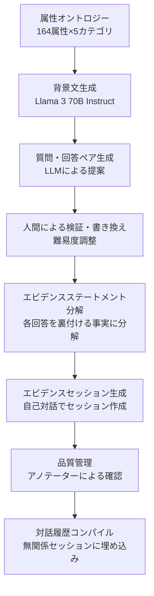

本記事は [LongMemEval: Benchmarking Chat Assistants on Long-Term Interactive Memory](https://arxiv.org/abs/2410.10813) の解説記事です。

この記事は [Zenn記事: AgentCore Memoryでサポートエージェントのトークンを最大95%圧縮する](https://zenn.dev/0h_n0/articles/4668d5a487ed15) の深掘りです。

## 論文概要（Abstract）

LongMemEvalは、チャットアシスタントが長期間のインタラクション履歴から情報を記憶・検索・活用する能力を評価するベンチマークである。著者らは500問の手作業で精選された質問を、任意の長さにスケーラブルなユーザー・アシスタント対話履歴に埋め込む設計を提案している。評価対象は5つの記憶能力（情報抽出、マルチセッション推論、時間推論、知識更新、棄権）であり、既存の商用アシスタントやlong-context LLMが30〜60%の精度低下を示すと報告されている。

## 情報源

- **arXiv ID**: 2410.10813
- **URL**: [https://arxiv.org/abs/2410.10813](https://arxiv.org/abs/2410.10813)
- **著者**: Di Wu, Hongwei Wang, Wenhao Yu, Yuwei Zhang, Kai-Wei Chang, Dong Yu
- **発表年**: 2024（ICLR 2025 採択）
- **分野**: cs.CL（計算言語学）
- **コード**: [https://github.com/xiaowu0162/LongMemEval](https://github.com/xiaowu0162/LongMemEval)

## 背景と動機（Background & Motivation）

LLMベースのチャットアシスタントは対話が長期化すると、過去のやり取りから必要な情報を引き出す「長期記憶」が不可欠になる。しかし著者らは、既存のベンチマークには以下の問題があると指摘している。

第一に、既存の評価データセットはコンテキスト長が限られている。LoCoMo（Maharana et al., 2024）は約9,000トークンの対話を使用するが、実際のユーザーとアシスタントの長期インタラクションは数十万トークンに達することがある。第二に、評価対象の記憶能力が限定的である。単純な情報検索だけでなく、時間の経過に伴う知識の更新や、複数セッションにまたがる推論なども実用上は重要である。第三に、商用システム（ChatGPT、Coze等）やメモリ拡張フレームワークを統一的な枠組みで比較した研究が不足している。

LongMemEvalはこれらのギャップを埋めるために設計された。特にAmazon Bedrock AgentCore Memoryのような記憶サービスの性能評価にも使われており、AgentCore公式ブログではLongMemEval-Sバリアントが評価基盤の一つとして採用されている。

## 主要な貢献（Key Contributions）

- **5軸の記憶能力評価**: 情報抽出、マルチセッション推論、時間推論、知識更新、棄権の5つの能力カテゴリを定義し、7種類の質問タイプで包括的に評価する枠組みを構築
- **スケーラブルなデータ構成**: 500問の質問に対して、任意の長さの対話履歴を生成するパイプラインを設計。LongMemEval-S（約115Kトークン）とLongMemEval-M（約1.5Mトークン）の2バリアントを提供
- **統一的なメモリパイプライン分析**: 既存の9つのメモリフレームワークをインデキシング・検索・読解の3段階で整理し、各設計選択の影響を体系的に比較

## 技術的詳細（Technical Details）

### 5つの記憶能力カテゴリ

LongMemEvalは、チャットアシスタントに求められる長期記憶を以下の5つの能力として定義している。

| 能力 | 定義 | 質問例（意訳） |
|---|---|---|
| **情報抽出（IE）** | 長い対話履歴から特定の情報を想起する。ユーザー側・アシスタント側いずれの発話も対象 | 「私が以前おすすめした映画のタイトルは？」 |
| **マルチセッション推論（MR）** | 複数セッションの情報を統合・比較して回答する | 「私が訪れた都市の中で、日本にあるものはどれ？」 |
| **時間推論（TR）** | 明示的な日時表現やタイムスタンプメタデータに基づく時間的推論 | 「2023年6月以降に私が買ったものは何？」 |
| **知識更新（KU）** | ユーザーの個人情報の変化を認識し、最新の状態を反映する | 「私の現在の住所はどこ？」（引越し後に質問） |
| **棄権（ABS）** | ユーザーが一度も言及していない情報について質問された場合に「わかりません」と回答する | 「私のペットの名前は？」（ペットについて言及がない場合） |

これら5つの能力は、さらに7種類の質問タイプに分解される。情報抽出は「single-session-user」「single-session-assistant」「single-session-preference」の3種類、マルチセッション推論は「multi-session」、知識更新は「knowledge-update」、時間推論は「temporal-reasoning」、棄権は「abstention」の各1種類である。棄権の30問は他の質問タイプから虚偽前提（false premise）の質問として再作成される。

### データ構築パイプライン

LongMemEvalのデータ構築は、以下の多段階パイプラインで行われる。



**属性オントロジー**: 著者らはユーザーの個人情報を164の属性に分類し、lifestyle（生活スタイル）、belongings（所有物）、life events（人生の出来事）、situational context（状況的文脈）、demographic information（人口統計情報）の5カテゴリに整理している。

**背景文の生成**: 各属性に対して、Llama 3 70B Instructがユーザーの背景文を生成する。例えば「lifestyle/hobbies」属性であれば「週末は山でハイキングを楽しんでいる」といった自然な設定が作られる。

**質問と回答の生成**: 背景文からLLMが (質問, 回答) ペアの候補を提案し、人間の専門家が難易度の調整と書き換えを行う。著者らはこの手作業によるキュレーションが品質の鍵であると述べている。

**エビデンスステートメントへの分解**: 各回答は1つ以上のエビデンスステートメント（回答の根拠となる事実）に分解される。時間推論の質問では、各エビデンスにタイムスタンプが手動で付与される。

**エビデンスセッションの生成**: 各エビデンスステートメントは、タスク指向の対話セッション内に間接的に埋め込まれる。著者らは「自己対話（self-chatting）」手法を用いて、ユーザーLLMがエビデンスを自然に会話に織り込むセッションを生成している。論文のSection 3.2で強調されているのは、エビデンスが直接的に述べられるのではなく、関連する会話の中で間接的に言及される点である。例えば「先月車を買った」ではなく、自動車保険の問い合わせの中で購入に言及する形をとる。

### スケーラブルな対話履歴の生成

LongMemEvalの重要な設計上の特徴は、対話履歴を任意の長さにスケーリングできる点である。各質問に対して、以下のプロセスで対話履歴がコンパイルされる。

1. **無関係セッションのサンプリング**: エビデンスセッションと矛盾しない属性から生成した自己対話セッション（全体の約50%）、ShareGPTデータ（約25%）、UltraChatデータ（約25%）を混合
2. **エビデンスの埋め込み**: エビデンスセッションを無関係セッション群のランダムな位置（中間部分）に挿入
3. **タイムスタンプの付与**: 各セッションにもっともらしいタイムスタンプを割り当て。エビデンスセッションのタイムスタンプをアンカーとして、その前後のセッションには時系列順のランダムな日付を設定

この「needle-in-a-haystack」設計により、2つの標準バリアントが提供されている。

| バリアント | セッション数 | トークン数 | 用途 |
|---|---|---|---|
| **LongMemEval-S** | 約30〜50セッション | 約115,000トークン | long-context LLMの評価、メモリシステムの標準評価 |
| **LongMemEval-M** | 約500セッション | 約1,500,000トークン | メモリ拡張システムの大規模評価 |

LongMemEval-Sの115Kトークンは現在のlong-context LLM（GPT-4oの128Kコンテキスト等）でギリギリ全文を入力できるサイズであり、これによりメモリシステムと全文入力の直接比較が可能になる。LongMemEval-Mの1.5Mトークンは全文入力が不可能なサイズであり、メモリ拡張が必須となる。

### 統一的メモリパイプライン：3段階フレームワーク

著者らは、既存のメモリ拡張フレームワークを以下の3段階で統一的に記述できるとしている。

$$
\text{Memory System} = \text{Indexing} \circ \text{Retrieval} \circ \text{Reading}
$$

メモリはkey-valueデータストアとしてモデル化される。各セッション $(t_i, S_i)$（$t_i$はタイムスタンプ、$S_i$はセッション内容）がインデキシングによってkey-valueアイテムに変換され、検索クエリで関連アイテムが取得され、読解モデルが回答を生成する。

著者らは4つの制御点（Control Points: CP1〜CP4）を定義し、各設計選択の影響を体系的に分析している。

#### CP1: Value（インデキシングの粒度）

対話履歴をどの粒度で保存するかの選択である。

- **Session**: セッション全体を1つのvalueとして保存
- **Round**: 各対話ラウンド（ユーザー発話+アシスタント応答の1ペア）を個別に保存
- **Summary/Fact**: セッションやラウンドをLLMで要約・事実抽出して保存

著者らの分析では、Round粒度がGPT-4oをリーダーとした場合に最良の結果を示すと報告されている。これは、セッション粒度では長すぎてリーダーの負荷が高くなり、要約・事実抽出では情報の欠落が生じるためと考えられる。

#### CP2: Key（インデックスキーの構成）

検索用のキーをどう構成するかの選択である。

- **K = V**: valueそのものをキーとして使用（最もシンプル）
- **K = fact**: LLMでvalueから事実を抽出してキーとする
- **K = keyphrase**: キーフレーズを抽出してキーとする
- **K = V + fact**: valueと事実を結合してキーとする（文書拡張）

著者らはK = V + fact（文書拡張）が最良であると報告しており、Recall@kで平均9.4%、最終精度で平均5.4%の改善が得られたとしている（論文Table 3より）。

#### CP3: Query（クエリの構成）

検索クエリをどう構成するかの選択である。

- **Question only**: 質問文をそのままクエリとして使用
- **Question + time**: 質問文に加え、LLMで時間範囲を推定してフィルタリング

時間推論の質問に対して、GPT-4oで時間範囲を抽出してクエリを拡張すると、Recallが平均11.3%（Round粒度）および6.8%（Session粒度）改善されたと報告されている（論文Table 4より）。

#### CP4: Reading（読解戦略）

検索結果をどう読解するかの選択である。

- **Direct**: 検索結果をそのまま入力して回答を生成
- **CoN（Chain-of-Note）**: 各検索結果から関連ノートを抽出してから回答を生成
- **JSON形式**: 出力をJSON形式で構造化

著者らは、CoN + JSON形式の組み合わせが最良であるとしている。Oracle検索（正解の検索結果が与えられた状態）でも、読解戦略の違いだけでGPT-4oの精度に最大10ポイントの差が生じると報告されている。

### 最適メモリデザイン

4つの制御点の分析に基づき、著者らは以下の設計を推奨している。

| 制御点 | 推奨設計 | 理由 |
|---|---|---|
| CP1 Value | Round（ラウンド粒度） | 情報欠落を防ぎつつリーダーの負荷を抑制 |
| CP2 Key | K = V + fact（文書拡張） | 9.4%のRecall改善 |
| CP3 Query | Question + time（時間認識クエリ拡張） | 時間推論で11.3%のRecall改善 |
| CP4 Reading | CoN + JSON | Oracle環境でも最大10ポイントの差 |

検索器にはStella V5 1.5B（密検索）、インデキシングLLMにはLlama 3.1 8B Instructが使用されている。

## 実験結果（Results）

### 商用システムの評価

著者らは97問のサブセット（3〜6セッション、LongMemEval-Sの約1/10の長さ）で商用システムを評価している。論文Figure 3aに基づく結果は以下の通りである。

| システム | LLM | 精度 |
|---|---|---|
| Offline Reading（上限） | GPT-4o | 0.918 |
| ChatGPT | GPT-4o | 0.577 |
| ChatGPT | GPT-4o-mini | 0.711 |
| Coze | GPT-4o | 0.330 |
| Coze | GPT-3.5-turbo | 0.247 |

ChatGPTとCozeは、Offline Reading（全履歴を直接読む理想的な条件）と比較してそれぞれ37%および64%の精度低下を示している。著者らは、ChatGPTは対話が進むにつれて重要な情報を上書きする傾向があり、Cozeはユーザーが間接的に提供した情報を記録しない傾向があると分析している。

### Long-Context LLMの評価（LongMemEval-S）

LongMemEval-S（約115Kトークン）の全履歴をlong-context LLMに直接入力した結果は以下の通りである（論文Figure 3bより）。

| モデル | Oracle精度 | 全履歴精度 | 低下率 |
|---|---|---|---|
| GPT-4o | 0.870 | 0.606 | 30.3% |
| GPT-4o (CoN) | 0.924 | 0.640 | 30.7% |
| Llama 3.1 70B | 0.744 | 0.334 | 55.1% |
| Llama 3.1 8B | 0.710 | 0.454 | 36.1% |
| Phi-3 128K 14B | 0.702 | 0.380 | 45.9% |
| Phi-3.5 Mini 4B | 0.660 | 0.342 | 48.1% |

ここで「Oracle精度」はエビデンスセッションのみを入力した場合、「全履歴精度」はLongMemEval-Sの全対話履歴を入力した場合の精度である。

著者らが報告した注目すべき知見は以下の通りである。

**全文入力の限界**: 最もスコアの高いGPT-4oでも30%以上の精度低下が生じ、オープンソースモデルでは50%以上低下するケースがある。著者らは「履歴がさらに長くなればこの低下はより顕著になる可能性がある」と述べている。

**リーダーの能力差**: Llama 3.1 8Bは検索結果が3Kトークンを超えると急激に性能が低下する一方、GPT-4oは20Kトークンを超えても改善を続ける。

### メモリ拡張パイプラインの評価（LongMemEval-M）

LongMemEval-M（約1.5Mトークン、約500セッション）での主要な検索・QA結果は以下の通りである（論文Table 3より）。

Round粒度の代表的な結果:

| Value | Key | Recall@5 | Recall@10 | GPT-4o (Top-5) | GPT-4o (Top-10) |
|---|---|---|---|---|---|
| Round | K = V | 0.582 | 0.692 | 0.615 | 0.670 |
| Round | K = V + fact | **0.644** | **0.784** | **0.657** | **0.720** |
| Round | K = keyphrase | 0.282 | 0.392 | 0.425 | 0.489 |

Session粒度の代表的な結果:

| Value | Key | Recall@5 | Recall@10 | GPT-4o (Top-5) | GPT-4o (Top-10) |
|---|---|---|---|---|---|
| Session | K = V | 0.706 | 0.783 | 0.670 | 0.676 |
| Session | K = V + fact | **0.732** | **0.862** | **0.714** | **0.700** |

Round粒度ではRecall@10がSession粒度を下回るが（0.784 vs 0.862）、GPT-4oのQA精度ではTop-10で0.720 vs 0.700とRound粒度が上回っている。これは、Sessionが長いため読解モデルの負荷が高くなり、検索精度の優位性がQA精度に反映されにくいためと著者らは分析している。

### 時間推論の評価

時間推論サブセットでの時間認識クエリ拡張（QE: Query Expansion）の効果は以下の通りである（論文Table 4より）。

| 設定 | Round Recall@5 | Round Recall@10 |
|---|---|---|
| K = V + fact（QE なし） | 0.489 | 0.550 |
| K = V + fact + QE（GPT-4o） | **0.526** | **0.722** |
| K = V + fact + QE（Llama 3.1 8B） | 0.481 | 0.570 |

GPT-4oによる時間範囲抽出はRecall@10を0.550から0.722へと大幅に改善している。一方、Llama 3.1 8Bによる時間範囲抽出は限定的な改善にとどまっている。著者らは、弱いLLMでは「時間的な手がかりがない質問に対して時間範囲を幻覚する」傾向があると指摘している。

## 既存フレームワークの統一的分類

著者らは9つの既存メモリフレームワークを3段階パイプラインで統一的に分類している（論文Table 2より）。

| 手法 | Value粒度 | Key構成 | 時間認識 | 読解戦略 |
|---|---|---|---|---|
| In-context RAG | round/session | K = V | No | direct |
| MemoryBank | summary + round | K = V | Yes | direct |
| LD-Agent | summary + fact | K = V | Yes | direct |
| CoN | round/session | K = V | No | CoN |
| ChatGPT | fact | - | No | - |
| Coze | fact | - | No | - |
| RAPTOR | round/session | node summary | No | - |
| MemWalker | round/session | node summary | No | interactive |
| HippoRAG | round/session | entity | No | direct |
| **著者提案** | **round** | **K = V + fact** | **Yes** | **CoN** |

この分類からは、時間認識を備えたフレームワークがMemoryBankとLD-Agentのみであること、また多くのシステムがround/session粒度のvalueにK = Vのシンプルなキーを使用していることがわかる。著者提案のデザインは、これらの制約を4つの制御点すべてで改善している点が特徴的である。

## AgentCore MemoryとLongMemEvalの関係

Amazon Bedrock AgentCore MemoryはLongMemEval-Sを公式ベンチマークの一つとして採用している。[AWS公式ブログ](https://aws.amazon.com/blogs/machine-learning/building-smarter-ai-agents-agentcore-long-term-memory-deep-dive)のベンチマーク結果によると、AgentCoreのSemantic戦略はLongMemEval-Sで94%の圧縮率（元のトークン量の6%で記憶を保持）を達成しながら、73.60%の正答率を維持していると報告されている。

LongMemEvalの文脈でこの数字を解釈すると、以下のようになる。

1. **全履歴入力のGPT-4o（0.606）との比較**: AgentCoreのSemantic戦略（0.736）は全履歴入力を上回っている。これはLongMemEval論文の知見「無関係な履歴がノイズとなりモデルの注意を散漫にする」と整合する
2. **Oracle精度（0.870）との比較**: AgentCoreは94%の圧縮を行いつつ、Oracle精度の84.6%の性能を維持している。圧縮によるトレードオフはあるが、実用上十分な水準といえる
3. **LongMemEvalの設計思想との整合**: AgentCoreのSemantic戦略は、事実（fact）をvalueとして抽出・保存する点でLongMemEvalのCP2分析（K = V + factが最良）と共通する設計思想を持つ

Zenn記事で紹介されているAgentCore Memoryの3戦略（Semantic・UserPreference・Summary）は、LongMemEvalの5つの能力カテゴリに対して異なる強みを持つと考えられる。Semantic戦略は情報抽出とマルチセッション推論に、UserPreference戦略は嗜好ベースの情報抽出に、Summary戦略は全体的なコンテキスト圧縮にそれぞれ対応する。

## 実運用への応用（Practical Applications）

### メモリシステムの設計指針としての活用

LongMemEvalの分析結果は、サポートエージェントのメモリシステム設計に直接的な示唆を与える。

**Round粒度のインデキシング**: 著者らの結果はRound粒度が最良であることを示しており、AgentCore Memoryの`CreateEvent` APIが対話ペア（ユーザー発話+アシスタント応答）を保存する設計と整合する。

**文書拡張によるキー構成**: K = V + factの優位性は、AgentCoreのSemantic戦略が元の対話から事実を抽出して長期記憶に保存する設計の理論的裏付けとなる。

**時間認識の重要性**: 時間推論に対するクエリ拡張の有効性は、サポートエージェントで「いつ問い合わせたか」「いつ契約を変更したか」といった時間的文脈を扱う際に、タイムスタンプメタデータの適切な管理が不可欠であることを示している。

### 評価ツールとしての活用

LongMemEvalはメモリシステムの開発・改善サイクルにおけるABテストのベンチマークとしても活用できる。パイプラインの各段階（インデキシング・検索・読解）を独立に評価できるため、ボトルネックの特定が容易である。

```python
from typing import Literal

MemoryAbility = Literal[
    "information_extraction",
    "multi_session_reasoning",
    "temporal_reasoning",
    "knowledge_update",
    "abstention",
]

def evaluate_memory_system(
    system_name: str,
    abilities: list[MemoryAbility],
    variant: Literal["S", "M"] = "S",
) -> dict[str, float]:
    """LongMemEvalによるメモリシステムの能力別評価

    Args:
        system_name: 評価対象システム名
        abilities: 評価する能力カテゴリのリスト
        variant: S（115Kトークン）またはM（1.5Mトークン）

    Returns:
        能力別の精度辞書
    """
    results: dict[str, float] = {}
    for ability in abilities:
        questions = load_longmemeval_questions(variant, ability)
        for q in questions:
            history = compile_chat_history(q, variant)
            response = system_under_test(system_name, history, q.question)
            score = gpt4o_judge(q, response)
            results.setdefault(ability, []).append(score)
    return {k: sum(v) / len(v) for k, v in results.items()}
```

## 関連研究（Related Work）

- **LoCoMo**（Maharana et al., 2024）: LLMエージェントの長期対話記憶を評価するベンチマーク。約9Kトークン・300ターンの対話を使用。LongMemEvalはこれを桁違いのスケール（115K〜1.5Mトークン）に拡張し、より現実的な設定で評価する
- **MemGPT**（Packer et al., ICLR 2024）: OS型のメモリ階層をLLMに導入するアーキテクチャ。LongMemEvalのフレームワーク分類ではIn-context RAGの拡張として位置づけられる
- **SimpleMem**（Liu et al., 2026）: 効率的な生涯メモリフレームワーク。LoCoMoでF1を26.4%改善し、推論トークンを30倍削減。LongMemEvalの3段階パイプラインの各段階を最適化する手法として位置づけられる

## まとめと今後の展望

LongMemEvalは、チャットアシスタントの長期記憶能力を5軸×7質問タイプで包括的に評価する初のベンチマークである。著者らの主要な知見は以下の通りである。

- 商用システム（ChatGPT、Coze）は短い履歴でも37〜64%の精度低下を示し、long-context LLMでも30〜55%の低下が生じる
- メモリパイプラインの最適設計として、Round粒度のvalue、V + factのkey構成、時間認識クエリ拡張、CoN + JSONの読解戦略が有効である
- 時間推論は特に困難な能力であり、弱いモデルでは時間範囲の幻覚が問題になる

このベンチマークは、AgentCore Memoryのような記憶サービスの性能評価において実用上の基盤となっており、メモリシステムの設計改善に客観的なフィードバックを提供する。今後は、より長い対話履歴（数百万トークン超）やマルチモーダルな記憶の評価への拡張が期待される。

## 参考文献

- **arXiv**: [https://arxiv.org/abs/2410.10813](https://arxiv.org/abs/2410.10813)
- **Code**: [https://github.com/xiaowu0162/LongMemEval](https://github.com/xiaowu0162/LongMemEval)
- **Project page**: [https://xiaowu0162.github.io/long-mem-eval/](https://xiaowu0162.github.io/long-mem-eval/)
- **ICLR 2025**: [https://iclr.cc/virtual/2025/poster/28290](https://iclr.cc/virtual/2025/poster/28290)
- **Related Zenn article**: [https://zenn.dev/0h_n0/articles/4668d5a487ed15](https://zenn.dev/0h_n0/articles/4668d5a487ed15)

---

:::message
この記事はAI（Claude Code）により自動生成されました。内容の正確性については複数の情報源で検証していますが、実際の利用時は公式ドキュメントもご確認ください。
:::
