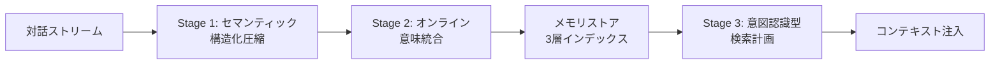

## 論文概要（Abstract）

本記事は [SimpleMem: Efficient Lifelong Memory for LLM Agents](https://arxiv.org/abs/2601.02553) の解説記事です。

SimpleMem は、LLMエージェントの長期記憶を効率的に管理するためのメモリフレームワークである。従来手法が全対話履歴をそのままコンテキストに含めることによるトークン冗長性、あるいは反復的な推論によるフィルタリングの高コストという課題を抱えていたのに対し、SimpleMem は「セマンティック・ロスレス圧縮」に基づく3段階パイプラインでこれらを解決する。著者らは、LoCoMo ベンチマークにおいて Mem0 比で平均 F1 を 26.4% 向上させ、推論時のトークン消費を約30倍削減したと報告している。

この記事は [Zenn記事: AgentCore Memoryでサポートエージェントのトークンを最大95%圧縮する](https://zenn.dev/0h_n0/articles/4668d5a487ed15) の深掘りです。

## 情報源

- **arXiv ID**: 2601.02553
- **URL**: [https://arxiv.org/abs/2601.02553](https://arxiv.org/abs/2601.02553)
- **著者**: Jiaqi Liu, Yaofeng Su, Peng Xia, Siwei Han, Zeyu Zheng, Cihang Xie, Mingyu Ding, Huaxiu Yao
- **所属**: University of North Carolina at Chapel Hill, UC Berkeley, UC Santa Cruz
- **発表年**: 2026（v1: 2026年1月5日、v3: 2026年1月29日）
- **分野**: cs.AI
- **コード**: [https://github.com/aiming-lab/SimpleMem](https://github.com/aiming-lab/SimpleMem)

## 背景と動機（Background & Motivation）

LLMエージェントが長期にわたる対話やタスクを処理する際、過去のやり取りをどのように保持・検索するかは根本的な課題である。著者らは既存手法を2つのカテゴリに分類している。

**受動的コンテキスト拡張型**: 全対話履歴をプロンプトに含める方式。MemGPT やフルコンテキスト手法がこれに該当する。LoCoMo ベンチマークにおいて、この方式はクエリあたり約16,910トークンを消費するが、平均 F1 は18.70にとどまる（論文 Table 1 より）。大量のノイズを含む履歴がモデルの注意を分散させるためと考えられる。

**反復的フィルタリング型**: A-Mem のように LLM を繰り返し呼び出してノイズを除去する方式。F1 は32.58と改善するが、メモリ構築に5,140秒を要し（論文 Table 4 より）、実用上のコストが大きい。

SimpleMem は、1回の LLM 呼び出しで対話ウィンドウをフィルタリング・圧縮することで、この品質と効率のトレードオフを解消することを目指している。

## 主要な貢献（Key Contributions）

- **3段階パイプライン**: セマンティック構造化圧縮 → オンライン意味統合 → 意図認識型検索計画の一貫したアーキテクチャ
- **セマンティック・ロスレス圧縮**: LLM による生成的フィルタリングで、低密度ウィンドウを破棄しつつ、保持すべき情報を自己完結的メモリユニットに変換
- **3層インデックス**: Dense（セマンティック）、Sparse（BM25）、Symbolic（メタデータ）の並列検索による高精度リトリーバル
- **LoCoMo での SOTA**: GPT-4.1-mini バックエンドで平均 F1 43.24（Mem0 の 34.20 比 +26.4%）、クエリあたり 531 トークン（フルコンテキスト比約30倍圧縮）

## 技術的詳細（Technical Details）

### 3段階パイプラインの全体像



### Stage 1: セマンティック構造化圧縮（Semantic Structured Compression）

対話ストリームを固定長のスライディングウィンドウ $W$（ウィンドウサイズ20ターン）に分割する。各ウィンドウに対して、LLM がゲーティング関数 $\Phi_{\text{gate}}$ を適用する。

$$
\Phi_{\text{gate}}(W) \rightarrow \{m_k\}, \quad |\{m_k\}| \geq 0
$$

ここで、
- $W$: 対話ウィンドウ（20ターン分の発話列）
- $m_k$: 抽出された $k$ 番目のメモリユニット
- $\{m_k\}$: メモリユニットの集合（空集合の場合、そのウィンドウは破棄される）

著者らはこのゲーティングを「二値分類器ではなく生成的フィルタ」と位置づけている。LLM が空の出力を返した場合、そのウィンドウは情報密度が低いと判定され破棄される。

保持されたウィンドウに対しては、以下の3つの変換を1回の LLM 呼び出しで実行する。

$$
\{m_k\} = F_\theta(W; H) \approx (g_{\text{time}} \circ g_{\text{coref}} \circ g_{\text{ext}})(W)
$$

ここで、
- $F_\theta$: パラメータ $\theta$ を持つ LLM
- $H$: 対話履歴のコンテキスト
- $g_{\text{ext}}$: 事実の原子化（atomic fact extraction）
- $g_{\text{coref}}$: 共参照解決（代名詞をエンティティ名に置換）
- $g_{\text{time}}$: 時間的アンカリング（相対時刻を ISO 8601 形式の絶対時刻に変換）

この変換により、各メモリユニットは元の対話コンテキストなしでも意味が通じる「自己完結的」な形式になる。著者らは、約24,000トークンの生の対話が約800トークンに圧縮された事例を示している。

### 3層インデックス構造

各メモリユニット $m_k$ は3つのインデックスで管理される。

$$
I(m_k) = \{s_k = E_{\text{dense}}(m_k), \; l_k = E_{\text{sparse}}(m_k), \; r_k = E_{\text{sym}}(m_k)\}
$$

| レイヤー | 表記 | 手法 | 用途 |
|---|---|---|---|
| Semantic | $s_k = E_{\text{dense}}(m_k)$ | Dense embedding | 意味的類似検索 |
| Lexical | $l_k = E_{\text{sparse}}(m_k)$ | BM25 (sparse) | 固有名詞・キーワードの完全一致 |
| Symbolic | $r_k = E_{\text{sym}}(m_k)$ | メタデータ（時刻、エンティティ型） | 時間範囲・属性フィルタリング |

ベクトルストアには LanceDB が使用されており、IVF-PQ インデックスが構築される（論文 Appendix B.2 より）。

### Stage 2: オンライン意味統合（Online Semantic Synthesis）

AgentCore Memory の統合（Consolidation）と類似した機構だが、SimpleMem ではバックグラウンド非同期処理ではなく **書き込み時にオンラインで実行** される点が異なる。

$$
F_{\text{syn}}(O_{\text{session}}, C_{\text{context}}; f)
$$

ここで、
- $O_{\text{session}}$: 新しいセッションから抽出されたメモリユニット群
- $C_{\text{context}}$: 既存のメモリストア内の関連レコード
- $f$: 統合関数（LLM による判定）

例えば、「ユーザーはコーヒーが好き」「ユーザーはオートミルクを好む」「ユーザーは熱いのが好き」という3つのメモリが、「ユーザーはオートミルク入りの熱いコーヒーを好む」に統合される。AgentCore Memory の ADD/UPDATE/NO-OP 判定と同様のメカニズムだが、SimpleMem では非同期遅延なく書き込み時に即座に実行される。

### Stage 3: 意図認識型検索計画（Intent-Aware Retrieval Planning）

クエリ $q$ に対して、LLM プランナーが3つのビュー別クエリと検索深度 $d$ を生成する。

$$
\{q_{\text{sem}}, q_{\text{lex}}, q_{\text{sym}}, d\} \sim P(q, H)
$$

各ビューで top-$n$（$n$ は $d$ に比例）の結果を取得し、和集合で統合する。

$$
R_{\text{sem}} = \text{Top-}n(\cos(E(q_{\text{sem}}), E(m_i)) \mid m_i \in M)
$$

$$
R_{\text{lex}} = \text{Top-}n(\text{BM25}(q_{\text{lex}}, m_i) \mid m_i \in M)
$$

$$
R_{\text{sym}} = \text{Top-}n(\{m_i \in M \mid \text{Meta}(m_i) \models q_{\text{sym}}\})
$$

$$
C_q = R_{\text{sem}} \cup R_{\text{lex}} \cup R_{\text{sym}}
$$

検索深度 $d$ の範囲は $k_{\min} = 3$ から $k_{\max} = 20$ と設定されている。クエリの複雑度に応じて LOW（直接ルックアップ）と HIGH（集約・時間比較・パターン合成）にラベル付けされ、HIGH の場合により多くの結果が取得される。

### アルゴリズムの全体像

```python
from dataclasses import dataclass


@dataclass
class MemoryUnit:
    """SimpleMem のメモリユニット。"""
    text: str
    dense_embedding: list[float]
    sparse_tokens: dict[str, float]
    metadata: dict[str, str]


def semantic_structured_compression(
    window: list[dict[str, str]],
    llm: object,
) -> list[MemoryUnit]:
    """Stage 1: 対話ウィンドウをフィルタリングし自己完結的メモリに圧縮する。

    Args:
        window: 20ターン分の対話リスト [{"role": ..., "content": ...}, ...]
        llm: LLM インスタンス

    Returns:
        メモリユニットのリスト（空リストの場合、ウィンドウは破棄）
    """
    prompt = (
        "以下の対話から保持すべき事実を抽出してください。\n"
        "代名詞はエンティティ名に、相対時刻はISO 8601に変換し、\n"
        "各事実を独立して理解可能な形にしてください。\n"
        "保持すべき情報がない場合は空を返してください。"
    )
    result = llm.generate(prompt + format_window(window))
    if not result.strip():
        return []
    facts = parse_atomic_facts(result)
    return [
        MemoryUnit(
            text=fact,
            dense_embedding=embed_dense(fact),
            sparse_tokens=compute_bm25_tokens(fact),
            metadata=extract_metadata(fact),
        )
        for fact in facts
    ]
```

## 実験結果（Results）

### LoCoMo ベンチマーク

LoCoMo は200〜400ターンの長期対話を含み、1,986件の評価質問（Multi-hop、Temporal、Open-domain、Single-hop の4カテゴリ）で構成される。

論文 Table 1 より、GPT-4.1-mini バックエンドでの主要結果を以下に示す。

| 手法 | 平均 F1 | 平均 BLEU-1 | クエリあたりトークン |
|---|---|---|---|
| Full context | 18.70 | 16.30 | 16,910 |
| MemGPT | 18.51 | 16.75 | 16,977 |
| ReadAgent | 7.16 | 6.09 | 643 |
| Mem0 | 34.20 | 30.89 | 973 |
| A-Mem | 32.58 | 28.45 | 2,520 |
| LightMem | 24.63 | 21.85 | 612 |
| **SimpleMem** | **43.24** | **37.62** | **531** |

注目すべき点として、フルコンテキスト方式（16,910トークン）に対して SimpleMem（531トークン）は約31.8倍のトークン圧縮を達成しながら、F1 を18.70から43.24へと大幅に向上させている。著者らは、ノイズとなる無関係な履歴の除去がモデルの注意集中を促進すると分析している。

カテゴリ別では、Temporal カテゴリで SimpleMem が F1 58.62 を記録し、Mem0 の 48.91 を約10ポイント上回っている。時間的アンカリング（$g_{\text{time}}$）による ISO 8601 変換が時系列推論を支援しているためと考えられる。

### LongMemEval-S ベンチマーク

論文 Table 2 より、LongMemEval-S（500件の質問、gpt-4.1-mini による正誤判定）の結果を示す。

| バックエンド | Full context | Mem0 | LightMem | SimpleMem |
|---|---|---|---|---|
| gpt-4.1-mini | 39.57% | 59.81% | 68.67% | **76.87%** |
| gpt-4.1 | 56.72% | 58.51% | 76.86% | **83.97%** |

Multi-Session カテゴリでは、SimpleMem が60.92%、LightMem が47.37%、Full context が30.08%と報告されている。セッション横断の記憶検索において SimpleMem の3層インデックスが有効に機能していることを示唆する結果である。

### 効率性比較

論文 Table 4 より、LoCoMo-10（10セッション）での処理時間比較（GPT-4.1-mini）を示す。

| 手法 | 構築時間 | 検索時間 | 合計時間 | 平均 F1 |
|---|---|---|---|---|
| A-Mem | 5,140.5s | 796.7s | 5,937.2s | 32.58 |
| Mem0 | 1,350.9s | 583.4s | 1,934.3s | 34.20 |
| LightMem | 97.8s | 577.1s | 675.9s | 24.63 |
| **SimpleMem** | **92.6s** | **388.3s** | **480.9s** | **43.24** |

SimpleMem はメモリ構築時間が92.6秒と Mem0（1,350.9秒）の約15分の1であり、合計処理時間でも最短でありながら最高の F1 を達成している。

### 小規模モデルでの性能

論文 Table 3 より、Qwen3-8B での結果は SimpleMem が F1 33.45、Mem0 が25.80と報告されている。小規模モデルでも SimpleMem の優位性が維持されることを示唆しているが、GPT-4.1-mini（F1 43.24）と比較すると差があり、Stage 1 の圧縮品質がバックエンド LLM の能力に依存する点に注意が必要である。

## AgentCore Memory との比較

Zenn記事で解説した AgentCore Memory と SimpleMem のアプローチには共通点と相違点がある。

| 観点 | AgentCore Memory | SimpleMem |
|---|---|---|
| 記憶抽出 | 非同期（20〜40秒） | 書き込み時にオンライン実行 |
| 統合（Consolidation） | ADD/UPDATE/NO-OP の3アクション | 意味的に関連するメモリの統合 |
| 検索 | namespace 単位のセマンティック検索 | 3層並列検索（Dense + BM25 + Symbolic） |
| ベンチマーク | LoCoMo, LongMemEval-S, PrefEval, PolyBench-QA | LoCoMo, LongMemEval-S |
| 圧縮率 | 最大95%（Summarization戦略） | 約97%（531/16,910 トークン） |
| マネージド性 | AWSフルマネージド | 自前運用が必要 |

SimpleMem の3層インデックスは AgentCore Memory の単一セマンティック検索より柔軟だが、AgentCore Memory は UserPreference 戦略のような特化型抽出を持つ点で異なる。実際のサポートエージェントでは、AgentCore Memory のマネージド環境の運用容易性と SimpleMem の検索精度を比較検討する必要がある。

## 実運用への応用（Practical Applications）

SimpleMem のアーキテクチャは、サポートエージェントやカスタマーサービスの長期記憶管理に直接応用できる。特に以下の点が実務上の利点となる。

**トークンコスト削減**: クエリあたり531トークンという低消費は、月間数万セッション規模のエージェントにおいて大幅なコスト削減をもたらす。AgentCore Memory の Summarization 戦略（95%圧縮）と比較しても、SimpleMem の約97%圧縮は同等以上である。

**リアルタイム統合**: AgentCore Memory の非同期抽出（20〜40秒）と異なり、SimpleMem のオンライン統合は直近のターンの情報も即座にメモリストアに反映できる。短期記憶との併用が不要になる可能性がある。

**制約**: 論文は主にテキスト対話を対象としており、マルチモーダル入力（画像、音声）への対応は検証されていない。また、メモリ構築には LLM 呼び出しが必要であり、Stage 1 の圧縮品質はバックエンドモデルの能力に依存する。

## Production Deployment Guide

### AWS実装パターン（コスト最適化重視）

SimpleMem の3段階パイプラインを AWS 上で実装する場合の推奨構成を示す。

| 規模 | 月間リクエスト | 推奨構成 | 月額コスト | 主要サービス |
|------|--------------|---------|-----------|------------|
| **Small** | ~3,000 (100/日) | Serverless | $80-200 | Lambda + Bedrock + OpenSearch Serverless |
| **Medium** | ~30,000 (1,000/日) | Hybrid | $400-900 | Lambda + ECS Fargate + OpenSearch + ElastiCache |
| **Large** | 300,000+ (10,000/日) | Container | $2,500-6,000 | EKS + Karpenter + OpenSearch + EC2 Spot |

**Small構成の詳細**（月額$80-200）:
- **Lambda**: Stage 1 圧縮処理、1GB RAM、60秒タイムアウト（$25/月）
- **Bedrock**: Claude 3.5 Haiku でフィルタリング・統合処理（$100/月）
- **OpenSearch Serverless**: 3層インデックス格納（Dense + BM25 + メタデータ）（$30/月）
- **DynamoDB**: メモリユニット本文と統合履歴（On-Demand、$10/月）
- **CloudWatch**: 基本監視（$5/月）

**Medium構成の詳細**（月額$400-900）:
- **Lambda**: イベント駆動の圧縮トリガー（$50/月）
- **ECS Fargate**: 検索サービス、0.5 vCPU × 2タスク（$120/月）
- **Bedrock**: Claude 3.5 Sonnet（Stage 1圧縮）+ Haiku（Stage 2統合）（$500/月）
- **OpenSearch**: r6g.large.search × 2ノード、3層インデックス（$150/月）
- **ElastiCache Redis**: 検索結果キャッシュ、cache.t3.micro（$15/月）

**コスト削減テクニック**:
- Bedrock Batch API 使用で Stage 1 の圧縮コストを50%削減（リアルタイム不要の場合）
- Prompt Caching 有効化で Stage 1 のシステムプロンプトコストを30-90%削減
- OpenSearch Serverless の OCU 自動スケーリングで夜間コストを削減

**コスト試算の注意事項**: 上記は2026年10月時点の AWS ap-northeast-1（東京）リージョン料金に基づく概算値です。実際のコストはトラフィックパターン、リージョン、バースト使用量により変動します。最新料金は [AWS料金計算ツール](https://calculator.aws/) で確認してください。

### Terraformインフラコード

**Small構成（Serverless）: Lambda + Bedrock + OpenSearch Serverless**

```hcl
# --- IAMロール（最小権限） ---
resource "aws_iam_role" "simplemem_lambda" {
  name = "simplemem-lambda-role"

  assume_role_policy = jsonencode({
    Version = "2012-10-17"
    Statement = [{
      Action = "sts:AssumeRole"
      Effect = "Allow"
      Principal = { Service = "lambda.amazonaws.com" }
    }]
  })
}

resource "aws_iam_role_policy" "simplemem_permissions" {
  role = aws_iam_role.simplemem_lambda.id

  policy = jsonencode({
    Version = "2012-10-17"
    Statement = [
      {
        Effect   = "Allow"
        Action   = ["bedrock:InvokeModel", "bedrock:InvokeModelWithResponseStream"]
        Resource = "arn:aws:bedrock:ap-northeast-1::foundation-model/anthropic.claude-3-5-haiku*"
      },
      {
        Effect   = "Allow"
        Action   = ["aoss:APIAccessAll"]
        Resource = aws_opensearchserverless_collection.memory.arn
      },
      {
        Effect   = "Allow"
        Action   = ["dynamodb:PutItem", "dynamodb:GetItem", "dynamodb:Query"]
        Resource = aws_dynamodb_table.memory_units.arn
      }
    ]
  })
}

# --- Lambda: Stage 1 圧縮 + Stage 2 統合 ---
resource "aws_lambda_function" "simplemem_compressor" {
  filename      = "simplemem_compressor.zip"
  function_name = "simplemem-stage1-compressor"
  role          = aws_iam_role.simplemem_lambda.arn
  handler       = "handler.compress_and_consolidate"
  runtime       = "python3.12"
  timeout       = 60
  memory_size   = 1024

  environment {
    variables = {
      BEDROCK_MODEL_ID    = "anthropic.claude-3-5-haiku-20241022-v1:0"
      OPENSEARCH_ENDPOINT = aws_opensearchserverless_collection.memory.collection_endpoint
      DYNAMODB_TABLE      = aws_dynamodb_table.memory_units.name
      WINDOW_SIZE         = "20"
    }
  }
}

# --- OpenSearch Serverless: 3層インデックス ---
resource "aws_opensearchserverless_collection" "memory" {
  name = "simplemem-memory-store"
  type = "VECTORSEARCH"
}

resource "aws_opensearchserverless_security_policy" "encryption" {
  name = "simplemem-encryption"
  type = "encryption"
  policy = jsonencode({
    Rules   = [{ Resource = ["collection/simplemem-memory-store"], ResourceType = "collection" }]
    AWSOwnedKey = true
  })
}

# --- DynamoDB: メモリユニット本文 ---
resource "aws_dynamodb_table" "memory_units" {
  name         = "simplemem-memory-units"
  billing_mode = "PAY_PER_REQUEST"
  hash_key     = "unit_id"
  range_key    = "actor_id"

  attribute {
    name = "unit_id"
    type = "S"
  }
  attribute {
    name = "actor_id"
    type = "S"
  }

  ttl {
    attribute_name = "expire_at"
    enabled        = true
  }
}

# --- CloudWatch アラーム ---
resource "aws_cloudwatch_metric_alarm" "compression_latency" {
  alarm_name          = "simplemem-compression-latency"
  comparison_operator = "GreaterThanThreshold"
  evaluation_periods  = 2
  metric_name         = "Duration"
  namespace           = "AWS/Lambda"
  period              = 300
  statistic           = "Average"
  threshold           = 30000
  alarm_description   = "Stage 1 圧縮処理の平均レイテンシが30秒を超過"

  dimensions = {
    FunctionName = aws_lambda_function.simplemem_compressor.function_name
  }
}
```

**Large構成（Container）: EKS + OpenSearch + Spot Instances**

```hcl
module "eks" {
  source  = "terraform-aws-modules/eks/aws"
  version = "~> 20.0"

  cluster_name    = "simplemem-cluster"
  cluster_version = "1.31"
  vpc_id          = module.vpc.vpc_id
  subnet_ids      = module.vpc.private_subnets

  cluster_endpoint_public_access = true
  enable_cluster_creator_admin_permissions = true
}

resource "kubectl_manifest" "karpenter_provisioner" {
  yaml_body = <<-YAML
    apiVersion: karpenter.sh/v1alpha5
    kind: Provisioner
    metadata:
      name: simplemem-spot
    spec:
      requirements:
        - key: karpenter.sh/capacity-type
          operator: In
          values: ["spot"]
        - key: node.kubernetes.io/instance-type
          operator: In
          values: ["c6i.xlarge", "c6i.2xlarge", "m6i.xlarge"]
      limits:
        resources:
          cpu: "64"
          memory: "256Gi"
      ttlSecondsAfterEmpty: 30
  YAML
}

resource "aws_budgets_budget" "simplemem_monthly" {
  name         = "simplemem-monthly"
  budget_type  = "COST"
  limit_amount = "6000"
  limit_unit   = "USD"
  time_unit    = "MONTHLY"

  notification {
    comparison_operator        = "GREATER_THAN"
    threshold                  = 80
    threshold_type             = "PERCENTAGE"
    notification_type          = "ACTUAL"
    subscriber_email_addresses = ["ops@example.com"]
  }
}
```

### セキュリティベストプラクティス

1. **ネットワーク**: OpenSearch Serverless は VPC エンドポイント経由アクセス、Lambda は VPC 内配置
2. **認証・認可**: IAM ロール最小権限、OpenSearch の SAML/IAM 認証
3. **シークレット管理**: Bedrock モデル ID 以外の機密情報は Secrets Manager に格納
4. **暗号化**: OpenSearch は AWS 所有キーで暗号化、DynamoDB は KMS 暗号化、S3 は SSE-KMS
5. **監査**: CloudTrail 全リージョン有効化、OpenSearch のアクセスログ有効化

### 運用・監視設定

**CloudWatch Logs Insights クエリ**:

```sql
-- Stage 1 圧縮率の監視（入力トークン対出力メモリユニット数）
fields @timestamp, input_tokens, output_units, compression_ratio
| stats avg(compression_ratio) as avg_ratio, pct(compression_ratio, 5) as p5_ratio by bin(1h)
| filter avg_ratio < 0.9

-- 3層検索のレイテンシ分析
fields @timestamp, search_type, duration_ms
| stats pct(duration_ms, 95) as p95, pct(duration_ms, 99) as p99 by search_type, bin(5m)
```

**CloudWatch アラーム（コスト重視）**:

```python
import boto3

cloudwatch = boto3.client("cloudwatch")

cloudwatch.put_metric_alarm(
    AlarmName="simplemem-bedrock-token-spike",
    ComparisonOperator="GreaterThanThreshold",
    EvaluationPeriods=1,
    MetricName="TokenUsage",
    Namespace="AWS/Bedrock",
    Period=3600,
    Statistic="Sum",
    Threshold=500000,
    ActionsEnabled=True,
    AlarmActions=["arn:aws:sns:ap-northeast-1:123456789:cost-alerts"],
    AlarmDescription="Stage 1 圧縮のトークン使用量異常（コスト急増）",
)
```

**Cost Explorer 日次レポート**:

```python
import boto3
from datetime import datetime, timedelta

ce = boto3.client("ce")

response = ce.get_cost_and_usage(
    TimePeriod={
        "Start": (datetime.now() - timedelta(days=1)).strftime("%Y-%m-%d"),
        "End": datetime.now().strftime("%Y-%m-%d"),
    },
    Granularity="DAILY",
    Metrics=["UnblendedCost"],
    GroupBy=[{"Type": "SERVICE", "Key": "SERVICE"}],
)

for result in response["ResultsByTime"]:
    for group in result["Groups"]:
        service = group["Keys"][0]
        cost = float(group["Metrics"]["UnblendedCost"]["Amount"])
        if cost > 50:
            print(f"⚠️ {service}: ${cost:.2f}/day")
```

### コスト最適化チェックリスト

**アーキテクチャ選択**:
- [ ] ~100 req/日 → Lambda + Bedrock + OpenSearch Serverless（$80-200/月）
- [ ] ~1,000 req/日 → ECS Fargate + OpenSearch（$400-900/月）
- [ ] 10,000+ req/日 → EKS + Spot + OpenSearch（$2,500-6,000/月）

**リソース最適化**:
- [ ] Spot Instances 使用で最大90%削減（EKS + Karpenter）
- [ ] Reserved Instances 1年コミットで最大72%削減
- [ ] Lambda メモリサイズ最適化（CloudWatch Insights 分析）
- [ ] OpenSearch Serverless OCU 自動スケーリング設定
- [ ] 夜間のスケールダウン（ECS/EKS）

**LLMコスト削減**:
- [ ] Bedrock Batch API で Stage 1 圧縮コスト50%削減
- [ ] Prompt Caching で Stage 1 システムプロンプト30-90%削減
- [ ] Stage 2 統合には Haiku（$0.25/MTok）、Stage 1 圧縮には Sonnet（$3/MTok）
- [ ] max_tokens 設定で過剰生成防止

**監視・アラート**:
- [ ] AWS Budgets 月額予算設定（80%で警告）
- [ ] CloudWatch トークン使用量スパイク検知
- [ ] Cost Anomaly Detection 有効化
- [ ] 日次コストレポート SNS/Slack 送信

**リソース管理**:
- [ ] 未使用 OpenSearch インデックス削除
- [ ] タグ戦略（環境別、プロジェクト別）
- [ ] DynamoDB TTL で古いメモリユニット自動削除
- [ ] S3 ライフサイクルポリシー（ログ30日保持）

## 関連研究（Related Work）

- **Mem0**: SimpleMem の主要ベースライン。LoCoMo で F1 34.20 を達成するが、メモリ構築に1,350秒を要する（論文 Table 4 より）。SimpleMem はこれを92.6秒に短縮しつつ F1 を9ポイント向上させている。
- **MemGPT**: OS のメモリ階層に着想を得たエージェントメモリ管理。フルコンテキストをページングする設計で、LoCoMo では F1 18.51 / 16,977トークンと、圧縮の恩恵が限定的である（論文 Table 1 より）。
- **A-Mem**: 反復的 LLM 推論によるメモリ構築で F1 32.58 を達成するが、構築時間が5,140秒と実用上の課題がある（論文 Table 4 より）。
- **LightMem**: 高速なメモリ構築（97.8秒）が特徴だが、F1 は24.63と SimpleMem に大きく劣る（論文 Table 1, 4 より）。

## まとめと今後の展望

SimpleMem は、セマンティック構造化圧縮、オンライン意味統合、意図認識型検索計画の3段階パイプラインにより、LLMエージェントの長期記憶管理における品質と効率の両立を実現したフレームワークである。

**主要な成果**:
- LoCoMo ベンチマークで平均 F1 43.24（既存手法比 SOTA）
- 推論トークン消費をフルコンテキスト比約30倍削減（531 vs 16,910トークン）
- メモリ構築時間を Mem0 比約15倍高速化（92.6秒 vs 1,350.9秒）

**制約と今後の方向性**:
- Stage 1 の圧縮品質はバックエンド LLM の能力に依存する（小規模モデルでは性能が低下）
- マルチモーダル入力への対応は未検証
- OpenSearch Serverless のコスト特性とAgentCore Memory のマネージドサービスとしての運用容易性を比較した上で、プロダクション環境での選択を検討する必要がある

## 参考文献

- **arXiv**: [https://arxiv.org/abs/2601.02553](https://arxiv.org/abs/2601.02553)
- **Code**: [https://github.com/aiming-lab/SimpleMem](https://github.com/aiming-lab/SimpleMem)
- **Related Zenn article**: [https://zenn.dev/0h_n0/articles/4668d5a487ed15](https://zenn.dev/0h_n0/articles/4668d5a487ed15)

---

> この記事はAI（Claude Code）により自動生成されました。内容の正確性については複数の情報源で検証していますが、実際の利用時は公式ドキュメントもご確認ください。
