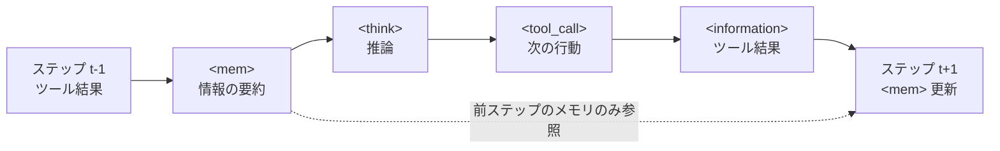

## 論文概要（Abstract）

本記事は [MemPO: Self-Memory Policy Optimization for Long-Horizon Agents](https://arxiv.org/abs/2603.00680) の解説記事です。

MemPOは、LLMエージェントが自分自身のメモリ管理ポリシーを強化学習で最適化する手法です。従来の手法ではメモリ操作に対する明示的な目的関数が設計されておらず、メモリの質が十分に最適化されないという課題がありました。MemPOはメモリレベルの報酬割り当て（credit assignment）を導入することで、「どの情報を保持すべきか」をエージェント自身が学習します。著者らは、5つの長期ホライズンベンチマークにおいて、ベースモデル比でF1スコア+25.98、前SOTA比+7.1の改善と、トークン使用量67.58%〜73.12%の削減を報告しています。

この記事は [Zenn記事: AgentCore Memoryでサポートエージェントのトークンを最大95%圧縮する](https://zenn.dev/0h_n0/articles/4668d5a487ed15) の深掘りです。

## 情報源

- **arXiv ID**: 2603.00680
- **URL**: [https://arxiv.org/abs/2603.00680](https://arxiv.org/abs/2603.00680)
- **著者**: Ruoran Li, Xinghua Zhang, Haiyang Yu, Shitong Duan, Xiang Li, Wenxin Xiang, Chonghua Liao, Xudong Guo, Yongbin Li, Jinli Suo（Tsinghua University, Tongyi Lab / Alibaba Group）
- **発表年**: 2026（Findings of ACL 2026 採択）
- **分野**: cs.AI
- **コード**: [https://github.com/TheNewBeeKing/MemPO](https://github.com/TheNewBeeKing/MemPO)

## 背景と動機（Background & Motivation）

LLMエージェントがWebリサーチや複数ステップのタスクをこなす際、対話履歴がコンテキストウィンドウを圧迫するという問題は広く認識されています。全履歴をそのまま保持する方式では、ステップ数が増えるにつれてトークン消費が線形に増加し、コストと推論速度の両面で問題になります。

この課題に対し、MEM1やA-MEMなど、エージェントにメモリ機構を導入して過去情報を要約・圧縮する手法が提案されてきました。しかし、著者らはMEM1の問題点として「メモリ操作に対する明示的な最適化目的関数が設計されていないこと」を指摘しています（論文Section 1）。MEM1ではメモリの書き込みと推論が同じ報酬で一括最適化されるため、「良いメモリとは何か」をモデルが独立に学習する仕組みがありません。

MemPOのアプローチは、この問題をメモリレベルのcredit assignmentで解決します。メモリ書き込みアクションに対して独立した報酬を計算し、タスク全体の成否とは別に「メモリの質」を直接的に最適化する仕組みを導入しています。

## 主要な貢献（Key Contributions）

- **貢献1**: メモリレベルのcredit assignment機構の提案。メモリアクション `<mem>` に対して、そのメモリ内容が最終回答にどれだけ寄与するかを条件付き確率で定量化する報酬設計
- **貢献2**: GRPO（Group Relative Policy Optimization）をベースとした強化学習フレームワーク。軌跡レベルのアドバンテージとメモリレベルのアドバンテージを組み合わせた二重アドバンテージ構造
- **貢献3**: 5つの長期ホライズンベンチマーク（マルチオブジェクティブタスク、シングルホップQA、マルチホップQA、ディープリサーチ）での包括的な評価。ベースモデル比F1+25.98、トークン67.58%削減（論文Table 1より）

## 技術的詳細（Technical Details）

### エージェントのアクション形式

MemPOのエージェントは、各ステップで以下の構造化されたアクションを生成します。

```
<mem>前ステップまでの有用な情報の要約</mem>
<think>現在のステップでの推論</think>
<tool_call>検索クエリなどのツール呼び出し</tool_call>
```

ツールからの返答は `<information>` タグで受け取り、最終回答は `<answer>` タグで出力します。重要な設計上の選択として、推論時には前ステップのメモリ `<mem>` のみを参照し、それ以前の全履歴は破棄されます。

$$
\pi_\theta(s_t \mid q, s_{t-1}^{mem})
$$

ここで $q$ はクエリ、$s_t$ はステップ $t$ でのエージェントの出力、$s_{t-1}^{mem}$ は前ステップのメモリ内容です。この設計により、コンテキスト長がステップ数に依存せず一定に保たれます。



### 軌跡レベルのアドバンテージ

まず、GRPO方式の軌跡レベル報酬を定義します。同一クエリから $N$ 本のサンプリング軌跡を生成し、それぞれの正誤で報酬を与えます。

$$
R^{T}(\tau_i) = \begin{cases} 1 & \text{回答が正しく、フォーマットが有効} \\ 0 & \text{それ以外} \end{cases}
$$

グループ内での正規化により軌跡レベルのアドバンテージを計算します。

$$
A^{T}(\tau_i) = \frac{R^{T}(\tau_i) - \operatorname{mean}\big(\{R^{T}(\tau_j)\}_{j=1}^{N}\big)}{\operatorname{std}\big(\{R^{T}(\tau_j)\}_{j=1}^{N}\big)}
$$

ここで $N$ はグループサイズ（論文では $N=16$）、$\tau_i$ は $i$ 番目のサンプリング軌跡です。これはGRPOの標準的な定式化であり、Value Networkを使わずにグループ内の相対的な性能でアドバンテージを推定します。

### メモリレベルの報酬設計

MemPOの核心であるメモリレベル報酬は、「メモリ内容が正解にどれだけ寄与するか」を条件付き確率で測定します（論文Eq. 4）。

$$
R^{M}\big(\tau_i(s_t^{mem})\big) = P\big[s^{ans} \mid \tau_i(s_t^{mem})\big] - \epsilon
$$

ここで、
- $\tau_i(s_t^{mem})$: 軌跡 $\tau_i$ のステップ $t$ におけるメモリ内容
- $s^{ans}$: 正解トークン列
- $\epsilon = P\big[s^{ans} \mid \tau_i(s_{<t})\big]$: メモリを除いた場合の正解確率（バイアス項）

確率 $P$ は長さ正規化された幾何平均で計算されます（論文Eq. 5）。

$$
P\big[s^{ans} \mid \tau_i(s_t^{mem})\big] = \sqrt[L]{\prod_{l=1}^{L} \pi_\theta\big(a_l \mid q, \tau_i(s_t^{mem}), a_{<l}\big)}
$$

ここで $L$ は正解トークン列の長さ、$a_l$ は $l$ 番目のトークンです。

この設計の意図は明確です。メモリ内容を条件として与えたときに正解の生成確率が高くなるほど、そのメモリは「良い要約」であるとみなされます。バイアス項 $\epsilon$ を引くことで、メモリの追加的な貢献分のみを評価します。

メモリレベルのアドバンテージも同様にグループ正規化されます（論文Eq. 6-8）。

$$
A^{M}\big(\tau_i(s_t^{mem})\big) = \frac{R^{M}\big(\tau_i(s_t^{mem})\big) - \operatorname{mean}\big(\{R^{M}(\cdot)\}\big)}{\operatorname{std}\big(\{R^{M}(\cdot)\}\big)}
$$

### 二重アドバンテージの統合

最終的なトークンレベルのアドバンテージは、軌跡レベルとメモリレベルの和として定義されます（論文Eq. 9）。

$$
A_{i,k} = \begin{cases} A^{T}(\tau_i) + A^{M}\big(\tau_i(s_t^{mem})\big), & \tau_{i,k} \in \tau_i(s_t^{mem}) \\ A^{T}(\tau_i), & \text{それ以外} \end{cases}
$$

メモリアクション `<mem>` 内のトークンは軌跡レベル＋メモリレベルの両方のアドバンテージを受け、それ以外のトークン（`<think>`, `<tool_call>` など）は軌跡レベルのアドバンテージのみを受けます。この分離により、メモリの質と推論の質が独立に最適化されます。

### 学習目的関数

最終的な目的関数はPPO/GRPOスタイルのクリップ付き目的関数にKLペナルティを加えたものです（論文Eq. 10）。

$$
\mathcal{J}(\theta) = \mathbb{E}\left[\frac{1}{N}\sum_{i=1}^{N}\frac{1}{|\tau_i|}\sum_{k=1}^{|\tau_i|}\min\Big(\gamma_{i,k}A_{i,k},\ \operatorname{clip}(\gamma_{i,k},1-\epsilon,1+\epsilon)A_{i,k}\Big) - \beta\,\mathcal{D}_{\mathrm{KL}}\big(\pi_\theta \,\|\, \pi_{\mathrm{ref}}\big)\right]
$$

ここで $\gamma_{i,k}$ は重要度比（importance ratio）です。

$$
\gamma_{i,k} = \frac{\pi_\theta(\tau_{i,k}\mid q, \tau_{i,<k})}{\pi_{\theta_{\mathrm{old}}}(\tau_{i,k}\mid q, \tau_{i,<k})}
$$

### アルゴリズム全体の流れ

```python
def mempo_training_loop(
    policy: LLM,
    ref_policy: LLM,
    dataset: list[Query],
    group_size: int = 16,
    batch_size: int = 128,
    lr: float = 1e-6,
    max_rounds: int = 16,
) -> LLM:
    """MemPOの学習ループの概要（擬似コード）"""
    for batch in sample_batches(dataset, batch_size):
        trajectories = []
        for query in batch:
            # 1. N本の軌跡をサンプリング
            group = [rollout(policy, query, max_rounds) for _ in range(group_size)]

            # 2. 軌跡レベル報酬の計算
            for traj in group:
                traj.reward_T = 1.0 if is_correct(traj.answer, query.gold) else 0.0

            # 3. 軌跡レベルアドバンテージの正規化
            rewards_T = [t.reward_T for t in group]
            for traj in group:
                traj.advantage_T = (traj.reward_T - mean(rewards_T)) / std(rewards_T)

            # 4. メモリレベル報酬の計算（各ステップの<mem>に対して）
            for traj in group:
                for step in traj.steps:
                    if step.has_mem:
                        p_with_mem = compute_answer_prob(policy, query, step.mem_content)
                        p_without_mem = compute_answer_prob(policy, query, step.context_before)
                        step.reward_M = p_with_mem - p_without_mem

            # 5. メモリレベルアドバンテージの正規化
            mem_rewards = collect_mem_rewards(group)
            for traj in group:
                for step in traj.steps:
                    if step.has_mem:
                        step.advantage_M = (step.reward_M - mean(mem_rewards)) / std(mem_rewards)

            # 6. トークンレベルアドバンテージの統合
            for traj in group:
                for token in traj.tokens:
                    if token.in_mem_segment:
                        token.advantage = traj.advantage_T + token.step.advantage_M
                    else:
                        token.advantage = traj.advantage_T

            trajectories.extend(group)

        # 7. PPO/GRPOスタイルの更新
        update_policy(policy, ref_policy, trajectories, lr)

    return policy
```

## 実装のポイント（Implementation）

### 学習パイプライン

著者らは以下の2段階パイプラインを採用しています（論文Section 5.3）。

**段階1: 行動クローニング（Behavior Cloning）**。GPT-4.1を用いてTangら（2025）のデータセット上で軌跡を生成し、正解軌跡のみ（約10,000件）をフィルタリング。Qwen2.5 7Bモデルを1エポックでファインチューニングし、`<mem>`, `<think>`, `<tool_call>` の構造化出力フォーマットを学習させます。

**段階2: 強化学習**。HotpotQAとNQから合成した2オブジェクティブタスクをRL学習セットとして使用。ローカルWiki検索エンジンをツールとして利用し、グループサイズ16、バッチサイズ128、学習率1e-6で学習を実施します。

### ハマりポイント

- **メモリ報酬の計算コスト**: 各 `<mem>` セグメントについて正解トークン列の条件付き確率を計算する必要があるため、通常のGRPOと比較して計算コストが増加します
- **バイアス項 $\epsilon$ の安定性**: メモリを含まない場合の確率を計算する際、コンテキストが短すぎると確率が不安定になる可能性があります
- **メモリの伝播**: 各ステップで前ステップのメモリのみを参照するため、重要な情報を複数ステップにわたって伝播させるには、エージェントがそれを毎回のメモリ要約に含める必要があります

## Production Deployment Guide

### AWS実装パターン（コスト最適化重視）

MemPOのようなメモリ管理機構をプロダクション環境で実装する際のAWS構成を紹介します。MemPOの「前ステップのメモリのみ参照」というアーキテクチャは、コンテキスト長が一定に保たれるため、サーバーレス環境との相性がよい特徴があります。

| 規模 | 月間リクエスト | 推奨構成 | 月額コスト | 主要サービス |
|------|--------------|---------|-----------|------------|
| **Small** | ~3,000 (100/日) | Serverless | $50-150 | Lambda + Bedrock + DynamoDB |
| **Medium** | ~30,000 (1,000/日) | Hybrid | $300-800 | Lambda + ECS Fargate + ElastiCache |
| **Large** | 300,000+ (10,000/日) | Container | $2,000-5,000 | EKS + Karpenter + EC2 Spot |

**Small構成の詳細**（月額$50-150）:
- **Lambda**: 1GB RAM, 60秒タイムアウト。メモリ管理ロジック含む推論パイプライン ($20/月)
- **Bedrock**: Claude 3.5 Haiku。Prompt Caching有効化で反復的なシステムプロンプトを削減 ($80/月)
- **DynamoDB**: On-Demand。メモリ状態の保存（セッション間でメモリ永続化） ($10/月)
- **CloudWatch**: 基本監視 ($5/月)

**Medium構成の詳細**（月額$300-800）:
- **ECS Fargate**: 0.5 vCPU, 1GB RAM × 2タスク。メモリ管理ロジックを常駐 ($120/月)
- **Bedrock**: Claude 3.5 Sonnet。Batch API活用で非リアルタイム処理を50%割引 ($400/月)
- **ElastiCache Redis**: cache.t3.micro。メモリ状態のキャッシュ ($15/月)

**Large構成の詳細**（月額$2,000-5,000）:
- **EKS**: コントロールプレーン ($72/月)
- **EC2 Spot Instances**: g5.xlarge × 2-4台（平均$800/月、最大90%削減）
- **Karpenter**: アイドル30秒でスケールダウン

**コスト試算の注意事項**: 上記は2026年10月時点のAWS ap-northeast-1（東京）リージョン料金に基づく概算値です。実際のコストはトラフィックパターンにより変動します。最新料金は [AWS料金計算ツール](https://calculator.aws/) で確認してください。

### Terraformインフラコード

**Small構成 (Serverless): Lambda + Bedrock + DynamoDB**

```hcl
module "vpc" {
  source  = "terraform-aws-modules/vpc/aws"
  version = "~> 5.0"

  name = "mempo-agent-vpc"
  cidr = "10.0.0.0/16"
  azs  = ["ap-northeast-1a", "ap-northeast-1c"]
  private_subnets = ["10.0.1.0/24", "10.0.2.0/24"]

  enable_nat_gateway   = false
  enable_dns_hostnames = true
}

resource "aws_iam_role" "lambda_mempo" {
  name = "lambda-mempo-role"

  assume_role_policy = jsonencode({
    Version = "2012-10-17"
    Statement = [{
      Action = "sts:AssumeRole"
      Effect = "Allow"
      Principal = { Service = "lambda.amazonaws.com" }
    }]
  })
}

resource "aws_iam_role_policy" "bedrock_invoke" {
  role = aws_iam_role.lambda_mempo.id

  policy = jsonencode({
    Version = "2012-10-17"
    Statement = [{
      Effect   = "Allow"
      Action   = ["bedrock:InvokeModel", "bedrock:InvokeModelWithResponseStream"]
      Resource = "arn:aws:bedrock:ap-northeast-1::foundation-model/anthropic.claude-3-5-haiku*"
    }]
  })
}

resource "aws_lambda_function" "mempo_handler" {
  filename      = "lambda.zip"
  function_name = "mempo-agent-handler"
  role          = aws_iam_role.lambda_mempo.arn
  handler       = "index.handler"
  runtime       = "python3.12"
  timeout       = 60
  memory_size   = 1024

  environment {
    variables = {
      BEDROCK_MODEL_ID    = "anthropic.claude-3-5-haiku-20241022-v1:0"
      DYNAMODB_TABLE      = aws_dynamodb_table.memory_store.name
      ENABLE_PROMPT_CACHE = "true"
    }
  }
}

resource "aws_dynamodb_table" "memory_store" {
  name         = "mempo-memory-state"
  billing_mode = "PAY_PER_REQUEST"
  hash_key     = "session_id"
  range_key    = "step_id"

  attribute {
    name = "session_id"
    type = "S"
  }

  attribute {
    name = "step_id"
    type = "N"
  }

  ttl {
    attribute_name = "expire_at"
    enabled        = true
  }
}

resource "aws_cloudwatch_metric_alarm" "lambda_cost" {
  alarm_name          = "mempo-lambda-cost-spike"
  comparison_operator = "GreaterThanThreshold"
  evaluation_periods  = 1
  metric_name         = "Duration"
  namespace           = "AWS/Lambda"
  period              = 3600
  statistic           = "Sum"
  threshold           = 100000
  alarm_description   = "Lambda実行時間異常（コスト急増の可能性）"

  dimensions = {
    FunctionName = aws_lambda_function.mempo_handler.function_name
  }
}
```

**Large構成 (Container): EKS + Karpenter + Spot Instances**

```hcl
module "eks" {
  source  = "terraform-aws-modules/eks/aws"
  version = "~> 20.0"

  cluster_name    = "mempo-inference-cluster"
  cluster_version = "1.31"

  vpc_id     = module.vpc.vpc_id
  subnet_ids = module.vpc.private_subnets

  cluster_endpoint_public_access = true
  enable_cluster_creator_admin_permissions = true
}

resource "kubectl_manifest" "karpenter_provisioner" {
  yaml_body = <<-YAML
    apiVersion: karpenter.sh/v1alpha5
    kind: Provisioner
    metadata:
      name: spot-provisioner
    spec:
      requirements:
        - key: karpenter.sh/capacity-type
          operator: In
          values: ["spot"]
        - key: node.kubernetes.io/instance-type
          operator: In
          values: ["g5.xlarge", "g5.2xlarge"]
      limits:
        resources:
          cpu: "32"
          memory: "128Gi"
      providerRef:
        name: default
      ttlSecondsAfterEmpty: 30
  YAML
}

resource "aws_budgets_budget" "mempo_monthly" {
  name         = "mempo-monthly-budget"
  budget_type  = "COST"
  limit_amount = "5000"
  limit_unit   = "USD"
  time_unit    = "MONTHLY"

  notification {
    comparison_operator        = "GREATER_THAN"
    threshold                  = 80
    threshold_type             = "PERCENTAGE"
    notification_type          = "ACTUAL"
    subscriber_email_addresses = ["ops@example.com"]
  }
}
```

### セキュリティベストプラクティス

1. **ネットワーク**: EKSでは `cluster_endpoint_public_access = false` を推奨（VPN経由アクセス）
2. **認証・認可**: IAM最小権限、IRSA（IAM Roles for Service Accounts）使用
3. **シークレット**: AWS Secrets Manager使用、環境変数ハードコード禁止
4. **データ保護**: 転送中TLS 1.2以上、保管中KMS暗号化
5. **監査**: CloudTrail全リージョン有効化

### 運用・監視設定

**CloudWatch Logs Insights クエリ**:

```sql
-- メモリ管理ステップあたりのトークン使用量
fields @timestamp, session_id, step_id, mem_tokens, total_tokens
| stats avg(mem_tokens) as avg_mem, avg(total_tokens) as avg_total by bin(1h)
| filter avg_total > 5000

-- レイテンシ分析
fields @timestamp, duration_ms
| stats pct(duration_ms, 95) as p95, pct(duration_ms, 99) as p99 by bin(5m)
```

**CloudWatch アラーム（Python）**:

```python
import boto3

cloudwatch = boto3.client('cloudwatch')

cloudwatch.put_metric_alarm(
    AlarmName='mempo-token-spike',
    ComparisonOperator='GreaterThanThreshold',
    EvaluationPeriods=1,
    MetricName='TokenUsage',
    Namespace='Custom/MemPO',
    Period=3600,
    Statistic='Sum',
    Threshold=500000,
    ActionsEnabled=True,
    AlarmActions=['arn:aws:sns:ap-northeast-1:123456789:cost-alerts'],
    AlarmDescription='メモリ管理パイプラインのトークン使用量異常'
)
```

**X-Ray トレーシング**:

```python
from aws_xray_sdk.core import xray_recorder, patch_all

patch_all()

@xray_recorder.capture('mempo_inference_step')
def run_agent_step(
    session_id: str,
    query: str,
    prev_memory: str,
) -> dict:
    """1ステップのエージェント推論を実行する。"""
    xray_recorder.put_annotation('session_id', session_id)
    xray_recorder.put_metadata('prev_memory_length', len(prev_memory))

    response = bedrock.invoke_model(
        modelId='anthropic.claude-3-5-haiku-20241022-v1:0',
        body=json.dumps({
            'prompt': build_prompt(query, prev_memory),
            'max_tokens': 2048,
        })
    )

    xray_recorder.put_metadata('output_tokens', response['usage']['output_tokens'])
    return response
```

### コスト最適化チェックリスト

**アーキテクチャ選択**:
- [ ] ~100 req/日 → Lambda + Bedrock (Serverless) — $50-150/月
- [ ] ~1000 req/日 → ECS Fargate + Bedrock (Hybrid) — $300-800/月
- [ ] 10000+ req/日 → EKS + Spot Instances (Container) — $2,000-5,000/月

**リソース最適化**:
- [ ] EC2: Spot Instances優先（最大90%削減、Karpenter自動管理）
- [ ] Reserved Instances: 1年コミットで72%削減（予測可能な負荷）
- [ ] Savings Plans: Compute Savings Plans検討
- [ ] Lambda: メモリサイズ最適化（CloudWatch Insights分析）
- [ ] ECS/EKS: アイドルタイムのスケールダウン（夜間0台）

**LLMコスト削減**:
- [ ] Bedrock Batch API: 50%割引（非リアルタイム処理）
- [ ] Prompt Caching: 30-90%削減（システムプロンプト固定）
- [ ] モデル選択: 簡易タスクはHaiku ($0.25/MTok)、複雑タスクはSonnet ($3/MTok)
- [ ] トークン数制限: max_tokens設定で過剰生成防止

**監視・アラート**:
- [ ] AWS Budgets: 月額予算設定（80%で警告、100%でアラート）
- [ ] CloudWatch: トークン使用量スパイク検知
- [ ] Cost Anomaly Detection: 自動異常検知
- [ ] 日次コストレポート: SNS/Slackへ自動送信

**リソース管理**:
- [ ] 未使用リソース削除: Lambda Insights, Trusted Advisor活用
- [ ] タグ戦略: 環境別（dev/staging/prod）でコスト可視化
- [ ] ライフサイクルポリシー: DynamoDBのTTL設定でメモリ自動削除
- [ ] 開発環境: 夜間停止設定

## 実験結果（Results）

### マルチオブジェクティブタスクの結果

著者らは、ローカルWiki検索環境とオンラインWeb検索環境の2つの設定で評価を行っています。マルチオブジェクティブタスクでは、複数の質問を同時に解決する必要があり、オブジェクティブ数が2, 4, 6, 8, 10と増加するにつれてタスクの難易度が上がります。

**論文Table 1（ローカルWiki検索、平均値）**:

| モデル | F1 | EM | TT (×10³) | PT (×10³) |
|---|---|---|---|---|
| Qwen2.5 (ReAct) | 11.65 | 8.56 | 3.64 | 0.61 |
| ReSearch | 21.65 | 15.98 | 3.29 | 0.71 |
| DeepResearcher | 16.71 | 12.78 | 4.29 | 0.77 |
| A-MEM | 13.83 | 10.21 | 2.62 | 0.38 |
| MEM1 | 26.34 | 19.40 | 1.38 | 0.20 |
| GRPO (w/o mem) | 30.53 | 23.13 | 4.39 | 0.81 |
| **MemPO** | **37.63** | **29.37** | **1.18** | **0.18** |

ここでTTは1質問あたりの総トークン数（×10³）、PTは1ステップあたりのピークトークン数（×10³）です。

論文Table 1より、MemPOのF1スコアはベースモデル（Qwen2.5 ReAct）比で $37.63 - 11.65 = 25.98$ ポイント、GRPO比で $37.63 - 30.53 = 7.10$ ポイント向上しています。トークン使用量はベースモデル比で $1 - 1.18/3.64 \approx 67.58\%$ 削減、GRPO比で $1 - 1.18/4.39 \approx 73.12\%$ 削減されています。

**オンラインWeb検索環境**（論文Table 1）でも同様の傾向が報告されており、MemPOはF1 38.79、TT 0.86（×10³）を達成し、MEM1（F1 28.04、TT 0.96）を上回っています。

### 分析ポイント

著者らの結果から読み取れる重要な傾向は以下の通りです。

**メモリ機構の効果**: メモリを使用するモデル（MEM1, A-MEM, MemPO）はいずれもトークン使用量が大幅に少ないが、A-MEMはF1でもベースモデルを上回れていません。MEM1はF1・トークンの両方で改善していますが、MemPOはさらにその上を行っています。

**GRPO w/o memとの比較**: GRPOベースの学習だけでもベースモデル比でF1が大幅に向上する（+18.88）一方、トークン使用量は増加しています（3.64→4.39）。MemPOはメモリ機構の追加によりF1をさらに向上させつつ、トークンを73%削減しています。

## 実運用への応用（Practical Applications）

### AgentCore Memoryとの比較

Zenn記事で解説されているAWS AgentCore Memoryは、「サービス側のLLMが会話から保持すべき情報を判断して抽出」する仕組みを採用しています。一方、MemPOは「エージェント自身がRLでメモリ管理ポリシーを学習」するアプローチです。

| 観点 | AgentCore Memory | MemPO |
|------|-----------------|-------|
| メモリ管理の主体 | サービス側LLM（非同期抽出） | エージェント自身（推論時に`<mem>`生成） |
| 最適化手法 | 組み込み戦略（Semantic/Summary/UserPref） | 強化学習（GRPO + メモリ報酬） |
| レイテンシ | 抽出に20-40秒（非同期） | 推論時にインライン生成（追加レイテンシなし） |
| カスタマイズ性 | 戦略の選択とnamespace設計 | 報酬設計とRL学習で完全にカスタマイズ可能 |
| 導入コスト | マネージドサービス（低い） | RL学習パイプラインの構築が必要（高い） |

サポートエージェントのように多数のユーザーを扱う商用サービスでは、AgentCore Memoryのマネージドアプローチが実用的です。一方、リサーチエージェントのように長期ホライズンで複雑な推論が必要なユースケースでは、MemPOのようなRL最適化されたメモリ管理が性能面で優位になる可能性があります。

### スケーリングの考慮事項

MemPOの「前ステップのメモリのみ参照」という設計は、コンテキスト長が一定に保たれるため、スケーリングの観点から有利です。ただし、RL学習のコストは無視できません。論文ではQwen2.5 7Bモデルを使用しており、より大規模なモデルへの適用にはGPU時間の大幅な増加が見込まれます。

## 関連研究（Related Work）

- **MEM1**: MemPOの直接的な先行研究。RLでエージェントにメモリ書き込みを学習させるが、メモリ操作に対する明示的な最適化目的がない点をMemPOは改善
- **A-MEM**: RAGベースのメモリ管理。外部ストレージに情報を保存し検索するアプローチだが、F1スコアではベースモデルと同等にとどまっている（論文Table 1より）
- **MemGPT (Packer et al., 2023)**: OS型のメモリ階層をLLMに導入した先駆的研究。コンテキストウィンドウをRAM、外部ストレージをディスクに見立てたページング方式

## まとめと今後の展望

MemPOは、メモリレベルのcredit assignmentという明快なアイデアで、長期ホライズンエージェントのメモリ管理を改善した研究です。著者らが報告する成果は、F1スコアの改善とトークン使用量の削減を両立している点で注目に値します。

実務への示唆として、MemPOのアプローチはAgentCore Memoryなどのマネージドサービスとは相補的な位置づけです。マネージドサービスが提供する汎用的なメモリ戦略に対し、MemPOは特定タスクに最適化されたメモリ管理を実現する手段を提供します。今後、マネージドメモリサービスにRL最適化の仕組みが統合される可能性もあり、両アプローチの融合が期待されます。

## 参考文献

- **arXiv**: [https://arxiv.org/abs/2603.00680](https://arxiv.org/abs/2603.00680)
- **Code**: [https://github.com/TheNewBeeKing/MemPO](https://github.com/TheNewBeeKing/MemPO)
- **ACL 2026 Findings**: [https://preview.aclanthology.org/ingest-acl/2026.findings-acl.1166/](https://preview.aclanthology.org/ingest-acl/2026.findings-acl.1166/)
- **Related Zenn article**: [https://zenn.dev/0h_n0/articles/4668d5a487ed15](https://zenn.dev/0h_n0/articles/4668d5a487ed15)

---

:::message
この記事はAI（Claude Code）により自動生成されました。内容の正確性については原論文と照合していますが、最新の情報は公式リポジトリおよびarXivをご確認ください。
:::
