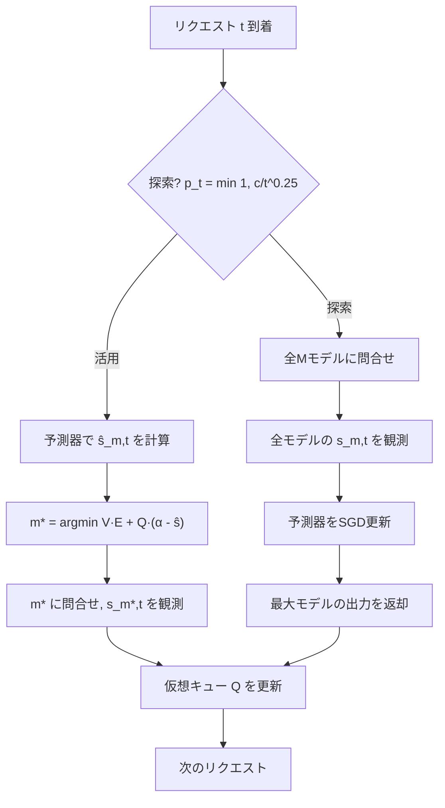

本記事は [MESS+ (arXiv:2505.19947)](https://arxiv.org/abs/2505.19947) の解説記事です。

## 論文概要（Abstract）

MESS+は、複数のLLM（モデルズー）からリクエストごとに最適なモデルを選択する確率的最適化アルゴリズムである。著者らは、SLA（Service Level Agreement）で定められた最低品質を保証しつつ、運用コストを最小化する問題を定式化し、Lyapunov drift-plus-penalty法とオンライン学習を組み合わせた解法を提案している。著者らの報告によると、既存のルーティング手法と比較して平均約2倍のコスト効率改善を達成している（論文Table 2より）。

この記事は [Zenn記事: Semantic Kernel×Azure AI FoundryでAIエージェントを本番デプロイする](https://zenn.dev/0h_n0/articles/fd126bdee7c768) の深掘りです。Zenn記事で取り上げたFoundryモデルカタログによるマルチLLM構成の背景にある「どのモデルにリクエストを振り分けるか」という問題に対して、理論的な最適化手法を提供する研究です。

## 情報源

- **会議名**: NeurIPS 2025（Neural Information Processing Systems）
- **arXiv ID**: 2505.19947 [cs.LG]
- **URL**: [https://arxiv.org/abs/2505.19947](https://arxiv.org/abs/2505.19947)
- **著者**: Herbert Woisetschläger（Technical University of Munich）, Ryan Zhang（Horace Greeley High School）, Shiqiang Wang（IBM Research）, Hans-Arno Jacobsen（University of Toronto）
- **投稿日**: 2025年5月26日（v3: 2025年10月23日）
- **コード**: [https://github.com/laminair/mess-plus](https://github.com/laminair/mess-plus)
- **ライセンス**: CC BY-NC-ND 4.0

## カンファレンス情報

**NeurIPS（Neural Information Processing Systems）** は、機械学習・人工知能分野の最上位会議の一つであり、毎年数千件の投稿から厳選された論文が採択される。2025年のNeurIPSでは、LLMの運用効率化やマルチモデル活用に関する研究が増加しており、本論文はその流れに位置する。

## 背景と動機（Background & Motivation）

オープンウェイトLLMの選択肢が急速に増えている。Llama、Qwen、Mistralなどのモデルファミリーにはそれぞれ複数のサイズのバリアントが存在し、ユーザーは「モデルズー」から適切なモデルを選ぶ必要がある。

この選択には本質的なトレードオフが存在する。大規模モデルほど正答率は高いが、推論コスト（計算資源、エネルギー消費）も大きい。一方で、SLAとして「全リクエストの80%以上を正しく処理する」といった品質保証が求められる場合、常に最大のモデルを使うのはコスト効率が悪い。

著者らは、既存のLLMルーティング手法には以下の課題があると指摘している：

1. **RouteLLM等のルーター**: 品質とコストのPareto最適点を見つけるが、SLAの明示的な保証がない
2. **RouterDC**: 対照学習ベースのマルチモデルルーターだが、オフラインの訓練データ（ルーティング嗜好データセット）が必要
3. **教育的推測（Educated Guessing）**: 事前の統計情報に基づくランダムルーティングだが、分布シフトに弱い

MESS+はこれらの課題に対し、オンライン学習によって訓練データ不要で動作し、かつSLA遵守の理論的保証を持つ手法を提供する。

## 技術的詳細（Technical Details）

### 問題定式化

$M$個のモデルが利用可能な環境で、時刻$t$にリクエストが到着する。各モデル$m$について以下を定義する：

- $s_{m,t} \in \{0, 1\}$: モデル$m$がリクエスト$t$を満足するか（ルーティング前は未知）
- $E_{m,t}$: モデル$m$でリクエスト$t$を処理するコスト（プロンプトトークン数等から事前推定可能）
- $y_{m,t} \in \{0, 1\}$: ルーティング決定変数（1つのモデルのみ選択）

最適化問題は以下の通りである（論文Eq. 1）：

$$
\min_{y} \frac{1}{T} \sum_{t=1}^{T} \sum_{m=1}^{M} \mathbb{E}[y_{m,t} \cdot E_{m,t}]
$$

$$
\text{s.t.} \quad \frac{1}{T} \sum_{t=1}^{T} \sum_{m=1}^{M} \mathbb{E}[y_{m,t} \cdot s_{m,t}] \geq \alpha
$$

$$
\sum_{m=1}^{M} y_{m,t} = 1, \quad y_{m,t} \in \{0, 1\} \quad \forall t
$$

ここで、
- $T$: 総リクエスト数
- $\alpha$: SLAターゲット（例: 0.80なら80%の満足率を保証）
- 目的関数（1行目）: 平均運用コストの最小化
- 制約（2行目）: 時間平均の満足率が$\alpha$以上

### Lyapunov Drift-Plus-Penalty法

著者らはLyapunov最適化の枠組みを用いてこの制約付きオンライン最適化を解いている。仮想キュー$Q_t$を導入し、SLA制約の違反度を追跡する：

$$
Q_{t+1} = \max\left\{0, \; Q_t + \alpha - \sum_{m=1}^{M} y_{m,t} \cdot s_{m,t}\right\}
$$

$Q_t$が大きいほど過去にSLA違反が蓄積していることを意味し、品質重視のルーティングを促す。逆に$Q_t$が小さいときはコスト重視で安価なモデルを選べる。

各リクエスト$t$でのルーティング決定は以下のサブ問題を解く（論文Eq. 3）：

$$
m^* = \arg\min_{m} \left[ V \cdot E_{m,t} + Q_t \cdot (\alpha - \hat{s}_{m,t}) \right]
$$

ここで、
- $V > 0$: コストと制約遵守の速度のトレードオフパラメータ
- $\hat{s}_{m,t}$: モデル$m$がリクエスト$t$を満足する予測確率
- $V$が大きいほどコスト重視、小さいほどSLA遵守重視

### 満足度予測器のオンライン学習

予測器$\hat{s}(z, a)$はパラメータ$z$を持ち、リクエストの特徴量$a_t$から各モデルの満足確率を予測する。訓練には正則化付き交差エントロピー損失を用いる（論文Eq. 4）：

$$
F(z) = -\mathbb{E}_{a}\left[\frac{1}{M}\sum_{m=1}^{M}\left(s_{m,t}\log\hat{s}(z,a)_m + (1-s_{m,t})\log(1-\hat{s}(z,a)_m)\right)\right] + \frac{\mu}{2}\|z\|^2
$$

ここで$\mu \geq 0$は正則化の強さを制御する。

### 探索と活用の制御

MESS+は探索確率$p_t = \min(1, c / t^{1/4})$でバランスを取る。探索時には全$M$モデルに問い合わせて各モデルの満足/不満足を観測し、予測器のSGD更新を行う。活用時には予測器の出力$\hat{s}_{m,t}$を用いてルーティングを決定する。



### アルゴリズム全体（Algorithm 1）

```python
from dataclasses import dataclass
import math
import random

@dataclass
class RoutingDecision:
    """ルーティング結果"""
    model_index: int
    cost: float
    satisfied: bool

def mess_plus_route(
    models: list[str],
    costs: list[float],
    predicted_satisfaction: list[float],
    queue: float,
    v_param: float,
    alpha: float,
    t: int,
    c: float = 0.1,
) -> tuple[int, bool]:
    """MESS+のルーティング決定

    Args:
        models: 利用可能なモデルのリスト
        costs: 各モデルのリクエスト処理コスト
        predicted_satisfaction: 各モデルの予測満足確率
        queue: 現在の仮想キュー値
        v_param: コスト-品質トレードオフパラメータ
        alpha: SLAターゲット
        t: 現在のリクエスト番号
        c: 探索パラメータ

    Returns:
        (選択モデルインデックス, 探索フラグ)
    """
    m = len(models)
    p_t = min(1.0, c / (t ** 0.25))
    is_explore = random.random() < p_t or t == 1

    if is_explore:
        return m - 1, True  # 最大モデルを使用

    # 活用: Lyapunov drift-plus-penalty
    best_model = 0
    best_score = float("inf")
    for i in range(m):
        score = v_param * costs[i] + queue * (alpha - predicted_satisfaction[i])
        if score < best_score:
            best_score = score
            best_model = i
    return best_model, False
```

### 理論的保証

著者らは以下の2つの定理を証明している。

**定理1（制約遵守）**: 任意の$t \geq 1$に対して、仮想キューの期待値は以下を満たす：

$$
\mathbb{E}[Q_t] \leq \max\left\{\alpha\psi, \; \frac{V\Delta_E}{\beta}\right\} + \sqrt{t}
$$

ここで$\psi$は予測器が十分な精度に達するまでのリクエスト数、$\Delta_E = E_{\max} - E_{\min}$はコストの幅、$\beta$は予測精度の閾値である。

**系1**: 時間平均のSLA違反は以下のオーダーで消失する：

$$
\alpha - \frac{1}{T}\sum_{t=1}^{T}\sum_{m=1}^{M}\mathbb{E}[y_{m,t}s_{m,t}] \leq O\left(\frac{V}{T} + \frac{1}{\sqrt{T}}\right)
$$

すなわち$T \to \infty$でSLAは漸近的に満たされる。

**定理2（コスト最適性）**: 適切な学習率スケジュールの下で、時間平均コストは以下を満たす（論文Eq. 7）：

$$
\mathbb{E}\left[\frac{1}{T}\sum_{t=1}^{T}\sum_{m=1}^{M}y_{m,t}E_{m,t}\right] \leq E^{\text{OPT}} + O\left(\frac{M}{T^{1/4}} + \frac{1}{V} + M \cdot F_{\min}\right)
$$

$E^{\text{OPT}}$は完全な統計的知識を持つ理想的な静的方策の最適コスト、$F_{\min}$は予測器損失の最小値である。$V = \sqrt{T}$と設定すれば、$T \to \infty$で両保証が成り立つ。

## 実装のポイント

### 予測器のアーキテクチャ

著者らはModernBERTバックボーンのTransformer重みを凍結し、マルチラベル分類ヘッドのみをオンラインSGDで訓練している。これにより予測器の訓練コストを抑えつつ、リクエストの意味的特徴を活用している。

### コスト推定

リクエスト到着時のコスト$E_{m,t}$はプロンプトトークン数から事前推定する。著者らは事前プロファイリングによりトークン数とエネルギーコストの対応を取得することを推奨している。

### ハイパーパラメータの選択

- **$V$パラメータ**: 論文ではデフォルト$V = 0.0001$を使用。$V$が大きいほどコスト削減を優先するが、SLA収束が遅くなる（論文Figure 2）
- **探索パラメータ$c$**: デフォルト$c = 0.1$。$c$が小さくても予測器は十分な精度に達すると報告されている（論文Figure 3）
- **$\alpha$の設定**: 有限期間$T_0$でのSLA保証が必要な場合、$\alpha$を目標値より若干高く設定することを著者らは推奨している

### フィードバックの取得

MESS+は各リクエストの処理後に満足/不満足のバイナリフィードバックを必要とする。著者らは20%のスパースフィードバックでも性能が維持されると報告している（論文Table 4）が、キュー更新と探索戦略の修正が必要と注記している。

## Production Deployment Guide

### AWS実装パターン（コスト最適化重視）

MESS+のLLMルーティングをAWS上で実現する場合の構成を示す。

**トラフィック量別の推奨構成**:

| 規模 | 月間リクエスト | 推奨構成 | 月額コスト | 主要サービス |
|------|--------------|---------|-----------|------------|
| **Small** | ~3,000 (100/日) | Serverless | $50-150 | Lambda + Bedrock + DynamoDB |
| **Medium** | ~30,000 (1,000/日) | Hybrid | $300-800 | Lambda + ECS Fargate + ElastiCache |
| **Large** | 300,000+ (10,000/日) | Container | $2,000-5,000 | EKS + Karpenter + EC2 Spot |

**Small構成の詳細** (月額$50-150):
- **Lambda**: ルーティングロジック実行、1GB RAM, 30秒タイムアウト ($20/月)
- **Bedrock**: 複数モデルエンドポイント（Claude 3.5 Haiku + Sonnet） ($80/月)
- **DynamoDB**: 仮想キュー状態・予測器パラメータ永続化、On-Demand ($10/月)
- **CloudWatch**: メトリクス監視 ($5/月)

**Medium構成の詳細** (月額$300-800):
- **Lambda**: ルーティング判定 ($50/月)
- **ECS Fargate**: 予測器推論サーバー、0.5 vCPU × 2タスク ($120/月)
- **Bedrock**: マルチモデル、Batch API活用 ($400/月)
- **ElastiCache Redis**: キュー状態・予測キャッシュ ($15/月)

**Large構成の詳細** (月額$2,000-5,000):
- **EKS**: コントロールプレーン ($72/月)
- **EC2 Spot**: g5.xlarge × 2-4台、セルフホストモデル (平均$800/月)
- **Karpenter**: 自動スケーリング（追加コストなし）
- **Bedrock Batch**: 50%割引活用 ($2,000/月)

**コスト削減テクニック**:
- Spot Instances使用で最大90%削減（EKS + Karpenter）
- Bedrock Batch API使用で50%削減（非リアルタイム処理）
- Prompt Caching有効化で30-90%削減
- MESS+自体がルーティングによるコスト最適化を提供（論文では約2倍のコスト効率）

**コスト試算の注意事項**:
- 上記は2026年11月時点のAWS ap-northeast-1（東京）リージョン料金に基づく概算値です
- 実際のコストはトラフィックパターン、リージョン、バースト使用量により変動します
- 最新料金は [AWS料金計算ツール](https://calculator.aws/) で確認してください

### Terraformインフラコード

**Small構成 (Serverless): Lambda + Bedrock + DynamoDB**

```hcl
module "vpc" {
  source  = "terraform-aws-modules/vpc/aws"
  version = "~> 5.0"

  name = "llm-router-vpc"
  cidr = "10.0.0.0/16"
  azs  = ["ap-northeast-1a", "ap-northeast-1c"]
  private_subnets = ["10.0.1.0/24", "10.0.2.0/24"]

  enable_nat_gateway   = false
  enable_dns_hostnames = true
}

resource "aws_iam_role" "lambda_router" {
  name = "lambda-mess-plus-router"

  assume_role_policy = jsonencode({
    Version = "2012-10-17"
    Statement = [{
      Action = "sts:AssumeRole"
      Effect = "Allow"
      Principal = { Service = "lambda.amazonaws.com" }
    }]
  })
}

resource "aws_iam_role_policy" "bedrock_invoke" {
  role = aws_iam_role.lambda_router.id
  policy = jsonencode({
    Version = "2012-10-17"
    Statement = [{
      Effect   = "Allow"
      Action   = ["bedrock:InvokeModel", "bedrock:InvokeModelWithResponseStream"]
      Resource = "arn:aws:bedrock:ap-northeast-1::foundation-model/*"
    }]
  })
}

resource "aws_lambda_function" "mess_plus_router" {
  filename      = "router.zip"
  function_name = "mess-plus-llm-router"
  role          = aws_iam_role.lambda_router.arn
  handler       = "index.handler"
  runtime       = "python3.12"
  timeout       = 60
  memory_size   = 1024

  environment {
    variables = {
      DYNAMODB_TABLE = aws_dynamodb_table.router_state.name
      V_PARAM        = "0.0001"
      ALPHA          = "0.80"
      C_PARAM        = "0.1"
    }
  }
}

resource "aws_dynamodb_table" "router_state" {
  name         = "mess-plus-router-state"
  billing_mode = "PAY_PER_REQUEST"
  hash_key     = "state_key"

  attribute {
    name = "state_key"
    type = "S"
  }

  ttl {
    attribute_name = "expire_at"
    enabled        = true
  }
}

resource "aws_cloudwatch_metric_alarm" "sla_violation" {
  alarm_name          = "mess-plus-sla-violation"
  comparison_operator = "LessThanThreshold"
  evaluation_periods  = 3
  metric_name         = "SatisfactionRate"
  namespace           = "MESSPlus/Router"
  period              = 300
  statistic           = "Average"
  threshold           = 0.75
  alarm_description   = "SLA満足率が75%を下回った"
}
```

**Large構成 (Container): EKS + Karpenter + Spot Instances**

```hcl
module "eks" {
  source  = "terraform-aws-modules/eks/aws"
  version = "~> 20.0"

  cluster_name    = "llm-router-cluster"
  cluster_version = "1.31"
  vpc_id          = module.vpc.vpc_id
  subnet_ids      = module.vpc.private_subnets

  cluster_endpoint_public_access = true
  enable_cluster_creator_admin_permissions = true
}

resource "kubectl_manifest" "karpenter_provisioner" {
  yaml_body = <<-YAML
    apiVersion: karpenter.sh/v1alpha5
    kind: Provisioner
    metadata:
      name: spot-router
    spec:
      requirements:
        - key: karpenter.sh/capacity-type
          operator: In
          values: ["spot"]
        - key: node.kubernetes.io/instance-type
          operator: In
          values: ["g5.xlarge", "g5.2xlarge"]
      limits:
        resources:
          cpu: "32"
          memory: "128Gi"
      providerRef:
        name: default
      ttlSecondsAfterEmpty: 30
  YAML
}

resource "aws_budgets_budget" "router_monthly" {
  name         = "llm-router-monthly-budget"
  budget_type  = "COST"
  limit_amount = "5000"
  limit_unit   = "USD"
  time_unit    = "MONTHLY"

  notification {
    comparison_operator        = "GREATER_THAN"
    threshold                  = 80
    threshold_type             = "PERCENTAGE"
    notification_type          = "ACTUAL"
    subscriber_email_addresses = ["ops@example.com"]
  }
}
```

### セキュリティベストプラクティス

1. **ネットワーク**: EKS `cluster_endpoint_public_access = false` を本番で設定、Lambda VPC内配置
2. **認証・認可**: IAMロール最小権限、MFA必須、IRSA使用
3. **シークレット管理**: Secrets Manager使用、環境変数ハードコード禁止
4. **データ保護**: TLS 1.2以上必須、KMS暗号化（S3/DynamoDB/EBS）
5. **監査**: CloudTrail全リージョン有効化、GuardDuty有効化

### 運用・監視設定

**CloudWatch Logs Insights クエリ**:

```sql
-- SLA満足率のリアルタイム監視
fields @timestamp, model_id, satisfied, cost_mj
| stats avg(satisfied) as satisfaction_rate, sum(cost_mj) as total_cost by bin(1h)
| filter satisfaction_rate < 0.80

-- モデル別ルーティング分布
fields @timestamp, model_id
| stats count(*) as route_count by model_id, bin(1h)
```

**CloudWatch アラーム（コスト重視）**:

```python
import boto3

cloudwatch = boto3.client("cloudwatch")

cloudwatch.put_metric_alarm(
    AlarmName="mess-plus-cost-spike",
    ComparisonOperator="GreaterThanThreshold",
    EvaluationPeriods=1,
    MetricName="RoutingCost",
    Namespace="MESSPlus/Router",
    Period=3600,
    Statistic="Sum",
    Threshold=500000,
    ActionsEnabled=True,
    AlarmActions=["arn:aws:sns:ap-northeast-1:123456789:cost-alerts"],
    AlarmDescription="ルーティングコスト異常（1時間あたり）",
)
```

**X-Ray トレーシング設定**:

```python
from aws_xray_sdk.core import xray_recorder, patch_all

patch_all()

@xray_recorder.capture("mess_plus_routing")
def route_request(prompt: str, models: list[str]) -> dict:
    xray_recorder.put_annotation("alpha", 0.80)
    xray_recorder.put_annotation("v_param", 0.0001)
    xray_recorder.put_metadata("prompt_length", len(prompt))

    decision = mess_plus_route(...)
    xray_recorder.put_annotation("selected_model", models[decision])
    return decision
```

### コスト最適化チェックリスト

**アーキテクチャ選択**:
- [ ] ~100 req/日 → Lambda + Bedrock (Serverless) - $50-150/月
- [ ] ~1000 req/日 → ECS Fargate + Bedrock (Hybrid) - $300-800/月
- [ ] 10000+ req/日 → EKS + Spot Instances (Container) - $2,000-5,000/月

**リソース最適化**:
- [ ] EC2: Spot Instances優先（最大90%削減、Karpenter自動管理）
- [ ] Reserved Instances: 1年コミットで72%削減
- [ ] Savings Plans: Compute Savings Plans検討
- [ ] Lambda: メモリサイズ最適化（CloudWatch Insights分析）
- [ ] ECS/EKS: アイドルタイムのスケールダウン（夜間0台）

**LLMコスト削減（MESS+活用）**:
- [ ] MESS+ルーティング導入: 論文報告では約2倍のコスト効率改善
- [ ] Bedrock Batch API: 50%割引（非リアルタイム処理）
- [ ] Prompt Caching: 30-90%削減
- [ ] $V$パラメータチューニング: SLA遵守と低コストのバランス調整
- [ ] トークン数制限: max_tokens設定で過剰生成防止

**監視・アラート**:
- [ ] AWS Budgets: 月額予算設定（80%で警告、100%でアラート）
- [ ] CloudWatch: SLA満足率・コストスパイク検知
- [ ] Cost Anomaly Detection: 自動異常検知
- [ ] 日次コストレポート: SNS/Slackへ自動送信

**リソース管理**:
- [ ] 未使用リソース削除: Lambda Insights, Trusted Advisor
- [ ] タグ戦略: 環境別（dev/staging/prod）コスト可視化
- [ ] ライフサイクルポリシー: S3古いキャッシュ自動削除（30日）
- [ ] 開発環境: 夜間停止（Auto Start/Stop）

## 実験結果（Results）

### メインベンチマーク（論文Table 2）

著者らはLlama 3.2 1B、Llama 3.1 8B、Llama 3.3 70Bの3モデルを用い、8つのベンチマークで評価を行っている。コスト指標はリクエストあたりのエネルギー消費（メガジュール: MJ）である。

| 手法 | 平均コスト (MJ) | 平均満足率 (%) |
|------|----------------|---------------|
| Llama 3.2 1B のみ | 0.12 | 58.28 |
| Llama 3.1 8B のみ | 0.54 | 68.20 |
| Llama 3.3 70B のみ | 2.91 | 73.70 |
| Educated Guessing | 1.28 | 67.47 |
| RouteLLM | 2.04 | 71.19 |
| RouterDC | 2.11 | 73.17 |
| **MESS+** | **1.08** | **68.44** |

論文Table 2より、MESS+はRouterDCと比較して約半分のコスト（2.11 → 1.08 MJ）で同程度のSLA遵守を達成している。RouteLLMやRouterDCはSLAターゲット$\alpha = 66\%$を大幅に超過する傾向があり、コスト効率が低下している。

### ルーティングオーバーヘッド（論文Table 3）

予測器の推論コストは平均でLLM呼び出しコストの4.65%と報告されている。オーバーヘッドはリクエスト長に依存し、1%（ARC Easy）から9%（SocialIQA）の範囲である。

### スパースフィードバック（論文Table 4）

全リクエストの20%のみにフィードバックがある場合でも、平均コスト1.05 MJ（フルフィードバック時1.08 MJ）と同等の性能を維持すると著者らは報告している。

### モデルズーの拡張（論文Table 5）

Qwen 2/2.5ファミリーでの追加実験（$\alpha = 67\%$）では、MESS+は0.84 MJでRouterDC（1.13 MJ）やRouteLLM（1.37 MJ）を上回るコスト効率を示している。

### $V$パラメータの影響（論文Figure 2）

$V$を大きくするとSLA収束が遅くなるが、最終的なコストは低下する。全ての$V$値で満足率は$\alpha$に収束すると報告されている。

## 実運用への応用（Practical Applications）

### Foundryモデルカタログとの接続

Zenn記事で紹介したAzure AI Foundryのモデルカタログは、GPT-4o、Mistral Large、Llama 4などを統一エンドポイントで提供している。MESS+のアルゴリズムをこのモデルカタログに適用することで、リクエストの内容に応じてコスト効率の高いモデルを自動選択できる。

具体的には、Semantic Kernelの「サービスID」によるモデル登録（primary/fallbackパターン）を拡張し、3つ以上のモデルからの動的選択を実現できる。

### 実装上の考慮事項

1. **フィードバック取得**: 本番環境では人間のフィードバック（満足/不満足）がリアルタイムに得られない場合がある。著者らのスパースフィードバック実験（20%）は参考になるが、フィードバックゼロの環境では別の手法が必要
2. **コスト推定**: Bedrockの場合、入力トークン数から推論コストは事前計算可能であり、MESS+のコスト推定前提と合致する
3. **非定常性**: 本論文の理論保証はi.i.d.リクエストを仮定している（Assumption 2）。実運用ではリクエスト分布が時間変化するため、予測器の定期的な再訓練や探索確率の調整が必要

### スケーリング

MESS+のルーティング判定はリクエストあたり$O(M)$の計算量であり、モデル数$M$が小さい（通常3〜10程度）ため、レイテンシへの影響は軽微である。ボトルネックは各モデルの推論レイテンシそのものにあり、ルーティング層の追加による遅延は4.65%程度に抑えられている。

## 関連研究（Related Work）

- **RouteLLM** (Ong et al., 2024): 2モデル間のルーティングに特化。品質ベースの閾値でモデルを切り替えるが、SLAの理論的保証はない
- **RouterDC** (Chen et al., 2024): 対照学習ベースのマルチモデルルーター。オフラインの訓練データ（モデル間の嗜好ペア）が必要で、新モデル追加時に再訓練が必要
- **CARROT** (Maity et al., 2025): コストとパフォーマンスの推定に基づくモデル選択。MESS+と同じく確率的最適化を用いるが、SLA保証の定式化が異なる
- **LightRouter** (2025): 訓練不要のアプローチで、複数モデルに並列問合せし、性能の低いモデルを早期停止する。探索コストが高い一方、学習段階が不要

## まとめと今後の展望

MESS+は、複数LLMからのモデル選択においてSLA保証付きのコスト最適化を実現する手法である。Lyapunov最適化とオンライン学習の組み合わせにより、キュレーション済みデータセットなしで動作し、理論的にSLA遵守とコスト最適性を保証する。

著者らが報告する限界として、各リクエストの満足フィードバックが必要であること、探索時に全モデルへの問合せが発生すること、i.i.d.仮定への依存がある。Azure AI Foundryのモデルカタログのようなマルチモデル環境でのリクエストルーティングに直接応用可能な知見であり、SLA制約下でのコスト最適化という実務的に重要な問題に理論的裏付けを提供している。

## 参考文献

- **arXiv**: [https://arxiv.org/abs/2505.19947](https://arxiv.org/abs/2505.19947)
- **Code**: [https://github.com/laminair/mess-plus](https://github.com/laminair/mess-plus)
- **Related Zenn article**: [https://zenn.dev/0h_n0/articles/fd126bdee7c768](https://zenn.dev/0h_n0/articles/fd126bdee7c768)
- **RouteLLM**: Ong et al., "RouteLLM: Learning to Route LLMs with Preference Data," 2024
- **RouterDC**: Chen et al., "RouterDC: Query-Based Router by Dual Contrastive Learning," 2024
- **CARROT**: Maity et al., "CARROT: A Cost Aware Rate Optimal Router," arXiv:2502.03261, 2025
- **LightRouter**: "LightRouter: Towards Efficient LLM Collaboration with Minimal Overhead," arXiv:2505.16221, 2025

---

:::message
この記事はAI（Claude Code）により自動生成されました。内容の正確性については論文原文と照合していますが、実際の利用時は公式の論文およびコードリポジトリもご確認ください。
:::
