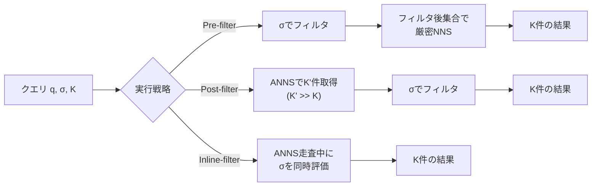

## 論文概要（Abstract）

本記事は [Filtered Vector Search: State-of-the-art and Research Challenges](https://research.google/pubs/filtered-vector-search-state-of-the-art-and-research-opportunities/)（VLDB 2025）の解説記事です。

この論文は、ベクトル検索にリレーショナルフィルタ（WHERE句）を組み合わせた**フィルタ付きベクトル検索（Filtered Vector Search: FVS）**の体系的なサーベイとチュートリアルです。埋め込みモデルの普及により、構造化データと非構造化データを統合的に検索するニーズが急速に高まっています。著者らは、Pre-filtering・Post-filtering・Inline-filteringの3つの基本実行戦略を分類し、フィルタの選択率やデータ相関がリコールと性能に与える影響を分析しています。さらに、Filtered-DiskANN・NHQ・ACORNといった専用複合インデックスの設計原理を深掘りし、未解決の研究課題を提示しています。

この記事は [Zenn記事: ベクトルDB選定と性能比較：量子化×フィルタで変わる5製品の実力差](https://zenn.dev/0h_n0/articles/772477bbc29046) の深掘りです。

## 情報源

- **会議名**: VLDB 2025（Proceedings of the VLDB Endowment, Vol.18）
- **URL**: [https://research.google/pubs/filtered-vector-search-state-of-the-art-and-research-opportunities/](https://research.google/pubs/filtered-vector-search-state-of-the-art-and-research-opportunities/)
- **著者**: Yannis Chronis, Helena Caminal, Yannis Papakonstantinou, Fatma Özcan, Anastasia Ailamaki
- **発表形式**: チュートリアル論文

## カンファレンス情報

**VLDBについて**: VLDB（Very Large Data Bases）はデータベース分野における最高峰の国際会議の一つです。データ管理、クエリ処理、分散システムなどの基盤技術に加え、近年はベクトル検索やAI統合データベースに関する発表も増加しています。著者陣はGoogle Research、ETH Zurich、EPFL等に所属しており、Google AlloyDBにおけるScaNNインデックスの実装経験に基づいた実践的な知見が含まれています。

## 技術的詳細（Technical Details）

### フィルタ付きベクトル検索（FVS）の定式化

FVSは以下のSQLクエリに対応する操作です。

```sql
SELECT *
FROM table
WHERE col1 = True AND col2 > 5
ORDER BY distance(q, vector_col)
LIMIT K
```

形式的には、クエリベクトル$\mathbf{q}$、フィルタ述語$\sigma$、結果数$K$が与えられたとき、$\sigma$を満たすレコード集合$S_\sigma$の中から$\mathbf{q}$に最も近い$K$件を返す問題です。

$$
\text{FVS}(\mathbf{q}, \sigma, K) = \underset{S \subseteq S_\sigma, |S|=K}{\arg\min} \sum_{\mathbf{v} \in S} d(\mathbf{q}, \mathbf{v})
$$

ここで$d(\mathbf{q}, \mathbf{v})$はコサイン距離やL2距離などの距離関数です。

近似最近傍探索（ANN）の品質は通常Recall@kで評価されます。

$$
\text{Recall@k} = \frac{|AN_k \cap N_k|}{k}
$$

$AN_k$はANNが返した$k$件、$N_k$は真の最近傍$k$件です。ただし著者らは、Recall@kだけでは不十分なケースがあると指摘しており、RDE@kやTDK@k（Patella et al., SISAP 2008）などの代替指標も紹介しています。

### 3つの基本実行戦略

著者らは、FVSの実行戦略を大きく3つに分類しています。



#### Pre-filtering（前フィルタ方式）

メタデータフィルタを先に適用し、残ったレコードに対して最近傍探索を実行します。

**利点**: フィルタ後の集合に対して正確な探索を行うため、リコールが高い。

**制約**: フィルタ後の集合が大きい場合（低選択率）、インデックスなしの厳密探索は$O(|S_\sigma|)$のコストがかかり性能が劣化します。論文では「expensive if filter is not selective」と明記されています。

$$
\text{Cost}_{\text{pre}} = |S_\sigma| \cdot c_{\text{dist}} + N \cdot c_{\text{filter}}
$$

$|S_\sigma|$はフィルタ通過レコード数、$c_{\text{dist}}$は距離計算コスト、$c_{\text{filter}}$はフィルタ評価コストです。

#### Post-filtering（後フィルタ方式）

まずANNインデックスで$K'$件（$K' \gg K$）の候補を取得し、その後フィルタを適用して$K$件に絞ります。

**利点**: ANNインデックスの性能をそのまま活用でき、フィルタが低選択率（大半のレコードが該当）の場合は効率的です。

**問題**: 高選択率フィルタ（全体の0.1%しか残らない場合など）では、ANN候補$K'$件のほとんどがフィルタで除外され、最終結果が$K$件に満たない、あるいは低品質な結果で埋まるリスクがあります。著者らはこれを「Recall & Performance Challenge」と呼んでいます。

$K'$の設定に2つの失敗モードがあります。

- $K' \gg K$に設定：無駄な距離計算が増加（wasted effort）
- $K'$が不十分：$\sigma(K') < K$となりリコールが低下

#### Inline-filtering（インラインフィルタ方式）

ANN探索のグラフ走査やツリー走査の途中でフィルタを同時に評価する方式です。著者らは「Blur the line between ANNS and filtering to improve accuracy and performance」と表現しています。

**グラフベースのInline-filtering**には2つの実装パターンがあります。

1. **Predicate Subgraph Traversal**: フィルタを満たさないノードを探索から完全に除外します。グラフの連結性が壊れるリスクがあり、リコールが低下する可能性があります。Weaviateのブログでこの問題が詳しく解説されています。

2. **Sweeping**: フィルタを満たさないノードもナビゲーションには参加させつつ、結果には含めません。グラフの連結性を維持できますが、距離計算の回数が増加します。

**ツリー/ハッシュベースのInline-filtering**: 内部ノードの探索は変更せず、リーフノードでのみフィルタを適用します。IVFやScaNNなどのクラスタリング系インデックスで使われる方式です。

### フィルタ選択率とリコールの関係

著者らが強調する重要な知見は、**フィルタの選択率（selectivity）がアルゴリズム選択よりも大きな影響を与える**という点です。

選択率が高い（フィルタで残るレコードが少ない）ほど、有効なノードを見つけるための探索努力が指数的に増加します。論文のスライドでは、選択率が高くなるにつれて「search effort increases」と図示されています。

さらに、**値-ベクトル相関（Value-Vector Correlation）**という概念が導入されています（Patel et al., SIGMOD 2024）。これはフィルタ条件を満たす確率とクエリベクトルからの距離の関係を表します。

- **正の相関**: クエリに近いレコードがフィルタを満たしやすい（例：「似た商品」かつ「夏物カテゴリ」）→ 探索が容易
- **相関なし**: フィルタ条件とベクトル距離が無関係 → 中程度の難易度
- **負の相関**: クエリに近いレコードほどフィルタを満たしにくい（例：「似た商品」かつ「価格1万円以上」）→ 探索が困難

この相関が負の場合、ANNインデックスが最近傍を効率的に見つけても、それらのほとんどがフィルタで除外されるため、性能が大幅に劣化します。

### 性能の定式化とクエリ最適化

著者らは、FVSの性能コストを以下の式でモデル化しています。

$$
\text{COST} = f(\text{\\#dist\_comp} \times c_{\text{dist}}, \text{\\#filter\_eval} \times c_{\text{filter}})
$$

最適な実行戦略は**クエリに依存**します。論文の実験データ（Weaviateブログ出典、beir-cohere-500k-filtered-dotデータセット）では、選択率20%ではfilter-first（Pre-filter）が高QPS、選択率50%ではdistance-compute-first（Post-filter）が高QPSを記録しています。

これは、従来のリレーショナルDBにおけるクエリ最適化と本質的に同じ課題ですが、ANN探索の近似性が加わることで、コスト推定が「レイテンシ/スループット」だけでなく「リコール品質」も含む多目的最適化になるという点が従来と異なります。

## 専用複合インデックスの設計原理

著者らは、フィルタ付き検索に特化した複合インデックスを3つの設計パターンに分類しています。

### 分類軸：フィルタ不可知性のスペクトラム


- **左端（フィルタ不可知）**: 既存インデックスをそのまま使い、探索時にフィルタを適用。汎用性が高い。
- **右端（フィルタ依存）**: フィルタ値をビルド時に取り込んだ専用インデックス。性能は高いが、新しいフィルタ条件に対応できない。

### Filtered-DiskANN（Gollapudi et al., WWW 2023）

DiskANN（Vamana）ベースのグラフインデックスに、フィルタを考慮した2つのバリアントを提供します。

- **StitchedVamana**: 各属性値ごとにサブグラフを構築し、それらを「ステッチ（縫合）」して1つのグラフにまとめます。同じリコールでより高いQPSを達成しますが、ビルドコストが高い。
- **FilteredVamana**: 挿入時に類似ラベルを持つ近傍を優先的に接続します。ビルドが高速で、インクリメンタル更新にも適しています。

### NHQ（Wang et al., NeurIPS 2023）

属性距離とベクトル距離を融合した**複合距離**でグラフを構築します。

$$
\text{dist} = f(L_2(\mathbf{p}_1, \mathbf{p}_2), \text{sim}(\text{att}_1, \text{att}_2))
$$

フィルタ値ごとに$k$個の最近傍を保持し、フィルタ値の共通数が多いエッジほど距離$\mathcal{D}$が小さくなる設計です。著者らの実験比較では、**NHQ-DiskANNがFiltered-DiskANNを大幅に上回るQPSを記録**したと報告されています。ただし、等値フィルタで非交差集合の場合はStitchedVamana/FilteredVamanaが有利になるケースもあると注記されています。

### ACORN（Patel et al., SIGMOD 2024）

ACORNは、既存の未修正インデックスに**追加エッジを挿入**して、フィルタによる連結性の断絶を防ぐアプローチです。

- **ACORN-1**: ビルドが高速なバリアント
- **ACORN-γ**: 検索が高速なバリアント

**フィルタ不可知**であることが大きな特長です。ビルド時にフィルタ条件を知る必要がなく、未知のフィルタ条件にも対応できます。著者らの実験では、ACORNがFiltered-DiskANNとNHQの両方を上回る性能を示し、かつ汎用性を維持していると報告されています。理想的な「Oracle Partitions」（フィルタごとに完全なHNSWを構築した上界）に近い性能を達成しています。

## 実装のポイント

### 各ベクトルDBでの実装戦略の違い

本チュートリアルの知見を各製品に当てはめると、以下のような対応関係が見えます。

| 製品 | フィルタ方式 | 論文での分類 |
|---|---|---|
| **Qdrant** | Payload Index + Inline filtering | Predicate Subgraph Traversal（Sweeping型） |
| **Milvus** | Bitset-based Iterator | Inline-filtering（ハイブリッド型） |
| **Weaviate** | Pre-filter + Inverted Index | Pre-filter + Sweeping |
| **pgvector** | SQLのWHERE句 | Post-filter相当 |
| **Google AlloyDB** | ScaNN + Inline filtering | Inline-filtering（Tree型） |

### 実装上の注意点

1. **選択率の事前推定が不可欠**: 最適な実行戦略は選択率に依存するため、クエリプランナーにフィルタの選択率推定機能を組み込む必要があります。
2. **値-ベクトル相関のプロファイリング**: 本番データでフィルタ値とベクトル距離の相関を事前に分析し、負の相関がある列にはPre-filter方式を強制するなどの対策が有効です。
3. **search_effort_paramsの自動チューニング**: フィルタの有無で最適なパラメータが変わるため、VDTuner（Yang et al., ICDE 2024）やDARTH（Chatzakis et al., SIGMOD 2026）のような適応的チューニング手法の導入が推奨されます。

## Production Deployment Guide

### AWS実装パターン（コスト最適化重視）

フィルタ付きベクトル検索システムをAWS上にデプロイする際の構成例です。

| 規模 | 月間リクエスト | 推奨構成 | 月額コスト | 主要サービス |
|------|--------------|---------|-----------|------------|
| **Small** | ~3,000 (100/日) | Serverless | $50-150 | Lambda + OpenSearch Serverless |
| **Medium** | ~30,000 (1,000/日) | Hybrid | $400-900 | ECS Fargate + OpenSearch + ElastiCache |
| **Large** | 300,000+ (10,000/日) | Container | $2,500-6,000 | EKS + Milvus/Qdrant + RDS (pgvector) |

**Small構成の詳細**（月額$50-150）:
- **Lambda**: 1GB RAM, 30秒タイムアウト（$20/月）
- **OpenSearch Serverless**: kNN検索、0.5 OCU（$90/月）
- **DynamoDB**: メタデータ + フィルタ用インデックス On-Demand（$10/月）
- **CloudWatch**: 基本監視（$5/月）

**Medium構成の詳細**（月額$400-900）:
- **ECS Fargate**: 1 vCPU, 2GB RAM × 2タスク（$120/月）
- **OpenSearch**: r6g.large.search × 2ノード（$500/月）
- **ElastiCache Redis**: cache.t3.micro（$15/月）フィルタ結果キャッシュ
- **ALB**: $20/月

**Large構成の詳細**（月額$2,500-6,000）:
- **EKS**: コントロールプレーン（$72/月）
- **EC2 Spot**: r6i.xlarge × 2-4台（平均$400/月、最大90%削減）
- **Milvus/Qdrant**: EKS上にデプロイ、Partition Key活用
- **RDS PostgreSQL**: db.r6g.large + pgvector拡張（$300/月）
- **S3**: ベクトルデータバックアップ（$30/月）
- **CloudWatch + X-Ray**: 詳細監視（$100/月）

**コスト試算の注意事項**: 上記は2026年11月時点のAWS ap-northeast-1（東京）リージョン料金に基づく概算値です。実際のコストはクエリパターン、フィルタ選択率の分布、データサイズにより変動します。最新料金は[AWS料金計算ツール](https://calculator.aws/)で確認してください。

### Terraformインフラコード

**Small構成（Serverless）: Lambda + OpenSearch Serverless**

```hcl
module "vpc" {
  source  = "terraform-aws-modules/vpc/aws"
  version = "~> 5.0"

  name = "fvs-vpc"
  cidr = "10.0.0.0/16"
  azs  = ["ap-northeast-1a", "ap-northeast-1c"]
  private_subnets = ["10.0.1.0/24", "10.0.2.0/24"]

  enable_nat_gateway   = false
  enable_dns_hostnames = true
}

resource "aws_iam_role" "lambda_fvs" {
  name = "lambda-fvs-role"

  assume_role_policy = jsonencode({
    Version = "2012-10-17"
    Statement = [{
      Action = "sts:AssumeRole"
      Effect = "Allow"
      Principal = { Service = "lambda.amazonaws.com" }
    }]
  })
}

resource "aws_iam_role_policy" "opensearch_access" {
  role = aws_iam_role.lambda_fvs.id

  policy = jsonencode({
    Version = "2012-10-17"
    Statement = [{
      Effect   = "Allow"
      Action   = ["aoss:APIAccessAll"]
      Resource = aws_opensearchserverless_collection.vectors.arn
    }]
  })
}

resource "aws_opensearchserverless_collection" "vectors" {
  name = "fvs-vectors"
  type = "VECTORSEARCH"
}

resource "aws_lambda_function" "fvs_handler" {
  filename      = "lambda.zip"
  function_name = "fvs-search-handler"
  role          = aws_iam_role.lambda_fvs.arn
  handler       = "index.handler"
  runtime       = "python3.12"
  timeout       = 30
  memory_size   = 1024

  environment {
    variables = {
      OPENSEARCH_ENDPOINT = aws_opensearchserverless_collection.vectors.collection_endpoint
      FILTER_STRATEGY     = "auto"
    }
  }
}

resource "aws_dynamodb_table" "metadata" {
  name         = "fvs-metadata"
  billing_mode = "PAY_PER_REQUEST"
  hash_key     = "item_id"

  attribute {
    name = "item_id"
    type = "S"
  }

  ttl {
    attribute_name = "expire_at"
    enabled        = true
  }
}

resource "aws_cloudwatch_metric_alarm" "lambda_duration" {
  alarm_name          = "fvs-lambda-duration-spike"
  comparison_operator = "GreaterThanThreshold"
  evaluation_periods  = 1
  metric_name         = "Duration"
  namespace           = "AWS/Lambda"
  period              = 3600
  statistic           = "Average"
  threshold           = 15000
  alarm_description   = "FVS Lambda平均実行時間15秒超過"

  dimensions = {
    FunctionName = aws_lambda_function.fvs_handler.function_name
  }
}
```

**Large構成（Container）: EKS + ベクトルDB**

```hcl
module "eks" {
  source  = "terraform-aws-modules/eks/aws"
  version = "~> 20.0"

  cluster_name    = "fvs-cluster"
  cluster_version = "1.31"

  vpc_id     = module.vpc.vpc_id
  subnet_ids = module.vpc.private_subnets

  cluster_endpoint_public_access = true
  enable_cluster_creator_admin_permissions = true
}

resource "kubectl_manifest" "karpenter_provisioner" {
  yaml_body = <<-YAML
    apiVersion: karpenter.sh/v1alpha5
    kind: Provisioner
    metadata:
      name: fvs-spot-provisioner
    spec:
      requirements:
        - key: karpenter.sh/capacity-type
          operator: In
          values: ["spot"]
        - key: node.kubernetes.io/instance-type
          operator: In
          values: ["r6i.xlarge", "r6i.2xlarge"]
      limits:
        resources:
          cpu: "32"
          memory: "128Gi"
      providerRef:
        name: default
      ttlSecondsAfterEmpty: 60
  YAML
}

resource "aws_budgets_budget" "fvs_monthly" {
  name         = "fvs-monthly-budget"
  budget_type  = "COST"
  limit_amount = "6000"
  limit_unit   = "USD"
  time_unit    = "MONTHLY"

  notification {
    comparison_operator        = "GREATER_THAN"
    threshold                  = 80
    threshold_type             = "PERCENTAGE"
    notification_type          = "ACTUAL"
    subscriber_email_addresses = ["ops@example.com"]
  }
}
```

### セキュリティベストプラクティス

1. **ネットワーク**: OpenSearch Serverlessはパブリックアクセスを無効化し、VPCエンドポイント経由でアクセス
2. **認証・認可**: IAMロール最小権限、OpenSearch Serverless Data Access Policyで細粒度制御
3. **暗号化**: S3/DynamoDB/OpenSearch全てKMS暗号化、転送中TLS 1.2以上
4. **監査**: CloudTrail全リージョン有効化、OpenSearch監査ログ有効

### 運用・監視設定

**CloudWatch Logs Insights クエリ**:

```sql
-- フィルタ選択率別のレイテンシ分析
fields @timestamp, filter_selectivity, latency_ms, recall
| stats avg(latency_ms) as avg_latency,
        pct(latency_ms, 95) as p95_latency,
        avg(recall) as avg_recall
  by bin(filter_selectivity, 0.1) as selectivity_bucket
| sort selectivity_bucket asc

-- 高選択率クエリの検出（リコール低下リスク）
fields @timestamp, filter_selectivity, recall, query_id
| filter filter_selectivity < 0.01 and recall < 0.9
| sort @timestamp desc
| limit 50
```

**CloudWatch アラーム（Python）**:

```python
import boto3

cloudwatch = boto3.client('cloudwatch')

cloudwatch.put_metric_alarm(
    AlarmName='fvs-low-recall-alert',
    ComparisonOperator='LessThanThreshold',
    EvaluationPeriods=3,
    MetricName='SearchRecall',
    Namespace='FVS/Search',
    Period=300,
    Statistic='Average',
    Threshold=0.9,
    ActionsEnabled=True,
    AlarmActions=['arn:aws:sns:ap-northeast-1:123456789:fvs-alerts'],
    AlarmDescription='FVS平均リコールが0.9未満に低下'
)

cloudwatch.put_metric_alarm(
    AlarmName='fvs-high-selectivity-latency',
    ComparisonOperator='GreaterThanThreshold',
    EvaluationPeriods=2,
    MetricName='HighSelectivityLatency',
    Namespace='FVS/Search',
    Period=300,
    Statistic='Average',
    Threshold=500,
    AlarmDescription='高選択率クエリのレイテンシ500ms超過'
)
```

**X-Ray トレーシング設定**:

```python
from aws_xray_sdk.core import xray_recorder
from aws_xray_sdk.core import patch_all

patch_all()

@xray_recorder.capture('filtered_vector_search')
def search_with_filter(query_vector: list[float], filters: dict, k: int = 10):
    xray_recorder.put_annotation('filter_strategy', 'auto')
    xray_recorder.put_annotation('k', k)

    selectivity = estimate_selectivity(filters)
    xray_recorder.put_metadata('estimated_selectivity', selectivity)

    if selectivity < 0.01:
        strategy = 'pre_filter'
    elif selectivity > 0.5:
        strategy = 'post_filter'
    else:
        strategy = 'inline_filter'

    xray_recorder.put_annotation('chosen_strategy', strategy)
    results = execute_search(query_vector, filters, k, strategy)
    xray_recorder.put_metadata('result_count', len(results))
    return results
```

**Cost Explorer自動レポート**:

```python
import boto3
from datetime import datetime, timedelta

ce = boto3.client('ce')

response = ce.get_cost_and_usage(
    TimePeriod={
        'Start': (datetime.now() - timedelta(days=1)).strftime('%Y-%m-%d'),
        'End': datetime.now().strftime('%Y-%m-%d')
    },
    Granularity='DAILY',
    Metrics=['UnblendedCost'],
    GroupBy=[
        {'Type': 'SERVICE', 'Key': 'SERVICE'}
    ]
)

for result in response['ResultsByTime']:
    for group in result['Groups']:
        service = group['Keys'][0]
        cost = float(group['Metrics']['UnblendedCost']['Amount'])
        if cost > 100:
            print(f"ALERT: {service} cost ${cost:.2f}/day")
```

### コスト最適化チェックリスト

**アーキテクチャ選択**:
- [ ] ~100 req/日 → Lambda + OpenSearch Serverless（$50-150/月）
- [ ] ~1,000 req/日 → ECS Fargate + OpenSearch（$400-900/月）
- [ ] 10,000+ req/日 → EKS + 専用ベクトルDB（$2,500-6,000/月）

**リソース最適化**:
- [ ] EC2: Spot Instances優先（最大90%削減、Karpenter自動管理）
- [ ] Reserved Instances: 1年コミットで72%削減（予測可能な負荷のOpenSearchノード）
- [ ] Savings Plans: Compute Savings Plans検討
- [ ] Lambda: メモリサイズ最適化（CloudWatch Lambda Insights分析）
- [ ] OpenSearch: 適切なインスタンスタイプ選択（kNN検索にはメモリ最適化型を推奨）

**検索コスト削減**:
- [ ] フィルタ戦略の動的切替: 選択率に応じてPre/Post/Inlineを自動選択
- [ ] ElastiCacheによるフィルタ結果キャッシュ: 頻出フィルタ条件の結果をキャッシュ
- [ ] 量子化: OpenSearchのfaiss_hnsw_sq（Scalar Quantization）でメモリ4倍削減
- [ ] バッチ検索: 類似クエリをまとめて実行（スループット向上）

**監視・アラート**:
- [ ] AWS Budgets: 月額予算設定（80%で警告、100%でアラート）
- [ ] CloudWatch アラーム: リコール低下・レイテンシスパイク検知
- [ ] Cost Anomaly Detection: 自動異常検知
- [ ] 日次コストレポート: SNS/Slackへ自動送信

**リソース管理**:
- [ ] 未使用インデックス削除: OpenSearchのインデックスライフサイクル管理
- [ ] タグ戦略: 環境別（dev/staging/prod）でコスト可視化
- [ ] ライフサイクルポリシー: S3古いバックアップ自動削除（30日）
- [ ] 開発環境: 夜間はOpenSearchノード数を縮小

## 実験結果（Results）

### 複合インデックスの比較（論文Section 4より）

著者らが報告した主要な実験結果は以下の通りです。

| インデックス | フィルタ不可知性 | QPS（同一リコール条件） | 備考 |
|---|---|---|---|
| **ACORN** | 完全に不可知 | 最高 | Oracle Partitionsに近い性能 |
| **NHQ-DiskANN** | 部分的 | ACORNに次ぐ | 等値フィルタに特化 |
| **Filtered-DiskANN** | 部分的 | NHQに劣る | ビルド速度は優位 |
| **Inline filtering（Sweeping）** | 完全に不可知 | 低選択率で劣化 | 汎用性は最高 |

著者らは「ACORN outperforms both Filtered DiskANN and NHQ for a fixed recall, while maintaining generality」と結論づけています。

### 実行戦略の選択率依存性（論文Section 3より）

beir-cohere-500k-filtered-dotデータセットでの実験では:
- **選択率20%**: filter-first（Pre-filter）が高QPSを達成
- **選択率50%**: distance-compute-first（Post-filter）が高QPSを達成

この結果は、**単一の実行戦略では全ての選択率に対応できない**ことを示しており、適応的なクエリプランニングの必要性を裏付けています。

## 実運用への応用（Practical Applications）

### マルチテナント環境での注意点

マルチテナントRAGシステムでは、テナントIDによるフィルタが高選択率になりやすい問題があります。テナントAのデータが全体の0.05%しかない場合、Post-filter方式ではリコールが著しく低下します。著者らの分析に基づけば、以下の対策が有効です:

1. **テナント別パーティション**: Milvusの`partition_key`やQdrantのNamespaceを活用し、テナントデータを物理的に分離
2. **選択率ベースのルーティング**: クエリプランナーでフィルタ選択率を推定し、高選択率クエリにはPre-filter方式を強制
3. **ACORNスタイルのインデックス**: フィルタ不可知な複合インデックスを採用し、未知のフィルタ条件にも対応

### クエリプランニングの重要性

著者らは、従来のリレーショナルDBのクエリ最適化と同様に、FVSでもコストベースのクエリプランニングが不可欠だと主張しています。ただし、FVSのコスト関数にはリコール品質という新しい次元が加わるため、従来のオプティマイザでは対応が困難です。Google AlloyDB（ScaNN統合）やDARTH（SIGMOD 2026）のような適応的実行エンジンが今後の方向性として示されています。

## 関連研究（Related Work）

- **Filtered-DiskANN**（Gollapudi et al., WWW 2023）: DiskANNにフィルタ対応を追加した先駆的研究。StitchedVamanaとFilteredVamanaの2バリアントを提供。
- **ACORN**（Patel et al., SIGMOD 2024）: フィルタ不可知な複合インデックス。既存グラフにエッジを追加して連結性を維持。
- **NHQ**（Wang et al., NeurIPS 2023）: 属性距離とベクトル距離を融合した複合距離によるグラフ構築。
- **arXiv 2602.11443**（Zenn記事で引用）: UC MercedによるANN-Benchmarksのフィルタ検索拡張。FAISS・Milvus・pgvectorでの実験を含む。
- **DARTH**（Chatzakis et al., SIGMOD 2026）: 適応的実行による自動チューニング。クエリごとに最適な探索努力を動的に決定。

## まとめと今後の展望

著者らが提示した主要な知見と未解決課題をまとめます。

**主要な知見**:
- フィルタ付きベクトル検索の最適戦略は、フィルタの選択率・値-ベクトル相関・データ規模に強く依存し、単一の方式では対応できない
- 複合インデックス（特にACORN）は、汎用性と性能を両立する有望なアプローチ
- クエリプランニングとパラメータ自動チューニングが実用上の最大のボトルネック

**著者らが挙げた未解決の研究課題**:
1. **自動チューニング**: インデックスハイパーパラメータ、データ構造選択、探索アルゴリズムの自動最適化
2. **品質指標の改善**: フィルタ付き検索に適したRecall@k以外の品質指標の開発
3. **ベンチマーク標準化**: フィルタ選択率とデータ相関を考慮したベンチマークの整備
4. **ハイブリッド検索**: 全文検索とベクトル検索のランキング統合方法（固定重み vs 動的調整）
5. **RAGパイプライン全体の最適化**: ベクトル検索単体ではなく、LLMまで含めたエンドツーエンドの精度最適化

## 参考文献

- **Conference URL**: [https://research.google/pubs/filtered-vector-search-state-of-the-art-and-research-opportunities/](https://research.google/pubs/filtered-vector-search-state-of-the-art-and-research-opportunities/)
- **PDF**: [https://www.vldb.org/pvldb/vol18/p5488-caminal.pdf](https://www.vldb.org/pvldb/vol18/p5488-caminal.pdf)
- **ACORN**: [https://doi.org/10.1145/3654923](https://doi.org/10.1145/3654923)
- **Filtered-DiskANN**: [https://doi.org/10.1145/3543507.3583552](https://doi.org/10.1145/3543507.3583552)
- **NHQ**: Wang et al., NeurIPS 2023
- **DARTH**: Chatzakis et al., SIGMOD 2026
- **Related Zenn article**: [https://zenn.dev/0h_n0/articles/772477bbc29046](https://zenn.dev/0h_n0/articles/772477bbc29046)
