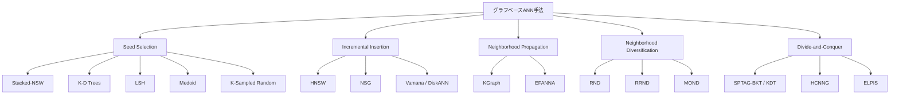

## 論文概要（Abstract）

本記事は [Graph-Based Vector Search: An Experimental Evaluation of the State-of-the-Art](https://arxiv.org/abs/2502.05575) の解説記事です。

Ilias Azizi、Karima Echihabi、Themis Palpanas の3名は、グラフベースの近似最近傍探索（ANN）手法を体系的に分類し、12種の手法を7つの実データセット（最大10億ベクトル）で評価した論文を発表した。著者らはグラフベース手法を5つの設計パラダイムに整理し、統一的な実験フレームワーク上で公平に比較することで、従来の個別ベンチマークでは見えなかった知見を明らかにしている。

この記事は [Zenn記事: ベクトルDB選定と性能比較：量子化×フィルタで変わる5製品の実力差](https://zenn.dev/0h_n0/articles/772477bbc29046) の深掘りです。

## 情報源

- **arXiv ID**: 2502.05575
- **URL**: [https://arxiv.org/abs/2502.05575](https://arxiv.org/abs/2502.05575)
- **著者**: Ilias Azizi (UM6P / Université Paris Cité), Karima Echihabi (UM6P), Themis Palpanas (Université Paris Cité)
- **発表年**: 2025
- **会場**: Proceedings of the ACM on Management of Data (SIGMOD), Volume 31, Issue 3
- **分野**: cs.IR, cs.PF
- **DOI**: 10.1145/3709693

## 背景と動機（Background & Motivation）

ベクトルデータは画像検索、自然言語処理、推薦システムなど多くの領域で利用されており、学習済み埋め込みの普及とともにその重要性はさらに増している。ベクトル検索の核心はk近傍探索（k-NN）であるが、高次元空間では厳密探索のコストが実用的でなくなるため、近似最近傍探索（ANN）が広く採用されている。

ANN手法にはハッシュベース、木ベース、量子化ベース、グラフベースなどの分類があるが、近年のベンチマークにおいてグラフベース手法が最も高いリコール-スループットのトレードオフを達成する傾向にある。しかし、著者らは既存の比較研究に2つの問題を指摘している。第一に、個別のベンチマーク（ann-benchmarks等）は実装言語やパラメータチューニングの差異が結果に影響を与えており、アルゴリズムの本質的な性能差が見えにくい。第二に、グラフベース手法内部の設計選択（グラフ構築方式、シード選択、近傍多様化）がどの程度性能に影響するかの体系的な分析が不足していた。

本論文はこのギャップを埋めるため、統一フレームワーク上で12手法を最大10億ベクトルまでスケールさせて評価し、どの設計選択が実際に効くのかを明らかにしている。

## 主要な貢献（Key Contributions）

著者らは以下の貢献を報告している（論文Section 1より）：

- **貢献1**: グラフベースベクトル検索手法を5つの設計パラダイム（Seed Selection, Incremental Insertion, Neighborhood Propagation, Neighborhood Diversification, Divide-and-Conquer）に分類する体系的なタクソノミーの提案
- **貢献2**: 12種の手法を統一フレームワーク上で再実装し、7つの実データセット（最大10億ベクトル）で公平に比較する網羅的な実験評価
- **貢献3**: 設計パラダイムごとの性能への影響分析（特に近傍多様化とシード選択がクエリ性能に与える影響の定量的評価）
- **貢献4**: 既存研究（Wang et al., 2021）とは異なる結論の報告と、今後の研究方向性の提示

## 技術的詳細（Technical Details）

### 5つの設計パラダイムの定義

著者らはグラフベースANN手法の設計空間を以下の5つのパラダイムに分類している（論文Section 3.2より）。



**1. Seed Selection（SS）**: 検索の開始点をグラフ上でどう選ぶかを決定する。クエリに近いシードを選べれば探索範囲が狭まり、検索コストが削減される。具体的な戦略として、Stacked-NSW（HNSWの階層構造）、K-D Trees（空間分割）、LSH（ハッシュベース）、Medoid（データセットの中心点）、K-Sampled Random Seeds（ランダム複数起点）がある。

**2. Incremental Insertion（II）**: データ点を1つずつグラフに挿入し、近傍ノードへのショートリンクと遠方ノードへのロングリンクを張ることでスモールワールド特性を実現する。HNSW、NSG、Vamanaがこのカテゴリに属する。

**3. Neighborhood Propagation（NP）**: k-NNグラフを近似的に構築するために、接続されたノード間で近傍リストを伝搬させる。KGraphとEFANNAがこの方式を採用している。

**4. Neighborhood Diversification（ND）**: グラフの辺を枝刈りして、各ノードの近傍が冗長な方向に偏らないようにする。これにより検索時の探索効率が向上する。

**5. Divide-and-Conquer（DC）**: データセットをパーティションに分割し、各パーティションで個別にグラフを構築した後、マージまたは並列検索する。SPTAG、HCNNG、ELPISがこのカテゴリに属する。

### 近傍多様化（Neighborhood Diversification）の数学的定義

著者らは3種類の近傍多様化戦略を検討している（論文Section 3.4より）。

**Relative Neighborhood Diversification（RND）** は、ノード$u$の近傍候補$v$について、$u$と$v$の距離よりも$v$と既存近傍ノード$w$の距離が近い場合に$v$を枝刈りする。形式的には：

$$
\text{prune}(v) = \exists w \in N(u): d(v, w) < d(u, v)
$$

ここで$N(u)$はノード$u$の現在の近傍集合、$d(\cdot, \cdot)$はベクトル間の距離関数である。RNDは平均的にDeepデータセットで約20%、Siftデータセットで約25%の辺を枝刈りすると著者らは報告している（論文Table 1より）。

**Relaxed RND（RRND）** はRNDの枝刈り条件を緩和したものである：

$$
\text{prune}(v) = \exists w \in N(u): \alpha \cdot d(v, w) < d(u, v)
$$

パラメータ$\alpha \geq 1$で枝刈りの積極性を制御する。$\alpha = 1$でRNDと等価、$\alpha > 1$で枝刈りが増加する。Vamana/DiskANNでは$\alpha = 1.2$が一般的に使用される。著者らの報告によると、RRNDの枝刈り率はDeepデータセットで0.6%、Siftで0.7%と、RNDよりはるかに控えめである（論文Table 1より）。

**Monotonic Order-based ND（MOND）** は距離の順序関係に基づく方式で、枝刈り率はDeep 2%、Sift 4%とRNDとRRNDの中間に位置する（論文Table 1より）。

### 検索アルゴリズム

グラフベースANN検索の基本は**Greedy Search**である。シードノードから出発し、クエリベクトルに最も近い未訪問の近傍ノードへ貪欲に移動する。探索候補がなくなるか、所定の計算予算に達した時点で終了する。

**Beam Search**はGreedy Searchの拡張で、ビーム幅$ef$（HNSWでは`efSearch`パラメータに相当）を使い、複数の候補パスを並列に探索する。ビーム幅を大きくするとリコールが向上するがレイテンシが増加するトレードオフがある。

$$
\text{Recall@}k = \frac{|S_{\text{approx}} \cap S_{\text{exact}}|}{k}
$$

ここで$S_{\text{approx}}$はANN検索が返した上位$k$件、$S_{\text{exact}}$は厳密なk-NN結果である。

### グラフ構築の計算量

各手法のグラフ構築コストは大きく異なる。著者らの報告（論文Section 4.4より）によると：

| 手法カテゴリ | 代表的手法 | 構築時間の特徴 |
|---|---|---|
| Incremental Insertion | HNSW, Vamana | $O(n \cdot \log n \cdot M)$程度、$M$は最大近傍数 |
| Neighborhood Propagation | KGraph, EFANNA | 反復的な近傍リスト更新、収束まで複数イテレーション |
| Divide-and-Conquer | ELPIS, HCNNG | パーティション構築は並列化可能だがマージにコスト |

Deep25GBデータセットにおいて、ELPISの構築時間に対してSPTAGは約24倍（25時間以上）を要したと報告されている（論文Section 4.4より）。また、HCNNGはDeep25GBのインデクシング中にメモリ使用量が200GBを超過した一方、最終的なインデックスサイズは50GB未満であったとされる。

## 実装のポイント（Implementation）

本論文の知見から、グラフベースANNの実装時に注意すべきポイントを整理する。

**1. 近傍多様化の選択**: RNDは枝刈りが強すぎてグラフの接続性を損なう場合がある。著者らの実験では、RRNDまたはMONDのほうがリコール-スループットのバランスが良い傾向が報告されている。Vamana/DiskANNの$\alpha = 1.2$は実績のある設定値である。

**2. シード選択の影響**: 著者らはDeep1Mにおいて、Stacked-NSW（SN）方式とK-Sampled Random（KS）方式の距離計算回数が4.3B vs 4.1Bであったと報告している（論文Table 2より）。Deep25GBでは1.49T vs 1.46Tとなり、大規模になるほどシード選択の影響は相対的に小さくなるが、オーバーヘッド自体は22.3Bの距離計算に達する。

**3. メモリ管理**: HNSWはグラフ全体をメモリに保持するため、データ量に比例してメモリ消費が増大する。10億ベクトル規模ではメモリが律速となるケースが多い。ELPISはHNSWに対して最大40%、Vamanaに対して30%のインデクシングメモリ削減を達成したと報告されている（論文Section 4.4より）。

**4. ビルド時間のバジェット**: 著者らは48時間のビルド制限を設けて実験している。実運用では構築時間も重要な制約であり、SPTAGのように25時間以上かかる手法は、頻繁なインデックス更新が必要な環境では不適である。

```python
import heapq
import numpy as np


def greedy_beam_search(
    graph: dict[int, list[int]],
    vectors: np.ndarray,
    query: np.ndarray,
    seed: int,
    ef: int,
    k: int,
) -> list[int]:
    """Beam Search付きGreedy Search（グラフベースANNの基本検索）

    Args:
        graph: 隣接リスト {node_id: [neighbor_ids]}
        vectors: 全ベクトル配列 (n, d)
        query: クエリベクトル (d,)
        seed: 開始ノード
        ef: ビーム幅（探索候補の最大数）
        k: 返却する近傍数
    """
    visited: set[int] = {seed}
    candidates = [(float(np.linalg.norm(query - vectors[seed])), seed)]
    results = [(-candidates[0][0], seed)]

    while candidates:
        c_dist, c_node = heapq.heappop(candidates)
        if results and -results[0][0] < c_dist:
            break
        for nb in graph[c_node]:
            if nb in visited:
                continue
            visited.add(nb)
            d = float(np.linalg.norm(query - vectors[nb]))
            if len(results) < ef or d < -results[0][0]:
                heapq.heappush(candidates, (d, nb))
                heapq.heappush(results, (-d, nb))
                if len(results) > ef:
                    heapq.heappop(results)

    return [nid for _, nid in sorted(results, key=lambda x: -x[0])[:k]]
```

## Production Deployment Guide

### AWS実装パターン（コスト最適化重視）

| 規模 | 月間リクエスト | 推奨構成 | 月額コスト | 主要サービス |
|------|--------------|---------|-----------|------------|
| **Small** | ~3,000 (100/日) | Serverless | $50-150 | Lambda + OpenSearch Serverless |
| **Medium** | ~30,000 (1,000/日) | Hybrid | $300-800 | ECS Fargate + OpenSearch |
| **Large** | 300,000+ (10,000/日) | Container | $2,000-5,000 | EKS + 自前HNSW/Vamana |

**Small構成**（月額$50-150）: Lambda 1GB RAM ($20) + OpenSearch Serverless 2 OCU ($70) + DynamoDB On-Demand ($10) + CloudWatch ($5)

**Large構成**（月額$2,000-5,000）: EKS ($72) + EC2 Spot r6i.2xlarge × 2-4台 ($400) + 自前ANNサーバ（HNSWLib/Vamana） + S3バックアップ ($20) + CloudWatch + X-Ray ($100)

**コスト削減**: Spot Instances最大90%削減、Reserved 72%削減、インデックス構築はSpotで実行しサービングと分離

上記は2026年11月時点のAWS ap-northeast-1料金に基づく概算。最新料金は[AWS料金計算ツール](https://calculator.aws/)で確認推奨。

### Terraformインフラコード

**Small構成（Serverless）**:

```hcl
module "vpc" {
  source  = "terraform-aws-modules/vpc/aws"
  version = "~> 5.0"
  name = "ann-search-vpc"
  cidr = "10.0.0.0/16"
  azs             = ["ap-northeast-1a", "ap-northeast-1c"]
  private_subnets = ["10.0.1.0/24", "10.0.2.0/24"]
  enable_nat_gateway   = false
  enable_dns_hostnames = true
}

resource "aws_iam_role" "lambda_ann" {
  name = "lambda-ann-search-role"
  assume_role_policy = jsonencode({
    Version = "2012-10-17"
    Statement = [{
      Action    = "sts:AssumeRole"
      Effect    = "Allow"
      Principal = { Service = "lambda.amazonaws.com" }
    }]
  })
}

resource "aws_opensearchserverless_collection" "vectors" {
  name = "ann-vectors"
  type = "VECTORSEARCH"
}

resource "aws_lambda_function" "ann_search" {
  filename      = "lambda.zip"
  function_name = "ann-search-handler"
  role          = aws_iam_role.lambda_ann.arn
  handler       = "index.handler"
  runtime       = "python3.12"
  timeout       = 30
  memory_size   = 1024
  environment {
    variables = {
      OPENSEARCH_ENDPOINT = aws_opensearchserverless_collection.vectors.collection_endpoint
      INDEX_NAME          = "hnsw-vectors"
    }
  }
}
```

**Large構成（Container）**:

```hcl
module "eks" {
  source  = "terraform-aws-modules/eks/aws"
  version = "~> 20.0"
  cluster_name    = "ann-search-cluster"
  cluster_version = "1.31"
  vpc_id     = module.vpc.vpc_id
  subnet_ids = module.vpc.private_subnets
  cluster_endpoint_public_access = true
  enable_cluster_creator_admin_permissions = true
}

resource "kubectl_manifest" "karpenter_provisioner" {
  yaml_body = <<-YAML
    apiVersion: karpenter.sh/v1alpha5
    kind: Provisioner
    metadata:
      name: ann-memory-optimized
    spec:
      requirements:
        - key: karpenter.sh/capacity-type
          operator: In
          values: ["spot"]
        - key: node.kubernetes.io/instance-type
          operator: In
          values: ["r6i.2xlarge", "r6i.4xlarge"]
      limits:
        resources:
          cpu: "64"
          memory: "512Gi"
      ttlSecondsAfterEmpty: 60
  YAML
}

resource "aws_budgets_budget" "ann_monthly" {
  name         = "ann-monthly-budget"
  budget_type  = "COST"
  limit_amount = "5000"
  limit_unit   = "USD"
  time_unit    = "MONTHLY"
  notification {
    comparison_operator        = "GREATER_THAN"
    threshold                  = 80
    threshold_type             = "PERCENTAGE"
    notification_type          = "ACTUAL"
    subscriber_email_addresses = ["ops@example.com"]
  }
}
```

### 運用・監視設定

```sql
-- ANN検索レイテンシ分析（CloudWatch Logs Insights）
fields @timestamp, search_latency_ms, recall_at_10
| stats pct(search_latency_ms, 95) as p95, pct(search_latency_ms, 99) as p99 by bin(5m)
```

```python
import boto3

cloudwatch = boto3.client('cloudwatch')

cloudwatch.put_metric_alarm(
    AlarmName='ann-search-latency-p99',
    ComparisonOperator='GreaterThanThreshold',
    EvaluationPeriods=2,
    MetricName='SearchLatency',
    Namespace='ANN/Search',
    Period=300,
    Statistic='p99',
    Threshold=100,
    AlarmDescription='ANN検索P99レイテンシが100msを超過'
)
```

### コスト最適化チェックリスト

**アーキテクチャ選択**: ~100 req/日→Serverless $50-150/月 / ~1000 req/日→Hybrid $300-800/月 / 10000+ req/日→Container $2,000-5,000/月

**リソース最適化**:
- [ ] メモリ最適化インスタンス（r6i系）をSpot使用（最大90%削減）
- [ ] Reserved Instances 1年コミット（72%削減）
- [ ] インデックス構築はSpotで実行、完了後S3バックアップ
- [ ] Karpenterでアイドル時スケールダウン

**ANN検索コスト削減**:
- [ ] ef_search値をリコール要件に応じて最適化
- [ ] 量子化（SQ/BQ）で必要メモリを1/4-1/32に削減
- [ ] 頻出クエリの結果をElastiCacheにキャッシュ

**監視・アラート**:
- [ ] AWS Budgets月額予算設定（80%警告）
- [ ] CloudWatch P99レイテンシ・メモリスパイク検知
- [ ] Cost Anomaly Detection有効化
- [ ] タグ戦略で環境別コスト可視化

## 実験結果（Results）

著者らはIntel Xeon Platinum 8276（1.5TB RAM）上で、各ワークロードを6回実行し最良・最悪を除外した4回の平均で報告している（論文Section 4.1より）。

### 評価対象手法

| 手法 | パラダイム | 主な特徴 |
|---|---|---|
| HNSW | II + SS(Stacked-NSW) | 階層的スモールワールドグラフ |
| NSG | II + ND(MOND) | 単調近傍多様化 |
| Vamana | II + ND(RRND) | DiskANNの中核アルゴリズム |
| DPG | NP + ND(RND) | 相対近傍多様化 |
| EFANNA | NP + SS(K-D Trees) | K-D木によるシード選択 |
| HCNNG | DC(MST merge) | 最小全域木のマージ |
| KGraph | NP | NN-Descentベース |
| NGT | II + ND | Yahoo! Japanの実装 |
| SPTAG-BKT | DC + SS(BKT) | Balance K-D Treeベースの分割 |
| SPTAG-KDT | DC + SS(KDT) | K-D Treeベースの分割 |
| ELPIS | DC(parallel search) | パーティション並列検索 |
| LSHAPG | SS(LSH) + NP | LSHベースのシード選択 |

### インデクシング性能

著者らの報告（論文Section 4.4より）によると、100GBスケールでの構築時間比較において：

- **ELPIS**はHNSWに対して2倍、Vamanaに対して2.7倍高速
- **SPTAG**はDeep25GBで25時間以上を要し、ELPISの約24倍
- **HCNNG**はDeep25GBのインデクシング中にメモリ使用量が200GBを超過（最終インデックスは50GB未満）
- **ELPIS**はHNSWに対して最大40%、Vamanaに対して30%のメモリ削減を実現

### 検索性能

10億ベクトル規模での検索性能について、著者らはELPISがリコール0.95の条件下で他の手法に対して「最大1桁高速」であったと報告している（論文Section 4.5より）。

小規模（100万件）から大規模（250億件以上）へスケールすると手法間の優劣が変化する点も指摘されている。SPTAG-BKTは小規模データセットで上位の効率を示す一方、大規模では構築時間がボトルネックとなる。VamanaはELPISおよびHNSWと競争力のある性能を示すと報告されている。

### データセットの影響

著者らはデータセットの相対コントラスト（RC）と局所固有次元（LID）がアルゴリズム性能に大きな影響を与えると分析している（論文Section 4より）。高RCのデータセット（クラスタ構造が明確）ではどの手法でもリコールが高くなりやすいが、低RCデータセット（一様分布に近い）では手法間の差が顕著になる。

## 実運用への応用（Practical Applications）

### ベクトルDB選定への示唆

本論文の知見は、Zenn記事で取り上げた5製品（Qdrant, Milvus, Weaviate, pgvector, LanceDB）の内部で使われているグラフベースインデックスの理解に直結する。

**HNSW採用製品（Qdrant, Weaviate, pgvector）** については、本論文の知見から以下が示唆される：
- HNSWの階層構造（Stacked-NSWベースのシード選択）は10億ベクトル規模でも有効だが、メモリ使用量が課題
- `ef_construction`（構築時のビーム幅）と`M`（最大近傍数）のチューニングがリコール-スループットを決定
- 近傍多様化の設定が重要で、RRNDベースの枝刈りが実用的なバランスを提供

**Vamana/DiskANN採用製品（pgvectorscale）** については：
- ディスクベースの設計によりメモリ制約を回避できるが、ディスクI/Oがボトルネック
- $\alpha = 1.2$のRRND設定は多くのデータセットで妥当

**Divide-and-Conquer系（Milvus, LanceDB）** については：
- パーティション分割は構築の並列化に有効だが、パーティション間検索のオーバーヘッドに注意
- MilvusのIVF系インデックスはDCパラダイムに分類でき、`nlist`と`nprobe`がパーティション数と検索範囲を制御

### スケーラビリティの限界

100GBを超えるスケールではII系（HNSW, Vamana）が最もスケーラブルであり、DC系（ELPIS）が構築速度で優位に立つと著者らは報告している。NP系（KGraph, EFANNA）は大規模データでのスケーラビリティに課題がある。5000万件を超えるとメモリ効率とビルド時間が選定の決定要因となる。

## 関連研究（Related Work）

- **HNSW原論文**: Malkov & Yashunin (2020), IEEE TPAMI. 階層的スモールワールドグラフの提案。本論文の主要評価対象
- **DiskANN**: Jayaram Subramanya et al. (2019), NeurIPS. ディスクベースANN検索。Vamanaアルゴリズムの基盤
- **NSG**: Fu et al. (2019), PVLDB. MOND近傍多様化を導入したグラフベース手法
- **Wang et al. (2021)**: グラフベースANNの先行サーベイ。著者らはこの研究と異なる結論を複数報告している
- **ELPIS**: Azizi et al. (2023), PVLDB. 本論文の著者らによるDC系手法

## まとめと今後の展望

本論文は、グラフベースANN手法を5つの設計パラダイムに体系的に分類し、12手法を最大10億ベクトルで統一的に評価した。著者らの主な知見は以下のとおりである：

- Incremental Insertion系（HNSW, Vamana）は検索性能とスケーラビリティのバランスが良く、100GB超でも有効
- 近傍多様化（ND）はデータセットが大きくなるほどクエリ性能への影響が増大する
- ベースグラフの選択がスケーラビリティを制限する場合がある
- 単一の手法がすべてのデータセットとワークロードで最良となるわけではない
- 今後の研究方向として、データ適応的なシード選択・多様化戦略、II・ND・DCのハイブリッド手法、理論的なグラフ構造の近接性-疎性トレードオフ分析が挙げられている

ベクトルDB選定においては、本論文が示すパラダイムの分類を理解したうえで、自社のデータ規模・次元数・更新頻度に適した手法を選択することが重要である。

## 参考文献

- **arXiv**: [https://arxiv.org/abs/2502.05575](https://arxiv.org/abs/2502.05575)
- **DOI**: [10.1145/3709693](https://doi.org/10.1145/3709693)
- **Related Zenn article**: [https://zenn.dev/0h_n0/articles/772477bbc29046](https://zenn.dev/0h_n0/articles/772477bbc29046)
