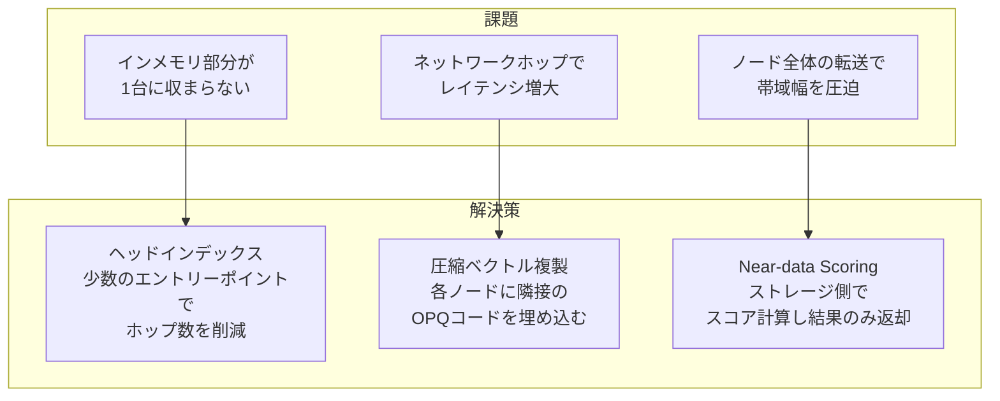
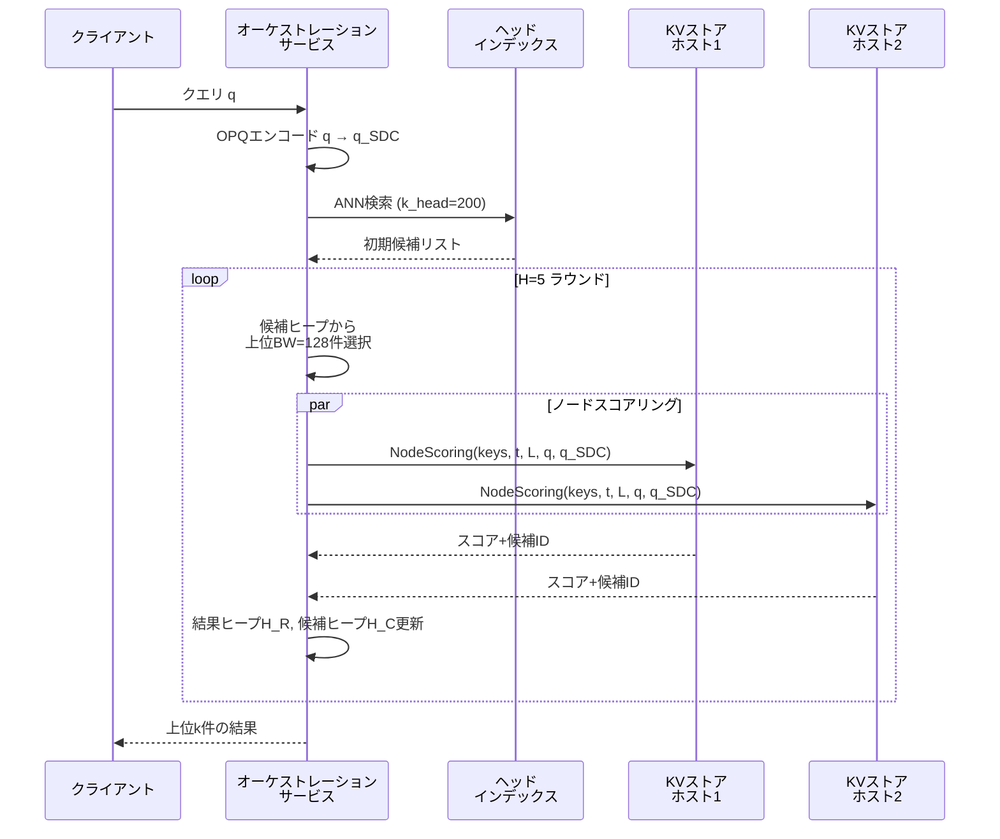

本記事は [DistributedANN: Efficient Scaling of a Single DiskANN Graph Across Thousands of Computers](https://arxiv.org/abs/2509.06046) の解説記事です。

この記事は [Zenn記事: ベクトルDB選定と性能比較：量子化×フィルタで変わる5製品の実力差](https://zenn.dev/0h_n0/articles/772477bbc29046) の深掘りです。

## 論文概要（Abstract）

DistributedANNは、Microsoftが Bing検索エンジンのベクトル検索基盤として開発した分散型近似最近傍探索システムである。著者らは、**500億件の384次元int8ベクトル**からなる単一のDiskANNグラフインデックスを、1000台以上のマシンに分散配置して検索する手法を提案している。従来のクラスタ分割方式（clustered partitioning）と比較して、Recall@5で7.8ポイント（90.8% vs 83.0%）、Recall@200で4.5ポイント（71.9% vs 67.4%）の改善を報告しており、同一のハードウェアフットプリントにおいてクエリスループットが6倍以上のヘッドルームを持つと主張している。

## 情報源

- **arXiv ID**: 2509.06046
- **URL**: [https://arxiv.org/abs/2509.06046](https://arxiv.org/abs/2509.06046)
- **著者**: Philip Adams, Menghao Li, Shi Zhang, Li Tan, Qi Chen, Mingqin Li, Zengzhong Li, Knut Risvik, Harsha Vardhan Simhadri（Microsoft）
- **発表年**: 2025
- **分野**: cs.DC（Distributed Computing）

## 背景と動機（Background & Motivation）

Web規模の検索エンジンでは、数百億件のベクトルに対するANN検索を低レイテンシ・高スループットで実現する必要がある。DiskANNは単一ノードで10億件規模のベクトル検索を効率的に処理できるシステムとして知られているが、500億件規模になると単一マシンのSSD・メモリでは到底収まらない。

従来の分散化手法は**クラスタ分割方式（clustered partitioning）**が主流である。データをk-meansなどでクラスタリングし、各パーティションに独立したインデックスを構築する方法だ。しかし、著者らはこの方式に以下の問題点があると指摘している。

1. **リコールの上限が固定される**: 各パーティションに固定のIO予算を割り当てるため、クエリがパーティション境界にまたがる場合にリコールが低下する
2. **ホットパーティションの偏り**: 人気のあるクエリはクラスタが集中するため、特定パーティションに負荷が集中する
3. **パーティション喪失の影響が大きい**: 1つのパーティションが利用不可になると、そのクラスタ全体の検索品質が大幅に低下する

DistributedANNは、これらの問題を「単一グラフをそのまま分散配置する」というアプローチで解決しようとしている。

## 主要な貢献（Key Contributions）

- **単一グラフ分散アーキテクチャ**: DiskANNのグラフインデックスを分割せず、分散key-valueストアを「巨大な共有ディスク」として扱うことで、単一グラフの探索品質を維持
- **3つの最適化技法**: 圧縮ベクトルのノード内複製、インメモリヘッドインデックス、Near-data Computation（ストレージ側スコアリング）
- **Bing本番環境での実証**: 500億ベクトル規模のBing検索インデックスで実運用されており、従来方式比でRecall@5が7.8ポイント向上、スループットヘッドルームが6倍以上

## 技術的詳細（Technical Details）

### DiskANNの基本構造

DiskANNのインデックスは3つのコンポーネントから構成される。

1. **インメモリ圧縮ベクトル配列**: 全ベクトルのPQ/OPQ圧縮表現をメモリ上に保持。候補のスコアリングに使用
2. **SSD上のグラフノード配列**: 各ベクトルに対応するノードが、フル精度ベクトルと隣接ノードIDリストを保持
3. **インメモリキャッシュ**: 頻繁にアクセスされるノードのキャッシュ

探索は固定のエントリーポイントからビームサーチで実行される。各イテレーションで候補ノードの隣接ノードをSSDから読み取り、インメモリ圧縮ベクトルでスコアリングする。

### 分散化の3つの課題と解決策

単一のDiskANNグラフをネットワーク越しに分散配置する場合、以下の課題が生じる。著者らはそれぞれに対して解決策を提案している。



#### 解決策1: 圧縮ベクトルのノード内複製

通常のDiskANNでは、隣接ノードのスコアリングにインメモリ圧縮ベクトル配列を参照する。しかし分散環境では、この配列が1台に収まらないため別途ネットワークアクセスが必要になる。

著者らの解決策は、各グラフノードに**隣接ノードのOPQ圧縮ベクトルを複製して埋め込む**というものである。これにより、1回のノード読み取りで隣接ノードのスコアリングまで完結する。

この複製によるストレージ増加率は以下の式で表される（論文 Equation 1）。

$$
\text{Amplification} = \frac{(1+R) \cdot \text{sizeof(id)} + d + R \cdot d_{\text{OPQ}}}{R \cdot \text{sizeof(id)} + d}
$$

ここで、$R$はグラフの次数（隣接ノード数）、$d$はフル次元数、$d_{\text{OPQ}}$はOPQコードサイズである。著者らは$R=100$、$d=384$、$d_{\text{OPQ}}=64$の設定で**約10倍のストレージ増加**と報告している。

#### 解決策2: インメモリヘッドインデックス

DiskANNの探索は固定エントリーポイントから開始するが、500億件規模のグラフでは目的のベクトルに到達するまでのホップ数が多くなる。

著者らは、グラフの上位層から幅優先探索で$C$個のベクトルを収集し、それらに対してシャード分割されたインメモリANNインデックス（ヘッドインデックス）を構築する。Bing本番環境では**25億ベクトル**のヘッドインデックスが使用されている。

探索時はまずヘッドインデックスにクエリを投げ、得られた結果をビームサーチの初期候補として使用する。これにより、グラフの深い階層から探索を開始できるため、ネットワークホップ数が大幅に削減される。

#### 解決策3: Near-data Computation（ストレージ側スコアリング）

通常の分散ストレージではノード全体（フル精度ベクトル+隣接リスト+複製された圧縮ベクトル）を転送するが、これはネットワーク帯域を圧迫する。

著者らは、key-valueストアの各ホスト上にスコアリングサービスを配置する。このサービスがノードを読み取り、フル精度距離の計算とOPQ圧縮ベクトルによる隣接候補のスコアリングをローカルで実行し、**スコアと候補IDのみ**を返却する。

帯域削減率は以下の式で表される（論文 Equation 2）。

$$
\text{Ratio} = \frac{(1+R)(\text{sizeof(id)} + \text{sizeof(score)}) + d + d_{\text{OPQ}}}{(1+R) \cdot \text{sizeof(id)} + d + R \cdot d_{\text{OPQ}}}
$$

著者らはこの方式で**約6倍の帯域幅削減**を達成したと報告している。

### 分散探索プロトコル

探索は2つのサービスが連携して実行される。



**オーケストレーションサービス**は結果ヒープ$H_R$（サイズ$k$）と候補ヒープ$H_C$（サイズ$L \geq \max(BW, k)$）を管理する。各ラウンドで候補ヒープから上位$BW$件を選択し、対応するノードのスコアリングをストレージ側に依頼する。$H=5$ラウンドの反復で探索が完了する。

**ノードスコアリングサービス**は、受け取ったノードキーに対してバッチ読み取りを行い、フル精度距離と隣接ノードのOPQ距離を計算する。閾値$t$を下回る候補のみを返却することで、不要なデータ転送を抑制する。

### グラフ構築: グラフスティッチング

500億件規模のグラフを逐次的に構築するのは分散環境では非現実的である。著者らは以下のグラフスティッチング手法を採用している。

1. データをクラスタリングし、各クラスタに属するベクトル（複数クラスタに属するベクトルは全てのクラスタに挿入）で個別にDiskANNインデックスを構築
2. 全パーティションのグラフを統合し、複数パーティションに出現するベクトルの隣接リストは和集合を取る
3. 各パーティションの上位層ベクトルからヘッドインデックスを構築

著者らは、スティッチされたグラフは完全な逐次構築と比較して品質が若干劣るが、「十分な品質」であり構築速度が大幅に速いと述べている。

## 実装のポイント（Implementation）

### ランダムシャーディングによる負荷分散

DistributedANNの基盤となるkey-valueストアは**ランダムシャーディング**を採用している。意味的な近接性に基づくクラスタ分割とは異なり、グラフノードがストレージホスト全体に均等に分散される。著者らはこれにより、特定ホストへの負荷集中が起きにくく、トラフィックパターンが予測可能になると述べている。

### 部分的障害への耐性

オーケストレーションサービスは、ノードスコアリングのバッチリクエストの一部が失敗しても探索を継続できる設計になっている。論文のTable 2によると、ノード可用性が100%から96%に低下した場合でも、Recall@5は90.8%から87.0%への低下に留まる。これはクラスタ分割方式で1パーティションが喪失した場合の品質低下と比較して、はるかに緩やかなデグラデーションである。

### スケーリングのボトルネック

3レプリカ構成では、ヘッドインデックスがノードスコアリングサービスよりも先にCPUバウンドになる。著者らは、ヘッドインデックスは全体のSSD使用量に比べて小さいため、レプリカ追加のコストは低いと述べている。

## Production Deployment Guide

### AWS実装パターン（コスト最適化重視）

DistributedANNはBing検索エンジンの内部システムであり、直接的にAWS上で再現するにはカスタム実装が必要である。ここでは、論文のアーキテクチャを参考にしたAWS構成パターンを示す。

**トラフィック量別の推奨構成**:

| 規模 | 月間リクエスト | 推奨構成 | 月額コスト | 主要サービス |
|------|--------------|---------|-----------|------------|
| **Small** | ~3,000 (100/日) | Serverless | $50-150 | Lambda + OpenSearch Serverless |
| **Medium** | ~30,000 (1,000/日) | Hybrid | $800-2,000 | ECS Fargate + OpenSearch |
| **Large** | 300,000+ (10,000/日) | Container | $5,000-15,000 | EKS + カスタムDiskANN + S3/EBS |

**Small構成の詳細** (月額$50-150):
- **Lambda**: 1GB RAM, 30秒タイムアウト ($20/月)
- **OpenSearch Serverless**: kNN検索, 2 OCU ($50-80/月)
- **DynamoDB**: メタデータ管理, On-Demand ($10/月)
- **CloudWatch**: 基本監視 ($5/月)

**Large構成の詳細** (月額$5,000-15,000):
- **EKS**: コントロールプレーン ($72/月)
- **EC2 i4i.2xlarge**: NVMe SSD搭載, 4台 ($3,200/月、Spot利用で最大90%削減)
- **S3**: グラフインデックス永続化 ($200/月)
- **ElastiCache Redis**: ヘッドインデックスキャッシュ ($500/月)
- **Application Load Balancer**: オーケストレーション層 ($50/月)

**コスト試算の注意事項**:
- 上記は2026年11月時点のAWS ap-northeast-1（東京）リージョン料金に基づく概算値
- DistributedANNの本番規模（500億ベクトル）はAWS上で数千台規模のクラスタが必要であり、ここでは小〜中規模のANN検索ユースケースを想定している
- 最新料金は [AWS料金計算ツール](https://calculator.aws/) で確認のこと

### Terraformインフラコード

**Small構成 (Serverless): Lambda + OpenSearch Serverless**

```hcl
module "vpc" {
  source  = "terraform-aws-modules/vpc/aws"
  version = "~> 5.0"

  name = "ann-search-vpc"
  cidr = "10.0.0.0/16"
  azs  = ["ap-northeast-1a", "ap-northeast-1c"]
  private_subnets = ["10.0.1.0/24", "10.0.2.0/24"]

  enable_nat_gateway   = false
  enable_dns_hostnames = true
}

resource "aws_iam_role" "lambda_ann" {
  name = "lambda-ann-search-role"

  assume_role_policy = jsonencode({
    Version = "2012-10-17"
    Statement = [{
      Action = "sts:AssumeRole"
      Effect = "Allow"
      Principal = { Service = "lambda.amazonaws.com" }
    }]
  })
}

resource "aws_iam_role_policy" "opensearch_access" {
  role = aws_iam_role.lambda_ann.id

  policy = jsonencode({
    Version = "2012-10-17"
    Statement = [{
      Effect   = "Allow"
      Action   = ["aoss:APIAccessAll"]
      Resource = aws_opensearchserverless_collection.vectors.arn
    }]
  })
}

resource "aws_opensearchserverless_collection" "vectors" {
  name = "ann-vectors"
  type = "VECTORSEARCH"
}

resource "aws_lambda_function" "ann_search" {
  filename      = "lambda.zip"
  function_name = "ann-search-handler"
  role          = aws_iam_role.lambda_ann.arn
  handler       = "index.handler"
  runtime       = "python3.12"
  timeout       = 30
  memory_size   = 1024

  environment {
    variables = {
      OPENSEARCH_ENDPOINT = aws_opensearchserverless_collection.vectors.collection_endpoint
    }
  }
}

resource "aws_cloudwatch_metric_alarm" "lambda_duration" {
  alarm_name          = "ann-search-duration-spike"
  comparison_operator = "GreaterThanThreshold"
  evaluation_periods  = 1
  metric_name         = "Duration"
  namespace           = "AWS/Lambda"
  period              = 3600
  statistic           = "Sum"
  threshold           = 100000
  alarm_description   = "ANN検索Lambda実行時間異常"

  dimensions = {
    FunctionName = aws_lambda_function.ann_search.function_name
  }
}
```

**Large構成 (Container): EKS + NVMe SSD + カスタムインデックス**

```hcl
module "eks" {
  source  = "terraform-aws-modules/eks/aws"
  version = "~> 20.0"

  cluster_name    = "ann-search-cluster"
  cluster_version = "1.31"

  vpc_id     = module.vpc.vpc_id
  subnet_ids = module.vpc.private_subnets

  cluster_endpoint_public_access = true
  enable_cluster_creator_admin_permissions = true
}

resource "kubectl_manifest" "karpenter_provisioner" {
  yaml_body = <<-YAML
    apiVersion: karpenter.sh/v1alpha5
    kind: Provisioner
    metadata:
      name: nvme-provisioner
    spec:
      requirements:
        - key: karpenter.sh/capacity-type
          operator: In
          values: ["spot"]
        - key: node.kubernetes.io/instance-type
          operator: In
          values: ["i4i.2xlarge", "i4i.4xlarge"]
      limits:
        resources:
          cpu: "64"
          memory: "256Gi"
      providerRef:
        name: default
      ttlSecondsAfterEmpty: 60
  YAML
}

resource "aws_s3_bucket" "graph_index" {
  bucket = "ann-graph-index-store"
}

resource "aws_s3_bucket_server_side_encryption_configuration" "graph_index" {
  bucket = aws_s3_bucket.graph_index.id
  rule {
    apply_server_side_encryption_by_default {
      sse_algorithm = "aws:kms"
    }
  }
}

resource "aws_budgets_budget" "ann_monthly" {
  name         = "ann-search-monthly-budget"
  budget_type  = "COST"
  limit_amount = "15000"
  limit_unit   = "USD"
  time_unit    = "MONTHLY"

  notification {
    comparison_operator        = "GREATER_THAN"
    threshold                  = 80
    threshold_type             = "PERCENTAGE"
    notification_type          = "ACTUAL"
    subscriber_email_addresses = ["ops@example.com"]
  }
}
```

### セキュリティベストプラクティス

1. **ネットワーク**: EKSは`cluster_endpoint_public_access = false`を推奨（VPN経由アクセス）
2. **IAM**: 最小権限の原則、IRSA（IAM Roles for Service Accounts）活用
3. **シークレット管理**: AWS Secrets Manager使用、環境変数ハードコード禁止
4. **暗号化**: S3/EBS全てKMS暗号化、TLS 1.2以上必須
5. **監査**: CloudTrail全リージョン有効化、GuardDuty脅威検知

### 運用・監視設定

**CloudWatch Logs Insights クエリ**:
```sql
-- ANN検索レイテンシ分析: P95, P99
fields @timestamp, search_latency_ms, hop_count
| stats pct(search_latency_ms, 95) as p95, pct(search_latency_ms, 99) as p99 by bin(5m)

-- ノードスコアリング失敗率モニタリング
fields @timestamp, scoring_failures, total_requests
| stats sum(scoring_failures) / sum(total_requests) * 100 as failure_rate by bin(1h)
| filter failure_rate > 2
```

**CloudWatch アラーム設定**:
```python
import boto3

cloudwatch = boto3.client('cloudwatch')

cloudwatch.put_metric_alarm(
    AlarmName='ann-search-latency-p99',
    ComparisonOperator='GreaterThanThreshold',
    EvaluationPeriods=2,
    MetricName='SearchLatencyP99',
    Namespace='Custom/ANNSearch',
    Period=300,
    Statistic='Average',
    Threshold=100,
    ActionsEnabled=True,
    AlarmActions=['arn:aws:sns:ap-northeast-1:123456789:ann-alerts'],
    AlarmDescription='ANN検索P99レイテンシ100ms超過'
)

cloudwatch.put_metric_alarm(
    AlarmName='ann-node-failure-rate',
    ComparisonOperator='GreaterThanThreshold',
    EvaluationPeriods=1,
    MetricName='NodeScoringFailureRate',
    Namespace='Custom/ANNSearch',
    Period=300,
    Statistic='Average',
    Threshold=4.0,
    AlarmDescription='ノードスコアリング失敗率4%超過（Recall低下リスク）'
)
```

**X-Ray トレーシング**:
```python
from aws_xray_sdk.core import xray_recorder, patch_all

patch_all()

@xray_recorder.capture('ann_search')
def distributed_search(query_vector: list[float], k: int = 200) -> list[dict]:
    xray_recorder.put_annotation('vector_dim', len(query_vector))
    xray_recorder.put_annotation('k', k)

    # ヘッドインデックス検索
    with xray_recorder.in_subsegment('head_index_search'):
        head_results = search_head_index(query_vector, k_head=200)
        xray_recorder.put_metadata('head_candidates', len(head_results))

    # 分散ビームサーチ
    for hop in range(5):
        with xray_recorder.in_subsegment(f'beam_search_hop_{hop}'):
            candidates = beam_search_step(query_vector, head_results)
            xray_recorder.put_metadata(f'hop_{hop}_candidates', len(candidates))

    return candidates[:k]
```

### コスト最適化チェックリスト

**アーキテクチャ選択**:
- [ ] ~100 req/日 → Lambda + OpenSearch Serverless - $50-150/月
- [ ] ~1000 req/日 → ECS Fargate + OpenSearch - $800-2,000/月
- [ ] 10000+ req/日 → EKS + NVMe SSD + カスタムインデックス - $5,000-15,000/月

**リソース最適化**:
- [ ] EC2: i4iインスタンス（NVMe SSD搭載）でDiskANN I/Oを最大化
- [ ] Spot Instances: Karpenter自動管理で最大90%削減
- [ ] Reserved Instances: 1年コミットで最大72%削減
- [ ] ヘッドインデックス: ElastiCacheで共有キャッシュ化
- [ ] EKS: アイドルタイムのスケールダウン設定

**検索コスト削減**:
- [ ] ビーム幅（BW）の動的調整: 低精度許容クエリではBW=64に縮小
- [ ] ヘッドインデックスサイズの最適化: キャッシュヒット率に応じて調整
- [ ] OPQ圧縮の活用: ストレージ転送量を6倍削減（論文Equation 2）
- [ ] 部分的障害許容: 可用性97%設定でRecall@5を87.5%に維持しつつインフラコスト削減

**監視・アラート**:
- [ ] AWS Budgets: 月額予算設定（80%で警告）
- [ ] CloudWatch: 検索レイテンシP99監視
- [ ] ノード障害率モニタリング: 4%超過でアラート（Table 2に基づく閾値）
- [ ] Cost Anomaly Detection: 機械学習ベース異常検知

**リソース管理**:
- [ ] S3ライフサイクルポリシー: 古いインデックススナップショットの自動削除
- [ ] タグ戦略: 環境別（dev/staging/prod）でコスト可視化
- [ ] 未使用ノード検出: Karpenter TTL設定で自動回収
- [ ] 開発環境: 夜間はノード数0にスケールダウン

## 実験結果（Results）

### 本番環境での性能比較

著者らは、Bingの本番検索インデックス（500億件の384次元int8ベクトル、203パーティション）を用いて、DistributedANNとクラスタ分割方式を比較している。

**主要パラメータ**:
- DistributedANN: $H=5$ラウンド、$BW=128$、$R=72$（隣接ノード数）、$k=L=200$、ヘッドインデックス25億ベクトル
- クラスタ分割: 203パーティション中上位40を選択、$I=120$、$BW=6$、$R=106$

論文のTable 1（3レプリカ構成、本番Webクエリ）より:

| 指標 | DistributedANN | クラスタ分割 |
|------|---------------|------------|
| **Recall@5** | **90.8%** | 83.0% |
| **Recall@200** | **71.9%** | 67.4% |
| レイテンシ P50 | 26 ms | 16 ms |
| レイテンシ P99 | 35 ms | 22 ms |
| SSDストレージ | 780 TiB | 270 TiB |
| メモリ | 42 TiB | 18 TiB |
| クエリあたりIO | 640 | 4,800 |
| クエリあたり帯域幅 | 1.4 MiB | 0.3 MiB |
| スループット | >100k QPS | ~15k QPS |

DistributedANNはリコールで大幅に優れる一方、レイテンシはP50で10ms、P99で13ms高い。著者らはDistributedANNがSSD容量バウンドであり「同一フットプリントで100k QPS以上にスケール可能」と述べているのに対し、クラスタ分割方式はIOバウンドである。

ストレージ使用量がDistributedANNで780 TiBと約3倍になっている点は、圧縮ベクトルのノード内複製（Equation 1の約10倍増幅）が主因である。

### 障害耐性

論文のTable 2より、ノードスコアリングサービスの可用性とリコールの関係:

| 可用性 | Recall@5 | Recall@200 |
|--------|----------|------------|
| 100% | 90.8% | 71.9% |
| 99% | 89.7% | 70.1% |
| 98% | 88.8% | 69.4% |
| 97% | 87.5% | 68.8% |
| 96% | 87.0% | 67.8% |

可用性が96%まで低下しても、Recall@5は87.0%を維持している。これはクラスタ分割方式における1パーティション喪失（全データの約0.5%に相当）の影響と比較して、DistributedANNの**gradual degradation**が優れていることを示している。

## 実運用への応用（Practical Applications）

DistributedANNのアーキテクチャは、以下のようなユースケースで参考になる。

**大規模RAGシステム**: 数十億件の文書埋め込みを単一インデックスで検索する場合、クラスタ分割方式ではパーティション境界によるリコール低下が問題になる。DistributedANNのアプローチ（特にヘッドインデックスとNear-data Scoring）は、リコールを維持しつつスケールアウトする設計パターンとして有用である。

**マルチテナント検索**: ランダムシャーディングにより負荷が均等に分散されるため、特定テナントのデータ偏りによるホットスポットが発生しにくい。

**コスト面の考慮**: 論文のTable 1から、DistributedANNは同一ハードウェアで6倍以上のスループットヘッドルームを持つが、ストレージ使用量は約3倍になる。SSD単価が下がり続けている現在、ストレージ増加のコスト影響はIOスループットの改善で十分に相殺できる場合がある。

**制約**: DistributedANNはMicrosoftの内部システムであり、OSSとして公開されていない。DiskANN自体はMicrosoft Researchからオープンソース公開されているが、分散版の実装は含まれていない。

## 関連研究（Related Work）

- **DiskANN原論文** (Subramanya et al., NeurIPS 2019): 単一ノードで10億件規模のANN検索を実現する基盤技術。Vamanaグラフとディスクベースのビームサーチが本論文の基礎
- **SPANN** (Chen et al., NeurIPS 2021): クラスタ分割+ポスティングリストによるANN検索。DistributedANNのグラフスティッチングはSPANNの手法を参考にしている
- **Milvusシャーディング**: Zillizが提供するMilvusはパーティション＋レプリカによる分散を実装。5000万件超でのシャーディングが成熟しているが、クラスタ分割方式の課題（リコール上限）は共通
- **FAISS (Johnson et al.)**: Meta AIのGPUベースANNライブラリ。著者らはGPUシステムの価格性能比は競争力があるが、単一マシンのサイズ制限があると指摘
- **Gottesbüren et al. (2024)**: kNNグラフのクロスパーティションエッジを削減する高度なパーティショニング。DistributedANNよりレイテンシに制約がある場合に有利だが、論文では実験比較は行われていない

## まとめと今後の展望

DistributedANNは、500億ベクトル規模のDiskANNグラフを分散key-valueストア上に配置し、3つの最適化（圧縮ベクトル複製、ヘッドインデックス、Near-data Scoring）によって単一グラフの探索品質を維持する手法である。Bing本番環境での評価において、クラスタ分割方式と比較してRecall@5で7.8ポイント、スループットで6倍以上のヘッドルームの改善が報告されている。

**実務への示唆**: ベクトルDBの大規模スケーリングでは、データを意味的にパーティション分割する方法が一般的だが、パーティション境界によるリコール低下は避けられない。DistributedANNの「単一グラフを分割せず分散する」というアプローチは、リコール重視のユースケースにおいて有力な設計パターンを示している。

**今後の方向性**: 著者らはSection 5.1で、ゾーン間レイテンシ（最大22ms）の削減、カーネルバイパスネットワーキング、GPUによるヘッドインデックスサービング、密集クラスタでの共有メモリ活用、HDDティアリングによるコスト最適化を今後の課題として挙げている。

## 参考文献

- **arXiv**: [https://arxiv.org/abs/2509.06046](https://arxiv.org/abs/2509.06046)
- **DiskANN (Microsoft Research)**: [https://github.com/microsoft/DiskANN](https://github.com/microsoft/DiskANN)
- **Related Zenn article**: [https://zenn.dev/0h_n0/articles/772477bbc29046](https://zenn.dev/0h_n0/articles/772477bbc29046)
