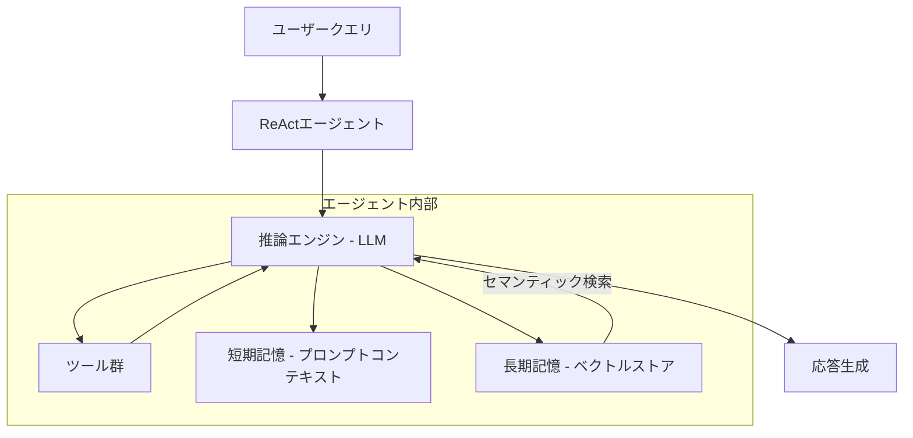
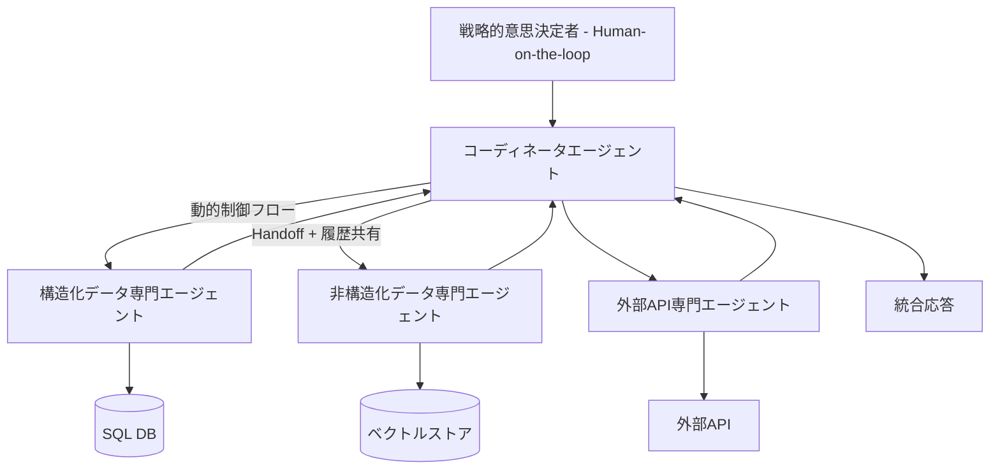

## 論文概要（Abstract）

本記事は [2601.03328](https://arxiv.org/abs/2601.03328) の解説記事です。

この論文は、LLM（大規模言語モデル）を活用したマルチエージェントシステム（MAS）の設計パターンとパラダイムを体系化し、通信セキュリティ・国家資産管理・公共事業カスタマーサービスの3つの産業ドメインでケーススタディを通じた実証評価を行った研究です。著者らは、MASアーキテクチャがプロトタイプ開発を加速する一方、LLMの出力変動性やハルシネーションが本番環境への移行における主要な障壁であると報告しています。

この記事は [Zenn記事: Semantic Kernel×Azure AI FoundryでAIエージェントを本番デプロイする](https://zenn.dev/0h_n0/articles/fd126bdee7c768) の深掘りです。

## 情報源

- **arXiv ID**: 2601.03328
- **URL**: [https://arxiv.org/abs/2601.03328](https://arxiv.org/abs/2601.03328)
- **著者**: Harri Renney, Maxim N Nethercott, Nathan Renney, Peter Hayes（Kaze Technologies / University of the West of England）
- **発表年**: 2026
- **分野**: cs.MA（マルチエージェントシステム）
- **掲載誌**: Journal on Artificial Intelligence, Vol. 8, No. 1, pp. 231-257

## 背景と動機（Background & Motivation）

LLMの能力向上に伴い、単一のエージェントに多数のツールを持たせるアプローチが広がっています。しかし著者らは、ツールキットが8〜12個を超えるとエージェントの性能が劣化する傾向があることを先行研究から指摘しています（論文Section 4.2より）。コンテキストウィンドウの過負荷と認知的干渉が原因とされています。

この課題に対し、機能を複数の専門エージェントに分割するMASアプローチが注目されています。しかし、MASの設計パターンに関する既存研究は、狭いドメイン固有の事例研究か、MITのNANDA等の壮大なビジョン的フレームワークに二極化しており、産業応用に必要な実践的な設計指針が不足していると著者らは主張しています（論文Section 2.3より）。

本論文は、この間隙を埋めるべく、産業現場で使われている設計パターンを体系化し、3つのケーススタディで実証評価することを目的としています。

## 主要な貢献（Key Contributions）

著者らが報告している本論文の主要な貢献は以下の3点です。

- **貢献1**: LLMベースMASの設計パターンを制御フロー・インタラクション形式・履歴共有・ネットワーク構成・人間関与の5軸で分類する体系的タクソノミー（論文Table 1）の提示
- **貢献2**: Single Information Environment（SIE）という、構造化・非構造化データを統合するデータ中心のアーキテクチャパターンの提案
- **貢献3**: 通信セキュリティ・国家資産管理・公共事業カスタマーサービスの3つの実産業ドメインにおけるケーススタディによる実証評価

## 技術的詳細（Technical Details）

### ReActエージェントの構成要素

論文Section 4.1では、ReActエージェントの4つの構成要素が定義されています。



エージェントの実行ループは、以下の4段階を完了まで反復します。

1. **クエリ処理**: ユーザー入力の解析と意図理解
2. **ツール活用**: 適切なツールの選択と実行
3. **情報処理（Observation）**: ツール出力の解釈
4. **合成・応答**: 最終回答の生成

### MAS設計パターンのタクソノミー

論文Table 1で提示されている設計軸の分類を以下に整理します。

| 設計軸 | 選択肢 | 説明 |
|--------|--------|------|
| **制御フロー** | Explicit / Dynamic | 事前定義のグラフ辺 vs LLMが実行時に判断 |
| **インタラクション形式** | Handoff / Tool Flow | エージェント間の制御委譲 vs ツールとしての呼び出し |
| **履歴共有** | Full Trace / Final Results | 推論過程全体の共有 vs 最終結果のみ共有 |
| **ネットワーク構成** | Supervisor / Swarm / Hierarchical / SIE | 中央管理 / 自律分散 / 階層型 / データ中心型 |
| **人間関与** | Human-in-the-loop / Human-on-the-loop | 各ステップで介入 / 戦略レベルで監視 |

著者らは、これらの設計軸の組み合わせによって、ドメイン固有の要件に適合するMASアーキテクチャを構成できると述べています。

### Single Information Environment（SIE）アーキテクチャ

SIEは本論文が提案するデータ中心のMASアーキテクチャパターンです。各エージェントが特定のデータソースに特化し、コーディネータがクエリをルーティングします。



SIEの特徴は、異なるスキーマの構造化データと非構造化データを、事前にスキーマ統合することなく自然言語インターフェースで橋渡しする点にあります。

### ツール数と性能の関係

著者らが先行研究から引用している、エージェントのツール数と性能の関係を定式化すると、以下のように表現できます。

$$
P(\text{correct action} \mid \mathcal{T}) \propto \frac{1}{|\mathcal{T}|^{\alpha}} \quad \text{for } |\mathcal{T}| > \tau
$$

ここで、
- $\mathcal{T}$: エージェントに割り当てられたツールの集合
- $|\mathcal{T}|$: ツール数
- $\alpha$: 劣化係数（$\alpha > 0$）
- $\tau$: 性能劣化が始まる閾値（論文では8〜12と報告）

この関係式は筆者の解釈による定式化であり、論文に直接記載されたものではありませんが、ツール数増加に伴う性能劣化の傾向を表現しています。MASでは各エージェントのツール数を $\tau$ 以下に保つことで、この劣化を回避できます。

## 実装のポイント（Implementation）

### Pythonでの基本的なMASオーケストレータの実装例

論文で示されたSIEパターンに基づく、コーディネータエージェントの基本設計を以下に示します。

```python
from dataclasses import dataclass
from enum import Enum
from typing import Protocol


class ControlFlow(Enum):
    EXPLICIT = "explicit"
    DYNAMIC = "dynamic"


class InteractionStyle(Enum):
    HANDOFF = "handoff"
    TOOL_FLOW = "tool_flow"


class HistorySharing(Enum):
    FULL_TRACE = "full_trace"
    FINAL_RESULTS = "final_results"


@dataclass(frozen=True)
class AgentConfig:
    """MASエージェントの設計パターン設定（論文Table 1に基づく）"""
    control_flow: ControlFlow
    interaction_style: InteractionStyle
    history_sharing: HistorySharing
    max_tools: int = 10  # 論文推奨: 8-12以下


class SpecialistAgent(Protocol):
    """専門エージェントのインターフェース"""
    async def process(self, query: str, context: dict[str, str]) -> str: ...
    @property
    def domain(self) -> str: ...


class SIECoordinator:
    """Single Information Environmentコーディネータ

    論文Section 4.2のSIEパターンに基づき、
    クエリを適切な専門エージェントにルーティングする。
    """
    def __init__(
        self,
        agents: list[SpecialistAgent],
        config: AgentConfig,
    ) -> None:
        self._agents = {agent.domain: agent for agent in agents}
        self._config = config

    async def route_query(self, query: str) -> str:
        """クエリを分析し、適切な専門エージェントにルーティングする"""
        relevant_agents = self._select_agents(query)

        results: list[str] = []
        for agent in relevant_agents:
            context = (
                {"history": "\n".join(results)}
                if self._config.history_sharing == HistorySharing.FULL_TRACE
                else {}
            )
            result = await agent.process(query, context)
            results.append(result)

        return self._synthesize(results)

    def _select_agents(self, query: str) -> list[SpecialistAgent]:
        """クエリに基づいて関連する専門エージェントを選択する"""
        # 本番ではLLMによる動的ルーティングを実装
        return list(self._agents.values())

    def _synthesize(self, results: list[str]) -> str:
        """複数エージェントの結果を統合する"""
        return "\n---\n".join(results)
```

### 実装上の注意点

- **ツール数の制限**: 各専門エージェントのツール数は8〜12以下に保つことが推奨されている（論文Section 4.2）
- **履歴共有の選択**: Full Traceは情報量が多いがコンテキスト消費が大きい。最終結果のみの共有はトークン効率が良いが、推論の文脈が失われる
- **動的 vs 明示的制御フロー**: 動的制御フローはLLMの判断に依存するため、出力変動性のリスクがある。本番環境では明示的制御フローとの組み合わせが安全
- **クリーンアップ**: クラウドホスト型エージェント（例: Azure AI Agent Service）ではスレッドとエージェントの明示的な削除が必須

## Production Deployment Guide

### AWS実装パターン（コスト最適化重視）

論文で示されたSIEアーキテクチャをAWS上にデプロイする際の、トラフィック量別推奨構成を示します。

| 規模 | 月間リクエスト | 推奨構成 | 月額コスト | 主要サービス |
|------|--------------|---------|-----------|------------|
| **Small** | ~3,000 (100/日) | Serverless | $50-150 | Lambda + Bedrock + DynamoDB |
| **Medium** | ~30,000 (1,000/日) | Hybrid | $300-800 | Lambda + ECS Fargate + ElastiCache |
| **Large** | 300,000+ (10,000/日) | Container | $2,000-5,000 | EKS + Karpenter + EC2 Spot |

**Small構成の詳細**（月額$50-150）:
- **Lambda**: エージェントごとに1関数、1GB RAM、60秒タイムアウト（$20/月）
- **Bedrock**: Claude 3.5 Haiku、Prompt Caching有効（$80/月）
- **DynamoDB**: On-Demand、エージェント間の状態共有用（$10/月）
- **SQS**: エージェント間メッセージング（$5/月）
- **CloudWatch**: 基本監視（$5/月）

**Medium構成の詳細**（月額$300-800）:
- **ECS Fargate**: コーディネータエージェント常駐、0.5 vCPU × 2タスク（$120/月）
- **Lambda**: 専門エージェントはイベント駆動（$50/月）
- **Bedrock**: Claude 3.5 Sonnet、Batch API活用（$400/月）
- **ElastiCache Redis**: セッション・履歴キャッシュ、cache.t3.micro（$15/月）

**Large構成の詳細**（月額$2,000-5,000）:
- **EKS**: コントロールプレーン（$72/月）
- **EC2 Spot**: g5.xlarge × 2-4台、Karpenter自動管理（平均$800/月）
- **Bedrock Batch**: 50%割引活用（$2,000/月）
- **S3**: エージェント間共有ストレージ（$20/月）
- **CloudWatch + X-Ray**: 詳細監視（$100/月）

**コスト削減テクニック**:
- Spot Instances使用で最大90%削減（EKS + Karpenter）
- Bedrock Batch API使用で50%削減（非リアルタイム処理）
- Prompt Caching有効化で30-90%削減（システムプロンプト固定）
- アイドルタイムのAuto Scaling to Zero（Fargate/Lambda）

**コスト試算の注意事項**: 上記は2026年11月時点のAWS ap-northeast-1（東京）リージョン料金に基づく概算値です。実際のコストはトラフィックパターン、リージョン、バースト使用量により変動します。最新料金は [AWS料金計算ツール](https://calculator.aws/) で確認してください。

### Terraformインフラコード

**Small構成（Serverless）: Lambda + Bedrock + DynamoDB**

```hcl
module "vpc" {
  source  = "terraform-aws-modules/vpc/aws"
  version = "~> 5.0"

  name = "mas-vpc"
  cidr = "10.0.0.0/16"
  azs  = ["ap-northeast-1a", "ap-northeast-1c"]
  private_subnets = ["10.0.1.0/24", "10.0.2.0/24"]

  enable_nat_gateway   = false
  enable_dns_hostnames = true
}

resource "aws_iam_role" "coordinator_lambda" {
  name = "mas-coordinator-role"

  assume_role_policy = jsonencode({
    Version = "2012-10-17"
    Statement = [{
      Action    = "sts:AssumeRole"
      Effect    = "Allow"
      Principal = { Service = "lambda.amazonaws.com" }
    }]
  })
}

resource "aws_iam_role_policy" "bedrock_invoke" {
  role = aws_iam_role.coordinator_lambda.id

  policy = jsonencode({
    Version = "2012-10-17"
    Statement = [{
      Effect   = "Allow"
      Action   = ["bedrock:InvokeModel", "bedrock:InvokeModelWithResponseStream"]
      Resource = "arn:aws:bedrock:ap-northeast-1::foundation-model/anthropic.claude-3-5-haiku*"
    }]
  })
}

resource "aws_lambda_function" "coordinator" {
  filename      = "coordinator.zip"
  function_name = "mas-coordinator"
  role          = aws_iam_role.coordinator_lambda.arn
  handler       = "index.handler"
  runtime       = "python3.12"
  timeout       = 60
  memory_size   = 1024

  environment {
    variables = {
      BEDROCK_MODEL_ID    = "anthropic.claude-3-5-haiku-20241022-v1:0"
      DYNAMODB_TABLE      = aws_dynamodb_table.agent_state.name
      CONTROL_FLOW        = "dynamic"
      MAX_TOOLS_PER_AGENT = "10"
    }
  }
}

resource "aws_dynamodb_table" "agent_state" {
  name         = "mas-agent-state"
  billing_mode = "PAY_PER_REQUEST"
  hash_key     = "session_id"
  range_key    = "agent_id"

  attribute {
    name = "session_id"
    type = "S"
  }
  attribute {
    name = "agent_id"
    type = "S"
  }

  ttl {
    attribute_name = "expire_at"
    enabled        = true
  }
}

resource "aws_cloudwatch_metric_alarm" "coordinator_errors" {
  alarm_name          = "mas-coordinator-errors"
  comparison_operator = "GreaterThanThreshold"
  evaluation_periods  = 1
  metric_name         = "Errors"
  namespace           = "AWS/Lambda"
  period              = 300
  statistic           = "Sum"
  threshold           = 5
  alarm_description   = "コーディネータエージェントのエラー率異常"

  dimensions = {
    FunctionName = aws_lambda_function.coordinator.function_name
  }
}
```

**Large構成（Container）: EKS + Karpenter + Spot Instances**

```hcl
module "eks" {
  source  = "terraform-aws-modules/eks/aws"
  version = "~> 20.0"

  cluster_name    = "mas-cluster"
  cluster_version = "1.31"

  vpc_id     = module.vpc.vpc_id
  subnet_ids = module.vpc.private_subnets

  cluster_endpoint_public_access = true
  enable_cluster_creator_admin_permissions = true
}

resource "kubectl_manifest" "karpenter_provisioner" {
  yaml_body = <<-YAML
    apiVersion: karpenter.sh/v1alpha5
    kind: Provisioner
    metadata:
      name: mas-spot-provisioner
    spec:
      requirements:
        - key: karpenter.sh/capacity-type
          operator: In
          values: ["spot"]
        - key: node.kubernetes.io/instance-type
          operator: In
          values: ["m5.xlarge", "m5.2xlarge", "c5.xlarge"]
      limits:
        resources:
          cpu: "32"
          memory: "128Gi"
      ttlSecondsAfterEmpty: 30
  YAML
}

resource "aws_budgets_budget" "mas_monthly" {
  name         = "mas-monthly-budget"
  budget_type  = "COST"
  limit_amount = "5000"
  limit_unit   = "USD"
  time_unit    = "MONTHLY"

  notification {
    comparison_operator        = "GREATER_THAN"
    threshold                  = 80
    threshold_type             = "PERCENTAGE"
    notification_type          = "ACTUAL"
    subscriber_email_addresses = ["ops@example.com"]
  }
}
```

### セキュリティベストプラクティス

- **IAMロール**: 最小権限の原則。各Lambda/コンテナに専用ロール、Bedrockモデル単位でリソース制限
- **ネットワーク**: EKSは `cluster_endpoint_public_access = false` を推奨（VPN経由アクセス）
- **シークレット管理**: AWS Secrets Manager使用、環境変数ハードコード禁止
- **暗号化**: S3/DynamoDB/EBS全てKMS暗号化、転送中はTLS 1.2以上
- **監査**: CloudTrail全リージョン有効化、Config/GuardDuty有効化

### 運用・監視設定

**CloudWatch Logs Insights クエリ**:

```sql
-- エージェント間ルーティングの分析
fields @timestamp, agent_id, query_type, duration_ms, token_count
| stats avg(duration_ms) as avg_latency, sum(token_count) as total_tokens by agent_id
| sort total_tokens desc

-- コスト異常検知: 1時間あたりのトークン使用量
fields @timestamp, model_id, input_tokens, output_tokens
| stats sum(input_tokens + output_tokens) as total_tokens by bin(1h)
| filter total_tokens > 100000
```

**CloudWatch アラーム（Python）**:

```python
import boto3

cloudwatch = boto3.client("cloudwatch")

cloudwatch.put_metric_alarm(
    AlarmName="mas-bedrock-token-spike",
    ComparisonOperator="GreaterThanThreshold",
    EvaluationPeriods=1,
    MetricName="TokenUsage",
    Namespace="Custom/MAS",
    Period=3600,
    Statistic="Sum",
    Threshold=500000,
    ActionsEnabled=True,
    AlarmActions=["arn:aws:sns:ap-northeast-1:123456789:cost-alerts"],
    AlarmDescription="MASトークン使用量異常（コスト急増）",
)
```

**X-Ray トレーシング設定**:

```python
from aws_xray_sdk.core import xray_recorder, patch_all

patch_all()


@xray_recorder.capture("coordinator_route")
def route_to_specialist(query: str, agent_id: str) -> str:
    """コーディネータからの専門エージェントへのルーティングをトレースする"""
    xray_recorder.put_annotation("agent_id", agent_id)
    xray_recorder.put_annotation("control_flow", "dynamic")
    xray_recorder.put_metadata("query_length", len(query))
    # エージェント呼び出し処理
    return result
```

### コスト最適化チェックリスト

**アーキテクチャ選択**:
- [ ] ~100 req/日 → Lambda + Bedrock (Serverless) — $50-150/月
- [ ] ~1000 req/日 → ECS Fargate + Bedrock (Hybrid) — $300-800/月
- [ ] 10000+ req/日 → EKS + Spot Instances (Container) — $2,000-5,000/月

**リソース最適化**:
- [ ] EC2: Spot Instances優先（最大90%削減、Karpenter自動管理）
- [ ] Reserved Instances: 1年コミットで72%削減（予測可能な負荷）
- [ ] Lambda: メモリサイズ最適化（CloudWatch Insights分析）
- [ ] ECS/EKS: アイドルタイムのスケールダウン（夜間0台）
- [ ] Savings Plans: Compute Savings Plans検討

**LLMコスト削減**:
- [ ] Bedrock Batch API: 50%割引（非リアルタイム処理）
- [ ] Prompt Caching: 30-90%削減（システムプロンプト固定）
- [ ] モデル選択: 簡易タスクはHaiku ($0.25/MTok)、複雑タスクはSonnet ($3/MTok)
- [ ] max_tokens設定で過剰生成防止
- [ ] 不要なエージェントの非活性化（論文で指摘されたMASの経済的利点）

**監視・アラート**:
- [ ] AWS Budgets: 月額予算設定（80%で警告、100%でアラート）
- [ ] CloudWatch アラーム: トークン使用量スパイク検知
- [ ] Cost Anomaly Detection: 自動異常検知
- [ ] 日次コストレポート: SNS/Slackへ自動送信

**リソース管理**:
- [ ] 未使用リソース削除: Trusted Advisor活用
- [ ] タグ戦略: 環境別（dev/staging/prod）、エージェント別でコスト可視化
- [ ] DynamoDB TTL: 古いセッション自動削除
- [ ] S3ライフサイクル: 古い履歴データ30日で削除

## 実験結果（Results）

### ケーススタディの概要

著者らは3つの産業ドメインでケーススタディを実施しています（論文Table 2より）。

| ID | ドメイン | アーキテクチャ | 評価方法 |
|----|---------|--------------|---------|
| CS1 | 通信セキュリティ（SOC） | SIE | ステークホルダーフィードバック |
| CS2 | 国家資産管理 | SIE | ステークホルダーフィードバック + クエリ別レビュー |
| CS3 | 公共事業カスタマーサービス | Hierarchical | UAT、Likertスケール評価 |

### CS3（カスタマーサービス）の定量的結果

CS3では最も詳細な定量評価が報告されています（論文Section 5.3より）。

- **スループット**: MASで約5通/分 vs 手動で約3通/分（ビジネス推定値）
- **単位コスト**: MASで約£0.05/通 vs 手動で約£0.33/通（ビジネス推定値）
- **開発時間**: 正規表現ベースラインは初回テスト可能出力まで約4.5時間、MAS専門エージェントは1時間未満（リード開発者の報告）
- **メール分類精度**: 参加者間の判断を集約した結果、100%の正確性（3名の参加者、24件の実メール）

**UAT評価（Likertスケール、1-5）**:
- 5つの評価軸: 正確性、有用性、明確性、根拠付け、安全性
- 各軸で平均3/5以上のスコア
- 明確性と安全性は平均約4/5
- 安全性のスコアは参加者間で3.3〜5.0と変動幅が大きい

### CS2（国家資産管理）の評価

CS2ではMicrosoft Azure上にデプロイされ、10名の上級スタッフが1ヶ月間評価を行っています（論文Section 5.2より）。

- フィードバックの61%がポジティブな傾向（語彙ベースの感情分類による）
- 著者ら自身が「信頼性と一貫性に改善の余地がある」と報告

### 開発速度に関する知見

論文Section 6.1では、CS3のプロトタイプとUATが1ヶ月以内に完了したのに対し、以前の2つの外部委託業者は「数ヶ月かけても実用可能なソリューションを提供できなかった」と報告されています。ただし著者らは、本番移行には「広範なチューニング」が必要であり、LLMの出力変動性と計算コストが「初期の時間節約を相殺する可能性がある」と注意を促しています。

## 実運用への応用（Practical Applications）

### Semantic KernelとMAS設計パターンの対応

本論文の設計パターンは、Zenn記事で解説されているSemantic Kernel + Azure AI Foundryの構成と直接的に対応します。

| 論文の設計パターン | Semantic Kernel / Azure AI Foundryでの実装 |
|------------------|------------------------------------------|
| コーディネータエージェント | Semantic Kernel の Kernel + Plugin構成 |
| 動的制御フロー | AzureAIAgentの動的ツール呼び出し |
| 履歴共有（Full Trace） | AzureAIAgentThreadによるスレッド管理 |
| SIEパターン | Foundry Agent Service + 複数データソースConnector |
| Human-on-the-loop | ASP.NET Core UIからの戦略的介入 |

### プロダクション視点での注意点

- **スケーリング**: 論文のCS1（通信セキュリティ）ではDockerコンテナによるオンプレミスデプロイが採用されている。クラウド環境ではEKS + Karpenterによる自動スケーリングが有効
- **レイテンシ**: MASではエージェント間の通信オーバーヘッドが加算される。論文では約5通/分のスループットが報告されており、リアルタイム要件が厳しい場合は明示的制御フローの採用を検討すべき
- **コスト効率**: 論文のCS3で報告された£0.05/通（MAS）vs £0.33/通（手動）の比較は、LLM APIコストのみの比較ではなく、人件費を含むビジネス推定値である点に注意
- **LLM変動性**: 著者らが繰り返し指摘しているように、LLMの出力変動性は本番環境での最大のリスク要因。Semantic KernelのFilter機能による出力検証が有効な対策となる

## 関連研究（Related Work）

- **ReAct (Yao et al., 2023)**: 推論（Reasoning）と行動（Acting）を交互に行うエージェントパターン。本論文のReActエージェント定義の基礎となっている
- **AutoGen (Wu et al., 2023)**: Microsoftが開発したマルチエージェント会話フレームワーク。本論文ではMASの代表的なオープンソース実装として引用されている
- **NANDA (MIT)**: 分散型AIエージェントのインターネット規模のフレームワーク。本論文はNANDAのようなビジョン的研究と狭いドメイン研究の間を埋める位置づけ

## まとめと今後の展望

本論文は、LLMベースMASの設計パターンを5つの軸で体系化し、3つの産業ケーススタディで実証評価を行っています。主要な知見として以下が報告されています。

- MASアーキテクチャはプロトタイプ開発を加速し、開発コストを削減できる（CS3で1ヶ月以内にプロトタイプ + UAT完了）
- 各エージェントのツール数を8〜12以下に制限するMASアプローチは、単一エージェントの性能劣化を回避する有効な手段
- しかし、LLMの出力変動性、ハルシネーション、解釈可能性の課題は本番成熟度への主要な障壁として残存

著者らは今後の研究方向として、反復的ユーザースタディ、検証パイプライン、ガードレールの構築を挙げています。Semantic Kernel + Azure AI Foundryを用いたMAS開発においても、これらの課題への対処が本番デプロイの鍵となります。

## 参考文献

- **arXiv**: [https://arxiv.org/abs/2601.03328](https://arxiv.org/abs/2601.03328)
- **掲載誌**: Journal on Artificial Intelligence, Vol. 8, No. 1, pp. 231-257, 2026
- **データ**: [https://osf.io/4dzmv/overview](https://osf.io/4dzmv/overview)
- **Related Zenn article**: [https://zenn.dev/0h_n0/articles/fd126bdee7c768](https://zenn.dev/0h_n0/articles/fd126bdee7c768)

---

:::message
本記事はAI（Claude Code）により自動生成されました。内容の正確性については論文原文と照合していますが、実際の利用時は原論文もご確認ください。
:::
