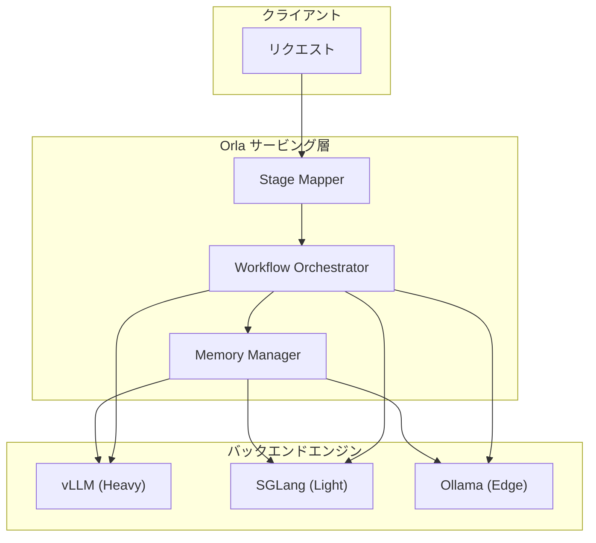
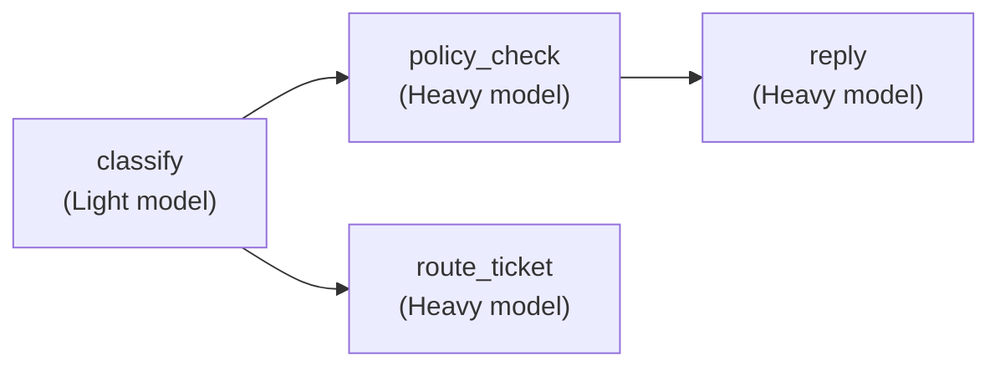

## 論文概要（Abstract）

本記事は [Orla (arXiv:2603.13605)](https://arxiv.org/abs/2603.13605) の解説記事です。

Orlaは、LLMベースのマルチエージェントシステムを本番環境で運用するためのサービングライブラリである。既存の推論エンジン（vLLM、SGLang等）の上位レイヤーとして動作し、個別リクエストではなくワークフロー全体を最適化単位として扱うことで、レイテンシとコストの同時削減を目指す。

著者らの評価によると、ステージマッピングによりウォールクロック時間が38%削減、平均完了時間が60%削減、推定推論コストが35%削減されたと報告されている（Figure 2a-cより）。

この記事は [Zenn記事: Semantic Kernel×Azure AI FoundryでAIエージェントを本番デプロイする](https://zenn.dev/0h_n0/articles/fd126bdee7c768) の深掘りです。

## 情報源

- **arXiv ID**: 2603.13605
- **URL**: [https://arxiv.org/abs/2603.13605](https://arxiv.org/abs/2603.13605)
- **著者**: Rana Shahout, Hayder Tirmazi, Minlan Yu, Michael Mitzenmacher
- **所属**: Harvard University, Boston University
- **発表年**: 2026
- **分野**: cs.AI
- **コード**: [https://github.com/harvard-cns/orla](https://github.com/harvard-cns/orla)（オープンソース）

## 背景と動機（Background & Motivation）

現在のLLMベースのエージェントシステムは、コード生成、金融分析、科学的発見など多岐にわたる分野で利用が進んでいる。これらのシステムは複数のLLM呼び出し（ステージ）を連鎖させたワークフローとして構成されるが、現行のサービングスタックには2つの課題が存在する。

**第一の課題は異種性（Heterogeneity）**である。エージェントワークフロー内の各ステージは、要求される能力が異なる。分類タスクには軽量モデルで十分な場合がある一方、ポリシーチェックや回答生成には高性能モデルが必要になる。さらに、バックエンド推論エンジン（vLLM、SGLang、Ollama等）やハードウェア（データセンターGPU、エッジデバイス）も多様である。

**第二の課題はワークフロー横断の調整（Coordination）**である。vLLMやSGLangといった既存の推論エンジンは、連続バッチング、KVキャッシュ管理、プリフィル/デコードスケジューリングなど、個別リクエストレベルの最適化には長けている。しかし、ワークフロー内のステージ間の依存関係、コンテキスト伝搬、メモリ再利用といったワークフロー横断的な判断は行わない。

Semantic KernelやAzure AI Foundry Agent Serviceのようなオーケストレーション層は、LangGraphやAutoGenと同様にサービング層をブラックボックスとして扱っており、サービングレベルの最適化判断には関与しない。Orlaはこのギャップを埋めるミドルウェアとして設計されている。

## 主要な貢献（Key Contributions）

著者らは以下の3つの貢献を主張している。

- **ステージマッパー（Stage Mapper）**: ワークフロー定義と利用可能なインフラを入力として、各ステージに最適なモデル・バックエンド・推論パラメータを割り当てる実行計画を生成する
- **ワークフローオーケストレーター（Workflow Orchestrator）**: ワークフローをDAG（有向非巡回グラフ）としてモデル化し、ステージ間の依存関係を管理しつつ、2段階スケジューリングとコンテキスト伝搬を提供する
- **メモリマネージャー（Memory Manager）**: リクエスト単位ではなくワークフロー単位でKVキャッシュを管理し、ステージ間のキャッシュ再利用とメモリ圧迫時の解放を制御する

これら3つのコンポーネントはプラガブルに設計されており、バックエンドはOpenAI互換HTTPエンドポイントを持つ任意の推論エンジンと接続可能である。

## 技術的詳細（Technical Details）

### コア抽象化

Orlaは3つの基本抽象化を定義する。

- **ステージ（Stage）**: ワークフロー内の1つのLLM呼び出し。モデル、バックエンド、推論パラメータ（温度、構造化出力モード等）を持つ
- **ワークフロー（Workflow）**: ステージのDAG。ステージ間の依存関係とコンテキスト伝搬ルールを含む
- **バックエンド（Backend）**: 推論エンジンのインスタンス。OpenAI互換APIを提供するサーバー（vLLM、SGLang、Ollama等）

### アーキテクチャ全体像



### ステージマッパーの詳細

ステージマッパーは、ワークフロー定義と利用可能なインフラストラクチャを入力として受け取り、各ステージにモデル・バックエンド・パラメータを割り当てる実行計画を出力する。2つの戦略が提供される。

**明示的マッピング**: 開発者がステージごとにバックエンドとパラメータを直接指定する。Orlaはバックエンドの有効性とパラメータの互換性を検証し、設定エラーを実行前に検出する。

**動的ルーティング**: `StageMapper`インターフェースを実装したカスタムマッパーを使用する。組み込みの`OneBitStageMapper`は、軽量なLLM呼び出しで各リクエストを「simple」か「complex」に分類し、軽量モデルまたは重量モデルにルーティングする。

```python
from orla import StageMapper, Stage, Backend

class OneBitStageMapper(StageMapper):
    """リクエストの複雑度に基づいて軽量/重量モデルに振り分ける"""

    def __init__(self, light_backend: Backend, heavy_backend: Backend) -> None:
        self.light = light_backend
        self.heavy = heavy_backend

    def map(self, stage: Stage, request_context: dict) -> Backend:
        complexity = self._classify_complexity(request_context)
        if complexity == "simple":
            return self.light
        return self.heavy

    def _classify_complexity(self, context: dict) -> str:
        # 軽量LLM呼び出しで複雑度を二値分類
        # 実装では分類用のプロンプトを送信する
        ...
```

### ワークフローオーケストレーターの詳細

ワークフローオーケストレーターはワークフローをDAGとしてモデル化する。各ステージは上流のすべての依存ステージが完了した時点でエンキューされる。

**2段階スケジューリング**:

1. **ステージスケジューラー**: どのステージのサブキューから次に処理するかを決定する。デフォルトはFCFS（先着順）で、キュー先頭の到着時刻が最も早いステージを選択する。開発者が優先度ヒントを付与する優先度スケジューリングも利用可能
2. **リクエストスケジューラー**: 選択されたステージキュー内の次のリクエストを決定する。デフォルトはFCFS

バックエンドキューはステージごとのサブキューに分割され、グローバルに一意なステージIDで識別される。著者らによれば、プロンプト長に基づくShortest Job Firstスケジューラーは20行未満のコードで実装可能とのことである。

カスタマーサポートの実行例における依存関係DAGを示す。



**コンテキスト伝搬**: 各ステージはビルダー関数を持ち、上流ステージの出力（テキスト、構造化JSON、ツール呼び出し結果）を受け取ってプロンプトを構築する。`classify`の出力は`policy_check`のビルダーに渡され、`policy_check`の結果（`needs_escalation`フラグ等）は`reply`のビルダーで分岐条件として使用される。

### メモリマネージャーの詳細

メモリマネージャーは、リクエスト単位ではなくワークフロー単位でKVキャッシュを管理する。SGLangのRadixAttentionやvLLMのPagedAttentionなどのリクエストレベルのキャッシュ管理では、LRU方式のエビクションがワークフロー実行中にキャッシュを追い出し、再プリフィルが発生する場合がある。

Orlaはワークフローレベルのシグナル（ステージ遷移、ワークフロー完了、ステージ依存関係、予測される再利用パターン、バックエンド遷移）に基づいてキャッシュポリシーを適用する。

**3つの組み込みポリシー**:

1. **Preserve on small increments**: 同一バックエンド上の連続ステージがコンテキストを僅かに拡張する場合、キャッシュを保持する
2. **Flush at workflow boundaries**: ワークフロー完了時またはモデル/バックエンド切り替え時にキャッシュを回収する
3. **Flush under pressure**: メモリ使用率が高い場合、アイドルワークフローのキャッシュを追い出す

開発者はステージ単位で`preserve`や`flush`のヒントを設定可能であり、ヒントが未設定の場合はOrlaのデフォルトポリシーが適用され、最終的にバックエンドのエビクションにフォールバックする。

## 実装のポイント（Implementation）

Orlaの実装において、実務上重要なポイントを整理する。

**バックエンド接続の抽象化**: バックエンドはOpenAI互換HTTPエンドポイントを持つ任意のサーバーとプラガブルに接続できる。バックエンドの切り替えはエンドポイントURLの変更のみで可能であり、これはSemantic KernelのAzureOpenAI互換コネクタと設計思想が共通する。

**シミュレーションバックエンド**: Orlaにはプリフィルとデコードのレイテンシをパラメトリックにモデル化するシミュレーションバックエンドが含まれており、GPU不要のCPU環境での実験が可能である。プロトタイピングやCI/CDパイプラインでの検証に有用である。

**ワークフロー定義のAPI**: ステージとその依存関係はPython（またはGo）のコードで定義する。各ステージに対してバックエンド、実行モード（`ExecutionModeAgentLoop`等）、レスポンスフォーマット（構造化出力対応）を指定する。

```python
from orla import Workflow, Stage, Backend, ExecutionMode

def build_support_workflow(
    light_backend: Backend,
    heavy_backend: Backend,
) -> Workflow:
    """カスタマーサポートワークフローのDAG定義"""
    workflow = Workflow(name="customer_support")

    classify = Stage(
        name="classify",
        backend=light_backend,
        response_format="structured",
    )
    policy_check = Stage(
        name="policy_check",
        backend=heavy_backend,
        execution_mode=ExecutionMode.AGENT_LOOP,
        depends_on=[classify],
    )
    reply = Stage(
        name="reply",
        backend=heavy_backend,
        execution_mode=ExecutionMode.AGENT_LOOP,
        depends_on=[policy_check],
    )
    route_ticket = Stage(
        name="route_ticket",
        backend=heavy_backend,
        execution_mode=ExecutionMode.AGENT_LOOP,
        depends_on=[classify],
    )

    workflow.add_stages([classify, policy_check, reply, route_ticket])
    return workflow
```

## Production Deployment Guide

### AWS実装パターン（コスト最適化重視）

Orlaのアーキテクチャをベースに、マルチエージェントLLMワークフローをAWSにデプロイする構成を示す。

**トラフィック量別の推奨構成**:

| 規模 | 月間リクエスト | 推奨構成 | 月額コスト | 主要サービス |
|------|--------------|---------|-----------|------------|
| **Small** | ~3,000 (100/日) | Serverless | $50-150 | Lambda + Bedrock + DynamoDB |
| **Medium** | ~30,000 (1,000/日) | Hybrid | $300-800 | Lambda + ECS Fargate + ElastiCache |
| **Large** | 300,000+ (10,000/日) | Container | $2,000-5,000 | EKS + Karpenter + EC2 Spot |

**Small構成の詳細**（月額$50-150）:
- **Lambda**: 1GB RAM、60秒タイムアウト（$20/月）
- **Bedrock**: Claude 3.5 Haiku、Prompt Caching有効（$80/月）
- **DynamoDB**: On-Demand、ワークフロー状態管理（$10/月）
- **CloudWatch**: 基本監視（$5/月）
- **API Gateway**: REST API（$5/月）

**Medium構成の詳細**（月額$300-800）:
- **Lambda**: イベント処理・ステージマッパー（$50/月）
- **ECS Fargate**: 0.5 vCPU × 1GB RAM × 2タスク、Orlaサーバー稼働（$120/月）
- **Bedrock**: Claude 3.5 Sonnet、Batch API活用（$400/月）
- **ElastiCache Redis**: cache.t3.micro、KVキャッシュ状態管理（$15/月）
- **ALB**: ロードバランサー（$20/月）

**Large構成の詳細**（月額$2,000-5,000）:
- **EKS**: コントロールプレーン（$72/月）
- **EC2 Spot Instances**: g5.xlarge × 2-4台、自己ホスト推論エンジン（平均$800/月）
- **Karpenter**: 自動スケーリング（追加コストなし）
- **Bedrock Batch**: 50%割引活用（$2,000/月）
- **S3**: KVキャッシュスナップショットストレージ（$20/月）
- **CloudWatch + X-Ray**: 詳細監視（$100/月）

**コスト削減テクニック**:
- Spot Instances使用で最大90%削減（EKS + Karpenter）
- Reserved Instances購入で最大72%削減（1年コミット）
- Bedrock Batch API使用で50%削減
- Prompt Caching有効化で30-90%削減
- Orlaのステージマッピングにより軽量モデル活用で35%削減（論文Figure 2cより）

**コスト試算の注意事項**: 上記は2026年11月時点のAWS ap-northeast-1（東京）リージョン料金に基づく概算値です。実際のコストはトラフィックパターン、リージョン、バースト使用量により変動します。最新料金は [AWS料金計算ツール](https://calculator.aws/) で確認してください。

### Terraformインフラコード

**Small構成（Serverless）の主要リソース**:

```hcl
resource "aws_lambda_function" "orla_handler" {
  filename      = "lambda.zip"
  function_name = "orla-workflow-handler"
  role          = aws_iam_role.lambda_orla.arn
  handler       = "index.handler"
  runtime       = "python3.12"
  timeout       = 60
  memory_size   = 1024

  environment {
    variables = {
      BEDROCK_MODEL_ID = "anthropic.claude-3-5-haiku-20241022-v1:0"
      DYNAMODB_TABLE   = aws_dynamodb_table.workflow_state.name
    }
  }
}

resource "aws_dynamodb_table" "workflow_state" {
  name         = "orla-workflow-state"
  billing_mode = "PAY_PER_REQUEST"
  hash_key     = "workflow_id"

  attribute { name = "workflow_id"; type = "S" }
  ttl { attribute_name = "expire_at"; enabled = true }
}
```

**Large構成（Container）の主要リソース**:

```hcl
module "eks" {
  source  = "terraform-aws-modules/eks/aws"
  version = "~> 20.0"
  cluster_name    = "orla-inference-cluster"
  cluster_version = "1.31"
  vpc_id     = module.vpc.vpc_id
  subnet_ids = module.vpc.private_subnets
  cluster_endpoint_public_access = true
  enable_cluster_creator_admin_permissions = true
}

resource "kubectl_manifest" "karpenter_nodepool" {
  yaml_body = <<-YAML
    apiVersion: karpenter.sh/v1
    kind: NodePool
    metadata:
      name: gpu-spot-pool
    spec:
      template:
        spec:
          requirements:
            - key: karpenter.sh/capacity-type
              operator: In
              values: ["spot"]
            - key: node.kubernetes.io/instance-type
              operator: In
              values: ["g5.xlarge", "g5.2xlarge"]
      disruption:
        consolidationPolicy: WhenEmpty
        consolidateAfter: 30s
  YAML
}
```

### 運用・監視設定

**CloudWatch Logs Insights クエリ**:

```sql
-- ワークフロー完了時間の分析
fields @timestamp, workflow_id, completion_time_ms
| stats avg(completion_time_ms) as avg_ms,
        pct(completion_time_ms, 95) as p95 by bin(5m)
```

**X-Ray トレーシング設定**:

```python
from aws_xray_sdk.core import xray_recorder, patch_all

patch_all()

@xray_recorder.capture("orla_stage_execution")
def execute_stage(stage_name: str, prompt: str, backend_url: str) -> str:
    xray_recorder.put_annotation("stage", stage_name)
    xray_recorder.put_metadata("prompt_length", len(prompt))
    response = call_backend(backend_url, prompt)
    xray_recorder.put_metadata("output_tokens", response.usage.completion_tokens)
    return response.content
```

### コスト最適化チェックリスト

- [ ] アーキテクチャ選択: トラフィック量に応じてServerless/Hybrid/Container
- [ ] EC2 Spot優先（Karpenter自動管理、最大90%削減）
- [ ] Reserved Instances / Savings Plans検討（72%削減）
- [ ] Orlaステージマッピングで軽量モデルへ動的ルーティング（35%削減）
- [ ] Bedrock Batch API（50%割引）、Prompt Caching（30-90%削減）
- [ ] AWS Budgets + Cost Anomaly Detection有効化
- [ ] CloudWatch アラーム: ワークフローレイテンシ・トークン使用量
- [ ] タグ戦略: 環境別・プロジェクト別コスト可視化
- [ ] 開発環境: 夜間停止、S3ライフサイクルポリシー設定

## 実験結果（Results）

### ステージマッピング実験

著者らはSWE-benchデータセット（2,294リクエスト）を使用して評価を実施している。

**実験設定**:
- ハードウェア: AMD EPYC 7313 × 2（64コア）、528GB RAM、NVIDIA RTX PRO 6000 Blackwell Max-Q（96GB VRAM）
- ベースライン: 全リクエストをQwen3-8B（vLLM）で処理
- Orla: `OneBitStageMapper`でQwen3-4B（simple）とQwen3-8B（complex）に振り分け
- GPU メモリ配分: Qwen3-8B 60%、Qwen3-4B 35%
- 最大コンテキスト: 32,768トークン、温度0

**結果**（論文Figure 2より）:
- 2,294リクエスト中、956件がQwen3-4Bにルーティング（約42%）
- ウォールクロック時間: 38%削減
- 平均完了時間: 60%削減
- 推定推論コスト: 35%削減（クラウド価格の差を仮定）

### KVキャッシュ管理実験

DAG-MATH-Formatted-CoTデータセット（2,894リクエスト、先頭5問題を使用）でキャッシュ管理の効果を評価している。

**比較設定**:
- Qwen3-8B on SGLang
- 戦略(i) flush per request: 各ステージ後にキャッシュを破棄
- 戦略(ii) flush per workflow: Orlaのデフォルト、ステージ間でキャッシュ保持・ワークフロー完了時に破棄

**結果**（論文Figure 3より）:
- ワークフローレベルのキャッシュ管理により、Time-to-First-Token（TTFT）のCDF分布全体が改善
- 具体的なパーセンタイル値は論文テキストに記載されていない

**評価の限界**: 著者ら自身が認めている点として、評価は単一GPUで実施されており、分散環境での挙動は未検証である。また、ThunderAgentなど他のワークフロー対応システムとの直接比較は含まれていない。

## 実運用への応用（Practical Applications）

### Azure AI Foundry Agent Serviceとの接続

Zenn記事で解説したSemantic Kernel + Azure AI Foundryの構成にOrlaの設計思想を適用する方法を考察する。

**ステージマッピングの適用**: Azure AI Foundryのモデルカタログは、GPT-4o、Mistral Large、Llama 4など異なるプロバイダーのモデルを統一エンドポイントで提供する。Orlaの`OneBitStageMapper`と同様に、リクエスト複雑度に基づく動的モデル切り替えをSemantic KernelのサービスID切り替えとして実装可能である。

**ワークフローオーケストレーションの適用**: Azure AI Foundry Agent Serviceはエージェントのライフサイクル管理をクラウド側で担うが、ワークフロー内のステージ間依存管理やスケジューリング最適化はアプリケーション側の責務である。Orlaの2段階スケジューリング（ステージスケジューラー + リクエストスケジューラー）は、高負荷時のマルチエージェント処理における参考設計となる。

**KVキャッシュ管理の示唆**: Semantic Kernelのフィルター機構を使い、ステージ遷移時にキャッシュ制御ヒントをバックエンドに伝達するパターンが考えられる。特に、同一モデル上で連続するステージ間のコンテキスト共有は、Orlaの「Preserve on small increments」ポリシーと同じ動機に基づく。

### スケーリングの考慮事項

- Orlaのバックエンド抽象化はOpenAI互換APIに依存しており、Azure OpenAIエンドポイントとの互換性が高い
- シミュレーションバックエンドを用いたワークフロー設計のプロトタイピングは、GPU確保前のアーキテクチャ検証に有効
- 著者らが報告する35%のコスト削減は、軽量モデルのトークン単価が低い前提に依存する。Bedrockの価格体系（Haiku vs Sonnet）でも同様の構造が成立する

## 関連研究（Related Work）

- **vLLM（Kwon et al., 2023）**: PagedAttentionによるKVキャッシュの仮想メモリ管理。Orlaはバックエンドとしてvlmを使用しつつ、ワークフロー単位の最適化を追加する位置づけ
- **SGLang（Zheng et al., 2024）**: RadixAttentionによるプレフィックスキャッシュ共有。Orlaのメモリマネージャーはこれを補完する形でワークフロー境界の制御を行う
- **ThunderAgent（Kang et al., 2026）**: プログラムをフラットな系列としてモデル化し、単一モデルをノード間でスケジューリング。著者らはOrlaがマルチステージDAGと異種モデルを扱う点で補完的であると主張
- **LangGraph / AutoGen**: エージェントオーケストレーションフレームワーク。論文では「サービング層をブラックボックスとして扱う」と位置づけ、Orlaはサービングレベルの判断を行う点で差別化
- **DSPy（Khattab et al., 2023）**: プロンプト最適化フレームワーク。Orlaはプロンプトではなくサービング判断を最適化する

## まとめと今後の展望

Orlaは、マルチエージェントLLMワークフローを最適化単位としてサービングするミドルウェアライブラリである。ステージマッパー、ワークフローオーケストレーター、メモリマネージャーの3コンポーネントにより、既存の推論エンジンの上位でワークフロー横断的な最適化を提供する。

著者らの評価では、ステージマッピングによる38%のウォールクロック時間削減と35%のコスト削減が報告されているが、単一GPU・単一ベースラインとの比較であり、分散環境や他のワークフロー対応システムとの比較は今後の課題として残されている。

Semantic Kernel + Azure AI Foundryの構成において、Orlaの設計思想はモデルルーティング、ワークフローDAG管理、KVキャッシュ制御の参考アーキテクチャとして実務上の示唆を提供する。

## 参考文献

- **arXiv**: [https://arxiv.org/abs/2603.13605](https://arxiv.org/abs/2603.13605)
- **Code**: [https://github.com/harvard-cns/orla](https://github.com/harvard-cns/orla)
- **vLLM**: Kwon et al., "Efficient Memory Management for Large Language Model Serving with PagedAttention," SOSP 2023
- **SGLang**: Zheng et al., "SGLang: Efficient Execution of Structured Language Model Programs," 2024
- **ThunderAgent**: Kang et al., 2026
- **Related Zenn article**: [Semantic Kernel×Azure AI FoundryでAIエージェントを本番デプロイする](https://zenn.dev/0h_n0/articles/fd126bdee7c768)
