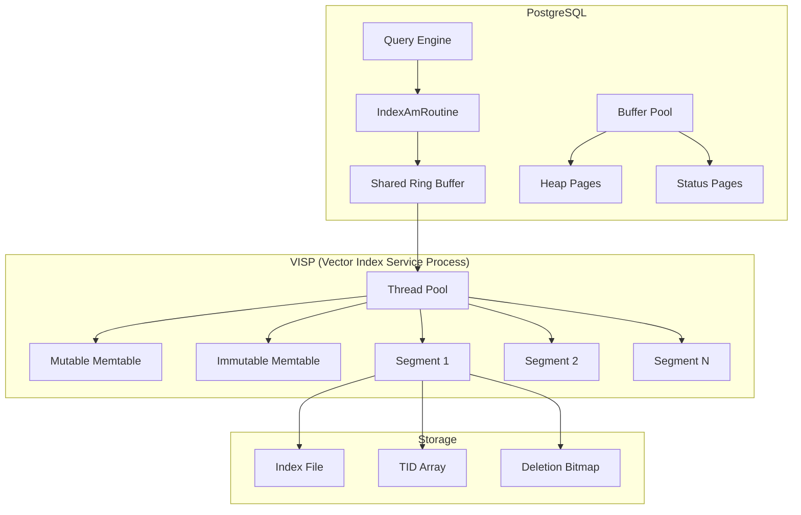

## 論文概要（Abstract）

本記事は [Building An Integrated Vector Database System in PostgreSQL](https://arxiv.org/abs/2608.15994) の解説記事です。

PostgreSQL-V 2.0は、PostgreSQL内部にベクトルインデックスを「分離統合（decoupled integration）」する手法を提案したシステムである。pgvectorやpgvectorscaleがPostgreSQLのページベースストレージを介してインデックスを管理するのに対し、PostgreSQL-V 2.0はベクトルインデックスをページバッファの外に配置しつつ、PostgreSQLのクエリエンジンからは透過的にアクセス可能とする設計を採用している。著者らは、ディスクベース検索（DiskANN backend）においてpgvectorscale比で7.3-8.0倍のレイテンシ改善、インメモリ検索（HNSW backend）においてpgvector比で3.2-5.0倍の高速化を報告している。

この記事は [Zenn記事: ベクトルDB選定と性能比較：量子化×フィルタで変わる5製品の実力差](https://zenn.dev/0h_n0/articles/772477bbc29046) の深掘りです。

## 情報源

- **arXiv ID**: 2608.15994
- **URL**: [https://arxiv.org/abs/2608.15994](https://arxiv.org/abs/2608.15994)
- **著者**: Jiayi Liu, Te Guo, Jianguo Wang（Purdue University）
- **発表年**: 2026（先行版PostgreSQL-V 1.0はCIDR 2026で発表）
- **分野**: cs.DB（データベース）
- **コード**: [https://github.com/purduedb/PostgreSQL-V.git](https://github.com/purduedb/PostgreSQL-V.git)

## 背景と動機（Background & Motivation）

ベクトル検索の本番運用において、PostgreSQLエコシステム内で完結させたいという需要は根強い。pgvectorはPostgreSQLの標準的な拡張インタフェース（IndexAmRoutine）を通じてHNSWやIVF_FLATインデックスを提供しているが、その実装にはページベースストレージに起因する根本的なボトルネックが存在する。

具体的には、ベクトルインデックスへのすべてのアクセスがPostgreSQLのバッファマネージャを経由するため、ヒープページとインデックスページがバッファプールを競合する。著者らは、同一のインデックス構造（HNSW）を用いた場合でも、pgvectorのPostgreSQL実装はネイティブライブラリ（hnswlib）に比べて数倍遅いと指摘している。

pgvectorscaleはTimescale社が開発したStreamingDiskANNインデックスを提供するが、これもPostgreSQLのページストレージ上に構築されている。著者らによれば、100Mベクトル規模ではpgvectorscaleのインデックス構築に1週間以上を要し、ベースラインとして使用できなかったと報告されている。

一方、MilvusやQdrantといった専用ベクトルDBはネイティブな性能を発揮するものの、既存のPostgreSQLベースのアプリケーションとの統合にはデータ同期やトランザクション一貫性の課題が伴う。PostgreSQL-V 2.0は「PostgreSQLの中でネイティブに近い性能を実現する」ことで、この二律背反を解消しようとするアプローチである。

## 主要な貢献（Key Contributions）

- **分離統合アーキテクチャ（Decoupled Integration）**: ベクトルインデックスをPostgreSQLのページバッファ・WALの外に配置しつつ、IndexAmRoutineを通じてクエリエンジンとの互換性を維持する設計
- **VISP（Vector Index Service Process）**: 専用プロセスによるインデックス管理。スレッドプールと共有リングバッファでバックエンドプロセスからの検索要求を並列処理し、V1.0のシングルコネクション制約を解消
- **LSMベースの動的更新**: 挿入はミュータブルなmemtableに追加し、非同期でディスクセグメントに変換。小セグメントのバックグラウンドマージにより、更新中もリコールを維持
- **高速クラッシュリカバリ**: 10Mベクトルで約22ms、100Mベクトルで約20msのカスタムインデックスリカバリ。V1.0の約500ms〜4,099msから大幅に改善
- **物理レプリケーション対応**: WALベースの一貫性チャネルとファイルベースの性能チャネルを分離した二重チャネルレプリケーション

## 技術的詳細（Technical Details）

### 分離統合のアーキテクチャ

PostgreSQL-V 2.0の核心は、ベクトルインデックスをPostgreSQLのページストレージから「分離（decouple）」しつつ、クエリエンジンとのインタフェースは維持する設計にある。



通常のPostgreSQL拡張（pgvectorなど）は、インデックスデータをバッファプール内のページとして管理し、WALを通じて永続化する。この方式では:

1. インデックスアクセスのたびにバッファマネージャのロック取得が必要
2. ヒープページとインデックスページがバッファプールを競合
3. WALへの書き込みがインデックス更新のクリティカルパスに入る

PostgreSQL-V 2.0では、インデックス構造体（グラフ、量子化コードブックなど）はVISPプロセスが直接メモリ管理する。PostgreSQLとの接点は最小限の「ステータスページ」のみで、これがWAL経由で永続化される。

### VISP（Vector Index Service Process）の設計

VISPはPostgreSQLのバックエンドプロセスとは独立した専用プロセスである。各セグメントは以下の3要素で構成される:

- **インデックス構造**: ネイティブライブラリ（hnswlib, Faiss, DiskANN）が管理
- **TID配列**: ベクトルIDからPostgreSQLヒープタプルへのマッピング
- **削除ビットマップ**: 論理削除のフラグ（物理削除はバックグラウンドマージ時）

バックエンドプロセスからの検索要求は共有リングバッファを通じてVISPに送信される。VISPのスレッドプールが全セグメントに対して並列に検索を実行し、各セグメントのTop-$k$結果をマージして返す。

検索クエリの距離計算は、セグメント$i$から得られる近似最近傍集合$\mathcal{N}_i(q, k)$に対して:

$$
\text{Result}(q, k) = \text{Top-}k\left(\bigcup_{i=1}^{S} \mathcal{N}_i(q, k)\right)
$$

ここで$S$はアクティブなセグメント数（memtable含む）、$q$はクエリベクトル、$k$は返却数である。各セグメントからの候補を統合し、全体のTop-$k$を返す。

### LSMフレームワークによる動的更新

挿入操作は以下のフローで処理される:

1. **Mutable Memtable**: 新規ベクトルはPostgreSQLの静的共有メモリ上のmemtableに追加。ロック最小化のため、append-onlyの設計にper-entryのreadyビットを使用
2. **Immutable Memtable**: memtableが閾値に達するとimmutableに遷移し、バックグラウンドでインデックスを構築
3. **Disk Segment**: 構築完了後、ディスクセグメントとしてフラッシュ
4. **Segment Merge**: 小セグメントを定期的にマージして検索効率を維持

削除はソフトデリート方式で、ビットマップのフラグを反転するのみ。インデックス構造自体は変更せず、バックグラウンドのマージ・リビルド時に物理的に除去する。

### mmapによるコールドスタート最適化

クラッシュ後の復旧では、ベクトルインデックスのメモリへの読み込みが大きなボトルネックとなる。著者らは、10MベクトルのHNSWインデックスで約5秒、100Mベクトルで約43秒のロード時間を計測している。

PostgreSQL-V 2.0はmmapを活用し、セグメントファイルをメモリマップしてから即座に検索可能とする。バックグラウンドでVISPがフルインメモリへの昇格を行う。これにより:

- 100Mベクトルの復旧後〜検索可能までの時間: mmap無しで約43秒 → mmap有りで約670ms
- 10Mベクトル: mmap有りで約2.6秒（リカバリ含む）

著者らは、mmapの対象をイミュータブルかつ完全に永続化されたファイルに限定することで、Crottyらが指摘するmmapの書き込み順序問題を回避していると述べている。

### クラッシュリカバリの改善

V1.0ではステータスページがフラットな配列構造であったため、リカバリ時に全エントリのスキャンが必要であった。V2.0ではSegmentID単位でインデックス化し、リカバリ対象をフラッシュ未完了のmemtableに限定した。

具体的なリカバリ手順:

1. MaxMemtableIdを読み取り、それを超えるフラッシュ済みセグメントを破棄
2. 各memtableをヒープと照合し、不整合があればヒープから再構築
3. ステータスページ境界を超えるセグメントをトリム

著者らは1,000回以上のクラッシュインジェクション試験で、復旧後のインデックスがヒープと完全一致することを確認したと報告している。

## 実装のポイント（Implementation）

PostgreSQL-V 2.0をPostgreSQL拡張として実装する際の要点:

**IndexAmRoutineの活用**: PostgreSQLのインデックスアクセスメソッドインタフェースを実装することで、`CREATE INDEX ... USING vectorv`のようなSQL構文で透過的に利用できる。検索はPostgreSQLのクエリプランナーが通常のインデックススキャンとして選択する。

**共有メモリ管理**: memtableはPostgreSQLの静的共有メモリ（shmem）上に配置する。動的共有メモリ（DSM）ではなく静的割り当てを使うことで、プロセス間の安定したアクセスを確保している。

**可視性チェック**: ベクトル検索結果のTIDからヒープタプルを取得した後、PostgreSQLのMVCC可視性チェックを適用する。これにより、トランザクション分離レベルに応じた正確な結果が保証される。

**ネイティブライブラリの差し替え**: インデックスバックエンドはプラグイン可能で、hnswlib（HNSW用）、Faiss（IVF_FLAT用）、DiskANNをサポートしている。新しいライブラリの追加はインタフェース実装のみで可能である。

```python
from typing import Protocol

class VectorIndexBackend(Protocol):
    def build(self, vectors: list[list[float]], params: dict) -> None:
        """Build index from vectors."""
        ...

    def search(self, query: list[float], k: int, params: dict) -> list[tuple[int, float]]:
        """Search for k nearest neighbors. Returns (id, distance) pairs."""
        ...

    def insert(self, vector_id: int, vector: list[float]) -> None:
        """Insert a single vector."""
        ...

    def mark_deleted(self, vector_id: int) -> None:
        """Soft-delete a vector."""
        ...
```

## Production Deployment Guide

### AWS実装パターン（コスト最適化重視）

PostgreSQL-V 2.0はPostgreSQL拡張として動作するため、AWS上ではRDSカスタムまたはEC2上のセルフホストPostgreSQLとしてデプロイする。以下にトラフィック量別の構成を示す。

**注意**: 以下のコスト試算は2026年11月時点のAWS ap-northeast-1（東京）リージョン料金に基づく概算値です。実際のコストはトラフィックパターン、リージョン、バースト使用量により変動します。最新料金は [AWS料金計算ツール](https://calculator.aws/) で確認してください。

| 規模 | 月間リクエスト | 推奨構成 | 月額コスト | 主要サービス |
|------|--------------|---------|-----------|------------|
| **Small** | ~3,000 (100/日) | Single EC2 | $80-200 | EC2 (r6g.large) + EBS gp3 |
| **Medium** | ~30,000 (1,000/日) | Multi-AZ EC2 | $400-900 | EC2 (r6g.xlarge) × 2 + EBS io2 |
| **Large** | 300,000+ (10,000/日) | EKS + PostgreSQL Operator | $2,500-6,000 | EKS + r6g.2xlarge × 3 + EBS io2 |

**Small構成の詳細**（月額$80-200）:
- **EC2**: r6g.large（2 vCPU, 16 GB RAM）— Graviton3でコスト効率を最大化（$55/月、Reserved 1年で$35/月）
- **EBS**: gp3 500 GB（ベクトルインデックス+ヒープデータ用）($40/月)
- **S3**: バックアップ用（$5/月）
- **CloudWatch**: 基本監視（$5/月）

**Medium構成の詳細**（月額$400-900）:
- **EC2**: r6g.xlarge（4 vCPU, 32 GB RAM）× 2台（Primary + Standby）($220/月)
- **EBS**: io2 1 TB, 3000 IOPS（$180/月）
- **ELB**: Network Load Balancer — リードレプリカへの振り分け（$20/月）
- **S3**: WALアーカイブ + ベースバックアップ（$10/月）

**Large構成の詳細**（月額$2,500-6,000）:
- **EKS**: コントロールプレーン（$72/月）
- **EC2**: r6g.2xlarge（8 vCPU, 64 GB RAM）× 3台（$660/月、Spot利用時$200/月）
- **EBS**: io2 2 TB, 10000 IOPS × 3（$1,200/月）
- **CloudNativePG Operator**: PostgreSQLライフサイクル管理（追加コストなし）

**コスト削減テクニック**:
- Reserved Instances購入で最大72%削減（1年コミット）
- Graviton（Arm）インスタンスでx86比約20%コスト削減
- EBS gp3はio2比で約60%安価（Small構成で十分）
- pgvectorscaleとの比較: PostgreSQL-V 2.0のmmapベース設計により、同等のベクトル規模でより少ないRAMで運用可能

### Terraformインフラコード

**Small構成（Single EC2 + PostgreSQL-V 2.0）**

```hcl
module "vpc" {
  source  = "terraform-aws-modules/vpc/aws"
  version = "~> 5.0"

  name = "pgv-vpc"
  cidr = "10.0.0.0/16"
  azs  = ["ap-northeast-1a", "ap-northeast-1c"]
  private_subnets = ["10.0.1.0/24", "10.0.2.0/24"]
  public_subnets  = ["10.0.101.0/24"]

  enable_nat_gateway   = true
  single_nat_gateway   = true
  enable_dns_hostnames = true
}

resource "aws_iam_role" "pgv_instance" {
  name = "pgv-instance-role"

  assume_role_policy = jsonencode({
    Version = "2012-10-17"
    Statement = [{
      Action = "sts:AssumeRole"
      Effect = "Allow"
      Principal = { Service = "ec2.amazonaws.com" }
    }]
  })
}

resource "aws_iam_role_policy" "pgv_s3_backup" {
  role = aws_iam_role.pgv_instance.id
  policy = jsonencode({
    Version = "2012-10-17"
    Statement = [{
      Effect   = "Allow"
      Action   = ["s3:PutObject", "s3:GetObject", "s3:ListBucket"]
      Resource = ["${aws_s3_bucket.backup.arn}", "${aws_s3_bucket.backup.arn}/*"]
    }]
  })
}

resource "aws_instance" "pgv_primary" {
  ami           = data.aws_ami.ubuntu_arm64.id
  instance_type = "r6g.large"
  subnet_id     = module.vpc.private_subnets[0]

  vpc_security_group_ids = [aws_security_group.pgv.id]
  iam_instance_profile   = aws_iam_instance_profile.pgv.name

  root_block_device {
    volume_type = "gp3"
    volume_size = 500
    throughput  = 250
    iops        = 3000
    encrypted   = true
  }

  user_data = <<-EOF
    #!/bin/bash
    apt-get update && apt-get install -y postgresql-16 build-essential cmake
    # PostgreSQL-V 2.0 build from source
    git clone https://github.com/purduedb/PostgreSQL-V.git /opt/pgv
    cd /opt/pgv && make install
    systemctl restart postgresql
  EOF

  tags = { Name = "pgv-primary", Project = "vector-search" }
}

resource "aws_s3_bucket" "backup" {
  bucket = "pgv-wal-backup-${data.aws_caller_identity.current.account_id}"
}

resource "aws_s3_bucket_lifecycle_configuration" "backup" {
  bucket = aws_s3_bucket.backup.id
  rule {
    id     = "expire-old-backups"
    status = "Enabled"
    expiration { days = 30 }
  }
}

resource "aws_cloudwatch_metric_alarm" "pgv_cpu" {
  alarm_name          = "pgv-cpu-high"
  comparison_operator = "GreaterThanThreshold"
  evaluation_periods  = 2
  metric_name         = "CPUUtilization"
  namespace           = "AWS/EC2"
  period              = 300
  statistic           = "Average"
  threshold           = 80
  alarm_description   = "PostgreSQL-V CPU使用率が80%超過"
  dimensions          = { InstanceId = aws_instance.pgv_primary.id }
}
```

**Large構成（EKS + CloudNativePG）**

```hcl
module "eks" {
  source  = "terraform-aws-modules/eks/aws"
  version = "~> 20.0"

  cluster_name    = "pgv-cluster"
  cluster_version = "1.31"

  vpc_id     = module.vpc.vpc_id
  subnet_ids = module.vpc.private_subnets

  cluster_endpoint_public_access = true
  enable_cluster_creator_admin_permissions = true
}

resource "helm_release" "cnpg_operator" {
  name       = "cnpg"
  repository = "https://cloudnative-pg.github.io/charts"
  chart      = "cloudnative-pg"
  namespace  = "cnpg-system"
  create_namespace = true
}

resource "kubectl_manifest" "pgv_cluster" {
  yaml_body = <<-YAML
    apiVersion: postgresql.cnpg.io/v1
    kind: Cluster
    metadata:
      name: pgv-cluster
      namespace: default
    spec:
      instances: 3
      postgresql:
        parameters:
          shared_buffers: "16GB"
          work_mem: "256MB"
          maintenance_work_mem: "2GB"
          max_parallel_workers_per_gather: "4"
      resources:
        requests:
          memory: "48Gi"
          cpu: "6"
        limits:
          memory: "60Gi"
          cpu: "8"
      storage:
        size: 2Ti
        storageClass: io2
      backup:
        barmanObjectStore:
          destinationPath: "s3://pgv-backup-${data.aws_caller_identity.current.account_id}/cnpg"
          s3Credentials:
            accessKeyId:
              name: pgv-s3-creds
              key: ACCESS_KEY_ID
            secretAccessKey:
              name: pgv-s3-creds
              key: ACCESS_SECRET_KEY
  YAML
}

resource "aws_budgets_budget" "pgv_monthly" {
  name         = "pgv-monthly-budget"
  budget_type  = "COST"
  limit_amount = "6000"
  limit_unit   = "USD"
  time_unit    = "MONTHLY"

  notification {
    comparison_operator        = "GREATER_THAN"
    threshold                  = 80
    threshold_type             = "PERCENTAGE"
    notification_type          = "ACTUAL"
    subscriber_email_addresses = ["ops@example.com"]
  }
}
```

### セキュリティベストプラクティス

**本番環境での推奨設定**:

1. **ネットワークセキュリティ**: PostgreSQLはプライベートサブネットに配置。セキュリティグループはアプリケーション層からの5432ポートのみ許可。EKS使用時は`cluster_endpoint_public_access = false`を設定しVPN経由アクセス
2. **認証・認可**: PostgreSQLのmd5/scram-sha-256認証。IAM認証（RDS Proxy経由）。最小権限の原則に基づくROLE設計
3. **シークレット管理**: AWS Secrets Manager使用。環境変数へのパスワードハードコード禁止。90日ごとのローテーション推奨
4. **データ保護**: EBS暗号化（KMS）必須。SSL/TLS接続必須（`sslmode=verify-full`）。S3バックアップもKMS暗号化
5. **監査**: CloudTrail有効化。PostgreSQL `pgaudit`拡張によるクエリ監査ログ

### 運用・監視設定

**CloudWatch Logs Insights クエリ**:

```sql
-- ベクトル検索レイテンシ分析（PostgreSQLログから）
fields @timestamp, @message
| parse @message "duration: * ms" as duration_ms
| filter @message like /vector/
| stats pct(duration_ms, 95) as p95, pct(duration_ms, 99) as p99 by bin(5m)

-- VISPプロセスのメモリ使用量異常検知
fields @timestamp, resident_memory_mb
| filter process_name = "visp"
| stats max(resident_memory_mb) as peak_mem by bin(1h)
| filter peak_mem > 40000
```

**CloudWatch アラーム（Python boto3）**:

```python
import boto3

cloudwatch = boto3.client('cloudwatch')

cloudwatch.put_metric_alarm(
    AlarmName='pgv-search-latency-p99',
    ComparisonOperator='GreaterThanThreshold',
    EvaluationPeriods=2,
    MetricName='SearchLatencyP99',
    Namespace='Custom/PostgreSQLV',
    Period=300,
    Statistic='Average',
    Threshold=50.0,
    ActionsEnabled=True,
    AlarmActions=['arn:aws:sns:ap-northeast-1:123456789:pgv-alerts'],
    AlarmDescription='ベクトル検索P99レイテンシが50ms超過'
)

cloudwatch.put_metric_alarm(
    AlarmName='pgv-disk-usage',
    ComparisonOperator='GreaterThanThreshold',
    EvaluationPeriods=1,
    MetricName='DiskSpaceUsedPercent',
    Namespace='Custom/PostgreSQLV',
    Period=3600,
    Statistic='Maximum',
    Threshold=80.0,
    AlarmDescription='EBSディスク使用率が80%超過（セグメントマージ遅延の可能性）'
)
```

**カスタムメトリクス送信（PostgreSQL-V固有）**:

```python
import psycopg2
import boto3
from datetime import datetime

cloudwatch = boto3.client('cloudwatch')

def publish_pgv_metrics(conn_string: str) -> None:
    """PostgreSQL-V固有メトリクスをCloudWatchに送信"""
    with psycopg2.connect(conn_string) as conn:
        with conn.cursor() as cur:
            cur.execute("SELECT count(*) FROM pg_stat_activity WHERE query LIKE '%vector%'")
            active_vector_queries = cur.fetchone()[0]

            cur.execute("SELECT pg_database_size(current_database())")
            db_size_bytes = cur.fetchone()[0]

    cloudwatch.put_metric_data(
        Namespace='Custom/PostgreSQLV',
        MetricData=[
            {
                'MetricName': 'ActiveVectorQueries',
                'Value': active_vector_queries,
                'Unit': 'Count',
                'Timestamp': datetime.utcnow()
            },
            {
                'MetricName': 'DatabaseSizeGB',
                'Value': db_size_bytes / (1024 ** 3),
                'Unit': 'Gigabytes',
                'Timestamp': datetime.utcnow()
            }
        ]
    )
```

### コスト最適化チェックリスト

**アーキテクチャ選択（トラフィック量で判断）**:
- [ ] ~100 req/日 → Single EC2 (r6g.large) — $80-200/月
- [ ] ~1,000 req/日 → Multi-AZ EC2 (r6g.xlarge × 2) — $400-900/月
- [ ] 10,000+ req/日 → EKS + CloudNativePG (r6g.2xlarge × 3) — $2,500-6,000/月

**リソース最適化**:
- [ ] Graviton（Arm）インスタンスで約20%コスト削減
- [ ] Reserved Instances: 1年コミットで最大72%削減
- [ ] Savings Plans: Compute Savings Plans検討（インスタンスファミリー変更に柔軟）
- [ ] EBS: gp3を基本とし、IOPSが必要な場合のみio2に切り替え
- [ ] PostgreSQL-V 2.0のmmap機能活用で、RAMサイズを抑えたインスタンス選択が可能

**PostgreSQL-V固有の最適化**:
- [ ] shared_buffers: ヒープデータ用に適切にサイジング（インデックスはVISPが管理するため、pgvectorより小さくて良い）
- [ ] VISP用メモリ: OS管理のメモリとして確保（PostgreSQL shared_buffersの外）
- [ ] DiskANNバックエンド使用時: SSD IOPS性能がボトルネックになるため、io2またはgp3の3000 IOPS以上を確保
- [ ] セグメントマージの頻度: 書き込み負荷に応じて調整（過剰なセグメント数は検索レイテンシに影響）

**監視・アラート（コスト異常の即時検知）**:
- [ ] AWS Budgets: 月額予算設定（80%で警告、100%でアラート）
- [ ] CloudWatch アラーム: ディスク使用率、CPU使用率、検索レイテンシ
- [ ] Cost Anomaly Detection: 自動異常検知
- [ ] 日次コストレポート: SNS/Slackへ自動送信

**リソース管理**:
- [ ] 開発環境: 夜間のEC2停止（Auto Start/Stop）
- [ ] S3バックアップ: 30日間のライフサイクルポリシー
- [ ] 未使用EBSスナップショット: 定期削除
- [ ] タグ戦略: 環境別（dev/staging/prod）でコスト可視化

## 実験結果（Results）

著者らはSIFT10M、DEEP10M、Cohere10M（768次元）、SIFT100M、およびmsturing-10Mスライディングウィンドウランブックを用いた包括的な実験を報告している。ハードウェアはUbuntu 22.04、Intel Xeon 112コア（2 NUMAノード）、251 GB DRAM、1.8 TB SSDである。

### インメモリ検索（10Mベクトル、シングルクライアント）

論文の実験結果によると、HNSW（hnswlibバックエンド）はpgvector HNSWに対してSIFT10Mで3.2-4.4倍、DEEP10Mで3.2-5.0倍の高速化を達成したと報告されている。IVF_FLAT（Faissバックエンド）ではSIFT10Mで6.5-8.6倍、DEEP10Mで4.9-10.4倍であった。ネイティブライブラリに対するオーバーヘッドは約0.8msと報告されている。

### インメモリ検索（32クライアント並列）

32クライアントへのスケーリングでは、HNSWスループットがリコール0.96-0.99の範囲で18.3-39.0倍に向上したと報告されている。pgvector比ではHNSWで3.2倍（SIFT10M）〜3.6倍（DEEP10M）、IVF_FLATで3.4倍〜4.2倍のスループットとなった。V1.0（シングルクライアント上限）比ではHNSWで23.4-36.4倍、IVF_FLATで11.1-16.2倍であった。

### ディスクベース検索（DiskANNバックエンド）

Cohere10M（768次元）において、pgvectorscaleとの比較で:
- **シングルクライアントレイテンシ**: 7.3-8.0倍の改善
- **ピークスループット**: 7.7-19.4倍の向上

V1.0比ではピークスループットが10.5-65.3倍と報告されている。SIFT100Mではpgvectorscaleのインデックス構築に1週間以上を要したため、ベースラインから除外されたと著者らは述べている。

### 動的ワークロード（msturing-10M、HNSW、32クライアント）

混合ワークロード（挿入+検索のスライディングウィンドウ）では:
- **平均スループット**: 約13.0K ops/s vs pgvectorの約2.5K ops/s（約5.1倍、範囲3.4-8.5倍）
- **リコール推移**: pgvectorは0.9298→0.8407に低下。PostgreSQL-V 2.0は0.9106→0.9422に向上

著者らは、PostgreSQL-V 2.0のリコールが初期にpgvectorより約2%低いが、50ステップ以内に追い越すと報告している。これはLSMベースの設計によりバックグラウンドマージが進むにつれてインデックス品質が改善するためと考えられる。

### クラッシュリカバリ

| システム | カスタムインデックスリカバリ | PostgreSQL組み込みリカバリ | WALスキャン量 |
|----------|--------------------------|--------------------------|-------------|
| PostgreSQL-V 2.0 | 22.43ms (10M), 19.76ms (100M) | 約900ms | 約200MB |
| PostgreSQL-V 1.0 | 495.3ms (10M), 4,099ms (100M) | — | — |
| pgvector | — | 約1,800ms | 約900MB |

V2.0のカスタムインデックスリカバリが100Mベクトルでも約20msと、データ規模にほぼ依存しない点が注目される。

### レプリケーション

1 Primary + 3 Standbysの構成で、プライマリのスループットはスタンバイの有無にかかわらず約12.9K ops/sを維持。スタンバイのRecall@100はプライマリとの最大差が0.0004、平均差約0.00005と報告されている。

## 実運用への応用（Practical Applications）

### 既存PostgreSQLユーザーの移行パス

PostgreSQL-V 2.0は既存のPostgreSQLとの互換性を維持しているため、以下の段階的な移行が考えられる:

1. **評価フェーズ**: pgvector/pgvectorscaleと並行して小規模データセットでベンチマーク
2. **移行フェーズ**: `CREATE INDEX ... USING vectorv`で新インデックスを作成し、既存のpgvectorインデックスをドロップ
3. **最適化フェーズ**: VISPのメモリ割り当て、セグメントマージ頻度、DiskANNパラメータの調整

### pgvector/pgvectorscaleとの使い分け

| 観点 | pgvector | pgvectorscale | PostgreSQL-V 2.0 |
|------|---------|---------------|-----------------|
| **成熟度** | 高（広く採用） | 中（Timescale社サポート） | 低（研究プロジェクト） |
| **インメモリ性能** | 基準 | 同等 | 3.2-5.0倍 |
| **ディスク性能** | 非対応 | StreamingDiskANN | 7.3-8.0倍（vs pgvectorscale） |
| **動的更新** | リコール低下あり | 未検証 | LSMで安定維持 |
| **レプリケーション** | PostgreSQL標準 | PostgreSQL標準 | 二重チャネル |
| **運用複雑度** | 低 | 中 | 高（ソースビルド必要） |

**現実的な判断基準**: PostgreSQL-V 2.0は性能面で優位性を示しているが、Purdue大学の研究プロジェクトであり、pgvectorやpgvectorscaleのような商用サポートやコミュニティ規模は持たない。本番採用は、プロジェクトの成熟度とサポート体制を慎重に評価した上で判断すべきである。

## 関連研究（Related Work）

- **pgvector**: PostgreSQLの標準的なベクトル検索拡張。HNSWとIVF_FLATをサポートするが、ページベースストレージの制約を受ける。本論文のベースライン比較対象
- **pgvectorscale**: Timescale社によるStreamingDiskANNインデックスの提供。ディスクベースANN検索を実現するが、PostgreSQLのページストレージ上に構築されている点で同様の制約がある
- **DiskANN (Microsoft Research)**: グラフベースのディスクベクトル検索。メモリ使用量をデータセット規模に依存しない水準に抑える設計。PostgreSQL-V 2.0のバックエンドライブラリとして使用
- **AlloyDB AI (Google Cloud)**: Google CloudのPostgreSQL互換サービス。ScaNNベースのインライン・フィルタリングを提供し、クエリオプティマイザがメタデータフィルタとベクトル検索を統合的に評価する
- **LSM-VEC (SOSP 2025)**: 動的ベクトル検索のためのLSMベースのディスクシステム。PostgreSQL-V 2.0と同様にLSM構造を採用するが、独立したシステムとしての実装

## まとめと今後の展望

PostgreSQL-V 2.0は、「PostgreSQL内部でネイティブに近いベクトル検索性能」を実現するための分離統合アーキテクチャを提示した。pgvector比で3.2-5.0倍（インメモリ）、pgvectorscale比で7.3-8.0倍（ディスクベース）のレイテンシ改善、データ規模に依存しない約20msのクラッシュリカバリ、物理レプリケーション対応が主要な成果である。

ただし、これらの数値は著者ら自身の実験環境での結果であり、データセット・ハードウェア・ワークロードパターンによって変動する。また、研究プロジェクトとしての成熟度は商用拡張に及ばない。pgvectorscaleとの比較も10Mベクトル規模に限られており、100Mベクトルではpgvectorscaleがベースラインから除外されている点に注意が必要である。

ベクトルDB選定においては、pgvectorの運用容易性、pgvectorscaleのディスクベース性能、PostgreSQL-V 2.0の分離統合アプローチをデータ規模と運用要件に応じて評価することが重要である。

## 参考文献

- **arXiv**: [https://arxiv.org/abs/2608.15994](https://arxiv.org/abs/2608.15994)
- **Code**: [https://github.com/purduedb/PostgreSQL-V.git](https://github.com/purduedb/PostgreSQL-V.git)
- **PostgreSQL-V 1.0 (CIDR 2026)**: Fast Vector Search in PostgreSQL: A Decoupled Approach
- **DiskANN**: [https://github.com/microsoft/DiskANN](https://github.com/microsoft/DiskANN)
- **pgvector**: [https://github.com/pgvector/pgvector](https://github.com/pgvector/pgvector)
- **pgvectorscale**: [https://github.com/timescale/pgvectorscale](https://github.com/timescale/pgvectorscale)
- **Related Zenn article**: [https://zenn.dev/0h_n0/articles/772477bbc29046](https://zenn.dev/0h_n0/articles/772477bbc29046)

---

:::message
この記事はAI（Claude Code）により自動生成されました。内容の正確性については論文の記述に基づいていますが、最新の情報は公式リポジトリおよび論文をご確認ください。
:::
