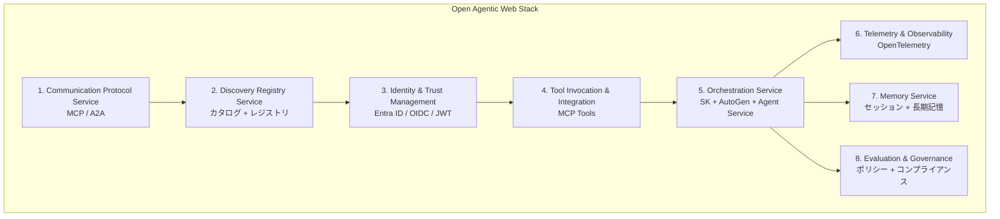
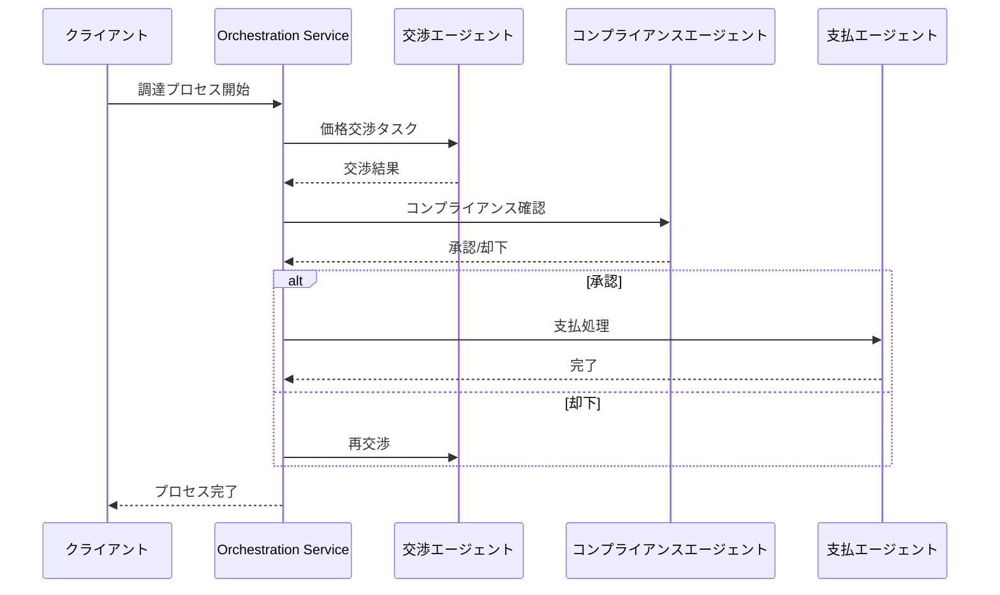

## ブログ概要（Summary）

本記事は [Agent Factory: Designing the Open Agentic Web Stack](https://azure.microsoft.com/en-us/blog/agent-factory-designing-the-open-agentic-web-stack/) の解説記事です。

Microsoftは2025年9月、Agent Factoryブログシリーズの最終回として「Open Agentic Web Stack」の設計思想を公開した。このブログでは、AIエージェントが組織横断で安全にスケールするために必要な8つのサービス層（通信プロトコル、ディスカバリ、アイデンティティ、ツール連携、オーケストレーション、テレメトリ、メモリ、ガバナンス）を定義している。HTTP/TCP/IPがWebを標準化したように、エージェント間通信にも標準化された基盤が必要だというのがMicrosoftの主張である。

この記事は [Zenn記事: Semantic Kernel×Azure AI FoundryでAIエージェントを本番デプロイする](https://zenn.dev/0h_n0/articles/fd126bdee7c768) の深掘りです。

## 情報源

- **種別**: 企業テックブログ（Microsoft Azure公式ブログ）
- **URL**: [https://azure.microsoft.com/en-us/blog/agent-factory-designing-the-open-agentic-web-stack/](https://azure.microsoft.com/en-us/blog/agent-factory-designing-the-open-agentic-web-stack/)
- **組織**: Microsoft（Azure AI / Microsoft Foundry部門）
- **著者**: Yina Arenas（Corporate Vice President, Microsoft Foundry）、Ulrich Homann（Corporate Vice President and Distinguished Architect, Cloud and AI）
- **発表日**: 2025年9月24日

## 技術的背景（Technical Background）

### なぜ「Agentic Web Stack」が必要か

従来のAIエージェント開発では、各フレームワーク（Semantic Kernel、AutoGen、LangChain、CrewAI等）がそれぞれ独自の通信方式、ツール定義、セッション管理を持っていた。これにより、異なるフレームワークで構築されたエージェント同士の連携が困難であり、組織をまたいだマルチエージェントシステムの構築には大きな統合コストが発生していた。

Microsoftは、この状況をインターネット黎明期になぞらえている。HTTP/TCP/IPがWebの基盤となったように、エージェント間通信にも標準化されたプロトコルスタックが必要だとブログは述べている。Agent Factoryシリーズ全体を通じて提示されたのが「Open Agentic Web Stack」という構想である。

### 学術的文脈

マルチエージェントシステムの標準化は、分散AIの研究において長年の課題である。FIPA（Foundation for Intelligent Physical Agents）が1990年代にエージェント通信言語（ACL）を標準化しようとした歴史がある。現在のLLMベースエージェントでは、Model Context Protocol（MCP）やAgent-to-Agent Protocol（A2A）が新たな標準として台頭している。Microsoftのブログは、これらの標準をエンタープライズ向けに体系化したものと位置づけられる。

## 実装アーキテクチャ（Architecture）

### 8つのサービス層

ブログが定義する8つのサービス層は、以下の構成で相互に連携する。



以下、各サービス層の技術的詳細を解説する。

### 1. Communication Protocol Service（通信プロトコル）

エージェント間の通信基盤として、2つのプロトコルが採用されている。

**Model Context Protocol (MCP)**: ツールの公開・呼び出しのためのベンダー中立プロトコル。エージェントが利用可能なツール（API、関数、データソース）を統一的なインターフェースで発見・実行できる。

**Agent-to-Agent Protocol (A2A)**: エージェント同士がメッセージを交換するためのプロトコル。組織内ワークフローだけでなく、サプライチェーンパートナー間のような組織横断的な連携もA2Aの対象範囲と述べられている。

```python
from dataclasses import dataclass
from typing import Protocol

class AgentCommunication(Protocol):
    """エージェント間通信の抽象インターフェース"""

    async def send_message(self, target_agent_id: str, payload: dict) -> dict:
        """A2Aプロトコルでメッセージを送信する"""
        ...

    async def discover_tools(self, capability_filter: str) -> list[dict]:
        """MCPでツールを発見する"""
        ...


@dataclass(frozen=True)
class A2AMessage:
    """A2Aプロトコルのメッセージ構造（概念的な定義）"""
    sender_id: str
    receiver_id: str
    action: str
    payload: dict
    correlation_id: str
```

### 2. Discovery Registry Service（ディスカバリレジストリ）

ブログでは、ディスカバリを2つの機能に分解している。

- **カタログ**: エージェント、ツール、アプリケーションのアセット一覧。開発者が「一度公開すれば広く発見される」仕組みを提供する
- **レジストリ**: デプロイ済みインスタンスの追跡。エンドポイント、ヘルスステータス、稼働状況をリアルタイムに管理する

この分離により、ツール定義（静的）とデプロイ状態（動的）を独立に管理できる。

### 3. Identity & Trust Management Service（アイデンティティ）

Microsoftは、アイデンティティを「エージェントシステムのコントロールプレーン」と位置づけている。具体的には以下の技術が採用されている。

- **Microsoft Entra ID**: エージェントに一意のIDを割り当てる「Entra Agent ID」機能
- **OIDC / JWT**: 標準的な認証・認可プロトコル
- **ゼロトラストセキュリティ**: 暗号化通信、きめ細かいロールベースアクセス制御（RBAC）

```csharp
// Entra ID認証によるエージェントアクセス制御の概念コード
using Azure.Identity;

public class AgentIdentityService
{
    private readonly DefaultAzureCredential _credential;

    public AgentIdentityService()
    {
        _credential = new DefaultAzureCredential();
    }

    /// <summary>
    /// エージェントが他のエージェントやツールにアクセスする際の
    /// トークン取得パターン。Entra IDによるゼロトラスト認証。
    /// </summary>
    public async Task<string> GetAgentTokenAsync(
        string scope,
        CancellationToken cancellationToken = default)
    {
        var context = new Azure.Core.TokenRequestContext(new[] { scope });
        var token = await _credential.GetTokenAsync(context, cancellationToken);
        return token.Token;
    }
}
```

### 4. Tool Invocation & Integration Service（ツール連携）

MCPを「ベンダー中立なツール公開標準」として位置づけ、エンタープライズAPIを一度登録すれば、Semantic Kernel、AutoGen、LangGraph、その他サードパーティSDKから利用できる仕組みを提供すると述べている。

### 5. Orchestration Service（オーケストレーション）

ブログによると、Azure AI Foundry Agent Service上でSemantic KernelとAutoGenを「統一フレームワーク」として提供し、マルチエージェントワークフローのオーケストレーションを担う。ワークフローは「依存関係の管理、リソース割り当て、コンフリクト解決」を行うとされている。



ブログでは、調達プロセス（procure-to-pay）において「数週間かかっていたサイクルを数時間に短縮」できるとの主張がある。ただし、これは具体的な測定結果ではなく期待値として記述されている点に注意が必要である。

### 6. Telemetry & Observability Service（テレメトリ）

Microsoftは、Azure AI FoundryがOpenTelemetryを「エージェント対応の計装」に拡張していると述べている。具体的には以下の機能を提供するとされる。

- 会話トレーシング（エージェントの判断過程の追跡）
- パフォーマンスデータの収集
- リアルタイム異常検知
- すべての判断・アクションのログ記録（アイデンティティと紐付け）

これはZenn記事で解説されているSemantic KernelのOpenTelemetry統合と直接対応する機能である。

```python
from opentelemetry import trace
from opentelemetry.sdk.trace import TracerProvider
from opentelemetry.sdk.trace.export import BatchSpanProcessor
from opentelemetry.exporter.otlp.proto.grpc.trace_exporter import OTLPSpanExporter

def setup_agent_telemetry(service_name: str = "multi-agent-system") -> None:
    """エージェントシステム向けOpenTelemetryの初期設定"""
    provider = TracerProvider()
    provider.add_span_processor(BatchSpanProcessor(OTLPSpanExporter()))
    trace.set_tracer_provider(provider)

tracer = trace.get_tracer("agent.orchestration")

async def traced_agent_invocation(agent_id: str, task: str) -> str:
    """OpenTelemetryスパン付きエージェント呼び出しの概念実装"""
    with tracer.start_as_current_span(
        "agent.invoke",
        attributes={
            "agent.id": agent_id,
            "agent.task": task,
            "gen_ai.system": "azure_ai_foundry",
        },
    ) as span:
        # Agent Service経由でエージェントを呼び出す
        result = await call_agent(agent_id, task)
        span.set_attribute("agent.response_length", len(result))
        return result
```

### 7. Memory Service（メモリ）

短期セッションメモリと長期エンタープライズ知識の統合を提供するとされている。ブログでは以下のユースケースが挙げられている。

- サポートエージェントが過去のクロスチャネルインタラクションを想起する
- サプライチェーンエージェントが過去の混乱パターンを追跡する

### 8. Evaluation & Governance Service（評価・ガバナンス）

継続的評価、ポリシー強制、倫理的セーフガード、規制コンプライアンスをカバーする。ブログによると、ガバナンスフックはオーケストレーション、テレメトリ、アイデンティティの各層に組み込まれている。

## Production Deployment Guide

### AWS実装パターン（コスト最適化重視）

Open Agentic Web Stackの概念をAWS上で実現する場合のアーキテクチャパターンを示す。マルチエージェントオーケストレーションの特性上、エージェント間通信のレイテンシとコストが主要な設計要因となる。

**トラフィック量別の推奨構成**:

| 規模 | 月間リクエスト | 推奨構成 | 月額コスト | 主要サービス |
|------|--------------|---------|-----------|------------|
| **Small** | ~3,000 (100/日) | Serverless | $50-150 | Lambda + Bedrock + DynamoDB + SQS |
| **Medium** | ~30,000 (1,000/日) | Hybrid | $300-800 | Lambda + ECS Fargate + ElastiCache + SQS |
| **Large** | 300,000+ (10,000/日) | Container | $2,000-5,000 | EKS + Karpenter + EC2 Spot + MSK |

**Small構成の詳細**（月額$50-150）:
- **Lambda**: エージェントロジック実行、1GB RAM、60秒タイムアウト（$20/月）
- **Bedrock**: Claude 3.5 Haiku、Prompt Caching有効（$80/月）
- **DynamoDB**: エージェントメモリ・セッション管理、On-Demand（$10/月）
- **SQS**: エージェント間メッセージング（$5/月）
- **API Gateway**: REST API（$5/月）
- **CloudWatch**: 基本監視（$5/月）

**Medium構成の詳細**（月額$300-800）:
- **Lambda**: イベント駆動処理（$50/月）
- **ECS Fargate**: オーケストレーションサービス、0.5 vCPU × 2タスク（$120/月）
- **Bedrock**: Claude 3.5 Sonnet、Batch API活用（$400/月）
- **ElastiCache Redis**: セッションメモリ、cache.t3.micro（$15/月）
- **SQS + SNS**: エージェント間通信（$10/月）
- **ALB**: ロードバランサ（$20/月）

**Large構成の詳細**（月額$2,000-5,000）:
- **EKS**: コントロールプレーン（$72/月）
- **EC2 Spot**: g5.xlarge × 2-4台（平均$800/月、最大90%削減）
- **Karpenter**: 自動スケーリング（追加コストなし）
- **MSK (Managed Kafka)**: エージェント間イベントストリーミング（$300/月）
- **Bedrock Batch**: 50%割引活用（$2,000/月）
- **S3**: プロンプトキャッシュ・メモリストレージ（$20/月）
- **CloudWatch + X-Ray**: 詳細監視（$100/月）

**コスト削減テクニック**:
- Spot Instances使用で最大90%削減（EKS + Karpenter）
- Reserved Instances購入で最大72%削減（1年コミット）
- Bedrock Batch API使用で50%削減
- Prompt Caching有効化で30-90%削減
- エージェント間通信をSQS経由にしてLambda実行時間を最小化

**コスト試算の注意事項**:
- 上記は2026年11月時点のAWS ap-northeast-1（東京）リージョン料金に基づく概算値です
- マルチエージェント構成ではエージェント間通信コストが追加で発生します
- 最新料金は [AWS料金計算ツール](https://calculator.aws/) で確認してください

### Terraformインフラコード

**Small構成 (Serverless): Lambda + Bedrock + DynamoDB + SQS**

```hcl
# --- VPC基盤 ---
module "vpc" {
  source  = "terraform-aws-modules/vpc/aws"
  version = "~> 5.0"

  name = "agent-stack-vpc"
  cidr = "10.0.0.0/16"
  azs  = ["ap-northeast-1a", "ap-northeast-1c"]
  private_subnets = ["10.0.1.0/24", "10.0.2.0/24"]

  enable_nat_gateway   = false
  enable_dns_hostnames = true
}

# --- IAMロール（最小権限） ---
resource "aws_iam_role" "agent_lambda" {
  name = "agent-lambda-role"

  assume_role_policy = jsonencode({
    Version = "2012-10-17"
    Statement = [{
      Action = "sts:AssumeRole"
      Effect = "Allow"
      Principal = { Service = "lambda.amazonaws.com" }
    }]
  })
}

resource "aws_iam_role_policy" "agent_permissions" {
  role = aws_iam_role.agent_lambda.id

  policy = jsonencode({
    Version = "2012-10-17"
    Statement = [
      {
        Effect = "Allow"
        Action = ["bedrock:InvokeModel", "bedrock:InvokeModelWithResponseStream"]
        Resource = "arn:aws:bedrock:ap-northeast-1::foundation-model/anthropic.claude-3-5-haiku*"
      },
      {
        Effect   = "Allow"
        Action   = ["dynamodb:GetItem", "dynamodb:PutItem", "dynamodb:Query"]
        Resource = aws_dynamodb_table.agent_memory.arn
      },
      {
        Effect   = "Allow"
        Action   = ["sqs:SendMessage", "sqs:ReceiveMessage", "sqs:DeleteMessage"]
        Resource = aws_sqs_queue.agent_messages.arn
      }
    ]
  })
}

# --- Lambda関数（エージェントハンドラ） ---
resource "aws_lambda_function" "agent_handler" {
  filename      = "agent_handler.zip"
  function_name = "multi-agent-handler"
  role          = aws_iam_role.agent_lambda.arn
  handler       = "index.handler"
  runtime       = "python3.12"
  timeout       = 60
  memory_size   = 1024

  environment {
    variables = {
      BEDROCK_MODEL_ID   = "anthropic.claude-3-5-haiku-20241022-v1:0"
      DYNAMODB_TABLE     = aws_dynamodb_table.agent_memory.name
      SQS_QUEUE_URL      = aws_sqs_queue.agent_messages.url
      ENABLE_PROMPT_CACHE = "true"
    }
  }
}

# --- DynamoDB（エージェントメモリ） ---
resource "aws_dynamodb_table" "agent_memory" {
  name         = "agent-memory-store"
  billing_mode = "PAY_PER_REQUEST"
  hash_key     = "agent_id"
  range_key    = "session_id"

  attribute {
    name = "agent_id"
    type = "S"
  }
  attribute {
    name = "session_id"
    type = "S"
  }

  ttl {
    attribute_name = "expire_at"
    enabled        = true
  }
}

# --- SQS（エージェント間メッセージング） ---
resource "aws_sqs_queue" "agent_messages" {
  name                       = "agent-a2a-messages"
  message_retention_seconds  = 86400
  visibility_timeout_seconds = 120
  receive_wait_time_seconds  = 10
}

# --- CloudWatch アラーム ---
resource "aws_cloudwatch_metric_alarm" "agent_errors" {
  alarm_name          = "agent-error-rate"
  comparison_operator = "GreaterThanThreshold"
  evaluation_periods  = 1
  metric_name         = "Errors"
  namespace           = "AWS/Lambda"
  period              = 300
  statistic           = "Sum"
  threshold           = 5
  alarm_description   = "エージェントエラー率の異常検知"

  dimensions = {
    FunctionName = aws_lambda_function.agent_handler.function_name
  }
}
```

**Large構成 (Container): EKS + Karpenter + MSK**

```hcl
# --- EKSクラスタ ---
module "eks" {
  source  = "terraform-aws-modules/eks/aws"
  version = "~> 20.0"

  cluster_name    = "agent-orchestration-cluster"
  cluster_version = "1.31"

  vpc_id     = module.vpc.vpc_id
  subnet_ids = module.vpc.private_subnets

  cluster_endpoint_public_access = true
  enable_cluster_creator_admin_permissions = true
}

# --- Karpenter（Spot優先の自動スケーリング） ---
resource "kubectl_manifest" "karpenter_provisioner" {
  yaml_body = <<-YAML
    apiVersion: karpenter.sh/v1alpha5
    kind: Provisioner
    metadata:
      name: agent-spot-provisioner
    spec:
      requirements:
        - key: karpenter.sh/capacity-type
          operator: In
          values: ["spot"]
        - key: node.kubernetes.io/instance-type
          operator: In
          values: ["m6i.xlarge", "m6i.2xlarge", "c6i.xlarge"]
      limits:
        resources:
          cpu: "64"
          memory: "256Gi"
      providerRef:
        name: default
      ttlSecondsAfterEmpty: 30
  YAML
}

# --- MSK（エージェント間イベントストリーミング） ---
resource "aws_msk_cluster" "agent_events" {
  cluster_name           = "agent-event-bus"
  kafka_version          = "3.7.0"
  number_of_broker_nodes = 2

  broker_node_group_info {
    instance_type  = "kafka.t3.small"
    client_subnets = module.vpc.private_subnets
    storage_info {
      ebs_storage_info {
        volume_size = 100
      }
    }
  }
}

# --- Cost Explorerアラート ---
resource "aws_budgets_budget" "agent_monthly" {
  name         = "agent-system-monthly"
  budget_type  = "COST"
  limit_amount = "5000"
  limit_unit   = "USD"
  time_unit    = "MONTHLY"

  notification {
    comparison_operator        = "GREATER_THAN"
    threshold                  = 80
    threshold_type             = "PERCENTAGE"
    notification_type          = "ACTUAL"
    subscriber_email_addresses = ["ops@example.com"]
  }
}
```

### セキュリティベストプラクティス

ブログが強調するゼロトラストモデルをAWSで実現する際の推奨設定。

1. **エージェントアイデンティティ**: IAMロールをエージェントごとに分離し、最小権限の原則を適用
2. **通信暗号化**: TLS 1.2以上必須、VPCエンドポイント経由でのサービス間通信
3. **シークレット管理**: AWS Secrets Manager使用、環境変数へのハードコード禁止
4. **監査**: CloudTrail全リージョン有効化、GuardDuty脅威検知有効化
5. **データ保護**: S3/DynamoDB/EBS全てKMS暗号化

### 運用・監視設定

**CloudWatch Logs Insights クエリ**:

```sql
-- エージェント間通信のレイテンシ分析
fields @timestamp, agent_id, target_agent_id, duration_ms
| stats avg(duration_ms) as avg_latency,
        pct(duration_ms, 95) as p95,
        pct(duration_ms, 99) as p99
  by bin(5m)

-- エージェントエラー率のモニタリング
fields @timestamp, agent_id, error_type
| filter level = "ERROR"
| stats count(*) as error_count by agent_id, bin(1h)
| sort error_count desc
```

**CloudWatch アラーム設定**:

```python
import boto3

cloudwatch = boto3.client("cloudwatch")

cloudwatch.put_metric_alarm(
    AlarmName="agent-orchestration-latency",
    ComparisonOperator="GreaterThanThreshold",
    EvaluationPeriods=2,
    MetricName="Duration",
    Namespace="AWS/Lambda",
    Period=300,
    Statistic="Average",
    Threshold=30000,
    AlarmDescription="エージェントオーケストレーションのレイテンシ異常",
)

cloudwatch.put_metric_alarm(
    AlarmName="bedrock-token-spike",
    ComparisonOperator="GreaterThanThreshold",
    EvaluationPeriods=1,
    MetricName="TokenUsage",
    Namespace="AWS/Bedrock",
    Period=3600,
    Statistic="Sum",
    Threshold=500000,
    ActionsEnabled=True,
    AlarmActions=["arn:aws:sns:ap-northeast-1:123456789:cost-alerts"],
    AlarmDescription="Bedrockトークン使用量の急増検知",
)
```

**X-Rayトレーシング**:

```python
from aws_xray_sdk.core import xray_recorder, patch_all

patch_all()

@xray_recorder.capture("agent_orchestration")
def orchestrate_agents(workflow_id: str, agents: list[str]) -> dict:
    """マルチエージェントワークフローの実行とトレーシング"""
    xray_recorder.put_annotation("workflow_id", workflow_id)
    xray_recorder.put_metadata("agent_count", len(agents))

    results = {}
    for agent_id in agents:
        with xray_recorder.in_subsegment(f"agent.{agent_id}"):
            result = invoke_agent(agent_id, workflow_id)
            results[agent_id] = result

    return results
```

### コスト最適化チェックリスト

**アーキテクチャ選択**:
- [ ] ~100 req/日 → Lambda + SQS (Serverless) - $50-150/月
- [ ] ~1,000 req/日 → ECS Fargate + SQS (Hybrid) - $300-800/月
- [ ] 10,000+ req/日 → EKS + MSK (Container) - $2,000-5,000/月

**リソース最適化**:
- [ ] EC2: Spot Instances優先（Karpenter自動管理で最大90%削減）
- [ ] Reserved Instances: 1年コミットで最大72%削減
- [ ] Savings Plans: Compute Savings Plans検討
- [ ] Lambda: メモリサイズ最適化（Power Tuning）
- [ ] ECS/EKS: アイドルタイムのスケールダウン

**LLMコスト削減**:
- [ ] Bedrock Batch API: 50%割引（非リアルタイム処理）
- [ ] Prompt Caching: 30-90%削減（システムプロンプト固定）
- [ ] モデル選択: 簡易タスクはHaiku、複雑タスクはSonnet
- [ ] トークン数制限: max_tokens設定

**エージェント間通信コスト**:
- [ ] SQS: ロングポーリングで不要なリクエスト削減
- [ ] MSK: パーティション数最適化
- [ ] バッチ処理: 複数メッセージをまとめて送信

**監視・アラート**:
- [ ] AWS Budgets: 月額予算設定（80%で警告）
- [ ] CloudWatch: エージェントレイテンシ監視
- [ ] Cost Anomaly Detection: 自動異常検知
- [ ] 日次コストレポート: SNS/Slack通知

**リソース管理**:
- [ ] 未使用リソース削除: Trusted Advisor活用
- [ ] タグ戦略: エージェント別・環境別でコスト可視化
- [ ] ライフサイクルポリシー: S3古いメモリデータ自動削除（30日）
- [ ] 開発環境: 夜間停止（ECS/EKS Auto Start/Stop）

## パフォーマンス最適化（Performance）

ブログ自体には具体的なベンチマーク結果は記載されていない。ただし、Microsoftが提示するアーキテクチャパターンから推測される最適化ポイントは以下の通りである。

**エージェント間通信のレイテンシ削減**:
- A2Aプロトコルによる標準化されたメッセージフォーマットで、シリアライゼーション/デシリアライゼーションのオーバーヘッドを最小化
- Discovery Registryによるエージェント検索のキャッシュ化

**オーケストレーションの並列化**:
- 依存関係のないエージェントタスクの並列実行
- Semantic KernelのFilter機構によるリクエストレベルの制御

**メモリアクセスの効率化**:
- 短期メモリ（セッション内）と長期メモリ（永続化）の層分離
- ホットデータをインメモリキャッシュに保持

## 運用での学び（Production Lessons）

ブログが提示する「Preparing for the Agentic Era」セクションから、以下の運用推奨事項が読み取れる。

**パイロット段階からの標準採用**: MicrosoftはMCPとA2Aをパイロットプロジェクトの段階から導入することを推奨している。後からプロトコルを差し替えるコストが高いためである。

**基盤としてのアイデンティティ・テレメトリ・メモリ**: これら3つを「後付けの機能」ではなく「設計の土台」として扱うことが強調されている。Zenn記事でもOpenTelemetryの設計パターンが独立セクションとして扱われており、同じ思想に基づいている。

**ガバナンスポリシーの事前定義**: エージェントが自律的に行動する以上、「何をしてはいけないか」をワークフローレベルで事前に埋め込む必要がある。承認ゲート、安全でないアクションのブロック、コンプライアンス対応の監査証跡が挙げられている。

**オープンソースコミュニティへの参加**: 標準がまだ成熟していないため、標準化プロセスに参加して自社の要件を反映させることが推奨されている。

## 学術研究との関連（Academic Connection）

ブログが提示するアーキテクチャは、以下の学術分野と関連している。

- **マルチエージェントシステム (MAS)**: 1990年代のFIPAエージェント通信言語（ACL）の現代版と見なせる。A2AプロトコルはFIPA-ACLの設計原則（メッセージの構造化、発見メカニズム）をLLMエージェント向けに再設計したものと解釈できる
- **分散システムのサービスディスカバリ**: Discovery Registryの設計は、マイクロサービスアーキテクチャにおけるService Mesh（Istio、Envoy）のサービスディスカバリパターンと類似している
- **ゼロトラストアーキテクチャ**: NISTのZero Trust Architecture（SP 800-207）の原則をエージェントシステムに適用したものと位置づけられる
- **LLMベースエージェントの設計パターン**: arXiv:2601.03328（LLM-Enabled Multi-Agent Systems: Design Patterns）で報告されている設計パターン分類と、ブログの8サービス層は相補的な関係にある

## まとめと実践への示唆

Microsoftの「Open Agentic Web Stack」構想は、LLMベースのマルチエージェントシステムに必要なインフラを8つのサービス層として体系化したものである。通信プロトコル（MCP/A2A）、アイデンティティ（Entra ID）、オーケストレーション（Semantic Kernel + AutoGen）、テレメトリ（OpenTelemetry）という4つの柱がZenn記事の内容と直接対応している。

実践的には、ブログの推奨通りパイロット段階からMCPとA2Aを採用し、アイデンティティとテレメトリを基盤として設計することが、本番運用への最短経路となる。ただし、A2Aプロトコルやエージェント向けOpenTelemetry Semantic Conventionsはまだ成熟途上にある点に留意が必要である。

## 参考文献

- **Blog URL**: [Agent Factory: Designing the Open Agentic Web Stack](https://azure.microsoft.com/en-us/blog/agent-factory-designing-the-open-agentic-web-stack/)
- **Series**: [Agent Factory Blog Series](https://azure.microsoft.com/en-us/blog/tag/agent-factory/)
- **Related**: [Building Multi-Agent Solutions with Semantic Kernel and A2A](https://devblogs.microsoft.com/semantic-kernel/guest-blog-building-multi-agent-solutions-with-semantic-kernel-and-a2a-protocol/)
- **Related**: [Announcing MCP Support in Azure AI Foundry Agent Service](https://devblogs.microsoft.com/foundry/announcing-model-context-protocol-support-preview-in-azure-ai-foundry-agent-service/)
- **Related**: [Semantic Kernel and AutoGen Part 2](https://devblogs.microsoft.com/semantic-kernel/semantic-kernel-and-autogen-part-2/)
- **Related**: [Announcing Microsoft Entra Agent ID](https://techcommunity.microsoft.com/blog/microsoft-entra-blog/announcing-microsoft-entra-agent-id-secure-and-manage-your-ai-agents/3827392)
- **Related Zenn article**: [Semantic Kernel×Azure AI FoundryでAIエージェントを本番デプロイする](https://zenn.dev/0h_n0/articles/fd126bdee7c768)
