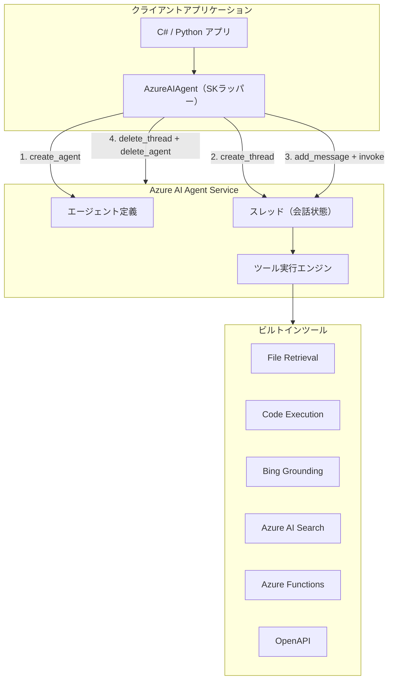
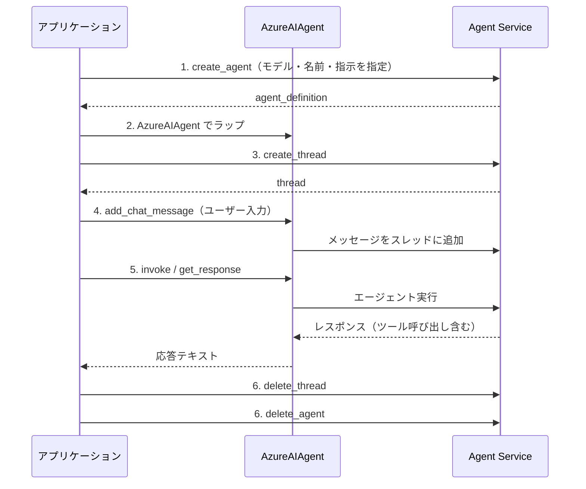

本記事は [Using Azure AI Agents with Semantic Kernel in .NET and Python](https://devblogs.microsoft.com/agent-framework/using-azure-ai-agents-with-semantic-kernel-in-net-and-python/) の解説記事です。

## ブログ概要（Summary）

Microsoftは2025年3月に公開した本ブログ記事で、Azure AI Agent ServiceとSemantic Kernel（SK）を統合してエージェントを構築する方法を紹介している。ブログでは、エージェント定義の作成からスレッドベースの対話、リソースクリーンアップまでの6ステップのライフサイクルを、C#とPythonの両言語でコード例とともに示している。Azure AI Agent Serviceはエージェントの状態管理とツール呼び出しをクラウド側で処理し、SKはそのオーケストレーション層として機能する構成が説明されている。

この記事は [Zenn記事: Semantic Kernel×Azure AI FoundryでAIエージェントを本番デプロイする](https://zenn.dev/0h_n0/articles/fd126bdee7c768) の深掘りです。

## 情報源

- **種別**: 企業テックブログ（Microsoft Agent Framework Blog）
- **URL**: [https://devblogs.microsoft.com/agent-framework/using-azure-ai-agents-with-semantic-kernel-in-net-and-python/](https://devblogs.microsoft.com/agent-framework/using-azure-ai-agents-with-semantic-kernel-in-net-and-python/)
- **組織**: Microsoft（著者: Sophia Lagerkrans-Pandey, Evan Mattson, Chris Rickman）
- **発表日**: 2025年3月13日

## 技術的背景（Technical Background）

### Azure AI Agent Serviceが解決する課題

LLMを使ったエージェントを本番運用する場合、開発者は以下の課題に直面する。

1. **会話状態管理**: マルチターンの対話でコンテキストを維持するために、セッションストアを自前で構築・運用する必要がある
2. **ツール呼び出しの実装**: LLMが返すツール呼び出しリクエストのパース・実行・結果の再注入を手動で実装する必要がある
3. **リソースのライフサイクル**: エージェント定義やスレッドの作成・破棄を確実に行わないとリソースリークが発生する

Microsoftはブログ中で、Azure AI Agent Serviceがこれらの課題を解決すると説明している。具体的には、「自動的なツール呼び出し（automates tool calling, eliminating the need for manual parsing and invocation）」と「スレッドによる安全な会話履歴管理（securely manages conversation history using threads, reducing the overhead of maintaining state）」を提供するとしている。

### Semantic Kernelの位置づけ

Semantic Kernelは、Azure AI Agent Serviceのクラウド側リソースをローカルのオーケストレーション層でラップする役割を担う。ブログのコード例から推測されるアーキテクチャでは、`AzureAIAgent`クラスがサービス側のエージェント定義をSKのエージェントオブジェクトとして抽象化し、Plugin・Filter・KernelFunctionといったSKのエコシステムと統合できるようにしている。

### 学術的背景

エージェントオーケストレーションの文脈では、ReActパターン（Yao et al., 2023）やToolformer（Schick et al., 2023）に代表されるツール呼び出しの自動化が研究されてきた。Azure AI Agent Serviceはこれらの研究成果を製品レベルで実装したものと位置づけられ、SKのPlugin機構を通じてカスタムツールを追加できる設計となっている。

## 実装アーキテクチャ（Architecture）

### システム構成

ブログで示されたコード例から、以下のアーキテクチャが読み取れる。



### 6ステップのエージェントライフサイクル

ブログでは、C#・Pythonの両言語で共通する6ステップのライフサイクルが示されている。



### C#での実装

ブログで示されたC#コード例を、本番利用を想定して補完したものを以下に示す。

```csharp
using Azure.AI.Projects;
using Azure.Identity;
using Microsoft.SemanticKernel;
using Microsoft.SemanticKernel.Agents.AzureAI;
using Microsoft.SemanticKernel.ChatCompletion;

// AIProjectClient を作成（Entra ID認証推奨）
AIProjectClient client =
    AzureAIAgent.CreateAzureAIClient(
        connectionString: "<your-connection-string>",
        credential: new DefaultAzureCredential());

AgentsClient agentsClient = client.GetAgentsClient();

// 1. Agent Service にエージェント定義を作成
Agent definition = await agentsClient.CreateAgentAsync(
    model: "gpt-4o",
    name: "TechSupportAgent",
    description: "技術サポートエージェント",
    instructions: "ユーザーの技術的な質問に日本語で回答してください。");

// 2. SK の AzureAIAgent でラップ
AzureAIAgent agent = new(definition, agentsClient);

// 3. スレッド作成
AgentThread thread = await agentsClient.CreateThreadAsync();

try
{
    // 4. ユーザーメッセージを追加
    var message = new ChatMessageContent(AuthorRole.User, "Semantic Kernelの主な利点を教えてください");
    await agent.AddChatMessageAsync(thread.Id, message);

    // 5. エージェントを実行しレスポンスを取得（ストリーミング）
    await foreach (ChatMessageContent response in agent.InvokeAsync(thread.Id))
    {
        Console.WriteLine(response.Content);
    }
}
finally
{
    // 6. リソースの明示的クリーンアップ（必須）
    await agentsClient.DeleteThreadAsync(thread.Id);
    await agentsClient.DeleteAgentAsync(agent.Id);
}
```

ブログの元コードでは`CreateAgentAsync`の`await`が省略されており、`threadId`変数が未定義のまま使用されている点に注意が必要である。上記コードではこれらを修正している。

### Pythonでの実装

```python
import asyncio
from azure.identity.aio import DefaultAzureCredential
from semantic_kernel.agents.azure_ai import AzureAIAgent, AzureAIAgentSettings

async def main() -> None:
    """Azure AI Agent の基本ライフサイクルを実行する"""
    ai_agent_settings = AzureAIAgentSettings.create()

    async with (
        DefaultAzureCredential() as creds,
        AzureAIAgent.create_client(credential=creds) as client,
    ):
        # 1. Agent Service にエージェント定義を作成
        agent_definition = await client.agents.create_agent(
            model=ai_agent_settings.model_deployment_name,
            name="TechSupportAgent",
            instructions="ユーザーの技術的な質問に日本語で回答してください。",
        )

        # 2. SK の AzureAIAgent でラップ
        agent = AzureAIAgent(
            client=client,
            definition=agent_definition,
        )

        # 3. スレッド作成
        thread = await client.agents.create_thread()

        try:
            # 4. ユーザーメッセージを追加
            await agent.add_chat_message(
                thread_id=thread.id,
                message="Semantic Kernelの主な利点を教えてください",
            )
            # 5. エージェントを実行しレスポンスを取得
            response = await agent.get_response(thread_id=thread.id)
            print(f"# {response.name}: {response}")
        finally:
            # 6. リソースの明示的クリーンアップ（必須）
            await client.agents.delete_thread(thread.id)
            await client.agents.delete_agent(agent.id)


if __name__ == "__main__":
    asyncio.run(main())
```

Pythonでは`async with`構文でCredentialとClientの両方を管理しているため、例外発生時もリソースが適切に解放される。ブログではSemantic Kernel Python 1.24.0以降を要件としており、`pip install semantic-kernel[azure]`でインストールする。

### ビルトインツール

ブログでは、Azure AI Agent Serviceが提供するビルトインツールとして以下の6種類が言及されている。

| ツール | 用途 | 説明 |
|--------|------|------|
| File Retrieval | ファイル検索 | アップロードしたファイルからの情報検索 |
| Code Execution | コード実行 | Pythonコードのサンドボックス実行 |
| Bing Grounding | Web検索 | Bing検索によるグラウンディング |
| Azure AI Search | インデックス検索 | 既存の検索インデックスの活用 |
| Azure Functions | カスタム関数 | サーバーレス関数との連携 |
| OpenAPI | 外部API | OpenAPIスキーマに基づくAPI呼び出し |

ブログではツールのセットアップ方法は詳述されていないが、`create_agent`呼び出し時に`tools`パラメータで指定する形式であることが公式ドキュメントから確認できる。

## Production Deployment Guide

### AWS実装パターン（コスト最適化重視）

Azure AI Agent Serviceは Azure 上で稼働するマネージドサービスであるが、周辺のアプリケーション層やフロントエンドをAWSで構築するケースや、マルチクラウド戦略でAWS側にオーケストレーション層を置くケースに対応するため、AWS上の実装パターンを示す。

**トラフィック量別の推奨構成**:

| 規模 | 月間リクエスト | 推奨構成 | 月額コスト | 主要サービス |
|------|--------------|---------|-----------|------------|
| **Small** | ~3,000 (100/日) | Serverless | $50-150 | Lambda + API Gateway + DynamoDB |
| **Medium** | ~30,000 (1,000/日) | Hybrid | $300-800 | Lambda + ECS Fargate + ElastiCache |
| **Large** | 300,000+ (10,000/日) | Container | $2,000-5,000 | EKS + Karpenter + EC2 Spot |

**Small構成の詳細**（月額$50-150）:
- **Lambda**: 1GB RAM, 60秒タイムアウト（$20/月）。Azure AI Agent Service APIへのHTTPリクエスト送信を担当
- **API Gateway**: REST API（$5/月）。WebSocket対応でストリーミング応答も可能
- **DynamoDB**: On-Demand（$10/月）。スレッドID・エージェントIDの対応表とセッション状態を保存
- **Secrets Manager**: Azure接続文字列の安全な保管（$1/月）
- **CloudWatch**: 基本監視（$5/月）

**Medium構成の詳細**（月額$300-800）:
- **ECS Fargate**: 0.5 vCPU, 1GB RAM × 2タスク（$120/月）。長時間エージェントセッションのホスト
- **Lambda**: イベント駆動処理・軽量API（$50/月）
- **ElastiCache Redis**: cache.t3.micro（$15/月）。スレッド状態のキャッシュ
- **ALB**: Application Load Balancer（$20/月）

**Large構成の詳細**（月額$2,000-5,000）:
- **EKS**: コントロールプレーン（$72/月）
- **EC2 Spot Instances**: c6i.xlarge × 2-4台（平均$200/月、最大90%削減）
- **Karpenter**: 自動スケーリング（追加コストなし）
- **ElastiCache Redis**: cache.r6g.large（$180/月）

**コスト削減テクニック**:
- Spot Instances使用で最大90%削減（EKS + Karpenter）
- Reserved Instances購入で最大72%削減（1年コミット）
- Lambda メモリ最適化でコスト30-50%削減（Lambda Power Tuning）
- アイドルタイムの Auto Scaling to Zero（Fargate/Lambda）

**コスト試算の注意事項**:
- 上記は2026年11月時点のAWS ap-northeast-1（東京）リージョン料金に基づく概算値
- Azure AI Agent Service側の料金（モデル呼び出しコスト）は別途発生する
- 実際のコストはトラフィックパターン、リージョン、バースト使用量により変動する
- 最新料金は [AWS料金計算ツール](https://calculator.aws/) で確認を推奨

### Terraformインフラコード

**Small構成 (Serverless): Lambda + API Gateway + DynamoDB**

```hcl
module "vpc" {
  source  = "terraform-aws-modules/vpc/aws"
  version = "~> 5.0"

  name = "agent-proxy-vpc"
  cidr = "10.0.0.0/16"
  azs  = ["ap-northeast-1a", "ap-northeast-1c"]
  private_subnets = ["10.0.1.0/24", "10.0.2.0/24"]

  enable_nat_gateway   = false
  enable_dns_hostnames = true
}

resource "aws_iam_role" "lambda_agent" {
  name = "lambda-agent-proxy-role"

  assume_role_policy = jsonencode({
    Version = "2012-10-17"
    Statement = [{
      Action = "sts:AssumeRole"
      Effect = "Allow"
      Principal = { Service = "lambda.amazonaws.com" }
    }]
  })
}

resource "aws_iam_role_policy" "lambda_permissions" {
  role = aws_iam_role.lambda_agent.id

  policy = jsonencode({
    Version = "2012-10-17"
    Statement = [
      {
        Effect   = "Allow"
        Action   = ["dynamodb:GetItem", "dynamodb:PutItem", "dynamodb:DeleteItem", "dynamodb:Query"]
        Resource = aws_dynamodb_table.agent_sessions.arn
      },
      {
        Effect   = "Allow"
        Action   = ["secretsmanager:GetSecretValue"]
        Resource = aws_secretsmanager_secret.azure_config.arn
      }
    ]
  })
}

resource "aws_lambda_function" "agent_proxy" {
  filename      = "lambda.zip"
  function_name = "azure-agent-proxy"
  role          = aws_iam_role.lambda_agent.arn
  handler       = "index.handler"
  runtime       = "python3.12"
  timeout       = 60
  memory_size   = 1024

  environment {
    variables = {
      DYNAMODB_TABLE = aws_dynamodb_table.agent_sessions.name
      SECRET_NAME    = aws_secretsmanager_secret.azure_config.name
    }
  }
}

resource "aws_dynamodb_table" "agent_sessions" {
  name         = "agent-sessions"
  billing_mode = "PAY_PER_REQUEST"
  hash_key     = "session_id"

  attribute {
    name = "session_id"
    type = "S"
  }

  ttl {
    attribute_name = "expire_at"
    enabled        = true
  }
}

resource "aws_secretsmanager_secret" "azure_config" {
  name = "azure-agent-config"
}

resource "aws_cloudwatch_metric_alarm" "lambda_errors" {
  alarm_name          = "agent-proxy-errors"
  comparison_operator = "GreaterThanThreshold"
  evaluation_periods  = 1
  metric_name         = "Errors"
  namespace           = "AWS/Lambda"
  period              = 300
  statistic           = "Sum"
  threshold           = 5
  alarm_description   = "Lambda関数のエラー急増検知"

  dimensions = {
    FunctionName = aws_lambda_function.agent_proxy.function_name
  }
}
```

**Large構成 (Container): EKS + Karpenter + Spot Instances**

```hcl
module "eks" {
  source  = "terraform-aws-modules/eks/aws"
  version = "~> 20.0"

  cluster_name    = "agent-proxy-cluster"
  cluster_version = "1.31"

  vpc_id     = module.vpc.vpc_id
  subnet_ids = module.vpc.private_subnets

  cluster_endpoint_public_access = true
  enable_cluster_creator_admin_permissions = true
}

resource "kubectl_manifest" "karpenter_provisioner" {
  yaml_body = <<-YAML
    apiVersion: karpenter.sh/v1
    kind: NodePool
    metadata:
      name: spot-pool
    spec:
      template:
        spec:
          requirements:
            - key: karpenter.sh/capacity-type
              operator: In
              values: ["spot"]
            - key: node.kubernetes.io/instance-type
              operator: In
              values: ["c6i.xlarge", "c6i.2xlarge"]
          limits:
            cpu: "32"
            memory: "64Gi"
      disruption:
        consolidationPolicy: WhenEmptyOrUnderutilized
        consolidateAfter: 30s
  YAML
}

resource "aws_budgets_budget" "agent_monthly" {
  name         = "agent-proxy-monthly"
  budget_type  = "COST"
  limit_amount = "5000"
  limit_unit   = "USD"
  time_unit    = "MONTHLY"

  notification {
    comparison_operator        = "GREATER_THAN"
    threshold                  = 80
    threshold_type             = "PERCENTAGE"
    notification_type          = "ACTUAL"
    subscriber_email_addresses = ["ops@example.com"]
  }
}
```

### セキュリティベストプラクティス

**本番環境での推奨設定**:

1. **Azure接続の保護**: Azure接続文字列はSecrets Managerに保管し、Lambda/ECSのIAMロール経由でのみ取得する。環境変数へのハードコード禁止
2. **ネットワーク分離**: EKSの`cluster_endpoint_public_access = false`を設定し、VPN/Direct Connect経由でアクセス
3. **IAMロール**: 最小権限の原則（PoLP）を適用。DynamoDBとSecrets Managerへのアクセスのみ許可
4. **暗号化**: S3/DynamoDB/EBSすべてKMS暗号化。転送中はTLS 1.2以上
5. **監査**: CloudTrail全リージョン有効化、Config有効化

**セキュリティチェックリスト**:
- [ ] Azure接続文字列のSecrets Manager保管
- [ ] IAMロール最小権限設定
- [ ] パブリックアクセス最小化
- [ ] TLS 1.2以上使用
- [ ] CloudTrail/Config有効化
- [ ] KMS暗号化（DynamoDB/S3）

### 運用・監視設定

**CloudWatch Logs Insights クエリ**:

```sql
-- エージェント応答時間の分析（P95, P99）
fields @timestamp, duration_ms, agent_name
| stats pct(duration_ms, 95) as p95, pct(duration_ms, 99) as p99 by bin(5m)

-- Azure API呼び出しエラーの検知
fields @timestamp, @message
| filter @message like /Azure.*error|timeout|429/
| stats count(*) as error_count by bin(1h)
```

**CloudWatch アラーム設定**:

```python
import boto3

cloudwatch = boto3.client('cloudwatch')

cloudwatch.put_metric_alarm(
    AlarmName='agent-response-latency',
    ComparisonOperator='GreaterThanThreshold',
    EvaluationPeriods=2,
    MetricName='Duration',
    Namespace='AWS/Lambda',
    Period=300,
    Statistic='Average',
    Threshold=30000,
    AlarmDescription='エージェント応答時間が平均30秒超過',
    AlarmActions=['arn:aws:sns:ap-northeast-1:123456789:agent-alerts'],
)

cloudwatch.put_metric_alarm(
    AlarmName='agent-error-rate',
    ComparisonOperator='GreaterThanThreshold',
    EvaluationPeriods=1,
    MetricName='Errors',
    Namespace='AWS/Lambda',
    Period=300,
    Statistic='Sum',
    Threshold=10,
    AlarmDescription='5分間のエラー数が10件超過',
)
```

**X-Ray トレーシング設定**:

```python
from aws_xray_sdk.core import xray_recorder, patch_all

patch_all()

@xray_recorder.capture('azure_agent_invoke')
def invoke_azure_agent(session_id: str, user_input: str) -> str:
    """Azure AI Agentを呼び出してレスポンスを取得する"""
    xray_recorder.put_annotation('session_id', session_id)
    xray_recorder.put_metadata('input_length', len(user_input))

    response = call_agent_service(session_id, user_input)

    xray_recorder.put_metadata('response_length', len(response))
    return response
```

**Cost Explorer自動レポート**:

```python
import boto3
from datetime import datetime, timedelta

ce = boto3.client('ce')

response = ce.get_cost_and_usage(
    TimePeriod={
        'Start': (datetime.now() - timedelta(days=1)).strftime('%Y-%m-%d'),
        'End': datetime.now().strftime('%Y-%m-%d'),
    },
    Granularity='DAILY',
    Metrics=['UnblendedCost'],
    GroupBy=[
        {'Type': 'SERVICE', 'Key': 'SERVICE'},
    ],
)

for result in response['ResultsByTime']:
    for group in result['Groups']:
        service = group['Keys'][0]
        cost = float(group['Metrics']['UnblendedCost']['Amount'])
        if cost > 100:
            print(f"ALERT: {service} = ${cost:.2f}/day")
```

### コスト最適化チェックリスト

**アーキテクチャ選択（トラフィック量で判断）**:
- [ ] ~100 req/日 → Lambda + API Gateway (Serverless) — $50-150/月
- [ ] ~1000 req/日 → ECS Fargate + Lambda (Hybrid) — $300-800/月
- [ ] 10000+ req/日 → EKS + Spot Instances (Container) — $2,000-5,000/月

**リソース最適化**:
- [ ] EC2: Spot Instances優先（最大90%削減、Karpenter自動管理）
- [ ] Reserved Instances: 1年コミットで72%削減（予測可能な負荷）
- [ ] Savings Plans: Compute Savings Plans検討（柔軟性高）
- [ ] Lambda: メモリサイズ最適化（Lambda Power Tuning分析）
- [ ] ECS/EKS: アイドルタイムのスケールダウン（夜間0台）

**Azure AI Agent Serviceコスト最適化**:
- [ ] モデル選択: 軽量タスクにはGPT-4o mini、複雑なタスクにはGPT-4oを使い分け
- [ ] スレッドの適時削除: `finally`ブロックで確実にクリーンアップ
- [ ] エージェント定義の再利用: 同一エージェントは使い回し、都度作成しない
- [ ] Prompt Caching: システムプロンプト固定で30-90%削減

**監視・アラート（コスト異常の即時検知）**:
- [ ] AWS Budgets: 月額予算設定（80%で警告、100%でアラート）
- [ ] CloudWatch アラーム: Lambda実行時間・エラー率のスパイク検知
- [ ] Cost Anomaly Detection: 自動異常検知（機械学習ベース）
- [ ] 日次コストレポート: SNS/Slackへ自動送信

**リソース管理**:
- [ ] 未使用リソース削除: Lambda Insights, Trusted Advisor活用
- [ ] タグ戦略: 環境別（dev/staging/prod）、プロジェクト別でコスト可視化
- [ ] DynamoDB TTL設定: 古いセッション情報の自動削除
- [ ] ライフサイクルポリシー: S3ログの30日自動削除

## パフォーマンス最適化（Performance）

### レイテンシの構成要素

Azure AI Agent Serviceを経由するエージェント呼び出しのレイテンシは、以下の要素で構成される。

$$
T_{\text{total}} = T_{\text{network}} + T_{\text{agent\_service}} + T_{\text{model\_inference}} + T_{\text{tool\_execution}}
$$

ここで、
- $T_{\text{network}}$: AWSからAzureへのネットワークラウンドトリップ（マルチクラウド構成時）
- $T_{\text{agent\_service}}$: Agent Serviceのオーケストレーション処理
- $T_{\text{model\_inference}}$: LLMの推論時間
- $T_{\text{tool\_execution}}$: ビルトインツール（Code Interpreter等）の実行時間

### 最適化手法

1. **リージョン選択**: Azure AI FoundryプロジェクトとAWSリソースを同一リージョン（例: East US / us-east-1）に配置し、$T_{\text{network}}$を最小化する
2. **スレッド再利用**: マルチターン対話では既存スレッドを再利用し、スレッド作成のオーバーヘッドを回避する
3. **ストリーミング応答**: C#の`InvokeAsync`はストリーミング対応。ユーザーへの初回応答時間（TTFT: Time to First Token）を短縮できる
4. **エージェント定義のキャッシュ**: 同一エージェントを繰り返し作成せず、定義IDを保存して再利用する

### ストリーミング vs 一括取得

ブログのコード例では、C#がストリーミング（`await foreach`）、Pythonが一括取得（`get_response`）を使用している。本番環境では対話型UIにはストリーミング、バッチ処理には一括取得が適している。

## 運用での学び（Production Lessons）

### リソースリークの防止

ブログで強調されているのは、**スレッドとエージェントの明示的な削除**である。`try...finally`パターンを採用し、例外発生時もリソースが確実にクリーンアップされる設計が示されている。

リソースリークが発生するパターンとして以下が考えられる。

| パターン | リスク | 対策 |
|---------|-------|------|
| `finally`ブロックなし | スレッド・エージェントが残留 | `try...finally`を徹底 |
| 非同期例外での中断 | クリーンアップ未実行 | Python: `async with`、C#: `IAsyncDisposable` |
| バッチ処理での蓄積 | 数千のスレッドが残留 | 定期的なガベージコレクションジョブの実装 |
| アプリケーションクラッシュ | クリーンアップ関数未到達 | Agent Service側のTTL設定、外部監視 |

### 認証の運用

ブログのC#コード例では`AzureCliCredential`が使用されているが、本番環境では`DefaultAzureCredential`が推奨される。Pythonコード例では最初から`DefaultAzureCredential`が使用されており、Azure App ServiceやAKSのマネージドIDと自動統合される。

### バージョン管理の重要性

ブログ発行時点（2025年3月）ではSemantic Kernel Python 1.24.0以降が要件とされていたが、2026年11月現在ではv1.46.0まで更新されている。Agent Framework 1.0のGA（2026年4月）により、新規プロジェクトではAgent Frameworkの採用も検討すべき段階にある。ブログのコード例をそのまま使用する場合は、最新のSKバージョンでの動作確認が必要である。

## 学術研究との関連（Academic Connection）

### エージェントオーケストレーションの研究背景

Azure AI Agent Serviceの設計は、以下の研究から影響を受けていると考えられる。

- **ReAct (Yao et al., 2023)**: Reasoning + Actingの統合パターン。Agent Serviceのツール呼び出し自動化はReActループの製品実装に相当する
- **Toolformer (Schick et al., 2023)**: LLMが自律的にツール使用を学習する研究。Agent Serviceのビルトインツール統合はこの方向性の延長線上にある
- **LATS (Zhou et al., 2024)**: Language Agent Tree Searchによるエージェントの探索・計画能力の強化。Agent Serviceのマルチツール呼び出しチェーンは類似の機構を提供する

### ブログの貢献と限界

ブログの貢献は、Azure AI Agent ServiceとSKの統合パターンを具体的なコードで示した点にある。一方で、ベンチマーク結果やスケーラビリティの定量的評価は含まれておらず、プロダクション規模での性能特性は別途検証が必要である。

## まとめと実践への示唆

本ブログ記事は、Azure AI Agent ServiceとSemantic Kernelの統合パターンを.NETとPythonの両言語で示した公式ガイドである。6ステップのライフサイクル（定義作成→ラップ→スレッド作成→メッセージ追加→実行→クリーンアップ）を理解することで、マネージドなエージェントインフラの上でカスタムロジックを構築できる。

**実践のポイント**:
- `try...finally`によるリソースクリーンアップは省略しないこと
- 本番環境では`DefaultAzureCredential`を使用すること
- SK v1.46.0以降を使用し、Agent Framework 1.0の採用も検討すること
- ビルトインツール（Code Interpreter, Bing Grounding等）を活用して実装コストを削減すること

## 参考文献

- **Blog URL**: [Using Azure AI Agents with Semantic Kernel in .NET and Python](https://devblogs.microsoft.com/agent-framework/using-azure-ai-agents-with-semantic-kernel-in-net-and-python/)
- **Official Docs**: [Exploring the Semantic Kernel AzureAIAgent](https://learn.microsoft.com/semantic-kernel/frameworks/agent/azure-ai-agent)
- **Sample Code (.NET)**: [GitHub - AzureAIAgent .NET Samples](https://github.com/microsoft/semantic-kernel/tree/main/dotnet/samples/GettingStartedWithAgents/AzureAIAgent)
- **Sample Code (Python)**: [GitHub - AzureAIAgent Python Samples](https://github.com/microsoft/semantic-kernel/tree/main/python/samples/getting_started_with_agents/azure_ai_agent)
- **Related Papers**: Yao et al., "ReAct: Synergizing Reasoning and Acting in Language Models" (2023); Schick et al., "Toolformer: Language Models Can Teach Themselves to Use Tools" (2023)
- **Related Zenn article**: [Semantic Kernel×Azure AI FoundryでAIエージェントを本番デプロイする](https://zenn.dev/0h_n0/articles/fd126bdee7c768)
