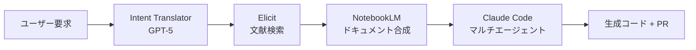
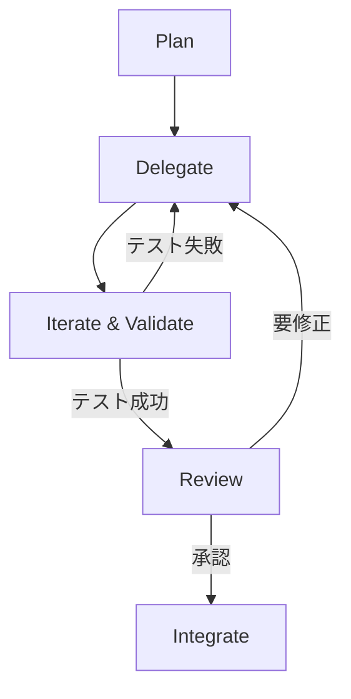

## 論文概要（Abstract）

本記事は [https://arxiv.org/abs/2508.08322](https://arxiv.org/abs/2508.08322) の解説記事です。

LLMはコンテキストウィンドウの制限とドメイン知識の不足により、大規模マルチファイルプロジェクトでの開発支援に課題を抱えている。本論文ではIntent Translator（GPT-5）による要件の構造化、Elicitによるセマンティック文献検索、NotebookLMによるドキュメント合成、Claude Codeマルチエージェントによるコード生成・検証の4要素を統合するワークフローを提案している。著者は約180,000行のNext.jsアプリケーション（RainMakerz）上で評価を行い、単一エージェントベースラインと比較して単発成功率の向上を報告している。

この記事は [Zenn記事: Claude Code×git worktreeで並列コーディング環境を構築しセッション分離とAGENTS.mdを最適化する](https://zenn.dev/0h_n0/articles/28308f8faf9cdf) の深掘りです。

## 情報源

- **arXiv ID**: 2508.08322
- **URL**: [https://arxiv.org/abs/2508.08322](https://arxiv.org/abs/2508.08322)
- **著者**: Muhammad Haseeb（Virginia Tech）
- **発表年**: 2025
- **分野**: cs.SE（Software Engineering）

## 背景と動機（Background & Motivation）

LLMベースのコーディングアシスタントは単一ファイルの補完や小規模な変更では高い成功率を示す一方、数百ファイル規模のプロジェクトではコンテキストウィンドウの制約がボトルネックとなる。著者はこの問題を3つの軸で整理している。

第一に**コンテキスト不足**の問題がある。大規模コードベースではファイル間の依存関係・型定義・ビジネスロジックが分散しており、1回のプロンプトにすべてを収めることが困難である。第二に**ドメイン知識の欠如**として、最新のライブラリAPI・フレームワーク固有のパターン・プロジェクト独自の規約がLLMの学習データに含まれていないケースがある。第三に**検証の欠如**として、生成コードが構文的に正しくても既存コードとの整合性やテストの通過を保証できない問題がある。

従来のCodePlan、MASAI、HyperAgent、DARSなどのアプローチはSWE-Benchなどの標準ベンチマークで評価されてきたが、著者はこれらが主にコンテキスト検索またはタスク分解のいずれか一方に焦点を当てており、外部知識の統合とマルチエージェント協調の両方を同時に扱うシステムが不足していると指摘している。

## 主要な貢献（Key Contributions）

- **貢献1**: Intent Translator・Elicit・NotebookLM・Claude Codeマルチエージェントの4コンポーネントを統合し、5層のコンテキスト階層で情報を構造化するワークフローの提案
- **貢献2**: 約180,000行のNext.jsウェブアプリケーション（RainMakerz）上でのケーススタディによる評価。フロントエンドとバックエンドにまたがる機能追加タスクでの検証
- **貢献3**: `.claude/agents/`ディレクトリにMarkdown/YAMLファイルとしてサブエージェントを定義し、ハブ＆スポーク型のオーケストレーションパターンを実装する方法の具体的な記述

## 技術的詳細（Technical Details）

### 4コンポーネントアーキテクチャ

本論文のシステムは以下の4要素で構成される。



**1. Intent Translator（GPT-5）**

ユーザーの自然言語による要求を構造化されたタスク仕様に変換する。著者によれば、明確なステップ分解と要件の明示化により、後続のエージェントが曖昧さなくタスクに取り組めるようになるとしている。

**2. Elicit（セマンティック文献検索）**

タスク仕様から検索クエリを生成し（例: "calendar widget React TypeScript library"）、上位$k$件（$k = 3 \sim 5$）の文献をPDFまたはテキストとして取得する。ここで取得される情報はLLMの学習データに含まれていない最新のライブラリ仕様やベストプラクティスである。

**3. NotebookLM（ドキュメント合成）**

取得した文献を目次形式のアウトラインとQ&Aバレットに変換する。著者は長文の段落をそのまま注入するよりも、この構造化された形式の方がエージェントのプロンプトに注入しやすいと報告している。

**4. Claude Code マルチエージェントシステム**

プランナー・コーダー・テスター・レビュアーの4種のサブエージェントをオーケストレーターが管理する。各サブエージェントは独立したコンテキストウィンドウを持ち、互いの中間出力に直接アクセスしない。

### 5層コンテキスト階層（Context Layering）

著者はエージェントのプロンプトに注入する情報を5層に構造化している。

$$
\text{Context}(a_i) = \bigoplus_{l=1}^{5} L_l(a_i)
$$

ここで $a_i$ はサブエージェント $i$、$\bigoplus$ は各層の結合を表す。

| 層 | 名称 | 内容 | 例 |
|---|---|---|---|
| L1 | タスク仕様 | Intent Translatorの出力 | ステップ分解、要件リスト |
| L2 | 外部知識 | Elicit + NotebookLMの出力 | ライブラリAPI、ベストプラクティス |
| L3 | プロジェクトメモリ | CLAUDE.mdの規約 | コーディング規約、アーキテクチャ |
| L4 | 検索コード | ベクトルDB検索結果 | 関連する既存関数・型定義 |
| L5 | 実行アーティファクト | テスト結果、diff、ログ | npm testの出力、エラースタック |

L4層のコード検索にはtree-sitterによる関数・クラス単位のチャンキングとChromaDB（またはZilliz）によるベクトル埋め込みが使われる。著者はこれを「dual-index backend with a unified adapter」と呼んでおり、ベクトル検索とgrepベースのファイルパス検索を統合アダプタで束ねている。

### サブエージェント定義

サブエージェントは`.claude/agents/`ディレクトリにMarkdownファイルとして定義される。

```markdown
<!-- .claude/agents/backend-architect.md -->
---
name: backend-architect
description: バックエンドAPI設計と実装の専門エージェント
tools:
  - Read
  - Write
  - Edit
  - Bash
---

あなたはバックエンドアーキテクトです。
API設計、データベーススキーマ、サーバーサイドロジックを担当します。
```

著者は同様のプロファイルをフロントエンド、DevOps、コードレビュアーにも作成している。各エージェントには担当ディレクトリとツール権限が明示的に割り当てられ、不要なファイルへのアクセスが制限される。

### オーケストレーションループ

著者が「Manager」と呼ぶオーケストレーターは以下の5フェーズで動作する。



1. **Plan**: プランナーエージェントがファイル・コンポーネント単位のステップリストを生成
2. **Delegate**: 各ステップを担当エージェントに割り当て。プラン抜粋、検索コード、エージェント固有の指示を付与
3. **Iterate & Validate**: `npm test`で検証。失敗時は該当エージェントにフィードバック（単純リトライ、DARSのような分岐なし）
4. **Review**: コードレビュアーが型安全性・パフォーマンス・セキュリティのチェックリストに基づきdiffを検査
5. **Integrate**: 統合diff生成、ブランチまたはPRへのプッシュ。CIが再度テストを実行

著者は現在の実行が**逐次的**であることを認めており、独立したステップの並列実行は将来の課題としている。これはZenn記事で解説されているworktree分離によるセッション並列化と組み合わせることで、このシステムの並列実行が実現可能であることを示唆している。

### ファイルロックによる競合防止

ファイルロック機構により、複数のサブエージェントが同一ファイルを同時編集することを防止している。これはZenn記事で述べられている`isolation: worktree`によるサブエージェントのファイルシステム分離と同じ課題意識に基づく設計である。

## 実装のポイント（Implementation）

著者のシステムを再現する際の注意点を整理する。

**コード検索のチャンキング戦略**: tree-sitterによる構文解析で関数・クラス単位にコードを分割し、各チャンクを埋め込みモデルでベクトル化する。単純な行数ベースの分割と比べ、意味的なまとまりが保たれるため検索精度が向上するとされる。

```python
import tree_sitter_python as tspython
from tree_sitter import Language, Parser
from chromadb import Client

PY_LANGUAGE = Language(tspython.language())
parser = Parser(PY_LANGUAGE)

def chunk_by_function(source_code: str) -> list[dict]:
    """tree-sitterで関数単位にチャンキングする"""
    tree = parser.parse(bytes(source_code, "utf-8"))
    chunks = []
    for node in tree.root_node.children:
        if node.type in ("function_definition", "class_definition"):
            chunks.append({
                "text": source_code[node.start_byte:node.end_byte],
                "type": node.type,
                "name": node.children[1].text.decode("utf-8"),
                "start_line": node.start_point[0],
                "end_line": node.end_point[0],
            })
    return chunks

def index_codebase(files: list[str], collection_name: str = "code") -> None:
    """コードベース全体をChromaDBにインデックスする"""
    client = Client()
    collection = client.get_or_create_collection(collection_name)
    for filepath in files:
        with open(filepath) as f:
            source = f.read()
        chunks = chunk_by_function(source)
        for chunk in chunks:
            collection.add(
                documents=[chunk["text"]],
                metadatas=[{
                    "file": filepath,
                    "name": chunk["name"],
                    "type": chunk["type"],
                }],
                ids=[f"{filepath}:{chunk['name']}"],
            )
```

**CLAUDE.mdによるプロジェクトメモリ**: L3層のプロジェクトメモリはCLAUDE.mdファイルから読み込まれる。コーディング規約・アーキテクチャの概要・ビルドコマンドなど、セッション横断で保持すべき情報がここに集約される。これはZenn記事で解説されているAGENTS.mdのディレクトリスコーピングと同じ設計思想である。

**エージェント間通信の制約**: サブエージェント間は直接通信できず、すべてオーケストレーターを経由する。これは情報のフローを制御しコンテキスト汚染を防ぐためであるが、逆にエージェント間の即座の連携が必要なタスクでは遅延が生じる。

## Production Deployment Guide

### AWS実装パターン（コスト最適化重視）

本論文のマルチエージェントコード生成システムをAWS上に構築する場合の推奨構成を示す。

**トラフィック量別の推奨構成**:

| 規模 | 月間リクエスト | 推奨構成 | 月額コスト | 主要サービス |
|------|--------------|---------|-----------|------------|
| **Small** | ~3,000 (100/日) | Serverless | $50-150 | Lambda + Bedrock + DynamoDB |
| **Medium** | ~30,000 (1,000/日) | Hybrid | $300-800 | Lambda + ECS Fargate + ElastiCache |
| **Large** | 300,000+ (10,000/日) | Container | $2,000-5,000 | EKS + Karpenter + EC2 Spot |

**Small構成の詳細** (月額$50-150):
- **Lambda**: 1GB RAM, 60秒タイムアウト ($20/月)
- **Bedrock**: Claude 3.5 Haiku, Prompt Caching有効 ($80/月)
- **DynamoDB**: On-Demand、コードチャンクのキャッシュ ($10/月)
- **ChromaDB on Lambda**: 小規模ベクトル検索 ($15/月)
- **CloudWatch**: 基本監視 ($5/月)

**コスト削減テクニック**:
- Spot Instances使用で最大90%削減（EKS + Karpenter）
- Bedrock Batch API使用で50%削減（非リアルタイム処理）
- Prompt Caching有効化で30-90%削減（L3層のCLAUDE.mdをキャッシュ）
- tree-sitterチャンキングで検索トークン数を削減

**コスト試算の注意事項**:
上記は2026年11月時点のAWS ap-northeast-1（東京）リージョン料金に基づく概算値です。実際のコストはトラフィックパターン、リージョン、バースト使用量により変動します。最新料金は [AWS料金計算ツール](https://calculator.aws/) で確認してください。

### Terraformインフラコード

**Small構成 (Serverless): Lambda + Bedrock + DynamoDB**

```hcl
module "vpc" {
  source  = "terraform-aws-modules/vpc/aws"
  version = "~> 5.0"

  name = "code-agent-vpc"
  cidr = "10.0.0.0/16"
  azs  = ["ap-northeast-1a", "ap-northeast-1c"]
  private_subnets = ["10.0.1.0/24", "10.0.2.0/24"]

  enable_nat_gateway   = false
  enable_dns_hostnames = true
}

resource "aws_iam_role" "lambda_agent" {
  name = "lambda-code-agent-role"

  assume_role_policy = jsonencode({
    Version = "2012-10-17"
    Statement = [{
      Action = "sts:AssumeRole"
      Effect = "Allow"
      Principal = { Service = "lambda.amazonaws.com" }
    }]
  })
}

resource "aws_iam_role_policy" "bedrock_invoke" {
  role = aws_iam_role.lambda_agent.id
  policy = jsonencode({
    Version = "2012-10-17"
    Statement = [{
      Effect   = "Allow"
      Action   = ["bedrock:InvokeModel", "bedrock:InvokeModelWithResponseStream"]
      Resource = "arn:aws:bedrock:ap-northeast-1::foundation-model/anthropic.claude-3-5-haiku*"
    }]
  })
}

resource "aws_lambda_function" "code_agent" {
  filename      = "lambda.zip"
  function_name = "multi-agent-code-assistant"
  role          = aws_iam_role.lambda_agent.arn
  handler       = "index.handler"
  runtime       = "python3.12"
  timeout       = 120
  memory_size   = 1024

  environment {
    variables = {
      BEDROCK_MODEL_ID    = "anthropic.claude-3-5-haiku-20241022-v1:0"
      DYNAMODB_TABLE      = aws_dynamodb_table.code_cache.name
      ENABLE_PROMPT_CACHE = "true"
    }
  }
}

resource "aws_dynamodb_table" "code_cache" {
  name         = "code-chunk-cache"
  billing_mode = "PAY_PER_REQUEST"
  hash_key     = "chunk_id"

  attribute {
    name = "chunk_id"
    type = "S"
  }

  ttl {
    attribute_name = "expire_at"
    enabled        = true
  }
}

resource "aws_cloudwatch_metric_alarm" "lambda_cost" {
  alarm_name          = "code-agent-cost-spike"
  comparison_operator = "GreaterThanThreshold"
  evaluation_periods  = 1
  metric_name         = "Duration"
  namespace           = "AWS/Lambda"
  period              = 3600
  statistic           = "Sum"
  threshold           = 100000
  alarm_description   = "Lambda実行時間異常（コスト急増の可能性）"

  dimensions = {
    FunctionName = aws_lambda_function.code_agent.function_name
  }
}
```

**Large構成 (Container): EKS + Karpenter + Spot Instances**

```hcl
module "eks" {
  source  = "terraform-aws-modules/eks/aws"
  version = "~> 20.0"

  cluster_name    = "code-agent-cluster"
  cluster_version = "1.31"
  vpc_id          = module.vpc.vpc_id
  subnet_ids      = module.vpc.private_subnets

  cluster_endpoint_public_access = true
  enable_cluster_creator_admin_permissions = true
}

resource "kubectl_manifest" "karpenter_provisioner" {
  yaml_body = <<-YAML
    apiVersion: karpenter.sh/v1
    kind: NodePool
    metadata:
      name: spot-code-agents
    spec:
      template:
        spec:
          requirements:
            - key: karpenter.sh/capacity-type
              operator: In
              values: ["spot"]
            - key: node.kubernetes.io/instance-type
              operator: In
              values: ["m7i.xlarge", "m7i.2xlarge"]
          limits:
            cpu: "32"
            memory: "128Gi"
      disruption:
        consolidationPolicy: WhenEmpty
        consolidateAfter: 30s
  YAML
}

resource "aws_budgets_budget" "code_agent_monthly" {
  name         = "code-agent-monthly-budget"
  budget_type  = "COST"
  limit_amount = "5000"
  limit_unit   = "USD"
  time_unit    = "MONTHLY"

  notification {
    comparison_operator        = "GREATER_THAN"
    threshold                  = 80
    threshold_type             = "PERCENTAGE"
    notification_type          = "ACTUAL"
    subscriber_email_addresses = ["ops@example.com"]
  }
}
```

### セキュリティベストプラクティス

- **IAMロール**: 最小権限の原則。Bedrock InvokeModelのみ許可
- **シークレット管理**: AWS Secrets Manager使用、環境変数ハードコード禁止
- **ネットワーク**: VPC内配置、パブリックアクセス最小化
- **暗号化**: S3/DynamoDB/EBS全てKMS暗号化
- **監査**: CloudTrail全リージョン有効化

### 運用・監視設定

**CloudWatch Logs Insights クエリ**:

```sql
fields @timestamp, model_id, input_tokens, output_tokens
| stats sum(input_tokens + output_tokens) as total_tokens by bin(1h)
| filter total_tokens > 100000

fields @timestamp, duration_ms
| stats pct(duration_ms, 95) as p95, pct(duration_ms, 99) as p99 by bin(5m)
```

**CloudWatch アラーム（コスト重視）**:

```python
import boto3

cloudwatch = boto3.client('cloudwatch')

cloudwatch.put_metric_alarm(
    AlarmName='bedrock-token-spike',
    ComparisonOperator='GreaterThanThreshold',
    EvaluationPeriods=1,
    MetricName='TokenUsage',
    Namespace='AWS/Bedrock',
    Period=3600,
    Statistic='Sum',
    Threshold=500000,
    ActionsEnabled=True,
    AlarmActions=['arn:aws:sns:ap-northeast-1:123456789:cost-alerts'],
    AlarmDescription='Bedrockトークン使用量異常'
)
```

**X-Ray トレーシング設定**:

```python
from aws_xray_sdk.core import xray_recorder, patch_all

patch_all()

@xray_recorder.capture('agent_orchestration')
def orchestrate_agents(task_spec: str) -> dict:
    xray_recorder.put_annotation('task_type', 'multi_agent')
    xray_recorder.put_metadata('spec_length', len(task_spec))
    # オーケストレーション実行
    return result
```

### コスト最適化チェックリスト

**アーキテクチャ選択**:
- [ ] ~100 req/日 → Lambda + Bedrock (Serverless) - $50-150/月
- [ ] ~1,000 req/日 → ECS Fargate + Bedrock (Hybrid) - $300-800/月
- [ ] 10,000+ req/日 → EKS + Spot (Container) - $2,000-5,000/月

**リソース最適化**:
- [ ] Spot Instances優先（最大90%削減、Karpenter自動管理）
- [ ] Reserved Instances: 1年コミットで72%削減
- [ ] Lambda: メモリサイズ最適化（CloudWatch Insights分析）
- [ ] ECS/EKS: アイドルタイムのスケールダウン
- [ ] tree-sitterチャンキングでベクトルDBサイズ最小化

**LLMコスト削減**:
- [ ] Bedrock Batch API: 50%割引（非リアルタイム）
- [ ] Prompt Caching: L3層（CLAUDE.md）を固定キャッシュ
- [ ] モデル選択: 簡易タスクはHaiku、複雑タスクはSonnet
- [ ] max_tokens設定で過剰生成防止

**監視・アラート**:
- [ ] AWS Budgets: 月額予算設定（80%警告）
- [ ] CloudWatch: トークン使用量スパイク検知
- [ ] Cost Anomaly Detection有効化
- [ ] 日次コストレポート: SNS/Slack送信

**リソース管理**:
- [ ] 未使用リソース削除（Lambda Insights活用）
- [ ] タグ戦略: 環境別・プロジェクト別
- [ ] S3ライフサイクル: 古いキャッシュ30日で削除
- [ ] 開発環境: 夜間停止

## 実験結果（Results）

著者は5件の非自明なタスク（機能追加およびバグ修正）をRainMakerz上で評価している。評価は小規模かつ非形式的であり、統計的検定は行われていない点に注意が必要である。

| 指標 | マルチエージェント | 単一エージェント |
|------|-------------------|-----------------|
| 単発成功率 | 4/5（80%） | 2/5（40%） |
| メッセージ数/タスク | 30-40 | 約10（成功時） |
| トークン消費/タスク | 約100K | 10-20K（成功時） |

著者は単一エージェントベースラインがプロジェクトに存在しない関数（`getEvents()`、`refreshToken()`）を勝手に生成した一方、マルチエージェントシステムは既存の`renewSession()`を正しく使用したと報告している。これはL4層のコード検索（ベクトルDB）が有効に機能していることを示唆している。

### ケーススタディ: CustomBlock（pitch-deckモジュール）

プランナーが4ステップを生成し、初回のテスト実行ではシリアライゼーションホワイトリストに新しいブロックタイプが追加されていなかったため失敗した。オーケストレーターがこれをバックエンドエージェントにフィードバックし、2回目の実行で成功した。レビュアーは1件のリファクタリングを提案した。単一エージェントベースラインはReactコンポーネントのみを生成し、レジストリと型更新を見落としてランタイムエラーが発生した。

### 既存手法との比較（著者の記載に基づく）

著者は既存手法の公表値として以下を挙げている。ただし直接比較実験は報告されていない。

| 手法 | ベンチマーク | 成功率 |
|------|------------|--------|
| MASAI | SWE-Bench Lite | 28.3% |
| HyperAgent | SWE-Bench Verified | 31.4% |
| DARS | SWE-Bench Lite | 47.0% (pass@1) |

これらはベンチマークが異なるため直接比較は困難であり、本論文のRainMakerz上での80%という数値とは評価条件が根本的に異なる。

## 実運用への応用（Practical Applications）

本論文のアプローチはZenn記事で解説されているClaude Code × git worktreeの並列開発環境と組み合わせることで、以下の実用的な構成が考えられる。

**worktree分離 + マルチエージェント**: 各worktreeで独立したマルチエージェントシステムを実行し、フロントエンド/バックエンド/テストを並列に開発する。worktreeがファイルシステムレベルの分離を、サブエージェント定義がコンテキストレベルの分離を提供する。

**AGENTS.mdとの統合**: 本論文の`.claude/agents/`によるエージェント定義はZenn記事で解説されているAGENTS.mdのディレクトリスコーピングと同じ設計空間にある。L3層（CLAUDE.md）のプロジェクトメモリとAGENTS.mdの階層的なスコーピングを組み合わせることで、各エージェントが受け取るコンテキストを最適化できる。

**スケーリングの課題**: 著者はタスクあたり約100Kトークンのコスト（単一エージェントの3-5倍）を報告している。大規模プロジェクトではこのコストが膨張する可能性があり、Prompt Cachingやモデル選択の最適化が必要となる。

## 関連研究（Related Work）

- **CodePlan (Microsoft Research, 2023)**: リポジトリレベルのコード変更計画を生成するが、マルチエージェント協調は含まない。タスク分解に焦点を当てている
- **DARS (2024)**: 分岐ベースの探索でpass@1=47%をSWE-Bench Liteで達成。本論文の単純リトライとは対照的なアプローチ
- **Co-Coder (arXiv 2606.00953)**: 依存グラフに基づくコヒージョンアウェアなタスク分割で並列エージェントの通信コストを最適化。本論文の逐次実行と相補的な関係にある

## まとめと今後の展望

著者は「適切な情報を適切な形式で提供し、作業をサブタスクに分割すること」がLLMコーディングアシスタントの性能向上において最も重要であると結論づけている。5層コンテキスト階層とエージェント定義の組み合わせは、Zenn記事で解説されているAGENTS.mdのスコーピングやworktree分離と同じ設計原則に基づいている。

ただし、本論文の評価は5タスク・1プロジェクトという限定的な規模であり、統計的検定も行われていない。Abstractの「significantly improves」という表現はこの証拠の規模に対してやや強い主張であることに注意が必要である。著者はより大規模な評価、適応的なプランニング、および承認ポイントの導入を将来の課題としている。

## 参考文献

- **arXiv**: [https://arxiv.org/abs/2508.08322](https://arxiv.org/abs/2508.08322)
- **Related Zenn article**: [https://zenn.dev/0h_n0/articles/28308f8faf9cdf](https://zenn.dev/0h_n0/articles/28308f8faf9cdf)
- **CodePlan**: [https://arxiv.org/abs/2309.12499](https://arxiv.org/abs/2309.12499)
- **DARS**: [https://arxiv.org/abs/2408.09686](https://arxiv.org/abs/2408.09686)
- **Co-Coder**: [https://arxiv.org/abs/2606.00953](https://arxiv.org/abs/2606.00953)

---

:::message
本記事はAI（Claude Code）により自動生成されました。内容は論文の記載に基づいていますが、解釈の正確性については原論文もご確認ください。
:::
