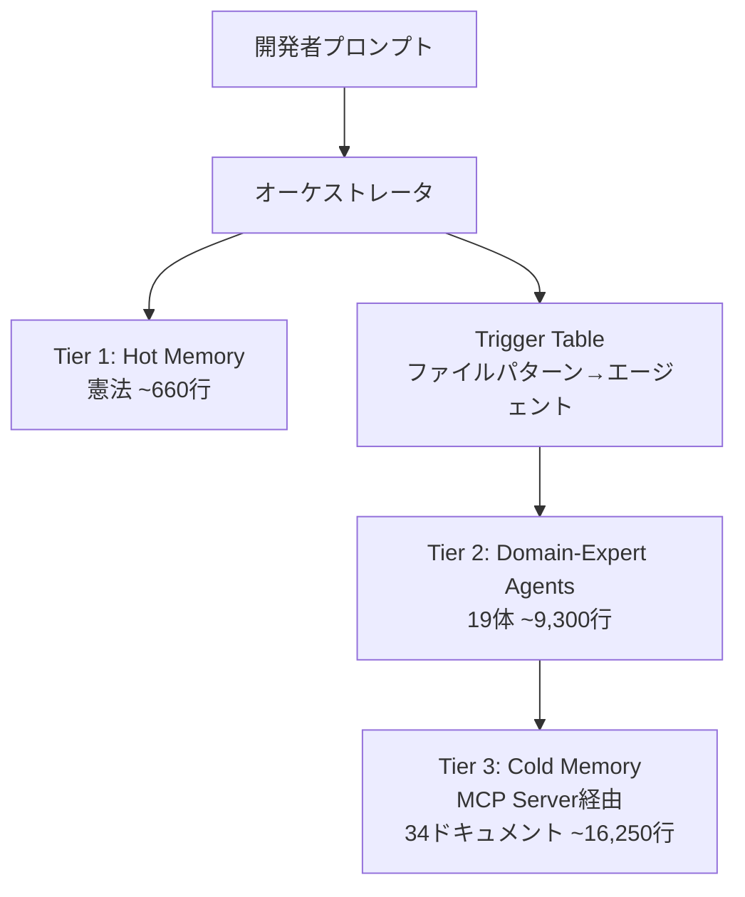

本記事は [https://arxiv.org/abs/2602.20478](https://arxiv.org/abs/2602.20478) の解説記事です。

## 論文概要（Abstract）

LLMベースのコーディングエージェントはセッションを跨ぐとコンテキストを失い、規約の逸脱やミスの再発が起きる。本論文では、108,000行のC#分散システムを構築する過程で開発された3層構造の「Codified Context Infrastructure」を提示している。Tier 1（hot memory: プロジェクト憲法）、Tier 2（19体のdomain-expert agents）、Tier 3（cold memory: 34件のサブシステムドキュメントをMCPサーバで検索提供）から構成され、283セッション・2,801プロンプトにわたる運用データが報告されている。

この記事は [Zenn記事: Claude Code×git worktreeで並列コーディング環境を構築しセッション分離とAGENTS.mdを最適化する](https://zenn.dev/0h_n0/articles/28308f8faf9cdf) の深掘りです。

## 情報源

- **arXiv ID**: 2602.20478
- **URL**: [https://arxiv.org/abs/2602.20478](https://arxiv.org/abs/2602.20478)
- **著者**: Aristidis Vasilopoulos（独立研究者、化学分野出身）
- **発表年**: 2026
- **分野**: cs.SE（ソフトウェアエンジニアリング）
- **コンパニオンリポジトリ**: [github.com/arisvas4/codified-context-infrastructure](https://github.com/arisvas4/codified-context-infrastructure)

## 背景と動機（Background & Motivation）

LLMコーディングエージェント（Claude Code、Cursor、GitHub Copilotなど）は、セッション単位では高い生産性を発揮する一方、セッション間でコンテキストが失われるという根本的な課題を抱えている。既存の対策として `CLAUDE.md`、`.cursorrules`、`AGENTS.md` といった単一ファイルのマニフェストが広く使われているが、著者はこれらが小規模プロジェクトでは有効でも、10万行を超えるコードベースではスケールしないと指摘している。

著者自身は化学分野の研究者であり、ソフトウェアエンジニアリングの専門教育を受けていない。この背景から、本論文はドメイン専門家がAIエージェントと協働して専門外のソフトウェアを構築するケーススタディとしての側面も持つ。著者は「CLAUDE.mdのような単一ファイルはコードをインデックスしているが、本基盤はコードに関する知識（設計意図、制約、失敗モード）をインデックスする」と位置づけている（Section 1より）。

## 主要な貢献（Key Contributions）

- **貢献1**: 単一ファイルマニフェストを拡張し、trigger table・hot/cold memory分離・MCP検索を統合した3層アーキテクチャの設計
- **貢献2**: 283セッションにわたる成長メトリクス・インタラクションパターン・4件の観察的ケーススタディによる定量評価
- **貢献3**: エージェント仕様・MCPサーバ・ドキュメント・分析スクリプトを含むオープンソースフレームワークの公開

## 技術的詳細（Technical Details）

### 3層アーキテクチャの全体像



### Tier 1: Hot Memory（プロジェクト憲法）

約660行のMarkdownファイルで、全セッションに自動的にロードされる。著者は「常に従うべきルールは何か？」という問いに答えるコンテンツのみをここに配置すべきとしている（Section 2.1より）。

含まれる内容:
- 品質基準・命名規約
- ビルドコマンド
- アーキテクチャ概要（Tier 3へのリンク付き）
- チェックリスト・既知の障害モード
- オーケストレーションプロトコル

設計上の制約は簡潔さであり、「サブシステムXはどう動作するか？」のような詳細はTier 3に委譲する。

### Tier 2: Domain-Expert Agents

19体のMarkdown仕様ファイルで構成され、合計約9,300行。著者は8体を「高機能（high-capability）」（平均約711行）、11体を「標準（standard）」（平均約327行）に分類している（Section 2.2より）。

各エージェント仕様の構成要素:
- スコープ定義（担当範囲）
- ツールと権限（一部は読み取り専用）
- 関連するTier 3ドキュメントの参照
- 出力形式の指定
- よくあるミスのパターン（symptom-cause-fix表）

著者が報告する重要な知見は、エージェント仕様の**50%以上がドメイン知識**（事実・数式・コードパターン・診断表）であり、行動指示ではないという点である。例えばネットワーキングエージェントは915行のうち約65%がドメイン知識で占められている（Section 2.2より）。

さらに、エージェントは事前設計ではなく**観察された失敗への対応**として順次作成された。最初に作成されたのは `network-protocol-designer` と `coordinate-wizard` で、デバッグ失敗率が最も高い領域であった。

### Trigger Table: 自動ルーティング

ファイルパターンに基づいてタスクをエージェントにルーティングする仕組み。`.gitignore` と同様のパターン記法を使用する。

| ファイルパターン | トリガータイミング | ルーティング先 |
|---|---|---|
| `network/sync/*` | 変更前 | network-protocol-designer |
| `ECS/*`, `network/*` | 変更後 | code-reviewer-game-dev |

未知のコード領域を探索する際は、オーケストレータが `suggest_agent(task_description)` を呼び出すことで適切なエージェントを推薦させる。

### Tier 3: Cold Memory（MCP検索基盤）

34件のサブシステムスコープのMarkdownドキュメント（約16,250行）を、約1,600行のPython MCPサーバで検索可能にしている。ドキュメントはAI消費を前提として書かれており、ファイルパス・パラメータ名・期待される動作が明示されている。

MCPサーバが提供する5つのツール:

```python
# MCPサーバのツール定義（論文Section 2.3より構成を再現）
def list_subsystems() -> list[str]:
    """全サブシステムの一覧を返す"""
    ...

def get_files_for_subsystem(key: str) -> list[str]:
    """指定サブシステムの関連ファイルパスを返す"""
    ...

def find_relevant_context(task: str) -> list[Document]:
    """タスク記述に関連するコンテキストドキュメントを返す"""
    ...

def search_context_documents(query: str) -> list[Document]:
    """キーワードでドキュメントを検索する"""
    ...

def suggest_agent(task: str) -> str:
    """タスク記述に適したエージェントを推薦する"""
    ...
```

現在の検索はキーワード部分文字列マッチングで実装されている。著者はセマンティック検索を今後の課題として挙げている。

### インフラストラクチャ規模のまとめ

著者が報告するインフラストラクチャの規模（Section 3, Figure 2より）:

| 層 | ファイル数 | 行数 | コードベース比 |
|---|---|---|---|
| Tier 1（憲法） | 1 | ~660 | 0.6% |
| Tier 2（エージェント） | 19 | ~9,300 | 8.6% |
| Tier 3（ナレッジベース+MCPサーバ） | 34 | ~16,250 | 15.0% |
| **合計** | **54** | **~26,200** | **24.2%** |

著者は「この比率は本プロジェクトの複雑性とドメインを反映したものであり、目標値ではない」と述べている。

## 実装のポイント（Implementation）

### 段階的な成長パターン

著者はGit履歴から3フェーズの成長パターンを報告している（Figure 2より）:
- **Phase 1（1-10日目）**: 約100行の憲法のみ
- **Phase 2（11-30日目）**: エージェント仕様と初期エージェントを追加
- **Phase 3（31-57日目）**: MCPサービスとエージェントの拡張

### 実践ガイドライン（G1-G6）

著者は6つのガイドラインを提示している:
1. 基本的な憲法から開始する
2. 計画エージェントを使って必要な仕様とスペシャリストを発見する
3. trigger tableを活用する
4. 1回以上説明した知識はドキュメント化する
5. ガイドなしのセッションが行き詰まったらスペシャリストを構築する
6. 陳腐化した仕様をサイレント障害の原因として扱う

### メンテナンスコスト

著者は週1-2時間のメンテナンスを報告している。各更新は影響セッションあたり約5分の追加時間を要し、隔週レビューに30-45分を費やしている。陳腐化した仕様が主な障害モードであり、少なくとも2回、矛盾するコードを生成する原因となった。対策として、セッション開始時に仕様更新を伴わないソースコード変更を検出するドリフト検出器を導入している。

## Production Deployment Guide

本論文のMCPサーバアーキテクチャをAWS上で運用する場合の構成を示す。

### AWS実装パターン（コスト最適化重視）

| 規模 | 月間リクエスト | 推奨構成 | 月額コスト | 主要サービス |
|------|--------------|---------|-----------|------------|
| **Small** | ~3,000 (100/日) | Serverless | $50-150 | Lambda + DynamoDB + S3 |
| **Medium** | ~30,000 (1,000/日) | Hybrid | $300-800 | Lambda + ECS Fargate + ElastiCache |
| **Large** | 300,000+ (10,000/日) | Container | $2,000-5,000 | EKS + Karpenter + OpenSearch |

**Small構成の詳細**（月額$50-150）:
- **Lambda**: MCPサーバをサーバーレス関数として実行、1GB RAM、30秒タイムアウト（$20/月）
- **DynamoDB**: コンテキストドキュメントのメタデータ格納、On-Demand（$10/月）
- **S3**: ドキュメント本体格納（$5/月）
- **Bedrock**: Claude 3.5 Haiku、Prompt Caching有効（$80/月）
- **CloudWatch**: 基本監視（$5/月）

**コスト試算の注意事項**: 上記は2026年11月時点のAWS ap-northeast-1（東京）リージョン料金に基づく概算値です。実際のコストはトラフィックパターンやバースト使用量により変動します。最新料金は [AWS料金計算ツール](https://calculator.aws/) で確認してください。

### Terraformインフラコード

**Small構成（Serverless）: Lambda + DynamoDB + S3**

```hcl
# --- IAMロール（最小権限） ---
resource "aws_iam_role" "mcp_lambda" {
  name = "mcp-context-server-role"

  assume_role_policy = jsonencode({
    Version = "2012-10-17"
    Statement = [{
      Action = "sts:AssumeRole"
      Effect = "Allow"
      Principal = { Service = "lambda.amazonaws.com" }
    }]
  })
}

resource "aws_iam_role_policy" "mcp_permissions" {
  role = aws_iam_role.mcp_lambda.id
  policy = jsonencode({
    Version = "2012-10-17"
    Statement = [
      {
        Effect   = "Allow"
        Action   = ["dynamodb:GetItem", "dynamodb:Query", "dynamodb:Scan"]
        Resource = aws_dynamodb_table.context_docs.arn
      },
      {
        Effect   = "Allow"
        Action   = ["s3:GetObject", "s3:ListBucket"]
        Resource = [aws_s3_bucket.docs.arn, "${aws_s3_bucket.docs.arn}/*"]
      }
    ]
  })
}

# --- Lambda関数（MCPサーバ） ---
resource "aws_lambda_function" "mcp_server" {
  filename      = "mcp_server.zip"
  function_name = "codified-context-mcp"
  role          = aws_iam_role.mcp_lambda.arn
  handler       = "server.handler"
  runtime       = "python3.12"
  timeout       = 30
  memory_size   = 1024

  environment {
    variables = {
      DYNAMODB_TABLE = aws_dynamodb_table.context_docs.name
      S3_BUCKET      = aws_s3_bucket.docs.id
    }
  }
}

# --- DynamoDB（ドキュメントメタデータ） ---
resource "aws_dynamodb_table" "context_docs" {
  name         = "codified-context-docs"
  billing_mode = "PAY_PER_REQUEST"
  hash_key     = "subsystem_key"
  range_key    = "doc_id"

  attribute {
    name = "subsystem_key"
    type = "S"
  }
  attribute {
    name = "doc_id"
    type = "S"
  }

  ttl {
    attribute_name = "expire_at"
    enabled        = true
  }
}

# --- S3（ドキュメント本体） ---
resource "aws_s3_bucket" "docs" {
  bucket = "codified-context-documents"
}

resource "aws_s3_bucket_server_side_encryption_configuration" "docs" {
  bucket = aws_s3_bucket.docs.id
  rule {
    apply_server_side_encryption_by_default {
      sse_algorithm = "aws:kms"
    }
  }
}

# --- CloudWatchアラーム ---
resource "aws_cloudwatch_metric_alarm" "mcp_errors" {
  alarm_name          = "mcp-server-errors"
  comparison_operator = "GreaterThanThreshold"
  evaluation_periods  = 1
  metric_name         = "Errors"
  namespace           = "AWS/Lambda"
  period              = 300
  statistic           = "Sum"
  threshold           = 5
  alarm_description   = "MCPサーバのエラー率異常"

  dimensions = {
    FunctionName = aws_lambda_function.mcp_server.function_name
  }
}
```

### セキュリティベストプラクティス

1. **ネットワーク**: Lambda VPC内配置、パブリックアクセス不要
2. **認証**: IAM最小権限、MFA必須
3. **シークレット**: AWS Secrets Manager使用
4. **暗号化**: S3/DynamoDB全てKMS暗号化
5. **監査**: CloudTrail/Config有効化

### 運用・監視設定

**CloudWatch Logs Insightsクエリ**:

```sql
-- MCPサーバのツール呼び出し頻度分析
fields @timestamp, tool_name, subsystem_key, duration_ms
| stats count(*) as call_count, avg(duration_ms) as avg_latency by tool_name
| sort call_count desc

-- エラー率の時系列分析
fields @timestamp, @message
| filter @message like /ERROR/
| stats count(*) as error_count by bin(1h)
```

**CloudWatchアラーム（Python）**:

```python
import boto3

cloudwatch = boto3.client('cloudwatch')

cloudwatch.put_metric_alarm(
    AlarmName='mcp-latency-spike',
    ComparisonOperator='GreaterThanThreshold',
    EvaluationPeriods=2,
    MetricName='Duration',
    Namespace='AWS/Lambda',
    Period=300,
    Statistic='p99',
    Threshold=10000,
    AlarmDescription='MCPサーバP99レイテンシ異常（10秒超過）'
)
```

### コスト最適化チェックリスト

**アーキテクチャ選択**:
- [ ] ~100 req/日 → Lambda + DynamoDB (Serverless) — $50-150/月
- [ ] ~1000 req/日 → ECS Fargate + ElastiCache (Hybrid) — $300-800/月
- [ ] 10000+ req/日 → EKS + OpenSearch (Container) — $2,000-5,000/月

**リソース最適化**:
- [ ] Lambda: メモリサイズ最適化（CloudWatch Insights分析）
- [ ] DynamoDB: On-Demandモード（低トラフィック時最適）
- [ ] S3: Intelligent-Tiering有効化
- [ ] CloudFront: ドキュメント配信キャッシュ（TTL 24h）
- [ ] ECS/EKS: アイドルタイムのスケールダウン

**検索コスト削減**:
- [ ] キーワードマッチングで十分な場合はベクトル検索を避ける
- [ ] 頻出クエリのキャッシュ（ElastiCache Redis）
- [ ] ドキュメント更新時のみインデックス再構築
- [ ] 不要なサブシステムドキュメントの定期アーカイブ

**監視・アラート**:
- [ ] AWS Budgets: 月額予算設定
- [ ] CloudWatch: Lambda実行時間・エラー率
- [ ] Cost Anomaly Detection: 自動異常検知
- [ ] 日次コストレポート: SNS/Slack送信

**リソース管理**:
- [ ] 未使用Lambda関数の削除
- [ ] タグ戦略: 環境別（dev/staging/prod）
- [ ] S3ライフサイクルポリシー: 古いバージョン自動削除
- [ ] DynamoDB TTL: 期限切れドキュメント自動削除
- [ ] CloudWatch Logs: 保持期間設定（90日推奨）

## 実験結果（Results）

著者は283セッションにわたるインタラクションデータを報告している（Section 3より）。なお、本論文はシステム論文・経験報告であり、対照実験による因果的な有効性の主張は行っていない。

| メトリクス | 値 |
|---|---|
| 開発期間 | 70日間（パートタイム） |
| コミット数 | 148 |
| セッション数 | 283 |
| 人間のプロンプト数 | 2,801 |
| エージェント呼び出し数 | 1,197 |
| エージェントターン数 | 16,522 |
| プロンプトあたり自律ターン数 | 約6 |
| セッション種別 | 87%アドホック / 13%構造化 |
| MCP検索呼び出し | 1,478回（218セッション） |

エージェント利用パターンとして、分類可能な757回の呼び出しのうち432回（57%）がプロジェクト固有のスペシャリストであった。最頻呼び出しはコードレビュアー（154回）とnetwork-protocol-designer（85回）である。人間のプロンプトの80%以上が100語以下であり、メタインフラストラクチャ（基盤自体の保守）プロンプトは実質プロンプトの4.3%にとどまった。

## 実運用への応用（Practical Applications）

### Zenn記事との関連

Zenn記事ではAGENTS.mdのディレクトリスコーピングによるサブエージェントのコンテキスト最適化を解説しているが、本論文はそのアプローチをさらに発展させたものと位置づけられる。具体的には:

- **AGENTS.mdの階層構造** → 本論文の**Trigger Table**による自動ルーティングに対応
- **`omitClaudeMd`による軽量化** → 本論文の**Tier分離**（hot/cold memory）に対応
- **サブエージェントの`tools`制限** → 本論文の**エージェント仕様における権限定義**に対応

### スケーリングの観点

著者は10万行のコードベースに対して26,200行（24.2%）のコンテキスト基盤を構築しているが、この比率はプロジェクトの複雑性に依存する。リアルタイムシミュレーションという高度に相互依存的なドメインが、通常のWebアプリケーションよりも多くのドキュメントを必要とした可能性がある。

### 主な障害パターンの事例

4つのケーススタディから特に注目すべきは、**決定論的RNGのデバッグ事例**である。時刻同期のリファクタリングが12ファイルにまたがるデシンクを引き起こし、5回のコンテキストウィンドウ消耗と84回の編集を経て解決された。network-protocol-designerエージェントに埋め込まれた決定論の理論知識が、ガード句のサイレント失敗・2つの異なるクロックレート・符号エラーの3つの原因を特定する鍵となった。

## 関連研究（Related Work）

- **CLAUDE.md / .cursorrules**: 単一ファイルのプロジェクト指示。本論文はこれを3層に拡張し、スケーラビリティの課題に対処
- **RAG（Retrieval-Augmented Generation）**: コード検索にベクトル埋め込みを使用するアプローチ。本論文はコードそのものではなく「コードに関する知識」を検索対象とする点で異なる
- **MCP（Model Context Protocol）**: Anthropicが提唱するプロトコル。本論文はMCPサーバとしてTier 3を実装し、ツール定義を介してエージェントにナレッジベースを公開

## まとめと今後の展望

本論文は、CLAUDE.mdやAGENTS.mdのような単一ファイルマニフェストを3層の構造化されたコンテキスト基盤に拡張するアプローチを提示している。著者は283セッションの運用を通じて、週1-2時間のメンテナンスコストでエージェントのコンテキスト維持が可能であることを報告している。

今後の課題として、著者は制御実験による各層の有効性評価、埋め込みベースのセマンティック検索、チーム・マルチプロジェクト環境での検証、セマンティックドリフトの分析を挙げている。また、著者は本フレームワークを創薬プロジェクトに適用する試みを進めており、ドメイン横断的な汎用性の検証が期待される。

**制約事項**: 本論文は1名の開発者・1つのプロジェクトに基づく経験報告であり、対照実験は含まれていない。また、Claude CodeとMCPに依存しており、他のツールへの移植性は検証されていない。

## 参考文献

- **arXiv**: [https://arxiv.org/abs/2602.20478](https://arxiv.org/abs/2602.20478)
- **Code**: [github.com/arisvas4/codified-context-infrastructure](https://github.com/arisvas4/codified-context-infrastructure)
- **Related Zenn article**: [https://zenn.dev/0h_n0/articles/28308f8faf9cdf](https://zenn.dev/0h_n0/articles/28308f8faf9cdf)
