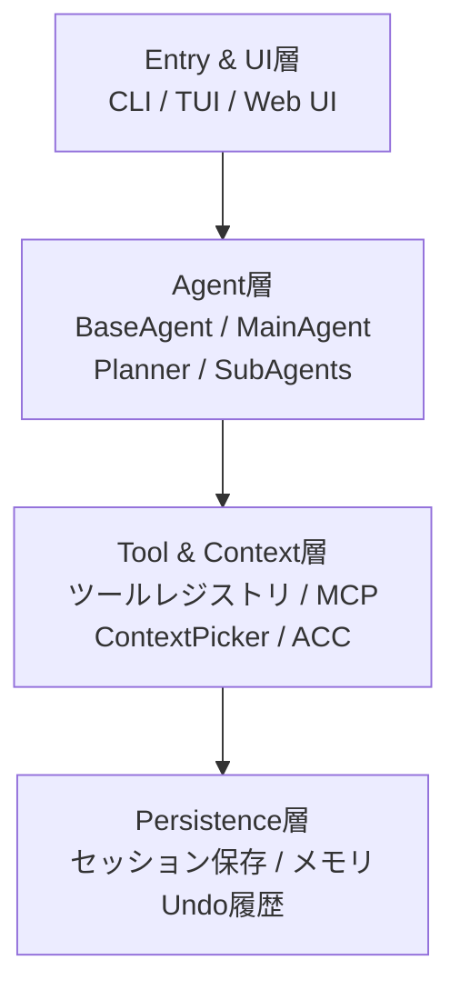
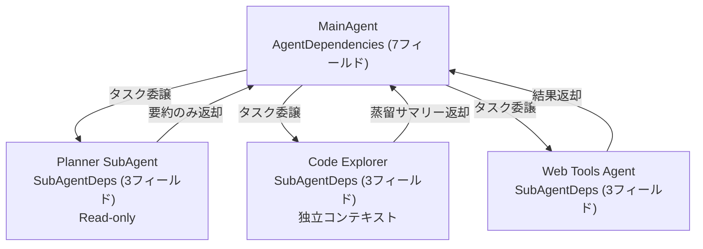

本記事は [https://arxiv.org/abs/2603.05344](https://arxiv.org/abs/2603.05344) の解説記事です。

## 論文概要（Abstract）

OpenDevは、Rust実装のオープンソースなターミナル型AIコーディングエージェントである。著者のNghi D. Q. Buiは、ワークロード特化型のモデルルーティング、計画と実行を分離するデュアルエージェント設計、遅延ツール検出（Lazy Tool Discovery）、および適応的コンテキスト圧縮（Adaptive Context Compaction, ACC）を備えた複合AIアーキテクチャを提案している。本論文は2026年3月に公開され、"Work in progress"と注記されている。

この記事は [Zenn記事: Claude Code×git worktreeで並列コーディング環境を構築しセッション分離とAGENTS.mdを最適化する](https://zenn.dev/0h_n0/articles/28308f8faf9cdf) の深掘りです。

## 情報源

- **arXiv ID**: 2603.05344
- **URL**: [https://arxiv.org/abs/2603.05344](https://arxiv.org/abs/2603.05344)
- **著者**: Nghi D. Q. Bui
- **発表年**: 2026
- **分野**: cs.AI
- **ライセンス**: CC BY 4.0

## 背景と動機（Background & Motivation）

現在のLLMベースコーディングエージェントは、ターミナル環境での長時間セッションにおいて複数の課題に直面している。著者は以下の3つを主要課題として挙げている。

第一に、**コンテキストウィンドウの消費問題**がある。著者の観測によると、典型的なセッションではツール出力がコンテキストの約70〜80%を占める。MCPツールのスキーマを一括読み込み（eager loading）した場合、最初のユーザーメッセージ前にコンテキストの約40%が消費されるという。

第二に、**サブエージェント間の状態分離**の問題がある。タスク管理やセッション永続化の機能をサブエージェントに渡すと、レース条件や不整合な状態が発生し得る。

第三に、**指示の消失（Instruction Fade-out）**問題がある。長いコンテキストにおいて、初期の指示が後の出力に埋もれ、エージェントが重要なルールを守らなくなる現象である。

## 主要な貢献（Key Contributions）

- **貢献1**: ワークフロー別のモデルバインディング（action, thinking, critique, vision, compactの5ロール、各々にフォールバックチェーン）
- **貢献2**: 拡張ReActループ（明示的なthinkingフェーズとオプショナルなself-critiqueを含む段階的な圧縮機構）
- **貢献3**: Adaptive Context Compaction（ACC）によるコンテキスト圧縮で、ピーク時のobservationコンテキストを約54%削減
- **貢献4**: イベント駆動型システムリマインダーによる指示消失対策
- **貢献5**: レジストリベースのツールシステムと遅延MCP検出による初期コンテキスト消費の削減

## 技術的詳細（Technical Details）

### 4層アーキテクチャ

著者はOpenDevのアーキテクチャを4つの層に分離している。



この設計において重要なのが**Scaffolding（足場）とHarness（ハーネス）の分離**である。Scaffoldingは最初のプロンプト前にエージェントを組み立てるフェーズで、`AgentFactory`がSkills → Subagents → Main agentの3段階を順に実行する。Harnessはランタイム時にツール実行のディスパッチ、コンテキスト圧縮、安全性チェック、永続化を管理する。

### 拡張ReActループ

標準的なReActループ（Reasoning + Acting）を拡張し、以下の4フェーズで動作する。

$$
\text{Loop} = \text{ContextMgmt} \rightarrow \text{Think}(L) \rightarrow \text{Act} \rightarrow \text{Decide}
$$

ここで $L \in \{\text{OFF}, \text{LOW}, \text{MEDIUM}, \text{HIGH}\}$ はThinkingレベルを表す。HIGHレベルでは自己批評（self-critique）フェーズが追加され、thinkingフェーズはツールなしで実行される。

**Doom-loopの検出**も重要な機構である。直近20回のツール呼び出しに対してMD5フィンガープリントを計算し、同じフィンガープリントが3回出現すると警告を発し、さらに繰り返されると承認待ちの一時停止が発生する。

読み取り専用ツール（Read, Grep等）は最大5つまで並列実行されるが、書き込みツールは直列に実行される。この設計はgit worktreeにおける並列セッション分離と共通する原則に基づいている。

### Adaptive Context Compaction（ACC）

ACCは5段階のコンテキスト圧力に基づく段階的な圧縮機構である。

| 段階 | コンテキスト圧力 | 動作 |
|------|-----------------|------|
| Stage 1 | 70% | 警告（Warning） |
| Stage 2 | 80% | Observationマスキング |
| Stage 3 | 85% | 高速プルーニング（Fast Pruning） |
| Stage 4 | 90% | 積極的マスキング（Aggressive Masking） |
| Stage 5 | 99% | 完全LLM圧縮 |

各段階の動作を形式的に表すと、コンテキスト圧力 $p$ は以下で定義される。

$$
p = \frac{|C_{\text{current}}|}{|C_{\text{max}}|}
$$

ここで $|C_{\text{current}}|$ は現在のコンテキストトークン数、$|C_{\text{max}}|$ はモデルの最大コンテキスト長である。

Stage 2のObservationマスキングでは、古いツール出力を要約に置き換える。著者はこの機構単独でピーク時のobservationコンテキストを約54%削減したと報告している。

**ツール出力の最適化**も重要な要素である。各ツールに専用のサマライザーが割り当てられ、例えばファイル読み取りの場合は「Read file (142 lines, 4,831 chars)」のような要約が生成される。8,000文字を超える出力はスクラッチファイルにオフロードされ、500文字のプレビューのみがコンテキストに挿入される。著者によると、この仕組みにより典型的なセッション長が15〜20ターンから30〜40ターンに延長されたという。

### デュアルメモリ構造

thinkingフェーズ用に2種類のメモリが設計されている。

1. **エピソードサマリー**: 最大500文字。完全な履歴から5メッセージごとに再生成される（「サマリーのドリフト」を防ぐため、前回のサマリーからの差分生成ではなく完全履歴からの再生成を行う）
2. **直近の会話**: 直近6回のやり取りをそのまま保持

### プロンプトキャッシング

プロンプトを安定部分（システムプロンプト、ツールスキーマ等）と動的部分（会話履歴）に分割し、安定部分をキャッシュする。著者はキャッシュ部分について入力コストの約88%削減を見積もっている。

### サブエージェント分離設計

サブエージェントの分離設計はClaude Codeのworktree分離と同じ原則に基づいている。



メインエージェントは`AgentDependencies`（7フィールド）を持つが、サブエージェントは`SubAgentDeps`（3フィールドのみ）を受け取る。これにより、サブエージェントはセッション永続化、コンソール出力、設定へのアクセスから分離される。

Plannerサブエージェントは読み取り専用で、7セクション構成の計画ファイルを書き出す。Code Explorerは独立したコンテキストウィンドウ内で実行され、蒸留されたサマリーのみがメインエージェントに返される。タスク管理ツールはメインエージェントにのみ付与され、サブエージェントには渡されない。

### イベント駆動型システムリマインダー

8つのイベント検出器がループの各イテレーション後に発火する。

| 検出器 | トリガー条件 |
|--------|------------|
| FailedTool | ツール実行が失敗 |
| ConsecutiveReads | 5回以上連続の読み取り操作 |
| PrematureCompletion | 未完了TODOがある状態で完了宣言 |
| ErrorSequence | 連続エラー（最大3回のnudge） |

リマインダーは`role: user`メッセージとして注入される。著者は`role: system`よりも`role: user`の方が「顕著に高いコンプライアンス」を示したと報告している。ガードレールとして`MAX_TODO_NUDGES = 2`、`MAX_NUDGE_ATTEMPTS = 3`が設定されている。

### 5層安全アーキテクチャ

| 層 | 機構 | 説明 |
|----|------|------|
| Layer 1 | プロンプトガードレール | システムプロンプト内の制約 |
| Layer 2 | スキーマ制限 | ツールスキーマレベルの引数制約 |
| Layer 3 | ランタイム承認 | ユーザーによる実行時承認 |
| Layer 4 | ツール検証 | ツール実行前のバリデーション |
| Layer 5 | ライフサイクルフック | 10イベント、exit code 2でブロック |

ライフサイクルフックは引数の変更も可能であり、Claude Codeの`pre-tool-use`フックに相当する機能を提供している。

### MCP遅延ツール検出

MCPツールスキーマのeager loading（一括読み込み）はコンテキストの約40%を消費する問題があった。OpenDevではレジストリベースの遅延検出（`search_tools`経由）を採用し、初期コンテキスト消費を5%未満に抑えている。

## 実装のポイント（Implementation）

OpenDevの設計から得られる実装上の知見を以下に整理する。

**ツール並列実行の設計**: 読み取り専用ツールのバッチ実行（最大5並列）と書き込みツールの直列実行という分離は、git worktreeにおける並列セッション管理と同様のread/write分離の原則に基づく。

**コンテキスト予算管理**: ACCの5段階アプローチは、単純な切り捨てよりもグレースフルな劣化を実現する。70%で警告を出し、段階的に圧縮を強化する設計は、システムリソース管理のバックプレッシャーパターンと類似している。

**フィンガープリントによるループ検出**: MD5ハッシュによるdoom-loop検出は計算コストが低く、ツール呼び出しパターンの異常を早期に発見できる。閾値（20-call window、3回出現）は調整可能なパラメータとして設計されている。

```python
import hashlib
from collections import deque
from typing import Any

class DoomLoopDetector:
    """ツール呼び出しパターンの繰り返しを検出する"""

    def __init__(self, window_size: int = 20, threshold: int = 3):
        self.window: deque[str] = deque(maxlen=window_size)
        self.threshold = threshold

    def check(self, tool_call: dict[str, Any]) -> str:
        fingerprint = hashlib.md5(
            str(tool_call).encode()
        ).hexdigest()
        self.window.append(fingerprint)

        count = sum(1 for fp in self.window if fp == fingerprint)
        if count >= self.threshold:
            return "PAUSE"
        elif count >= self.threshold - 1:
            return "WARN"
        return "OK"
```

## Production Deployment Guide

### AWS実装パターン（コスト最適化重視）

OpenDevのようなターミナルエージェントを本番環境で運用する場合のAWS構成を示す。以下のコスト試算は2026年11月時点のAWS ap-northeast-1（東京）リージョン料金に基づく概算値であり、実際のコストはトラフィックパターンやバースト使用量により変動する。最新料金は [AWS料金計算ツール](https://calculator.aws/) で確認されたい。

| 規模 | 月間リクエスト | 推奨構成 | 月額コスト | 主要サービス |
|------|--------------|---------|-----------|------------|
| **Small** | ~3,000 (100/日) | Serverless | $50-150 | Lambda + Bedrock + DynamoDB |
| **Medium** | ~30,000 (1,000/日) | Hybrid | $300-800 | Lambda + ECS Fargate + ElastiCache |
| **Large** | 300,000+ (10,000/日) | Container | $2,000-5,000 | EKS + Karpenter + EC2 Spot |

**Small構成の詳細**（月額$50-150）:
- Lambda: 1GB RAM, 60秒タイムアウト（$20/月）
- Bedrock: Claude 3.5 Haiku, Prompt Caching有効（$80/月）
- DynamoDB: On-Demand, コンテキストキャッシュ用（$10/月）
- CloudWatch: 基本監視（$5/月）

**コスト削減テクニック**:
- Spot Instances使用で最大90%削減（EKS + Karpenter）
- Bedrock Batch API使用で50%削減（非リアルタイム処理）
- Prompt Caching有効化で30-90%削減（論文では約88%の入力コスト削減を報告）
- ACCによるコンテキスト圧縮でトークン使用量削減

### Terraformインフラコード

**Small構成（Serverless）: Lambda + Bedrock + DynamoDB**

```hcl
module "vpc" {
  source  = "terraform-aws-modules/vpc/aws"
  version = "~> 5.0"

  name = "agent-vpc"
  cidr = "10.0.0.0/16"
  azs  = ["ap-northeast-1a", "ap-northeast-1c"]
  private_subnets = ["10.0.1.0/24", "10.0.2.0/24"]

  enable_nat_gateway   = false
  enable_dns_hostnames = true
}

resource "aws_iam_role" "lambda_agent" {
  name = "lambda-agent-role"

  assume_role_policy = jsonencode({
    Version = "2012-10-17"
    Statement = [{
      Action    = "sts:AssumeRole"
      Effect    = "Allow"
      Principal = { Service = "lambda.amazonaws.com" }
    }]
  })
}

resource "aws_iam_role_policy" "bedrock_invoke" {
  role = aws_iam_role.lambda_agent.id
  policy = jsonencode({
    Version = "2012-10-17"
    Statement = [{
      Effect   = "Allow"
      Action   = ["bedrock:InvokeModel", "bedrock:InvokeModelWithResponseStream"]
      Resource = "arn:aws:bedrock:ap-northeast-1::foundation-model/anthropic.claude-3-5-haiku*"
    }]
  })
}

resource "aws_lambda_function" "agent_handler" {
  filename      = "lambda.zip"
  function_name = "terminal-agent-handler"
  role          = aws_iam_role.lambda_agent.arn
  handler       = "index.handler"
  runtime       = "python3.12"
  timeout       = 120
  memory_size   = 1024

  environment {
    variables = {
      BEDROCK_MODEL_ID    = "anthropic.claude-3-5-haiku-20241022-v1:0"
      DYNAMODB_TABLE      = aws_dynamodb_table.context_cache.name
      ENABLE_PROMPT_CACHE = "true"
      ACC_THRESHOLD       = "0.70"
    }
  }
}

resource "aws_dynamodb_table" "context_cache" {
  name         = "agent-context-cache"
  billing_mode = "PAY_PER_REQUEST"
  hash_key     = "session_id"
  range_key    = "turn_number"

  attribute {
    name = "session_id"
    type = "S"
  }
  attribute {
    name = "turn_number"
    type = "N"
  }

  ttl {
    attribute_name = "expire_at"
    enabled        = true
  }
}

resource "aws_cloudwatch_metric_alarm" "lambda_duration" {
  alarm_name          = "agent-duration-spike"
  comparison_operator = "GreaterThanThreshold"
  evaluation_periods  = 1
  metric_name         = "Duration"
  namespace           = "AWS/Lambda"
  period              = 3600
  statistic           = "Sum"
  threshold           = 200000
  alarm_description   = "Lambda実行時間異常（ACC圧縮頻発の可能性）"

  dimensions = {
    FunctionName = aws_lambda_function.agent_handler.function_name
  }
}
```

### セキュリティベストプラクティス

- IAMロール: 最小権限の原則（Bedrock InvokeModelのみ許可）
- ネットワーク: Lambda VPC内配置、パブリックサブネット不使用
- シークレット: AWS Secrets Manager使用、環境変数ハードコード禁止
- 暗号化: DynamoDB KMS暗号化、転送中TLS 1.2以上
- 監査: CloudTrail全リージョン有効化

### 運用・監視設定

**CloudWatch Logs Insightsクエリ**:

```sql
-- ACC発動頻度の監視（コンテキスト圧力が高いセッションの特定）
fields @timestamp, session_id, acc_stage, context_pressure
| filter acc_stage >= 3
| stats count(*) as aggressive_compactions by bin(1h)

-- Doom-loop検出イベントの監視
fields @timestamp, session_id, tool_fingerprint, loop_count
| filter loop_count >= 3
| stats count(*) as doom_loops by bin(1h)
```

**CloudWatchアラーム（Python）**:

```python
import boto3

cloudwatch = boto3.client('cloudwatch')

cloudwatch.put_metric_alarm(
    AlarmName='bedrock-token-spike',
    ComparisonOperator='GreaterThanThreshold',
    EvaluationPeriods=1,
    MetricName='TokenUsage',
    Namespace='Custom/Agent',
    Period=3600,
    Statistic='Sum',
    Threshold=500000,
    ActionsEnabled=True,
    AlarmActions=['arn:aws:sns:ap-northeast-1:123456789:cost-alerts'],
    AlarmDescription='エージェントトークン使用量異常'
)
```

### コスト最適化チェックリスト

**アーキテクチャ選択**:
- [ ] ~100 req/日 → Lambda + Bedrock（Serverless）$50-150/月
- [ ] ~1000 req/日 → ECS Fargate + Bedrock（Hybrid）$300-800/月
- [ ] 10000+ req/日 → EKS + Spot（Container）$2,000-5,000/月

**リソース最適化**:
- [ ] EC2 Spot Instances優先（最大90%削減）
- [ ] Reserved Instances 1年コミット（最大72%削減）
- [ ] Lambda メモリサイズ最適化（CloudWatch Insights分析）
- [ ] ECS/EKS アイドル時スケールダウン

**LLMコスト削減**:
- [ ] Prompt Caching有効化（安定部分キャッシュで約88%削減）
- [ ] ACC有効化（コンテキスト圧縮でトークン消費削減）
- [ ] MCP遅延検出（初期コンテキスト消費を40%→5%に削減）
- [ ] Bedrock Batch API使用（非リアルタイム処理で50%削減）
- [ ] モデル選択: 簡易タスクはHaiku、複雑タスクはSonnet

**監視・アラート**:
- [ ] AWS Budgets月額予算設定
- [ ] CloudWatchトークン使用量アラーム
- [ ] ACC発動頻度監視
- [ ] Doom-loop検出イベント監視
- [ ] Cost Anomaly Detection有効化

## 実験結果（Results）

本論文にはOpenDevの制御されたベンチマーク結果は含まれていない。著者は設計上の観測値と経験則を報告している。

| 指標 | 値 | 出典 |
|------|-----|------|
| MCPスキーマのコンテキスト占有率（eager loading） | 約40% | 著者の観測 |
| MCP遅延検出後のコンテキスト占有率 | 5%未満 | 著者の観測 |
| ツール出力のコンテキスト占有率 | 約70-80% | 著者の観測 |
| ACC によるピークobservationコンテキスト削減率 | 約54% | 著者の報告 |
| セッション長の延長（出力オフロード適用後） | 15-20 → 30-40ターン | 著者の報告 |
| プロンプトキャッシュによるコスト削減見積 | 約88% | 著者の見積 |

著者は他の研究からの参照値も引用している。Terminal-Benchではフロンティアエージェントがキュレーション済みCLIタスクの65%未満しか解決できず、LongCLI-Benchでは合格率が20%未満であると報告されている。Meta Context Engineeringの論文はSWE-bench Verifiedで89.1%の合格率を報告しているが、これはOpenDevの結果ではない。

## 実運用への応用（Practical Applications）

OpenDevの設計原則はClaude Codeのworktree分離やAGENTS.mdのスコーピングと直接的に関連する。

**並列セッションにおけるコンテキスト管理**: ACCの5段階アプローチは、複数のworktreeセッションが同時に長時間実行される場合のコンテキスト枯渇問題への対処策を提供する。各セッションが独立したコンテキスト予算を持つworktree分離モデルとの組み合わせが考えられる。

**サブエージェントの権限分離**: OpenDevの`SubAgentDeps`（3フィールド）対`AgentDependencies`（7フィールド）の設計は、Claude Codeの`.claude/agents/*.md`における`tools`フィールドの最小権限設定と同様のアプローチである。

**MCPの遅延検出**: OpenDevのlazy tool discoveryは、AGENTS.mdのディレクトリスコーピングと同様に、エージェントに不要な情報を与えないことでコンテキスト効率を高める設計原則である。

## 関連研究（Related Work）

- **Claude Code**: Anthropicのターミナルベースコーディングエージェント。worktree分離とサブエージェント機構を組み込み実装している。OpenDevの設計と多くの共通点を持つ
- **Terminal-Bench** (arXiv): CLIタスクのベンチマーク。フロンティアエージェントの解決率が65%未満であることを報告
- **Meta Context Engineering** (arXiv): SWE-bench Verifiedで89.1%を報告。コンテキスト工学の有効性を示す

## まとめと今後の展望

OpenDevの論文は、ターミナル型AIコーディングエージェントの設計空間を体系的に整理した論文である。Scaffolding/Harness分離、ACC、サブエージェント分離、MCP遅延検出といった設計原則は、Claude Codeのworktree並列セッションやAGENTS.mdのコンテキスト最適化と共通する基盤に立っている。

ただし、本論文は制御されたベンチマーク実験を含まず、報告される数値は著者の観測と経験則に基づく点に留意が必要である。今後の研究において、これらの設計原則の定量的な有効性検証が期待される。

## 参考文献

- **arXiv**: [https://arxiv.org/abs/2603.05344](https://arxiv.org/abs/2603.05344)
- **Related Zenn article**: [https://zenn.dev/0h_n0/articles/28308f8faf9cdf](https://zenn.dev/0h_n0/articles/28308f8faf9cdf)
