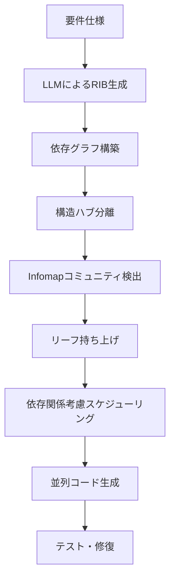

本記事は [https://arxiv.org/abs/2606.00953](https://arxiv.org/abs/2606.00953) の解説記事です。

## 論文概要（Abstract）

マルチエージェントLLMシステムではタスクを複数のエージェントに分割して並列処理するが、エージェント間の通信コストが並列化のメリットを相殺する場合がある。本論文はこのトレードオフをグラフ分割問題として定式化し、凝集度（cohesion）に基づくタスク分割手法**Co-Coder**を提案している。著者らは、静的解析によるファイル依存グラフの構築、構造ハブの分離、Infomapコミュニティ検出による分割、依存関係を考慮したスケジューリングを組み合わせることで、逐次処理と比較してパス率を最大14.0ポイント向上させ、最大2.10倍の実行速度向上と最大35%のAPIコスト削減を達成したと報告している。

この記事は [Zenn記事: Claude Code×git worktreeで並列コーディング環境を構築しセッション分離とAGENTS.mdを最適化する](https://zenn.dev/0h_n0/articles/28308f8faf9cdf) の深掘りです。

## 情報源

- **arXiv ID**: 2606.00953
- **URL**: [https://arxiv.org/abs/2606.00953](https://arxiv.org/abs/2606.00953)
- **著者**: Xu Yang, Lunyiu Nie, Ethan Chandra, Stanislav Gannutin, Fangru Lin, Swarat Chaudhuri（テキサス大学オースティン校、オックスフォード大学）
- **発表年**: 2026
- **分野**: cs.LG, cs.MA
- **コード**: [https://github.com/Flitternie/CoCoder](https://github.com/Flitternie/CoCoder)

## 背景と動機（Background & Motivation）

Claude Codeの`-w`フラグやgit worktreeを使った並列コーディングが普及する中、「タスクをどう分割すれば並列化が有効になるのか」という問いは実践上重要である。Zenn記事で述べたように、同一モジュールの2機能を並列で開発するとマージコンフリクトが頻発する一方、フロントエンドとバックエンドの分離は効果的である。

著者らはこの現象を理論的に分析し、以下の課題を指摘している：

- 単純なファイル単位の並列分割では、ファイル間依存が多い場合にエージェント間通信のオーバーヘッドが増大する
- 逆に、すべてを1エージェントで逐次処理すると計算時間が線形に増加する
- 既存のマルチエージェントシステム（Claude Code Agent Teams等）は依存関係を明示的に考慮せずタスクを分配している

この問題に対し、著者らは古典的な分散タスクスケジューリング理論を応用し、通信コストと計算コストのトレードオフを最適化するアプローチを提案している。

## 主要な貢献（Key Contributions）

- **貢献1**: マルチエージェントシステムの通信・計算トレードオフをグラフ分割の目的関数として定式化（$T(P) = W(P) + \alpha \cdot C(P)$）
- **貢献2**: 凝集度に基づくCo-Coderの提案。静的解析による依存グラフ構築、構造ハブの分離、Infomapコミュニティ検出、依存関係考慮スケジューリングを統合
- **貢献3**: DevEval・CodeProjectEvalの計28タスクでの実証評価。逐次処理、ファイル並列、Claude Code Agent Teamsとの比較

## 技術的詳細（Technical Details）

### 問題定式化

著者らはタスクを有向グラフ $G = (V, E)$ としてモデル化している。各頂点 $v_i \in V$ はファイル単位のサブタスクであり、計算コスト $w_i$ を持つ。各辺 $(v_i, v_j) \in E$ はファイル間依存を表し、結合コスト $c_{ij}$ を持つ。

分割 $P$ は頂点を $K$ 個のエージェントグループに割り当てる写像である。以下の2つのコストを定義する：

**計算コスト** $W(P)$: スケジュールされたDAGのクリティカルパスのレイテンシ。同一グループ内のタスクは直列化される：

$$
W(P) = \max_{k=1}^{K} \sum_{v_i \in P_k} w_i + \text{serialization overhead}
$$

**通信コスト** $C(P)$: 分割境界をまたぐ辺の結合コストの総和：

$$
C(P) = \sum_{(v_i, v_j) \in E: P(v_i) \neq P(v_j)} c_{ij}
$$

最適化目的関数は以下の通りである：

$$
T(P) = W(P) + \alpha \cdot C(P)
$$

ここで、
- $W(P)$: クリティカルパス計算コスト
- $C(P)$: パーティション間通信コスト
- $\alpha > 0$: 通信コストの重みパラメータ
- $P$: 頂点（ファイル）からエージェントグループへの分割

### Repository Interface Blueprint（RIB）によるグラフ構築

著者らはLLMを用いて、要件仕様（プロダクトスペック、UML図等）からRepository Interface Blueprint（RIB）を生成する。RIBは各ファイルが定義するシンボル（クラス、型付き関数シグネチャ、定数）とインポート関係を列挙したものである。

辺の重みはシンボル共有に基づくコサイン類似度で算出される：

$$
c_{ij} = \gamma \cdot \frac{\mathbf{s}_i \cdot \mathbf{s}_j}{\|\mathbf{s}_i\| \|\mathbf{s}_j\|}
$$

ここで、
- $\mathbf{s}_i$: ファイル $i$ のシンボルベクトル（疎表現）
- $\gamma$: スケーリング係数
- ファイルが定義するシンボルは参照のみのシンボルよりも高い重みを持つ
- ビルトインやボイラープレートは除外

### 凝集度ベースの分割アルゴリズム

著者らのアルゴリズム（Algorithm 1）は3つのステップで構成される：

**ステップ1: 構造ハブの分離**

- **In-hub**（被参照度が高いユーティリティファイル）: 各in-hubを単独グループに分離し、クリティカルパスから除外する
- **Out-hub**（参照度が高い集約ファイル）: すべてのout-hubを1つの統合グループにまとめる

**ステップ2: Infomapコミュニティ検出**

残りのサブグラフに対し、Infomapアルゴリズムを適用する。Infomapはランダムウォークの2レベルマップ方程式の記述長を最小化するクラスタリング手法である：

$$
L(M) = q_{\curvearrowright} H(\mathcal{Q}) + \sum_{i=1}^{m} p_{\circlearrowright}^i H(\mathcal{P}^i)
$$

遷移確率は結合コスト $c_{ij}$ に比例し、マルコフ時間パラメータ $t$ がクラスタの粒度を制御する。

**ステップ3: リーフ頂点の持ち上げ（Latent Parallelism Exploitation）**

クラスタ内の依存先が1つのみでクラスタ内被依存ノードがないリーフ頂点について、以下の条件を満たす場合に単独グループに持ち上げる：

$$
\alpha \cdot c_{ij} < w_i
$$

これにより、通信コストの増分よりも並列化による計算コスト削減の方が大きい場合にのみ分離が行われる。



### 依存関係考慮スケジューリング

生成フェーズでは、ファイルは共有タスクリストに配置される。上流のファイルがすべて完了すると「ready」状態に遷移し、担当グループのエージェントが処理を開始する。グローバルなバリア同期は存在せず、貪欲リストスケジューリングで実行される。

テスト実行後、失敗したテストは該当グループに割り当てられ、修復フェーズが固定ラウンド数だけ繰り返される。

## 実装のポイント（Implementation）

著者らの実装はOpenHands SDK v1.11.4上に構築されており、gpt-5-miniモデルを使用している。実装上の注意点として：

- **RIB生成の品質**: LLMが生成するインターフェースブループリントの正確性が分割品質に直結する。型付きシグネチャの抽出精度が重要
- **Infomapのマルコフ時間パラメータ $t$**: 値が大きいほど少数の大きなクラスタが生成される。プロジェクト規模に応じた調整が必要
- **ハブ検出の閾値**: in-degree/out-degreeの閾値設定がハブ分離の品質を決定する
- **$\alpha$パラメータ**: 通信コストの重みは実験的に調整。依存密度の高いプロジェクトでは大きな値が適切

```python
from dataclasses import dataclass
from typing import dict

@dataclass
class FileNode:
    """依存グラフのファイルノード"""
    name: str
    symbols_defined: list[str]
    symbols_imported: list[str]
    weight: float  # インターフェースサイズに基づく計算コスト

def compute_edge_weight(
    node_i: FileNode,
    node_j: FileNode,
    gamma: float = 1.0
) -> float:
    """シンボル共有に基づく辺の重み計算

    Args:
        node_i: ファイルノードi
        node_j: ファイルノードj
        gamma: スケーリング係数

    Returns:
        コサイン類似度に基づく結合コスト
    """
    all_symbols = set(node_i.symbols_defined + node_i.symbols_imported +
                      node_j.symbols_defined + node_j.symbols_imported)

    vec_i = []
    vec_j = []
    for sym in all_symbols:
        # 定義シンボルは高重み、参照のみは低重み
        w_i = 2.0 if sym in node_i.symbols_defined else (
            1.0 if sym in node_i.symbols_imported else 0.0
        )
        w_j = 2.0 if sym in node_j.symbols_defined else (
            1.0 if sym in node_j.symbols_imported else 0.0
        )
        vec_i.append(w_i)
        vec_j.append(w_j)

    dot = sum(a * b for a, b in zip(vec_i, vec_j))
    norm_i = sum(a ** 2 for a in vec_i) ** 0.5
    norm_j = sum(b ** 2 for b in vec_j) ** 0.5

    if norm_i == 0 or norm_j == 0:
        return 0.0

    return gamma * dot / (norm_i * norm_j)
```

## Production Deployment Guide

### AWS実装パターン（コスト最適化重視）

Co-Coderのようなマルチエージェントコーディングシステムをプロダクション環境で運用する場合、トラフィック量に応じた構成が必要である。以下は2026年11月時点のAWS ap-northeast-1（東京）リージョン料金に基づく概算値である。

| 規模 | 月間リクエスト | 推奨構成 | 月額コスト | 主要サービス |
|------|--------------|---------|-----------|------------|
| **Small** | ~3,000 (100/日) | Serverless | $50-150 | Lambda + Bedrock + DynamoDB |
| **Medium** | ~30,000 (1,000/日) | Hybrid | $300-800 | Lambda + ECS Fargate + ElastiCache |
| **Large** | 300,000+ (10,000/日) | Container | $2,000-5,000 | EKS + Karpenter + EC2 Spot |

**Small構成の詳細**（月額$50-150）:
- **Lambda**: 1GB RAM, 60秒タイムアウト（$20/月）
- **Bedrock**: Claude 3.5 Haiku, Prompt Caching有効（$80/月）
- **DynamoDB**: On-Demand（$10/月）— RIBキャッシュとグラフ分割結果の保存
- **Step Functions**: ワークフローオーケストレーション（$5/月）

**Large構成の詳細**（月額$2,000-5,000）:
- **EKS**: コントロールプレーン（$72/月）
- **EC2 Spot Instances**: c5.2xlarge × 2-4台（平均$400/月、最大90%削減）
- **Bedrock Batch**: 50%割引活用（$2,000/月）
- **ElastiCache Redis**: 依存グラフキャッシュ（$50/月）

**コスト削減テクニック**:
- Spot Instances使用で最大90%削減（EKS + Karpenter）
- Bedrock Batch API使用で50%削減（非リアルタイム処理）
- Prompt Caching有効化で30-90%削減（RIB生成プロンプトの固定部分）
- 依存グラフのキャッシュでLLM呼び出し回数を削減

**コスト試算の注意事項**: 上記は2026年11月時点のAWS ap-northeast-1リージョン料金に基づく概算値です。実際のコストはトラフィックパターン、リージョン、バースト使用量により変動します。最新料金は [AWS料金計算ツール](https://calculator.aws/) で確認してください。

### Terraformインフラコード

**Small構成（Serverless）: Lambda + Bedrock + Step Functions**

```hcl
module "vpc" {
  source  = "terraform-aws-modules/vpc/aws"
  version = "~> 5.0"

  name = "cocoder-vpc"
  cidr = "10.0.0.0/16"
  azs  = ["ap-northeast-1a", "ap-northeast-1c"]
  private_subnets = ["10.0.1.0/24", "10.0.2.0/24"]

  enable_nat_gateway   = false
  enable_dns_hostnames = true
}

resource "aws_iam_role" "lambda_cocoder" {
  name = "lambda-cocoder-role"

  assume_role_policy = jsonencode({
    Version = "2012-10-17"
    Statement = [{
      Action    = "sts:AssumeRole"
      Effect    = "Allow"
      Principal = { Service = "lambda.amazonaws.com" }
    }]
  })
}

resource "aws_iam_role_policy" "bedrock_invoke" {
  role = aws_iam_role.lambda_cocoder.id
  policy = jsonencode({
    Version = "2012-10-17"
    Statement = [{
      Effect   = "Allow"
      Action   = ["bedrock:InvokeModel", "bedrock:InvokeModelWithResponseStream"]
      Resource = "arn:aws:bedrock:ap-northeast-1::foundation-model/anthropic.claude-3-5-haiku*"
    }]
  })
}

resource "aws_lambda_function" "graph_partitioner" {
  filename      = "graph_partitioner.zip"
  function_name = "cocoder-graph-partitioner"
  role          = aws_iam_role.lambda_cocoder.arn
  handler       = "index.handler"
  runtime       = "python3.12"
  timeout       = 120
  memory_size   = 1024

  environment {
    variables = {
      BEDROCK_MODEL_ID    = "anthropic.claude-3-5-haiku-20241022-v1:0"
      DYNAMODB_TABLE      = aws_dynamodb_table.graph_cache.name
      ENABLE_PROMPT_CACHE = "true"
    }
  }
}

resource "aws_dynamodb_table" "graph_cache" {
  name         = "cocoder-graph-cache"
  billing_mode = "PAY_PER_REQUEST"
  hash_key     = "repo_hash"

  attribute {
    name = "repo_hash"
    type = "S"
  }

  ttl {
    attribute_name = "expire_at"
    enabled        = true
  }
}

resource "aws_cloudwatch_metric_alarm" "lambda_cost" {
  alarm_name          = "cocoder-lambda-cost-spike"
  comparison_operator = "GreaterThanThreshold"
  evaluation_periods  = 1
  metric_name         = "Duration"
  namespace           = "AWS/Lambda"
  period              = 3600
  statistic           = "Sum"
  threshold           = 100000
  alarm_description   = "Lambda実行時間異常（コスト急増の可能性）"

  dimensions = {
    FunctionName = aws_lambda_function.graph_partitioner.function_name
  }
}
```

### 運用・監視設定

**CloudWatch Logs Insights クエリ**:

```sql
-- コスト異常検知: 1時間あたりのトークン使用量
fields @timestamp, model_id, input_tokens, output_tokens
| stats sum(input_tokens + output_tokens) as total_tokens by bin(1h)
| filter total_tokens > 100000

-- レイテンシ分析: P95, P99
fields @timestamp, duration_ms
| stats pct(duration_ms, 95) as p95, pct(duration_ms, 99) as p99 by bin(5m)
```

**CloudWatch アラーム**:

```python
import boto3

cloudwatch = boto3.client('cloudwatch')

cloudwatch.put_metric_alarm(
    AlarmName='cocoder-token-spike',
    ComparisonOperator='GreaterThanThreshold',
    EvaluationPeriods=1,
    MetricName='TokenUsage',
    Namespace='Custom/CoCoder',
    Period=3600,
    Statistic='Sum',
    Threshold=500000,
    ActionsEnabled=True,
    AlarmActions=['arn:aws:sns:ap-northeast-1:123456789:cost-alerts'],
    AlarmDescription='Co-Coderトークン使用量異常'
)
```

### コスト最適化チェックリスト

**アーキテクチャ選択**:
- [ ] ~100 req/日 → Lambda + Bedrock (Serverless) - $50-150/月
- [ ] ~1000 req/日 → ECS Fargate + Bedrock (Hybrid) - $300-800/月
- [ ] 10000+ req/日 → EKS + Spot Instances (Container) - $2,000-5,000/月

**リソース最適化**:
- [ ] EC2: Spot Instances優先（最大90%削減、Karpenter自動管理）
- [ ] Reserved Instances: 1年コミットで72%削減（予測可能な負荷）
- [ ] Lambda: メモリサイズ最適化（CloudWatch Insights分析）
- [ ] ECS/EKS: アイドルタイムのスケールダウン（夜間0台）

**LLMコスト削減**:
- [ ] Bedrock Batch API: 50%割引（非リアルタイム処理）
- [ ] Prompt Caching: 30-90%削減（RIB生成の固定プロンプト部分）
- [ ] モデル選択: Haiku（$0.25/MTok）で分割、Sonnet（$3/MTok）で生成
- [ ] トークン数制限: max_tokens設定で過剰生成防止
- [ ] 依存グラフキャッシュ: 同一リポジトリの再分割を回避

**監視・アラート**:
- [ ] AWS Budgets: 月額予算設定（80%で警告、100%でアラート）
- [ ] CloudWatch アラーム: トークン使用量スパイク検知
- [ ] Cost Anomaly Detection: 自動異常検知
- [ ] 日次コストレポート: SNS/Slackへ自動送信

**リソース管理**:
- [ ] 未使用リソース削除: Lambda Insights活用
- [ ] タグ戦略: 環境別（dev/staging/prod）でコスト可視化
- [ ] ライフサイクルポリシー: DynamoDBキャッシュ自動削除（30日TTL）
- [ ] 開発環境: 夜間停止設定

## 実験結果（Results）

著者らはDevEval（Pythonサブセット、10プロジェクト）とCodeProjectEval（18プロジェクト）の計28タスクで評価を実施している。

### DevEval（論文Table 1より）

| 手法 | パス率 | 実行時間(s) | APIコスト(USD) |
|------|--------|------------|---------------|
| Sequential | 56.8% | 800 (1x) | 0.25 (1x) |
| File-based Parallel | 57.7% | 806 (1.01x) | 0.36 (1.44x) |
| Claude Code w/ Agent Teams | 54.1% | 536 (0.67x) | 0.23 (0.92x) |
| **Co-Coder** | **68.1%** | **442 (0.55x)** | **0.18 (0.72x)** |

著者らによると、ファイル単位の単純並列は速度向上にほぼ寄与せず（1.01x）、コストが44%増加している。一方、Co-Coderは凝集度に基づく分割により、パス率を11.3ポイント改善しつつ、コストを28%削減している。

### CodeProjectEval（論文の結果セクションより）

| 手法 | パス率 | 実行時間(s) | APIコスト(USD) |
|------|--------|------------|---------------|
| Sequential | 20.1% | 2756 (1x) | 1.03 (1x) |
| File-based Parallel | 23.3% | 1771 (0.64x) | 1.65 (1.60x) |
| Claude Code w/ Agent Teams | 16.3% | 680 (0.25x) | 0.38 (0.37x) |
| **Co-Coder** | **34.1%** | **1315 (0.48x)** | **0.67 (0.65x)** |

より大規模なCodeProjectEvalでは、Co-Coderの優位性がさらに顕著になっている。著者らは、プロジェクトの辺密度（$|E|/|V|$）とCo-Coderの改善幅の間にPearson相関 $r = 0.65$、Spearman相関 $\rho = 0.60$（いずれも$p < 0.05$）の正の相関があると報告しており、依存関係が密なプロジェクトほどCo-Coderの効果が大きいことが示唆されている。

### Zenn記事との関連

Zenn記事で述べた「タスク分割の判断基準」において、ファイル依存度が並列セッションの効果を左右すると指摘した。Co-Coderの結果はこの知見を定量的に裏付けている。フロントエンドとバックエンドのように担当ディレクトリが明確に分離されたケース（低密度）では単純な並列でも効果がある一方、密結合なモジュールでは凝集度を考慮した分割が不可欠である。

## 実運用への応用（Practical Applications）

Co-Coderのグラフ分割アプローチは、git worktreeを使った並列開発に以下の示唆を与える：

- **タスク分割の自動化**: リポジトリの依存グラフを静的解析で構築し、worktreeごとの担当ファイルセットを自動決定できる可能性がある
- **ハブファイルの特別扱い**: 共有ユーティリティ（in-hub）を単独worktreeに配置し、他のworktreeから参照のみとする設計は、マージコンフリクト削減に有効
- **スケーリング判断**: 辺密度メトリクスにより、並列worktree数の適切な上限を自動推定できる可能性がある

ただし、著者らの評価は10-18プロジェクトの限定的なサンプルであり、大規模な産業プロジェクトでの効果は検証されていない。

## 関連研究（Related Work）

- **MASAI（arXiv 2024）**: ファイル単位でエージェントを分割するが、依存関係を考慮しない。著者らによると、SWE-Bench Liteで28.3%のパス率
- **HyperAgent（arXiv 2024）**: マルチエージェントでの自律的コード修正。SWE-Bench Verifiedで31.4%のパス率と報告されている
- **Claude Code Agent Teams**: 並列エージェント実行をサポートするが、タスク分割は自動的に行われ、依存グラフの明示的な最適化は行わない

## まとめと今後の展望

Co-Coderは、マルチエージェントコーディングにおけるタスク分割を通信・計算コストのトレードオフとして理論的に定式化し、凝集度に基づくグラフ分割で実用的な改善を達成したと報告されている。特に依存関係が密なプロジェクトでの効果が大きい点は、git worktreeを用いた並列開発の設計指針として参考になる。

今後の展望として、著者らはPython以外の言語（Rust、Java等、コンパイラフィードバックが豊富な静的型付き言語）への拡張を挙げている。また、結合がほぼ完全な場合にCo-Coderが単一グループに退化する制約も指摘されている。

## 参考文献

- **arXiv**: [https://arxiv.org/abs/2606.00953](https://arxiv.org/abs/2606.00953)
- **Code**: [https://github.com/Flitternie/CoCoder](https://github.com/Flitternie/CoCoder)
- **Related Zenn article**: [https://zenn.dev/0h_n0/articles/28308f8faf9cdf](https://zenn.dev/0h_n0/articles/28308f8faf9cdf)

---

:::message
この記事はAI（Claude Code）により自動生成されました。内容の正確性については原論文もご確認ください。
:::
